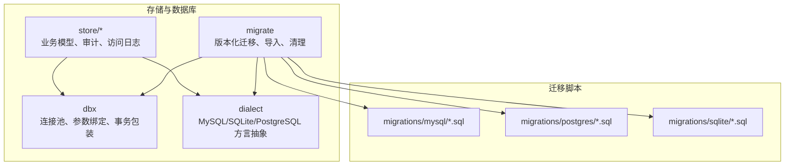
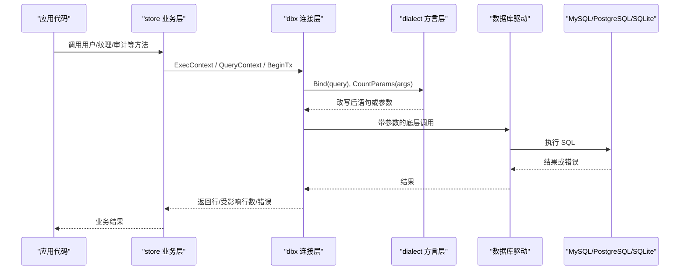
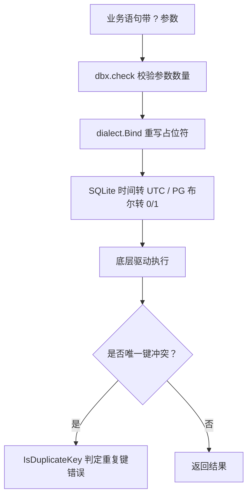
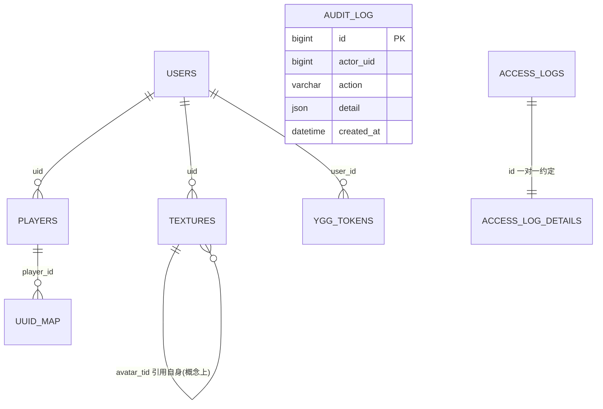
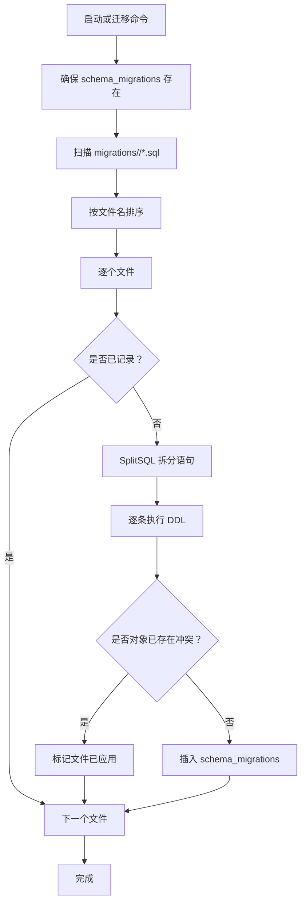
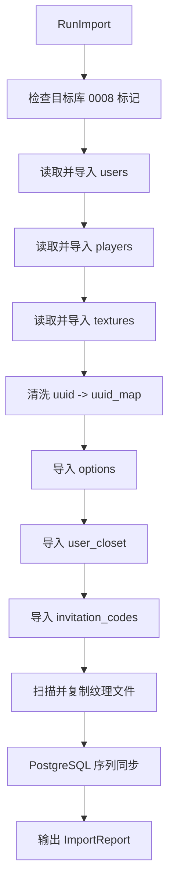
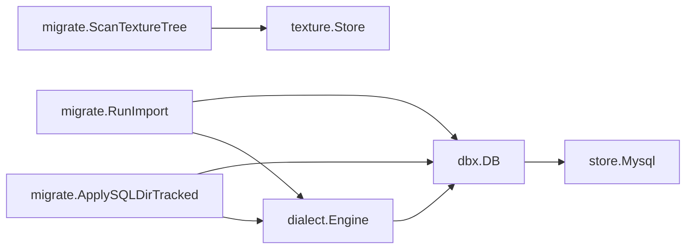

# 数据库与迁移

**本文引用的文件**
- [server/internal/store/schema.go](https://github.com/YimingZhanshen/skin-nexus/blob/797ae1a/server/internal/store/schema.go)
- [server/internal/dbx/dbx.go](https://github.com/YimingZhanshen/skin-nexus/blob/797ae1a/server/internal/dbx/dbx.go)
- [server/internal/dialect/dialect.go](https://github.com/YimingZhanshen/skin-nexus/blob/797ae1a/server/internal/dialect/dialect.go)
- [server/internal/migrate/tracked.go](https://github.com/YimingZhanshen/skin-nexus/blob/797ae1a/server/internal/migrate/tracked.go)
- [server/internal/migrate/sqldir.go](https://github.com/YimingZhanshen/skin-nexus/blob/797ae1a/server/internal/migrate/sqldir.go)
- [server/internal/migrate/scan.go](https://github.com/YimingZhanshen/skin-nexus/blob/797ae1a/server/internal/migrate/scan.go)
- [server/internal/migrate/import.go](https://github.com/YimingZhanshen/skin-nexus/blob/797ae1a/server/internal/migrate/import.go)
- [server/internal/migrate/clean.go](https://github.com/YimingZhanshen/skin-nexus/blob/797ae1a/server/internal/migrate/clean.go)
- [server/internal/store/audit.go](https://github.com/YimingZhanshen/skin-nexus/blob/797ae1a/server/internal/store/audit.go)
- [server/internal/store/accesslog.go](https://github.com/YimingZhanshen/skin-nexus/blob/797ae1a/server/internal/store/accesslog.go)
- [server/migrations/mysql/0001_init.sql](https://github.com/YimingZhanshen/skin-nexus/blob/797ae1a/server/migrations/mysql/0001_init.sql)
- [server/migrations/mysql/0002_web_sessions.sql](https://github.com/YimingZhanshen/skin-nexus/blob/797ae1a/server/migrations/mysql/0002_web_sessions.sql)
- [server/migrations/mysql/0003_oidc.sql](https://github.com/YimingZhanshen/skin-nexus/blob/797ae1a/server/migrations/mysql/0003_oidc.sql)
- [server/migrations/mysql/0004_union.sql](https://github.com/YimingZhanshen/skin-nexus/blob/797ae1a/server/migrations/mysql/0004_union.sql)
- [server/migrations/mysql/0005_user_flags.sql](https://github.com/YimingZhanshen/skin-nexus/blob/797ae1a/server/migrations/mysql/0005_user_flags.sql)
- [server/migrations/mysql/0008_legacy_preserve.sql](https://github.com/YimingZhanshen/skin-nexus/blob/797ae1a/server/migrations/mysql/0008_legacy_preserve.sql)
- [server/migrations/mysql/0011_access_logs.sql](https://github.com/YimingZhanshen/skin-nexus/blob/797ae1a/server/migrations/mysql/0011_access_logs.sql)
- [server/migrations/mysql/0029_access_log_details.sql](https://github.com/YimingZhanshen/skin-nexus/blob/797ae1a/server/migrations/mysql/0029_access_log_details.sql)

## 目录
1. [简介](#简介)
2. [项目结构](#项目结构)
3. [核心组件](#核心组件)
4. [架构总览](#架构总览)
5. [详细组件分析](#详细组件分析)
6. [依赖关系分析](#依赖关系分析)
7. [性能与容量特性](#性能与容量特性)
8. [故障排查指南](#故障排查指南)
9. [结论](#结论)
10. [附录：从 blessing-skin-server 迁移](#附录从-blessing-skinserver-迁移)

## 简介
本文件说明 SkinNexus 的数据库层、方言抽象、迁移系统以及从旧版 blessing-skin-server 的数据迁移流程。SkinNexus 支持 MySQL（含 MariaDB/TiDB）、PostgreSQL 和 SQLite 三种引擎；所有业务查询通过 `dbx` 连接池执行，并通过 `dialect` 层屏蔽 SQL 差异。迁移采用“每引擎独立树 + 版本化 SQL 文件”的模式，由 `schema_migrations` 元数据表记录已应用文件。

## 项目结构
数据库相关代码集中在 `server/internal` 下三个相邻包，DDL 按引擎分目录存放：

**图表来源**
- [server/internal/dbx/dbx.go:1-40](https://github.com/YimingZhanshen/skin-nexus/blob/797ae1a/server/internal/dbx/dbx.go#L1-L40)
- [server/internal/dialect/dialect.go:1-40](https://github.com/YimingZhanshen/skin-nexus/blob/797ae1a/server/internal/dialect/dialect.go#L1-L40)
- [server/internal/migrate/tracked.go:1-40](https://github.com/YimingZhanshen/skin-nexus/blob/797ae1a/server/internal/migrate/tracked.go#L1-L40)
- [server/migrations/mysql/0001_init.sql:1-10](https://github.com/YimingZhanshen/skin-nexus/blob/797ae1a/server/migrations/mysql/0001_init.sql#L1-L10)

**章节来源**
- [server/internal/dbx/dbx.go:1-40](https://github.com/YimingZhanshen/skin-nexus/blob/797ae1a/server/internal/dbx/dbx.go#L1-L40)
- [server/internal/dialect/dialect.go:1-40](https://github.com/YimingZhanshen/skin-nexus/blob/797ae1a/server/internal/dialect/dialect.go#L1-L40)
- [server/internal/migrate/tracked.go:1-40](https://github.com/YimingZhanshen/skin-nexus/blob/797ae1a/server/internal/migrate/tracked.go#L1-L40)

## 核心组件
- **dbx 连接层**：封装 `database/sql`，负责驱动选择、DSN 标准化、参数计数校验、占位符重写、SQLite UTC 归一化、布尔值转换、事务包装、重复键识别、生成主键读取等。
- **dialect 方言层**：定义支持的引擎集合、占位符绑定、大小写敏感比较、空值安全比较、Upsert、InsertIgnore、聚合函数、会话级锁、表存在检查、行级锁等跨引擎 API。
- **migrate 迁移层**：扫描并排序 SQL 文件、创建 `schema_migrations` 元数据表、逐文件执行、容忍“对象已存在”冲突、记录已应用文件、提供从 blessing-skin-server 的数据导入与清理能力。
- **store 业务模型**：基于 dbx 暴露用户、玩家、纹理、选项、通知、OIDC、Union、审计、访问日志等读写方法；同时提供安装检测与表存在探测。

**章节来源**
- [server/internal/dbx/dbx.go:1-120](https://github.com/YimingZhanshen/skin-nexus/blob/797ae1a/server/internal/dbx/dbx.go#L1-L120)
- [server/internal/dialect/dialect.go:1-120](https://github.com/YimingZhanshen/skin-nexus/blob/797ae1a/server/internal/dialect/dialect.go#L1-L120)
- [server/internal/migrate/tracked.go:1-120](https://github.com/YimingZhanshen/skin-nexus/blob/797ae1a/server/internal/migrate/tracked.go#L1-L120)
- [server/internal/store/schema.go:1-53](https://github.com/YimingZhanshen/skin-nexus/blob/797ae1a/server/internal/store/schema.go#L1-L53)

## 架构总览

**图表来源**
- [server/internal/dbx/dbx.go:60-120](https://github.com/YimingZhanshen/skin-nexus/blob/797ae1a/server/internal/dbx/dbx.go#L60-L120)
- [server/internal/dialect/dialect.go:80-160](https://github.com/YimingZhanshen/skin-nexus/blob/797ae1a/server/internal/dialect/dialect.go#L80-L160)

## 详细组件分析

### 引擎支持与选择策略
SkinNexus 支持以下引擎：

| 引擎 | 驱动名称 | 典型 DSN 前缀 | 默认行为 |
|---|---|---|---|
| MySQL / MariaDB / TiDB | mysql | 无 scheme 时默认 | 若未显式指定且 DSN 无法推断，则回退到 MySQL |
| PostgreSQL | pgx | postgres:// 或 postgresql:// | 将 `?` 占位符改写为 `$n` |
| SQLite | sqlite | sqlite: 或 file: | 使用内存或 WAL 文件数据库，强制外键开启 |

选择优先级如下：
1. 显式传入 engine 参数。
2. 从 DSN 前缀推断。
3. 无法推断时使用 MySQL（保持历史部署不变）。

SQLite 在内存模式下强制单连接；文件模式启用 WAL、busy_timeout、foreign_keys 和 NORMAL 同步策略。MySQL/PostgreSQL 设置最大连接数、空闲连接数和连接生命周期。

**章节来源**
- [server/internal/dialect/dialect.go:10-100](https://github.com/YimingZhanshen/skin-nexus/blob/797ae1a/server/internal/dialect/dialect.go#L10-L100)
- [server/internal/dbx/dbx.go:40-120](https://github.com/YimingZhanshen/skin-nexus/blob/797ae1a/server/internal/dbx/dbx.go#L40-L120)
- [server/internal/dbx/dbx.go:280-391](https://github.com/YimingZhanshen/skin-nexus/blob/797ae1a/server/internal/dbx/dbx.go#L280-L391)

### dbx 与 dialect 如何屏蔽方言差异
- **占位符重写**：所有查询统一使用 `?`；仅 PostgreSQL 被改写为 `$n`。
- **参数数量校验**：在执行前统计 `?` 或 `$n` 数量并与 Go 参数列表对比，避免 SQLite 静默忽略多余参数导致的逻辑错误。
- **SQLite 时间归一化**：写入 SQLite 时将 `time.Time`、`*time.Time`、`sql.NullTime` 统一转为 UTC，使字符串比较具备时间语义。
- **PostgreSQL 布尔转换**：Go 的 `bool` 被转换为 0/1，因为 pgx 不会把 bool 编码成 smallint。
- **跨引擎 Upsert / InsertIgnore**：MySQL 用 `ON DUPLICATE KEY UPDATE` 或 `INSERT IGNORE`；SQLite 和 PostgreSQL 用 `ON CONFLICT DO NOTHING` 或 `DO UPDATE SET`。
- **空值安全比较**：MySQL 使用 `<=>`，SQLite 使用 `IS`，PostgreSQL 使用 `NOT ... IS DISTINCT FROM`。
- **会话锁与行锁**：MySQL 使用 `GET_LOCK`/`RELEASE_LOCK`，PostgreSQL 使用 advisory lock，SQLite 不提供分布式锁但进程内串行。
- **表存在检查**：分别查询 `information_schema`、`sqlite_master` 或当前 schema。

**图表来源**
- [server/internal/dbx/dbx.go:120-220](https://github.com/YimingZhanshen/skin-nexus/blob/797ae1a/server/internal/dbx/dbx.go#L120-L220)
- [server/internal/dbx/dbx.go:391-424](https://github.com/YimingZhanshen/skin-nexus/blob/797ae1a/server/internal/dbx/dbx.go#L391-L424)
- [server/internal/dialect/dialect.go:100-220](https://github.com/YimingZhanshen/skin-nexus/blob/797ae1a/server/internal/dialect/dialect.go#L100-L220)

**章节来源**
- [server/internal/dbx/dbx.go:120-220](https://github.com/YimingZhanshen/skin-nexus/blob/797ae1a/server/internal/dbx/dbx.go#L120-L220)
- [server/internal/dialect/dialect.go:100-220](https://github.com/YimingZhanshen/skin-nexus/blob/797ae1a/server/internal/dialect/dialect.go#L100-L220)

### 核心表结构与实体关系
以下表来自各引擎迁移树中的初始化及后续迁移文件。列含义以迁移注释和 store 实现为准。

#### users（账户）
| 字段 | 类型与约束 | 业务含义 |
|---|---|---|
| id | 自增主键 | 账户 ID，迁移时保留原 blessing-skin-server uid |
| email | 唯一索引 | 登录邮箱，迁移阶段需处理大小写折叠冲突 |
| nickname | 唯一索引 | 显示昵称，迁移阶段需处理大小写折叠冲突 |
| password | 非空 | 原始哈希值，懒重新散列前标记为 legacy |
| password_algo | 非空 | 密码算法族，例如 legacy:bcrypt、legacy:argon2、legacy |
| player_limit | 非空默认 3 | 允许创建的玩家数量下限 |
| ip | 可选 | 注册 IP |
| avatar_tid | 可选 | 头像纹理 ID，指向 textures.id |
| created_at / updated_at | UTC 时间戳 | 创建与更新时间 |
| email_verified | 非空默认 0 | 邮箱验证状态 |
| can_join_server | 非空默认 1 | 是否允许加入服务器 |
| score | 非空默认 0 | 保留旧平台分数 |
| locale | 可选 | 语言区域 |
| is_dark_mode | 非空默认 0 | 深色模式偏好 |
| permission | 非空默认 0 | 权限标志，负值表示封禁 |
| last_sign_at | 可选 | 上次签到时间 |
| verification_token | 非空默认空串 | 邮件验证令牌 |

#### players（玩家皮肤角色）
| 字段 | 类型与约束 | 业务含义 |
|---|---|---|
| id | 自增主键 | 玩家 ID |
| uid | 外键引用 users.id | 所属账户 |
| name | 唯一索引 | Minecraft 用户名，大小写保留但去重比较按大小写不敏感规则处理 |
| tid_skin / tid_cape | 可选 | 皮肤/披风纹理 ID，迁移时 -1/0 转为 NULL |
| preference | 可选 | 遗留字段，用于映射 |
| created_at / updated_at | UTC 时间戳 | 创建与更新时间 |

#### textures（纹理）
| 字段 | 类型与约束 | 业务含义 |
|---|---|---|
| id | 自增主键 | 纹理 ID |
| uid | 非空 | 上传账户 ID |
| type | 枚举 skin/cape | 类型，steve/alex/cape 迁移时映射 |
| hash | 索引 | SHA-256 十六进制文件名 |
| model | 可选 default/slim | 经典或 slim 人物模型 |
| description | 可选 | 描述文本 |
| upload_at | UTC 时间戳 | 上传时间 |
| public | 非空默认公开 | 保留旧平台私有/公开状态 |

#### uuid_map（离线玩家 UUID 映射）
| 字段 | 类型与约束 | 业务含义 |
|---|---|---|
| name | 主键 | 玩家名 |
| uuid | 唯一索引 | 32 位小写十六进制 UUID |
| player_id | 可选索引 | 关联的 players.id |

#### options（站点配置）
| 字段 | 类型与约束 | 业务含义 |
|---|---|---|
| k | 主键 | 配置键 |
| v | 文本 | 配置值 |

#### ygg_tokens（Yggdrasil 令牌）
| 字段 | 类型与约束 | 业务含义 |
|---|---|---|
| id | 自增主键 | 令牌记录 |
| user_id | 索引 | 账户 ID |
| client_token / access_token | 唯一索引 | Yggdrasil 客户端令牌与访问令牌 |
| selected_pid | 可选 | 选中的玩家 |
| created_at / expires_at | UTC 时间戳 | 创建与过期时间 |
| invalidated | 非空默认关闭 | 是否失效 |

#### ygg_join_sessions（Yggdrasil 登录会话）
| 字段 | 类型与约束 | 业务含义 |
|---|---|---|
| id | 自增主键 | 会话 ID |
| access_token | 索引 | 访问令牌 |
| uuid | 非空 | 32 位 UUID |
| server_id / server_ip | 可选 | 服务器标识与地址 |
| created_at / expires_at | UTC 时间戳 | TTL 约 120 秒 |

#### web_sessions（Web 会话）
| 字段 | 类型与约束 | 业务含义 |
|---|---|---|
| token | 主键 | Cookie 中携带的会话令牌 |
| user_id | 索引 | 账户 ID |
| created_at / expires_at | UTC 时间戳 | Web 会话生命周期 |

#### oidc_*（OIDC 提供方）
- oidc_clients：OAuth 客户端、重定向地址、授权范围、公开客户端标志。
- oidc_auth_requests：授权码流程状态、PKCE challenge、code 唯一索引。
- oidc_access_tokens：JWT jti 账本、撤销时间。
- oidc_refresh_tokens：刷新令牌、轮换时旧行标记撤销。
- oidc_device_auth：设备授权码流程、user_code 唯一性。

#### union_kv（Union 扩展键值）
| 字段 | 类型与约束 | 业务含义 |
|---|---|---|
| k | 主键 | Union 子系统键 |
| v | 可选文本 | 值 |
| updated_at | 自动更新 | 最近更新时间 |

#### audit_log（审计日志）
| 字段 | 类型与约束 | 业务含义 |
|---|---|---|
| id | 自增主键 | 审计事件 ID |
| actor_uid | 可选索引 | 操作者账户；NULL 表示系统或 Union 事件 |
| action | 索引 | 动作名称 |
| detail | JSON | 结构化详情 |
| created_at | UTC 时间戳 | 审计时间 |

#### access_logs（访问日志摘要）
| 字段 | 类型与约束 | 业务含义 |
|---|---|---|
| id | 自增主键 | 日志摘要 ID |
| kind/outcome | 枚举字段 | 请求类别与结果 |
| uid/who/ip/ua/detail | 观察字段 | 用户、身份、IP、UA、截断详情 |
| created_at | 索引 | 用于保留期清理与分页 |

#### access_log_details（访问日志明细）
| 字段 | 类型与约束 | 业务含义 |
|---|---|---|
| id | 主键，与 access_logs.id 同值 | 明细关联摘要行 |
| status_code / duration_ms | 数值 | HTTP 响应状态与耗时 |
| upstream_code / headers_json / body_excerpt | 可选 | 上游响应片段 |
| credential_ref / credentials_until | 可选 | 凭据引用与短期保留截止时间 |
| captured_at | 索引 | 捕获时间 |

**图表来源**
- [server/migrations/mysql/0001_init.sql:1-103](https://github.com/YimingZhanshen/skin-nexus/blob/797ae1a/server/migrations/mysql/0001_init.sql#L1-L103)
- [server/migrations/mysql/0002_web_sessions.sql:1-9](https://github.com/YimingZhanshen/skin-nexus/blob/797ae1a/server/migrations/mysql/0002_web_sessions.sql#L1-L9)
- [server/migrations/mysql/0003_oidc.sql:1-91](https://github.com/YimingZhanshen/skin-nexus/blob/797ae1a/server/migrations/mysql/0003_oidc.sql#L1-L91)
- [server/migrations/mysql/0004_union.sql:1-20](https://github.com/YimingZhanshen/skin-nexus/blob/797ae1a/server/migrations/mysql/0004_union.sql#L1-L20)
- [server/migrations/mysql/0011_access_logs.sql:1-24](https://github.com/YimingZhanshen/skin-nexus/blob/797ae1a/server/migrations/mysql/0011_access_logs.sql#L1-L24)
- [server/migrations/mysql/0029_access_log_details.sql:1-31](https://github.com/YimingZhanshen/skin-nexus/blob/797ae1a/server/migrations/mysql/0029_access_log_details.sql#L1-L31)

**章节来源**
- [server/migrations/mysql/0001_init.sql:1-103](https://github.com/YimingZhanshen/skin-nexus/blob/797ae1a/server/migrations/mysql/0001_init.sql#L1-L103)
- [server/migrations/mysql/0002_web_sessions.sql:1-9](https://github.com/YimingZhanshen/skin-nexus/blob/797ae1a/server/migrations/mysql/0002_web_sessions.sql#L1-L9)
- [server/migrations/mysql/0003_oidc.sql:1-91](https://github.com/YimingZhanshen/skin-nexus/blob/797ae1a/server/migrations/mysql/0003_oidc.sql#L1-L91)
- [server/migrations/mysql/0004_union.sql:1-20](https://github.com/YimingZhanshen/skin-nexus/blob/797ae1a/server/migrations/mysql/0004_union.sql#L1-L20)
- [server/migrations/mysql/0005_user_flags.sql:1-19](https://github.com/YimingZhanshen/skin-nexus/blob/797ae1a/server/migrations/mysql/0005_user_flags.sql#L1-L19)
- [server/migrations/mysql/0008_legacy_preserve.sql:1-13](https://github.com/YimingZhanshen/skin-nexus/blob/797ae1a/server/migrations/mysql/0008_legacy_preserve.sql#L1-L13)
- [server/migrations/mysql/0011_access_logs.sql:1-24](https://github.com/YimingZhanshen/skin-nexus/blob/797ae1a/server/migrations/mysql/0011_access_logs.sql#L1-L24)
- [server/migrations/mysql/0029_access_log_details.sql:1-31](https://github.com/YimingZhanshen/skin-nexus/blob/797ae1a/server/migrations/mysql/0029_access_log_details.sql#L1-L31)

### 迁移系统：tracked 元数据与版本化 SQL
迁移系统采用“每引擎独立目录”布局：`migrations/<engine>/<NNNN_*.sql>`。运行时由 `ApplySQLDirTracked` 完成以下流程：

1. 确保 `schema_migrations` 元数据表存在，并为旧库添加 engine 列。
2. 禁止对已由其他引擎迁移过的数据库再次应用不同引擎的迁移树。
3. 按文件名排序扫描目标引擎目录下所有 `.sql`。
4. 跳过已在 `schema_migrations` 中记录的文件。
5. 按行分割 SQL，去除整行注释。
6. 执行每条语句；遇到“对象已存在”的 DDL 冲突视为幂等，仍标记文件已应用。
7. 其他错误直接失败。
8. 成功后插入该文件名记录。

**图表来源**
- [server/internal/migrate/tracked.go:40-160](https://github.com/YimingZhanshen/skin-nexus/blob/797ae1a/server/internal/migrate/tracked.go#L40-L160)
- [server/internal/migrate/sqldir.go:1-33](https://github.com/YimingZhanshen/skin-nexus/blob/797ae1a/server/internal/migrate/sqldir.go#L1-L33)

**章节来源**
- [server/internal/migrate/tracked.go:1-210](https://github.com/YimingZhanshen/skin-nexus/blob/797ae1a/server/internal/migrate/tracked.go#L1-L210)
- [server/internal/migrate/sqldir.go:1-33](https://github.com/YimingZhanshen/skin-nexus/blob/797ae1a/server/internal/migrate/sqldir.go#L1-L33)

### 从 blessing-skin-server 迁移的实际步骤
迁移分为两个层面：**数据库结构迁移**和**数据导入**。

#### 结构迁移
1. 先让目标 SkinNexus 实例完成一次正常启动，使 `SKIN_AUTO_MIGRATE` 应用所有 NNNN_*.sql 文件。
2. 确认目标库已包含 `0008_legacy_preserve.sql` 的记录，否则导入器会认为目标结构尚未就绪。
3. 如果目标库已有 `schema_migrations` 但 engine 列缺失，迁移框架会自动补列并回填默认值。

#### 数据对齐与字段映射
- **users**：保留 uid、email、nickname、password、ip、avatar、register_at、verified、score、locale、is_dark_mode、permission、last_sign_at、verification_token。密码按哈希族分类为 legacy:bcrypt、legacy:argon2 或 legacy。permission 负值被视为封禁。player_limit 至少设为 3。
- **players**：保留 pid、uid、name、tid_skin、tid_cape、last_modified；-1/0 纹理引用转为 NULL。
- **textures**：legacyType steve/alex/cape 映射为 skin(default/slim)/cape；description 映射为 description；public 字段保留。
- **uuid_map**：经过五步清洗：按 name 去重、按 uuid 去重、按玩家名回填 player_id、删除孤儿、最终由目标唯一键保证一致性。
- **options**：按 key 保留首条，跳过超长 value。
- **user_closet**：按 (user_uid, texture_tid, item_name) 精确重复判断，MySQL 端使用二进制比较保证 Hat 与 hat 不冲突。
- **invitation_codes**：保留 id、code、generated_at、used_by、used_at、description。
- **纹理文件**：扫描 legacy textures 目录，校验文件名等于字节内容 SHA-256，再原样存入新存储。

**图表来源**
- [server/internal/migrate/import.go:40-120](https://github.com/YimingZhanshen/skin-nexus/blob/797ae1a/server/internal/migrate/import.go#L40-L120)
- [server/internal/migrate/import.go:200-658](https://github.com/YimingZhanshen/skin-nexus/blob/797ae1a/server/internal/migrate/import.go#L200-L658)
- [server/internal/migrate/clean.go:1-122](https://github.com/YimingZhanshen/skin-nexus/blob/797ae1a/server/internal/migrate/clean.go#L1-L122)
- [server/internal/migrate/scan.go:1-81](https://github.com/YimingZhanshen/skin-nexus/blob/797ae1a/server/internal/migrate/scan.go#L1-L81)

**章节来源**
- [server/internal/migrate/import.go:40-120](https://github.com/YimingZhanshen/skin-nexus/blob/797ae1a/server/internal/migrate/import.go#L40-L120)
- [server/internal/migrate/import.go:200-658](https://github.com/YimingZhanshen/skin-nexus/blob/797ae1a/server/internal/migrate/import.go#L200-L658)
- [server/internal/migrate/clean.go:1-122](https://github.com/YimingZhanshen/skin-nexus/blob/797ae1a/server/internal/migrate/clean.go#L1-L122)
- [server/internal/migrate/scan.go:1-81](https://github.com/YimingZhanshen/skin-nexus/blob/797ae1a/server/internal/migrate/scan.go#L1-L81)

### 事务、会话、审计日志与访问明细
- **事务**：dbx 提供 `BeginTx`，事务对象同样重写占位符并复用参数校验；生成主键读取也区分 MySQL 与其他引擎。
- **会话**：web_sessions 保存 Web 登录会话；ygg_join_sessions 保存 Yggdrasil 短生命周期登录会话；oidc_* 表保存 OIDC 授权流程、访问令牌与刷新令牌。
- **审计日志**：audit_log 记录管理员操作、Union 事件和系统行为，actor_uid 为 NULL 时表示系统来源；detail 为 JSON。
- **访问日志**：access_logs 记录可观测流量摘要；access_log_details 记录诊断所需的状态码、耗时、头部和响应片段。二者通过 id 一对一关联，明细表没有物理外键，依靠约定和保留策略分离。

**章节来源**
- [server/internal/dbx/dbx.go:160-220](https://github.com/YimingZhanshen/skin-nexus/blob/797ae1a/server/internal/dbx/dbx.go#L160-L220)
- [server/internal/dbx/dbx.go:391-424](https://github.com/YimingZhanshen/skin-nexus/blob/797ae1a/server/internal/dbx/dbx.go#L391-L424)
- [server/migrations/mysql/0002_web_sessions.sql:1-9](https://github.com/YimingZhanshen/skin-nexus/blob/797ae1a/server/migrations/mysql/0002_web_sessions.sql#L1-L9)
- [server/migrations/mysql/0003_oidc.sql:1-91](https://github.com/YimingZhanshen/skin-nexus/blob/797ae1a/server/migrations/mysql/0003_oidc.sql#L1-L91)
- [server/internal/store/audit.go:1-128](https://github.com/YimingZhanshen/skin-nexus/blob/797ae1a/server/internal/store/audit.go#L1-L128)
- [server/internal/store/accesslog.go:1-131](https://github.com/YimingZhanshen/skin-nexus/blob/797ae1a/server/internal/store/accesslog.go#L1-L131)
- [server/migrations/mysql/0011_access_logs.sql:1-24](https://github.com/YimingZhanshen/skin-nexus/blob/797ae1a/server/migrations/mysql/0011_access_logs.sql#L1-L24)
- [server/migrations/mysql/0029_access_log_details.sql:1-31](https://github.com/YimingZhanshen/skin-nexus/blob/797ae1a/server/migrations/mysql/0029_access_log_details.sql#L1-L31)

## 依赖关系分析

**图表来源**
- [server/internal/dialect/dialect.go:1-120](https://github.com/YimingZhanshen/skin-nexus/blob/797ae1a/server/internal/dialect/dialect.go#L1-L120)
- [server/internal/dbx/dbx.go:1-120](https://github.com/YimingZhanshen/skin-nexus/blob/797ae1a/server/internal/dbx/dbx.go#L1-L120)
- [server/internal/migrate/tracked.go:1-120](https://github.com/YimingZhanshen/skin-nexus/blob/797ae1a/server/internal/migrate/tracked.go#L1-L120)
- [server/internal/migrate/import.go:1-120](https://github.com/YimingZhanshen/skin-nexus/blob/797ae1a/server/internal/migrate/import.go#L1-L120)
- [server/internal/migrate/scan.go:1-81](https://github.com/YimingZhanshen/skin-nexus/blob/797ae1a/server/internal/migrate/scan.go#L1-L81)

**章节来源**
- [server/internal/dialect/dialect.go:1-120](https://github.com/YimingZhanshen/skin-nexus/blob/797ae1a/server/internal/dialect/dialect.go#L1-L120)
- [server/internal/dbx/dbx.go:1-120](https://github.com/YimingZhanshen/skin-nexus/blob/797ae1a/server/internal/dbx/dbx.go#L1-L120)
- [server/internal/migrate/tracked.go:1-120](https://github.com/YimingZhanshen/skin-nexus/blob/797ae1a/server/internal/migrate/tracked.go#L1-L120)
- [server/internal/migrate/import.go:1-120](https://github.com/YimingZhanshen/skin-nexus/blob/797ae1a/server/internal/migrate/import.go#L1-L120)

## 性能与容量特性
- **连接池**：MySQL 与 PostgreSQL 默认最大打开连接数为 24，空闲连接 8，连接生命周期 30 分钟；SQLite 文件模式最多 4 个连接，内存模式 1 个。
- **SQLite 并发**：WAL 允许读多写少场景并发读取；busy_timeout 将写锁竞争转为等待；`_pragma=synchronous(NORMAL)` 平衡持久性与性能。
- **访问日志保留**：access_logs 通过保留期清理，默认按 90 天窗口删除；access_log_details 区分凭据保留截止时间和捕获时间，避免长期留存敏感信息。
- **索引设计**：users/email/nickname、players/name+uid、textures/hash+uid/type、uuid_map/uuid、access_logs/created_at 等索引支撑唯一性、查找与分页。
- **UID 生成**：MySQL 使用 LastInsertId；PostgreSQL 和 SQLite 使用 RETURNING id。导入完成后 PostgreSQL 需要手动同步序列，防止下一次自动生成主键冲突。

**章节来源**
- [server/internal/dbx/dbx.go:280-391](https://github.com/YimingZhanshen/skin-nexus/blob/797ae1a/server/internal/dbx/dbx.go#L280-L391)
- [server/internal/store/accesslog.go:80-131](https://github.com/YimingZhanshen/skin-nexus/blob/797ae1a/server/internal/store/accesslog.go#L80-L131)
- [server/migrations/mysql/0001_init.sql:1-103](https://github.com/YimingZhanshen/skin-nexus/blob/797ae1a/server/migrations/mysql/0001_init.sql#L1-L103)
- [server/migrations/mysql/0011_access_logs.sql:1-24](https://github.com/YimingZhanshen/skin-nexus/blob/797ae1a/server/migrations/mysql/0011_access_logs.sql#L1-L24)
- [server/migrations/mysql/0029_access_log_details.sql:1-31](https://github.com/YimingZhanshen/skin-nexus/blob/797ae1a/server/migrations/mysql/0029_access_log_details.sql#L1-L31)
- [server/internal/migrate/import.go:600-658](https://github.com/YimingZhanshen/skin-nexus/blob/797ae1a/server/internal/migrate/import.go#L600-L658)

## 故障排查指南

### 常见迁移失败原因与修复
| 现象 | 可能原因 | 修复方案 |
|---|---|---|
| 启动时报“数据库由另一个引擎迁移过” | schema_migrations 中已有不同 engine 记录 | 确认连接指向正确的 MySQL/PostgreSQL/SQLite 数据库；不要混用迁移树 |
| 重复执行迁移却报错 | SQL 文件不是幂等的 DDL，或使用了不允许的数据写入语句 | 只允许幂等 DDL；如需回填数据，应改为可证明二遍运行无副作用的语句或放入 Go 代码 |
| 迁移成功但目标表缺少列 | 目标库未先完成 SKIN_AUTO_MIGRATE 导致结构迁移未应用 | 先启动一次目标服务，再运行导入 |
| 导入 users 时 email/nickname 冲突 | 目标库有大小写不敏感唯一键，而旧库没有 | 在导入前清理或合并冲突记录；dry-run 报告 skipped 必须为零 |
| 导入 players 时报 name 长度问题 | 旧玩家名超过 16 字符 | 手动缩短或改名后再导入 |
| user_closet 导入出现大小写重复 | MySQL 默认 collation 对文本大小写不敏感 | 导入器已针对 MySQL 使用二进制比较；若仍异常，检查 collation 配置 |
| PostgreSQL 导入后新用户 id=1 冲突 | 导入时显式写入 id，PG 序列未同步 | 导入完成后由 resyncSequences 自动同步；若手动导入，需执行序列同步 |
| SQLite 时间比较异常 | 时间值包含时区字符串，被当作文本比较 | dbx 已强制 SQLite 参数 UTC；检查是否绕过 dbx 直接写入 |
| Postgres 布尔写入失败 | Go bool 被传给 smallint 列 | dbx.args 已将 bool 转为 0/1；若自定义 SQL，请遵循此约定 |
| 重复键错误未被业务层识别 | 错误来自单一引擎分支 | 使用 dbx.IsDuplicateKey 统一判断 |

### 事务与会话注意事项
- 直接调用 `sql.DB` 会绕过 dbx 的参数重写层，因此除迁移元数据探测和特殊隔离级别需求外，不应直接使用。
- 访问日志的主表与明细表通过 id 一对一关联，明细写入失败不得影响摘要写入。
- 审计日志写入失败应降级为字符串详情或忽略，不能中断业务流。

**章节来源**
- [server/internal/migrate/tracked.go:40-210](https://github.com/YimingZhanshen/skin-nexus/blob/797ae1a/server/internal/migrate/tracked.go#L40-L210)
- [server/internal/migrate/import.go:40-120](https://github.com/YimingZhanshen/skin-nexus/blob/797ae1a/server/internal/migrate/import.go#L40-L120)
- [server/internal/dbx/dbx.go:120-220](https://github.com/YimingZhanshen/skin-nexus/blob/797ae1a/server/internal/dbx/dbx.go#L120-L220)
- [server/internal/dbx/dbx.go:391-424](https://github.com/YimingZhanshen/skin-nexus/blob/797ae1a/server/internal/dbx/dbx.go#L391-L424)
- [server/internal/store/accesslog.go:20-80](https://github.com/YimingZhanshen/skin-nexus/blob/797ae1a/server/internal/store/accesslog.go#L20-L80)
- [server/internal/store/audit.go:1-60](https://github.com/YimingZhanshen/skin-nexus/blob/797ae1a/server/internal/store/audit.go#L1-L60)

## 结论
SkinNexus 的数据库层通过 dbx 和 dialect 两层抽象，把 MySQL、PostgreSQL、SQLite 的差异收敛到最小边界：占位符、布尔、时间、Upsert、InsertIgnore、锁、版本查询、表存在检查都由方言层表达，业务层继续面向统一的接口。迁移系统以每引擎独立 SQL 树配合 schema_migrations 元数据表实现幂等、可审计的版本演进；blessing-skin-server 迁移则强调 ID 保留、字段映射、唯一键冲突预检和纹理文件完整性校验。运维侧应重视访问日志与审计日志的分层保留策略，并在导入后检查 PostgreSQL 序列、SQLite WAL 行为和 MySQL collation。

## 附录：从 blessing-skin-server 迁移
推荐操作流程如下：

1. **备份旧库与纹理目录**
   备份 blessing-skin-server 使用的数据库和 TEXTURES_DIR。

2. **准备目标 SkinNexus 数据库**
   启动一次目标服务，确保 `SKIN_AUTO_MIGRATE` 应用全部迁移文件，并确认 `0008_legacy_preserve.sql` 已记录。

3. **运行 dry-run**
   使用导入工具的干跑模式，检查 users、players、textures、uuid_map、options、user_closet、invitation_codes 的选择数、插入数、跳过数和警告项。

4. **处理警告**
   - users：email/nickname 大小写冲突必须清零。
   - players：name 长度不超过 16。
   - textures：unknown legacy type 需人工确认。
   - options：value 超过 64KiB 会被跳过。
   - user_closet：确认 MySQL 二进制比较生效。

5. **执行真实导入**
   一次性导入数据库行和纹理文件；PostgreSQL 会自动同步序列。

6. **验证关键数据**
   - users.password_algo 是否正确分类。
   - textures.type/model/public 是否与旧站一致。
   - uuid_map.uuid 是否为 32 位小写十六进制。
   - players.name 是否保留大小写但唯一。
   - options 中 operator 修改的配置是否优先于旧值。

7. **切换流量并观察**
   观察审计日志、访问日志、邮件失败计数和 OIDC/Yggdrasil 登录流程。

8. **归档旧系统**
   在确认业务稳定后，归档 blessing-skin-server 的数据库快照和纹理目录；保留至少一个不可变副本。

9. **定期维护**
   - 清理旧 access_logs 和 access_log_details。
   - 监控 schema_migrations 增长。
   - 定期检查 SQLite WAL 大小与 PostgreSQL 序列偏移。
   - 对大表进行备份恢复演练。

**章节来源**
- [server/internal/migrate/import.go:40-120](https://github.com/YimingZhanshen/skin-nexus/blob/797ae1a/server/internal/migrate/import.go#L40-L120)
- [server/internal/migrate/import.go:200-658](https://github.com/YimingZhanshen/skin-nexus/blob/797ae1a/server/internal/migrate/import.go#L200-L658)
- [server/internal/migrate/scan.go:1-81](https://github.com/YimingZhanshen/skin-nexus/blob/797ae1a/server/internal/migrate/scan.go#L1-L81)
- [server/internal/migrate/clean.go:1-122](https://github.com/YimingZhanshen/skin-nexus/blob/797ae1a/server/internal/migrate/clean.go#L1-L122)
- [server/internal/store/accesslog.go:80-131](https://github.com/YimingZhanshen/skin-nexus/blob/797ae1a/server/internal/store/accesslog.go#L80-L131)
- [server/migrations/mysql/0008_legacy_preserve.sql:1-13](https://github.com/YimingZhanshen/skin-nexus/blob/797ae1a/server/migrations/mysql/0008_legacy_preserve.sql#L1-L13)
