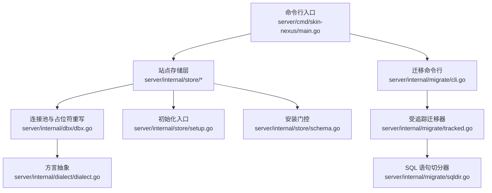
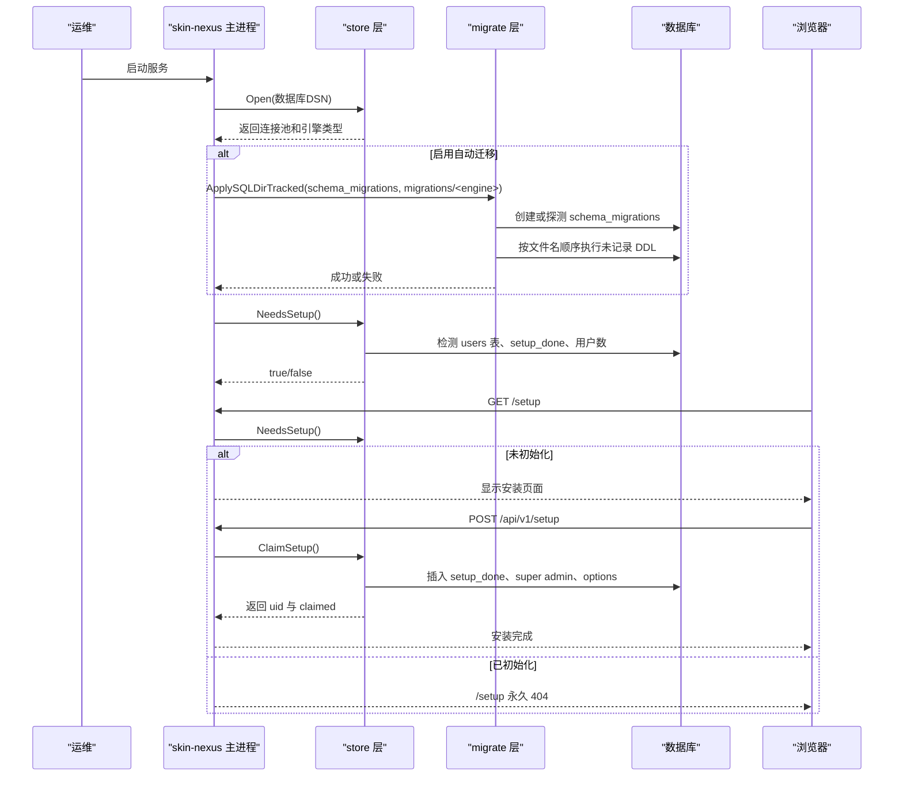
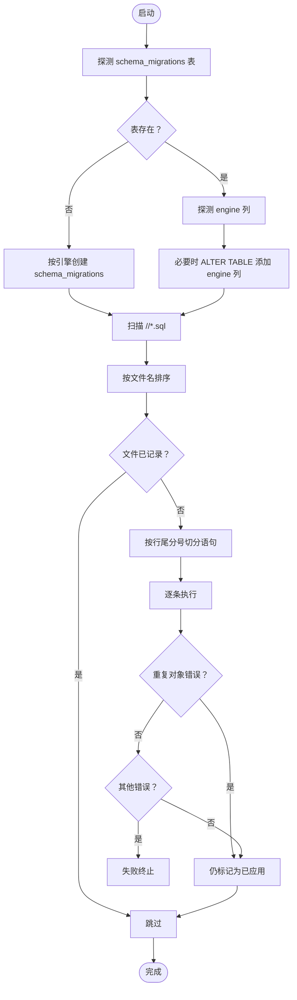
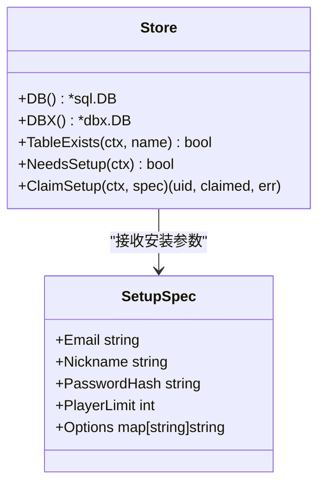
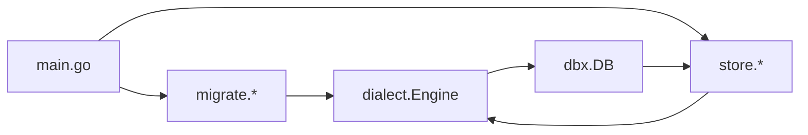

# 数据库选型与迁移

**本文引用的文件**
- [server/cmd/skin-nexus/main.go](https://github.com/YimingZhanshen/skin-nexus/blob/797ae1a/server/cmd/skin-nexus/main.go)
- [server/internal/store/setup.go](https://github.com/YimingZhanshen/skin-nexus/blob/797ae1a/server/internal/store/setup.go)
- [server/internal/store/schema.go](https://github.com/YimingZhanshen/skin-nexus/blob/797ae1a/server/internal/store/schema.go)
- [server/internal/migrate/cli.go](https://github.com/YimingZhanshen/skin-nexus/blob/797ae1a/server/internal/migrate/cli.go)
- [server/internal/migrate/tracked.go](https://github.com/YimingZhanshen/skin-nexus/blob/797ae1a/server/internal/migrate/tracked.go)
- [server/internal/migrate/sqldir.go](https://github.com/YimingZhanshen/skin-nexus/blob/797ae1a/server/internal/migrate/sqldir.go)
- [server/internal/dbx/dbx.go](https://github.com/YimingZhanshen/skin-nexus/blob/797ae1a/server/internal/dbx/dbx.go)
- [server/internal/dialect/dialect.go](https://github.com/YimingZhanshen/skin-nexus/blob/797ae1a/server/internal/dialect/dialect.go)
- [docs/migration.md](https://github.com/YimingZhanshen/skin-nexus/blob/797ae1a/docs/migration.md)
- [docs/compat-matrix.md](https://github.com/YimingZhanshen/skin-nexus/blob/797ae1a/docs/compat-matrix.md)

## 目录
1. [简介](#简介)
2. [项目结构](#项目结构)
3. [核心组件](#核心组件)
4. [架构总览](#架构总览)
5. [详细组件分析](#详细组件分析)
6. [依赖关系分析](#依赖关系分析)
7. [性能与容量考量](#性能与容量考量)
8. [故障排查指南](#故障排查指南)
9. [结论](#结论)
10. [附录：备份与升级最佳实践](#附录备份与升级最佳实践)

## 简介
本文面向部署 SkinNexus 的运维与后端人员，给出 MySQL、PostgreSQL、SQLite 三种引擎在部署复杂度、并发能力、事务语义、索引行为和适用场景上的对比，并基于代码仓库的实际实现给出明确推荐：单机测试优先 SQLite；小规模生产优先 PostgreSQL；已有 MySQL 生态或强依赖 InnoDB 工具链时选择 MySQL。随后说明 `migrate` 子命令的工作方式、版本号命名规则、SQL 分库存放、增量迁移执行顺序、回滚策略和数据一致性保证；解释从 blessing-skin-server 迁移的步骤、字段对齐关系、兼容表结构和已知限制；梳理初始化入口 `store.Setup` 如何创建用户和初始选项，以及首次访问 `/setup` 与数据库 schema 之间的关系；最后提供备份命令示例和“停写→备份→迁移”的最佳实践。

## 项目结构
SkinNexus 使用按功能域划分的内部包组织代码，数据库相关逻辑集中在 `internal/store`、`internal/migrate`、`internal/dbx` 和 `internal/dialect` 四个层次：



**图表来源**
- [server/cmd/skin-nexus/main.go:1-120](https://github.com/YimingZhanshen/skin-nexus/blob/797ae1a/server/cmd/skin-nexus/main.go#L1-L120)
- [server/internal/store/setup.go:1-105](https://github.com/YimingZhanshen/skin-nexus/blob/797ae1a/server/internal/store/setup.go#L1-L105)
- [server/internal/store/schema.go:1-53](https://github.com/YimingZhanshen/skin-nexus/blob/797ae1a/server/internal/store/schema.go#L1-L53)
- [server/internal/migrate/cli.go:1-200](https://github.com/YimingZhanshen/skin-nexus/blob/797ae1a/server/internal/migrate/cli.go#L1-L200)
- [server/internal/migrate/tracked.go:1-210](https://github.com/YimingZhanshen/skin-nexus/blob/797ae1a/server/internal/migrate/tracked.go#L1-L210)
- [server/internal/migrate/sqldir.go:1-33](https://github.com/YimingZhanshen/skin-nexus/blob/797ae1a/server/internal/migrate/sqldir.go#L1-L33)
- [server/internal/dbx/dbx.go:1-200](https://github.com/YimingZhanshen/skin-nexus/blob/797ae1a/server/internal/dbx/dbx.go#L1-L200)
- [server/internal/dialect/dialect.go:1-200](https://github.com/YimingZhanshen/skin-nexus/blob/797ae1a/server/internal/dialect/dialect.go#L1-L200)

**章节来源**
- [server/cmd/skin-nexus/main.go:1-120](https://github.com/YimingZhanshen/skin-nexus/blob/797ae1a/server/cmd/skin-nexus/main.go#L1-L120)
- [server/internal/migrate/cli.go:1-200](https://github.com/YimingZhanshen/skin-nexus/blob/797ae1a/server/internal/migrate/cli.go#L1-L200)
- [server/internal/migrate/tracked.go:1-210](https://github.com/YimingZhanshen/skin-nexus/blob/797ae1a/server/internal/migrate/tracked.go#L1-L210)
- [server/internal/migrate/sqldir.go:1-33](https://github.com/YimingZhanshen/skin-nexus/blob/797ae1a/server/internal/migrate/sqldir.go#L1-L33)
- [server/internal/store/setup.go:1-105](https://github.com/YimingZhanshen/skin-nexus/blob/797ae1a/server/internal/store/setup.go#L1-L105)
- [server/internal/store/schema.go:1-53](https://github.com/YimingZhanshen/skin-nexus/blob/797ae1a/server/internal/store/schema.go#L1-L53)
- [server/internal/dbx/dbx.go:1-200](https://github.com/YimingZhanshen/skin-nexus/blob/797ae1a/server/internal/dbx/dbx.go#L1-L200)
- [server/internal/dialect/dialect.go:1-200](https://github.com/YimingZhanshen/skin-nexus/blob/797ae1a/server/internal/dialect/dialect.go#L1-L200)

## 核心组件
- **数据库方言抽象层**：统一支持 MySQL/MariaDB/TiDB、SQLite（CGO-free）、PostgreSQL，并通过 DSN 前缀推断驱动。所有业务查询以 `?` 编写，PostgreSQL 由 `Bind` 转换为 `$n`，同时做参数数量校验，避免 SQLite 静默丢弃多余参数的风险。
- **迁移系统**：每个引擎独立维护 `migrations/<engine>/` 目录，版本号采用固定宽度的五位数前缀加语义化文件名；启动时通过 `schema_migrations` 表记录已应用文件，按文件名排序增量执行，重复对象错误被容忍以实现预追踪数据库自引导。
- **导入器**：`skin-nexus migrate import` 负责把 blessing-skin-server 的 users、players、textures、uuid、options、user_closet、invitation_codes 等表迁移到目标库，保留主键，并对 uuid 清洗、纹理目录字节级拷贝。
- **初始化入口**：`store.Setup` 在单事务中写入 `setup_done` 标记、超级管理员账号和站点选项；`store.schema.NeedsSetup` 通过检查 `users` 表是否存在、是否已有 `setup_done=1` 以及用户计数决定是否开放安装向导。

**章节来源**
- [server/internal/dialect/dialect.go:1-200](https://github.com/YimingZhanshen/skin-nexus/blob/797ae1a/server/internal/dialect/dialect.go#L1-L200)
- [server/internal/dbx/dbx.go:1-200](https://github.com/YimingZhanshen/skin-nexus/blob/797ae1a/server/internal/dbx/dbx.go#L1-L200)
- [server/internal/migrate/tracked.go:1-210](https://github.com/YimingZhanshen/skin-nexus/blob/797ae1a/server/internal/migrate/tracked.go#L1-L210)
- [server/internal/migrate/cli.go:1-200](https://github.com/YimingZhanshen/skin-nexus/blob/797ae1a/server/internal/migrate/cli.go#L1-L200)
- [server/internal/store/setup.go:1-105](https://github.com/YimingZhanshen/skin-nexus/blob/797ae1a/server/internal/store/setup.go#L1-L105)
- [server/internal/store/schema.go:1-53](https://github.com/YimingZhanshen/skin-nexus/blob/797ae1a/server/internal/store/schema.go#L1-L53)

## 架构总览
下图展示服务启动、自动迁移、安装门控和 `/setup` 的关系：



**图表来源**
- [server/cmd/skin-nexus/main.go:350-600](https://github.com/YimingZhanshen/skin-nexus/blob/797ae1a/server/cmd/skin-nexus/main.go#L350-L600)
- [server/internal/migrate/tracked.go:1-210](https://github.com/YimingZhanshen/skin-nexus/blob/797ae1a/server/internal/migrate/tracked.go#L1-L210)
- [server/internal/store/schema.go:1-53](https://github.com/YimingZhanshen/skin-nexus/blob/797ae1a/server/internal/store/schema.go#L1-L53)
- [server/internal/store/setup.go:1-105](https://github.com/YimingZhanshen/skin-nexus/blob/797ae1a/server/internal/store/setup.go#L1-L105)

## 详细组件分析

### 数据库引擎对比

| 维度 | MySQL/MariaDB | PostgreSQL | SQLite |
|---|---|---|---|
| 部署复杂度 | 需要运行 MySQL/MariaDB/TiDB 实例，配置字符集、时区、连接池；现有企业生态成熟。 | 需要运行 PostgreSQL 实例，默认 UTF-8 友好，连接池和扩展生态完善。 | 零进程、单文件数据库，适合容器内本地文件或宿主机路径；现代 CGO-free 驱动可静态编译。 |
| 并发能力 | InnoDB 行级锁、MVCC、高并发写入表现稳定，适合多进程/多副本。 | MVCC 成熟，读写分离、流复制、分区等扩展能力强，适合中等规模生产。 | 单写者模型，写操作全局锁，不适合多进程并发写；适合单进程测试、小型只读或低并发场景。 |
| 事务语义 | 支持完整 ACID，InnoDB 默认隔离级别为 REPEATABLE READ。 | 支持完整 ACID，默认 READ COMMITTED，可调整隔离级别。 | 支持 ACID 事务，但同一时间只有一个写事务能持有写锁。 |
| 索引行为 | B+ 树、全文索引、函数索引等丰富；字符集/排序规则对索引敏感。 | B-tree/GiST/GIN/HASH 等多种索引；JSON、部分扩展索引能力更强。 | B-tree 索引可用，但大表、高频写、复杂查询优化不如服务端数据库。 |
| 本项目适配 | 默认引擎，DSN 无 scheme 时回退到 MySQL；DDL 和 `schema_migrations` 针对 InnoDB 设计。 | 通过 `postgres://` DSN 识别，`Bind` 改写 `?` 为 `$n`，迁移标记使用 `TIMESTAMPTZ`。 | 通过 `sqlite:`/`file:` DSN 识别，`schema_migrations` 使用 SQLite 原生时间函数。 |
| 推荐场景 | 已有 MySQL 生态、需要 InnoDB 工具链、习惯传统 MySQL 运维的团队。 | 新项目、中小规模生产、希望更标准 SQL 和更好扩展性的团队。 | 单机测试、CI、本地开发、极小规模部署。 |

**章节来源**
- [server/internal/dialect/dialect.go:1-200](https://github.com/YimingZhanshen/skin-nexus/blob/797ae1a/server/internal/dialect/dialect.go#L1-L200)
- [server/internal/dbx/dbx.go:1-200](https://github.com/YimingZhanshen/skin-nexus/blob/797ae1a/server/internal/dbx/dbx.go#L1-L200)
- [server/internal/migrate/tracked.go:1-210](https://github.com/YimingZhanshen/skin-nexus/blob/797ae1a/server/internal/migrate/tracked.go#L1-L210)

### 迁移子系统与版本号规则

#### 目录布局与版本号
- 迁移 SQL 放在 `server/migrations/<engine>/<编号>_<语义>.sql`，其中 `<engine>` 是 `mysql`、`postgres` 或 `sqlite`。
- 编号采用五位数字前缀，例如 `0001_init.sql`、`0009_schema_align.sql`、`0030_join_session_indexes.sql`。
- 同一引擎目录下文件按文件名排序执行，因此编号必须单调递增且唯一。

#### 增量迁移执行流程


**图表来源**
- [server/internal/migrate/tracked.go:1-210](https://github.com/YimingZhanshen/skin-nexus/blob/797ae1a/server/internal/migrate/tracked.go#L1-L210)
- [server/internal/migrate/sqldir.go:1-33](https://github.com/YimingZhanshen/skin-nexus/blob/797ae1a/server/internal/migrate/sqldir.go#L1-L33)

#### 关键行为
- **预追踪数据库兼容**：如果数据库已经手动建过表但没有 `schema_migrations`，迁移器会容忍重复对象错误并继续标记文件已应用，避免启动崩溃。
- **引擎互斥保护**：`schema_migrations` 中的 `engine` 列用于防止一个数据库同时被不同引擎的迁移树污染；若检测到其他引擎的记录，启动直接拒绝。
- **数据迁移不在 DDL 中**：迁移文件默认只包含 DDL，因为重跑可能重复应用；少数幂等回填数据允许存在，其余数据迁移应放在 Go 逻辑中。
- **无回滚命令**：当前 `migrate` 子命令没有通用回滚接口；回滚应通过备份恢复或显式反向 DDL 配合人工验证。

**章节来源**
- [server/internal/migrate/tracked.go:1-210](https://github.com/YimingZhanshen/skin-nexus/blob/797ae1a/server/internal/migrate/tracked.go#L1-L210)
- [server/internal/migrate/sqldir.go:1-33](https://github.com/YimingZhanshen/skin-nexus/blob/797ae1a/server/internal/migrate/sqldir.go#L1-L33)

### Blessing-Skin-Server 迁移步骤

#### 前置准备
- 确认目标库为空或业务表可清空，并保留 `schema_migrations`、`union_kv`、`oidc_clients` 等基建表。
- 准备好老站 `.env`、老站纹理目录只读权限、老站数据库只读账号。
- 如果老站有非 bcrypt/argon2 的弱哈希用户，需挂载 `SKIN_LEGACY_ENV`，否则这些用户无法登录。
- 预检老站变体表结构，例如 `legacy.uuid` 需要 `pid` 列、`legacy.invitation_codes` 需要 `description` 列。

#### 执行步骤
1. **预检查**：`migrate preflight --env ... --textures ... --dump ...`，查看密码方法、盐槽、哈希分布和纹理树审计结果。
2. **备份**：对目标库和纹理目录执行备份。
3. **可选清理**：重迁场景下 TRUNCATE 业务表，但保留基建表。
4. **Dry-run**：`migrate import --source-dsn ... --target-dsn ... --source-prefix ... --textures-src ... --textures-dst ... --dry-run`，核对 selected/inserted 行数。
5. **实跑**：去掉 `--dry-run`，导入器保持幂等，失败可重跑。
6. **对账**：比对两侧表行数、丢行定位、凭据完整性、Union 键连续性。

#### 字段与表对齐关系
- `users` → `users`：密码原样携带，`permission` 原样搬运；派生列包括 `player_limit`、`can_join_server`、`avatar_tid`、`email_verified`、`created_at`、`updated_at`。
- `players` → `players`：名称、披风引用原样。
- `textures` → `textures`：`type` 映射为 `skin`/`model`，`name` → `description`。
- `uuid` → `uuid_map`：五步清洗，保留 UUID，不漂移。
- `options` → `options`：INSERT IGNORE，先到先得。
- `user_closet` → `user_closet`：NOT EXISTS 去重。
- `invitation_codes` → `invitation_codes`：携带扩展列。

#### 已知限制
- 不迁移会话令牌、旧版插件无关表。
- `players.preference` 保留为空；`textures.size`/`likes` 不迁移。
- 纹理问题文件不会被拷贝：文件名不等于内容 hash 或非 64-hex 文件名会被拒绝或跳过。
- 老站魔改或 fork 缺列会在 import 阶段报 `Unknown column` 中止。
- 空邮箱、重复 email/nickname 可能导致唯一键冲突，需要先在老站处理后再重迁。

**章节来源**
- [docs/migration.md:1-200](https://github.com/YimingZhanshen/skin-nexus/blob/797ae1a/docs/migration.md#L1-L200)
- [server/internal/migrate/cli.go:1-200](https://github.com/YimingZhanshen/skin-nexus/blob/797ae1a/server/internal/migrate/cli.go#L1-L200)
- [docs/compat-matrix.md:1-68](https://github.com/YimingZhanshen/skin-nexus/blob/797ae1a/docs/compat-matrix.md#L1-L68)

### 初始化入口与安装门控

#### `store.Setup` 的职责
`ClaimSetup` 在一个事务中完成三件事：
1. 写入单向标记 `setup_done = 1`。
2. 创建超级管理员账号（`permission=2`），该权限是插件安装等能力的硬性要求。
3. 将向导收集的站点选项以 key/value 形式写入 `options`。

该事务保证：多个并发请求中只有一个能成功插入 `setup_done`；失败时回滚标记，允许重试。

#### 安装门控逻辑
`NeedsSetup` 判断站点是否未初始化：
- 如果 `users` 表不存在，视为未初始化。
- 如果 `setup_done = 1`，视为已初始化。
- 如果 `users` 表存在但没有用户，也视为未初始化。

#### `/setup` 与数据库 schema 的关系
服务启动时会调用 `NeedsSetup`。若返回未初始化，则安装向导可用；一旦安装成功，`/setup` 永久 404。也就是说，`/setup` 不是“开关”，而是“首次初始化门”。



**图表来源**
- [server/internal/store/setup.go:1-105](https://github.com/YimingZhanshen/skin-nexus/blob/797ae1a/server/internal/store/setup.go#L1-L105)
- [server/internal/store/schema.go:1-53](https://github.com/YimingZhanshen/skin-nexus/blob/797ae1a/server/internal/store/schema.go#L1-L53)

**章节来源**
- [server/internal/store/setup.go:1-105](https://github.com/YimingZhanshen/skin-nexus/blob/797ae1a/server/internal/store/setup.go#L1-L105)
- [server/internal/store/schema.go:1-53](https://github.com/YimingZhanshen/skin-nexus/blob/797ae1a/server/internal/store/schema.go#L1-L53)
- [server/cmd/skin-nexus/main.go:350-600](https://github.com/YimingZhanshen/skin-nexus/blob/797ae1a/server/cmd/skin-nexus/main.go#L350-L600)

## 依赖关系分析



- `dialect` 定义支持的引擎、驱动名、DSN 推断和占位符绑定。
- `dbx` 封装连接池、Ping、事务、占位符重写和参数数量校验。
- `store` 暴露业务表操作和安装门控。
- `main` 组装服务，并根据 `SKIN_AUTO_MIGRATE` 调用 `ApplySQLDirTracked`。
- `migrate` 提供 CLI 和受追踪迁移执行逻辑。

**图表来源**
- [server/internal/dialect/dialect.go:1-200](https://github.com/YimingZhanshen/skin-nexus/blob/797ae1a/server/internal/dialect/dialect.go#L1-L200)
- [server/internal/dbx/dbx.go:1-200](https://github.com/YimingZhanshen/skin-nexus/blob/797ae1a/server/internal/dbx/dbx.go#L1-L200)
- [server/cmd/skin-nexus/main.go:1-120](https://github.com/YimingZhanshen/skin-nexus/blob/797ae1a/server/cmd/skin-nexus/main.go#L1-L120)
- [server/internal/migrate/cli.go:1-200](https://github.com/YimingZhanshen/skin-nexus/blob/797ae1a/server/internal/migrate/cli.go#L1-L200)

**章节来源**
- [server/internal/dialect/dialect.go:1-200](https://github.com/YimingZhanshen/skin-nexus/blob/797ae1a/server/internal/dialect/dialect.go#L1-L200)
- [server/internal/dbx/dbx.go:1-200](https://github.com/YimingZhanshen/skin-nexus/blob/797ae1a/server/internal/dbx/dbx.go#L1-L200)
- [server/cmd/skin-nexus/main.go:1-120](https://github.com/YimingZhanshen/skin-nexus/blob/797ae1a/server/cmd/skin-nexus/main.go#L1-L120)
- [server/internal/migrate/cli.go:1-200](https://github.com/YimingZhanshen/skin-nexus/blob/797ae1a/server/internal/migrate/cli.go#L1-L200)

## 性能与容量考量
- **SQLite** 适合单进程、低并发写入和快速本地测试；不要把它当成多副本、高并发写入的生产数据库。
- **PostgreSQL** 适合中小型生产环境，具备更好的标准 SQL 支持、扩展能力和连接池管理。
- **MySQL/MariaDB** 适合已有 InnoDB 生态的团队，注意字符集、排序规则和连接池配置。
- 纹理分发走内容地址直取，删除后不会主动失效 CDN 或浏览器缓存；这是性能取舍，不是数据不一致。
- 访问日志、详情、Join Session 等表有定时清理逻辑，避免无限增长。

[本节为通用指导，不直接分析具体文件]

## 故障排查指南

### 迁移报错常见原因
- **DSN 缺少 `parseTime=true` 或两侧时区不一致**：import 会直接拒绝。
- **目标库未运行自动迁移**：实跑强查 `schema_migrations` 中 `0008_legacy_preserve.sql` 的记标；手动执行 DDL 必须补记标。
- **老站表缺列**：preflight 不连库，需用 `SHOW COLUMNS` 预检，缺列会在 import 中止。
- **重复对象错误**：迁移器容忍 table/index/column 重复，但数据冲突（如重复主键）会失败。
- **引擎混用**：如果数据库已被另一个引擎迁移过，迁移器会拒绝当前引擎接入。

### 安装向导异常
- 未设置 `SKIN_SETUP_TOKEN` 且随机 token 生成失败时，日志会告警安装向导无人值守。
- 安装成功后 `/setup` 永久 404，不能当作“关闭/打开”开关。
- 并发安装由事务和单向标记保证，只有一个调用能成功创建超管。

**章节来源**
- [docs/migration.md:1-200](https://github.com/YimingZhanshen/skin-nexus/blob/797ae1a/docs/migration.md#L1-L200)
- [server/internal/migrate/tracked.go:1-210](https://github.com/YimingZhanshen/skin-nexus/blob/797ae1a/server/internal/migrate/tracked.go#L1-L210)
- [server/cmd/skin-nexus/main.go:350-600](https://github.com/YimingZhanshen/skin-nexus/blob/797ae1a/server/cmd/skin-nexus/main.go#L350-L600)
- [server/internal/store/setup.go:1-105](https://github.com/YimingZhanshen/skin-nexus/blob/797ae1a/server/internal/store/setup.go#L1-L105)

## 结论
- 单机测试首选 SQLite；小规模生产首选 PostgreSQL；已有 MySQL 生态或强依赖 InnoDB 工具链时选 MySQL。
- 迁移系统按引擎分目录、按文件名排序、通过 `schema_migrations` 追踪，支持预追踪数据库自引导，但不提供通用回滚命令。
- 从 blessing-skin-server 迁移应以 dry-run 先行、对账收尾；弱哈希用户需要 `SKIN_LEGACY_ENV`，纹理问题文件需要提前处理。
- 初始化入口在一个事务中写入安装标记、超管和选项；首次访问 `/setup` 由 `NeedsSetup` 控制，安装完成后端点永久 404。
- 升级前务必遵循“停写、备份、再执行迁移”的顺序，并把备份作为回滚依据。

[本节为总结性内容，不直接分析具体文件]

## 附录：备份与升级最佳实践

### 备份命令示例
以下命令来自迁移文档中的实操示例，应在宿主机或数据库容器内执行：

```bash
mysqldump -u root -p skin_nexus | gzip > backup-skin_nexus-$(date +%Y%m%d-%H%M%S).sql.gz
tar czf backup-textures-$(date +%Y%m%d-%H%M%S).tgz /data/textures
```

### 升级前建议流程
1. **停写**：暂停对外写入或进入维护模式，避免迁移期间产生新数据。
2. **备份**：备份目标数据库和纹理目录。
3. **Dry-run**：先执行 `migrate import --dry-run`，确认 selected/inserted 一致。
4. **执行迁移**：去掉 `--dry-run` 执行实跑。
5. **对账**：比对两侧表行数、定位丢行、检查凭据完整性。
6. **灰度切流**：确认无误后再切换域名或流量入口。
7. **观察**：关注弱哈希用户登录、纹理 404、Union 键一致性等关键指标。

**章节来源**
- [docs/migration.md:1-200](https://github.com/YimingZhanshen/skin-nexus/blob/797ae1a/docs/migration.md#L1-L200)
