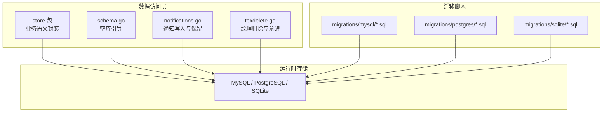
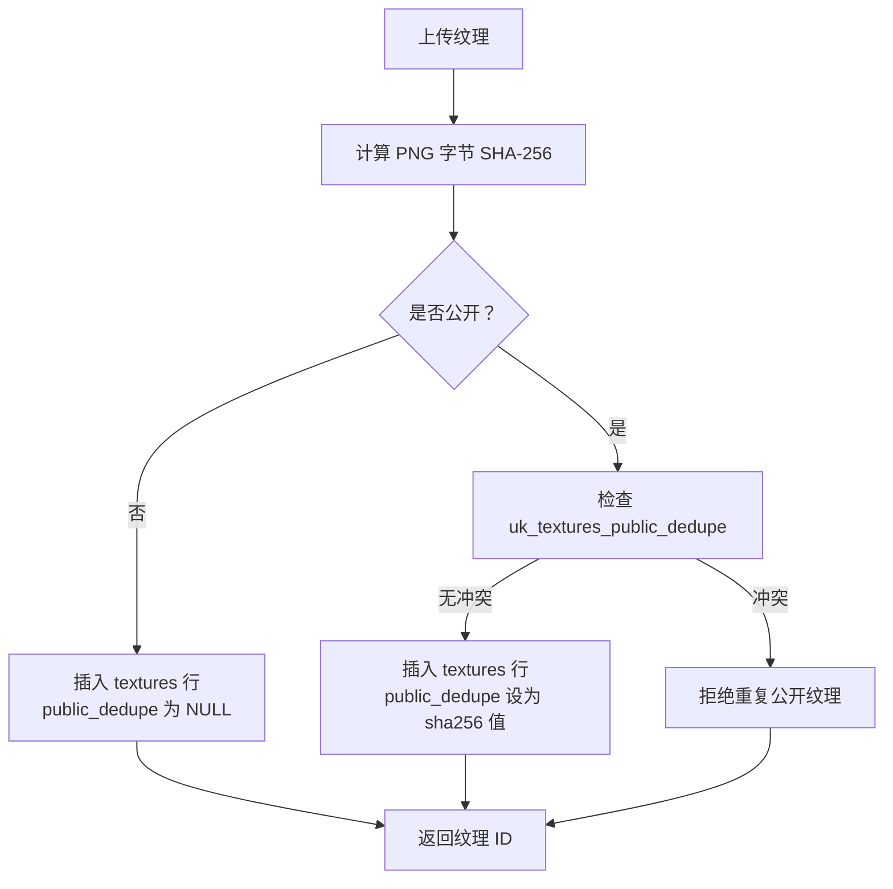
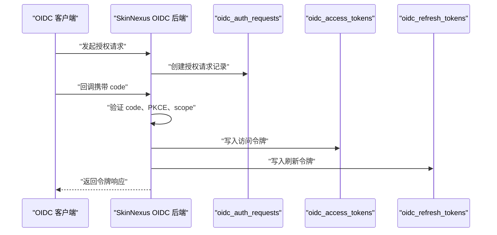
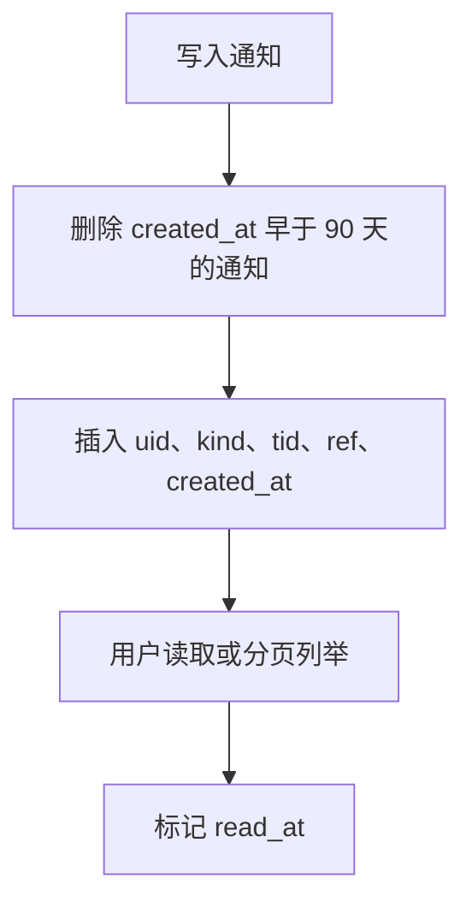
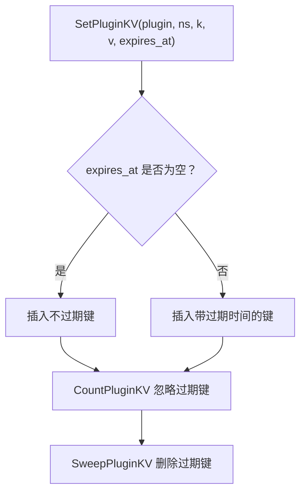
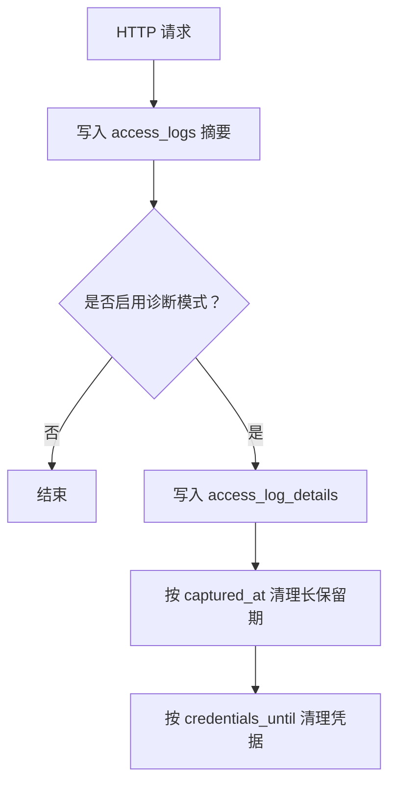
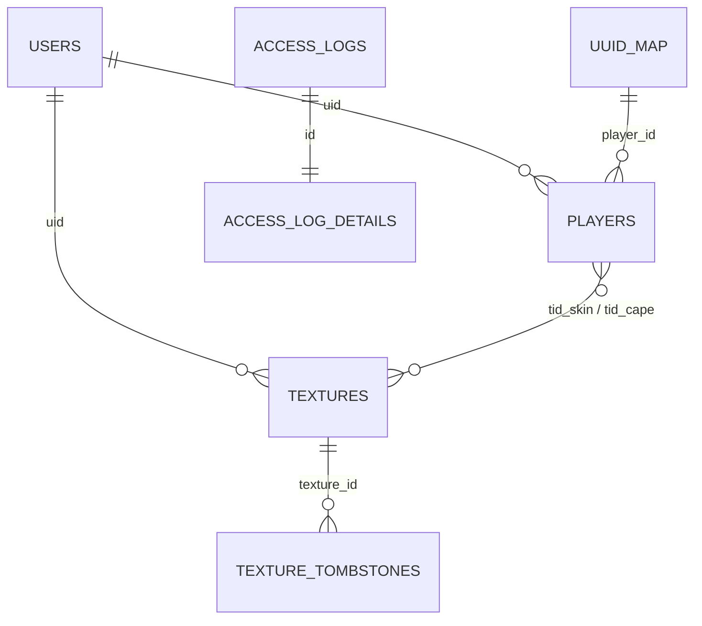
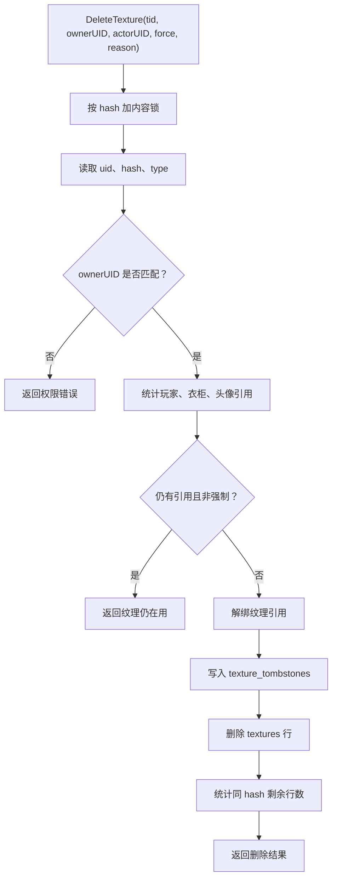

# 数据模型

**本文引用的文件**
- [schema.go](https://github.com/YimingZhanshen/skin-nexus/blob/797ae1a/server/internal/store/schema.go)
- [notifications.go](https://github.com/YimingZhanshen/skin-nexus/blob/797ae1a/server/internal/store/notifications.go)
- [texdelete.go](https://github.com/YimingZhanshen/skin-nexus/blob/797ae1a/server/internal/store/texdelete.go)
- [join_session_sweep_test.go](https://github.com/YimingZhanshen/skin-nexus/blob/797ae1a/server/internal/store/join_session_sweep_test.go)
- [plugin_store_integration_test.go](https://github.com/YimingZhanshen/skin-nexus/blob/797ae1a/server/internal/store/plugin_store_integration_test.go)
- [0001_init.sql（MySQL）](https://github.com/YimingZhanshen/skin-nexus/blob/797ae1a/server/migrations/mysql/0001_init.sql)
- [0003_oidc.sql（MySQL）](https://github.com/YimingZhanshen/skin-nexus/blob/797ae1a/server/migrations/mysql/0003_oidc.sql)
- [0004_union.sql（MySQL）](https://github.com/YimingZhanshen/skin-nexus/blob/797ae1a/server/migrations/mysql/0004_union.sql)
- [0012_plugin_platform.sql（MySQL）](https://github.com/YimingZhanshen/skin-nexus/blob/797ae1a/server/migrations/mysql/0012_plugin_platform.sql)
- [0015_texture_public_dedupe.sql（MySQL）](https://github.com/YimingZhanshen/skin-nexus/blob/797ae1a/server/migrations/mysql/0015_texture_public_dedupe.sql)
- [0019_texture_tombstones.sql（MySQL）](https://github.com/YimingZhanshen/skin-nexus/blob/797ae1a/server/migrations/mysql/0019_texture_tombstones.sql)
- [0021_notifications.sql（MySQL）](https://github.com/YimingZhanshen/skin-nexus/blob/797ae1a/server/migrations/mysql/0021_notifications.sql)
- [0027_plugin_kv_expiry_index.sql（MySQL）](https://github.com/YimingZhanshen/skin-nexus/blob/797ae1a/server/migrations/mysql/0027_plugin_kv_expiry_index.sql)
- [0028_notification_created_index.sql（MySQL）](https://github.com/YimingZhanshen/skin-nexus/blob/797ae1a/server/migrations/mysql/0028_notification_created_index.sql)
- [0029_access_log_details.sql（MySQL）](https://github.com/YimingZhanshen/skin-nexus/blob/797ae1a/server/migrations/mysql/0029_access_log_details.sql)
- [0001_init.sql（PostgreSQL）](https://github.com/YimingZhanshen/skin-nexus/blob/797ae1a/server/migrations/postgres/0001_init.sql)
- [0001_init.sql（SQLite）](https://github.com/YimingZhanshen/skin-nexus/blob/797ae1a/server/migrations/sqlite/0001_init.sql)

## 目录
1. [引言](#引言)
2. [项目结构](#项目结构)
3. [核心实体总览](#核心实体总览)
4. [架构概览](#架构概览)
5. [详细表结构分析](#详细表结构分析)
6. [依赖关系与跨方言迁移差异](#依赖关系与跨方言迁移差异)
7. [数据生命周期规则](#数据生命周期规则)
8. [典型查询示例与性能注意事项](#典型查询示例与性能注意事项)
9. [故障排查指南](#故障排查指南)
10. [结论](#结论)

## 引言
本文面向 SkinNexus 的核心数据模型，逐项说明用户、玩家角色、纹理、公开皮肤库、OIDC 授权、Union 成员同步、通知、插件存储、站点选项、访问日志和操作审计等表结构。文档同时解释三套数据库迁移脚本之间的差异、dialect 层如何屏蔽差异，以及纹理删除软标记、会话清理、通知保留和审计日志归档等生命周期策略。

## 项目结构
SkinNexus 的数据库模型由 Go 层代码和按方言分目录的 SQL 迁移脚本共同定义：

- `server/internal/store`：封装业务语义的数据访问实现，包含通知、纹理删除、插件 KV 行为等逻辑。
- `server/migrations/{mysql,postgres,sqlite}`：分别维护 MySQL、PostgreSQL、SQLite 的 DDL 迁移。
- `server/internal/dialect`：提供方言抽象，例如表是否存在检查、SQL 重写、时间值标准化等。
- `server/internal/store/schema.go`：仅用于空库初始化流程，暴露原始连接、表存在检查和安装向导判断。

**图表来源**
- [schema.go:1-53](https://github.com/YimingZhanshen/skin-nexus/blob/797ae1a/server/internal/store/schema.go#L1-L53)
- [notifications.go:1-125](https://github.com/YimingZhanshen/skin-nexus/blob/797ae1a/server/internal/store/notifications.go#L1-L125)
- [texdelete.go:1-200](https://github.com/YimingZhanshen/skin-nexus/blob/797ae1a/server/internal/store/texdelete.go#L1-L200)
- [0001_init.sql（MySQL）:1-103](https://github.com/YimingZhanshen/skin-nexus/blob/797ae1a/server/migrations/mysql/0001_init.sql#L1-L103)

**章节来源**
- [schema.go:1-53](https://github.com/YimingZhanshen/skin-nexus/blob/797ae1a/server/internal/store/schema.go#L1-L53)
- [0001_init.sql（MySQL）:1-103](https://github.com/YimingZhanshen/skin-nexus/blob/797ae1a/server/migrations/mysql/0001_init.sql#L1-L103)

## 核心实体总览
以下表格列出 SkinNexus 在迁移中定义的实体及其核心职责。注意：部分实体名与业务概念不完全一一对应；例如“公开皮肤库”对应的是 `textures` 表的 `public_dedupe` 列及唯一索引，而不是独立表。

| 实体 | 对应表 | 主键 | 核心字段 | 主要索引或约束 | 业务含义 |
|---|---|---|---|---|---|
| 用户 | `users` | `id` | `email`、`nickname`、`password`、`password_algo`、`player_limit`、`ip`、`avatar_tid`、`created_at`、`updated_at` | 主键；邮箱唯一；昵称唯一 | 账户主体，决定登录、玩家上限、头像关联及创建更新时间。 |
| 玩家角色 | `players` | `id` | `uid`、`name`、`tid_skin`、`tid_cape`、`preference`、`created_at`、`updated_at` | 主键；玩家名唯一；`uid` 索引 | Minecraft 风格的角色名称，绑定皮肤纹理 ID 和披风纹理 ID。 |
| 皮肤与披风纹理 | `textures` | `id` | `uid`、`type`、`hash`、`model`、`description`、`upload_at`、`public_dedupe` | 主键；`(uid,type)` 索引；`hash` 索引；`public_dedupe` 唯一索引 | 上传的 PNG 纹理内容地址化存储，区分皮肤与披风，支持公开去重。 |
| 公开皮肤库 | `textures` + `public_dedupe` | 通过 `(type, public_dedupe)` 隐式确定 | `type`、`public_dedupe` | `uk_textures_public_dedupe` | 同一哈希只允许一个公开纹理行；私有纹理可重复。 |
| OIDC 客户端与授权 | `oidc_clients`、`oidc_auth_requests`、`oidc_access_tokens`、`oidc_refresh_tokens`、`oidc_device_auth` | 各表主键不同 | 客户端标识、重定向 URI、授权码、令牌、设备码等 | 客户端主键、授权请求唯一码、访问令牌主键、刷新令牌主键、设备码唯一性 | OpenID Connect 授权码、设备流程与令牌账本。 |
| Union 成员同步 | `union_kv` | `k` | `k`、`v`、`updated_at` | 主键 | Union 扩展状态键值，当前主要用于未来持久化状态预留。 |
| 通知 | `notifications` | `id` | `uid`、`kind`、`tid`、`ref`、`read_at`、`created_at` | 主键；`(uid,id)`；`(uid,read_at)`；`created_at` | 站内通知，按 90 天窗口自动裁剪，按用户隔离。 |
| 插件 KV 存储 | `plugin_kv` | `(plugin,ns,k)` | `plugin`、`ns`、`k`、`v`、`expires_at`、`updated_at` | 复合主键；`(plugin,expires_at)` 索引 | 插件命名空间键值存储，支持过期时间和定时清扫。 |
| 站点选项 | `options` | `k` | `k`、`v` | 主键 | 系统级键值配置，如安装完成标志、Union 配置等。 |
| 访问日志 | `access_logs`、`access_log_details` | 主表无自增；明细表以 `id` 为主键 | 摘要状态、耗时、上游响应、头信息、正文片段、凭据到期时间、采集时间 | 明细表索引：`credentials_until`、`captured_at` | 轻量访问摘要 + 可选诊断明细，凭据短保留期与日志长期保留期分离。 |
| 操作审计 | `audit_log` | `id` | `actor_uid`、`action`、`detail`、`created_at` | 主键；`actor_uid` 索引；`action` 索引 | 管理面与系统操作的审计流水，支持 JSON 详情。 |
| 纹理墓碑 | `texture_tombstones` | `texture_id` | `uid`、`type`、`hash`、`model`、`description`、`source`、`source_url`、`public`、`moderation`、`upload_at`、`deleted_by`、`deleted_at`、`reason` | 主键；`hash` 索引 | 硬删除纹理的审核证据快照，供面板和历史追溯使用。 |
| UUID 映射 | `uuid_map` | `name` | `name`、`uuid`、`player_id` | 主键；`uuid` 唯一；`player_id` 索引 | Yggdrasil 风格离线玩家名到固定 UUID 的映射。 |
| Yggdrasil 令牌与会话 | `ygg_tokens`、`ygg_join_sessions` | 自增主键 | 用户令牌、访问令牌、选择玩家、过期时间、失效标志、加入会话信息等 | 令牌唯一索引；会话按 `access_token` 索引；测试要求 `uuid`、`expires_at` 索引 | 模拟 Minecraft 认证令牌和短期加入会话。 |

**章节来源**
- [0001_init.sql（MySQL）:1-103](https://github.com/YimingZhanshen/skin-nexus/blob/797ae1a/server/migrations/mysql/0001_init.sql#L1-L103)
- [0003_oidc.sql（MySQL）:1-91](https://github.com/YimingZhanshen/skin-nexus/blob/797ae1a/server/migrations/mysql/0003_oidc.sql#L1-L91)
- [0004_union.sql（MySQL）:1-20](https://github.com/YimingZhanshen/skin-nexus/blob/797ae1a/server/migrations/mysql/0004_union.sql#L1-L20)
- [0012_plugin_platform.sql（MySQL）:1-64](https://github.com/YimingZhanshen/skin-nexus/blob/797ae1a/server/migrations/mysql/0012_plugin_platform.sql#L1-L64)
- [0015_texture_public_dedupe.sql（MySQL）:1-8](https://github.com/YimingZhanshen/skin-nexus/blob/797ae1a/server/migrations/mysql/0015_texture_public_dedupe.sql#L1-L8)
- [0019_texture_tombstones.sql（MySQL）:1-25](https://github.com/YimingZhanshen/skin-nexus/blob/797ae1a/server/migrations/mysql/0019_texture_tombstones.sql#L1-L25)
- [0021_notifications.sql（MySQL）:1-21](https://github.com/YimingZhanshen/skin-nexus/blob/797ae1a/server/migrations/mysql/0021_notifications.sql#L1-L21)
- [0027_plugin_kv_expiry_index.sql（MySQL）:1-5](https://github.com/YimingZhanshen/skin-nexus/blob/797ae1a/server/migrations/mysql/0027_plugin_kv_expiry_index.sql#L1-L5)
- [0028_notification_created_index.sql（MySQL）:1-5](https://github.com/YimingZhanshen/skin-nexus/blob/797ae1a/server/migrations/mysql/0028_notification_created_index.sql#L1-L5)
- [0029_access_log_details.sql（MySQL）:1-31](https://github.com/YimingZhanshen/skin-nexus/blob/797ae1a/server/migrations/mysql/0029_access_log_details.sql#L1-L31)

## 架构概览
从数据建模角度看，SkinNexus 围绕“用户 → 玩家 → 纹理”这条主线组织数据，并在此基础上叠加身份授权、平台扩展、访问审计和站内通知。

```mermaid
erDiagram
  USERS {
    bigint id PK
    varchar email
    varchar nickname
    varchar password
    varchar password_algo
    int player_limit
    varchar ip
    bigint avatar_tid
    datetime created_at
    datetime updated_at
  }

  PLAYERS {
    bigint id PK
    bigint uid FK
    varchar name
    bigint tid_skin
    bigint tid_cape
    varchar preference
    datetime created_at
    datetime updated_at
  }

  TEXTURES {
    bigint id PK
    bigint uid FK
    enum type
    char hash
    enum model
    varchar description
    datetime upload_at
    varchar public_dedupe
  }

  OIDC_CLIENTS {
    varchar client_id PK
    varchar secret_hash
    varchar name
    text redirect_uris
    text grant_types
    text scopes
    tinyint is_public
    datetime created_at
  }

  OIDC_AUTH_REQUESTS {
    varchar id PK
    varchar client_id
    varchar subject
    text scopes
    varchar redirect_uri
    varchar state
    varchar nonce
    varchar code_challenge
    varchar code_challenge_method
    bigint selected_pid
    datetime auth_time
    tinyint done
    varchar code
    datetime code_expires
    datetime created_at
  }

  OIDC_ACCESS_TOKENS {
    varchar jti PK
    bigint uid
    varchar client_id
    text scopes
    bigint selected_pid
    datetime expires_at
    datetime created_at
    datetime revoked_at
  }

  OIDC_REFRESH_TOKENS {
    varchar token PK
    bigint uid
    varchar client_id
    text scopes
    bigint selected_pid
    datetime auth_time
    datetime expires_at
    datetime created_at
    tinyint revoked
  }

  OIDC_DEVICE_AUTH {
    varchar device_code PK
    varchar user_code
    varchar client_id
    text scopes
    datetime expires_at
    tinyint done
    tinyint denied
    bigint uid
    bigint selected_pid
    datetime auth_time
    datetime created_at
  }

  UNION_KV {
    varchar k PK
    text v
    datetime updated_at
  }

  NOTIFICATIONS {
    bigint id PK
    bigint uid
    varchar kind
    bigint tid
    varchar ref
    datetime read_at
    datetime created_at
  }

  PLUGIN_META {
    varchar name PK
    varchar version
    int hook_api
    varchar runtime
    json manifest
    json config
    int schema_version
    varchar source
    char checksum
    varchar state
    text last_error
    datetime installed_at
    datetime updated_at
  }

  PLUGIN_SECRETS {
    varchar plugin
    varchar k
    blob ciphertext
    varbinary nonce
    int key_version
    datetime updated_at
  }

  PLUGIN_KV {
    varchar plugin
    varchar ns
    varchar k
    mediumtext v
    datetime expires_at
    datetime updated_at
  }

  PLUGIN_DOCS {
    varchar plugin
    varchar coll
    varchar id
    json doc
    datetime created_at
    datetime updated_at
  }

  PLUGIN_MIGRATIONS {
    varchar plugin
    int version
    datetime applied_at
  }

  OPTIONS {
    varchar k PK
    text v
  }

  ACCESS_LOGS {
    bigint id PK
    int status_code
    bigint duration_ms
    varchar detail
    datetime captured_at
  }

  ACCESS_LOG_DETAILS {
    bigint id PK
    int status_code
    bigint duration_ms
    varchar upstream_code
    text headers_json
    text body_excerpt
    varchar credential_ref
    datetime credentials_until
    datetime captured_at
  }

  AUDIT_LOG {
    bigint id PK
    bigint actor_uid
    varchar action
    json detail
    datetime created_at
  }

  TEXTURE_TOMBSTONES {
    bigint texture_id PK
    bigint uid
    enum type
    char hash
    enum model
    varchar description
    varchar source
    varchar source_url
    tinyint public
    varchar moderation
    datetime upload_at
    bigint deleted_by
    datetime deleted_at
    varchar reason
  }

  UUID_MAP {
    varchar name PK
    char uuid
    bigint player_id
  }

  YGG_TOKENS {
    bigint id PK
    bigint user_id
    char client_token
    char access_token
    bigint selected_pid
    datetime created_at
    datetime expires_at
    tinyint invalidated
  }

  YGG_JOIN_SESSIONS {
    bigint id PK
    char access_token
    char uuid
    varchar server_id
    varchar server_ip
    datetime created_at
    datetime expires_at
  }

  USERS ||--o{ PLAYERS : "uid"
  USERS ||--o{ TEXTURES : "uid"
  USERS ||--o{ OIDC_ACCESS_TOKENS : "uid"
  USERS ||--o{ OIDC_REFRESH_TOKENS : "uid"
  TEXTURES ||--o{ TEXTURE_TOMBSTONES : "texture_id"
  PLAYERS }o--o{ TEXTURES : "tid_skin / tid_cape"
  OIDC_CLIENTS ||--o{ OIDC_AUTH_REQUESTS : "client_id"
  OIDC_CLIENTS ||--o{ OIDC_ACCESS_TOKENS : "client_id"
  OIDC_CLIENTS ||--o{ OIDC_REFRESH_TOKENS : "client_id"
  OIDC_CLIENTS ||--o{ OIDC_DEVICE_AUTH : "client_id"
  UUID_MAP ||--o{ PLAYERS : "player_id"
  ACCESS_LOGS ||--|| ACCESS_LOG_DETAILS : "id"
```

**图表来源**
- [0001_init.sql（MySQL）:1-103](https://github.com/YimingZhanshen/skin-nexus/blob/797ae1a/server/migrations/mysql/0001_init.sql#L1-L103)
- [0003_oidc.sql（MySQL）:1-91](https://github.com/YimingZhanshen/skin-nexus/blob/797ae1a/server/migrations/mysql/0003_oidc.sql#L1-L91)
- [0012_plugin_platform.sql（MySQL）:1-64](https://github.com/YimingZhanshen/skin-nexus/blob/797ae1a/server/migrations/mysql/0012_plugin_platform.sql#L1-L64)
- [0019_texture_tombstones.sql（MySQL）:1-25](https://github.com/YimingZhanshen/skin-nexus/blob/797ae1a/server/migrations/mysql/0019_texture_tombstones.sql#L1-L25)
- [0021_notifications.sql（MySQL）:1-21](https://github.com/YimingZhanshen/skin-nexus/blob/797ae1a/server/migrations/mysql/0021_notifications.sql#L1-L21)
- [0029_access_log_details.sql（MySQL）:1-31](https://github.com/YimingZhanshen/skin-nexus/blob/797ae1a/server/migrations/mysql/0029_access_log_details.sql#L1-L31)

## 详细表结构分析

### 用户表 users
- 主键：`id`，自增。
- 唯一约束：`email`、`nickname`。
- 关键字段：
  - `email`：登录邮箱，大小写折叠去重在迁移注释中说明。
  - `nickname`：显示昵称。
  - `password`、`password_algo`：密码哈希与算法标识，兼容旧行。
  - `player_limit`：每个用户可拥有的玩家角色数量。
  - `avatar_tid`：遗留字段，指向 `textures.tid`。
  - `created_at`、`updated_at`：记录创建与更新时间。
- 索引策略：主键索引、邮箱唯一索引、昵称唯一索引。
- 业务含义：用户是账户边界；管理员可通过 `player_limit` 控制角色数量；`setup_done` 选项结合 `users` 表是否为空决定安装向导是否可见。

**章节来源**
- [0001_init.sql（MySQL）:1-33](https://github.com/YimingZhanshen/skin-nexus/blob/797ae1a/server/migrations/mysql/0001_init.sql#L1-L33)
- [0001_init.sql（PostgreSQL）:1-20](https://github.com/YimingZhanshen/skin-nexus/blob/797ae1a/server/migrations/postgres/0001_init.sql#L1-L20)
- [0001_init.sql（SQLite）:1-24](https://github.com/YimingZhanshen/skin-nexus/blob/797ae1a/server/migrations/sqlite/0001_init.sql#L1-L24)
- [schema.go:26-53](https://github.com/YimingZhanshen/skin-nexus/blob/797ae1a/server/internal/store/schema.go#L26-L53)

### 玩家角色表 players
- 主键：`id`，自增。
- 外键语义：`uid` 指向 `users.id`；`tid_skin`、`tid_cape` 指向 `textures.id`。
- 关键字段：
  - `name`：Minecraft 风格角色名，保留大小写。
  - `tid_skin`、`tid_cape`：皮肤与披风纹理 ID，迁移注释提到 `-1`/`0` 会被归一化为 `NULL`。
  - `preference`：遗留字段，仍保留以便映射。
- 索引策略：主键、玩家名唯一索引、`uid` 索引。
- 业务含义：玩家是用户的游戏内身份；同一玩家名全局唯一；按 `uid` 可枚举用户的所有角色。

**章节来源**
- [0001_init.sql（MySQL）:35-52](https://github.com/YimingZhanshen/skin-nexus/blob/797ae1a/server/migrations/mysql/0001_init.sql#L35-L52)
- [0001_init.sql（PostgreSQL）:21-33](https://github.com/YimingZhanshen/skin-nexus/blob/797ae1a/server/migrations/postgres/0001_init.sql#L21-L33)
- [0001_init.sql（SQLite）:25-41](https://github.com/YimingZhanshen/skin-nexus/blob/797ae1a/server/migrations/sqlite/0001_init.sql#L25-L41)

### 纹理表 textures
- 主键：`id`，自增。
- 关键字段：
  - `uid`：上传者用户。
  - `type`：`skin` 或 `cape`。
  - `hash`：PNG 字节内容的 SHA-256 十六进制，文件名即 `<textures_dir>/<hash>`。
  - `model`：皮肤模型 `default` 或 `slim`。
  - `description`：描述文本。
  - `upload_at`：上传时间。
  - `public_dedupe`：公开纹理去重列，公开行值为 `sha256:...`，私有行为 `NULL`。
- 索引策略：
  - `(uid,type)`：按用户和类型查找。
  - `hash`：按内容地址快速定位。
  - `public_dedupe`：公开纹理唯一。
- 业务含义：纹理以内容地址为中心；公开皮肤库通过 `public_dedupe` 保证同一哈希只有一份公开记录；私有副本仍可多次上传。

**图表来源**
- [0015_texture_public_dedupe.sql（MySQL）:1-8](https://github.com/YimingZhanshen/skin-nexus/blob/797ae1a/server/migrations/mysql/0015_texture_public_dedupe.sql#L1-L8)

**章节来源**
- [0001_init.sql（MySQL）:54-70](https://github.com/YimingZhanshen/skin-nexus/blob/797ae1a/server/migrations/mysql/0001_init.sql#L54-L70)
- [0015_texture_public_dedupe.sql（MySQL）:1-8](https://github.com/YimingZhanshen/skin-nexus/blob/797ae1a/server/migrations/mysql/0015_texture_public_dedupe.sql#L1-L8)

### 公开皮肤库 skinlib
SkinNexus 没有独立的 `skinlib` 表。公开皮肤库由 `textures.public_dedupe` 表达：

- 公开纹理行的 `public_dedupe` 是带前缀的哈希值。
- `uk_textures_public_dedupe` 确保同一 `(type, public_dedupe)` 只有一个公开行。
- 私有纹理的 `public_dedupe` 为 `NULL`，因此允许多份相同内容的私有副本。
- 迁移注释指出：历史重复行会先保留 `NULL`，再由 Go 回填选择一个赢家，但不会直接删除重复行。

**章节来源**
- [0015_texture_public_dedupe.sql（MySQL）:1-8](https://github.com/YimingZhanshen/skin-nexus/blob/797ae1a/server/migrations/mysql/0015_texture_public_dedupe.sql#L1-L8)

### OIDC 客户端与授权 oidc
OIDC 相关表分为五类：

| 表 | 主键 | 关键关系 | 业务含义 |
|---|---|---|---|
| `oidc_clients` | `client_id` | 被授权请求、访问令牌、刷新令牌、设备授权引用 | 注册 OAuth/OIDC 客户端，支持公共客户端和重定向 URI、授权类型、作用域。 |
| `oidc_auth_requests` | `id` | `client_id` 引用客户端 | 授权码流程的请求状态机，包含 PKCE challenge、state、nonce、code 等。 |
| `oidc_access_tokens` | `jti` | `uid`、`client_id` | JWT 访问令牌账本，`revoked_at` 为空表示有效。 |
| `oidc_refresh_tokens` | `token` | `uid`、`client_id` | 刷新令牌，轮换时旧行标记撤销并插入新行。 |
| `oidc_device_auth` | `device_code` | `client_id` | RFC 8628 设备授权流程，`done`、`denied`、`uid` 表示审批状态。 |

**图表来源**
- [0003_oidc.sql（MySQL）:1-91](https://github.com/YimingZhanshen/skin-nexus/blob/797ae1a/server/migrations/mysql/0003_oidc.sql#L1-L91)

**章节来源**
- [0003_oidc.sql（MySQL）:1-91](https://github.com/YimingZhanshen/skin-nexus/blob/797ae1a/server/migrations/mysql/0003_oidc.sql#L1-L91)

### Union 成员同步 union_sync
Union 核心在设计上对每次请求保持无状态，持久化内容较小：

- `union_kv`：通用键值表，键为主键，附带 `updated_at`。
- 实际 Union 配置保存在 `options` 表中，例如成员密钥、服务器列表缓存、签名密钥版本等。
- UUID 重映射目标仍复用 `uuid_map`。
- Union 事件通过 `audit_log` 记录，`actor_uid` 可为空表示系统或 Union 事件。

**章节来源**
- [0004_union.sql（MySQL）:1-20](https://github.com/YimingZhanshen/skin-nexus/blob/797ae1a/server/migrations/mysql/0004_union.sql#L1-L20)
- [0001_init.sql（MySQL）:72-86](https://github.com/YimingZhanshen/skin-nexus/blob/797ae1a/server/migrations/mysql/0001_init.sql#L72-L86)

### 通知 notifications
- 主键：`id`。
- 关键字段：
  - `uid`：通知归属用户。
  - `kind`：封闭集合，如报告结果、纹理下架、封禁等。
  - `tid`：关联纹理 ID。
  - `ref`：主题快照字符串，避免纹理删除后通知不可读。
  - `read_at`：已读时间。
  - `created_at`：创建时间。
- 索引策略：
  - `(uid,id)`：分页读取。
  - `(uid,read_at)`：未读筛选。
  - `created_at`：批量裁剪旧通知。
- 业务含义：通知按用户隔离，写入前先删除早于 90 天的行；客户端根据 `kind` 和本地化字典渲染文案。

**图表来源**
- [0021_notifications.sql（MySQL）:1-21](https://github.com/YimingZhanshen/skin-nexus/blob/797ae1a/server/migrations/mysql/0021_notifications.sql#L1-L21)
- [notifications.go:24-125](https://github.com/YimingZhanshen/skin-nexus/blob/797ae1a/server/internal/store/notifications.go#L24-L125)

**章节来源**
- [0021_notifications.sql（MySQL）:1-21](https://github.com/YimingZhanshen/skin-nexus/blob/797ae1a/server/migrations/mysql/0021_notifications.sql#L1-L21)
- [0028_notification_created_index.sql（MySQL）:1-5](https://github.com/YimingZhanshen/skin-nexus/blob/797ae1a/server/migrations/mysql/0028_notification_created_index.sql#L1-L5)
- [notifications.go:1-125](https://github.com/YimingZhanshen/skin-nexus/blob/797ae1a/server/internal/store/notifications.go#L1-L125)

### 插件 KV 存储 plugin_kv
- 主键：`(plugin, ns, k)`。
- 关键字段：
  - `plugin`：插件名称。
  - `ns`：命名空间，用于隔离不同用途的数据。
  - `k`：键。
  - `v`：值，MySQL 使用 `MEDIUMTEXT`。
  - `expires_at`：可选过期时间。
  - `updated_at`：更新时间。
- 索引策略：复合主键；`(plugin,expires_at)` 用于按插件扫描过期键。
- 业务含义：
  - 命名空间使同一插件可保存多组独立数据。
  - 过期键对读取和计数透明；清扫任务定期删除过期行。
  - 插件元数据、加密配置、文档、迁移记录分别位于 `plugin_meta`、`plugin_secrets`、`plugin_docs`、`plugin_migrations`。

**图表来源**
- [0012_plugin_platform.sql（MySQL）:28-48](https://github.com/YimingZhanshen/skin-nexus/blob/797ae1a/server/migrations/mysql/0012_plugin_platform.sql#L28-L48)
- [0027_plugin_kv_expiry_index.sql（MySQL）:1-5](https://github.com/YimingZhanshen/skin-nexus/blob/797ae1a/server/migrations/mysql/0027_plugin_kv_expiry_index.sql#L1-L5)
- [plugin_store_integration_test.go:54-97](https://github.com/YimingZhanshen/skin-nexus/blob/797ae1a/server/internal/store/plugin_store_integration_test.go#L54-L97)

**章节来源**
- [0012_plugin_platform.sql（MySQL）:1-64](https://github.com/YimingZhanshen/skin-nexus/blob/797ae1a/server/migrations/mysql/0012_plugin_platform.sql#L1-L64)
- [0027_plugin_kv_expiry_index.sql（MySQL）:1-5](https://github.com/YimingZhanshen/skin-nexus/blob/797ae1a/server/migrations/mysql/0027_plugin_kv_expiry_index.sql#L1-L5)
- [plugin_store_integration_test.go:1-135](https://github.com/YimingZhanshen/skin-nexus/blob/797ae1a/server/internal/store/plugin_store_integration_test.go#L1-L135)

### 站点选项 site_options
- 表名：`options`。
- 主键：`k`。
- 字段：`k`、`v`。
- 业务含义：站点级键值配置。安装向导通过检查 `users` 表是否存在、`setup_done` 是否为 `"1"`、以及用户数是否为 0 来决定是否需要初始化。

**章节来源**
- [0001_init.sql（MySQL）:88-91](https://github.com/YimingZhanshen/skin-nexus/blob/797ae1a/server/migrations/mysql/0001_init.sql#L88-L91)
- [schema.go:26-53](https://github.com/YimingZhanshen/skin-nexus/blob/797ae1a/server/internal/store/schema.go#L26-L53)

### 访问日志 access_log
访问日志拆分为两棵树：

- `access_logs`：轻量摘要行，每六小时扫描一次并按 90 天清理。
- `access_log_details`：诊断明细，1:1 挂在 `access_logs.id` 上，但没有物理外键。
- 保留策略：
  - `captured_at`：跟随面板配置的明细保留期，默认 90 天。
  - `credentials_until`：仅含可用凭据的行走更短的固定保留期，不等同于日志整体保留期。

**图表来源**
- [0029_access_log_details.sql（MySQL）:1-31](https://github.com/YimingZhanshen/skin-nexus/blob/797ae1a/server/migrations/mysql/0029_access_log_details.sql#L1-L31)

**章节来源**
- [0029_access_log_details.sql（MySQL）:1-31](https://github.com/YimingZhanshen/skin-nexus/blob/797ae1a/server/migrations/mysql/0029_access_log_details.sql#L1-L31)

### 操作审计 audit_log
- 主键：`id`。
- 字段：`actor_uid`、`action`、`detail`、`created_at`。
- 索引：`actor_uid`、`action`。
- 业务含义：记录管理操作和系统行为；`detail` 为 JSON 详情；Union 或系统事件可留空 `actor_uid`。

**章节来源**
- [0001_init.sql（MySQL）:93-103](https://github.com/YimingZhanshen/skin-nexus/blob/797ae1a/server/migrations/mysql/0001_init.sql#L93-L103)

## 依赖关系与跨方言迁移差异

### 实体关系图

**图表来源**
- [0001_init.sql（MySQL）:1-103](https://github.com/YimingZhanshen/skin-nexus/blob/797ae1a/server/migrations/mysql/0001_init.sql#L1-L103)
- [0019_texture_tombstones.sql（MySQL）:1-25](https://github.com/YimingZhanshen/skin-nexus/blob/797ae1a/server/migrations/mysql/0019_texture_tombstones.sql#L1-L25)
- [0029_access_log_details.sql（MySQL）:1-31](https://github.com/YimingZhanshen/skin-nexus/blob/797ae1a/server/migrations/mysql/0029_access_log_details.sql#L1-L31)

### MySQL、PostgreSQL、SQLite 迁移差异
| 维度 | MySQL | PostgreSQL | SQLite |
|---|---|---|---|
| 自增主键 | `BIGINT UNSIGNED AUTO_INCREMENT` | `BIGSERIAL` | `INTEGER PRIMARY KEY AUTOINCREMENT` |
| 时间类型 | `DATETIME(3)`，UTC 毫秒 | `TIMESTAMPTZ`，即时比较 | `DATETIME`，driver 将可解析值转回 `time.Time` |
| 更新时间触发器 | `ON UPDATE CURRENT_TIMESTAMP(3)` | 无，Go 写入方设置 `updated_at` | 无，Go 写入方设置 `updated_at` |
| 布尔与标志列 | `TINYINT(1)` | `SMALLINT` | `INTEGER` |
| JSON 与长文本 | `JSON`、`MEDIUMTEXT` | `TEXT`，Go 侧序列化 JSON | `TEXT` |
| 字符宽度 | `CHAR(n)` 用于哈希与令牌 | 避免 `CHAR(n)`，改用 `VARCHAR` | 使用 `CHAR(n)` 表示固定长度哈希 |
| 大小写折叠唯一索引 | utf8mb4 默认排序隐含折叠 | `LOWER(email)`、`LOWER(name)` 表达式索引 | `LOWER(email)`、`LOWER(name)` 表达式索引 |
| 更新时戳 | 引擎触发 | 应用层设置 | 应用层设置 |

这些差异由迁移脚本分别声明，而 Go 层的 dialect 层负责：

- 表存在性检查使用方言查询。
- 时间参数统一转换为 UTC。
- 在缺少进程间锁能力的 SQLite 上，纹理哈希锁降级为进程内串行。
- 对原生 `DB()` 的使用绕过语句重写池，因此 `schema.go` 注释明确指出该路径意外成为 MySQL 专用路径。

**章节来源**
- [0001_init.sql（MySQL）:1-103](https://github.com/YimingZhanshen/skin-nexus/blob/797ae1a/server/migrations/mysql/0001_init.sql#L1-L103)
- [0001_init.sql（PostgreSQL）:1-100](https://github.com/YimingZhanshen/skin-nexus/blob/797ae1a/server/migrations/postgres/0001_init.sql#L1-L100)
- [0001_init.sql（SQLite）:1-104](https://github.com/YimingZhanshen/skin-nexus/blob/797ae1a/server/migrations/sqlite/0001_init.sql#L1-L104)
- [schema.go:1-24](https://github.com/YimingZhanshen/skin-nexus/blob/797ae1a/server/internal/store/schema.go#L1-L24)
- [texdelete.go:41-116](https://github.com/YimingZhanshen/skin-nexus/blob/797ae1a/server/internal/store/texdelete.go#L41-L116)

## 数据生命周期规则

### 纹理删除软标记
纹理删除不是简单物理删除：

1. 删除前锁定纹理内容地址，防止上传与删除竞争。
2. 查询纹理是否仍被玩家、衣柜或头像引用。
3. 若强制删除则解绑引用；否则返回占用错误。
4. 将原行快照写入 `texture_tombstones`。
5. 删除 `textures` 中的行。
6. 统计同哈希剩余行数，供调用方决定是否删除底层文件。

**图表来源**
- [texdelete.go:1-200](https://github.com/YimingZhanshen/skin-nexus/blob/797ae1a/server/internal/store/texdelete.go#L1-L200)
- [0019_texture_tombstones.sql（MySQL）:1-25](https://github.com/YimingZhanshen/skin-nexus/blob/797ae1a/server/migrations/mysql/0019_texture_tombstones.sql#L1-L25)

**章节来源**
- [texdelete.go:1-200](https://github.com/YimingZhanshen/skin-nexus/blob/797ae1a/server/internal/store/texdelete.go#L1-L200)
- [0019_texture_tombstones.sql（MySQL）:1-25](https://github.com/YimingZhanshen/skin-nexus/blob/797ae1a/server/migrations/mysql/0019_texture_tombstones.sql#L1-L25)

### 会话清理
Yggdrasil 加入会话 `ygg_join_sessions` 的生命周期约为 120 秒：

- 会话按 `access_token`、`uuid`、`server_id`、`server_ip`、`expires_at` 等字段记录。
- 清理过程只删除已过期的行，不会截断整张表。
- 测试明确要求 `uuid` 和 `expires_at` 上有索引，避免全表扫描。

**章节来源**
- [0001_init.sql（MySQL）:100-103](https://github.com/YimingZhanshen/skin-nexus/blob/797ae1a/server/migrations/mysql/0001_init.sql#L100-L103)
- [join_session_sweep_test.go:1-108](https://github.com/YimingZhanshen/skin-nexus/blob/797ae1a/server/internal/store/join_session_sweep_test.go#L1-L108)

### 通知保留策略
- 通知写入前删除 `created_at` 早于 90 天的行。
- 保留策略与访问日志一致，避免无限增长。
- 新增 `created_at` 索引是为了避免每次插入都全表扫描旧通知。

**章节来源**
- [notifications.go:24-49](https://github.com/YimingZhanshen/skin-nexus/blob/797ae1a/server/internal/store/notifications.go#L24-L49)
- [0028_notification_created_index.sql（MySQL）:1-5](https://github.com/YimingZhanshen/skin-nexus/blob/797ae1a/server/migrations/mysql/0028_notification_created_index.sql#L1-L5)

### 审计日志归档建议
- `audit_log` 适合做滚动归档：按 `created_at` 切分历史数据。
- 可使用 `actor_uid` 和 `action` 索引做管理员查询。
- `detail` 是 JSON，适合导出分析但不宜频繁 JOIN。
- Union 或系统事件可识别为 `actor_uid IS NULL`。

**章节来源**
- [0001_init.sql（MySQL）:93-103](https://github.com/YimingZhanshen/skin-nexus/blob/797ae1a/server/migrations/mysql/0001_init.sql#L93-L103)

## 典型查询示例与性能注意事项

### 按哈希查找纹理
- 目标：根据 PNG 内容的 SHA-256 快速定位纹理。
- 推荐查询：按 `textures.hash` 精确查找。
- 性能要点：
  - MySQL 使用 `CHAR(64)` 上的 `idx_textures_hash`。
  - PostgreSQL 使用 `VARCHAR(64)` 上的索引。
  - SQLite 使用 `CHAR(64)` 上的索引。
- 风险：公开去重列 `public_dedupe` 与 `hash` 不同，前者用于公开唯一性，后者用于内容寻址。

**章节来源**
- [0001_init.sql（MySQL）:61-70](https://github.com/YimingZhanshen/skin-nexus/blob/797ae1a/server/migrations/mysql/0001_init.sql#L61-L70)
- [0001_init.sql（PostgreSQL）:35-46](https://github.com/YimingZhanshen/skin-nexus/blob/797ae1a/server/migrations/postgres/0001_init.sql#L35-L46)
- [0001_init.sql（SQLite）:43-56](https://github.com/YimingZhanshen/skin-nexus/blob/797ae1a/server/migrations/sqlite/0001_init.sql#L43-L56)

### 按玩家 UUID 列举角色
- 目标：根据 `players.uid` 列出用户的所有玩家角色。
- 推荐查询：`SELECT ... FROM players WHERE uid = ? ORDER BY id`。
- 性能要点：
  - `idx_players_uid` 覆盖按用户枚举。
  - 如果还需要玩家名到 UUID 的映射，可联查 `uuid_map`。
- 复杂度：单表索引查找，通常为 O(log n)。

**章节来源**
- [0001_init.sql（MySQL）:35-52](https://github.com/YimingZhanshen/skin-nexus/blob/797ae1a/server/migrations/mysql/0001_init.sql#L35-L52)
- [0001_init.sql（PostgreSQL）:21-33](https://github.com/YimingZhanshen/skin-nexus/blob/797ae1a/server/migrations/postgres/0001_init.sql#L21-L33)
- [0001_init.sql（SQLite）:25-41](https://github.com/YimingZhanshen/skin-nexus/blob/797ae1a/server/migrations/sqlite/0001_init.sql#L25-L41)

### 按命名空间检索插件数据
- 目标：获取某插件某命名空间下的键值。
- 推荐查询：按 `(plugin, ns, k)` 主键查找；批量列出按 `(plugin, ns)` 前缀。
- 性能要点：
  - 主键查询是 O(log n)。
  - 过期键对读取透明，不会被计入配额。
  - 清扫任务按 `(plugin,expires_at)` 索引删除过期键。
- 复杂度：单键读取 O(log n)，范围扫描受命名空间和键前缀影响。

**章节来源**
- [0012_plugin_platform.sql（MySQL）:28-48](https://github.com/YimingZhanshen/skin-nexus/blob/797ae1a/server/migrations/mysql/0012_plugin_platform.sql#L28-L48)
- [0027_plugin_kv_expiry_index.sql（MySQL）:1-5](https://github.com/YimingZhanshen/skin-nexus/blob/797ae1a/server/migrations/mysql/0027_plugin_kv_expiry_index.sql#L1-L5)
- [plugin_store_integration_test.go:54-97](https://github.com/YimingZhanshen/skin-nexus/blob/797ae1a/server/internal/store/plugin_store_integration_test.go#L54-L97)

### 按用户列举通知
- 目标：分页查看用户的通知，支持只看未读。
- 推荐查询：`WHERE uid = ? AND read_at IS NULL`，按 `id DESC` 分页。
- 性能要点：
  - `(uid,id)` 支持有序分页。
  - `(uid,read_at)` 支持未读过滤。
  - `created_at` 索引支持旧通知裁剪。

**章节来源**
- [0021_notifications.sql（MySQL）:1-21](https://github.com/YimingZhanshen/skin-nexus/blob/797ae1a/server/migrations/mysql/0021_notifications.sql#L1-L21)
- [0028_notification_created_index.sql（MySQL）:1-5](https://github.com/YimingZhanshen/skin-nexus/blob/797ae1a/server/migrations/mysql/0028_notification_created_index.sql#L1-L5)
- [notifications.go:51-125](https://github.com/YimingZhanshen/skin-nexus/blob/797ae1a/server/internal/store/notifications.go#L51-L125)

### 按用户和动作审计
- 目标：按管理员或系统动作审计历史。
- 推荐查询：`WHERE actor_uid = ?` 或 `WHERE action = ?`。
- 性能要点：两个独立索引分别优化两类查询；JSON `detail` 不适合频繁 JOIN。

**章节来源**
- [0001_init.sql（MySQL）:93-103](https://github.com/YimingZhanshen/skin-nexus/blob/797ae1a/server/migrations/mysql/0001_init.sql#L93-L103)

## 故障排查指南

### 纹理删除失败
- 现象：删除纹理时报“纹理仍在用”。
- 可能原因：仍有玩家角色、衣柜条目或头像引用该纹理。
- 排查步骤：
  1. 确认纹理 ID 对应的 `hash`、`type`、`uid`。
  2. 检查 `players.tid_skin`、`players.tid_cape`。
  3. 确认是否使用强制删除。
  4. 若文件已被误删，可查看 `texture_tombstones` 恢复线索。

**章节来源**
- [texdelete.go:1-200](https://github.com/YimingZhanshen/skin-nexus/blob/797ae1a/server/internal/store/texdelete.go#L1-L200)
- [0019_texture_tombstones.sql（MySQL）:1-25](https://github.com/YimingZhanshen/skin-nexus/blob/797ae1a/server/migrations/mysql/0019_texture_tombstones.sql#L1-L25)

### 通知无法读取或增长过快
- 现象：通知列表为空，或通知表持续增长。
- 可能原因：
  - 查询未指定 `uid`。
  - 写入失败被视为尽力而为，不一定阻塞主操作。
  - 未部署或跳过 `created_at` 索引导致插入时全表扫描。
- 排查步骤：
  1. 检查 `uid` 是否正确。
  2. 检查 `read_at` 是否为空。
  3. 检查 `created_at` 是否在 90 天内。
  4. 检查是否有 `idx_notif_created`。

**章节来源**
- [notifications.go:24-125](https://github.com/YimingZhanshen/skin-nexus/blob/797ae1a/server/internal/store/notifications.go#L24-L125)
- [0028_notification_created_index.sql（MySQL）:1-5](https://github.com/YimingZhanshen/skin-nexus/blob/797ae1a/server/migrations/mysql/0028_notification_created_index.sql#L1-L5)

### 插件 KV 过期键仍可见
- 现象：设置了过期时间，但仍能读到键。
- 可能原因：
  - 使用了错误的命名空间或键名。
  - 过期时间在未来而非过去。
  - 尚未运行清扫任务，但读取路径本身应忽略过期键。
- 排查步骤：
  1. 核对 `plugin`、`ns`、`k`。
  2. 检查 `expires_at`。
  3. 检查 `CountPluginKV` 是否排除过期键。
  4. 检查 `SweepPluginKV` 是否成功执行。

**章节来源**
- [plugin_store_integration_test.go:54-97](https://github.com/YimingZhanshen/skin-nexus/blob/797ae1a/server/internal/store/plugin_store_integration_test.go#L54-L97)
- [0027_plugin_kv_expiry_index.sql（MySQL）:1-5](https://github.com/YimingZhanshen/skin-nexus/blob/797ae1a/server/migrations/mysql/0027_plugin_kv_expiry_index.sql#L1-L5)

### 加入会话泄漏
- 现象：`ygg_join_sessions` 行数持续上涨。
- 可能原因：
  - 清理任务未运行。
  - 查询或清扫缺失 `uuid`、`expires_at` 索引。
- 排查步骤：
  1. 确认清理任务是否按 120 秒 TTL 工作。
  2. 检查 `idx_join_uuid`、`idx_join_expiry`。
  3. 验证清理后仅删除过期行，不删除活跃行。

**章节来源**
- [join_session_sweep_test.go:1-108](https://github.com/YimingZhanshen/skin-nexus/blob/797ae1a/server/internal/store/join_session_sweep_test.go#L1-L108)

## 结论
SkinNexus 的数据模型以用户、玩家、纹理为核心，围绕内容地址化的纹理存储构建公开皮肤库、纹理墓碑、审计日志和通知体系。OIDC 表承载客户端与授权流程，Union 表作为扩展点，插件平台提供命名空间 KV、文档和加密配置。MySQL、PostgreSQL、SQLite 三套迁移脚本在自增列、时间类型、JSON 和字符宽度上存在差异，但通过迁移注释和 dialect 层屏蔽了大部分方言细节。运维侧需要关注纹理删除软标记、通知 90 天保留、访问日志凭据短保留期、审计日志归档以及插件 KV 过期清扫，以保证系统在长期运行下可控、可追溯且性能稳定。
