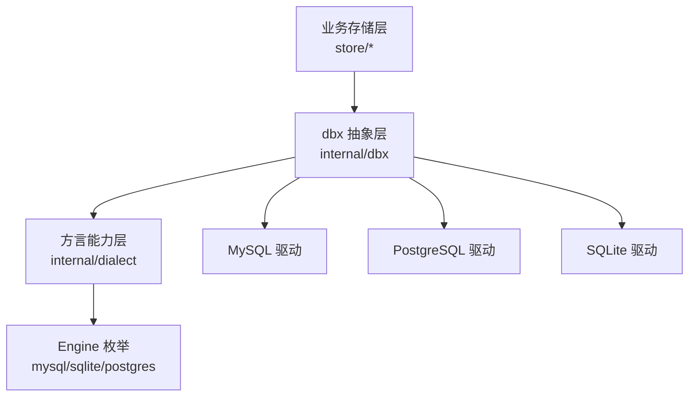
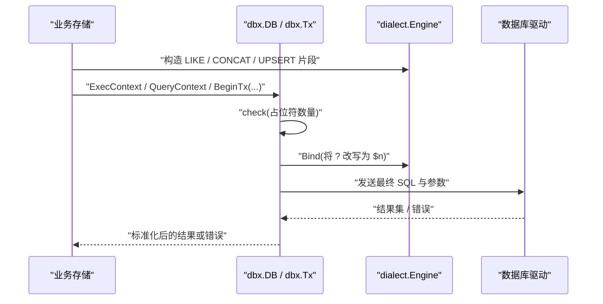
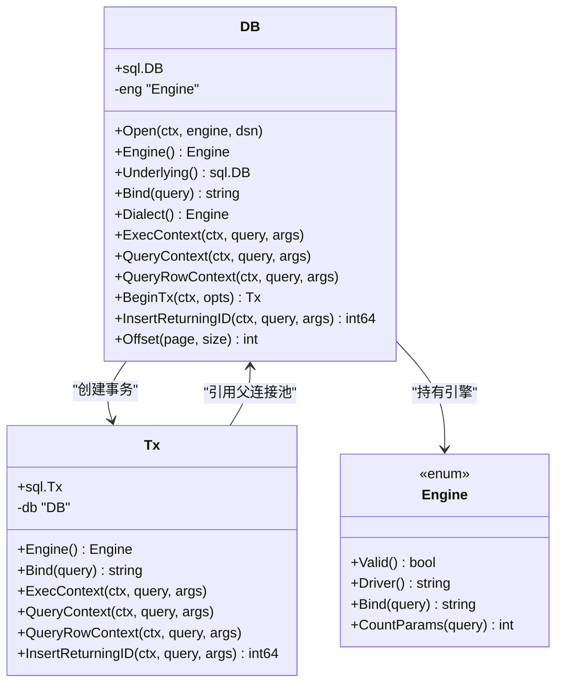
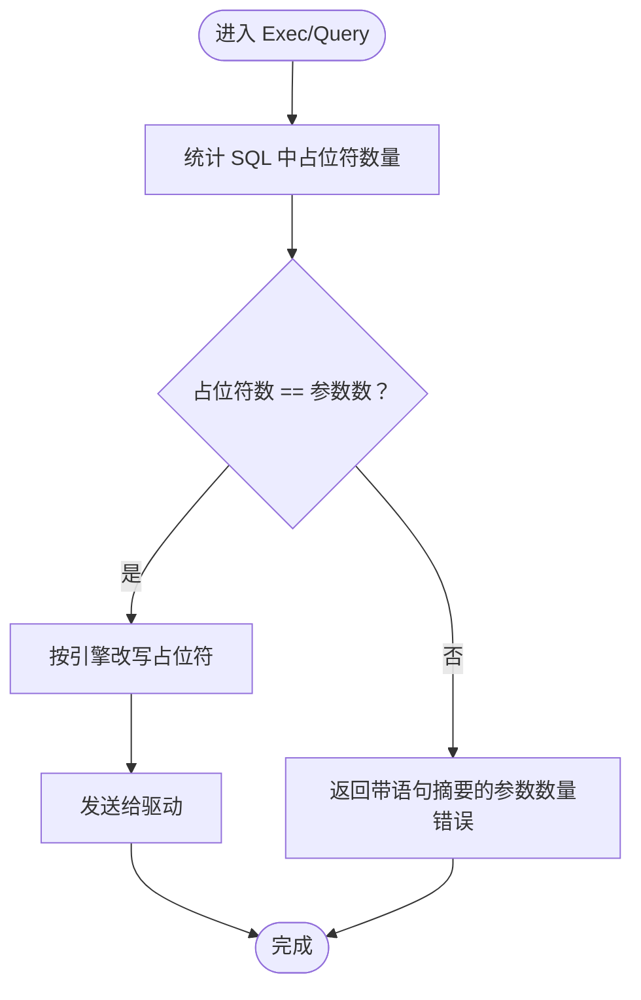
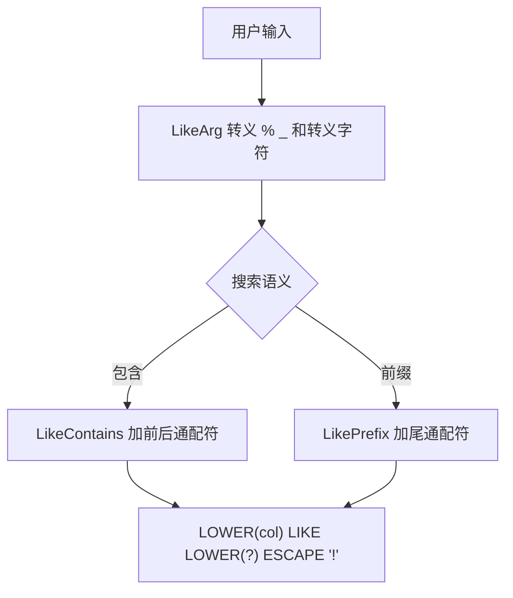
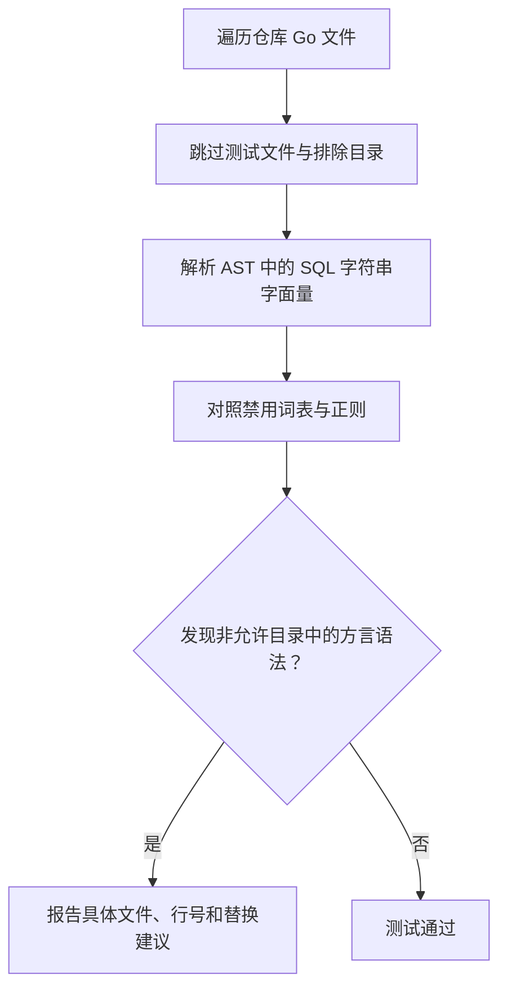
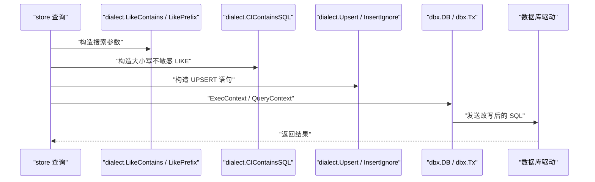
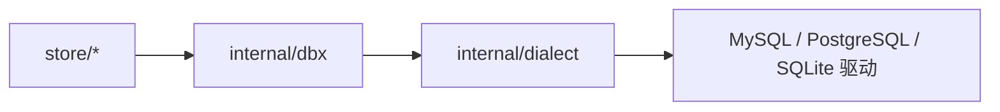
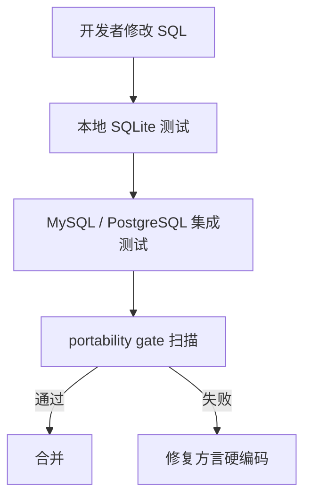

# 方言适配与 dbx 抽象层

**本文引用的文件**
- [dbx.go](https://github.com/YimingZhanshen/skin-nexus/blob/797ae1a/server/internal/dbx/dbx.go)
- [dialect.go](https://github.com/YimingZhanshen/skin-nexus/blob/797ae1a/server/internal/dialect/dialect.go)
- [like.go](https://github.com/YimingZhanshen/skin-nexus/blob/797ae1a/server/internal/dialect/like.go)
- [portability_gate_test.go](https://github.com/YimingZhanshen/skin-nexus/blob/797ae1a/server/internal/dialect/portability_gate_test.go)
- [engine_gate_integration_test.go](https://github.com/YimingZhanshen/skin-nexus/blob/797ae1a/server/internal/store/engine_gate_integration_test.go)

## 目录
1. [引言](#引言)
2. [项目结构](#项目结构)
3. [核心组件](#核心组件)
4. [架构总览](#架构总览)
5. [详细组件分析](#详细组件分析)
6. [依赖关系分析](#依赖关系分析)
7. [性能与连接配置](#性能与连接配置)
8. [调试与可移植性建议](#调试与可移植性建议)
9. [常见问题与解决方案](#常见问题与解决方案)
10. [结论](#结论)

## 引言
本仓库通过 `internal/dbx` 和 `internal/dialect` 两个内部包，把数据库驱动差异收敛到最小边界：上层业务存储逻辑只接触统一的 `DB`、`Tx` 与 `Engine` 能力，不再直接拼写 MySQL、PostgreSQL、SQLite 的方言语法。
- `dbx` 负责连接池、事务、SQL 占位符改写、参数规范化、错误归一化和跨引擎插入返回值等“执行层”职责。
- `dialect` 负责 LIKE 安全匹配、CONCAT、NULL 安全比较、UPSERT、版本查询、表存在检查、行级锁等“表达层”能力。
- `portability_gate_test` 通过静态扫描 SQL 字面量，强制把引擎特定语法限制在允许目录中，避免代码库逐步退化为“仅 MySQL 可用”。

## 项目结构
与本次文档相关的源码集中在 `server/internal` 下三个子包：
- `internal/dbx`：对 `database/sql` 的薄封装。
- `internal/dialect`：MySQL/MariaDB、PostgreSQL、SQLite 的统一方言能力。
- `internal/store`：使用上述两层的业务存储实现（本文不展开其具体实现，只说明调用路径）。

**图示来源**
- [dbx.go:1-40](https://github.com/YimingZhanshen/skin-nexus/blob/797ae1a/server/internal/dbx/dbx.go#L1-L40)
- [dialect.go:1-30](https://github.com/YimingZhanshen/skin-nexus/blob/797ae1a/server/internal/dialect/dialect.go#L1-L30)

**章节来源**
- [dbx.go:1-40](https://github.com/YimingZhanshen/skin-nexus/blob/797ae1a/server/internal/dbx/dbx.go#L1-L40)
- [dialect.go:1-30](https://github.com/YimingZhanshen/skin-nexus/blob/797ae1a/server/internal/dialect/dialect.go#L1-L30)

## 核心组件
### dbx 层职责
`dbx.DB` 嵌入标准库连接池，并保存当前引擎类型。它提供以下关键能力：
- 按引擎打开连接池，并根据 DSN 自动推断或回退为 MySQL。
- 统一执行方法：`ExecContext`、`QueryContext`、`QueryRowContext`。
- 统一事务：`BeginTx` 返回 `*Tx`，同样重写占位符并做参数校验。
- 占位符绑定改写：所有 SQL 都写 `?`；PostgreSQL 被转换为 `$n`。
- 参数校验：比对 SQL 中的占位符数量与传入参数数量，防止 SQLite 静默忽略多余参数。
- 参数规范化：SQLite 上把时间统一为 UTC；PostgreSQL 上把 Go `bool` 转为 `0/1`。
- 自增 ID 读取：MySQL 用 `LastInsertId`，其他引擎追加 `RETURNING id`。
- 重复键错误识别：聚合 MySQL、PostgreSQL、SQLite 的错误码。

### dialect 层职责
`dialect.Engine` 是受支持的三种引擎枚举，并提供：
- 占位符改写与计数：`Bind`、`CountParams`、`Placeholders`。
- 文本匹配：`LikeArg`、`LikeContains`、`LikePrefix`、`CIContainsSQL`、`CIEquals`。
- 聚合与拼接：`ConcatList`、`Concat`。
- UPSERT 与幂等写入：`Upsert`、`InsertIgnore`。
- NULL 安全比较：`NullSafeEq`。
- 元数据与锁：`VersionQuery`、`TableExistsQuery`、`SessionLock`、`LockSQL`。

**章节来源**
- [dbx.go:41-120](https://github.com/YimingZhanshen/skin-nexus/blob/797ae1a/server/internal/dbx/dbx.go#L41-L120)
- [dbx.go:121-200](https://github.com/YimingZhanshen/skin-nexus/blob/797ae1a/server/internal/dbx/dbx.go#L121-L200)
- [dialect.go:31-120](https://github.com/YimingZhanshen/skin-nexus/blob/797ae1a/server/internal/dialect/dialect.go#L31-L120)
- [dialect.go:201-391](https://github.com/YimingZhanshen/skin-nexus/blob/797ae1a/server/internal/dialect/dialect.go#L201-L391)

## 架构总览
调用路径从上层 store 进入 dbx，再落到具体驱动；方言函数由 dialect 生成 SQL 片段，再由 store 或 dbx 拼装后执行。

**图示来源**
- [dbx.go:80-120](https://github.com/YimingZhanshen/skin-nexus/blob/797ae1a/server/internal/dbx/dbx.go#L80-L120)
- [dbx.go:150-190](https://github.com/YimingZhanshen/skin-nexus/blob/797ae1a/server/internal/dbx/dbx.go#L150-L190)
- [dialect.go:100-160](https://github.com/YimingZhanshen/skin-nexus/blob/797ae1a/server/internal/dialect/dialect.go#L100-L160)

## 详细组件分析

### dbx.DB 与 dbx.Tx：连接、事务与参数边界
`dbx.DB` 不是简单包装器，而是“参数校验 + 占位符改写 + 引擎参数规范化”的统一入口。
`dbx.Tx` 复用父连接池的引擎信息，确保事务内语句也经过相同处理，避免事务分支悄悄绕过重写逻辑。

**图示来源**
- [dbx.go:41-120](https://github.com/YimingZhanshen/skin-nexus/blob/797ae1a/server/internal/dbx/dbx.go#L41-L120)
- [dbx.go:150-190](https://github.com/YimingZhanshen/skin-nexus/blob/797ae1a/server/internal/dbx/dbx.go#L150-L190)
- [dialect.go:31-120](https://github.com/YimingZhanshen/skin-nexus/blob/797ae1a/server/internal/dialect/dialect.go#L31-L120)

#### 占位符校验流程
`dbx.check` 在 SQL 到达驱动前统计占位符数量，并与参数长度比较。这是必要的防御措施：SQLite 驱动对多余参数较宽容，容易把“多传一个参数”变成“查不到任何行”，而不是编译期或驱动层报错。

**图示来源**
- [dbx.go:121-200](https://github.com/YimingZhanshen/skin-nexus/blob/797ae1a/server/internal/dbx/dbx.go#L121-L200)
- [dialect.go:120-190](https://github.com/YimingZhanshen/skin-nexus/blob/797ae1a/server/internal/dialect/dialect.go#L120-L190)

**章节来源**
- [dbx.go:41-120](https://github.com/YimingZhanshen/skin-nexus/blob/797ae1a/server/internal/dbx/dbx.go#L41-L120)
- [dbx.go:121-200](https://github.com/YimingZhanshen/skin-nexus/blob/797ae1a/server/internal/dbx/dbx.go#L121-L200)
- [dbx.go:300-424](https://github.com/YimingZhanshen/skin-nexus/blob/797ae1a/server/internal/dbx/dbx.go#L300-L424)

### dialect 层：LIKE、CONCAT、UPSERT 与跨引擎差异

#### LIKE 与安全转义
`dialect.LikeArg`、`LikeContains`、`LikePrefix`、`LikeEscapeClause`、`CIContainsSQL` 共同保证：
- 用户输入不会携带 `%`、`_` 或转义字符本身。
- 所有 LIKE 都显式指定 ESCAPE 字符。
- 大小写不敏感搜索不依赖某引擎默认排序规则，而是对两侧同时使用 `LOWER()`。

**图示来源**
- [like.go:1-51](https://github.com/YimingZhanshen/skin-nexus/blob/797ae1a/server/internal/dialect/like.go#L1-L51)

#### CONCAT 与字符串拼接
`dialect.Concat` 避免硬编码 `CONCAT(a,b)`：
- MySQL 使用逗号分隔的 `CONCAT(...)`。
- PostgreSQL 与 SQLite 使用 `||` 运算符。
- 空参数时返回空字符串字面量，避免调用方处理空列表。

#### UPSERT 与幂等写入
- `Upsert`：MySQL 使用 `ON DUPLICATE KEY UPDATE`，PostgreSQL 与 SQLite 使用 `ON CONFLICT ... DO UPDATE SET`。
- `InsertIgnore`：MySQL 使用 `INSERT IGNORE`，其他引擎使用 `ON CONFLICT DO NOTHING`。
- 两者都通过 `Placeholders` 生成 `?, ?, ?`，保持占位符风格一致。

#### NULL 安全比较
`NullSafeEq` 明确区分引擎实现：
- MySQL：`<=>`。
- SQLite：`IS`。
- PostgreSQL：`NOT (a IS DISTINCT FROM b)`。
- 未识别引擎回退为普通等值比较。

**章节来源**
- [like.go:1-51](https://github.com/YimingZhanshen/skin-nexus/blob/797ae1a/server/internal/dialect/like.go#L1-L51)
- [dialect.go:201-391](https://github.com/YimingZhanshen/skin-nexus/blob/797ae1a/server/internal/dialect/dialect.go#L201-L391)

### 可移植性门禁测试
`TestNoMySQLOnlySQLOutsideTheDialectLayer` 会遍历仓库中除测试文件和排除目录外的 `.go` 文件，解析 SQL 字面量，检测是否出现被禁止的 MySQL 专属写法，例如：
- `NOW(3)`、`NOW()`
- `DATE_ADD`
- `INSERT IGNORE`
- `ON DUPLICATE KEY`
- `GROUP_CONCAT`
- `IFNULL`
- `COLLATE utf8mb4`
- `CONCAT(`
- `FOR UPDATE`
- `information_schema`
- `DATABASE()`
- `@@session`
- `SHOW CREATE TABLE`

允许的目录只有：
- `internal/dialect`
- `internal/dbx`
- `internal/migrate`

这保证了“只有方言层和迁移层可以说方言，业务层必须走统一接口”。

**图示来源**
- [portability_gate_test.go:1-196](https://github.com/YimingZhanshen/skin-nexus/blob/797ae1a/server/internal/dialect/portability_gate_test.go#L1-L196)

**章节来源**
- [portability_gate_test.go:1-196](https://github.com/YimingZhanshen/skin-nexus/blob/797ae1a/server/internal/dialect/portability_gate_test.go#L1-L196)

### 实际调用路径示例
虽然本文不直接展示 store 实现细节，但根据 dbx 与 dialect 的职责划分，典型调用路径如下：

**图示来源**
- [like.go:1-51](https://github.com/YimingZhanshen/skin-nexus/blob/797ae1a/server/internal/dialect/like.go#L1-L51)
- [dialect.go:201-391](https://github.com/YimingZhanshen/skin-nexus/blob/797ae1a/server/internal/dialect/dialect.go#L201-L391)
- [dbx.go:80-120](https://github.com/YimingZhanshen/skin-nexus/blob/797ae1a/server/internal/dbx/dbx.go#L80-L120)

## 依赖关系分析
dbx 依赖 dialect，但不反向依赖业务 store；dialect 只暴露稳定的方言能力，不感知上层如何拼装 SQL。

**图示来源**
- [dbx.go:1-40](https://github.com/YimingZhanshen/skin-nexus/blob/797ae1a/server/internal/dbx/dbx.go#L1-L40)
- [dialect.go:1-30](https://github.com/YimingZhanshen/skin-nexus/blob/797ae1a/server/internal/dialect/dialect.go#L1-L30)

**章节来源**
- [dbx.go:1-40](https://github.com/YimingZhanshen/skin-nexus/blob/797ae1a/server/internal/dbx/dbx.go#L1-L40)
- [dialect.go:1-30](https://github.com/YimingZhanshen/skin-nexus/blob/797ae1a/server/internal/dialect/dialect.go#L1-L30)

## 性能与连接配置
dbx 对不同引擎做了差异化连接池配置：

| 引擎 | 最大连接数 | 空闲连接数 | 连接生命周期 | 特殊行为 |
| --- | ---: | ---: | ---: | --- |
| MySQL | 24 | 8 | 30 分钟 | 强制 `ParseTime`、UTC 会话时区 |
| PostgreSQL | 24 | 8 | 30 分钟 | 布尔参数转为 `0/1` |
| SQLite 内存库 | 1 | 1 | 不超时 | 单连接，避免 `:memory:` 分库 |
| SQLite 文件库 | 4 | 4 | 不超时 | WAL、`busy_timeout`、外键开关 |

这些设置避免两类问题：
- MySQL 会话时区与应用时钟不一致导致过期时间错乱。
- SQLite 内存库因连接池拆分导致测试表不可见。

**章节来源**
- [dbx.go:201-330](https://github.com/YimingZhanshen/skin-nexus/blob/797ae1a/server/internal/dbx/dbx.go#L201-L330)

## 调试与可移植性建议

### 开发期运行策略
- 至少针对 SQLite 与一种生产引擎运行测试，不要只在本地 SQLite 上验证。
- 对于仅在某个引擎有意义的集成测试，应使用 `requireEngines` 显式跳过，而不是让其他引擎“沉默通过”。

**图示来源**
- [engine_gate_integration_test.go:1-24](https://github.com/YimingZhanshen/skin-nexus/blob/797ae1a/server/internal/store/engine_gate_integration_test.go#L1-L24)
- [portability_gate_test.go:1-196](https://github.com/YimingZhanshen/skin-nexus/blob/797ae1a/server/internal/dialect/portability_gate_test.go#L1-L196)

### 调试步骤
1. 若出现“参数数量不匹配”，优先检查是否在 SQL 片段中混用了不同引擎的占位符形式，或新增了不带参数的方言函数。
2. 若 SQLite 能通过而线上失败，检查是否使用了 `CONCAT(`、`GROUP_CONCAT`、`NOW()`、`FOR UPDATE`、`information_schema`、`DATABASE()`、`COLLATE` 等被门禁禁止的写法。
3. 若时间比较异常，确认写入和比较是否都使用应用层 UTC 值，而不是依赖数据库时钟函数。
4. 若分页偏移为负数或超大值导致 500，使用 `dbx.Offset`，它会把非法页码和尺寸限制为有效范围。

**章节来源**
- [dbx.go:100-120](https://github.com/YimingZhanshen/skin-nexus/blob/797ae1a/server/internal/dbx/dbx.go#L100-L120)
- [dbx.go:201-260](https://github.com/YimingZhanshen/skin-nexus/blob/797ae1a/server/internal/dbx/dbx.go#L201-L260)
- [engine_gate_integration_test.go:1-24](https://github.com/YimingZhanshen/skin-nexus/blob/797ae1a/server/internal/store/engine_gate_integration_test.go#L1-L24)

## 常见问题与解决方案

### 1. 混用方言函数
**现象**：在 store 中直接写 `CONCAT(a, b)`、`GROUP_CONCAT(col)`、`IFNULL(a,b)`、`NOW()`。
**原因**：绕过 `dialect.Concat`、`dialect.ConcatList`、`COALESCE`、应用层时间。
**解决**：
- 字符串拼接使用 `dialect.Concat(parts...)`。
- 行聚合使用 `dialect.ConcatList(expr)`。
- 空值回退使用标准 `COALESCE`。
- 时间比较使用 Go 侧 UTC 值，不在 SQL 中调用 `NOW()`。

**章节来源**
- [portability_gate_test.go:20-60](https://github.com/YimingZhanshen/skin-nexus/blob/797ae1a/server/internal/dialect/portability_gate_test.go#L20-L60)
- [dialect.go:260-391](https://github.com/YimingZhanshen/skin-nexus/blob/797ae1a/server/internal/dialect/dialect.go#L260-L391)

### 2. 忽略大小写排序与 LIKE 差异
**现象**：同一搜索在 MySQL 能命中，在 PostgreSQL 或 SQLite 漏掉大小写不同的记录。
**原因**：依赖列默认排序规则或 COLLATE，而不是显式 `LOWER()`。
**解决**：
- 使用 `dialect.CIContainsSQL(col)` 或 `dialect.CIEquals(col)`。
- 绑定值来自 `dialect.LikeContains` 或 `dialect.LikePrefix`。

**章节来源**
- [like.go:1-51](https://github.com/YimingZhanshen/skin-nexus/blob/797ae1a/server/internal/dialect/like.go#L1-L51)
- [dialect.go:201-240](https://github.com/YimingZhanshen/skin-nexus/blob/797ae1a/server/internal/dialect/dialect.go#L201-L240)

### 3. ON CONFLICT vs REPLACE vs INSERT IGNORE
**现象**：UPSERT 在 MySQL 正常，在 PostgreSQL 或 SQLite 报语法错误。
**原因**：不同引擎 UPSERT 语法不同。
**解决**：
- 覆盖冲突并更新字段：使用 `dialect.Upsert(table, cols, keys, update)`。
- 幂等插入且忽略冲突：使用 `dialect.InsertIgnore(table, cols)`。
- 不要在业务层手写 `REPLACE`、`INSERT IGNORE`、`ON DUPLICATE KEY`。

**章节来源**
- [dialect.go:240-320](https://github.com/YimingZhanshen/skin-nexus/blob/797ae1a/server/internal/dialect/dialect.go#L240-L320)
- [portability_gate_test.go:20-60](https://github.com/YimingZhanshen/skin-nexus/blob/797ae1a/server/internal/dialect/portability_gate_test.go#L20-L60)

### 4. TIMESTAMP 精度与时区问题
**现象**：SQLite 上时间比较看似相等却查不到，或 MySQL 上线后过期时间偏差若干小时。
**原因**：
- SQLite 以文本存储时间，时区表示不同会导致文本不等。
- MySQL 会话时区可能与 UTC 不一致。
**解决**：
- dbx 在 SQLite 上把时间参数统一转为 UTC。
- MySQL 连接启用 `ParseTime` 并将会话时区设为 `+00:00`。
- 应用层始终使用 UTC 时间值进行写入和比较。

**章节来源**
- [dbx.go:201-260](https://github.com/YimingZhanshen/skin-nexus/blob/797ae1a/server/internal/dbx/dbx.go#L201-L260)
- [dbx.go:260-330](https://github.com/YimingZhanshen/skin-nexus/blob/797ae1a/server/internal/dbx/dbx.go#L260-L330)

### 5. LIMIT/OFFSET 语义与负偏移
**现象**：分页计算溢出或产生负 OFFSET，导致各引擎各自报错。
**原因**：请求参数未经保护，`(page-1)*size` 可能溢出或为负。
**解决**：
- 使用 `dbx.Offset(page, size)`，它会限制最小页码、最小尺寸和最大偏移。
- SELECT … LIMIT 是通用语法；DELETE/UPDATE 顶层 LIMIT 是 MySQL 扩展，应避免。

**章节来源**
- [dbx.go:100-120](https://github.com/YimingZhanshen/skin-nexus/blob/797ae1a/server/internal/dbx/dbx.go#L100-L120)
- [portability_gate_test.go:60-120](https://github.com/YimingZhanshen/skin-nexus/blob/797ae1a/server/internal/dialect/portability_gate_test.go#L60-L120)

### 6. 自增 ID 读取方式不同
**现象**：非 MySQL 引擎无法通过 `LastInsertId` 获取插入 ID。
**原因**：pgx 不支持该 API，SQLite 仅在 rowid 场景正确返回。
**解决**：
- 使用 `db.InsertReturningID` 或事务形式的同名方法。
- 对应表主键命名为 `id`，并在非 MySQL 引擎上追加 `RETURNING id`。

**章节来源**
- [dbx.go:360-424](https://github.com/YimingZhanshen/skin-nexus/blob/797ae1a/server/internal/dbx/dbx.go#L360-L424)

### 7. 重复键错误识别
**现象**：唯一键冲突在不同引擎返回不同错误格式。
**解决**：
- 使用 `dbx.IsDuplicateKey(err)` 统一判断，避免把 PostgreSQL 或 SQLite 的唯一约束错误当作未知 500。

**章节来源**
- [dbx.go:330-360](https://github.com/YimingZhanshen/skin-nexus/blob/797ae1a/server/internal/dbx/dbx.go#L330-L360)

## 结论
`dbx` 与 `dialect` 共同构成了本项目数据库访问的可移植边界：
- 业务层只关心“做什么”，不关心“哪个引擎怎么写”。
- 所有引擎差异集中在 `dialect` 生成的 SQL 片段和 `dbx` 的连接、参数、错误处理逻辑中。
- `portability_gate_test` 作为静态护栏，阻止 MySQL 专属语法扩散到业务层。
- 开发阶段必须同时验证 SQLite 与至少一种生产引擎，并使用 `requireEngines` 明确标注引擎相关测试。

只要遵循“SQL 片段走 `dialect`、执行走 `dbx`、参数走 `?`、时间走 UTC、分页走 `Offset`、冲突走 Upsert/InsertIgnore”的原则，就能显著降低跨引擎部署风险。
