# 本地账号与密码认证

**本文引用的文件**
- [service.go](https://github.com/YimingZhanshen/skin-nexus/blob/797ae1a/server/internal/account/service.go)
- [password.go](https://github.com/YimingZhanshen/skin-nexus/blob/797ae1a/server/internal/auth/password.go)
- [webapi_password.go](https://github.com/YimingZhanshen/skin-nexus/blob/797ae1a/server/internal/webapi/password.go)
- [webapi_setup.go](https://github.com/YimingZhanshen/skin-nexus/blob/797ae1a/server/internal/webapi/setup.go)
- [webapi_profile.go](https://github.com/YimingZhanshen/skin-nexus/blob/797ae1a/server/internal/webapi/profile.go)
- [store_setup.go](https://github.com/YimingZhanshen/skin-nexus/blob/797ae1a/server/internal/store/setup.go)
- [store_web.go](https://github.com/YimingZhanshen/skin-nexus/blob/797ae1a/server/internal/store/web.go)
- [usersbrief.go](https://github.com/YimingZhanshen/skin-nexus/blob/797ae1a/server/internal/store/usersbrief.go)
- [ygg_models.go](https://github.com/YimingZhanshen/skin-nexus/blob/797ae1a/server/internal/ygg/models.go)
- [ygg_http.go](https://github.com/YimingZhanshen/skin-nexus/blob/797ae1a/server/internal/ygg/http.go)
- [0001_init.sql](https://github.com/YimingZhanshen/skin-nexus/blob/797ae1a/server/migrations/sqlite/0001_init.sql)
- [0002_web_sessions.sql](https://github.com/YimingZhanshen/skin-nexus/blob/797ae1a/server/migrations/sqlite/0002_web_sessions.sql)
- [0009_schema_align.sql](https://github.com/YimingZhanshen/skin-nexus/blob/797ae1a/server/migrations/sqlite/0009_schema_align.sql)
- [server.go](https://github.com/YimingZhanshen/skin-nexus/blob/797ae1a/server/cmd/skin-nexus/server.go)

## 目录
1. [简介](#简介)
2. [项目结构定位](#项目结构定位)
3. [核心组件](#核心组件)
4. [架构总览](#架构总览)
5. [详细组件分析](#详细组件分析)
6. [依赖关系分析](#依赖关系分析)
7. [性能与扩展性](#性能与扩展性)
8. [安全建议](#安全建议)
9. [常见问题与排查](#常见问题与排查)
10. [结论](#结论)

## 简介
本文聚焦“本地账号与密码认证”的完整生命周期，覆盖：
- 用户注册、昵称校验与冲突处理；
- 密码哈希算法与迁移策略；
- 浏览器登录、会话建立、刷新与注销；
- 玩家（Player）数据如何参与 Yggdrasil、OIDC 与 Web API；
- 典型请求响应示例与错误码；
- 安全加固与故障排查。

该实现以 Go 后端为主，数据库使用 SQLite/MySQL/PostgreSQL 等可移植引擎，并通过 `internal/store` 抽象数据库操作；Web API 暴露 `/api/v1/*` 路由，Yggdrasil 兼容接口位于 `/api/yggdrasil/*`，OIDC 相关逻辑在 `internal/oidc`。

## 项目结构定位
本地认证涉及三层：
- **Web API 层**：接收浏览器请求，负责参数校验、限流、审计、会话 Cookie 与错误映射。
- **账户与存储层**：`account.Service` 提供角色/纹理等业务能力；`store` 封装用户、玩家、会话、邮箱验证、权限等持久化语义。
- **密码与安全层**：`auth.Password` 支持现代 PHC（bcrypt、argon2i/argon2id）与多种遗留哈希，并负责懒升级。

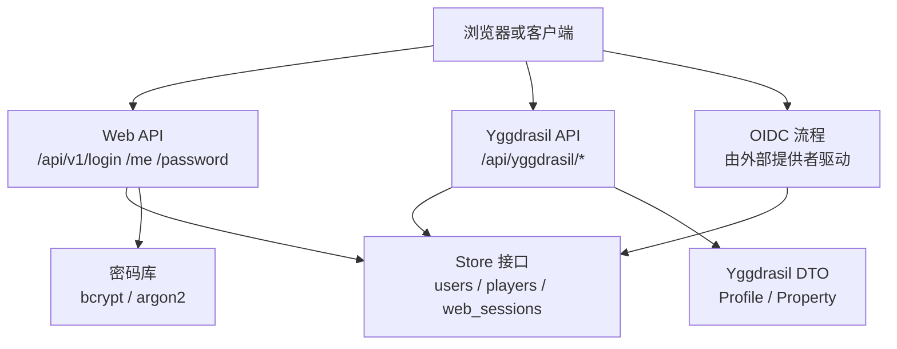

**图示来源**
- [webapi_password.go:1-80](https://github.com/YimingZhanshen/skin-nexus/blob/797ae1a/server/internal/webapi/password.go#L1-L80)
- [ygg_http.go:1-80](https://github.com/YimingZhanshen/skin-nexus/blob/797ae1a/server/internal/ygg/http.go#L1-L80)
- [ygg_models.go:1-60](https://github.com/YimingZhanshen/skin-nexus/blob/797ae1a/server/internal/ygg/models.go#L1-L60)
- [store_web.go:1-60](https://github.com/YimingZhanshen/skin-nexus/blob/797ae1a/server/internal/store/web.go#L1-L60)

**章节来源**
- [server.go:1-24](https://github.com/YimingZhanshen/skin-nexus/blob/797ae1a/server/cmd/skin-nexus/server.go#L1-L24)
- [0001_init.sql:1-40](https://github.com/YimingZhanshen/skin-nexus/blob/797ae1a/server/migrations/sqlite/0001_init.sql#L1-L40)

## 核心组件
- **Web API 密码与会话处理器**：处理登录、改密、忘记密码、重置、头像与账号删除等浏览器端能力。
- **账户服务 `account.Service`**：面向角色与纹理的业务层，定义 Player 投影、权限、昵称限制、Union 通知钩子等。
- **密码库 `auth`**：统一 bcrypt/argon2i/argon2id 与现代 PHP 风格哈希，同时保留 legacy 迁移兼容。
- **Store 接口**：封装用户创建、昵称唯一性检查、密码验证、会话增删查、邮箱验证标记、权限读取等。
- **Yggdrasil 模型**：把 UUID、皮肤、披风组装为 Base64 `textures` property，供 Minecraft 客户端与服务端校验。
- **OIDC 简报**：从 `users` 表读取昵称、邮箱与 `email_verified`，用于 ID Token 与用户信息声明。

**章节来源**
- [webapi_password.go:1-120](https://github.com/YimingZhanshen/skin-nexus/blob/797ae1a/server/internal/webapi/password.go#L1-L120)
- [service.go:1-120](https://github.com/YimingZhanshen/skin-nexus/blob/797ae1a/server/internal/account/service.go#L1-L120)
- [password.go:1-60](https://github.com/YimingZhanshen/skin-nexus/blob/797ae1a/server/internal/auth/password.go#L1-L60)
- [store_web.go:1-120](https://github.com/YimingZhanshen/skin-nexus/blob/797ae1a/server/internal/store/web.go#L1-L120)
- [ygg_models.go:1-105](https://github.com/YimingZhanshen/skin-nexus/blob/797ae1a/server/internal/ygg/models.go#L1-L105)
- [usersbrief.go:1-21](https://github.com/YimingZhanshen/skin-nexus/blob/797ae1a/server/internal/store/usersbrief.go#L1-L21)

## 架构总览
下图展示一次浏览器登录到会话生效的关键调用链。

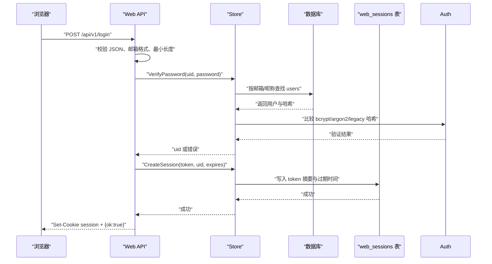

**图示来源**
- [webapi_password.go:1-120](https://github.com/YimingZhanshen/skin-nexus/blob/797ae1a/server/internal/webapi/password.go#L1-L120)
- [store_web.go:60-120](https://github.com/YimingZhanshen/skin-nexus/blob/797ae1a/server/internal/store/web.go#L60-L120)

**章节来源**
- [webapi_password.go:1-120](https://github.com/YimingZhanshen/skin-nexus/blob/797ae1a/server/internal/webapi/password.go#L1-L120)
- [store_web.go:60-120](https://github.com/YimingZhanshen/skin-nexus/blob/797ae1a/server/internal/store/web.go#L60-L120)

## 详细组件分析

### 1. 用户注册与安装向导
系统提供两条注册入口：
- **首次安装向导**：`POST /api/v1/setup`，用于站点初始化，创建超级管理员（permission=2）。
- **普通注册**：通过 `Store.CreateUser` 写入用户，调用方负责生成现代 PHC 哈希。

#### 安装向导流程
安装向导要求：
- 站点名、站点地址可选但需合法；
- 昵称必填；
- 密码至少 8 字符；
- 邮箱可选且需符合正则；
- `player_limit` 默认 3，上限 16；
- 使用 `auth.HashArgon2id` 生成哈希；
- 通过 `Store.ClaimSetup` 原子写入 `setup_done` 标志与用户行。

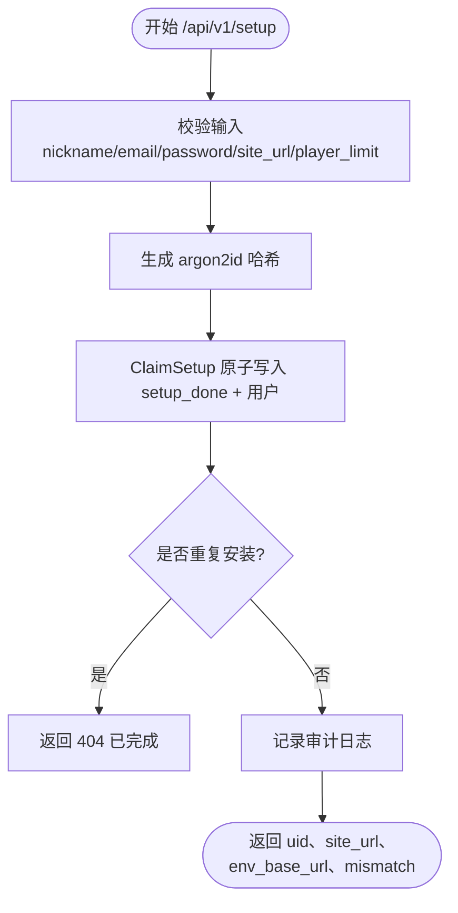

**图示来源**
- [webapi_setup.go:1-173](https://github.com/YimingZhanshen/skin-nexus/blob/797ae1a/server/internal/webapi/setup.go#L1-L173)
- [store_setup.go:1-105](https://github.com/YimingZhanshen/skin-nexus/blob/797ae1a/server/internal/store/setup.go#L1-L105)

#### 普通注册路径
普通注册的典型步骤为：
1. 校验昵称与邮箱格式；
2. 检查昵称是否已被占用；
3. 调用 `Store.CreateUser`；
4. 失败时区分 `ErrDuplicate` 与其他数据库错误；
5. 成功后返回用户标识。

`Store.insertUser` 会把 `email_verified` 写为 0，`can_join_server` 写为 1，`permission` 默认为 0，`password_algo` 固定为 `argon2id`。

**章节来源**
- [webapi_setup.go:1-173](https://github.com/YimingZhanshen/skin-nexus/blob/797ae1a/server/internal/webapi/setup.go#L1-L173)
- [store_setup.go:1-105](https://github.com/YimingZhanshen/skin-nexus/blob/797ae1a/server/internal/store/setup.go#L1-L105)
- [store_web.go:1-60](https://github.com/YimingZhanshen/skin-nexus/blob/797ae1a/server/internal/store/web.go#L1-L60)
- [0009_schema_align.sql:1-8](https://github.com/YimingZhanshen/skin-nexus/blob/797ae1a/server/migrations/sqlite/0009_schema_align.sql#L1-L8)

### 2. 昵称校验与复用
昵称在 `users` 表上有大小写不敏感的唯一索引：
- SQLite/MySQL/PostgreSQL 均通过表达式索引或排序规则保证 `LOWER(nickname)` 唯一；
- `NicknameTaken` 使用 `CIEquals` 判断是否存在相同昵称；
- 更新昵称时若冲突返回 `ErrDuplicate`，Web API 映射为 HTTP 409；
- 昵称回收后重新注册会触发唯一约束冲突，提示“昵称已被占用”。

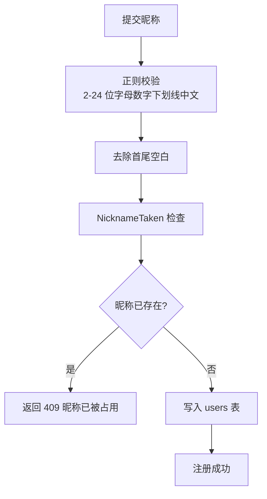

**图示来源**
- [webapi_profile.go:1-120](https://github.com/YimingZhanshen/skin-nexus/blob/797ae1a/server/internal/webapi/profile.go#L1-L120)
- [store_web.go:40-100](https://github.com/YimingZhanshen/skin-nexus/blob/797ae1a/server/internal/store/web.go#L40-L100)
- [0001_init.sql:1-40](https://github.com/YimingZhanshen/skin-nexus/blob/797ae1a/server/migrations/sqlite/0001_init.sql#L1-L40)

**章节来源**
- [webapi_profile.go:1-120](https://github.com/YimingZhanshen/skin-nexus/blob/797ae1a/server/internal/webapi/profile.go#L1-L120)
- [store_web.go:40-100](https://github.com/YimingZhanshen/skin-nexus/blob/797ae1a/server/internal/store/web.go#L40-L100)
- [0001_init.sql:1-40](https://github.com/YimingZhanshen/skin-nexus/blob/797ae1a/server/migrations/sqlite/0001_init.sql#L1-L40)

### 3. 密码哈希算法与迁移
`auth` 包支持两类哈希：
- **现代 PHC**：bcrypt `$2y$`、argon2i `$argon2i$`、argon2id `$argon2id$`；
- **遗留哈希**：MD5、SHA256、SHA512、带盐变体、AuthMe 格式等。

新注册用户始终使用 `auth.HashArgon2id` 生成 `$argon2id$` 哈希。
首次登录后若发现用户仍使用遗留算法，可通过 `NeedsRehash` 与 `RehashPassword` 进行懒升级。

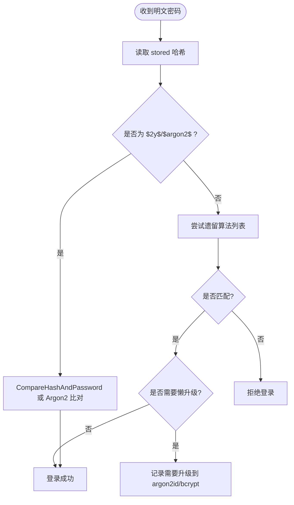

**图示来源**
- [password.go:1-120](https://github.com/YimingZhanshen/skin-nexus/blob/797ae1a/server/internal/auth/password.go#L1-L120)
- [password.go:200-280](https://github.com/YimingZhanshen/skin-nexus/blob/797ae1a/server/internal/auth/password.go#L200-L280)
- [store_web.go:120-200](https://github.com/YimingZhanshen/skin-nexus/blob/797ae1a/server/internal/store/web.go#L120-L200)

**章节来源**
- [password.go:1-120](https://github.com/YimingZhanshen/skin-nexus/blob/797ae1a/server/internal/auth/password.go#L1-L120)
- [password.go:200-280](https://github.com/YimingZhanshen/skin-nexus/blob/797ae1a/server/internal/auth/password.go#L200-L280)
- [store_web.go:120-200](https://github.com/YimingZhanshen/skin-nexus/blob/797ae1a/server/internal/store/web.go#L120-L200)

### 4. 浏览器登录与会话生命周期
#### 登录
典型请求：
```http
POST /api/v1/login HTTP/1.1
Host: example.com
Content-Type: application/json

{
  "identifier": "playername",
  "password": "mysecret"
}
```

成功响应：
```http
HTTP/1.1 200 OK
Content-Type: application/json
Set-Cookie: session=<opaque-token>; Path=/; HttpOnly; SameSite=Lax; Secure

{
  "ok": true
}
```

失败分支包括：
- 无效 JSON → 400；
- 邮箱或昵称不存在 → 401；
- 凭据不正确 → 401；
- 未配置邮箱验证门控时可能允许登录；
- 限流器触发 → 429。

#### 会话建立
会话令牌不直接存入数据库，而是先计算摘要：
- 服务端生成随机 token；
- 将 `sha256(token)` 写入 `web_sessions.token`；
- 查询时使用同样摘要匹配；
- 会话携带 `user_id` 与 `expires_at`。

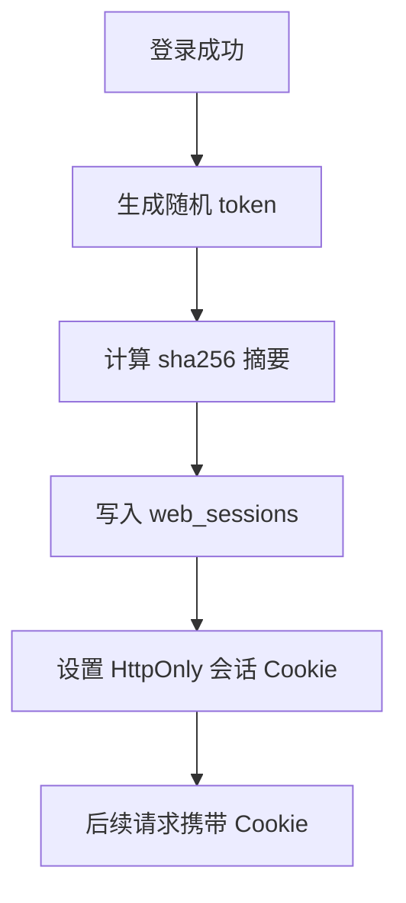

**图示来源**
- [webapi_password.go:1-120](https://github.com/YimingZhanshen/skin-nexus/blob/797ae1a/server/internal/webapi/password.go#L1-L120)
- [store_web.go:60-120](https://github.com/YimingZhanshen/skin-nexus/blob/797ae1a/server/internal/store/web.go#L60-L120)
- [0002_web_sessions.sql:1-8](https://github.com/YimingZhanshen/skin-nexus/blob/797ae1a/server/migrations/sqlite/0002_web_sessions.sql#L1-L8)

**章节来源**
- [webapi_password.go:1-120](https://github.com/YimingZhanshen/skin-nexus/blob/797ae1a/server/internal/webapi/password.go#L1-L120)
- [store_web.go:60-120](https://github.com/YimingZhanshen/skin-nexus/blob/797ae1a/server/internal/store/web.go#L60-L120)
- [0002_web_sessions.sql:1-8](https://github.com/YimingZhanshen/skin-nexus/blob/797ae1a/server/migrations/sqlite/0002_web_sessions.sql#L1-L8)

#### 会话刷新
会话刷新通常由 Yggdrasil 或 Web API 的受保护接口触发：
- 解析 Cookie 中的 session token；
- 调用 `SessionUser` 获取 `user_id`；
- 若过期则返回未授权；
- 成功则继续业务逻辑。

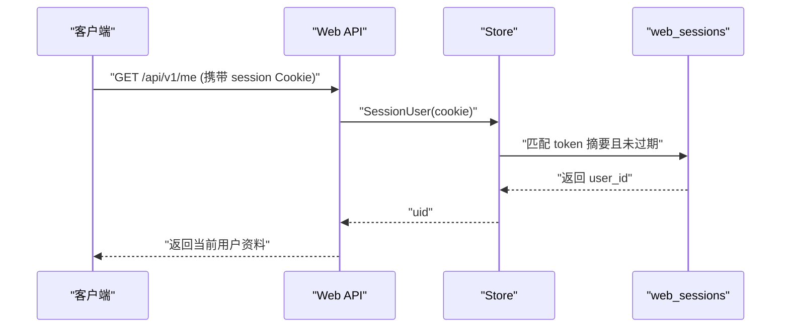

**图示来源**
- [store_web.go:60-120](https://github.com/YimingZhanshen/skin-nexus/blob/797ae1a/server/internal/store/web.go#L60-L120)

#### 注销与账号删除
- **密码修改**：会撤销所有 Yggdrasil token、OIDC/Launcher 授权，并删除除当前 Cookie 外的其他 Web 会话；
- **账号删除**：级联删除 session、token、closet、uuid_map 中的关联；审计保留 actor_uid；最后清空 Cookie，使前端放弃状态。

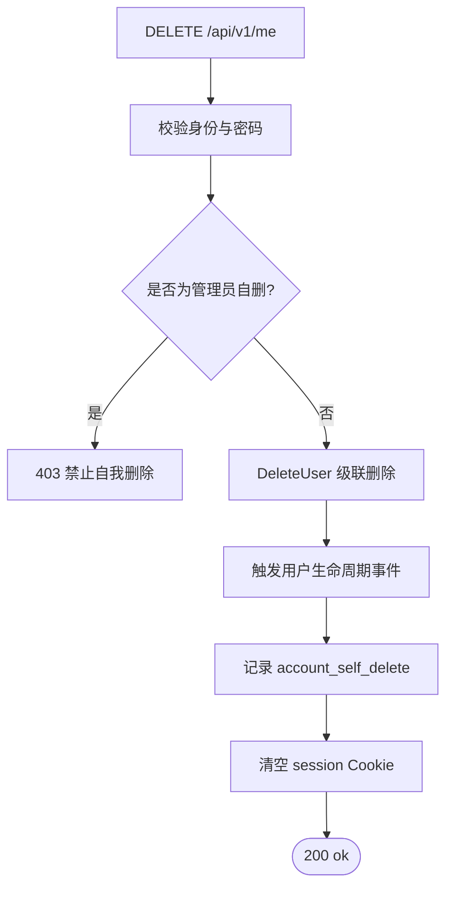

**图示来源**
- [webapi_profile.go:120-220](https://github.com/YimingZhanshen/skin-nexus/blob/797ae1a/server/internal/webapi/profile.go#L120-L220)

**章节来源**
- [webapi_password.go:1-120](https://github.com/YimingZhanshen/skin-nexus/blob/797ae1a/server/internal/webapi/password.go#L1-L120)
- [webapi_profile.go:120-220](https://github.com/YimingZhanshen/skin-nexus/blob/797ae1a/server/internal/webapi/profile.go#L120-L220)
- [store_web.go:60-120](https://github.com/YimingZhanshen/skin-nexus/blob/797ae1a/server/internal/store/web.go#L60-L120)

### 5. 玩家（Player）与账户的关系
`users` 表与 `players` 表通过 `uid` 关联：
- `users.id` 是账户主键；
- `players.uid` 指向 `users.id`；
- `players.name` 是游戏内显示名称；
- `uuid_map.name` 将玩家名映射到 32 位小写十六进制 UUID；
- `textures` 表保存皮肤与披风的 hash、model、上传者等信息。

`account.Player` 是传输中性投影，包含：
- `ID`、`UID`、`Name`、`UUID`；
- `SkinTID`、`CapeTID`；
- `SkinHash`、`CapeHash`；
- `SkinModel`。

Yggdrasil 的 `Profile` 使用：
- `id` 为 UUID；
- `name` 为玩家名；
- `properties` 中 `textures` 是 Base64 编码的结构，包含皮肤 URL、披风 URL、模型等。

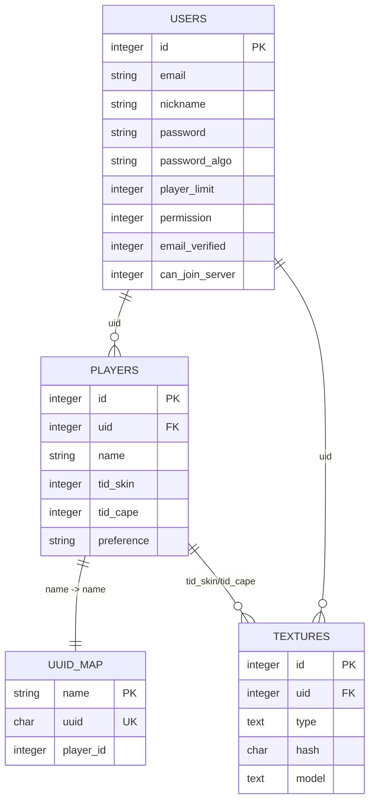

**图示来源**
- [0001_init.sql:1-104](https://github.com/YimingZhanshen/skin-nexus/blob/797ae1a/server/migrations/sqlite/0001_init.sql#L1-L104)
- [service.go:100-160](https://github.com/YimingZhanshen/skin-nexus/blob/797ae1a/server/internal/account/service.go#L100-L160)
- [ygg_models.go:1-105](https://github.com/YimingZhanshen/skin-nexus/blob/797ae1a/server/internal/ygg/models.go#L1-L105)

**章节来源**
- [0001_init.sql:1-104](https://github.com/YimingZhanshen/skin-nexus/blob/797ae1a/server/migrations/sqlite/0001_init.sql#L1-L104)
- [service.go:100-160](https://github.com/YimingZhanshen/skin-nexus/blob/797ae1a/server/internal/account/service.go#L100-L160)
- [ygg_models.go:1-105](https://github.com/YimingZhanshen/skin-nexus/blob/797ae1a/server/internal/ygg/models.go#L1-L105)

### 6. Yggdrasil/OIDC/Web API 中的玩家数据
- **Yggdrasil**：`Profile` 序列化 `id`、`name`、`properties`；`AssembleTextures` 根据皮肤/披风 URL 与模型字段生成 `textures` property，并可签名；`uploadableTextures` 固定为 `skin,cape`。
- **OIDC**：`UserBrief` 从 `users` 表读取 `nickname`、`email`、`email_verified`，作为用户信息声明的基础。
- **Web API**：`AccountView` 暴露 `nickname`、`permission`、`playerLimit`、`playerCount`、`avatarUrl`、`storageBytes` 等用户中心信息。

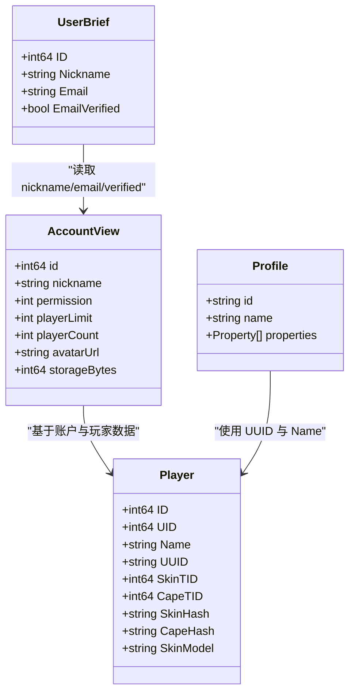

**图示来源**
- [service.go:120-160](https://github.com/YimingZhanshen/skin-nexus/blob/797ae1a/server/internal/account/service.go#L120-L160)
- [ygg_models.go:1-60](https://github.com/YimingZhanshen/skin-nexus/blob/797ae1a/server/internal/ygg/models.go#L1-L60)
- [usersbrief.go:1-21](https://github.com/YimingZhanshen/skin-nexus/blob/797ae1a/server/internal/store/usersbrief.go#L1-L21)

**章节来源**
- [service.go:120-160](https://github.com/YimingZhanshen/skin-nexus/blob/797ae1a/server/internal/account/service.go#L120-L160)
- [ygg_models.go:1-60](https://github.com/YimingZhanshen/skin-nexus/blob/797ae1a/server/internal/ygg/models.go#L1-L60)
- [usersbrief.go:1-21](https://github.com/YimingZhanshen/skin-nexus/blob/797ae1a/server/internal/store/usersbrief.go#L1-L21)

## 依赖关系分析
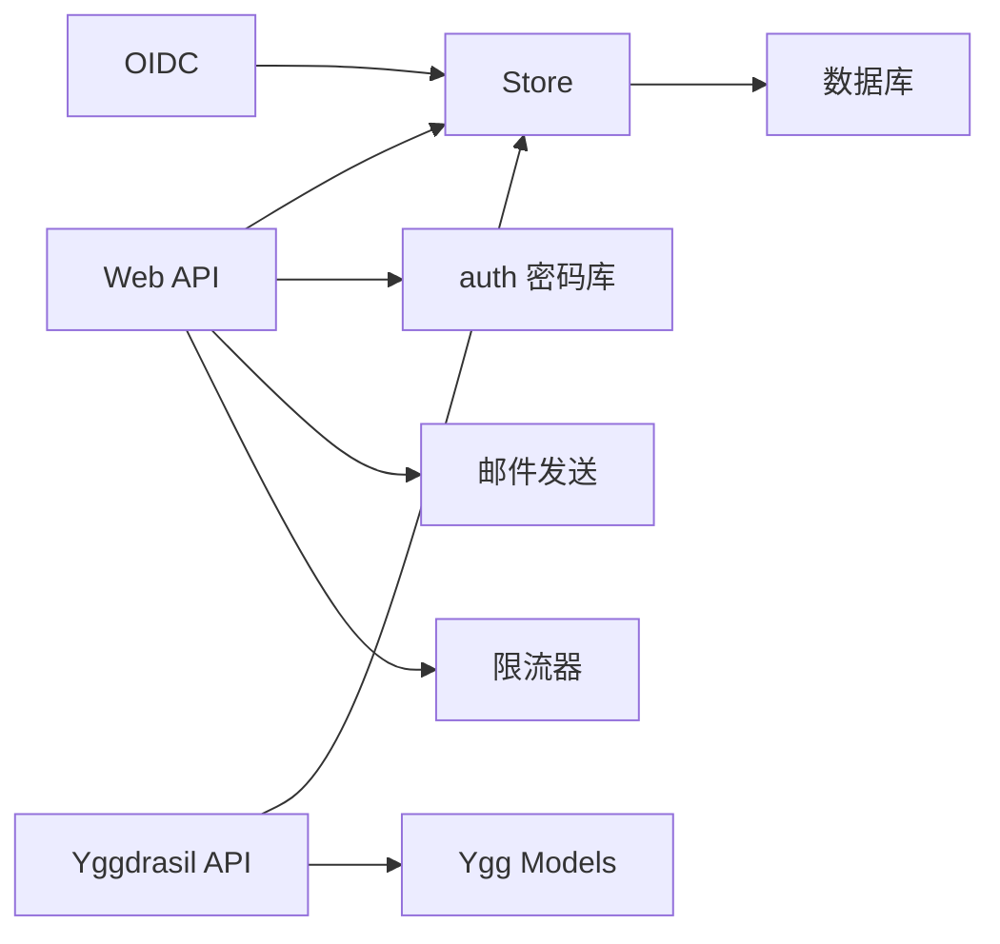

**图示来源**
- [webapi_password.go:1-80](https://github.com/YimingZhanshen/skin-nexus/blob/797ae1a/server/internal/webapi/password.go#L1-L80)
- [ygg_http.go:1-80](https://github.com/YimingZhanshen/skin-nexus/blob/797ae1a/server/internal/ygg/http.go#L1-L80)

**章节来源**
- [webapi_password.go:1-80](https://github.com/YimingZhanshen/skin-nexus/blob/797ae1a/server/internal/webapi/password.go#L1-L80)
- [ygg_http.go:1-80](https://github.com/YimingZhanshen/skin-nexus/blob/797ae1a/server/internal/ygg/http.go#L1-L80)

## 性能与扩展性
- HTTP Server 设置了读头超时、读超时、写超时与空闲超时，防止慢客户端耗尽连接。
- 密码哈希采用 bcrypt/argon2id，成本参数可调；遗留哈希仅用于迁移与兼容。
- 会话表对 `user_id` 有索引，`token` 是主键，查询效率较高。
- 昵称/邮箱唯一索引避免全表扫描冲突。
- 限流器按 IP 与邮箱维度滑动窗口，适合防暴力破解与邮件滥用。

[本节为通用指导，无需具体文件引用]

## 安全建议
- **最小密码长度**：安装向导与改密接口均要求至少 8 字符；生产环境可结合策略进一步要求复杂度。
- **CSRF 防护**：Web API 应配合前端 SameSite Cookie 与跨站请求策略；管理面板与敏感操作建议使用 CSRF Token 或 Bearer Token。
- **登录限流**：利用共享限流器对登录、找回密码分别设置 IP 维度与目标维度限制。
- **失败重试计数**：对同一邮箱/昵称的失败次数做短期计数，超过阈值返回 429 并引导冷却。
- **敏感日志脱敏**：访问日志与审计日志应避免输出明文密码、session token、邮箱正文；本项目已有访问日志脱敏与审计记录机制。
- **会话安全**：启用 `Secure`、`HttpOnly`、`SameSite=Lax`；HTTPS 部署下强制 Secure。
- **密码变更联动**：改密应撤销旧授权、刷新会话，避免泄露后仍可长期登录。
- **邮箱验证门控**：若启用邮箱验证门控，未验证邮箱应阻止部分敏感操作或服务器加入流程。

[本节为通用指导，无需具体文件引用]

## 常见问题与排查

### 忘记密码重置邮件未收到
排查步骤：
1. 确认 SMTP 配置是否可用；
2. 检查邮箱地址是否有效；
3. 查看限流器是否因 IP 或邮箱频率过高拒绝；
4. 检查邮件发送队列与重试任务；
5. 查看审计日志中是否有密码重置相关记录。

相关逻辑：
- `handleForgotPassword` 对邮箱格式、SMTP 配置、限流器进行检查；
- 未知邮箱仍返回 `{ok:true}`，避免枚举；
- 重置令牌为 32 字节随机值，仅存 SHA-256 摘要，30 分钟 TTL，单次使用。

**章节来源**
- [webapi_password.go:120-305](https://github.com/YimingZhanshen/skin-nexus/blob/797ae1a/server/internal/webapi/password.go#L120-L305)

### 昵称被回收后冲突
排查步骤：
1. 确认旧玩家名是否仍在 `uuid_map` 或 `players` 表中；
2. 检查昵称唯一索引是否命中；
3. 确认是否尝试注册已被占用的昵称；
4. 若昵称确实已回收，应等待或联系管理员清理残留映射。

相关逻辑：
- `NicknameTaken` 与 `uq_users_nickname` 共同保证昵称唯一；
- 冲突时返回 409。

**章节来源**
- [store_web.go:40-100](https://github.com/YimingZhanshen/skin-nexus/blob/797ae1a/server/internal/store/web.go#L40-L100)
- [0001_init.sql:1-40](https://github.com/YimingZhanshen/skin-nexus/blob/797ae1a/server/migrations/sqlite/0001_init.sql#L1-L40)

### Session 刷新失败
排查步骤：
1. 确认 Cookie 中是否携带 `session`；
2. 检查 `web_sessions` 中对应 token 摘要是否存在；
3. 检查 `expires_at` 是否已过期；
4. 检查数据库连接是否正常；
5. 若密码已修改，确认是否只保留了当前会话而清除了其他会话。

相关逻辑：
- `CreateSession` 写入摘要；
- `SessionUser` 按摘要与过期时间查找；
- 密码修改后会删除除当前 Cookie 外的其他会话。

**章节来源**
- [store_web.go:60-120](https://github.com/YimingZhanshen/skin-nexus/blob/797ae1a/server/internal/store/web.go#L60-L120)
- [webapi_password.go:1-120](https://github.com/YimingZhanshen/skin-nexus/blob/797ae1a/server/internal/webapi/password.go#L1-L120)

### 密码强度不达标
排查步骤：
1. 确认密码长度是否小于 8；
2. 确认是否使用了空字符串或非法字符；
3. 检查安装向导与改密接口的最小长度校验；
4. 若为遗留哈希，考虑执行懒升级策略。

相关逻辑：
- 安装向导与改密接口均要求最小 8 字符；
- 新哈希使用 `auth.HashArgon2id`；
- 遗留哈希可通过 `NeedsRehash` 与 `RehashPassword` 升级。

**章节来源**
- [webapi_setup.go:1-173](https://github.com/YimingZhanshen/skin-nexus/blob/797ae1a/server/internal/webapi/setup.go#L1-L173)
- [webapi_password.go:1-120](https://github.com/YimingZhanshen/skin-nexus/blob/797ae1a/server/internal/webapi/password.go#L1-L120)
- [password.go:1-120](https://github.com/YimingZhanshen/skin-nexus/blob/797ae1a/server/internal/auth/password.go#L1-L120)

## 结论
本地账号与密码认证在本项目中由 Web API、Store、auth 密码库与数据库共同协作完成。注册阶段强调昵称唯一性与现代哈希；登录阶段强调凭据校验与会话安全；玩家数据通过 UUID 与 texture property 贯穿 Yggdrasil、OIDC 与 Web API。运维侧应关注最小密码长度、CSRF、限流、失败重试、敏感日志脱敏与邮箱验证门控；排障时应优先检查唯一约束、会话摘要、SMTP 配置与审计日志。
