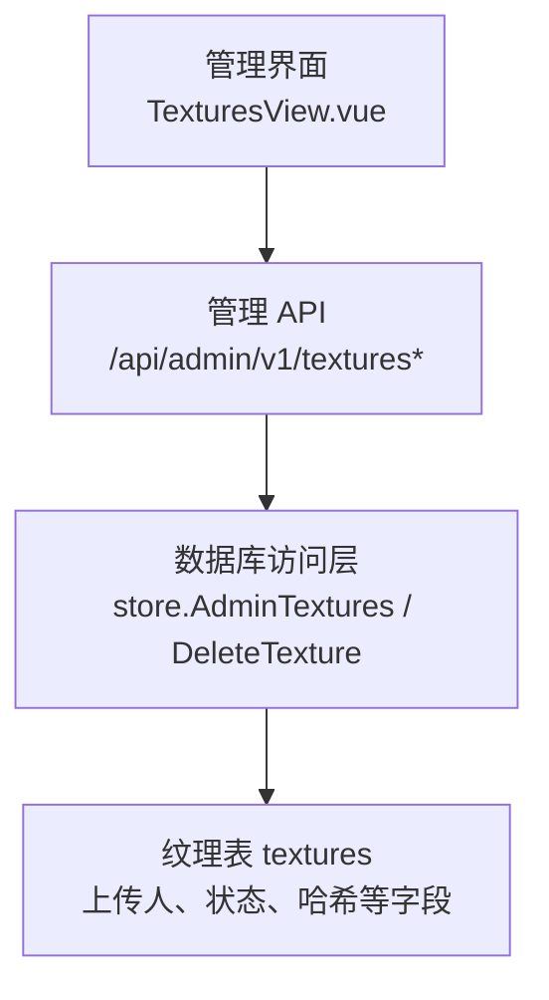
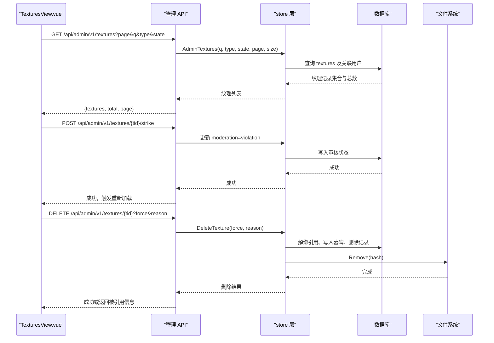
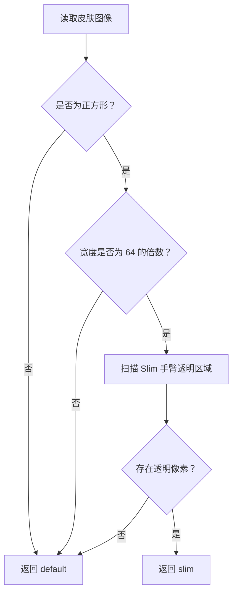
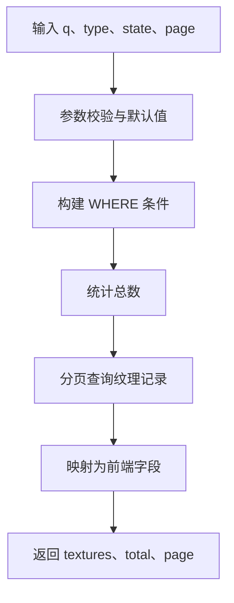
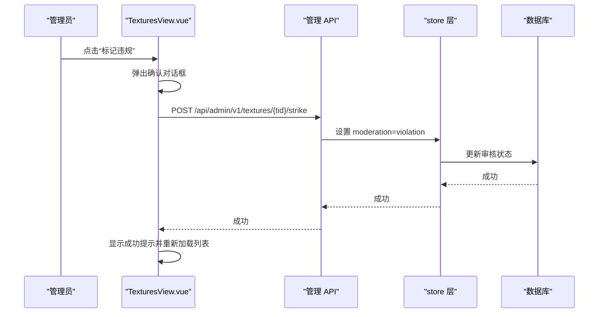
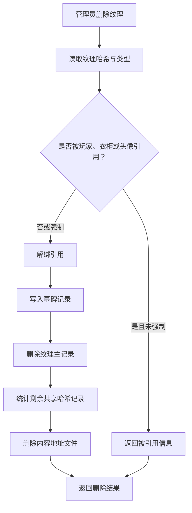
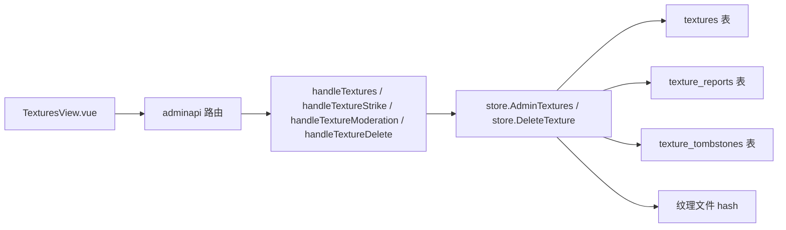
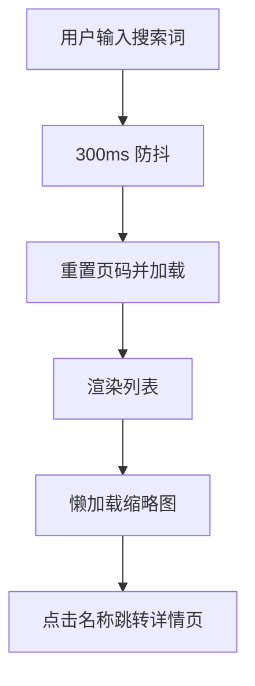
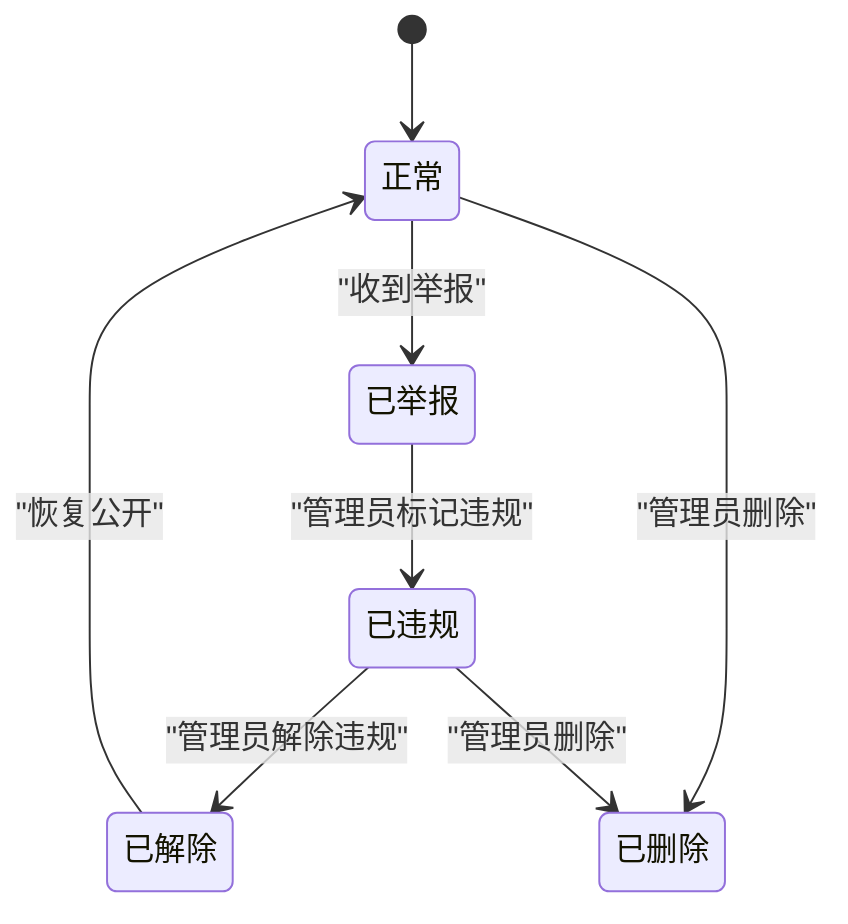

# 材质管理

**本文引用的文件**
- [TexturesView.vue](https://github.com/YimingZhanshen/skin-nexus/blob/797ae1a/web/src/components/admin/TexturesView.vue)
- [adminapi.go](https://github.com/YimingZhanshen/skin-nexus/blob/797ae1a/server/internal/adminapi/adminapi.go)
- [web.go（存储层）](https://github.com/YimingZhanshen/skin-nexus/blob/797ae1a/server/internal/store/web.go)
- [texdelete.go（删除逻辑）](https://github.com/YimingZhanshen/skin-nexus/blob/797ae1a/server/internal/store/texdelete.go)
- [model.go（纹理模型类型检测）](https://github.com/YimingZhanshen/skin-nexus/blob/797ae1a/server/internal/texture/model.go)
- [0017_texture_metadata_reports.sql](https://github.com/YimingZhanshen/skin-nexus/blob/797ae1a/server/migrations/mysql/0017_texture_metadata_reports.sql)
- [0018_texture_moderation.sql](https://github.com/YimingZhanshen/skin-nexus/blob/797ae1a/server/migrations/mysql/0018_texture_moderation.sql)
- [0019_texture_tombstones.sql](https://github.com/YimingZhanshen/skin-nexus/blob/797ae1a/server/migrations/mysql/0019_texture_tombstones.sql)

## 目录
1. [简介](#简介)
2. [项目结构与入口](#项目结构与入口)
3. [核心组件：材质列表页面](#核心组件材质列表页面)
4. [架构总览](#架构总览)
5. [详细组件分析](#详细组件分析)
6. [依赖关系分析](#依赖关系分析)
7. [性能与展示优化](#性能与展示优化)
8. [审核流程说明](#审核流程说明)
9. [常见问题处理](#常见问题处理)
10. [结论](#结论)

## 简介
本文档面向站点管理员，说明“材质管理”功能如何列出、筛选、操作和审计纹理资源。前端通过 `TexturesView.vue` 提供可视化面板；后端通过 `/api/admin/v1/textures` 系列接口暴露查询、状态变更、删除等操作；数据模型围绕纹理的哈希、模型类型、公开性、上传者、审核状态、举报与创建时间展开。

## 项目结构与入口
材质管理的前端入口是管理面板中的“材质”视图，对应组件位于 `web/src/components/admin/TexturesView.vue`。该组件在挂载后发起分页请求，并根据查询参数构造 URL。后端路由注册于管理 API 模块中，统一以 `/api/admin/v1/...` 暴露给已认证的管理员客户端。

**图表来源**
- [TexturesView.vue:1-80](https://github.com/YimingZhanshen/skin-nexus/blob/797ae1a/web/src/components/admin/TexturesView.vue#L1-L80)
- [adminapi.go:111-128](https://github.com/YimingZhanshen/skin-nexus/blob/797ae1a/server/internal/adminapi/adminapi.go#L111-L128)
- [web.go（存储层）:661-722](https://github.com/YimingZhanshen/skin-nexus/blob/797ae1a/server/internal/store/web.go#L661-L722)

**章节来源**
- [TexturesView.vue:1-80](https://github.com/YimingZhanshen/skin-nexus/blob/797ae1a/web/src/components/admin/TexturesView.vue#L1-L80)
- [adminapi.go:111-128](https://github.com/YimingZhanshen/skin-nexus/blob/797ae1a/server/internal/adminapi/adminapi.go#L111-L128)

## 核心组件：材质列表页面
`TexturesView.vue` 负责以下职责：

- 显示纹理 ID、缩略图、上传时间、名称、类型与模型、上传者、可见性与哈希。
- 提供搜索框、类型下拉、状态下拉、清空过滤、刷新与分页控件。
- 对每行执行三类操作：标记违规、解除违规、删除。
- 使用内部序列号防止异步翻页覆盖旧数据，避免重复点击造成多次提交。
- 复制哈希到剪贴板，并在失败时提示用户。

### 列表字段与展示规则
| 列 | 含义 | 数据来源或行为 |
|---|---|---|
| ID | 纹理记录编号 | 后端返回的 `id` |
| 缩略图 | 皮肤预览图 | 当后端返回 `previewURL` 时显示图片，否则显示占位符 |
| 上传时间 | 创建时间 | 将 ISO 时间字符串转为本地可读格式并去掉毫秒与时区后缀 |
| 名称 | 纹理名称 | 为空时显示占位符；点击链接跳转到公共详情页 `/skinlib/{id}` |
| 类型与模型 | 纹理类型与模型类型 | 类型为 `skin` 或 `cape`；模型为 `default` 或 `slim` |
| 上传者 | 上传者昵称或 UID | 优先显示昵称，否则显示 `#UID` |
| 可见性 | 公开、私密或违规 | 根据 `public` 与 `moderation` 判断 |
| 哈希 | 内容地址前缀 | 显示前 12 位，支持一键复制完整哈希 |
| 操作 | 标记违规、解除违规、删除 | 按钮受当前是否正在执行动作控制 |

**章节来源**
- [TexturesView.vue:1-190](https://github.com/YimingZhanshen/skin-nexus/blob/797ae1a/web/src/components/admin/TexturesView.vue#L1-L190)
- [TexturesView.vue:201-268](https://github.com/YimingZhanshen/skin-nexus/blob/797ae1a/web/src/components/admin/TexturesView.vue#L201-L268)

## 架构总览
材质管理的调用链从前端 UI 开始，经过管理 API 路由、存储层查询或写操作，最终落到数据库与文件系统。

**图表来源**
- [TexturesView.vue:60-160](https://github.com/YimingZhanshen/skin-nexus/blob/797ae1a/web/src/components/admin/TexturesView.vue#L60-L160)
- [adminapi.go:444-459](https://github.com/YimingZhanshen/skin-nexus/blob/797ae1a/server/internal/adminapi/adminapi.go#L444-L459)
- [web.go（存储层）:661-722](https://github.com/YimingZhanshen/skin-nexus/blob/797ae1a/server/internal/store/web.go#L661-L722)
- [texdelete.go（删除逻辑）:1-200](https://github.com/YimingZhanshen/skin-nexus/blob/797ae1a/server/internal/store/texdelete.go#L1-L200)

## 详细组件分析

### 纹理数据模型
纹理的核心字段包括：

| 字段 | 含义 | 说明 |
|---|---|---|
| `hash` | 内容哈希 | 基于纹理像素计算的内容地址，用于去重与文件定位 |
| `model` | 模型类型 | `default` 表示 Steve，`slim` 表示 Alex；默认值为空时表示未知或未标注 |
| `public` | 公开性 | 布尔值，决定纹理是否在公共库中可见 |
| `uploader` | 上传者 | 实际存储为用户 ID，前端通常用昵称辅助识别 |
| `status` | 业务状态 | 文档语义上可理解为“公开/私密/违规”，后端更精确地拆分为 `public` 与 `moderation` |
| `report_count` | 举报次数 | 由 `texture_reports` 表累计；列表页主要依赖 `moderation` 判定最终处置结果 |
| `created_at` | 创建时间 | 上传时间，前端格式化后展示 |

需要注意：前端列表显示的“状态”主要由 `public` 与 `moderation` 共同决定。`moderation` 为空表示未违规，值为 `violation` 表示已被标记违规；`public` 表示是否在公共库中可见。举报数量本身不直接改变列表标签，但会推动审核决策。

**章节来源**
- [web.go（存储层）:661-722](https://github.com/YimingZhanshen/skin-nexus/blob/797ae1a/server/internal/store/web.go#L661-L722)
- [0017_texture_metadata_reports.sql:1-20](https://github.com/YimingZhanshen/skin-nexus/blob/797ae1a/server/migrations/mysql/0017_texture_metadata_reports.sql#L1-L20)
- [0018_texture_moderation.sql:1-7](https://github.com/YimingZhanshen/skin-nexus/blob/797ae1a/server/migrations/mysql/0018_texture_moderation.sql#L1-L7)

### 纹理模型类型检测
模型类型不是完全依赖上传者声明，而是对皮肤像素进行分析：

- 仅正方形且宽度为 64 倍数的纹理才具备 Slim 手臂区域的判断依据。
- 若右臂特定区域存在透明像素，则判定为 `slim`。
- 非正方形或非 64 倍数宽度的纹理返回 `default`。
- 回填工具可从已有 PNG 字节中提取模型类型。

**图表来源**
- [model.go（纹理模型类型检测）:1-68](https://github.com/YimingZhanshen/skin-nexus/blob/797ae1a/server/internal/texture/model.go#L1-L68)

**章节来源**
- [model.go（纹理模型类型检测）:1-68](https://github.com/YimingZhanshen/skin-nexus/blob/797ae1a/server/internal/texture/model.go#L1-L68)

### 查询纹理与过滤条件
管理端纹理列表接口接受以下查询参数：

| 参数 | 含义 | 行为 |
|---|---|---|
| `page` | 页码 | 小于 1 时归一化为 1 |
| `q` | 搜索词 | 匹配名称或哈希，作为 LIKE 模式传入存储层 |
| `type` | 纹理类型 | 支持 `skin`、`cape`，其他值等价不过滤 |
| `state` | 状态过滤 | 支持公开、私密、违规三类语义 |
| `size` | 每页数量 | 固定为 50 |

存储层会根据条件拼接 WHERE 子句，并返回记录集合与总数。过滤器设计遵循“管理员真实问题”思路：按上传者与名称查找、按皮肤或披风分类、按仍在库内或已在货架上筛选。

**图表来源**
- [adminapi.go:444-459](https://github.com/YimingZhanshen/skin-nexus/blob/797ae1a/server/internal/adminapi/adminapi.go#L444-L459)
- [web.go（存储层）:661-722](https://github.com/YimingZhanshen/skin-nexus/blob/797ae1a/server/internal/store/web.go#L661-L722)

**章节来源**
- [adminapi.go:444-459](https://github.com/YimingZhanshen/skin-nexus/blob/797ae1a/server/internal/adminapi/adminapi.go#L444-L459)
- [web.go（存储层）:661-722](https://github.com/YimingZhanshen/skin-nexus/blob/797ae1a/server/internal/store/web.go#L661-L722)

### 更新状态：审核通过与标记违规
- **标记违规**：调用 `POST /api/admin/v1/textures/{tid}/strike`，将纹理的审核状态设为违规。
- **审核通过**：调用 `PUT /api/admin/v1/textures/{tid}/moderation`，将 `moderation` 置空，表示解除违规。

前端在点击操作前弹出确认对话框，并使用全局忙态阻止同一行重复提交。操作成功后会重新加载列表，使审核列成为操作成功的视觉证据。

**图表来源**
- [TexturesView.vue:110-140](https://github.com/YimingZhanshen/skin-nexus/blob/797ae1a/web/src/components/admin/TexturesView.vue#L110-L140)
- [adminapi.go:122-128](https://github.com/YimingZhanshen/skin-nexus/blob/797ae1a/server/internal/adminapi/adminapi.go#L122-L128)

**章节来源**
- [TexturesView.vue:110-140](https://github.com/YimingZhanshen/skin-nexus/blob/797ae1a/web/src/components/admin/TexturesView.vue#L110-L140)
- [adminapi.go:122-128](https://github.com/YimingZhanshen/skin-nexus/blob/797ae1a/server/internal/adminapi/adminapi.go#L122-L128)

### 删除纹理与被引用保护
删除纹理不是简单删一行记录，而是包含引用检查、解绑、墓碑记录与文件清理：

1. 读取纹理的哈希与类型。
2. 检查是否有玩家、衣柜条目或头像仍引用该纹理。
3. 若存在引用且未强制删除，返回 `ErrTextureInUse`，并附带占用者信息。
4. 若允许强制删除，先解绑所有引用。
5. 写入 `texture_tombstones` 墓碑记录，保留删除原因、上传者、上传时间与审核痕迹。
6. 删除纹理主记录。
7. 统计剩余共享该哈希的记录数，供前端决定是否继续删除底层文件。
8. 调用文件系统的 `Remove(hash)` 删除内容地址对应的文件；缺失文件不算错误，因为数据库删除不能因文件系统失败而回滚。

**图表来源**
- [texdelete.go（删除逻辑）:1-200](https://github.com/YimingZhanshen/skin-nexus/blob/797ae1a/server/internal/store/texdelete.go#L1-L200)
- [TexturesView.vue:140-190](https://github.com/YimingZhanshen/skin-nexus/blob/797ae1a/web/src/components/admin/TexturesView.vue#L140-L190)

**章节来源**
- [texdelete.go（删除逻辑）:1-200](https://github.com/YimingZhanshen/skin-nexus/blob/797ae1a/server/internal/store/texdelete.go#L1-L200)
- [TexturesView.vue:140-190](https://github.com/YimingZhanshen/skin-nexus/blob/797ae1a/web/src/components/admin/TexturesView.vue#L140-L190)

### 加入皮肤库操作
“加入皮肤库”在前端语境中通常指将纹理加入用户的收藏或公开库。仓库中与“皮肤库”最接近的后端能力是公共皮肤库接口：

- 列表接口 `/api/v1/skinlib` 返回公开纹理、上传者、点赞数、预览图等。
- 点赞接口 `/api/v1/skinlib/{tid}/like` 本质上是添加衣柜条目，即把纹理加入用户个人收藏。
- 取消点赞接口 `/api/v1/skinlib/{tid}/unlike` 移除收藏。

需要区分：

- **公共库可见性**：由纹理记录的 `public` 字段决定。
- **用户收藏**：由衣柜条目决定，属于用户维度，不是纹理记录本身的公开属性。
- **管理面板**：当前 `TexturesView.vue` 没有直接“加入收藏夹”按钮，但其跳转 `/skinlib/{id}` 可进入公共详情页，在那里进行收藏或查看。

**章节来源**
- [skinlib.go（公共皮肤库接口）:1-200](https://github.com/YimingZhanshen/skin-nexus/blob/797ae1a/server/internal/webapi/skinlib.go#L1-L200)
- [TexturesView.vue:201-268](https://github.com/YimingZhanshen/skin-nexus/blob/797ae1a/web/src/components/admin/TexturesView.vue#L201-L268)

## 依赖关系分析
材质管理涉及前端组件、管理 API、存储层、数据库迁移与文件系统。关键依赖如下：

**图表来源**
- [TexturesView.vue:1-190](https://github.com/YimingZhanshen/skin-nexus/blob/797ae1a/web/src/components/admin/TexturesView.vue#L1-L190)
- [adminapi.go:111-128](https://github.com/YimingZhanshen/skin-nexus/blob/797ae1a/server/internal/adminapi/adminapi.go#L111-L128)
- [web.go（存储层）:661-722](https://github.com/YimingZhanshen/skin-nexus/blob/797ae1a/server/internal/store/web.go#L661-L722)
- [texdelete.go（删除逻辑）:1-200](https://github.com/YimingZhanshen/skin-nexus/blob/797ae1a/server/internal/store/texdelete.go#L1-L200)

**章节来源**
- [adminapi.go:111-128](https://github.com/YimingZhanshen/skin-nexus/blob/797ae1a/server/internal/adminapi/adminapi.go#L111-L128)
- [web.go（存储层）:661-722](https://github.com/YimingZhanshen/skin-nexus/blob/797ae1a/server/internal/store/web.go#L661-L722)

## 性能与展示优化
- **分页**：管理列表每页固定 50 条，前端根据后端返回的 `total` 计算最大页数。
- **防抖搜索**：搜索输入延迟 300ms 再触发第 1 页加载，避免频繁请求。
- **并发安全**：使用序列号 `seq` 保证旧响应不会覆盖新渲染的行。
- **缩略图优化**：列表中的皮肤缩略图使用懒加载与异步解码，尺寸固定为 44px，启用像素化渲染以提升清晰度和性能。
- **大图预览**：公共详情页使用服务端渲染预览图与可选的 canvas 动态预览；预览图 URL 中包含渲染器版本，便于长期缓存失效。
- **哈希复制**：复制失败时明确提示，而不是静默视为成功。

**图表来源**
- [TexturesView.vue:20-40](https://github.com/YimingZhanshen/skin-nexus/blob/797ae1a/web/src/components/admin/TexturesView.vue#L20-L40)
- [TexturesView.vue:201-268](https://github.com/YimingZhanshen/skin-nexus/blob/797ae1a/web/src/components/admin/TexturesView.vue#L201-L268)

**章节来源**
- [TexturesView.vue:20-40](https://github.com/YimingZhanshen/skin-nexus/blob/797ae1a/web/src/components/admin/TexturesView.vue#L20-L40)
- [TexturesView.vue:201-268](https://github.com/YimingZhanshen/skin-nexus/blob/797ae1a/web/src/components/admin/TexturesView.vue#L201-L268)

## 审核流程说明
纹理审核围绕三个维度：

1. **上传阶段**：纹理生成 `hash`、`type`、`model`、`public`、上传者、创建时间等基础信息。
2. **举报阶段**：`texture_reports` 表记录用户对纹理的举报，支持同一用户对同一纹理一次举报，并按状态与时间排序。
3. **处置阶段**：管理员通过“标记违规”或“解除违规”修改 `moderation`。被标记违规的纹理即使仍私密，也会在公共库与最新公开皮肤查询中被排除。

**图表来源**
- [0017_texture_metadata_reports.sql:1-20](https://github.com/YimingZhanshen/skin-nexus/blob/797ae1a/server/migrations/mysql/0017_texture_metadata_reports.sql#L1-L20)
- [0018_texture_moderation.sql:1-7](https://github.com/YimingZhanshen/skin-nexus/blob/797ae1a/server/migrations/mysql/0018_texture_moderation.sql#L1-L7)

通知与审计方面：

- 举报记录保存在 `texture_reports`，并带有索引优化查询。
- 删除操作会写入 `texture_tombstones`，保留原始纹理元数据、上传者、上传时间、审核状态、删除人与删除原因。
- 审核操作可通过审计日志与管理面板报告接口进一步追踪。

**章节来源**
- [0017_texture_metadata_reports.sql:1-20](https://github.com/YimingZhanshen/skin-nexus/blob/797ae1a/server/migrations/mysql/0017_texture_metadata_reports.sql#L1-L20)
- [0018_texture_moderation.sql:1-7](https://github.com/YimingZhanshen/skin-nexus/blob/797ae1a/server/migrations/mysql/0018_texture_moderation.sql#L1-L7)
- [0019_texture_tombstones.sql:1-20](https://github.com/YimingZhanshen/skin-nexus/blob/797ae1a/server/migrations/mysql/0019_texture_tombstones.sql#L1-L20)

## 常见问题处理

### 损坏图片或无法加载缩略图
- 列表缩略图仅在存在 `previewURL` 时显示，否则显示占位符。
- 如果公共详情页也无法加载，应检查对应哈希的文件是否存在、权限是否正确。
- 文件删除使用内容地址路径，缺失文件不应阻断数据库删除，因此可能出现“数据库记录已删但文件仍存在”的情况，需结合墓碑记录与文件系统巡检。

**章节来源**
- [TexturesView.vue:201-268](https://github.com/YimingZhanshen/skin-nexus/blob/797ae1a/web/src/components/admin/TexturesView.vue#L201-L268)
- [model.go（纹理模型类型检测）:1-68](https://github.com/YimingZhanshen/skin-nexus/blob/797ae1a/server/internal/texture/model.go#L1-L68)
- [texdelete.go（删除逻辑）:1-21](https://github.com/YimingZhanshen/skin-nexus/blob/797ae1a/server/internal/store/texdelete.go#L1-L21)

### 重复哈希冲突
- 相同内容的纹理共享 `hash`，公开纹理具有内容级去重约束。
- 私有副本可与公开副本共存，但内容一致。
- 删除时会统计剩余共享哈希记录数，避免误删仍被其他纹理引用的底层文件。

**章节来源**
- [web.go（存储层）:254-283](https://github.com/YimingZhanshen/skin-nexus/blob/797ae1a/server/internal/store/web.go#L254-L283)
- [texdelete.go（删除逻辑）:1-200](https://github.com/YimingZhanshen/skin-nexus/blob/797ae1a/server/internal/store/texdelete.go#L1-L200)

### 被引用纹理无法删除
- 若纹理仍被玩家皮肤、披风、衣柜或用户头像引用，普通删除会返回被引用信息。
- 管理员可选择强制删除，此时系统会先解绑引用，再写入墓碑并删除记录。
- 前端会在 409 响应中解析占用者名单，再次确认后执行强制删除。

**章节来源**
- [texdelete.go（删除逻辑）:1-200](https://github.com/YimingZhanshen/skin-nexus/blob/797ae1a/server/internal/store/texdelete.go#L1-L200)
- [TexturesView.vue:140-190](https://github.com/YimingZhanshen/skin-nexus/blob/797ae1a/web/src/components/admin/TexturesView.vue#L140-L190)

### 批量操作与导出列表
当前仓库中：

- 管理纹理列表为单条操作为主，没有独立的“批量勾选 + 批量删除/批量标记”接口实现。
- 也没有专门的“导出纹理列表”接口；如需导出，可在外部通过脚本反复调用 `/api/admin/v1/textures` 分页获取，或使用审计与报告接口配合导出数据。
- “批量”语义在当前代码中更多体现为分页遍历与后端聚合统计，而非一次性多行事务。

**章节来源**
- [adminapi.go:444-459](https://github.com/YimingZhanshen/skin-nexus/blob/797ae1a/server/internal/adminapi/adminapi.go#L444-L459)
- [web.go（存储层）:661-722](https://github.com/YimingZhanshen/skin-nexus/blob/797ae1a/server/internal/store/web.go#L661-L722)

## 结论
材质管理以 `TexturesView.vue` 为管理入口，以 `/api/admin/v1/textures` 系列接口为控制面，以 `textures`、`texture_reports`、`texture_tombstones` 三张表为核心数据结构。它提供了清晰的列表、筛选、分页、审核与删除能力，并通过内容哈希、模型类型检测、引用保护与墓碑记录保障数据一致性。对于“加入皮肤库”，应区分公共库可见性与用户收藏；对于批量操作与导出，当前实现以分页与单条操作为主，扩展时应优先复用现有查询与删除契约。
