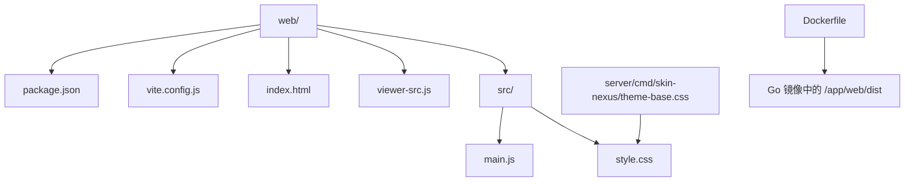
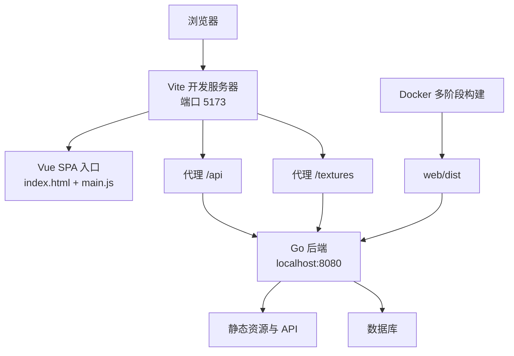
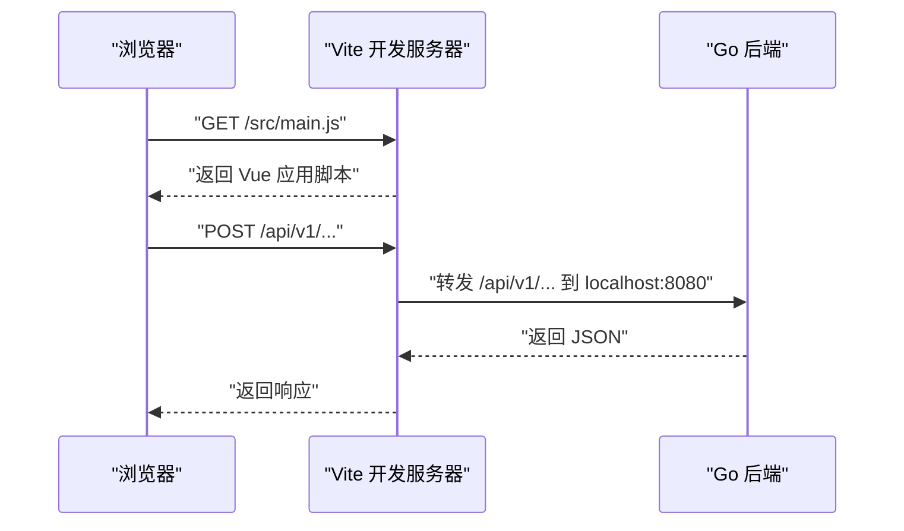
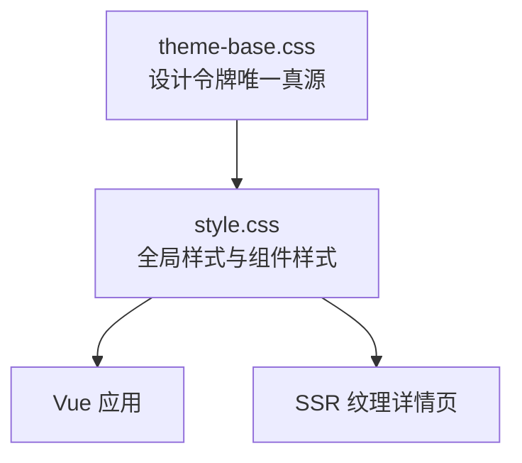
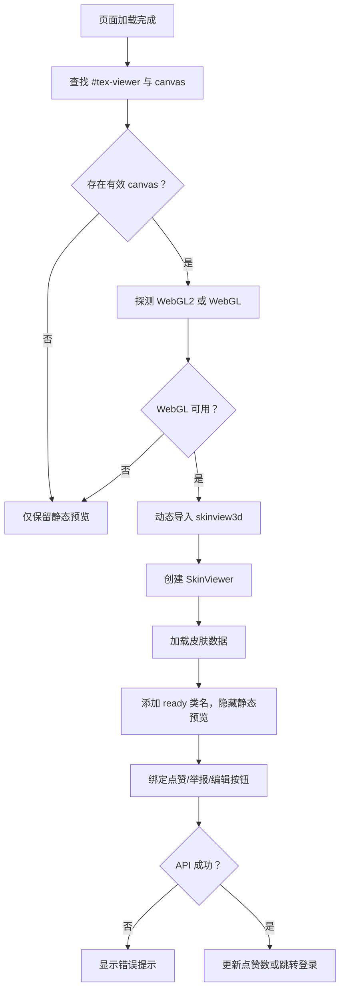
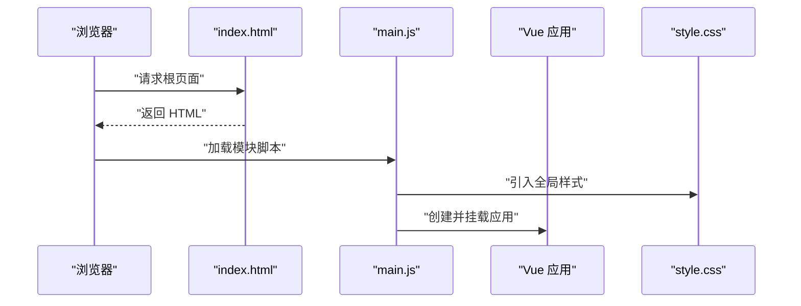
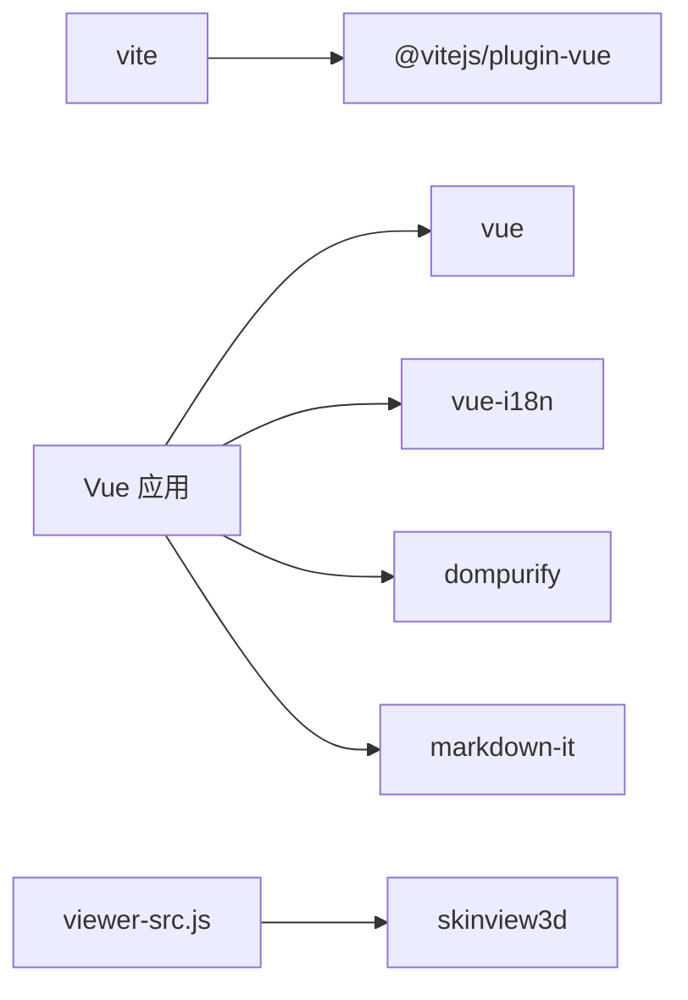
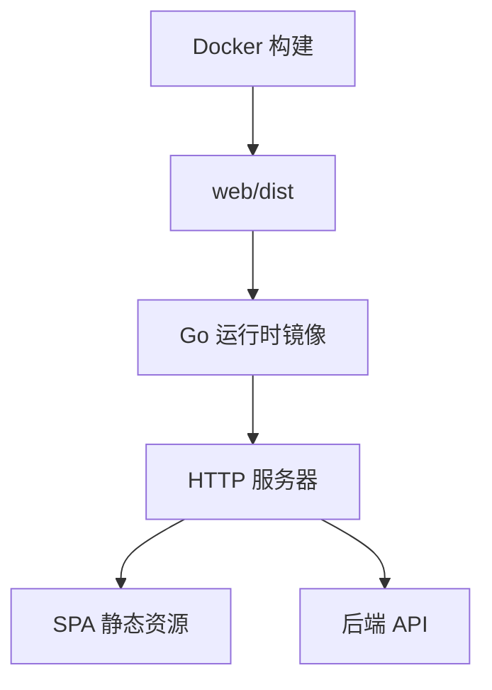

# 构建与开发环境

**本文引用的文件**
- [web/package.json](https://github.com/YimingZhanshen/skin-nexus/blob/797ae1a/web/package.json)
- [web/vite.config.js](https://github.com/YimingZhanshen/skin-nexus/blob/797ae1a/web/vite.config.js)
- [web/viewer-src.js](https://github.com/YimingZhanshen/skin-nexus/blob/797ae1a/web/viewer-src.js)
- [web/src/style.css](https://github.com/YimingZhanshen/skin-nexus/blob/797ae1a/web/src/style.css)
- [server/cmd/skin-nexus/theme-base.css](https://github.com/YimingZhanshen/skin-nexus/blob/797ae1a/server/cmd/skin-nexus/theme-base.css)
- [web/index.html](https://github.com/YimingZhanshen/skin-nexus/blob/797ae1a/web/index.html)
- [web/src/main.js](https://github.com/YimingZhanshen/skin-nexus/blob/797ae1a/web/src/main.js)
- [Dockerfile](https://github.com/YimingZhanshen/skin-nexus/blob/797ae1a/Dockerfile)
- [server/cmd/skin-nexus/server.go](https://github.com/YimingZhanshen/skin-nexus/blob/797ae1a/server/cmd/skin-nexus/server.go)

## 目录
1. [简介](#简介)
2. [项目结构](#项目结构)
3. [核心组件](#核心组件)
4. [架构总览](#架构总览)
5. [详细组件分析](#详细组件分析)
6. [依赖关系分析](#依赖关系分析)
7. [性能与体积优化](#性能与体积优化)
8. [本地开发与调试](#本地开发与调试)
9. [与 Go 后端集成](#与-go-后端集成)
10. [常见问题排查](#常见问题排查)
11. [结论](#结论)

## 简介
本仓库的前端位于 `web` 目录，基于 Vue 3、Vite 和 skinview3d，负责管理面板、用户页面以及纹理详情页的 3D 皮肤预览。前端产物由 Docker 多阶段构建打包到 Go 后端镜像中，运行时由 Go HTTP 服务器作为静态资源服务。

本文聚焦：
- Node 环境与脚本命令
- Vite 开发服务器、代理规则、插件扩展点、生产构建输出
- viewer-src.js 如何渐进增强纹理详情页的 3D 预览
- style.css 的全局样式、CSS 变量与主题 token 体系
- 本地开发、热重载、Vue Devtools 调试
- 将前端产物嵌入 Go 后端的流程
- 新增静态资源、全局样式、第三方库的最佳实践
- 构建体积优化、按需引入、缓存策略与浏览器兼容性

## 项目结构
前端相关代码集中在 `web` 目录：



**图示来源**
- [web/package.json:1-22](https://github.com/YimingZhanshen/skin-nexus/blob/797ae1a/web/package.json#L1-L22)
- [web/vite.config.js:1-43](https://github.com/YimingZhanshen/skin-nexus/blob/797ae1a/web/vite.config.js#L1-L43)
- [web/viewer-src.js:1-182](https://github.com/YimingZhanshen/skin-nexus/blob/797ae1a/web/viewer-src.js#L1-L182)
- [web/src/style.css:1-200](https://github.com/YimingZhanshen/skin-nexus/blob/797ae1a/web/src/style.css#L1-L200)
- [server/cmd/skin-nexus/theme-base.css:1-106](https://github.com/YimingZhanshen/skin-nexus/blob/797ae1a/server/cmd/skin-nexus/theme-base.css#L1-L106)
- [web/index.html:1-43](https://github.com/YimingZhanshen/skin-nexus/blob/797ae1a/web/index.html#L1-L43)
- [web/src/main.js:1-6](https://github.com/YimingZhanshen/skin-nexus/blob/797ae1a/web/src/main.js#L1-L6)
- [Dockerfile:1-68](https://github.com/YimingZhanshen/skin-nexus/blob/797ae1a/Dockerfile#L1-L68)

**章节来源**
- [web/package.json:1-22](https://github.com/YimingZhanshen/skin-nexus/blob/797ae1a/web/package.json#L1-L22)
- [web/vite.config.js:1-43](https://github.com/YimingZhanshen/skin-nexus/blob/797ae1a/web/vite.config.js#L1-L43)
- [web/index.html:1-43](https://github.com/YimingZhanshen/skin-nexus/blob/797ae1a/web/index.html#L1-L43)
- [web/src/main.js:1-6](https://github.com/YimingZhanshen/skin-nexus/blob/797ae1a/web/src/main.js#L1-L6)
- [Dockerfile:1-68](https://github.com/YimingZhanshen/skin-nexus/blob/797ae1a/Dockerfile#L1-L68)

## 核心组件
### package.json 的作用
`web/package.json` 是前端项目的入口定义，包含以下职责：
- 声明包名为 `skin-nexus-web`，版本为 `0.6.0`，并标记为私有项目。
- 启用 ES Module 模式。
- 提供三个 npm 脚本：
  - `dev`：启动 Vite 开发服务器。
  - `build`：执行生产构建。
  - `preview`：预览构建产物。
- 运行期依赖包括 Vue 3、Vue I18n、DOMPurify、markdown-it 和 skinview3d。
- 开发依赖包括 Vite 和 Vue 官方插件。

**章节来源**
- [web/package.json:1-22](https://github.com/YimingZhanshen/skin-nexus/blob/797ae1a/web/package.json#L1-L22)

### vite.config.js 的职责
`vite.config.js` 是构建与开发环境的控制中心，主要配置：
- 使用 `@vitejs/plugin-vue` 处理 `.vue` 单文件组件。
- 开发服务器监听端口 `5173`。
- 将 `/api` 和 `/textures` 请求代理到 Go 后端 `http://localhost:8080`。
- 生产构建输出到 `dist` 目录，并清空旧产物。
- 关闭 CSS 代码分割，保证应用基础样式、主题包和自定义样式的加载顺序。
- 定义两个 Rollup 入口：
  - `main`：指向 `index.html`，用于 SPA。
  - `viewer`：指向 `viewer-src.js`，用于纹理详情页的固定名称 JS 产物。
- 控制输出文件名：
  - `viewer` 入口始终输出 `assets/viewer.js`。
  - 其他 JS 使用带哈希的文件名。
  - 所有静态资源使用 `assets/[name]-[hash][extname]`。

**章节来源**
- [web/vite.config.js:1-43](https://github.com/YimingZhanshen/skin-nexus/blob/797ae1a/web/vite.config.js#L1-L43)

### Docker 构建链路
Dockerfile 展示了完整的多阶段构建：
1. 第一阶段使用 `node:22-alpine` 安装依赖并构建前端。
2. 第二阶段使用 Go 镜像编译后端二进制。
3. 第三阶段将 Go 二进制、前端 `dist` 和数据库迁移文件放入 Alpine 运行时镜像。

这意味着前端构建结果最终被复制到 `/app/web/dist`，由 Go 后端在运行时暴露。

**章节来源**
- [Dockerfile:1-68](https://github.com/YimingZhanshen/skin-nexus/blob/797ae1a/Dockerfile#L1-L68)

## 架构总览
前端与后端的整体关系如下：



**图示来源**
- [web/vite.config.js:1-43](https://github.com/YimingZhanshen/skin-nexus/blob/797ae1a/web/vite.config.js#L1-L43)
- [web/index.html:1-43](https://github.com/YimingZhanshen/skin-nexus/blob/797ae1a/web/index.html#L1-L43)
- [web/src/main.js:1-6](https://github.com/YimingZhanshen/skin-nexus/blob/797ae1a/web/src/main.js#L1-L6)
- [Dockerfile:1-68](https://github.com/YimingZhanshen/skin-nexus/blob/797ae1a/Dockerfile#L1-L68)
- [server/cmd/skin-nexus/server.go:1-24](https://github.com/YimingZhanshen/skin-nexus/blob/797ae1a/server/cmd/skin-nexus/server.go#L1-L24)

## 详细组件分析

### 开发服务器与代理规则
Vite 开发服务器默认监听 `5173`，并通过代理把两类请求转发到 Go 后端：
- `/api`：前端业务接口。
- `/textures`：纹理图片资源。

代理开启 `changeOrigin`，使后端看到的请求主机头与直接访问一致。开发时前端和后端可以独立运行，前端只负责 UI 与构建，后端提供数据与静态资源。



**图示来源**
- [web/vite.config.js:1-43](https://github.com/YimingZhanshen/skin-nexus/blob/797ae1a/web/vite.config.js#L1-L43)
- [web/src/main.js:1-6](https://github.com/YimingZhanshen/skin-nexus/blob/797ae1a/web/src/main.js#L1-L6)

**章节来源**
- [web/vite.config.js:1-43](https://github.com/YimingZhanshen/skin-nexus/blob/797ae1a/web/vite.config.js#L1-L43)

### 静态资源与主题 token
全局样式入口是 `web/src/style.css`，它通过 `@import` 引用 `server/cmd/skin-nexus/theme-base.css`。这个设计让主题 token 成为单一真源：
- SPA 前端通过 CSS 导入消费 token。
- SSR 页面同样 embed 同一份 `theme-base.css`。
- 修改 token 会同时影响前端与 SSR 渲染。

`theme-base.css` 定义了暗色主题的语义变量，例如背景、面板、文本、主操作色、危险色、间距、层级、动画时间和字号等。`style.css` 在此基础上实现顶栏、卡片、按钮、表单、认证分栏等全局样式。



**图示来源**
- [server/cmd/skin-nexus/theme-base.css:1-106](https://github.com/YimingZhanshen/skin-nexus/blob/797ae1a/server/cmd/skin-nexus/theme-base.css#L1-L106)
- [web/src/style.css:1-200](https://github.com/YimingZhanshen/skin-nexus/blob/797ae1a/web/src/style.css#L1-L200)

**章节来源**
- [web/src/style.css:1-200](https://github.com/YimingZhanshen/skin-nexus/blob/797ae1a/web/src/style.css#L1-L200)
- [server/cmd/skin-nexus/theme-base.css:1-106](https://github.com/YimingZhanshen/skin-nexus/blob/797ae1a/server/cmd/skin-nexus/theme-base.css#L1-L106)

### 3D 皮肤预览器集成
`viewer-src.js` 不是主 SPA 的一部分，而是纹理详情页使用的独立入口。它的核心职责是“渐进增强”：
- 如果页面没有目标容器或 canvas，则直接退出。
- 先探测 WebGL 支持；不支持时保留静态图片预览。
- 动态导入 `skinview3d`，避免非 3D 页面也加载约 500 KB 的 chunk。
- 创建 SkinViewer，根据 data 属性加载皮肤模型。
- 首次渲染成功后才移除静态预览，失败时保持原图。
- 绑定点赞、举报、编辑按钮，调用后端 `/api/v1/skinlib/*` 接口。
- 遇到未登录时跳转到 `/login?next=当前路径`，避免丢失上下文。
- 网络或 API 错误时显示提示，并在 finally 中恢复按钮状态。



**图示来源**
- [web/viewer-src.js:1-182](https://github.com/YimingZhanshen/skin-nexus/blob/797ae1a/web/viewer-src.js#L1-L182)

**章节来源**
- [web/viewer-src.js:1-182](https://github.com/YimingZhanshen/skin-nexus/blob/797ae1a/web/viewer-src.js#L1-L182)

### 应用入口与 Vue 初始化
`web/index.html` 提供 HTML 骨架、favicon、manifest、主题色和初始加载动画。它通过 `<script type="module" src="/src/main.js">` 挂载 Vue 应用。

`web/src/main.js` 只做三件事：
1. 从 Vue 创建应用。
2. 注册 i18n。
3. 挂载到 `#app`，并引入全局样式。

这意味着新增全局样式时，应优先放在 `style.css`，而不是每个页面单独引入。



**图示来源**
- [web/index.html:1-43](https://github.com/YimingZhanshen/skin-nexus/blob/797ae1a/web/index.html#L1-L43)
- [web/src/main.js:1-6](https://github.com/YimingZhanshen/skin-nexus/blob/797ae1a/web/src/main.js#L1-L6)

**章节来源**
- [web/index.html:1-43](https://github.com/YimingZhanshen/skin-nexus/blob/797ae1a/web/index.html#L1-L43)
- [web/src/main.js:1-6](https://github.com/YimingZhanshen/skin-nexus/blob/797ae1a/web/src/main.js#L1-L6)

## 依赖关系分析

### 运行期依赖
| 依赖 | 用途 | 说明 |
|---|---|---|
| `vue` | 前端框架 | 构建 SPA 和管理面板 |
| `vue-i18n` | 国际化 | 多语言文案 |
| `dompurify` | 安全过滤 | 防止富文本 XSS |
| `markdown-it` | Markdown 渲染 | 展示描述内容 |
| `skinview3d` | 3D 皮肤预览 | 仅在纹理详情页动态导入 |

### 开发期依赖
| 依赖 | 用途 | 说明 |
|---|---|---|
| `vite` | 构建工具 | 开发服务器、打包、产物优化 |
| `@vitejs/plugin-vue` | Vue 插件 | 处理 `.vue` 文件 |



**图示来源**
- [web/package.json:1-22](https://github.com/YimingZhanshen/skin-nexus/blob/797ae1a/web/package.json#L1-L22)
- [web/viewer-src.js:1-182](https://github.com/YimingZhanshen/skin-nexus/blob/797ae1a/web/viewer-src.js#L1-L182)

**章节来源**
- [web/package.json:1-22](https://github.com/YimingZhanshen/skin-nexus/blob/797ae1a/web/package.json#L1-L22)

## 性能与体积优化
### 已实现的优化
- **按需加载 3D 预览**：`viewer-src.js` 只在检测到 canvas 且 WebGL 可用时才动态导入 `skinview3d`，避免 cape 页面或旧浏览器加载大 chunk。
- **固定名称 viewer 产物**：Rollup 对 `viewer` 入口强制输出 `assets/viewer.js`，确保后端模板引用稳定，不因哈希变化破坏契约。
- **关闭 CSS 代码分割**：`cssCodeSplit: false` 保证基础样式、主题包和自定义样式顺序正确，避免主题覆盖失效。
- **资源命名含哈希**：除 viewer 外，JS 和静态资源均带哈希，便于长期缓存。
- **构建产物清理**：`emptyOutDir: true` 每次构建前清空 `dist`，避免残留旧文件。

### 可考虑的优化方向
- **第三方库按需引入**：对 markdown-it、DOMPurify 等库确认是否全量引入，必要时改为按需加载或替换轻量实现。
- **Tree Shaking 验证**：检查 unused Vue 组件、i18n 文案和 API 客户端是否被真正使用。
- **分包策略细化**：若后续增加更多重型功能（如地图、图表），可将它们拆分为独立 chunk，并按路由或交互懒加载。
- **资源预加载优先级**：对首屏关键 CSS 和字体使用 `preload`，对非必要资源使用 `prefetch` 或懒加载。
- **CDN 与缓存策略**：部署时将 `assets/[name]-[hash].js` 和 `assets/[name]-[hash][extname]` 设置强缓存，HTML 使用短缓存或无缓存。

**章节来源**
- [web/vite.config.js:1-43](https://github.com/YimingZhanshen/skin-nexus/blob/797ae1a/web/vite.config.js#L1-L43)
- [web/viewer-src.js:1-182](https://github.com/YimingZhanshen/skin-nexus/blob/797ae1a/web/viewer-src.js#L1-L182)

## 本地开发与调试

### 前置条件
- Node.js 版本由 Dockerfile 指定为 `node:22-alpine`，因此建议本地使用 Node 22。
- 已安装 Node 包管理器（npm）。

### 安装依赖
进入前端目录：
```bash
cd web
npm install
```

### 启动后端
后端默认监听 `8080`，前端开发服务器会把 `/api` 和 `/textures` 代理到该地址。请确保 Go 后端已在本地运行。

### 启动 Vite
```bash
npm run dev
```
开发服务器默认监听 `5173`。

### 访问开发服务器
打开浏览器访问：
```
http://localhost:5173
```
此时：
- Vue 应用从 `index.html` 和 `src/main.js` 加载。
- 接口请求被代理到 Go 后端。
- 纹理详情页的 viewer 由 `viewer-src.js` 提供。

### 热重载
修改 `.vue`、`.js`、`.css` 后，Vite 会自动热更新页面，无需手动刷新。

### 调试 Vue Devtools
建议使用 Chrome 或 Edge 的 Vue Devtools 扩展：
- 在开发者工具的 Components 面板查看组件树。
- 在 Console 面板查看日志和网络请求。
- 结合 Network 面板观察代理后的 `/api` 请求。

### 预览构建产物
构建完成后，可使用预览命令：
```bash
npm run build
npm run preview
```
这会启动一个静态服务器预览 `dist` 内容，适合测试生产构建行为，但不具备开发服务器的代理能力。

**章节来源**
- [Dockerfile:1-68](https://github.com/YimingZhanshen/skin-nexus/blob/797ae1a/Dockerfile#L1-L68)
- [web/package.json:1-22](https://github.com/YimingZhanshen/skin-nexus/blob/797ae1a/web/package.json#L1-L22)
- [web/vite.config.js:1-43](https://github.com/YimingZhanshen/skin-nexus/blob/797ae1a/web/vite.config.js#L1-L43)

## 与 Go 后端集成

### 构建产物位置
Dockerfile 将前端构建产物复制到 `/app/web/dist`，并由 Go 后端在运行时作为静态资源提供服务。因此，生产环境中不需要单独的 Nginx 或 Node 服务来托管前端。

### 后端连接超时
Go 后端使用统一的 HTTP Server 配置，设置了读取头、读取、写入和空闲超时，并限制最大头部大小。这有助于防止慢客户端耗尽连接资源。



**图示来源**
- [Dockerfile:1-68](https://github.com/YimingZhanshen/skin-nexus/blob/797ae1a/Dockerfile#L1-L68)
- [server/cmd/skin-nexus/server.go:1-24](https://github.com/YimingZhanshen/skin-nexus/blob/797ae1a/server/cmd/skin-nexus/server.go#L1-L24)

### 新增静态资源的正确做法
- 普通静态资源应放在会被 Vite 构建处理的资源目录中，或通过 Rollup 的 `assetFileNames` 规则产出到 `assets/`。
- 需要被 SSR 页面或后端模板直接引用的资源，应遵循现有命名契约；例如 viewer 必须输出为 `assets/viewer.js`。
- 不要随意改动 viewer 输出路径，否则会破坏后端模板引用。

### 新增全局样式的正确做法
- 新增全局样式应放在 `web/src/style.css`。
- 颜色、间距、字体等视觉值不应硬编码，而应优先使用 `theme-base.css` 提供的 token。
- 如果需要新增 token，应修改 `server/cmd/skin-nexus/theme-base.css`，因为它是 SPA 与 SSR 共享的唯一真源。

### 新增第三方库的正确做法
- 运行期依赖添加到 `dependencies`。
- 构建期依赖添加到 `devDependencies`。
- 如果库体积较大，优先考虑按需引入、动态导入或延迟加载。
- 对可能改变产物大小的库，建议补充单元测试或回归检查，避免意外增大包体。

**章节来源**
- [Dockerfile:1-68](https://github.com/YimingZhanshen/skin-nexus/blob/797ae1a/Dockerfile#L1-L68)
- [web/vite.config.js:1-43](https://github.com/YimingZhanshen/skin-nexus/blob/797ae1a/web/vite.config.js#L1-L43)
- [web/src/style.css:1-200](https://github.com/YimingZhanshen/skin-nexus/blob/797ae1a/web/src/style.css#L1-L200)
- [server/cmd/skin-nexus/theme-base.css:1-106](https://github.com/YimingZhanshen/skin-nexus/blob/797ae1a/server/cmd/skin-nexus/theme-base.css#L1-L106)
- [server/cmd/skin-nexus/server.go:1-24](https://github.com/YimingZhanshen/skin-nexus/blob/797ae1a/server/cmd/skin-nexus/server.go#L1-L24)

## 常见问题排查

### 前端无法访问后端接口
- 确认 Go 后端正在 `localhost:8080` 运行。
- 确认浏览器请求的是 `http://localhost:5173`，而不是直接访问后端端口。
- 检查 Network 面板中 `/api` 是否被代理到后端。

### 纹理详情页没有 3D 预览
- 确认页面中存在带有 `data-skinview3d` 的 canvas。
- 确认浏览器支持 WebGL 或 WebGL2。
- 如果是 cape 页面，不会加载 3D 预览器，这是预期行为。
- 检查控制台是否有 skinview3d 加载错误或网络错误。

### 主题颜色不生效
- 确认 `style.css` 是否正确引入 `theme-base.css`。
- 确认没有在其他样式中覆盖 token 的顺序。
- 注意 SSR 页面和 SPA 共用同一份 token，修改时应同步生效。

### 构建后 viewer 找不到
- 不要修改 `viewer` 入口的输出文件名。
- 后端模板期望 `assets/viewer.js`，任何哈希化都会破坏该契约。
- 重新运行 `npm run build` 并检查 `web/dist/assets/viewer.js` 是否存在。

### 开发服务器端口冲突
- Vite 默认使用 `5173`。
- 如果端口被占用，可在系统层面释放端口，或调整 Vite 配置。

**章节来源**
- [web/vite.config.js:1-43](https://github.com/YimingZhanshen/skin-nexus/blob/797ae1a/web/vite.config.js#L1-L43)
- [web/viewer-src.js:1-182](https://github.com/YimingZhanshen/skin-nexus/blob/797ae1a/web/viewer-src.js#L1-L182)
- [web/src/style.css:1-200](https://github.com/YimingZhanshen/skin-nexus/blob/797ae1a/web/src/style.css#L1-L200)

## 结论
本项目的前端以 Vite 为中心，配合 Vue 3 和 skinview3d，形成清晰的开发体验与生产构建流程。`vite.config.js` 统一了开发代理、插件、构建输出和 viewer 固定入口；`style.css` 与 `theme-base.css` 共同构成全站样式与主题 token 体系；`viewer-src.js` 以渐进增强方式集成 3D 预览，兼顾性能与兼容性。Docker 多阶段构建将前端产物嵌入 Go 后端，使部署更简单。对于后续演进，建议重点关注第三方库按需引入、构建体积控制和 CDN 缓存策略，同时保持 viewer 契约与主题 token 的稳定性。
