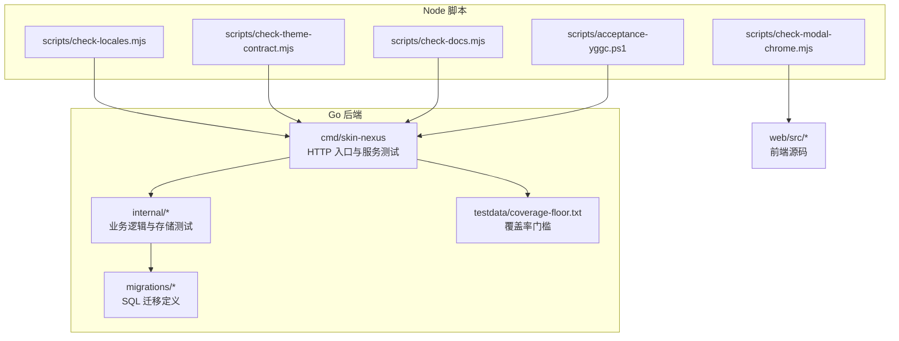
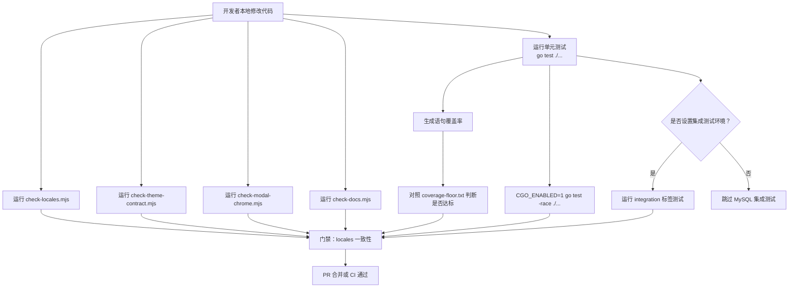
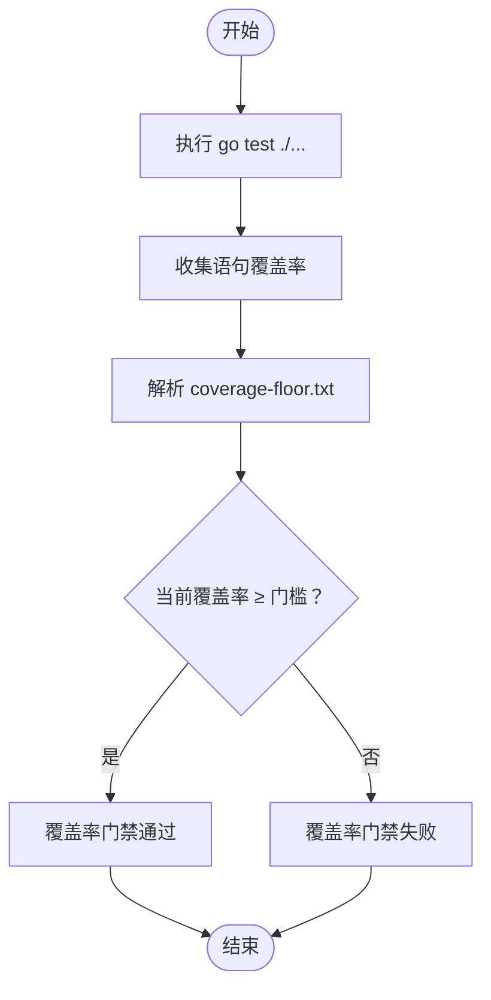
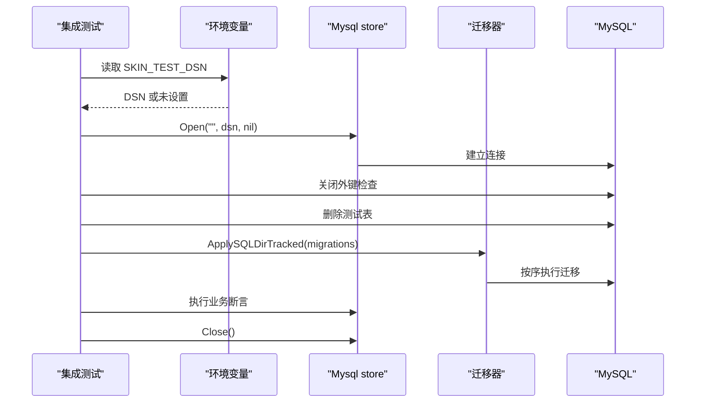
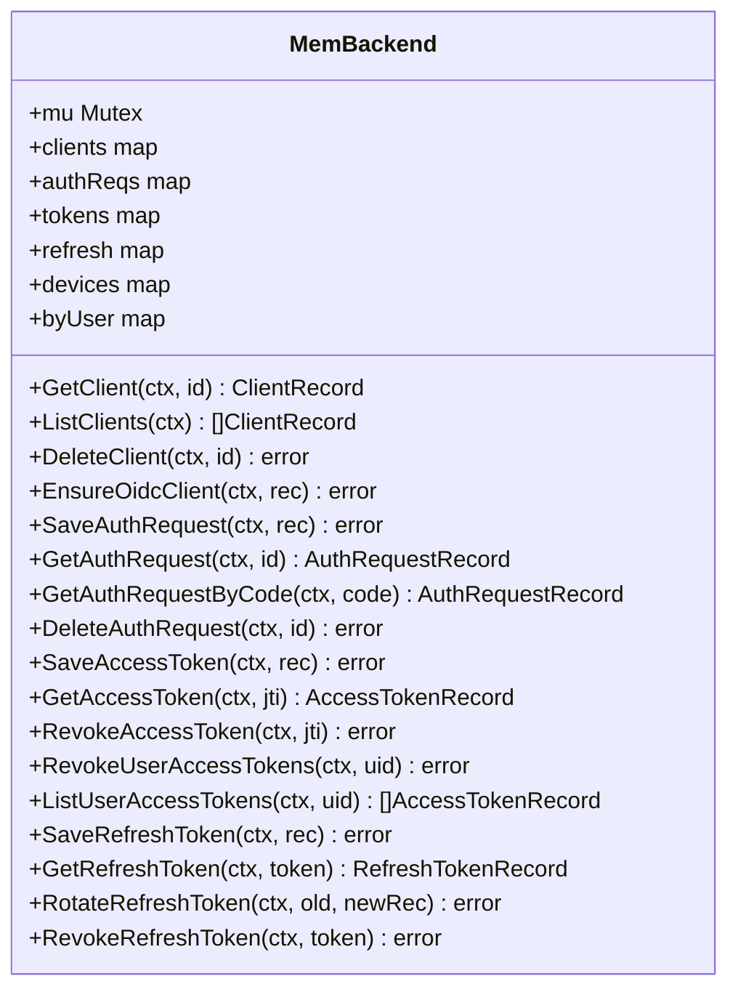
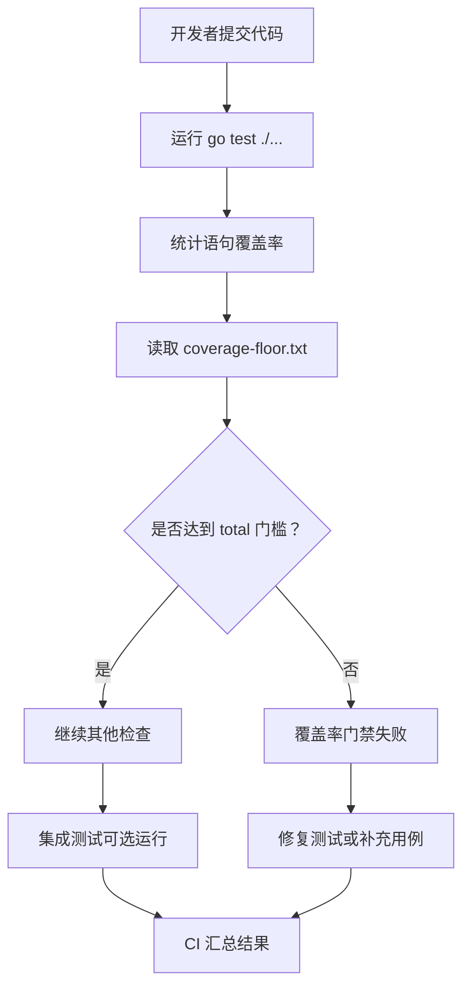

# 测试与质量保障

**本文引用的文件**
- [coverage-floor.txt](https://github.com/YimingZhanshen/skin-nexus/blob/797ae1a/server/testdata/coverage-floor.txt)
- [main_test.go](https://github.com/YimingZhanshen/skin-nexus/blob/797ae1a/server/cmd/skin-nexus/main_test.go)
- [server_test.go](https://github.com/YimingZhanshen/skin-nexus/blob/797ae1a/server/cmd/skin-nexus/server_test.go)
- [integration_test.go](https://github.com/YimingZhanshen/skin-nexus/blob/797ae1a/server/internal/store/integration_test.go)
- [contract_test.go](https://github.com/YimingZhanshen/skin-nexus/blob/797ae1a/server/internal/oidc/contract_test.go)
- [setup_test.go](https://github.com/YimingZhanshen/skin-nexus/blob/797ae1a/server/internal/store/setup_test.go)
- [env.go](https://github.com/YimingZhanshen/skin-nexus/blob/797ae1a/server/internal/config/env.go)
- [check-locales.mjs](https://github.com/YimingZhanshen/skin-nexus/blob/797ae1a/scripts/check-locales.mjs)
- [check-theme-contract.mjs](https://github.com/YimingZhanshen/skin-nexus/blob/797ae1a/scripts/check-theme-contract.mjs)
- [check-modal-chrome.mjs](https://github.com/YimingZhanshen/skin-nexus/blob/797ae1a/scripts/check-modal-chrome.mjs)
- [check-docs.mjs](https://github.com/YimingZhanshen/skin-nexus/blob/797ae1a/scripts/check-docs.mjs)
- [acceptance-yggc.ps1](https://github.com/YimingZhanshen/skin-nexus/blob/797ae1a/scripts/acceptance-yggc.ps1)

## 目录
1. [引言](#引言)
2. [项目结构与测试布局](#项目结构与测试布局)
3. [核心测试类型](#核心测试类型)
4. [架构总览：本地测试、覆盖率门禁与 CI 检查](#架构总览本地测试覆盖率门禁与-ci-检查)
5. [详细组件分析](#详细组件分析)
6. [依赖与外部系统模拟策略](#依赖与外部系统模拟策略)
7. [为新模块编写测试](#为新模块编写测试)
8. [覆盖率门槛与执行流程](#覆盖率门槛与执行流程)
9. [CI 门禁脚本说明](#ci-门禁脚本说明)
10. [代码风格、命名约定与审查清单](#代码风格命名约定与审查清单)
11. [回归测试最佳实践](#回归测试最佳实践)
12. [故障排查](#故障排查)
13. [结论](#结论)

## 引言
本文面向后端开发者和贡献者，系统化说明 SkinNexus 的测试分层、覆盖率门槛、CI 门禁脚本以及外部依赖模拟策略。目标是让读者能够：
- 理解单元测试、集成测试和契约测试在仓库中的组织方式；
- 知道如何运行测试、生成覆盖率报告并解读 `coverage-floor.txt`；
- 理解 locales 一致性、theme contract、modal Chrome 兼容性和文档检查的作用；
- 掌握构造配置、初始化 store、发起 HTTP 请求、断言响应和清理数据的标准做法；
- 遵循代码风格、命名约定和 PR 审查清单，降低回归风险。

## 项目结构与测试布局
后端基于 Go，测试主要分布在以下位置：
- `server/cmd/skin-nexus/*_test.go`：HTTP 服务层、SPA 注入、主题、SEO、静态资源等端到端或集成风格的测试；
- `server/internal/*/*_test.go`：内部包（account、store、plugin、webapi、union、oidc、mailer、auth 等）的单元和集成测试；
- `server/internal/store/*_integration_test.go`：带数据库后端的 MySQL 集成测试；
- `server/migrations/*/NNNN_*.sql`：多引擎迁移文件，被集成测试复用；
- `server/testdata/coverage-floor.txt`：单元测试语句覆盖率门槛；
- `scripts/*.mjs`：Node.js 编写的 CI 前置检查脚本；
- `scripts/acceptance-yggc.ps1`：YGG/OIDC 免密登录验收辅助脚本。

**图表来源**
- [main_test.go:1-208](https://github.com/YimingZhanshen/skin-nexus/blob/797ae1a/server/cmd/skin-nexus/main_test.go#L1-L208)
- [integration_test.go:1-200](https://github.com/YimingZhanshen/skin-nexus/blob/797ae1a/server/internal/store/integration_test.go#L1-L200)
- [coverage-floor.txt:1-13](https://github.com/YimingZhanshen/skin-nexus/blob/797ae1a/server/testdata/coverage-floor.txt#L1-L13)
- [check-locales.mjs:1-200](https://github.com/YimingZhanshen/skin-nexus/blob/797ae1a/scripts/check-locales.mjs#L1-L200)
- [check-theme-contract.mjs:1-130](https://github.com/YimingZhanshen/skin-nexus/blob/797ae1a/scripts/check-theme-contract.mjs#L1-L130)
- [check-modal-chrome.mjs:1-116](https://github.com/YimingZhanshen/skin-nexus/blob/797ae1a/scripts/check-modal-chrome.mjs#L1-L116)
- [check-docs.mjs:1-195](https://github.com/YimingZhanshen/skin-nexus/blob/797ae1a/scripts/check-docs.mjs#L1-L195)
- [acceptance-yggc.ps1:1-200](https://github.com/YimingZhanshen/skin-nexus/blob/797ae1a/scripts/acceptance-yggc.ps1#L1-L200)

**章节来源**
- [main_test.go:1-208](https://github.com/YimingZhanshen/skin-nexus/blob/797ae1a/server/cmd/skin-nexus/main_test.go#L1-L208)
- [integration_test.go:1-200](https://github.com/YimingZhanshen/skin-nexus/blob/797ae1a/server/internal/store/integration_test.go#L1-L200)
- [coverage-floor.txt:1-13](https://github.com/YimingZhanshen/skin-nexus/blob/797ae1a/server/testdata/coverage-floor.txt#L1-L13)

## 核心测试类型
### 单元测试
- 目标：验证纯函数、解析逻辑、错误处理、状态机、边界值，不依赖真实数据库、SMTP、Union Hub 或 Mojang。
- 典型形式：表驱动用例、httptest 路由测试、内存结构断言、mock/fake 外部依赖。
- 示例领域：
  - SPA 页面注入、SEO 标记替换、主题 CSS 注入顺序；
  - HTTP Server 超时与安全头加固；
  - OIDC 后端接口契约的双向实现；
  - Store 安装向导的原子性与回滚。

**章节来源**
- [main_test.go:1-208](https://github.com/YimingZhanshen/skin-nexus/blob/797ae1a/server/cmd/skin-nexus/main_test.go#L1-L208)
- [server_test.go:1-17](https://github.com/YimingZhanshen/skin-nexus/blob/797ae1a/server/cmd/skin-nexus/server_test.go#L1-L17)
- [setup_test.go:1-98](https://github.com/YimingZhanshen/skin-nexus/blob/797ae1a/server/internal/store/setup_test.go#L1-L98)

### 并发与竞态检测
- 并发回归用例与普通单元测试一起运行；`server/internal/metrics/metrics_test.go` 的 `TestConcurrentRegistrationIncrementAndScrape` 同时执行 `NewCounter`、`Inc` 和 `WriteText`，并校验最终计数与完整 exposition。
- `WriteText` 在 `Registry.mu` 内深拷贝 family 元数据、label names、series 和 uptime；解锁后只渲染不可变快照，series key 排序保证输出稳定。
- CI 的独立 `race` job 在 Ubuntu 上运行 `CGO_ENABLED=1 go test -race ./...`，与保留的 unit/coverage job 分开。
- race detector 需要 CGO 和 C 编译器。无 GCC 的环境只能记录普通测试结果，不能声称竞态检测通过。

**章节来源**
- [metrics.go](https://github.com/YimingZhanshen/skin-nexus/blob/main/server/internal/metrics/metrics.go)
- [metrics_test.go](https://github.com/YimingZhanshen/skin-nexus/blob/main/server/internal/metrics/metrics_test.go)

### 集成测试
- 目标：验证跨层数据流，尤其是 SQL 查询、事务、迁移、并发冲突、外部协议交互。
- 启用方式：通过 Go build tag `integration` 控制，默认不运行，避免在无数据库环境失败。
- 典型特征：
  - 使用 `//go:build integration` 标记；
  - 从环境变量读取 DSN，例如 `SKIN_TEST_DSN`；
  - 自动创建/清空测试表，应用迁移，再执行业务断言；
  - 用 t.Cleanup 关闭连接，确保可重复运行。

**章节来源**
- [integration_test.go:1-200](https://github.com/YimingZhanshen/skin-nexus/blob/797ae1a/server/internal/store/integration_test.go#L1-L200)

### 契约测试
- 目标：保证对外暴露的协议不变，包括 OIDC、YGG、WebAPI、插件平台、主题契约、i18n 错误码契约。
- 表现形式：
  - Go 测试中对协议字段、错误形状、签名、JTI、刷新令牌轮换等进行断言；
  - Node 脚本对 theme-spec.md、theme-base.css、打包主题 token 引用进行契约校验；
  - PowerShell 验收脚本按“十条契约”走查 YGG/OIDC 设备授权流程。

**章节来源**
- [contract_test.go:1-200](https://github.com/YimingZhanshen/skin-nexus/blob/797ae1a/server/internal/oidc/contract_test.go#L1-L200)
- [check-theme-contract.mjs:1-130](https://github.com/YimingZhanshen/skin-nexus/blob/797ae1a/scripts/check-theme-contract.mjs#L1-L130)
- [acceptance-yggc.ps1:1-200](https://github.com/YimingZhanshen/skin-nexus/blob/797ae1a/scripts/acceptance-yggc.ps1#L1-L200)

## 架构总览：本地测试、覆盖率门禁与 CI 检查

**图表来源**
- [coverage-floor.txt:1-13](https://github.com/YimingZhanshen/skin-nexus/blob/797ae1a/server/testdata/coverage-floor.txt#L1-L13)
- [check-locales.mjs:1-200](https://github.com/YimingZhanshen/skin-nexus/blob/797ae1a/scripts/check-locales.mjs#L1-L200)
- [check-theme-contract.mjs:1-130](https://github.com/YimingZhanshen/skin-nexus/blob/797ae1a/scripts/check-theme-contract.mjs#L1-L130)
- [check-modal-chrome.mjs:1-116](https://github.com/YimingZhanshen/skin-nexus/blob/797ae1a/scripts/check-modal-chrome.mjs#L1-L116)
- [check-docs.mjs:1-195](https://github.com/YimingZhanshen/skin-nexus/blob/797ae1a/scripts/check-docs.mjs#L1-L195)
- [integration_test.go:1-200](https://github.com/YimingZhanshen/skin-nexus/blob/797ae1a/server/internal/store/integration_test.go#L1-L200)

## 详细组件分析

### 覆盖率门槛与执行流程
`server/testdata/coverage-floor.txt` 是“单元测试阶段”的语句覆盖率门槛文件。其关键含义：
- 它只约束 `go test ./...` 的 unit leg，不包含数据库密集型集成测试；
- 文件中记录整体 statement 百分比的最低阈值，例如 `total 45.0`；
- 注释说明该数字是近期测量的基线，允许小幅波动，但下降通常意味着新增代码未加测试；
- 新增 0% 包或移除已有零覆盖率豁免包都会触发检查失败；
- 因此，覆盖率门禁的核心不是追求绝对高覆盖率，而是防止覆盖率因新增功能而倒退。

**图表来源**
- [coverage-floor.txt:1-13](https://github.com/YimingZhanshen/skin-nexus/blob/797ae1a/server/testdata/coverage-floor.txt#L1-L13)

**章节来源**
- [coverage-floor.txt:1-13](https://github.com/YimingZhanshen/skin-nexus/blob/797ae1a/server/testdata/coverage-floor.txt#L1-L13)

### 数据库集成测试套件
`internal/store/integration_test.go` 是 MySQL 集成测试的主入口之一：
- 使用 `//go:build integration` 跳过默认构建；
- 从 `SKIN_TEST_DSN` 读取 MySQL 连接串；
- 打开 Mysql store，延迟清理连接；
- 显式禁用外键检查后批量 DROP 测试表，再调用迁移工具应用 `migrations` 目录；
- 提供 seedUser/seedUserAs 等种子函数，构造用户、纹理、任务、审计日志等数据；
- 断言公共纹理去重、插件任务生命周期、导入、注册冲突等行为。

**图表来源**
- [integration_test.go:1-200](https://github.com/YimingZhanshen/skin-nexus/blob/797ae1a/server/internal/store/integration_test.go#L1-L200)

**章节来源**
- [integration_test.go:1-200](https://github.com/YimingZhanshen/skin-nexus/blob/797ae1a/server/internal/store/integration_test.go#L1-L200)

### OIDC 契约测试与内存后端
`internal/oidc/contract_test.go` 定义了内存版 `Backend` 实现，用于隔离 OIDC 协议行为与持久化细节：
- 维护客户端、认证请求、访问令牌、刷新令牌、设备授权记录的内存映射；
- 所有写操作加互斥锁，读操作返回排序后的结果，保证测试确定性；
- 覆盖获取客户端、保存认证请求、按 code 查找、撤销访问令牌、刷新令牌轮换、列出用户令牌等路径；
- 这种“契约双实现”让协议逻辑可以在内存后端上快速验证，而不依赖真实数据库。

**图表来源**
- [contract_test.go:1-200](https://github.com/YimingZhanshen/skin-nexus/blob/797ae1a/server/internal/oidc/contract_test.go#L1-L200)

**章节来源**
- [contract_test.go:1-200](https://github.com/YimingZhanshen/skin-nexus/blob/797ae1a/server/internal/oidc/contract_test.go#L1-L200)

### SPA 与主题注入测试
`cmd/skin-nexus/main_test.go` 覆盖了服务端渲染 SPA 的关键路径：
- 断言根路径和其他 HTML 路径会注入 SEO 标记、主题 CSS、自定义样式；
- 断言注入 CSS 必须位于 Vite 构建产物之后，避免主题变量被 app CSS 覆盖；
- 断言已知 shell 路由如 `/setup` 返回 200，未知路径返回 404；
- 断言静态资源如 `/assets/app.js` 直接原样返回，不被注入层污染。

**章节来源**
- [main_test.go:1-208](https://github.com/YimingZhanshen/skin-nexus/blob/797ae1a/server/cmd/skin-nexus/main_test.go#L1-L208)

### HTTP Server 加固测试
`cmd/skin-nexus/server_test.go` 验证 HTTP server 构造函数设置了正向超时和最大请求头大小，防止慢连接攻击和超大请求头导致资源耗尽。

**章节来源**
- [server_test.go:1-17](https://github.com/YimingZhanshen/skin-nexus/blob/797ae1a/server/cmd/skin-nexus/server_test.go#L1-L17)

### 安装向导原子性测试
`internal/store/setup_test.go` 验证安装向导这一单向门的关键属性：
- 首次 ClaimSetup 成功且只产生一个超级管理员；
- 并发第二次 ClaimSetup 不会报错，而是返回“已失去抢占”；
- 账号创建失败时，安装标记和选项必须回滚，站点不能陷入不可恢复状态；
- 重试时可用新昵称完成安装。

**章节来源**
- [setup_test.go:1-98](https://github.com/YimingZhanshen/skin-nexus/blob/797ae1a/server/internal/store/setup_test.go#L1-L98)

## 依赖与外部系统模拟策略
### 数据库
- 单元测试尽量不调真实数据库；需要数据库的行为放入 `*_integration_test.go` 并通过 `go test -tags integration` 运行；
- 集成测试使用 `SKIN_TEST_DSN` 指向 MySQL，先 drop 测试表，再应用迁移，最后做断言；
- 对于 SQLite 相关测试，应使用临时目录和 t.Cleanup 清理，避免污染宿主环境；
- 对于 MySQL/Postgres/SQLite 差异，优先使用 `dbx`、`dialect` 抽象，并在 portability gate 测试中验证。

### SMTP
- 邮件发送属于外部依赖，单元测试应验证消息构造、地址解析、重试策略、审计写入；
- 真实 SMTP 发送放在集成测试或 admin mailtest 场景；
- 测试断言应关注 envelope 中的 `{error, code, message}`、队列状态、重试次数和审计日志，而不是网络本身。

### Union Hub
- Union 相关测试应区分 outbound 请求、inbound 回调、OAuth2 grant、成员名称、诊断探针；
- 对外部 HTTP 调用可使用 httptest.Server 构造 mock Union Hub；
- 对安全级别、限流、签名、诊断 wire 格式进行断言；
- 不要在生产测试中实际访问 Union Hub。

### Mojang / YGG / OIDC
- Mojang/YGG 作为外部身份源，应在测试中 stub 其 JSON 响应；
- OIDC 契约测试使用内存 Backend 隔离存储；
- YGG/OIDC 设备授权流程可由 `acceptance-yggc.ps1` 在真实环境中走查，但自动化测试仍应以协议断言为主。

**章节来源**
- [integration_test.go:1-200](https://github.com/YimingZhanshen/skin-nexus/blob/797ae1a/server/internal/store/integration_test.go#L1-L200)
- [contract_test.go:1-200](https://github.com/YimingZhanshen/skin-nexus/blob/797ae1a/server/internal/oidc/contract_test.go#L1-L200)
- [acceptance-yggc.ps1:1-200](https://github.com/YimingZhanshen/skin-nexus/blob/797ae1a/scripts/acceptance-yggc.ps1#L1-L200)

## 为新模块编写测试
### 构造 Config
- 优先使用 `internal/config` 提供的配置结构与环境变量映射；
- 使用 `KnownEnv` 与 `TestOnlyEnv` 明确哪些 `SKIN_*` 变量会被进程读取；
- 测试中避免污染真实环境，可使用子进程、环境变量临时替换或仅传入配置对象；
- 如果模块依赖多个环境变量，应使用表驱动用例覆盖缺失、非法、默认值、优先级等分支。

**章节来源**
- [env.go:1-104](https://github.com/YimingZhanshen/skin-nexus/blob/797ae1a/server/internal/config/env.go#L1-L104)

### 初始化 Store
- 对于 SQLite 测试，使用 `t.TempDir()` 存放数据目录，并在 `t.Cleanup` 中关闭 store；
- 对于 MySQL 集成测试，使用 `openTestStore` 模式：读取 DSN、drop 测试表、应用迁移、seed 数据；
- 事务性操作要断言回滚：安装向导、插件安装事务、密码重置、邮箱验证等；
- 断言不仅看返回值，还要检查数据库中最终状态，尤其是唯一约束、索引、审计日志。

**章节来源**
- [integration_test.go:1-200](https://github.com/YimingZhanshen/skin-nexus/blob/797ae1a/server/internal/store/integration_test.go#L1-L200)
- [setup_test.go:1-98](https://github.com/YimingZhanshen/skin-nexus/blob/797ae1a/server/internal/store/setup_test.go#L1-L98)

### 发起 HTTP 请求
- 使用 `net/http/httptest.NewRecorder` 和 `NewRequest` 构造请求；
- 将 handler 挂载到真实 router 或最小化 handler 上，验证路由参数、body 上限、header 注入、错误形状；
- 对需要 session、OIDC、Union、插件上下文的路由，优先注入 mock store、mock client、stub 时间源；
- 断言状态码、Content-Type、JSON envelope、HTML 注入标记、安全头、缓存头。

**章节来源**
- [main_test.go:1-208](https://github.com/YimingZhanshen/skin-nexus/blob/797ae1a/server/cmd/skin-nexus/main_test.go#L1-L208)
- [server_test.go:1-17](https://github.com/YimingZhanshen/skin-nexus/blob/797ae1a/server/cmd/skin-nexus/server_test.go#L1-L17)

### 断言响应
- API 响应断言使用结构化字段比较，而非整段 JSON 字符串；
- HTML 断言关注关键标记、标题、SEO head、主题注入顺序；
- 错误响应断言 `code` 与 i18n 错误码一致，确保前后端共享错误语义；
- 并发测试需断言竞态条件，例如安装向导只能有一个赢家。

### 清理数据
- 每个测试方法结束时调用 `t.Cleanup`；
- 数据库测试使用 drop table 或事务回滚；
- 文件系统测试使用 `t.TempDir()`；
- 全局状态（如 siteurl、随机数、时间源）必须在测试结束后恢复，避免交叉污染。

## 覆盖率门槛与执行流程
### 门槛含义
- `total 45.0` 表示单元测试阶段的语句覆盖率不得低于该值；
- 该门槛针对的是“可到达语句”，不包括因 build tag 跳过的集成测试；
- 如果新增代码没有测试，覆盖率可能下降，从而触发门禁失败；
- 零覆盖率包列表用于解释某些包为何在本阶段不可达，新增或移除都需要理由。

### 执行流程

**图表来源**
- [coverage-floor.txt:1-13](https://github.com/YimingZhanshen/skin-nexus/blob/797ae1a/server/testdata/coverage-floor.txt#L1-L13)

**章节来源**
- [coverage-floor.txt:1-13](https://github.com/YimingZhanshen/skin-nexus/blob/797ae1a/server/testdata/coverage-floor.txt#L1-L13)

## CI 门禁脚本说明

### Go race 门禁
`.github/workflows/ci.yml` 的 `race` job 使用 Ubuntu 与 Go 1.26，通过 `CGO_ENABLED=1 go test -race ./...` 运行全部后端测试。该 job 不改变现有 unit/coverage job；普通测试验证功能，race job 额外检测无锁共享状态访问。metrics 的注册、增量与 scrape 并发回归用例会在两条腿中执行。

### Locales 一致性检查
`scripts/check-locales.mjs` 负责三类一致性：
1. 前端 `web/src/locales/zh-CN.json` 与 `en.json` 的 key 集合必须一致；
2. 后端声明的错误码必须在前端 `errors.*` 中存在对应翻译；
3. 前端 errors 下不能存在后端未声明的“死键”；
4. SSR 目录下的 webi18n 目录必须保持 key 对齐、无死拷贝、无中文残留、无命名空间混用；
5. 对 vue-i18n 链接消息语法中的裸 `@` 进行保护性检查，避免运行时抛错。

**章节来源**
- [check-locales.mjs:1-200](https://github.com/YimingZhanshen/skin-nexus/blob/797ae1a/scripts/check-locales.mjs#L1-L200)

### Theme Contract 校验
`scripts/check-theme-contract.mjs` 校验两个容易静默失效的主题契约：
1. `docs/theme-spec.md` §3 的默认 token 值必须与 `server/cmd/skin-nexus/theme-base.css` 中 `:root` 定义一致；
2. 打包主题不得引用 host 已删除的 token；若 pack 内定义了私有 token，则不受此限制；
3. 当 `plugins-dist` 未检出时，脚本会输出可见 note，而不是假装通过。

**章节来源**
- [check-theme-contract.mjs:1-130](https://github.com/YimingZhanshen/skin-nexus/blob/797ae1a/scripts/check-theme-contract.mjs#L1-L130)

### Modal Chrome 兼容性检查
`scripts/check-modal-chrome.mjs` 禁止除 `ToastHub.vue` 外的任何 `position: fixed` 前台覆盖层，并强制诊断弹窗使用原生 `<dialog>` 和 `showModal()`：
- 原因：固定定位可能被祖先元素的 transform 动画影响，导致模态框不在视口顶部，甚至被遮挡；
- 规则：扫描 `web/src` 下 `.vue` 与 `.js`，剥离注释后再匹配 CSS；
- 特例：诊断弹窗必须使用 `diag-modal` 类、调用 `showModal()`，且不能出现旧版 `diag-overlay`。

**章节来源**
- [check-modal-chrome.mjs:1-116](https://github.com/YimingZhanshen/skin-nexus/blob/797ae1a/scripts/check-modal-chrome.mjs#L1-L116)

### 文档检查
`scripts/check-docs.mjs` 检查文档自洽性：
1. Markdown 相对链接不能断裂；
2. 表格各行列数必须一致；
3. 竞品分析表必须有快照日期；
4. `deploy.md` §2.3 的环境变量表必须与 `env.go` 的 `KnownEnv` 双向一致；
5. README 中英文快速启动 `.env` 块必须与 `docker-compose.quickstart.yml` 一致，且变量必须被 compose 引用。

**章节来源**
- [check-docs.mjs:1-195](https://github.com/YimingZhanshen/skin-nexus/blob/797ae1a/scripts/check-docs.mjs#L1-L195)

### YGG/OIDC 验收脚本
`scripts/acceptance-yggc.ps1` 不是普通单元测试，而是面向真机的验收辅助脚本：
- 按十条契约检查元数据、discovery、device_authorization、批准、token 轮询、id_token 声明、userinfo 双路径、validate、X-Authlib-Injector-API-Location；
- 支持自动登录批准或手动浏览器批准；
- 适用于部署后可复现的联合认证验收，不作为常规 CI 必过项。

**章节来源**
- [acceptance-yggc.ps1:1-200](https://github.com/YimingZhanshen/skin-nexus/blob/797ae1a/scripts/acceptance-yggc.ps1#L1-L200)

## 代码风格、命名约定与审查清单

### 测试命名与结构
- 文件名以 `_test.go` 结尾；集成测试使用 `*_integration_test.go` 并加 `//go:build integration`；
- 测试函数使用 `func TestXxx(t *testing.T)`，并发测试使用 `func TestXxxConcurrent` 或类似命名；
- 表驱动测试使用 `[]struct{ name string; in ...; want ... }` 形式，便于扩展用例；
- 外部依赖统一使用 fake/mock/stub，避免隐式网络或磁盘 IO。

### 环境与配置命名
- 生产环境变量统一以 `SKIN_` 前缀开头；
- 所有被进程读取的变量必须登记在 `KnownEnv`；
- 仅 compose 使用的变量登记在 `ComposeEnv`；
- 测试专用变量登记在 `TestOnlyEnv`；
- 新增环境变量需要同步更新 `check-docs.mjs` 所依赖的部署文档。

**章节来源**
- [env.go:1-104](https://github.com/YimingZhanshen/skin-nexus/blob/797ae1a/server/internal/config/env.go#L1-L104)

### PR 审查清单
- 新增功能是否补充了单元测试或集成测试；
- 并发代码是否有并发回归用例，并在具备 CGO/C 编译器时运行 `CGO_ENABLED=1 go test -race ./...`；
- 新增环境变量是否登记在 `KnownEnv` 并更新部署文档；
- 新增错误码是否在 i18n 两端都有对应 entry；
- 新增 UI 覆盖层是否遵循 `<dialog>` + `showModal()` 约定；
- 新增主题 token 是否同步更新 theme-spec 与 theme-base.css；
- 新增数据库变更是否提供迁移文件，并在集成测试中覆盖；
- 是否避免引入真实网络、真实 SMTP、真实 Union Hub、真实 Mojang 调用；
- 是否添加 `t.Cleanup` 或临时目录，避免测试间污染。

## 回归测试最佳实践
- 回归测试应描述历史 bug 的输入、期望行为和修复依据，而不是只写“能跑就行”；
- 对并发、回滚、幂等、唯一约束、索引、分页、偏移量、时间戳、时区敏感逻辑优先写回归测试；
- 对 UI 行为优先写契约测试或脚本检查，而不是只截图；
- 对协议行为优先断言关键字段和错误码，而不是断言整个 JSON；
- 对部署配置优先断言环境变量表和 compose 模板的一致性；
- 对性能敏感路径优先补充基准测试或测量点，避免后续优化造成退化。

## 故障排查

### 本地运行测试
- 运行全部单元测试：`go test ./...`；
- 运行竞态检测（需 CGO + C 编译器）：`CGO_ENABLED=1 go test -race ./...`；
- 运行集成测试：设置 `SKIN_TEST_DSN` 后执行 `go test -tags integration ./internal/store/`；
- 运行单个测试：`go test ./server/internal/store -run TestIntegrationPublicTextureDedupe`；
- 查看覆盖率：`go test ./... -coverprofile=cover.out && go tool cover -html=cover.out`；
- 仅查看语句覆盖率：`go test ./... -covermode=statement`。

### 覆盖率门槛失败
- 确认失败来自 `coverage-floor.txt` 的 total 值；
- 新增功能但未写测试是最常见原因；
- 如果确实新增了不可达代码，应先尝试写出测试；只有在确属 build tag 或入口不可达时才考虑调整门槛；
- 门槛调整应由维护者在确认 unit leg 稳定性后执行，不应随意提高容差。

### CI 失败排查
- race job 报 `C compiler "gcc" not found`：确认 Ubuntu runner 已启用 CGO 且 GCC 可用；本地无 GCC 时以 CI race job 为准，不以普通测试替代；
- race job 报 `DATA RACE`：按报告栈定位共享状态的读写方，将快照/拷贝或加锁放在同一同步边界内，再重跑 race 与普通测试；
- locales 不一致：检查 zh-CN 与 en 的 key 集合，以及后端错误码与前端 `errors.*` 的对应关系；
- theme contract 失败：检查 theme-spec.md §3 与 theme-base.css 的 token 值是否一致；
- modal Chrome 失败：检查是否手写 `position: fixed` 覆盖层，诊断弹窗是否使用 `<dialog>` 和 `showModal()`；
- 文档检查失败：检查 deploy.md 环境变量表、README 快速启动 .env、compose 模板是否一致；
- 集成测试失败：检查 MySQL 容器是否可用、DSN 是否正确、迁移是否完整、测试表是否被意外占用。

**章节来源**
- [integration_test.go:1-200](https://github.com/YimingZhanshen/skin-nexus/blob/797ae1a/server/internal/store/integration_test.go#L1-L200)
- [check-locales.mjs:1-200](https://github.com/YimingZhanshen/skin-nexus/blob/797ae1a/scripts/check-locales.mjs#L1-L200)
- [check-theme-contract.mjs:1-130](https://github.com/YimingZhanshen/skin-nexus/blob/797ae1a/scripts/check-theme-contract.mjs#L1-L130)
- [check-modal-chrome.mjs:1-116](https://github.com/YimingZhanshen/skin-nexus/blob/797ae1a/scripts/check-modal-chrome.mjs#L1-L116)
- [check-docs.mjs:1-195](https://github.com/YimingZhanshen/skin-nexus/blob/797ae1a/scripts/check-docs.mjs#L1-L195)

## 结论
SkinNexus 的测试体系以“单元测试保底、集成测试覆盖数据库、契约测试守护协议、脚本检查守护文档与前端行为”为骨架。覆盖率门槛不是装饰，而是防止新增功能逃逸测试的护栏；CI 门禁脚本把容易静默破坏的问题提前暴露给作者。对新模块而言，最稳妥的做法是：先写最小可运行的测试，再补全边界、并发、回滚和协议断言；对外部依赖一律 mock；对部署配置一律登记；对 UI 行为一律遵守现有契约。这样既能通过本地测试与 CI，也能降低上线后的回归风险。
