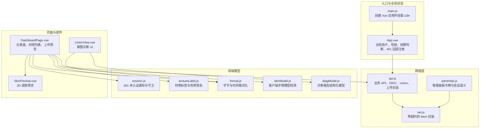
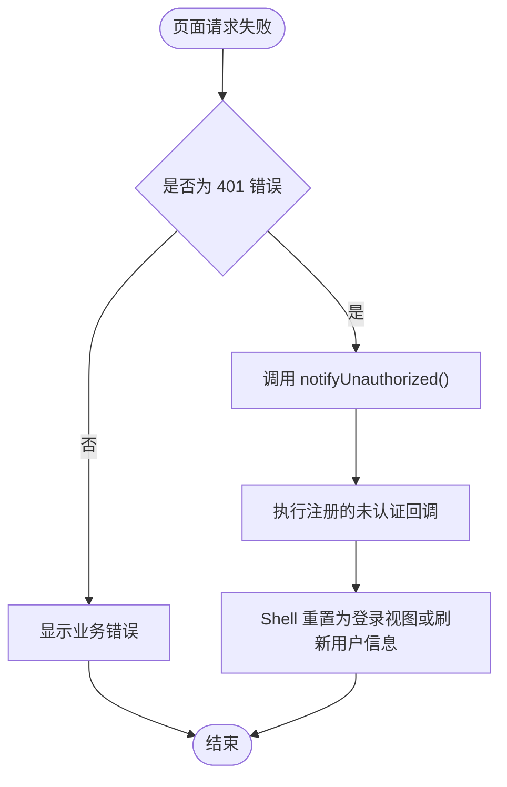
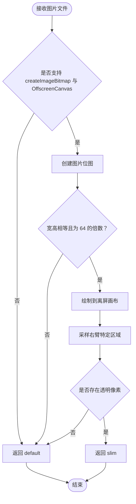
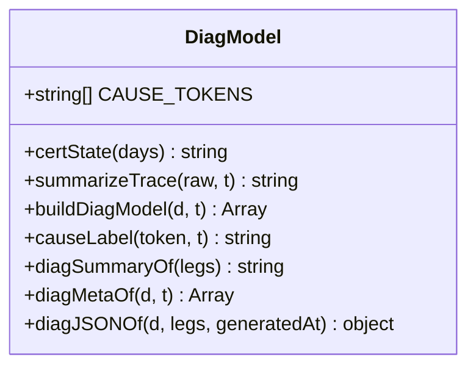
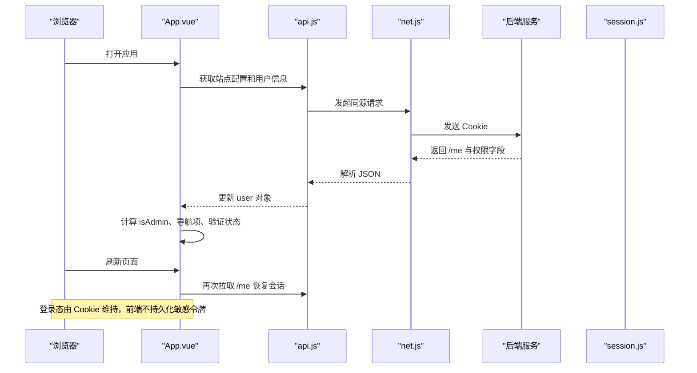
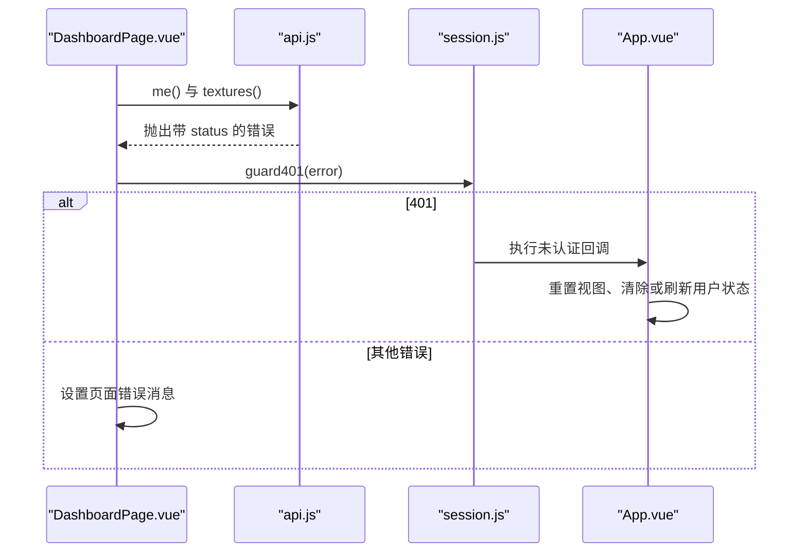
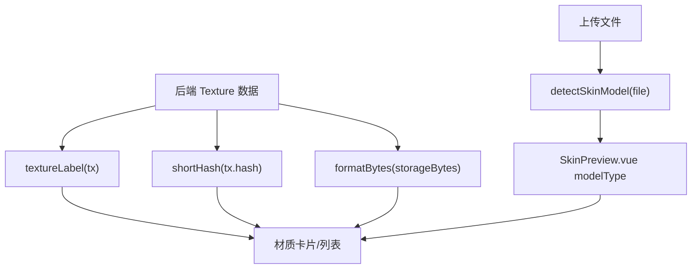
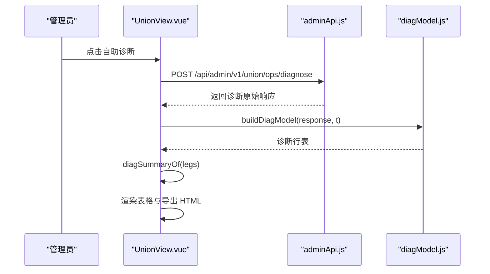
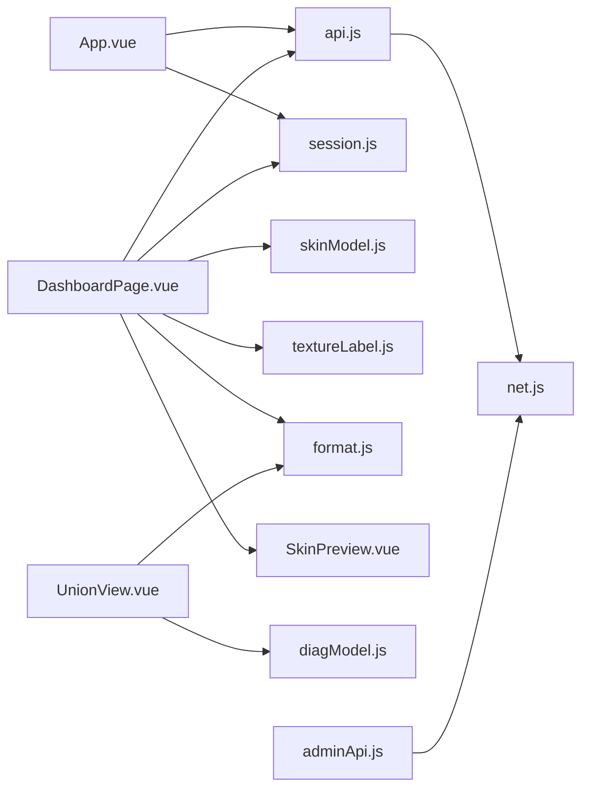

# 状态管理与领域模型

**本文引用的文件**
- [session.js](https://github.com/YimingZhanshen/skin-nexus/blob/797ae1a/web/src/session.js)
- [skinModel.js](https://github.com/YimingZhanshen/skin-nexus/blob/797ae1a/web/src/skinModel.js)
- [diagModel.js](https://github.com/YimingZhanshen/skin-nexus/blob/797ae1a/web/src/diagModel.js)
- [format.js](https://github.com/YimingZhanshen/skin-nexus/blob/797ae1a/web/src/format.js)
- [textureLabel.js](https://github.com/YimingZhanshen/skin-nexus/blob/797ae1a/web/src/textureLabel.js)
- [api.js](https://github.com/YimingZhanshen/skin-nexus/blob/797ae1a/web/src/api.js)
- [net.js](https://github.com/YimingZhanshen/skin-nexus/blob/797ae1a/web/src/net.js)
- [adminApi.js](https://github.com/YimingZhanshen/skin-nexus/blob/797ae1a/web/src/adminApi.js)
- [App.vue](https://github.com/YimingZhanshen/skin-nexus/blob/797ae1a/web/src/App.vue)
- [DashboardPage.vue](https://github.com/YimingZhanshen/skin-nexus/blob/797ae1a/web/src/pages/DashboardPage.vue)
- [UnionView.vue](https://github.com/YimingZhanshen/skin-nexus/blob/797ae1a/web/src/components/admin/UnionView.vue)
- [SkinPreview.vue](https://github.com/YimingZhanshen/skin-nexus/blob/797ae1a/web/src/components/SkinPreview.vue)

## 目录
1. [引言](#引言)
2. [项目结构](#项目结构)
3. [核心模块](#核心模块)
4. [架构总览](#架构总览)
5. [组件与数据流详解](#组件与数据流详解)
6. [依赖关系分析](#依赖关系分析)
7. [性能与可维护性建议](#性能与可维护性建议)
8. [故障排查指南](#故障排查指南)
9. [结论](#结论)

## 引言
本文聚焦前端的状态管理与领域模型，围绕以下五个核心文件展开：
- `session.js`：统一的未认证通知与 401 守卫。
- `skinModel.js`：客户端皮肤模型检测，用于上传前的 3D 预览。
- `diagModel.js`：诊断接口返回的结构化解释模型。
- `format.js`：字节大小与时间的统一格式化能力。
- `textureLabel.js`：材质哈希、名称和来源标签的统一展示逻辑。

需要特别说明的是：当前仓库中并没有一个名为“会话存储”的模块直接保存用户身份、角色、权限、登录态和 CSRF 令牌；这些职责由浏览器 Cookie、后端 `/api/v1/me` 响应以及应用根组件共同承担。CSRF 等安全细节通常由服务端会话机制处理，前端侧通过同源请求携带 Cookie，而不是在前端内存或本地存储中明文保存敏感令牌。

## 项目结构
本节仅列出与本文目标相关的文件及其职责边界：

**图表来源**
- [main.js:1-6](https://github.com/YimingZhanshen/skin-nexus/blob/797ae1a/web/src/main.js#L1-L6)
- [App.vue:1-120](https://github.com/YimingZhanshen/skin-nexus/blob/797ae1a/web/src/App.vue#L1-L120)
- [net.js:1-23](https://github.com/YimingZhanshen/skin-nexus/blob/797ae1a/web/src/net.js#L1-L23)
- [api.js:1-161](https://github.com/YimingZhanshen/skin-nexus/blob/797ae1a/web/src/api.js#L1-L161)
- [adminApi.js:1-32](https://github.com/YimingZhanshen/skin-nexus/blob/797ae1a/web/src/adminApi.js#L1-L32)
- [session.js:1-13](https://github.com/YimingZhanshen/skin-nexus/blob/797ae1a/web/src/session.js#L1-L13)
- [skinModel.js:1-41](https://github.com/YimingZhanshen/skin-nexus/blob/797ae1a/web/src/skinModel.js#L1-L41)
- [diagModel.js:1-191](https://github.com/YimingZhanshen/skin-nexus/blob/797ae1a/web/src/diagModel.js#L1-L191)
- [format.js:1-21](https://github.com/YimingZhanshen/skin-nexus/blob/797ae1a/web/src/format.js#L1-L21)
- [textureLabel.js:1-21](https://github.com/YimingZhanshen/skin-nexus/blob/797ae1a/web/src/textureLabel.js#L1-L21)
- [DashboardPage.vue:1-200](https://github.com/YimingZhanshen/skin-nexus/blob/797ae1a/web/src/pages/DashboardPage.vue#L1-L200)
- [UnionView.vue:1-200](https://github.com/YimingZhanshen/skin-nexus/blob/797ae1a/web/src/components/admin/UnionView.vue#L1-L200)
- [SkinPreview.vue:1-87](https://github.com/YimingZhanshen/skin-nexus/blob/797ae1a/web/src/components/SkinPreview.vue#L1-L87)

**章节来源**
- [main.js:1-6](https://github.com/YimingZhanshen/skin-nexus/blob/797ae1a/web/src/main.js#L1-L6)
- [App.vue:1-120](https://github.com/YimingZhanshen/skin-nexus/blob/797ae1a/web/src/App.vue#L1-L120)

## 核心模块

### 会话与未认证守卫：`session.js`
`session.js` 不是传统意义上的“会话存储”，而是跨组件共享的“会话失效事件通道”。它提供两个导出：
- `setUnauthorizedHandler(fn)`：注册一个在收到 401 时执行的回调。
- `notifyUnauthorized()`：主动触发该回调。
- `guard401(e)`：判断错误是否为 401；如果是，则触发未认证回调并返回 `true`，调用方据此避免重复显示错误提示。

典型用法是：
- 应用启动时在根组件注册 401 处理器，把界面回退到登录态。
- 页面级异步请求捕获异常后调用 `guard401`，让 Shell 决定是否需要重新加载 `/me` 或跳转登录页。

**图表来源**
- [session.js:1-13](https://github.com/YimingZhanshen/skin-nexus/blob/797ae1a/web/src/session.js#L1-L13)
- [DashboardPage.vue:1-200](https://github.com/YimingZhanshen/skin-nexus/blob/797ae1a/web/src/pages/DashboardPage.vue#L1-L200)

**章节来源**
- [session.js:1-13](https://github.com/YimingZhanshen/skin-nexus/blob/797ae1a/web/src/session.js#L1-L13)
- [App.vue:1-120](https://github.com/YimingZhanshen/skin-nexus/blob/797ae1a/web/src/App.vue#L1-L120)
- [DashboardPage.vue:1-200](https://github.com/YimingZhanshen/skin-nexus/blob/797ae1a/web/src/pages/DashboardPage.vue#L1-L200)

### 皮肤模型检测：`skinModel.js`
`skinModel.js` 暴露一个异步函数 `detectSkinModel(file)`，用于在用户上传皮肤前，根据像素数据判断手臂模型是 `slim` 还是 `default`。其规则遵循 Mojang 规范：
- 只有宽高相等且宽度是 64 的倍数时才包含手臂模型信息。
- 对右臂特定区域采样，若存在透明像素则判定为 `slim`。
- 不支持 `createImageBitmap` 或 `OffscreenCanvas` 的环境降级返回 `default`。
- 使用 `finally` 关闭位图，避免资源泄漏。

注意：这个模型只影响上传前的 3D 预览，最终存储在服务器上的模型以服务端检测结果为准。

**图表来源**
- [skinModel.js:1-41](https://github.com/YimingZhanshen/skin-nexus/blob/797ae1a/web/src/skinModel.js#L1-L41)

**章节来源**
- [skinModel.js:1-41](https://github.com/YimingZhanshen/skin-nexus/blob/797ae1a/web/src/skinModel.js#L1-L41)
- [DashboardPage.vue:1-200](https://github.com/YimingZhanshen/skin-nexus/blob/797ae1a/web/src/pages/DashboardPage.vue#L1-L200)
- [SkinPreview.vue:1-87](https://github.com/YimingZhanshen/skin-nexus/blob/797ae1a/web/src/components/SkinPreview.vue#L1-L87)

### 诊断模型：`diagModel.js`
`diagModel.js` 承载 Union 自检接口的结果，将原始响应转换为可读的行表结构。关键导出包括：
- `CAUSE_TOKENS`：诊断原因枚举值集合。
- `certState(days)`：证书剩余天数对应的状态。
- `summarizeTrace(raw, t)`：从 GnuTLS 调试日志中提取版本、密码套件和断言数量。
- `buildDiagModel(d, t)`：构建两腿诊断结果。
- `causeLabel(token, t)`：将机器原因映射为可操作的自然语言。
- `diagSummaryOf(legs)`：汇总整体状态。
- `diagMetaOf(d, t)`：提取密钥指纹、私钥版本、服务器列表版本。
- `diagJSONOf(d, legs, generatedAt)`：生成包含解释结果和原始响应的 JSON 报告。

**图表来源**
- [diagModel.js:1-191](https://github.com/YimingZhanshen/skin-nexus/blob/797ae1a/web/src/diagModel.js#L1-L191)

**章节来源**
- [diagModel.js:1-191](https://github.com/YimingZhanshen/skin-nexus/blob/797ae1a/web/src/diagModel.js#L1-L191)
- [UnionView.vue:1-200](https://github.com/YimingZhanshen/skin-nexus/blob/797ae1a/web/src/components/admin/UnionView.vue#L1-L200)

### 格式化能力：`format.js`
`format.js` 提供两个全局一致的格式化函数：
- `formatBytes(n)`：将字节数转换为 B/KB/MB/GB/TB，空值返回占位符。
- `formatWhen(value)`：使用站点当前语言环境格式化日期和时间。

这两个函数替代了之前多处不一致的字节格式化和浏览器默认语言日期渲染。

**章节来源**
- [format.js:1-21](https://github.com/YimingZhanshen/skin-nexus/blob/797ae1a/web/src/format.js#L1-L21)
- [DashboardPage.vue:1-200](https://github.com/YimingZhanshen/skin-nexus/blob/797ae1a/web/src/pages/DashboardPage.vue#L1-L200)
- [UnionView.vue:1-200](https://github.com/YimingZhanshen/skin-nexus/blob/797ae1a/web/src/components/admin/UnionView.vue#L1-L200)

### 材质标签：`textureLabel.js`
`textureLabel.js` 定义材质展示约定：
- `shortHash(hash, n = 12)`：截短哈希，避免不同列表出现不同长度。
- `textureLabel(tx)`：优先取描述或名称，再回退到短哈希。
- `nameFromFile(filename)`：根据文件名预填充上传名称，去除常见扩展名并限制长度。

这保证了同一材质在不同页面不会显示三种不同的哈希宽度或名称。

**章节来源**
- [textureLabel.js:1-21](https://github.com/YimingZhanshen/skin-nexus/blob/797ae1a/web/src/textureLabel.js#L1-L21)
- [DashboardPage.vue:1-200](https://github.com/YimingZhanshen/skin-nexus/blob/797ae1a/web/src/pages/DashboardPage.vue#L1-L200)

## 架构总览
下图展示前端状态管理的真实边界：用户身份、权限和登录态主要由后端会话与 `/api/v1/me` 响应驱动，前端通过根组件维护当前用户对象，并通过 `provide('sessionUser', user)` 向下注入。

**图表来源**
- [App.vue:1-120](https://github.com/YimingZhanshen/skin-nexus/blob/797ae1a/web/src/App.vue#L1-L120)
- [api.js:1-161](https://github.com/YimingZhanshen/skin-nexus/blob/797ae1a/web/src/api.js#L1-L161)
- [net.js:1-23](https://github.com/YimingZhanshen/skin-nexus/blob/797ae1a/web/src/net.js#L1-L23)
- [session.js:1-13](https://github.com/YimingZhanshen/skin-nexus/blob/797ae1a/web/src/session.js#L1-L13)

**章节来源**
- [App.vue:1-120](https://github.com/YimingZhanshen/skin-nexus/blob/797ae1a/web/src/App.vue#L1-L120)
- [api.js:1-161](https://github.com/YimingZhanshen/skin-nexus/blob/797ae1a/web/src/api.js#L1-L161)

## 组件与数据流详解

### 使用 session 控制导航与登录态
在 Dashboard 页面中，加载材质列表时会调用 `api.me()` 与 `api.textures(...)`，并在捕获异常时调用 `guard401(e)`。如果返回 `true`，表示这是会话丢失导致的 401，不应重复显示业务错误，而应交由 Shell 处理登录态恢复。

**图表来源**
- [DashboardPage.vue:1-200](https://github.com/YimingZhanshen/skin-nexus/blob/797ae1a/web/src/pages/DashboardPage.vue#L1-L200)
- [session.js:1-13](https://github.com/YimingZhanshen/skin-nexus/blob/797ae1a/web/src/session.js#L1-L13)
- [App.vue:1-120](https://github.com/YimingZhanshen/skin-nexus/blob/797ae1a/web/src/App.vue#L1-L120)

**章节来源**
- [DashboardPage.vue:1-200](https://github.com/YimingZhanshen/skin-nexus/blob/797ae1a/web/src/pages/DashboardPage.vue#L1-L200)
- [session.js:1-13](https://github.com/YimingZhanshen/skin-nexus/blob/797ae1a/web/src/session.js#L1-L13)

### 将后端 Texture 转换为前端可渲染对象
Dashboard 页面从 `api.textures` 获取后端材质数据，并结合以下工具进行渲染：
- `textureLabel(tx)`：显示人类可读的材质名称。
- `shortHash(tx.hash)`：显示稳定长度的哈希。
- `formatBytes(bytes)`：显示存储空间占用。
- `detectSkinModel(file)`：在上传预览阶段判断手臂模型。
- `SkinPreview.vue`：根据 `modelType` 渲染 `slim` 或 `default` 模型。

**图表来源**
- [DashboardPage.vue:1-200](https://github.com/YimingZhanshen/skin-nexus/blob/797ae1a/web/src/pages/DashboardPage.vue#L1-L200)
- [textureLabel.js:1-21](https://github.com/YimingZhanshen/skin-nexus/blob/797ae1a/web/src/textureLabel.js#L1-L21)
- [format.js:1-21](https://github.com/YimingZhanshen/skin-nexus/blob/797ae1a/web/src/format.js#L1-L21)
- [skinModel.js:1-41](https://github.com/YimingZhanshen/skin-nexus/blob/797ae1a/web/src/skinModel.js#L1-L41)
- [SkinPreview.vue:1-87](https://github.com/YimingZhanshen/skin-nexus/blob/797ae1a/web/src/components/SkinPreview.vue#L1-L87)

**章节来源**
- [DashboardPage.vue:1-200](https://github.com/YimingZhanshen/skin-nexus/blob/797ae1a/web/src/pages/DashboardPage.vue#L1-L200)
- [textureLabel.js:1-21](https://github.com/YimingZhanshen/skin-nexus/blob/797ae1a/web/src/textureLabel.js#L1-L21)
- [skinModel.js:1-41](https://github.com/YimingZhanshen/skin-nexus/blob/797ae1a/web/src/skinModel.js#L1-L41)
- [SkinPreview.vue:1-87](https://github.com/YimingZhanshen/skin-nexus/blob/797ae1a/web/src/components/SkinPreview.vue#L1-L87)

### 展示材质来源与审核状态
当前前端代码中：
- 材质来源相关字段通过上传表单中的 `source` 与 `sourceUrl` 传递到后端（见 `uploadTexture`）。
- 审核状态属于后端材质元数据范畴，具体字段取决于后端返回结构与对应页面的渲染逻辑。
- 若需要在前端展示来源与审核状态，应以后端实际返回字段为准，在列表或详情组件中按字段渲染，而不是自行推断。

为避免误判，建议在新增展示逻辑时：
1. 先确认后端接口返回的字段名称与含义。
2. 使用 `textureLabel` 或独立字段渲染器统一展示。
3. 对空值、未知来源和未知审核状态给出明确占位文案。

[本节为概念性说明，不直接分析具体源码行]

### 诊断流程：UnionView 与 diagModel
Union 管理面板通过 `fetchJSON('/api/admin/v1/union/ops/diagnose')` 获取诊断原始响应，然后交给 `buildDiagModel` 生成为行表，再用 `diagSummaryOf` 得出整体状态，用 `diagMetaOf` 输出密钥元信息。

**图表来源**
- [UnionView.vue:1-200](https://github.com/YimingZhanshen/skin-nexus/blob/797ae1a/web/src/components/admin/UnionView.vue#L1-L200)
- [adminApi.js:1-32](https://github.com/YimingZhanshen/skin-nexus/blob/797ae1a/web/src/adminApi.js#L1-L32)
- [diagModel.js:1-191](https://github.com/YimingZhanshen/skin-nexus/blob/797ae1a/web/src/diagModel.js#L1-L191)

**章节来源**
- [UnionView.vue:1-200](https://github.com/YimingZhanshen/skin-nexus/blob/797ae1a/web/src/components/admin/UnionView.vue#L1-L200)
- [adminApi.js:1-32](https://github.com/YimingZhanshen/skin-nexus/blob/797ae1a/web/src/adminApi.js#L1-L32)
- [diagModel.js:1-191](https://github.com/YimingZhanshen/skin-nexus/blob/797ae1a/web/src/diagModel.js#L1-L191)

## 依赖关系分析

**图表来源**
- [App.vue:1-120](https://github.com/YimingZhanshen/skin-nexus/blob/797ae1a/web/src/App.vue#L1-L120)
- [DashboardPage.vue:1-200](https://github.com/YimingZhanshen/skin-nexus/blob/797ae1a/web/src/pages/DashboardPage.vue#L1-L200)
- [UnionView.vue:1-200](https://github.com/YimingZhanshen/skin-nexus/blob/797ae1a/web/src/components/admin/UnionView.vue#L1-L200)
- [api.js:1-161](https://github.com/YimingZhanshen/skin-nexus/blob/797ae1a/web/src/api.js#L1-L161)
- [net.js:1-23](https://github.com/YimingZhanshen/skin-nexus/blob/797ae1a/web/src/net.js#L1-L23)
- [adminApi.js:1-32](https://github.com/YimingZhanshen/skin-nexus/blob/797ae1a/web/src/adminApi.js#L1-L32)
- [skinModel.js:1-41](https://github.com/YimingZhanshen/skin-nexus/blob/797ae1a/web/src/skinModel.js#L1-L41)
- [textureLabel.js:1-21](https://github.com/YimingZhanshen/skin-nexus/blob/797ae1a/web/src/textureLabel.js#L1-L21)
- [format.js:1-21](https://github.com/YimingZhanshen/skin-nexus/blob/797ae1a/web/src/format.js#L1-L21)
- [diagModel.js:1-191](https://github.com/YimingZhanshen/skin-nexus/blob/797ae1a/web/src/diagModel.js#L1-L191)
- [SkinPreview.vue:1-87](https://github.com/YimingZhanshen/skin-nexus/blob/797ae1a/web/src/components/SkinPreview.vue#L1-L87)

**章节来源**
- [api.js:1-161](https://github.com/YimingZhanshen/skin-nexus/blob/797ae1a/web/src/api.js#L1-L161)
- [net.js:1-23](https://github.com/YimingZhanshen/skin-nexus/blob/797ae1a/web/src/net.js#L1-L23)
- [adminApi.js:1-32](https://github.com/YimingZhanshen/skin-nexus/blob/797ae1a/web/src/adminApi.js#L1-L32)

## 性能与可维护性建议

### 应避免的状态污染
- 不要在前端自行维护“登录态布尔值”作为权威状态。权威状态来自后端 `/me`，前端只缓存当前用户对象。
- 不要在多个组件中各自复制一份 `user`、`permission` 或 `isAdmin`。应由 `App.vue` 通过 `provide('sessionUser', user)` 提供，子组件通过 `inject` 读取。
- 不要在上传成功后立即修改可能仍被其他列表使用的旧数组引用；应替换为新的响应数据或使用不可变更新模式。
- 不要把后端字段名与前端展示字段名混为一谈。例如 `description` 与 `name` 的优先级应在展示层统一处理，而不是每个列表各写一次。

### 跨组件共享数据的最佳实践
- 用户信息：放在根组件，通过 `provide/inject` 或组合式状态容器共享。
- 站点配置：同样由根组件提供，避免每个页面重复请求。
- 国际化翻译：由 `i18n` 实例提供，纯模型函数（如 `diagModel.js`）通过参数传入 `t`，便于测试。
- 401 处理：集中注册在 Shell，页面只负责上报错误。

### 大型列表渲染优化
- 使用后端分页：Dashboard 已采用 `page` 与 `pageSize`，避免一次性渲染数百条材质。
- 行级并发保护：使用 `rowBusy` 集合防止重复提交。
- 搜索防抖：搜索输入延迟触发，减少频繁翻页请求。
- 增量覆盖防护：使用序列号或版本号确保旧响应不覆盖新响应。
- WebGL 上下文释放：`SkinPreview.vue` 在卸载时销毁 viewer，避免大量预览累积 GPU 资源。
- 虚拟滚动：当材质数量很大时，应考虑虚拟列表或可见区域渲染，而非全量 DOM 节点。

[本节为通用性能建议，不直接分析具体源码行]

## 故障排查指南

### 401 登录后仍显示业务错误
检查页面是否在捕获错误后调用了 `guard401(e)`。如果未调用，可能出现 401 既触发未认证回调，又显示普通错误的情况。

**章节来源**
- [session.js:1-13](https://github.com/YimingZhanshen/skin-nexus/blob/797ae1a/web/src/session.js#L1-L13)
- [DashboardPage.vue:1-200](https://github.com/YimingZhanshen/skin-nexus/blob/797ae1a/web/src/pages/DashboardPage.vue#L1-L200)

### 诊断结果混乱或方向判断错误
`diagModel.js` 的设计重点是把“本站到 Union”和“Union 到本站”两条腿分开建模，避免历史代码中扁平读取导致的状态码、响应头、正文归属错乱。若诊断面板出现矛盾结论，应先检查原始响应结构，再检查 `buildDiagModel` 分支。

**章节来源**
- [diagModel.js:1-191](https://github.com/YimingZhanshen/skin-nexus/blob/797ae1a/web/src/diagModel.js#L1-L191)
- [UnionView.vue:1-200](https://github.com/YimingZhanshen/skin-nexus/blob/797ae1a/web/src/components/admin/UnionView.vue#L1-L200)

### 3D 预览不旋转或空白
- 检查浏览器是否支持 WebGL。
- 检查 `prefers-reduced-motion` 媒体查询，这会禁用自动旋转。
- 检查 `SkinPreview.vue` 是否正确释放 viewer。
- 确认 `modelType` 是否与 `detectSkinModel` 的结果一致。

**章节来源**
- [SkinPreview.vue:1-87](https://github.com/YimingZhanshen/skin-nexus/blob/797ae1a/web/src/components/SkinPreview.vue#L1-L87)
- [skinModel.js:1-41](https://github.com/YimingZhanshen/skin-nexus/blob/797ae1a/web/src/skinModel.js#L1-L41)

### 时间或大小显示不一致
确保所有时间使用 `formatWhen`，所有字节使用 `formatBytes`，避免浏览器默认语言和多种舍入策略造成差异。

**章节来源**
- [format.js:1-21](https://github.com/YimingZhanshen/skin-nexus/blob/797ae1a/web/src/format.js#L1-L21)
- [DashboardPage.vue:1-200](https://github.com/YimingZhanshen/skin-nexus/blob/797ae1a/web/src/pages/DashboardPage.vue#L1-L200)
- [UnionView.vue:1-200](https://github.com/YimingZhanshen/skin-nexus/blob/797ae1a/web/src/components/admin/UnionView.vue#L1-L200)

## 结论
本项目的前端状态管理并非依赖单一“会话存储模块”，而是以浏览器 Cookie 为凭证、以 `/api/v1/me` 为权威用户源、以 `App.vue` 为全局状态中心，并由 `session.js` 提供统一的 401 事件处理。领域模型方面：
- `skinModel.js` 负责上传前手臂模型的本地检测。
- `diagModel.js` 负责将诊断接口原始响应解释为可读的行表。
- `format.js` 与 `textureLabel.js` 提供跨页面一致的格式化与展示约定。

在实际开发中，应坚持“后端字段即真相”的原则，不在前端伪造权限、登录态或审核状态；同时通过分页、防抖、行级并发保护和 WebGL 资源释放等手段，保证大型列表与预览的性能与稳定性。
