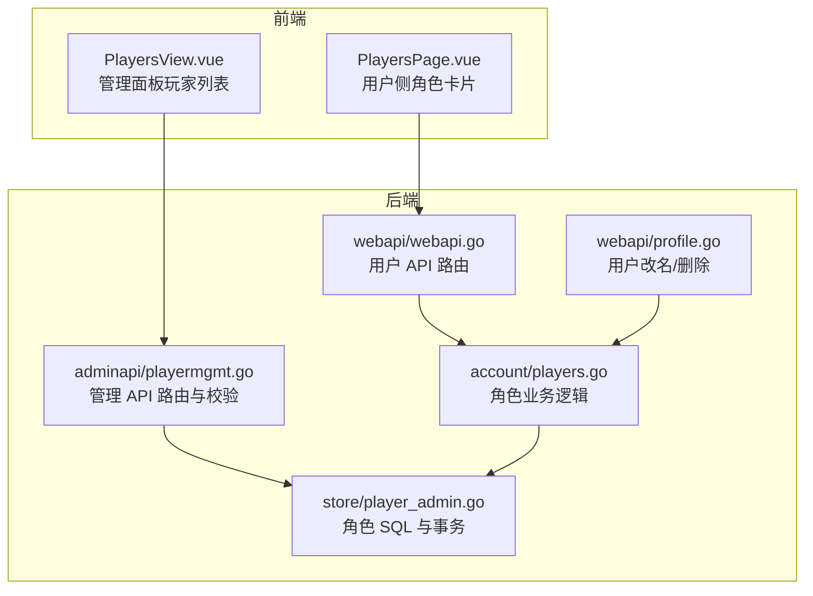
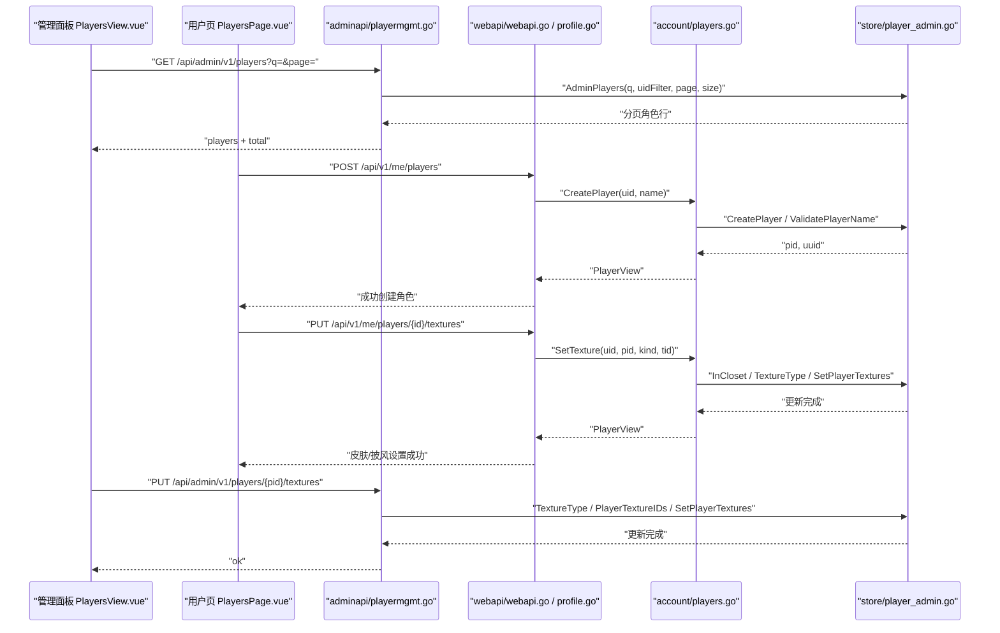
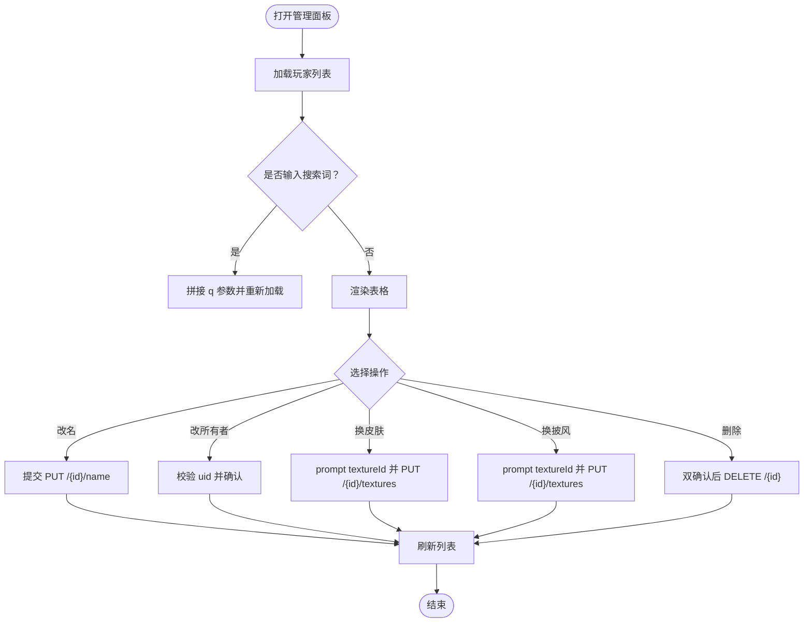
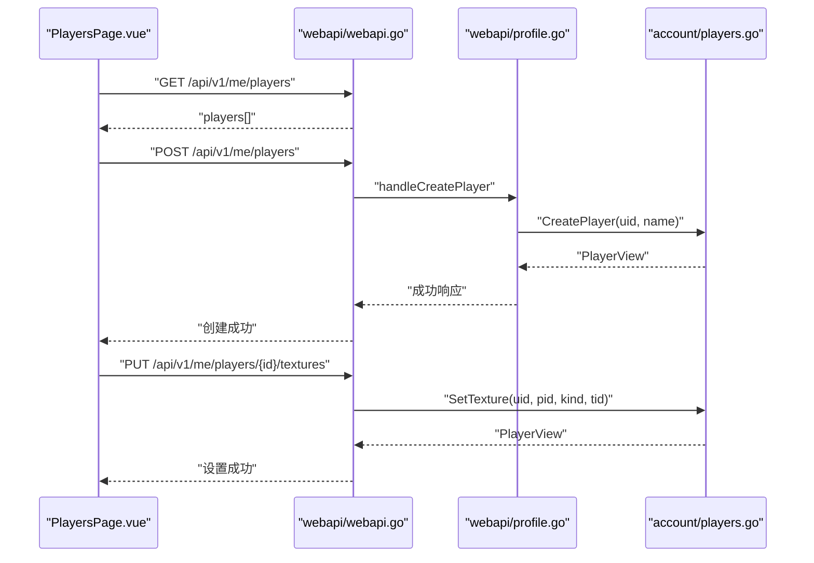
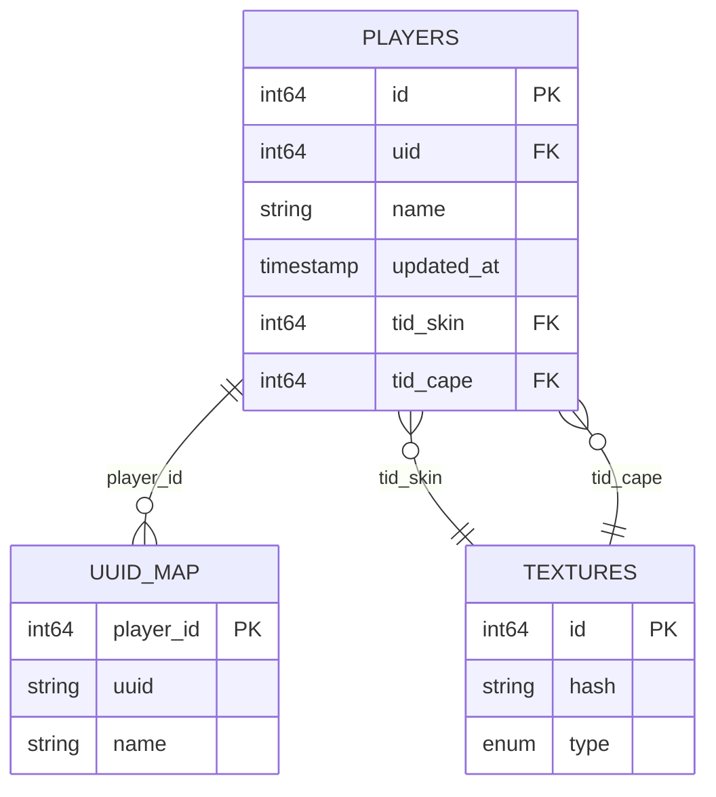
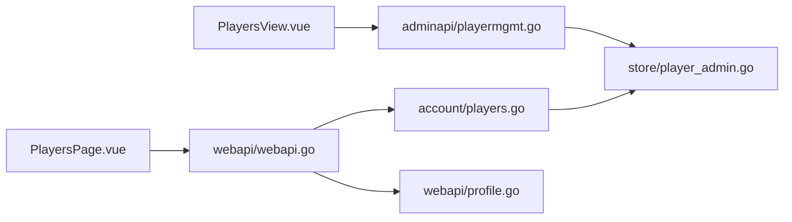

# 玩家与角色管理

**本文引用的文件**
- [PlayersView.vue](https://github.com/YimingZhanshen/skin-nexus/blob/797ae1a/web/src/components/admin/PlayersView.vue)
- [PlayersPage.vue](https://github.com/YimingZhanshen/skin-nexus/blob/797ae1a/web/src/pages/PlayersPage.vue)
- [players.go](https://github.com/YimingZhanshen/skin-nexus/blob/797ae1a/server/internal/account/players.go)
- [playermgmt.go](https://github.com/YimingZhanshen/skin-nexus/blob/797ae1a/server/internal/adminapi/playermgmt.go)
- [player_admin.go](https://github.com/YimingZhanshen/skin-nexus/blob/797ae1a/server/internal/store/player_admin.go)
- [profile.go](https://github.com/YimingZhanshen/skin-nexus/blob/797ae1a/server/internal/webapi/profile.go)
- [webapi.go](https://github.com/YimingZhanshen/skin-nexus/blob/797ae1a/server/internal/webapi/webapi.go)
- [players_payload_test.go](https://github.com/YimingZhanshen/skin-nexus/blob/797ae1a/server/internal/webapi/players_payload_test.go)

## 目录
1. [引言](#引言)
2. [项目结构](#项目结构)
3. [核心组件](#核心组件)
4. [架构总览](#架构总览)
5. [详细组件分析](#详细组件分析)
6. [依赖关系分析](#依赖关系分析)
7. [性能考虑](#性能考虑)
8. [故障排查指南](#故障排查指南)
9. [结论](#结论)

## 引言
本文面向“玩家与角色管理”能力，说明前端如何展示、分配和管理玩家拥有的游戏角色，以及后端如何实现权限校验、数据一致性与错误处理。重点包括：

- 管理端 `PlayersView.vue` 如何列出角色、预览皮肤和披风、改名、转移所有者、分配或移除皮肤/披风、删除角色。
- 用户端 `PlayersPage.vue` 如何创建角色、设置默认皮肤和披风、更换穿戴材质。
- 角色数据模型中 Player 与 Texture 的关系：角色 UUID、皮肤 hash、披风 hash、模型类型、更新时间。
- 角色管理的核心 API：列出角色、设置皮肤、移除角色、批量删除（通过列表页操作）、按玩家筛选。
- 角色校验规则：UUID 零漂移、皮肤存在性与类型匹配、权限限制、防重复分配。
- 典型工作流：为新玩家创建角色、将公开皮肤设为默认、清理废弃角色。
- 常见错误处理示例：皮肤已删除、玩家无权限、角色名称冲突等。

## 项目结构
该功能横跨前端 Vue 页面与管理面板组件，以及 Go 后端的账户服务、管理 API、存储层与公共 Web API。

**图示来源**
- [PlayersView.vue:1-172](https://github.com/YimingZhanshen/skin-nexus/blob/797ae1a/web/src/components/admin/PlayersView.vue#L1-L172)
- [PlayersPage.vue:1-200](https://github.com/YimingZhanshen/skin-nexus/blob/797ae1a/web/src/pages/PlayersPage.vue#L1-L200)
- [playermgmt.go:1-239](https://github.com/YimingZhanshen/skin-nexus/blob/797ae1a/server/internal/adminapi/playermgmt.go#L1-L239)
- [players.go:1-346](https://github.com/YimingZhanshen/skin-nexus/blob/797ae1a/server/internal/account/players.go#L1-L346)
- [player_admin.go:1-206](https://github.com/YimingZhanshen/skin-nexus/blob/797ae1a/server/internal/store/player_admin.go#L1-L206)
- [webapi.go:308-312](https://github.com/YimingZhanshen/skin-nexus/blob/797ae1a/server/internal/webapi/webapi.go#L308-L312)
- [profile.go:230-291](https://github.com/YimingZhanshen/skin-nexus/blob/797ae1a/server/internal/webapi/profile.go#L230-L291)

**章节来源**
- [PlayersView.vue:1-172](https://github.com/YimingZhanshen/skin-nexus/blob/797ae1a/web/src/components/admin/PlayersView.vue#L1-L172)
- [PlayersPage.vue:1-200](https://github.com/YimingZhanshen/skin-nexus/blob/797ae1a/web/src/pages/PlayersPage.vue#L1-L200)
- [playermgmt.go:1-239](https://github.com/YimingZhanshen/skin-nexus/blob/797ae1a/server/internal/adminapi/playermgmt.go#L1-L239)
- [players.go:1-346](https://github.com/YimingZhanshen/skin-nexus/blob/797ae1a/server/internal/account/players.go#L1-L346)
- [player_admin.go:1-206](https://github.com/YimingZhanshen/skin-nexus/blob/797ae1a/server/internal/store/player_admin.go#L1-L206)
- [webapi.go:308-312](https://github.com/YimingZhanshen/skin-nexus/blob/797ae1a/server/internal/webapi/webapi.go#L308-L312)
- [profile.go:230-291](https://github.com/YimingZhanshen/skin-nexus/blob/797ae1a/server/internal/webapi/profile.go#L230-L291)

## 核心组件
- 管理面板玩家列表组件：负责分页查询、搜索、预览、改名、转移所有者、纹理替换与删除。
- 用户角色页面：负责创建角色、查看角色卡片、设置皮肤/披风、改名、删除。
- 账户服务：封装角色列表、视图投影、创建、改名、删除、设置纹理等业务逻辑。
- 管理 API：暴露 `/api/admin/v1/players` 系列接口，做参数校验、权限检查、审计记录。
- 存储层：提供分页查询、改名、所有权变更、纹理设置、删除等数据库操作。
- 用户 Web API：暴露 `/api/v1/me/players` 系列接口，校验当前用户身份与角色归属。

**章节来源**
- [PlayersView.vue:1-172](https://github.com/YimingZhanshen/skin-nexus/blob/797ae1a/web/src/components/admin/PlayersView.vue#L1-L172)
- [PlayersPage.vue:1-200](https://github.com/YimingZhanshen/skin-nexus/blob/797ae1a/web/src/pages/PlayersPage.vue#L1-L200)
- [players.go:1-346](https://github.com/YimingZhanshen/skin-nexus/blob/797ae1a/server/internal/account/players.go#L1-L346)
- [playermgmt.go:1-239](https://github.com/YimingZhanshen/skin-nexus/blob/797ae1a/server/internal/adminapi/playermgmt.go#L1-L239)
- [player_admin.go:1-206](https://github.com/YimingZhanshen/skin-nexus/blob/797ae1a/server/internal/store/player_admin.go#L1-L206)
- [webapi.go:308-312](https://github.com/YimingZhanshen/skin-nexus/blob/797ae1a/server/internal/webapi/webapi.go#L308-L312)
- [profile.go:230-291](https://github.com/YimingZhanshen/skin-nexus/blob/797ae1a/server/internal/webapi/profile.go#L230-L291)

## 架构总览
下图展示从前端到存储层的数据流：

**图示来源**
- [PlayersView.vue:1-172](https://github.com/YimingZhanshen/skin-nexus/blob/797ae1a/web/src/components/admin/PlayersView.vue#L1-L172)
- [PlayersPage.vue:1-200](https://github.com/YimingZhanshen/skin-nexus/blob/797ae1a/web/src/pages/PlayersPage.vue#L1-L200)
- [playermgmt.go:1-239](https://github.com/YimingZhanshen/skin-nexus/blob/797ae1a/server/internal/adminapi/playermgmt.go#L1-L239)
- [webapi.go:308-312](https://github.com/YimingZhanshen/skin-nexus/blob/797ae1a/server/internal/webapi/webapi.go#L308-L312)
- [profile.go:230-291](https://github.com/YimingZhanshen/skin-nexus/blob/797ae1a/server/internal/webapi/profile.go#L230-L291)
- [players.go:1-346](https://github.com/YimingZhanshen/skin-nexus/blob/797ae1a/server/internal/account/players.go#L1-L346)
- [player_admin.go:1-206](https://github.com/YimingZhanshen/skin-nexus/blob/797ae1a/server/internal/store/player_admin.go#L1-L206)

## 详细组件分析

### 管理面板玩家列表 PlayersView.vue
该组件承担管理端玩家角色的集中管理能力：

- 列表加载：调用 `/api/admin/v1/players?page=&q=` 获取分页数据，显示 PID、预览图、玩家名、UUID、所有者昵称与 ID、皮肤 hash、披风 hash、更新时间。
- 搜索：支持按玩家名、所有者昵称或数值型 owner uid 模糊匹配；当传入 `uid` 查询参数时，可只列出某个所有者的角色，便于为指定玩家挑选皮肤。
- 改名：弹出对话框输入新名字，调用 `PUT /api/admin/v1/players/{id}/name`，成功后刷新列表。
- 转移所有者：要求输入整数且大于 0，二次确认后才调用 `PUT /api/admin/v1/players/{id}/owner`。
- 分配皮肤/披风：点击对应按钮弹出输入框，填入目标 textureId；传入 `type=skin|cape` 与 `textureId`，若填 0 表示移除该槽位。
- 删除角色：双确认，调用 `DELETE /api/admin/v1/players/{id}`，成功后刷新列表。
- 错误处理：统一捕获请求异常并显示在顶部错误区域；对无效数字、空输入、重复操作进行客户端防护。

**图示来源**
- [PlayersView.vue:1-172](https://github.com/YimingZhanshen/skin-nexus/blob/797ae1a/web/src/components/admin/PlayersView.vue#L1-L172)
- [playermgmt.go:1-239](https://github.com/YimingZhanshen/skin-nexus/blob/797ae1a/server/internal/adminapi/playermgmt.go#L1-L239)

**章节来源**
- [PlayersView.vue:1-172](https://github.com/YimingZhanshen/skin-nexus/blob/797ae1a/web/src/components/admin/PlayersView.vue#L1-L172)
- [playermgmt.go:1-239](https://github.com/YimingZhanshen/skin-nexus/blob/797ae1a/server/internal/adminapi/playermgmt.go#L1-L239)

### 用户角色页面 PlayersPage.vue
该组件面向普通玩家，展示其拥有的角色卡片，并提供更贴近游戏体验的交互：

- 角色列表：调用用户 API 获取当前用户的角色集合，每个角色包含 ID、名称、UUID、皮肤 URL、披风 URL、皮肤模型类型、当前挂载的皮肤/披风 textureId 与 hash。
- 创建角色：输入新角色名并提交 `POST /api/v1/me/players`，成功后清空输入并刷新列表。
- 设置皮肤/披风：点击按钮打开材质选择器，根据当前角色挂载的 textureId 高亮已穿戴项；提交后调用 `PUT /api/v1/me/players/{id}/textures`。
- 改名与删除：改名走用户侧 API；删除需要两次确认，调用 `DELETE /api/v1/me/players/{id}`。
- 模型类型：渲染 3D 预览时使用角色返回的 `SkinModel`，区分 slim 与 default 模型，避免 Alex 皮肤在 Steve 模型上误判。

**图示来源**
- [PlayersPage.vue:1-200](https://github.com/YimingZhanshen/skin-nexus/blob/797ae1a/web/src/pages/PlayersPage.vue#L1-L200)
- [webapi.go:308-312](https://github.com/YimingZhanshen/skin-nexus/blob/797ae1a/server/internal/webapi/webapi.go#L308-L312)
- [webapi.go:1239-1280](https://github.com/YimingZhanshen/skin-nexus/blob/797ae1a/server/internal/webapi/webapi.go#L1239-L1280)
- [profile.go:230-291](https://github.com/YimingZhanshen/skin-nexus/blob/797ae1a/server/internal/webapi/profile.go#L230-L291)
- [players.go:1-346](https://github.com/YimingZhanshen/skin-nexus/blob/797ae1a/server/internal/account/players.go#L1-L346)

**章节来源**
- [PlayersPage.vue:1-200](https://github.com/YimingZhanshen/skin-nexus/blob/797ae1a/web/src/pages/PlayersPage.vue#L1-L200)
- [webapi.go:1239-1280](https://github.com/YimingZhanshen/skin-nexus/blob/797ae1a/server/internal/webapi/webapi.go#L1239-L1280)
- [profile.go:230-291](https://github.com/YimingZhanshen/skin-nexus/blob/797ae1a/server/internal/webapi/profile.go#L230-L291)

### 角色数据模型与 Player 到 Texture 的关系
角色与材质的关系不是简单的一对一文本字段，而是通过纹理表中的 id 与 hash 共同表达：

- 角色标识：
  - 角色 ID：数据库主键，用于内部管理与 API 路径。
  - 角色 UUID：由 `uuid_map` 维护，代表跨系统或联盟的身份标识。
  - 角色名称：可改名，但 UUID 必须保持“零漂移”。
  - 所有者 UID：角色所属用户。
  - 更新时间：用于列表排序与展示。
- 材质映射：
  - 皮肤 textureId：指向 textures 表的皮肤条目。
  - 披风 textureId：指向 textures 表的披风条目。
  - 皮肤 hash：直接用于生成缩略图与预览 URL。
  - 披风 hash：用于披风预览。
  - 皮肤模型类型：决定 3D 渲染使用 default 还是 slim 模型。
- 数据投影：
  - 用户侧 `PlayerView` 会在 JSON 输出中显式携带 `SkinHash`、`CapeHash`、`SkinTID`、`CapeTID`、`SkinModel`，即使嵌入的底层结构对这些字段做了排除标记，外层仍会覆盖并输出。
  - 管理侧列表通过 JOIN 一次性取得 player、users、uuid_map、textures 信息，避免 N+1 查询。

**图示来源**
- [player_admin.go:1-206](https://github.com/YimingZhanshen/skin-nexus/blob/797ae1a/server/internal/store/player_admin.go#L1-L206)
- [players_payload_test.go:1-47](https://github.com/YimingZhanshen/skin-nexus/blob/797ae1a/server/internal/webapi/players_payload_test.go#L1-L47)

**章节来源**
- [player_admin.go:1-206](https://github.com/YimingZhanshen/skin-nexus/blob/797ae1a/server/internal/store/player_admin.go#L1-L206)
- [players_payload_test.go:1-47](https://github.com/YimingZhanshen/skin-nexus/blob/797ae1a/server/internal/webapi/players_payload_test.go#L1-L47)

### 角色管理的核心 API

#### 列出角色
- 管理端列表：`GET /api/admin/v1/players`
  - 查询参数：
    - `page`：页码，小于 1 时回退为 1。
    - `q`：搜索词，匹配玩家名、所有者昵称，或数值型 owner uid。
    - `uid`：可选，仅列出某个所有者的角色。
  - 响应体包含 `players` 数组与 `total` 总数。
- 用户端列表：`GET /api/v1/me/players`
  - 返回当前登录用户拥有的角色列表，包含角色 UUID、皮肤 URL、披风 URL、皮肤模型类型、当前挂载的材质 ID 与 hash。

#### 设置皮肤或披风
- 用户端：`PUT /api/v1/me/players/{id}/textures`
  - 请求体：`{ textureId }`，0 表示移除该槽位。
  - 校验：必须是当前用户拥有角色，且 textureId 对应的材质属于该用户衣帽间，且类型与槽位匹配。
- 管理端：`PUT /api/admin/v1/players/{pid}/textures`
  - 请求体：`{ type, textureId }`，type 为 skin 或 cape。
  - 校验：管理员可分配任意已存在的材质，但仍需类型匹配；textureId 为 0 表示清空槽位。

#### 移除角色
- 用户端：`DELETE /api/v1/me/players/{id}`
  - 删除前需前端双确认；后端删除时会同时清理 `uuid_map` 中与角色关联的记录，并解绑相关令牌的角色选择。
- 管理端：`DELETE /api/admin/v1/players/{pid}`
  - 管理端同样执行事务性删除，并在成功时触发审计与可选的联盟公告钩子。

#### 批量删除
- 代码库中没有独立的“批量删除”端点。实际批量删除通常由管理面板逐条调用删除接口实现；前端通过二次确认与禁用并发按钮防止误操作。

#### 按玩家筛选
- 管理端列表支持 `uid` 查询参数，只返回指定所有者的角色；这常用于“先筛选玩家，再为该玩家挑选皮肤”的工作流。

**章节来源**
- [playermgmt.go:1-239](https://github.com/YimingZhanshen/skin-nexus/blob/797ae1a/server/internal/adminapi/playermgmt.go#L1-L239)
- [webapi.go:308-312](https://github.com/YimingZhanshen/skin-nexus/blob/797ae1a/server/internal/webapi/webapi.go#L308-L312)
- [webapi.go:1239-1280](https://github.com/YimingZhanshen/skin-nexus/blob/797ae1a/server/internal/webapi/webapi.go#L1239-L1280)
- [profile.go:230-291](https://github.com/YimingZhanshen/skin-nexus/blob/797ae1a/server/internal/webapi/profile.go#L230-L291)

### 角色校验规则

#### UUID 格式与零漂移
- UUID 来自 `uuid_map`，用于联盟或外部系统识别角色身份。
- 改名操作不修改 `uuid_map.uuid`，只同步 `name`；后端在改名后还会读取一次角色记录，确保 UUID 字节级不变。
- 如果改名导致 UUID 漂移，管理 API 会返回内部错误，而不是静默破坏历史账号身份。

#### 皮肤存在性与类型匹配
- 用户端设置材质时，后端会检查 textureId 是否在用户衣帽间内；不在则拒绝。
- 材质类型必须与槽位一致：皮肤槽只能分配皮肤，披风槽只能分配披风。
- 管理端允许分配任意已存在的材质，但类型校验仍然生效，避免把披风挂到皮肤槽。

#### 权限限制
- 用户端 API 要求当前登录用户；角色归属由 `ownPlayer` 校验，只有角色所有者才能改名、删除、设置材质。
- 管理端 API 独立于用户身份，由上层路由与认证中间件控制访问；管理员可重定向角色所有者、分配任意材质。
- 用户端设置材质还要求材质属于当前用户，防止跨用户占用他人上传内容。

#### 防重复分配
- 用户端材质选择器基于当前挂载的 textureId 高亮已穿戴项，减少重复选择。
- 用户端同时维护一个单请求序列号，避免快速双击造成多次覆盖。
- 管理端通过 `busy` 标志与双重确认降低误操作风险。

**章节来源**
- [players.go:1-346](https://github.com/YimingZhanshen/skin-nexus/blob/797ae1a/server/internal/account/players.go#L1-L346)
- [playermgmt.go:1-239](https://github.com/YimingZhanshen/skin-nexus/blob/797ae1a/server/internal/adminapi/playermgmt.go#L1-L239)
- [profile.go:230-291](https://github.com/YimingZhanshen/skin-nexus/blob/797ae1a/server/internal/webapi/profile.go#L230-L291)
- [PlayersPage.vue:1-200](https://github.com/YimingZhanshen/skin-nexus/blob/797ae1a/web/src/pages/PlayersPage.vue#L1-L200)
- [PlayersView.vue:1-172](https://github.com/YimingZhanshen/skin-nexus/blob/797ae1a/web/src/components/admin/PlayersView.vue#L1-L172)

### 典型工作流

#### 为新玩家创建角色
1. 用户在 `PlayersPage.vue` 输入角色名。
2. 前端调用 `POST /api/v1/me/players`。
3. 后端校验名称规则与上限，插入角色与 UUID 映射。
4. 返回 `PlayerView`，前端刷新列表并显示创建成功提示。

#### 将公开皮肤设为默认
1. 管理员在管理面板或通过 API 获取某玩家的 textureId。
2. 调用 `PUT /api/admin/v1/players/{pid}/textures`，type 为 skin 或 cape。
3. 后端校验材质存在且类型匹配，写入 `tid_skin` 或 `tid_cape`。
4. 前端刷新后看到对应缩略图出现。

#### 清理废弃角色
1. 管理员在列表中定位废弃角色。
2. 点击删除，触发两次确认。
3. 后端在一个事务中删除 `uuid_map`、解绑令牌的角色选择、删除角色。
4. 可选触发联盟公告钩子，使上游状态尽快收敛。

**章节来源**
- [PlayersPage.vue:1-200](https://github.com/YimingZhanshen/skin-nexus/blob/797ae1a/web/src/pages/PlayersPage.vue#L1-L200)
- [playermgmt.go:1-239](https://github.com/YimingZhanshen/skin-nexus/blob/797ae1a/server/internal/adminapi/playermgmt.go#L1-L239)
- [player_admin.go:1-206](https://github.com/YimingZhanshen/skin-nexus/blob/797ae1a/server/internal/store/player_admin.go#L1-L206)

## 依赖关系分析

- 耦合度：
  - 前端与后端通过 RESTful JSON 解耦。
  - 管理 API 与用户 API 职责分离：管理端侧重批量与强约束，用户端侧重归属与权限。
  - 账户服务是业务中枢，屏蔽存储细节。
- 直接依赖：
  - `PlayersView.vue` 依赖管理 API。
  - `PlayersPage.vue` 依赖用户 API。
  - 管理 API 依赖存储层。
  - 用户 API 依赖账户服务。
  - 账户服务依赖存储层。
- 潜在循环：
  - 代码中没有明显的模块循环导入；主要依赖方向是前端 → API → 服务 → 存储。

**图示来源**
- [PlayersView.vue:1-172](https://github.com/YimingZhanshen/skin-nexus/blob/797ae1a/web/src/components/admin/PlayersView.vue#L1-L172)
- [PlayersPage.vue:1-200](https://github.com/YimingZhanshen/skin-nexus/blob/797ae1a/web/src/pages/PlayersPage.vue#L1-L200)
- [playermgmt.go:1-239](https://github.com/YimingZhanshen/skin-nexus/blob/797ae1a/server/internal/adminapi/playermgmt.go#L1-L239)
- [webapi.go:308-312](https://github.com/YimingZhanshen/skin-nexus/blob/797ae1a/server/internal/webapi/webapi.go#L308-L312)
- [profile.go:230-291](https://github.com/YimingZhanshen/skin-nexus/blob/797ae1a/server/internal/webapi/profile.go#L230-L291)
- [players.go:1-346](https://github.com/YimingZhanshen/skin-nexus/blob/797ae1a/server/internal/account/players.go#L1-L346)
- [player_admin.go:1-206](https://github.com/YimingZhanshen/skin-nexus/blob/797ae1a/server/internal/store/player_admin.go#L1-L206)

**章节来源**
- [PlayersView.vue:1-172](https://github.com/YimingZhanshen/skin-nexus/blob/797ae1a/web/src/components/admin/PlayersView.vue#L1-L172)
- [PlayersPage.vue:1-200](https://github.com/YimingZhanshen/skin-nexus/blob/797ae1a/web/src/pages/PlayersPage.vue#L1-L200)
- [playermgmt.go:1-239](https://github.com/YimingZhanshen/skin-nexus/blob/797ae1a/server/internal/adminapi/playermgmt.go#L1-L239)
- [webapi.go:308-312](https://github.com/YimingZhanshen/skin-nexus/blob/797ae1a/server/internal/webapi/webapi.go#L308-L312)
- [profile.go:230-291](https://github.com/YimingZhanshen/skin-nexus/blob/797ae1a/server/internal/webapi/profile.go#L230-L291)
- [players.go:1-346](https://github.com/YimingZhanshen/skin-nexus/blob/797ae1a/server/internal/account/players.go#L1-L346)
- [player_admin.go:1-206](https://github.com/YimingZhanshen/skin-nexus/blob/797ae1a/server/internal/store/player_admin.go#L1-L206)

## 性能考虑
- 管理列表采用单次 JOIN 查询 players、users、uuid_map、textures，避免每行额外查材质或所有者信息。
- 用户侧 `PlayerView` 显式输出 `SkinHash`、`CapeHash`、`SkinTID`、`CapeTID`，让前端可以直接渲染缩略图，而不必再次请求详情。
- 用户端材质设置与列表加载使用单请求序列号，避免慢响应覆盖快响应。
- 删除与改名在事务中执行，减少不一致窗口。
- 管理端删除时解绑令牌的角色选择，避免客户端继续依赖失效的 profile selection。

[本节为通用性能建议，不直接分析具体文件]

## 故障排查指南

#### 皮肤已被删除或不在衣帽间
- 现象：用户设置皮肤失败。
- 原因：textureId 不存在，或不属于当前用户衣帽间。
- 后端行为：用户端设置材质时检查 `InCloset` 与 `TextureType`，不存在或不匹配返回类型不匹配或资源未找到。
- 建议处理：
  - 用户端提示材质已不可用，引导重新选择。
  - 管理员可从共享材质库中选择有效 textureId。

#### 玩家无权限
- 现象：用户改名、删除、设置材质被拒绝。
- 原因：未登录、角色不属于当前用户。
- 后端行为：用户端 API 先校验当前用户，再通过 `ownPlayer` 校验角色归属。
- 建议处理：
  - 未登录时跳转到登录。
  - 非所有者时提示无权操作。

#### 角色名称冲突
- 现象：改名或创建角色失败。
- 原因：名称不符合规则，或已有同名角色。
- 后端行为：调用名称验证规则；若冲突返回名称已被占用。
- 建议处理：
  - 前端提示用户更换名称。
  - 管理端改名失败时显示冲突错误。

#### 材质类型不匹配
- 现象：把披风分配到皮肤槽，或反之。
- 原因：请求的 textureId 类型与 slot 不一致。
- 后端行为：返回类型不匹配错误。
- 建议处理：
  - 前端在选择器中过滤或提示。
  - 管理端明确 type 字段并校验。

#### UUID 漂移保护
- 现象：改名后 UUID 变化。
- 原因：存储层或后续逻辑意外修改了 `uuid_map.uuid`。
- 后端行为：改名成功后重新读取角色并比对 UUID，发现漂移则返回内部错误。
- 建议处理：
  - 运维检查存储层迁移与写入逻辑。
  - 不要绕过该校验直接返回成功。

**章节来源**
- [players.go:1-346](https://github.com/YimingZhanshen/skin-nexus/blob/797ae1a/server/internal/account/players.go#L1-L346)
- [playermgmt.go:1-239](https://github.com/YimingZhanshen/skin-nexus/blob/797ae1a/server/internal/adminapi/playermgmt.go#L1-L239)
- [profile.go:230-291](https://github.com/YimingZhanshen/skin-nexus/blob/797ae1a/server/internal/webapi/profile.go#L230-L291)
- [PlayersView.vue:1-172](https://github.com/YimingZhanshen/skin-nexus/blob/797ae1a/web/src/components/admin/PlayersView.vue#L1-L172)
- [PlayersPage.vue:1-200](https://github.com/YimingZhanshen/skin-nexus/blob/797ae1a/web/src/pages/PlayersPage.vue#L1-L200)

## 结论
玩家与角色管理由前端页面、管理面板、账户服务、管理 API、用户 API 与存储层共同构成。核心设计原则是：

- 角色 UUID 稳定，改名不改 UUID，保障跨系统身份一致性。
- 材质通过 textureId 与 hash 共同表达，类型与槽位严格匹配。
- 用户端强调归属与权限，管理端强调可编辑与可审计。
- 列表与预览尽量复用单次查询结果，减少 N+1 与多余网络往返。
- 删除与改名使用事务，保证角色、身份映射与令牌状态的一致性。

这套机制既能满足普通玩家创建和装扮角色，也能支撑管理员批量维护、迁移与清理角色数据。

[本节为总结性内容，不直接分析具体文件]
