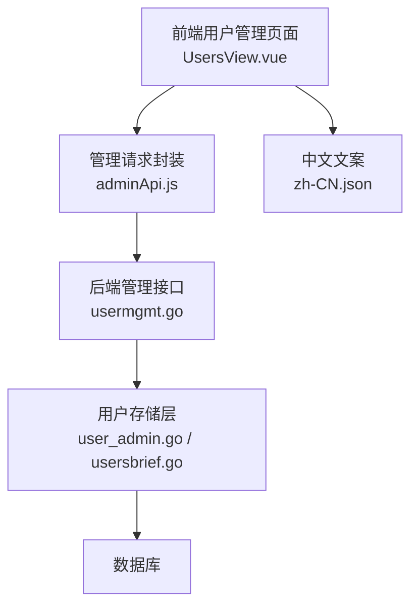
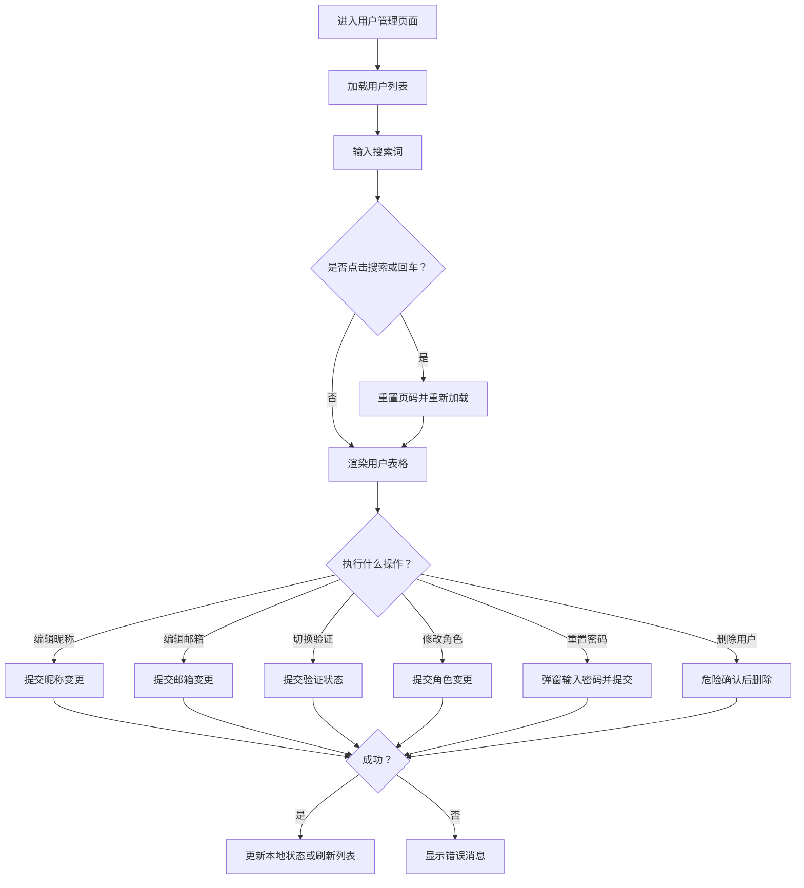
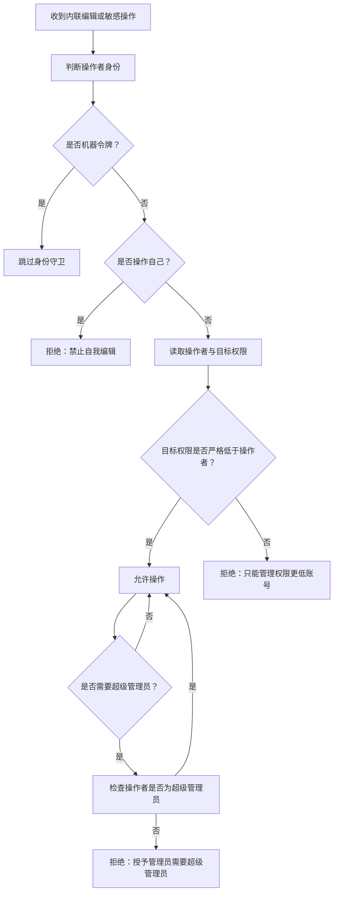
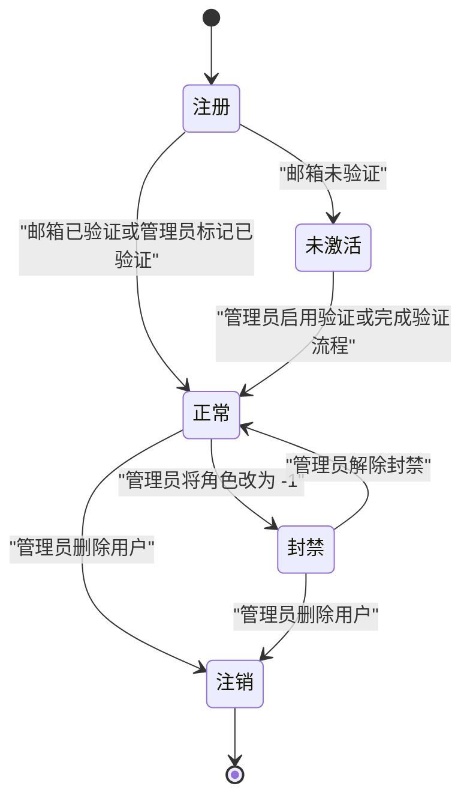
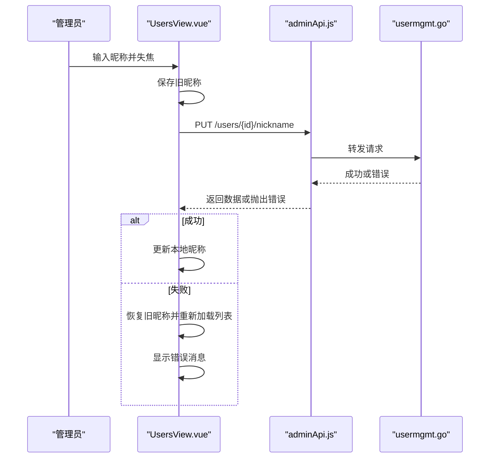
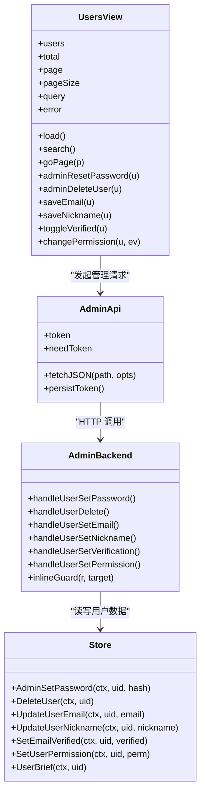

# 用户管理

**本文引用的文件**
- [UsersView.vue](https://github.com/YimingZhanshen/skin-nexus/blob/797ae1a/web/src/components/admin/UsersView.vue)
- [adminApi.js](https://github.com/YimingZhanshen/skin-nexus/blob/797ae1a/web/src/adminApi.js)
- [usermgmt.go](https://github.com/YimingZhanshen/skin-nexus/blob/797ae1a/server/internal/adminapi/usermgmt.go)
- [user_admin.go](https://github.com/YimingZhanshen/skin-nexus/blob/797ae1a/server/internal/store/user_admin.go)
- [usersbrief.go](https://github.com/YimingZhanshen/skin-nexus/blob/797ae1a/server/internal/store/usersbrief.go)
- [zh-CN.json](https://github.com/YimingZhanshen/skin-nexus/blob/797ae1a/web/src/locales/zh-CN.json)

## 目录
1. [简介](#简介)
2. [项目结构中的用户管理位置](#项目结构中的用户管理位置)
3. [用户模型关键字段](#用户模型关键字段)
4. [前端能力总览](#前端能力总览)
5. [后端管理接口规范](#后端管理接口规范)
6. [权限与守卫规则](#权限与守卫规则)
7. [用户生命周期](#用户生命周期)
8. [交互细节：搜索、分页、空状态、确认对话框、错误提示](#交互细节搜索分页空状态确认对话框错误提示)
9. [常用操作示例](#常用操作示例)
10. [依赖关系分析](#依赖关系分析)
11. [故障排查](#故障排查)
12. [结论](#结论)

## 简介
用户管理是服务器后台管理面板中的一个核心功能，用于对注册用户进行查看、检索、编辑和处置。该功能由前端 `UsersView.vue` 提供界面，并通过 `/api/admin/v1/*` 系列管理接口与后端交互。它支持列出用户、按昵称或邮箱搜索、重置密码、修改昵称和邮箱、切换邮箱验证状态、调整角色等级、删除账号等操作；同时通过服务端守卫机制限制“只能管理权限严格低于自己的账号”，并对超级管理员做额外保护。

## 项目结构中的用户管理位置
用户管理涉及三层代码：
- 前端页面：`web/src/components/admin/UsersView.vue`
- 前端管理网络封装：`web/src/adminApi.js`
- 后端管理路由与业务逻辑：`server/internal/adminapi/usermgmt.go`
- 用户数据持久化与事务：`server/internal/store/user_admin.go`
- 用户简要信息读取：`server/internal/store/usersbrief.go`
- 中文本地化文案：`web/src/locales/zh-CN.json`

**图表来源**
- [UsersView.vue:1-200](https://github.com/YimingZhanshen/skin-nexus/blob/797ae1a/web/src/components/admin/UsersView.vue#L1-L200)
- [adminApi.js:1-32](https://github.com/YimingZhanshen/skin-nexus/blob/797ae1a/web/src/adminApi.js#L1-L32)
- [usermgmt.go:1-387](https://github.com/YimingZhanshen/skin-nexus/blob/797ae1a/server/internal/adminapi/usermgmt.go#L1-L387)
- [user_admin.go:1-80](https://github.com/YimingZhanshen/skin-nexus/blob/797ae1a/server/internal/store/user_admin.go#L1-L80)
- [usersbrief.go:1-21](https://github.com/YimingZhanshen/skin-nexus/blob/797ae1a/server/internal/store/usersbrief.go#L1-L21)
- [zh-CN.json:663-683](https://github.com/YimingZhanshen/skin-nexus/blob/797ae1a/web/src/locales/zh-CN.json#L663-L683)

**章节来源**
- [UsersView.vue:1-230](https://github.com/YimingZhanshen/skin-nexus/blob/797ae1a/web/src/components/admin/UsersView.vue#L1-L230)
- [adminApi.js:1-32](https://github.com/YimingZhanshen/skin-nexus/blob/797ae1a/web/src/adminApi.js#L1-L32)
- [usermgmt.go:1-387](https://github.com/YimingZhanshen/skin-nexus/blob/797ae1a/server/internal/adminapi/usermgmt.go#L1-L387)
- [user_admin.go:1-80](https://github.com/YimingZhanshen/skin-nexus/blob/797ae1a/server/internal/store/user_admin.go#L1-L80)
- [usersbrief.go:1-21](https://github.com/YimingZhanshen/skin-nexus/blob/797ae1a/server/internal/store/usersbrief.go#L1-L21)
- [zh-CN.json:663-683](https://github.com/YimingZhanshen/skin-nexus/blob/797ae1a/web/src/locales/zh-CN.json#L663-L683)

## 用户模型关键字段
从前端展示、后端更新和 OIDC 简要信息中可以看出，用户模型至少包含以下字段：

| 字段 | 含义 | 说明 |
|---|---|---|
| `id` | 用户编号 | 前端显示为 ID；后端使用 `int64` 路径参数；uid 1 有特殊保护。 |
| `uuid` | 玩家 UUID | 与游戏角色关联；删除用户时会先收集 UUID 再清理映射表。 |
| `nickname` | 昵称 | 可内联编辑；后端要求 2 到 24 位字母、数字、下划线或中文；唯一。 |
| `email` | 邮箱 | 可内联编辑；可为空；格式校验；唯一。 |
| `emailVerified` | 邮箱是否已验证 | 前端以数值 0/1 表示；后端用布尔值写入。 |
| `permission` | 角色等级 | -1 封禁、0 普通、1 管理员、2 超级管理员；UI 不授予 2。 |
| `passwordAlgo` | 密码算法 | 前端显示，若以 `legacy` 开头会标记风险样式。 |
| `createdAt` | 创建时间 | 前端只取日期部分。 |
| `updatedAt` | 更新时间 | 后端存在对应列，但当前用户列表页面未直接展示。 |
| `lastLoginAt` | 最后登录时间 | 用户模型通常存在该字段；当前用户管理列表未直接展示。 |

注意：当前 `UsersView.vue` 的表格列包括 ID、昵称、邮箱、权限、验证、密码算法、创建时间和操作列，没有直接展示最后登录时间。若需要审计最后登录时间，可在列表查询或详情扩展中补充。

**章节来源**
- [UsersView.vue:95-180](https://github.com/YimingZhanshen/skin-nexus/blob/797ae1a/web/src/components/admin/UsersView.vue#L95-L180)
- [usermgmt.go:220-387](https://github.com/YimingZhanshen/skin-nexus/blob/797ae1a/server/internal/adminapi/usermgmt.go#L220-L387)
- [usersbrief.go:1-21](https://github.com/YimingZhanshen/skin-nexus/blob/797ae1a/server/internal/store/usersbrief.go#L1-L21)

## 前端能力总览
`UsersView.vue` 是一个基于 Vue 的管理页面，核心能力如下：

| 能力 | 实现方式 |
|---|---|
| 列出用户 | 挂载时调用 `/api/admin/v1/users?page=...&q=...`，渲染 `users` 数组和 `total`。 |
| 搜索昵称或邮箱 | 输入框绑定 `query`，回车或点击搜索按钮后带 `q` 参数重新加载。 |
| 分页 | 固定每页 50 条，通过 `Pager` 组件切换页码。 |
| 空状态 | 当没有用户且没有错误时显示“暂无用户”。 |
| 内联编辑昵称 | 单元格输入框失焦提交 `PUT /users/{id}/nickname`。 |
| 内联编辑邮箱 | 单元格输入框失焦提交 `PUT /users/{id}/email`。 |
| 切换邮箱验证 | 点击验证按钮切换 `verified` 布尔值。 |
| 修改角色 | 下拉选择 -1、0、1；super admin 只显示标签不可改；uid 1 禁用。 |
| 重置密码 | 弹出输入框，POST `/users/{id}/password`，成功后弹窗提示。 |
| 删除用户 | 危险确认对话框，DELETE `/users/{id}`，成功后刷新列表。 |
| 错误提示 | 统一在顶部错误区域显示后端返回的错误消息。 |
| 防重复提交 | 所有写操作使用 `busy` 标志，避免并发 PUT。 |

**图表来源**
- [UsersView.vue:1-200](https://github.com/YimingZhanshen/skin-nexus/blob/797ae1a/web/src/components/admin/UsersView.vue#L1-L200)

**章节来源**
- [UsersView.vue:1-200](https://github.com/YimingZhanshen/skin-nexus/blob/797ae1a/web/src/components/admin/UsersView.vue#L1-L200)

## 后端管理接口规范
本节聚焦用户管理相关的 HTTP 接口。所有接口都属于管理 API，受管理员会话或机器令牌保护，并由后端权限守卫控制具体操作。

### 通用行为
- URL 前缀：`/api/admin/v1`
- 认证：管理员 Cookie 会话优先；若配置了 `X-Admin-Token`，则作为机器回退凭据附加到请求头。
- 响应体：成功通常返回 `{ ok: true }`；失败返回包含错误消息和管理员可读错误码的对象。
- 错误处理：前端 `adminApi.js` 把非 `res.ok` 的情况包装成 JavaScript 错误，并保留 `status` 与原始 `data`。

### 接口定义

| 用途 | HTTP 方法 | URL | 请求体 | 成功响应 | 主要失败情况 | 权限要求 |
|---|---|---|---|---|---|---|
| 列出用户 | GET | `/api/admin/v1/users` | 查询参数：`page`、可选 `q` | `{ users, total }` | 401/403、网络错误、后端错误 | 管理员会话或有效机器令牌 |
| 重置密码 | POST | `/api/admin/v1/users/{id}/password` | `{ password }`，最少 8 字符 | `{ ok: true }` | 400 非法参数、404 用户不存在、403 守卫拒绝、500 哈希失败 | 管理员会话或机器令牌；目标必须通过守卫检查 |
| 修改邮箱 | PUT | `/api/admin/v1/users/{id}/email` | `{ email }`，可为空字符串 | `{ ok: true }` | 400 邮箱无效、409 邮箱被占用、404、403 | 管理员会话或机器令牌；目标权限必须严格低于操作者 |
| 修改昵称 | PUT | `/api/admin/v1/users/{id}/nickname` | `{ nickname }`，2-24 位字母、数字、下划线或中文 | `{ ok: true }` | 400 昵称无效、409 昵称被占用、404、403 | 同上 |
| 切换邮箱验证 | PUT | `/api/admin/v1/users/{id}/verification` | `{ verified: boolean }` | `{ ok: true }` | 400、404、403 | 同上 |
| 修改角色 | PUT | `/api/admin/v1/users/{id}/permission` | `{ permission: -1 | 0 | 1 }` | `{ ok: true }` | 仅管理员 Web 会话；授予管理员需要超级管理员 |
| 删除用户 | DELETE | `/api/admin/v1/users/{id}` | 无 | `{ ok: true }` | 400 uid 1 或超级管理员、404、403、500 | 管理员会话或机器令牌；目标权限必须严格低于操作者 |

#### 列出用户
- 查询参数：
  - `page`：必填页码。
  - `q`：可选搜索关键词，用于匹配昵称或邮箱。
- 响应体：
  - `users`：用户数组。
  - `total`：符合条件的用户总数。
- 前端分页：每页 50 条，根据 `total` 计算最大页码。

#### 重置密码
- 请求体验证：密码去除空白后长度不得小于 8。
- 副作用：
  - 覆盖用户密码哈希，并设置算法为 `argon2id`。
  - 失效用户 Yggdrasil 令牌。
  - 触发凭据变更回调，撤销 OIDC 授权。
  - 写入审计日志。

#### 修改角色
- 允许值：
  - `-1`：封禁。
  - `0`：普通玩家。
  - `1`：管理员。
- 特殊规则：
  - 不能通过机器令牌修改角色。
  - 将某用户设为管理员（`1`）时，操作者必须是超级管理员（`2`）。
  - UI 不会展示或授予 `2`。
- 封禁副作用：
  - 发送封禁通知。
  - 尝试清除除当前会话外的其他 Web 会话。
  - 降权或封禁时失效用户令牌和授权。

**章节来源**
- [adminApi.js:1-32](https://github.com/YimingZhanshen/skin-nexus/blob/797ae1a/web/src/adminApi.js#L1-L32)
- [usermgmt.go:1-387](https://github.com/YimingZhanshen/skin-nexus/blob/797ae1a/server/internal/adminapi/usermgmt.go#L1-L387)

## 权限与守卫规则
用户管理的核心安全模型是“权限严格低于自己”：

**图表来源**
- [usermgmt.go:60-120](https://github.com/YimingZhanshen/skin-nexus/blob/797ae1a/server/internal/adminapi/usermgmt.go#L60-L120)
- [usermgmt.go:300-387](https://github.com/YimingZhanshen/skin-nexus/blob/797ae1a/server/internal/adminapi/usermgmt.go#L300-L387)

关键规则总结：
- 禁止自我编辑。
- 只能管理权限严格低于自己的账号。
- 授予管理员必须由超级管理员执行。
- UID 1 和超级管理员账号有额外保护。
- 角色变更仅允许 Web 管理员会话，不允许 `X-Admin-Token` 机器令牌。

**章节来源**
- [usermgmt.go:60-120](https://github.com/YimingZhanshen/skin-nexus/blob/797ae1a/server/internal/adminapi/usermgmt.go#L60-L120)
- [usermgmt.go:300-387](https://github.com/YimingZhanshen/skin-nexus/blob/797ae1a/server/internal/adminapi/usermgmt.go#L300-L387)

## 用户生命周期
用户生命周期在前端体现为可见状态变化，在后端体现为数据删除、通知和审计：

- **注册**：用户在站点注册账号；此时可能尚未验证邮箱。
- **激活**：邮箱验证通过后，用户处于可用状态；管理员也可手动标记邮箱已验证。
- **封禁**：管理员将角色改为 `-1`，系统发送封禁通知，并尽量清理其他 Web 会话。
- **注销**：管理员删除用户，系统删除会话、令牌、OIDC 授权、衣柜、玩家及用户记录。
- **数据清理**：上传材质和审计日志被保留，避免历史数据丢失；Union 玩家 UUID 会在删除前采集以便外部联动清理。

**图表来源**
- [usermgmt.go:201-235](https://github.com/YimingZhanshen/skin-nexus/blob/797ae1a/server/internal/adminapi/usermgmt.go#L201-L235)
- [user_admin.go:1-80](https://github.com/YimingZhanshen/skin-nexus/blob/797ae1a/server/internal/store/user_admin.go#L1-L80)

**章节来源**
- [usermgmt.go:201-235](https://github.com/YimingZhanshen/skin-nexus/blob/797ae1a/server/internal/adminapi/usermgmt.go#L201-L235)
- [user_admin.go:1-80](https://github.com/YimingZhanshen/skin-nexus/blob/797ae1a/server/internal/store/user_admin.go#L1-L80)

## 交互细节：搜索、分页、空状态、确认对话框、错误提示

### 搜索
- 输入框占位符为“搜索邮箱 / 昵称…”。
- 用户回车或点击搜索按钮后，页码重置为第 1 页，并带上 `q` 参数重新加载。
- 空搜索等价于不带 `q` 参数的列表加载。

### 分页
- 每页固定 50 条。
- 页码边界检查：不允许小于 1，也不允许超出 `total`。
- 最大页码按 `Math.ceil(total / pageSize)` 计算，最小为 1。
- 分页控件由 `Pager` 组件提供。

### 空状态
- 当 `users` 为空且没有错误时，显示“暂无用户”。
- 这适用于首次加载、搜索无结果等场景。

### 确认对话框
- 重置密码：使用提示对话框，提示文本包含用户名和用户 ID。
- 删除用户：使用危险确认对话框，提示删除后果，包括会话、令牌、衣柜、角色一并删除，材质与审计保留。
- 修改角色：使用危险确认对话框，显示“从某个角色改为另一个角色”，其中角色名称来自本地化键。

### 错误提示
- 所有写操作失败时，将错误消息写入页面顶部的错误区域。
- 前端 `adminApi.js` 会把 401/403 设置为 `needToken.value = true`，使外壳提示管理员令牌卡片。
- 错误对象携带 `status` 和 `data`，便于上层按状态分流。

**图表来源**
- [UsersView.vue:70-120](https://github.com/YimingZhanshen/skin-nexus/blob/797ae1a/web/src/components/admin/UsersView.vue#L70-L120)
- [adminApi.js:1-32](https://github.com/YimingZhanshen/skin-nexus/blob/797ae1a/web/src/adminApi.js#L1-L32)
- [usermgmt.go:240-290](https://github.com/YimingZhanshen/skin-nexus/blob/797ae1a/server/internal/adminapi/usermgmt.go#L240-L290)

**章节来源**
- [UsersView.vue:1-200](https://github.com/YimingZhanshen/skin-nexus/blob/797ae1a/web/src/components/admin/UsersView.vue#L1-L200)
- [adminApi.js:1-32](https://github.com/YimingZhanshen/skin-nexus/blob/797ae1a/web/src/adminApi.js#L1-L32)
- [zh-CN.json:663-683](https://github.com/YimingZhanshen/skin-nexus/blob/797ae1a/web/src/locales/zh-CN.json#L663-L683)

## 常用操作示例

### 为普通玩家提升为管理员
适用场景：某玩家长期活跃、可信，需要赋予管理权限。

操作步骤：
1. 打开用户管理页面。
2. 如果不知道用户，先在搜索框输入昵称或邮箱。
3. 找到目标用户，在“权限”列将其从“正常”改为“管理员”。
4. 系统弹出确认对话框，显示“从普通改为管理员”。
5. 确认前请确认操作者自身是超级管理员，否则后端会拒绝授予管理员。
6. 成功后下拉框保持新角色，失败时回滚并显示错误。

注意事项：
- 普通管理员不能给自己或其他管理员提升为管理员。
- 超级管理员（`2`）不能在 UI 中被授予或降级。
- 若目标权限不低于操作者，后端返回“只能管理权限更低账号”。

### 重置用户密码
适用场景：玩家忘记密码，管理员为其强制设置新密码。

操作步骤：
1. 在用户列表中点击“改密”。
2. 在弹出对话框中输入不少于 8 位的密码。
3. 确认后，后端会哈希并存储新的 `argon2id` 密码。
4. 系统会失效该用户的 Yggdrasil 令牌，并触发凭据变更回调。
5. 前端弹出“已重设：该用户全部令牌与启动器授权已失效”的提示。
6. 若失败，页面顶部显示错误消息。

注意事项：
- 重置密码不是发送邮件链接，而是管理员直接设定密码。
- 目标用户仍须通过守卫检查：不能自我重置，且目标权限必须严格低于操作者。
- 如果目标是超级管理员，同样受守卫限制。

### 批量操作的现状与建议
当前 `UsersView.vue` 没有实现真正的批量勾选和批量提交。其“批量”语义更接近“逐个内联编辑 + 统一错误展示 + 统一确认对话框”。若未来需要批量操作，建议：
- 增加行选择复选框。
- 增加批量修改角色、批量重置验证状态的入口。
- 复用现有 `putUser` 风格的事务式更新，并集中展示失败用户。
- 对超大规模批量操作引入后端批量接口，避免逐条 PUT。

**章节来源**
- [UsersView.vue:1-200](https://github.com/YimingZhanshen/skin-nexus/blob/797ae1a/web/src/components/admin/UsersView.vue#L1-L200)
- [usermgmt.go:120-387](https://github.com/YimingZhanshen/skin-nexus/blob/797ae1a/server/internal/adminapi/usermgmt.go#L120-L387)
- [zh-CN.json:663-683](https://github.com/YimingZhanshen/skin-nexus/blob/797ae1a/web/src/locales/zh-CN.json#L663-L683)

## 依赖关系分析

**图表来源**
- [UsersView.vue:1-200](https://github.com/YimingZhanshen/skin-nexus/blob/797ae1a/web/src/components/admin/UsersView.vue#L1-L200)
- [adminApi.js:1-32](https://github.com/YimingZhanshen/skin-nexus/blob/797ae1a/web/src/adminApi.js#L1-L32)
- [usermgmt.go:1-387](https://github.com/YimingZhanshen/skin-nexus/blob/797ae1a/server/internal/adminapi/usermgmt.go#L1-L387)
- [user_admin.go:1-80](https://github.com/YimingZhanshen/skin-nexus/blob/797ae1a/server/internal/store/user_admin.go#L1-L80)
- [usersbrief.go:1-21](https://github.com/YimingZhanshen/skin-nexus/blob/797ae1a/server/internal/store/usersbrief.go#L1-L21)

**章节来源**
- [UsersView.vue:1-200](https://github.com/YimingZhanshen/skin-nexus/blob/797ae1a/web/src/components/admin/UsersView.vue#L1-L200)
- [adminApi.js:1-32](https://github.com/YimingZhanshen/skin-nexus/blob/797ae1a/web/src/adminApi.js#L1-L32)
- [usermgmt.go:1-387](https://github.com/YimingZhanshen/skin-nexus/blob/797ae1a/server/internal/adminapi/usermgmt.go#L1-L387)
- [user_admin.go:1-80](https://github.com/YimingZhanshen/skin-nexus/blob/797ae1a/server/internal/store/user_admin.go#L1-L80)
- [usersbrief.go:1-21](https://github.com/YimingZhanshen/skin-nexus/blob/797ae1a/server/internal/store/usersbrief.go#L1-L21)

## 故障排查

| 现象 | 可能原因 | 处理建议 |
|---|---|---|
| 无法登录管理面板 | 管理员会话失效或没有管理员权限 | 重新登录；检查是否具备管理员角色；必要时配置 `X-Admin-Token`。 |
| 修改角色失败 | 操作者不是超级管理员 | 只有超级管理员才能授予管理员角色。 |
| 修改角色失败 | 目标权限不低于操作者 | 只能管理权限严格低于自己的账号。 |
| 修改角色失败 | 使用了机器令牌 | 角色变更仅允许管理员 Web 会话。 |
| 修改邮箱失败 | 邮箱格式无效 | 输入合法邮箱，或留空清空邮箱。 |
| 修改邮箱失败 | 邮箱已被其他账号占用 | 更换邮箱或使用已有邮箱的唯一性策略。 |
| 修改昵称失败 | 昵称不符合规则 | 使用 2-24 位字母、数字、下划线或中文。 |
| 修改昵称失败 | 昵称已被占用 | 更换唯一昵称。 |
| 重置密码失败 | 密码少于 8 位 | 输入不少于 8 位密码。 |
| 删除用户失败 | 目标是 uid 1 | uid 1 是引导管理员，禁止删除。 |
| 删除用户失败 | 目标是超级管理员 | 超级管理员账号不可删除。 |
| 删除用户失败 | 目标权限不低于操作者 | 只能管理权限严格低于自己的账号。 |
| 页面显示错误消息 | 后端返回非 2xx | 查看错误消息、状态码和后端审计日志。 |
| 提示需要令牌 | 401 或 403 | 刷新管理员令牌或重新登录。 |

**章节来源**
- [adminApi.js:1-32](https://github.com/YimingZhanshen/skin-nexus/blob/797ae1a/web/src/adminApi.js#L1-L32)
- [usermgmt.go:1-387](https://github.com/YimingZhanshen/skin-nexus/blob/797ae1a/server/internal/adminapi/usermgmt.go#L1-L387)

## 结论
用户管理模块以 `UsersView.vue` 为入口，通过简洁的内联编辑和确认对话框，提供了管理员日常维护所需的核心能力。后端通过严格的守卫机制确保“只能管理权限更低账号”，并对超级管理员和 uid 1 提供额外保护。删除操作不仅清理用户凭据和会话，还保留材质与审计数据，保证历史可追溯性。

对于后续扩展，建议优先考虑：
- 明确展示最后登录时间。
- 支持邀请来源或邀请码追踪。
- 支持批量选择和批量操作。
- 增强分页性能，例如游标分页或索引优化。
- 为常见错误提供更明确的本地化提示。
