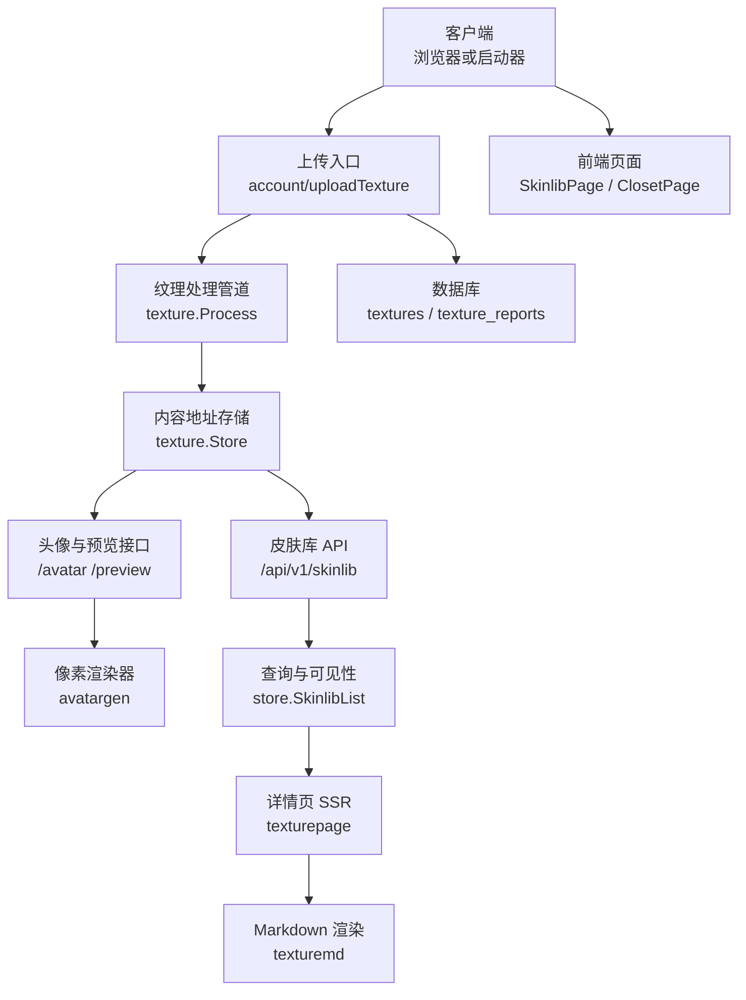
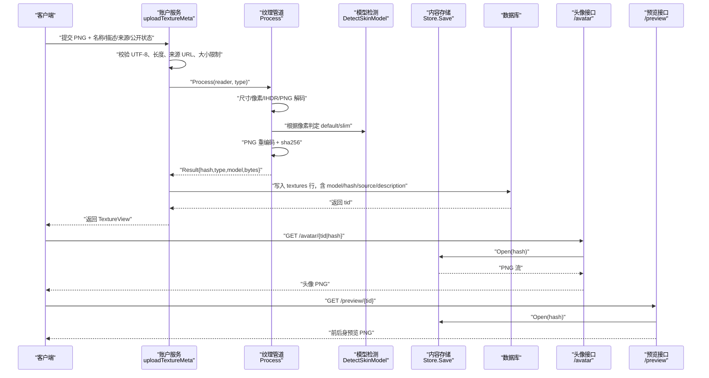
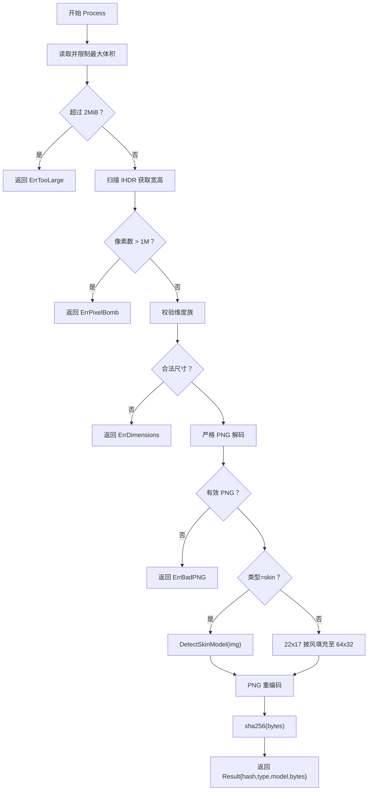
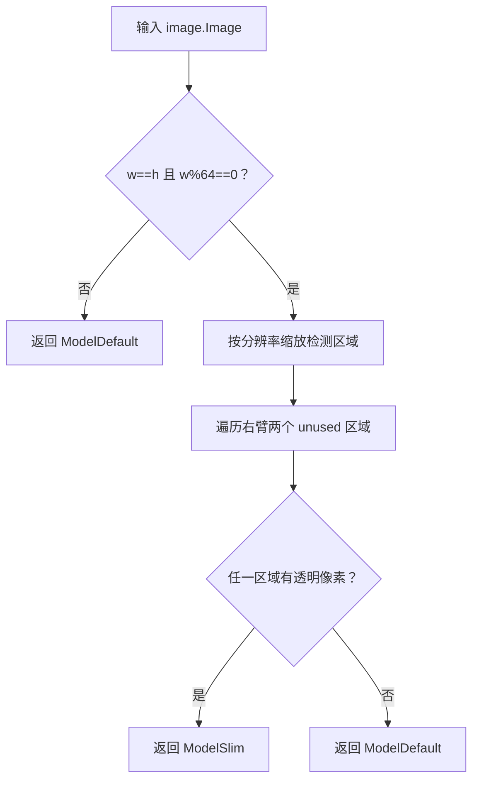
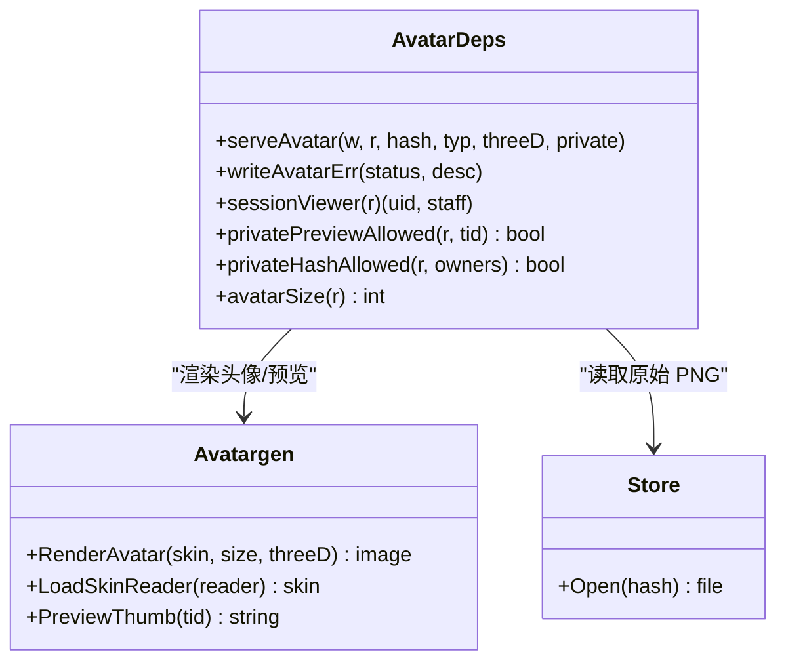
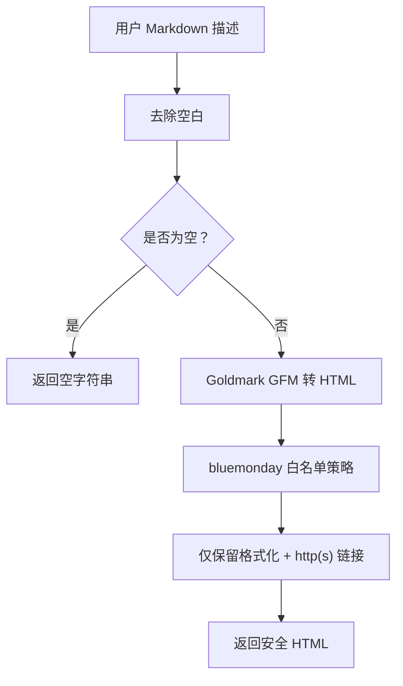
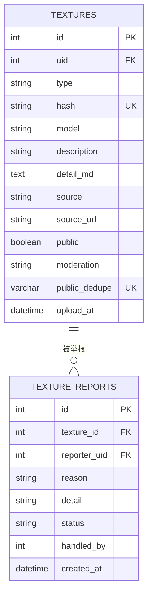
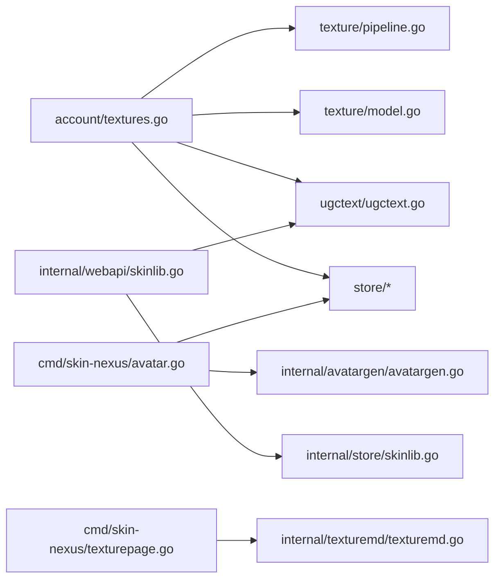

# 皮肤与材质管理

**本文引用的文件**
- [pipeline.go](https://github.com/YimingZhanshen/skin-nexus/blob/797ae1a/server/internal/texture/pipeline.go)
- [model.go](https://github.com/YimingZhanshen/skin-nexus/blob/797ae1a/server/internal/texture/model.go)
- [avatargen.go](https://github.com/YimingZhanshen/skin-nexus/blob/797ae1a/server/internal/avatargen/avatargen.go)
- [avatar.go](https://github.com/YimingZhanshen/skin-nexus/blob/797ae1a/server/cmd/skin-nexus/avatar.go)
- [texturemd.go](https://github.com/YimingZhanshen/skin-nexus/blob/797ae1a/server/internal/texturemd/texturemd.go)
- [ugctext.go](https://github.com/YimingZhanshen/skin-nexus/blob/797ae1a/server/internal/ugctext/ugctext.go)
- [textures.go](https://github.com/YimingZhanshen/skin-nexus/blob/797ae1a/server/internal/account/textures.go)
- [skinlib.go](https://github.com/YimingZhanshen/skin-nexus/blob/797ae1a/server/internal/webapi/skinlib.go)
- [skinlib_store.go](https://github.com/YimingZhanshen/skin-nexus/blob/797ae1a/server/internal/store/skinlib.go)
- [texturepage.go](https://github.com/YimingZhanshen/skin-nexus/blob/797ae1a/server/cmd/skin-nexus/texturepage.go)
- [redetect_models.go](https://github.com/YimingZhanshen/skin-nexus/blob/797ae1a/server/cmd/skin-nexus/redetect_models.go)
- [compress.go](https://github.com/YimingZhanshen/skin-nexus/blob/797ae1a/server/cmd/skin-nexus/compress.go)
- [0015_texture_public_dedupe.sql](https://github.com/YimingZhanshen/skin-nexus/blob/797ae1a/server/migrations/sqlite/0015_texture_public_dedupe.sql)
- [0017_texture_metadata_reports.sql](https://github.com/YimingZhanshen/skin-nexus/blob/797ae1a/server/migrations/sqlite/0017_texture_metadata_reports.sql)
- [0018_texture_moderation.sql](https://github.com/YimingZhanshen/skin-nexus/blob/797ae1a/server/migrations/sqlite/0018_texture_moderation.sql)
- [0024_textures_public_upload.sql](https://github.com/YimingZhanshen/skin-nexus/blob/797ae1a/server/migrations/sqlite/0024_textures_public_upload.sql)
- [SkinlibPage.vue](https://github.com/YimingZhanshen/skin-nexus/blob/797ae1a/web/src/pages/SkinlibPage.vue)
- [ClosetPage.vue](https://github.com/YimingZhanshen/skin-nexus/blob/797ae1a/web/src/pages/ClosetPage.vue)

## 目录
1. [简介](#简介)
2. [项目结构](#项目结构)
3. [核心组件](#核心组件)
4. [架构总览](#架构总览)
5. [详细组件分析](#详细组件分析)
6. [依赖关系分析](#依赖关系分析)
7. [性能考虑](#性能考虑)
8. [故障排查指南](#故障排查指南)
9. [结论](#结论)

## 简介
本文档聚焦 SkinNexus 的皮肤与材质管理能力，围绕一次 PNG 上传后的完整处理管线展开：从尺寸、像素、格式校验，到内容哈希去重、模型检测、头像与预览生成、元数据解析、审核标记、公开分发，以及前端浏览、筛选、排序、点赞入柜和私密导入。文档同时说明 Texture 模型字段、UGC 文本过滤与安全边界，并给出常见错误响应示例与性能优化建议。

## 项目结构
与皮肤材质相关的代码主要分布在以下层次：
- 服务层：`internal/account/textures.go` 负责用户级上传、私有导入、元数据校验与管道调用。
- 管道层：`internal/texture/pipeline.go` 实现尺寸/像素/格式检查、PNG 重编码、内容地址化存储；`internal/texture/model.go` 根据像素自动判断 steve/alex 模型。
- 渲染层：`cmd/skin-nexus/avatar.go` 暴露 `/avatar`、`/preview` 接口；`internal/avatargen/avatargen.go` 完成像素级头像与预览绘制。
- 元数据层：`internal/texturemd/texturemd.go` 将 Markdown 描述安全转 HTML；`internal/ugctext/ugctext.go` 清理不可见 Unicode 控制字符。
- 查询与展示层：`internal/webapi/skinlib.go` 提供皮肤库 API；`internal/store/skinlib.go` 实现可见性、筛选、排序、分页；`cmd/skin-nexus/texturepage.go` 提供服务端渲染的详情页面。
- 前端：`web/src/pages/SkinlibPage.vue` 实现公共皮肤库浏览、筛选、排序、点赞；`web/src/pages/ClosetPage.vue` 实现个人衣柜管理与“设为头像”。



**图表来源**
- [textures.go:85-180](https://github.com/YimingZhanshen/skin-nexus/blob/797ae1a/server/internal/account/textures.go#L85-L180)
- [pipeline.go:58-130](https://github.com/YimingZhanshen/skin-nexus/blob/797ae1a/server/internal/texture/pipeline.go#L58-L130)
- [avatar.go:1-80](https://github.com/YimingZhanshen/skin-nexus/blob/797ae1a/server/cmd/skin-nexus/avatar.go#L1-L80)
- [avatargen.go:1-40](https://github.com/YimingZhanshen/skin-nexus/blob/797ae1a/server/internal/avatargen/avatargen.go#L1-L40)
- [skinlib.go:1-60](https://github.com/YimingZhanshen/skin-nexus/blob/797ae1a/server/internal/webapi/skinlib.go#L1-L60)
- [skinlib_store.go:1-60](https://github.com/YimingZhanshen/skin-nexus/blob/797ae1a/server/internal/store/skinlib.go#L1-L60)
- [texturepage.go:1-40](https://github.com/YimingZhanshen/skin-nexus/blob/797ae1a/server/cmd/skin-nexus/texturepage.go#L1-L40)
- [texturemd.go:1-25](https://github.com/YimingZhanshen/skin-nexus/blob/797ae1a/server/internal/texturemd/texturemd.go#L1-L25)

**章节来源**
- [textures.go:85-180](https://github.com/YimingZhanshen/skin-nexus/blob/797ae1a/server/internal/account/textures.go#L85-L180)
- [pipeline.go:1-130](https://github.com/YimingZhanshen/skin-nexus/blob/797ae1a/server/internal/texture/pipeline.go#L1-L130)
- [avatar.go:1-80](https://github.com/YimingZhanshen/skin-nexus/blob/797ae1a/server/cmd/skin-nexus/avatar.go#L1-L80)
- [avatargen.go:1-40](https://github.com/YimingZhanshen/skin-nexus/blob/797ae1a/server/internal/avatargen/avatargen.go#L1-L40)
- [skinlib.go:1-60](https://github.com/YimingZhanshen/skin-nexus/blob/797ae1a/server/internal/webapi/skinlib.go#L1-L60)
- [skinlib_store.go:1-60](https://github.com/YimingZhanshen/skin-nexus/blob/797ae1a/server/internal/store/skinlib.go#L1-L60)
- [texturepage.go:1-40](https://github.com/YimingZhanshen/skin-nexus/blob/797ae1a/server/cmd/skin-nexus/texturepage.go#L1-L40)
- [texturemd.go:1-25](https://github.com/YimingZhanshen/skin-nexus/blob/797ae1a/server/internal/texturemd/texturemd.go#L1-L25)

## 核心组件
- 纹理处理管道：负责输入限制、IHDR 预检、维度规则、严格 PNG 解码、模型检测、PNG 重编码、SHA-256 内容地址化与持久化。
- 模型检测：基于 Mojang slim skin 右臂未使用区域透明像素判断 steve（default）与 alex（slim），拒绝非正方形或非 64 倍数图像。
- 内容地址存储：以 `dir/<sha256>` 形式落盘，路径仅接受 64 位十六进制 hash，天然防路径穿越；相同内容幂等写入。
- 头像与预览：根据皮肤 sheet 的 UV 布局渲染 2D 头像、3D 立方体头像、前后身预览图，支持 size、3d、png 参数。
- 元数据解析：description、detail_md、source、source_url 在上传和编辑时经过 UGC 文本清理与长度、格式校验；detail_md 通过受限 Markdown 渲染。
- 皮肤库查询：按类型（skin/cape）、模型（steve/alex）、上传者、关键词、排序、分页返回条目；匿名只读公开，登录可见自身私有。
- 私密副本导入：允许用户导入一份私有副本，跳过公开重复检查，便于绑定角色后修改或保留私有版本。

**章节来源**
- [pipeline.go:58-130](https://github.com/YimingZhanshen/skin-nexus/blob/797ae1a/server/internal/texture/pipeline.go#L58-L130)
- [model.go:12-52](https://github.com/YimingZhanshen/skin-nexus/blob/797ae1a/server/internal/texture/model.go#L12-L52)
- [textures.go:85-180](https://github.com/YimingZhanshen/skin-nexus/blob/797ae1a/server/internal/account/textures.go#L85-L180)
- [avatar.go:1-80](https://github.com/YimingZhanshen/skin-nexus/blob/797ae1a/server/cmd/skin-nexus/avatar.go#L1-L80)
- [texturemd.go:1-66](https://github.com/YimingZhanshen/skin-nexus/blob/797ae1a/server/internal/texturemd/texturemd.go#L1-L66)
- [skinlib.go:1-120](https://github.com/YimingZhanshen/skin-nexus/blob/797ae1a/server/internal/webapi/skinlib.go#L1-L120)
- [skinlib_store.go:1-120](https://github.com/YimingZhanshen/skin-nexus/blob/797ae1a/server/internal/store/skinlib.go#L1-L120)

## 架构总览
下图展示一次成功上传到公开分发的关键时序：



**图表来源**
- [textures.go:85-180](https://github.com/YimingZhanshen/skin-nexus/blob/797ae1a/server/internal/account/textures.go#L85-L180)
- [pipeline.go:58-130](https://github.com/YimingZhanshen/skin-nexus/blob/797ae1a/server/internal/texture/pipeline.go#L58-L130)
- [model.go:30-52](https://github.com/YimingZhanshen/skin-nexus/blob/797ae1a/server/internal/texture/model.go#L30-L52)
- [avatar.go:1-80](https://github.com/YimingZhanshen/skin-nexus/blob/797ae1a/server/cmd/skin-nexus/avatar.go#L1-L80)

## 详细组件分析

### 纹理上传与处理管线
处理管线顺序为：
1. 读取最多 `MaxUploadBytes`（2 MiB）字节，超过直接报错。
2. 扫描 IHDR，解析宽高，防止 PNG bomb。
3. 检查像素总数不超过 `MaxPixels`（约 100 万）。
4. 校验维度是否属于皮肤（64x32/64x64 系列）或披风（64x32/22x17 系列）。
5. 严格使用 `image/png` 解码，拒绝其他格式。
6. 皮肤走模型检测；披风若为 22x17 系列则透明填充到最小 64x32 对齐尺寸。
7. 输出 PNG 重编码，丢弃 ancillary chunks 和多态负载。
8. 对重编码结果计算 SHA-256，作为文件名和内容键。



**图表来源**
- [pipeline.go:58-130](https://github.com/YimingZhanshen/skin-nexus/blob/797ae1a/server/internal/texture/pipeline.go#L58-L130)

**章节来源**
- [pipeline.go:58-130](https://github.com/YimingZhanshen/skin-nexus/blob/797ae1a/server/internal/texture/pipeline.go#L58-L130)

### 模型检测：steve、alex、layered
- 常量 `ModelDefault` 对应 steve（默认 4px 手臂），`ModelSlim` 对应 alex（3px 手臂）。
- 检测逻辑只看像素：只有正方形且宽度为 64 倍数的图像才携带模型信息；64x32 及其他尺寸统一返回 `ModelDefault`。
- 依据 Mojang `HttpTexture#isSlimSkin` 规则，检查右臂第一层的两个固定区域：如果任一区域存在透明像素，则判定为 slim。
- 为避免误判经典皮肤，代码刻意不采用额外启发式（如左臂区域、纯色检测）。
- 后端工具 `redetect-models` 可从已存储 PNG 重新检测模型，并以 dry-run 模式输出差异，支持 `--apply` 批量修正历史行。



**图表来源**
- [model.go:12-52](https://github.com/YimingZhanshen/skin-nexus/blob/797ae1a/server/internal/texture/model.go#L12-L52)
- [redetect_models.go:1-80](https://github.com/YimingZhanshen/skin-nexus/blob/797ae1a/server/cmd/skin-nexus/redetect_models.go#L1-L80)

**章节来源**
- [model.go:12-52](https://github.com/YimingZhanshen/skin-nexus/blob/797ae1a/server/internal/texture/model.go#L12-L52)
- [redetect_models.go:1-116](https://github.com/YimingZhanshen/skin-nexus/blob/797ae1a/server/cmd/skin-nexus/redetect_models.go#L1-L116)

### 头像生成：avatargen 与 avatar 接口
- `avatargen` 实现与 legacy blessing-skin-server 一致的几何与 UV 映射：
  - 2D 头像：正面头部 + 头盔叠加层。
  - 3D 头像：-45° yaw 的头部立方体，显示正面、侧面、顶面。
  - 预览：全身前后视图并排，带比例留白。
- 支持 `size`（8..1024，默认 100）、`3d`（存在即 3D 视图）、`png`（兼容参数，始终输出 PNG）。
- `/avatar/player/{name}`、`/avatar/user/{uid}`、`/avatar/{tid}`、`/avatar/hash/{hash}` 均遵循缺失回退默认头像的策略；披风类型返回 422。
- 私密头像：需要会话 cookie、管理员权限或纹理所有者身份；响应头标记 `private, no-store`。
- 公开头像：可缓存，默认 24 小时；插件代理场景下短 TTL 缓存。



**图表来源**
- [avatar.go:1-120](https://github.com/YimingZhanshen/skin-nexus/blob/797ae1a/server/cmd/skin-nexus/avatar.go#L1-L120)
- [avatargen.go:1-80](https://github.com/YimingZhanshen/skin-nexus/blob/797ae1a/server/internal/avatargen/avatargen.go#L1-L80)

**章节来源**
- [avatar.go:1-120](https://github.com/YimingZhanshen/skin-nexus/blob/797ae1a/server/cmd/skin-nexus/avatar.go#L1-L120)
- [avatargen.go:1-80](https://github.com/YimingZhanshen/skin-nexus/blob/797ae1a/server/internal/avatargen/avatargen.go#L1-L80)

### 元数据解析：texturemd 与 ugctext
- `ugctext.Visible` 移除 Unicode Cf 类控制字符（双向覆盖、零宽空格、隔离符等），但保留 ZWJ/ZWNJ 以避免破坏表情序列。
- `texturemd.Render` 使用 Goldmark GFM 渲染 Markdown，再用 bluemonday 策略仅允许：
  - 基础排版元素：段落、加粗、斜体、删除线、列表、表格、标题等。
  - http(s) 链接，强制 `rel="nofollow"` 与 `referrerpolicy="no-referrer"`。
  - 禁止图片、iframe、表单、样式等远程资源，避免跟踪与 NSFW 内容随描述传播。
- 渲染失败降级为空字符串，不会回显原始输入。
- `Excerpt` 提取纯文本摘要用于 SEO 卡片，截断后追加省略号。



**图表来源**
- [texturemd.go:1-66](https://github.com/YimingZhanshen/skin-nexus/blob/797ae1a/server/internal/texturemd/texturemd.go#L1-L66)
- [ugctext.go:1-33](https://github.com/YimingZhanshen/skin-nexus/blob/797ae1a/server/internal/ugctext/ugctext.go#L1-L33)

**章节来源**
- [texturemd.go:1-66](https://github.com/YimingZhanshen/skin-nexus/blob/797ae1a/server/internal/texturemd/texturemd.go#L1-L66)
- [ugctext.go:1-33](https://github.com/YimingZhanshen/skin-nexus/blob/797ae1a/server/internal/ugctext/ugctext.go#L1-L33)

### 去重与存储：内容地址化与公开去重键
- 存储路径为 `<TexturesDir>/<sha256>`，路径正则要求恰好 64 位十六进制，防止路径穿越。
- `Store.Save` 先检查文件是否存在，相同内容幂等写入。
- 数据库层面，`public_dedupe` 列存储 `type:sha256` 唯一键，仅对公开纹理生效；私密纹理允许多份相同内容，由 `user_closet` 与 owner 控制访问。
- 历史迁移脚本 `BackfillPublicDedupe` 为每个 `(type, hash)` 公开组选择一条 winner 回填该列，确保后续写入受唯一索引约束。



**图表来源**
- [pipeline.go:100-130](https://github.com/YimingZhanshen/skin-nexus/blob/797ae1a/server/internal/texture/pipeline.go#L100-L130)
- [0015_texture_public_dedupe.sql:1-5](https://github.com/YimingZhanshen/skin-nexus/blob/797ae1a/server/migrations/sqlite/0015_texture_public_dedupe.sql#L1-L5)
- [0017_texture_metadata_reports.sql:1-20](https://github.com/YimingZhanshen/skin-nexus/blob/797ae1a/server/migrations/sqlite/0017_texture_metadata_reports.sql#L1-L20)
- [0018_texture_moderation.sql:1-5](https://github.com/YimingZhanshen/skin-nexus/blob/797ae1a/server/migrations/sqlite/0018_texture_moderation.sql#L1-L5)

**章节来源**
- [pipeline.go:100-130](https://github.com/YimingZhanshen/skin-nexus/blob/797ae1a/server/internal/texture/pipeline.go#L100-L130)
- [dedupe.go:1-48](https://github.com/YimingZhanshen/skin-nexus/blob/797ae1a/server/internal/store/dedupe.go#L1-L48)
- [0015_texture_public_dedupe.sql:1-5](https://github.com/YimingZhanshen/skin-nexus/blob/797ae1a/server/migrations/sqlite/0015_texture_public_dedupe.sql#L1-L5)
- [0017_texture_metadata_reports.sql:1-20](https://github.com/YimingZhanshen/skin-nexus/blob/797ae1a/server/migrations/sqlite/0017_texture_metadata_reports.sql#L1-L20)
- [0018_texture_moderation.sql:1-5](https://github.com/YimingZhanshen/skin-nexus/blob/797ae1a/server/migrations/sqlite/0018_texture_moderation.sql#L1-L5)

### 皮肤库浏览、筛选、排序、点赞入柜
- API：`GET /api/v1/skinlib?filter=&keyword=&uploader=&sort=&page=`
  - `filter`：`skin`、`cape`、`steve`、`alex`。
  - `sort`：`time`（默认）或 `likes`。
  - `page`：1 起，每页 20，最大 50。
- 可见性：匿名仅公开；登录用户可见公开 + 自身私有；管理员可见全部。
- 点赞：`POST /api/v1/skinlib/{tid}/like` 与 `DELETE /api/v1/skinlib/{tid}/like`，底层写入 `user_closet`；计数来自 pivot 表，避免反范式漂移。
- 前端 `SkinlibPage.vue`：
  - 支持按类型、作者、关键词、排序、分页。
  - “收进衣柜”点击后刷新 likes 并提示下一步穿戴。
  - 预览优先使用服务器端版本网格预览图，避免每个卡片创建 WebGL 上下文导致崩溃。
- 前端 `ClosetPage.vue`：
  - 支持衣柜内搜索、按类型 tab、分页。
  - 支持“设为头像”、改名、移除、穿戴目标选择。

**章节来源**
- [skinlib.go:1-120](https://github.com/YimingZhanshen/skin-nexus/blob/797ae1a/server/internal/webapi/skinlib.go#L1-L120)
- [skinlib_store.go:1-160](https://github.com/YimingZhanshen/skin-nexus/blob/797ae1a/server/internal/store/skinlib.go#L1-L160)
- [SkinlibPage.vue:1-120](https://github.com/YimingZhanshen/skin-nexus/blob/797ae1a/web/src/pages/SkinlibPage.vue#L1-L120)
- [ClosetPage.vue:1-120](https://github.com/YimingZhanshen/skin-nexus/blob/797ae1a/web/src/pages/ClosetPage.vue#L1-L120)

### 私密副本导入
- `ImportPrivateTexture` 调用同一内部上传流程，但设置 `Public=false`，从而跳过公开内容重复检查。
- 目的：让用户能拥有一份私有副本，以便绑定角色后修改或使用，而不影响公共库。
- 同所有者相同内容的导入是幂等的；不同所有者可各自拥有私密副本。

**章节来源**
- [textures.go:110-140](https://github.com/YimingZhanshen/skin-nexus/blob/797ae1a/server/internal/account/textures.go#L110-L140)

### Texture 模型字段说明
| 字段 | 含义 | 取值与行为 |
|---|---|---|
| `hash` | 存储文件的 SHA-256 十六进制值 | 64 位十六进制，用于内容地址化存储与公开去重键 |
| `model` | 皮肤模型 | `default`（steve）、`slim`（alex）；由像素检测决定，客户端声明仅作参考 |
| `source` | 来源标签 | 空、`original`、`derivative`、`repost`；后两者必须提供合法 http(s) 源链接 |
| `source_url` | 原始来源链接 | 仅当 source 为 derivative/repost 时必填，且需通过 URL 校验 |
| `description` | 皮肤名称 | 最长 50 字符，UTF-8，支持站点命名正则 |
| `detail_md` | 详细描述 Markdown | 最长 4000 字符，渲染为受限 HTML |
| `public` | 公开状态 | 公开纹理进入皮肤库；私密纹理仅所有者与管理员可见 |
| `moderation` | 审核标记 | 空表示正常，`violation` 表示违规内容，禁止再公开 |
| 举报相关 | 举报计数与记录 | 通过 `texture_reports` 表记录举报原因、状态、处理人 |

**章节来源**
- [0015_texture_public_dedupe.sql:1-5](https://github.com/YimingZhanshen/skin-nexus/blob/797ae1a/server/migrations/sqlite/0015_texture_public_dedupe.sql#L1-L5)
- [0017_texture_metadata_reports.sql:1-20](https://github.com/YimingZhanshen/skin-nexus/blob/797ae1a/server/migrations/sqlite/0017_texture_metadata_reports.sql#L1-L20)
- [0018_texture_moderation.sql:1-5](https://github.com/YimingZhanshen/skin-nexus/blob/797ae1a/server/migrations/sqlite/0018_texture_moderation.sql#L1-L5)
- [textures.go:85-180](https://github.com/YimingZhanshen/skin-nexus/blob/797ae1a/server/internal/account/textures.go#L85-L180)

## 依赖关系分析


**图表来源**
- [textures.go:85-180](https://github.com/YimingZhanshen/skin-nexus/blob/797ae1a/server/internal/account/textures.go#L85-L180)
- [pipeline.go:58-130](https://github.com/YimingZhanshen/skin-nexus/blob/797ae1a/server/internal/texture/pipeline.go#L58-L130)
- [model.go:12-52](https://github.com/YimingZhanshen/skin-nexus/blob/797ae1a/server/internal/texture/model.go#L12-L52)
- [avatar.go:1-80](https://github.com/YimingZhanshen/skin-nexus/blob/797ae1a/server/cmd/skin-nexus/avatar.go#L1-L80)
- [avatargen.go:1-80](https://github.com/YimingZhanshen/skin-nexus/blob/797ae1a/server/internal/avatargen/avatargen.go#L1-L80)
- [skinlib.go:1-120](https://github.com/YimingZhanshen/skin-nexus/blob/797ae1a/server/internal/webapi/skinlib.go#L1-L120)
- [skinlib_store.go:1-160](https://github.com/YimingZhanshen/skin-nexus/blob/797ae1a/server/internal/store/skinlib.go#L1-L160)
- [texturepage.go:1-40](https://github.com/YimingZhanshen/skin-nexus/blob/797ae1a/server/cmd/skin-nexus/texturepage.go#L1-L40)
- [texturemd.go:1-66](https://github.com/YimingZhanshen/skin-nexus/blob/797ae1a/server/internal/texturemd/texturemd.go#L1-L66)

**章节来源**
- [textures.go:85-180](https://github.com/YimingZhanshen/skin-nexus/blob/797ae1a/server/internal/account/textures.go#L85-L180)
- [pipeline.go:58-130](https://github.com/YimingZhanshen/skin-nexus/blob/797ae1a/server/internal/texture/pipeline.go#L58-L130)
- [model.go:12-52](https://github.com/YimingZhanshen/skin-nexus/blob/797ae1a/server/internal/texture/model.go#L12-L52)
- [avatar.go:1-80](https://github.com/YimingZhanshen/skin-nexus/blob/797ae1a/server/cmd/skin-nexus/avatar.go#L1-L80)
- [avatargen.go:1-80](https://github.com/YimingZhanshen/skin-nexus/blob/797ae1a/server/internal/avatargen/avatargen.go#L1-L80)
- [skinlib.go:1-120](https://github.com/YimingZhanshen/skin-nexus/blob/797ae1a/server/internal/webapi/skinlib.go#L1-L120)
- [skinlib_store.go:1-160](https://github.com/YimingZhanshen/skin-nexus/blob/797ae1a/server/internal/store/skinlib.go#L1-L160)
- [texturepage.go:1-40](https://github.com/YimingZhanshen/skin-nexus/blob/797ae1a/server/cmd/skin-nexus/texturepage.go#L1-L40)
- [texturemd.go:1-66](https://github.com/YimingZhanshen/skin-nexus/blob/797ae1a/server/internal/texturemd/texturemd.go#L1-L66)

## 性能考虑
- CDN 缓存：
  - 公开头像默认 24 小时缓存；公开预览使用 avatargen 版本号做一年期 immutable 缓存，修复渲染逻辑时通过版本号失效。
  - 压缩中间件排除 `/textures/`、`/preview/`、`/avatar/`、`/texture-render/` 等二进制路径，避免对 PNG 再次 gzip。
- 静态直出：
  - 皮肤详情页面采用服务端渲染，搜索引擎可直接抓取 name、uploader、likes、预览图、JSON-LD。
  - 前端渐进增强：无 JS 时仍可用静态预览图。
- 大图片异步处理：
  - 管道限制 2 MiB 与 100 万像素，避免内存炸弹。
  - 历史遗留文件原样搬迁，全量解码审计作为后台任务，避免阻塞迁移。
- 磁盘容量监控：
  - 内容地址存储以 hash 命名，重复内容幂等写入；应监控 `TexturesDir` 磁盘使用率，定期巡检缺失 hash、损坏 PNG。
  - `public_dedupe` 唯一键减少公开重复存储；私密副本可适度增长，需结合配额与清理策略。
- 数据库索引：
  - `idx_textures_public_upload(public, upload_at)` 加速公开库最新排序与 sitemap 查询。
  - `idx_report_status_time`、`idx_report_texture` 优化举报统计与处理队列。

**章节来源**
- [compress.go:1-92](https://github.com/YimingZhanshen/skin-nexus/blob/797ae1a/server/cmd/skin-nexus/compress.go#L1-L92)
- [texturepage.go:1-40](https://github.com/YimingZhanshen/skin-nexus/blob/797ae1a/server/cmd/skin-nexus/texturepage.go#L1-L40)
- [pipeline.go:58-130](https://github.com/YimingZhanshen/skin-nexus/blob/797ae1a/server/internal/texture/pipeline.go#L58-L130)
- [0024_textures_public_upload.sql:1-12](https://github.com/YimingZhanshen/skin-nexus/blob/797ae1a/server/migrations/sqlite/0024_textures_public_upload.sql#L1-L12)

## 故障排查指南
- 上传成功：
  - 返回 `TextureView`，包含 `tid`、`hash`、`model`、`type`、`url`、`avatarUrl`、`previewUrl`。
  - 可通过 `/avatar/{tid}`、`/preview/{tid}` 验证头像与预览。
- 尺寸过大：
  - 响应码 400，错误体示例：
    ```json
    {
      "error": "too_large",
      "error_description": "文件大小超过上传限制"
    }
    ```
- 非法 PNG：
  - 响应码 400，错误体示例：
    ```json
    {
      "error": "invalid",
      "error_description": "纹理不是有效的 PNG"
    }
    ```
- 尺寸不符合规范：
  - 响应码 400，错误体示例：
    ```json
    {
      "error": "dimensions",
      "error_description": "纹理尺寸不属于允许族",
      "width": 128,
      "height": 64,
      "type": "skin"
    }
    ```
- 重复 hash（公开）：
  - 公开纹理按 `type:sha256` 唯一；重复上传会复用已有内容，但可能返回已有 `tid` 或合并逻辑；私密上传允许重复。
- 私密材质访问失败：
  - `/avatar` 私密路径返回 401 或 404，取决于是否匹配所有者；响应头包含 `Vary: Cookie` 与 `Cache-Control: private, no-store`。
  - 匿名用户访问私密详情页面返回 404，而不是泄露信息。

**章节来源**
- [textures.go:120-180](https://github.com/YimingZhanshen/skin-nexus/blob/797ae1a/server/internal/account/textures.go#L120-L180)
- [avatar.go:80-160](https://github.com/YimingZhanshen/skin-nexus/blob/797ae1a/server/cmd/skin-nexus/avatar.go#L80-L160)
- [skinlib_store.go:160-220](https://github.com/YimingZhanshen/skin-nexus/blob/797ae1a/server/internal/store/skinlib.go#L160-L220)

## 结论
SkinNexus 的皮肤与材质管理系统以内容地址化为核心，将上传、模型检测、头像生成、元数据处理、审核标记与公开分发解耦成清晰模块。管道层保证安全性与一致性，avatargen 与 avatar 接口保证与 legacy 行为一致，texturemd 与 ugctext 构建 UGC 安全边界，skinlib 查询层提供稳定的浏览体验。生产部署应重点关注 CDN 缓存策略、静态直出质量、大图异步处理与磁盘容量监控，并结合 `public_dedupe` 与举报/审核机制维护公共库健康。
