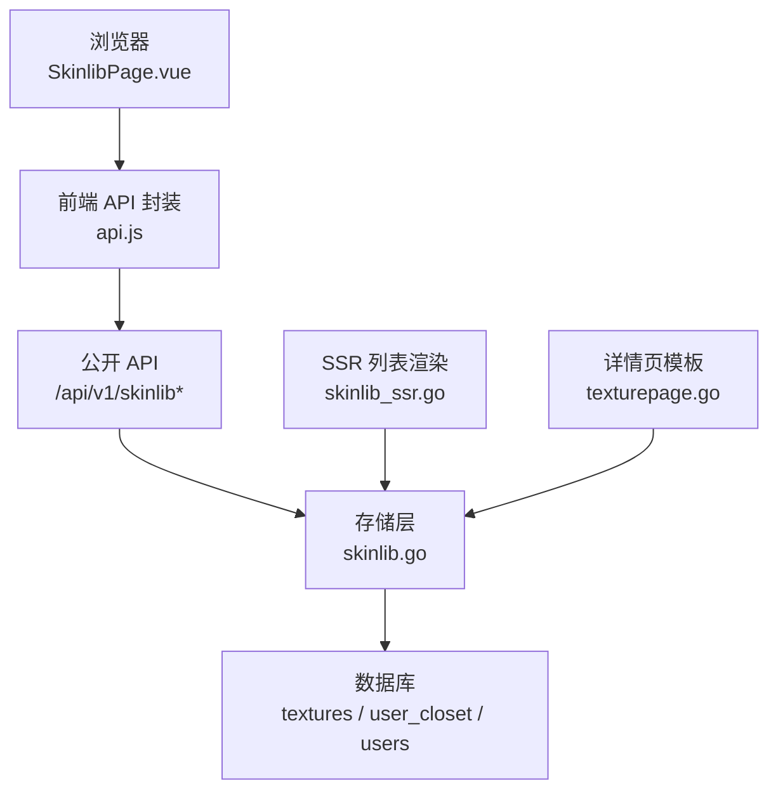
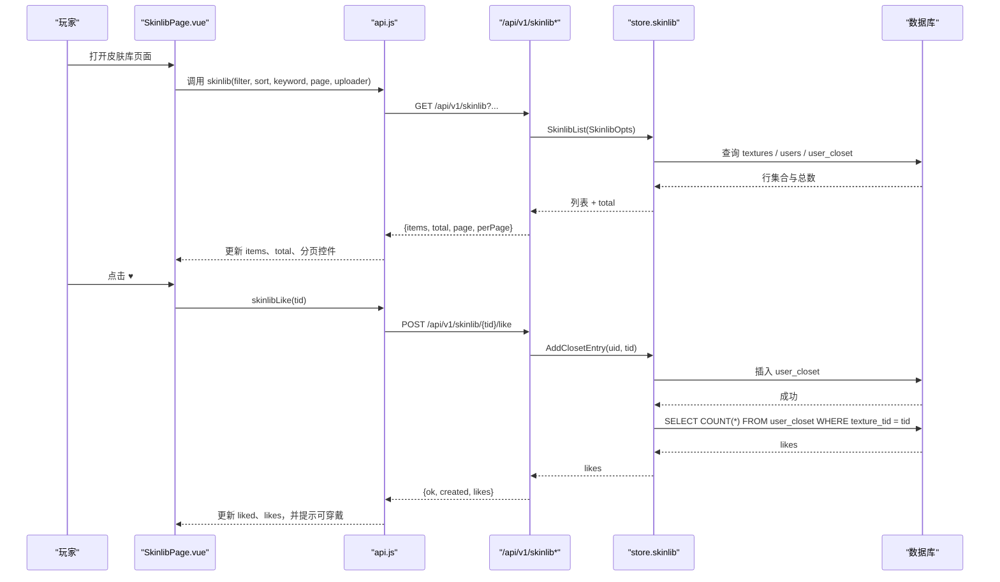
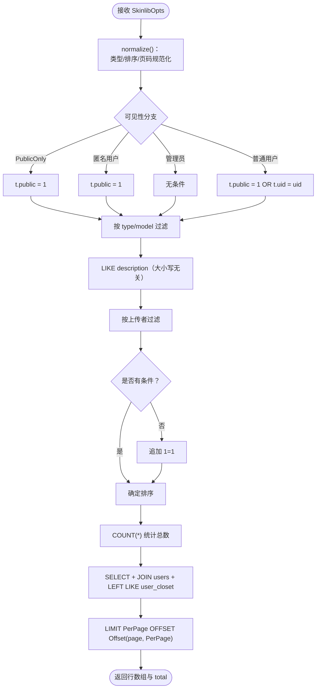
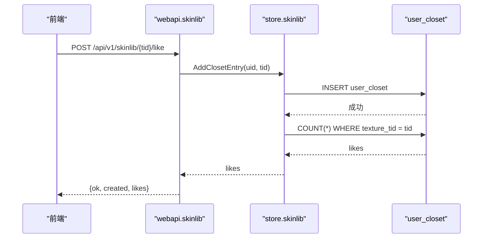
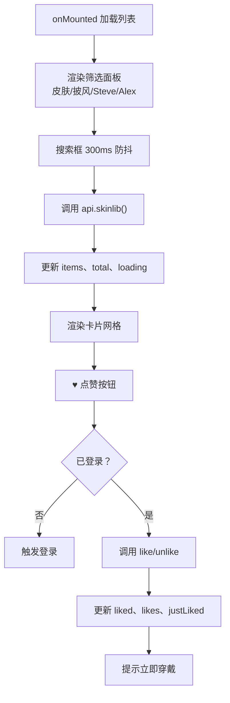
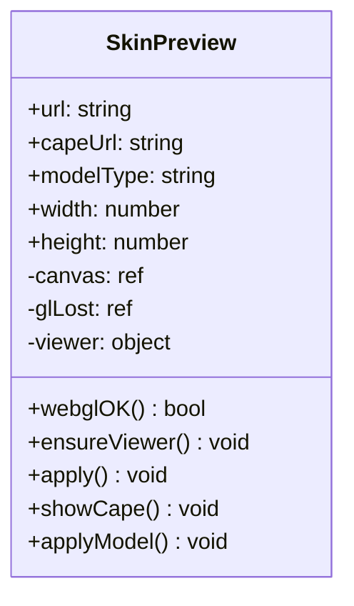
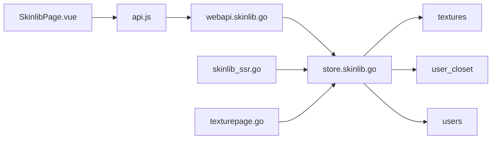

# 皮肤库浏览与筛选

**本文引用的文件**
- [server/internal/webapi/skinlib.go](https://github.com/YimingZhanshen/skin-nexus/blob/797ae1a/server/internal/webapi/skinlib.go)
- [server/internal/store/skinlib.go](https://github.com/YimingZhanshen/skin-nexus/blob/797ae1a/server/internal/store/skinlib.go)
- [web/src/pages/SkinlibPage.vue](https://github.com/YimingZhanshen/skin-nexus/blob/797ae1a/web/src/pages/SkinlibPage.vue)
- [web/src/components/SkinPreview.vue](https://github.com/YimingZhanshen/skin-nexus/blob/797ae1a/web/src/components/SkinPreview.vue)
- [web/src/api.js](https://github.com/YimingZhanshen/skin-nexus/blob/797ae1a/web/src/api.js)
- [server/cmd/skin-nexus/skinlib_ssr.go](https://github.com/YimingZhanshen/skin-nexus/blob/797ae1a/server/cmd/skin-nexus/skinlib_ssr.go)
- [server/cmd/skin-nexus/texturepage.go](https://github.com/YimingZhanshen/skin-nexus/blob/797ae1a/server/cmd/skin-nexus/texturepage.go)

## 目录
1. [引言](#引言)
2. [项目结构](#项目结构)
3. [核心组件](#核心组件)
4. [架构总览](#架构总览)
5. [详细组件分析](#详细组件分析)
6. [依赖关系分析](#依赖关系分析)
7. [性能考量](#性能考量)
8. [故障排查指南](#故障排查指南)
9. [结论](#结论)
10. [附录：API 契约示例](#附录api-契约示例)

## 引言
本文说明皮肤库的公开浏览、筛选、分页、点赞入柜以及私有副本导入能力，并梳理后端只读 API、数据库查询构建器、前端页面与 3D 预览之间的数据流向。重点包括：
- 公开只读 API：皮肤列表、单品详情、点赞/取消点赞、所有者元数据修改。
- 查询构建器 `SkinlibOpts`：按模型、来源类型、关键词、上传者、排序和页码筛选。
- 前端 `SkinlibPage.vue`：筛选面板、分页控件、收藏提示与穿戴入口。
- 3D 预览 `SkinPreview.vue`：自动旋转、模型切换、WebGL 不可用回退、披风加载。
- 点赞与收藏数据流：客户端调用 `/api/v1/*` → 服务端写入 `user_closet` → 返回最新点赞数。
- SEO：SSR 列表片段与详情页 JSON-LD、OG 信息，提升搜索引擎收录效果。

## 项目结构
皮肤库功能跨越四层：
- Web 层暴露 `/api/v1/skinlib*` 接口，负责鉴权、参数校验与响应序列化。
- Store 层实现 `SkinlibList`、`SkinlibOne`、`AddClosetEntry`、`RemoveClosetEntryByTID`、`ClosetLikes` 等持久化逻辑。
- 前端 Vue 页面负责筛选、分页、点赞交互与穿戴流程。
- SSR 渲染器为爬虫提供首屏可抓取列表，详情页模板注入 JSON-LD 与 OG 字段。



图表来源
- [server/internal/webapi/skinlib.go:22-105](https://github.com/YimingZhanshen/skin-nexus/blob/797ae1a/server/internal/webapi/skinlib.go#L22-L105)
- [server/internal/store/skinlib.go:28-181](https://github.com/YimingZhanshen/skin-nexus/blob/797ae1a/server/internal/store/skinlib.go#L28-L181)
- [web/src/pages/SkinlibPage.vue:1-120](https://github.com/YimingZhanshen/skin-nexus/blob/797ae1a/web/src/pages/SkinlibPage.vue#L1-L120)
- [web/src/api.js:98-140](https://github.com/YimingZhanshen/skin-nexus/blob/797ae1a/web/src/api.js#L98-L140)
- [server/cmd/skin-nexus/skinlib_ssr.go:13-89](https://github.com/YimingZhanshen/skin-nexus/blob/797ae1a/server/cmd/skin-nexus/skinlib_ssr.go#L13-L89)
- [server/cmd/skin-nexus/texturepage.go:10-61](https://github.com/YimingZhanshen/skin-nexus/blob/797ae1a/server/cmd/skin-nexus/texturepage.go#L10-L61)

章节来源
- [server/internal/webapi/skinlib.go:22-105](https://github.com/YimingZhanshen/skin-nexus/blob/797ae1a/server/internal/webapi/skinlib.go#L22-L105)
- [server/internal/store/skinlib.go:28-181](https://github.com/YimingZhanshen/skin-nexus/blob/797ae1a/server/internal/store/skinlib.go#L28-L181)
- [web/src/pages/SkinlibPage.vue:1-120](https://github.com/YimingZhanshen/skin-nexus/blob/797ae1a/web/src/pages/SkinlibPage.vue#L1-L120)
- [web/src/api.js:98-140](https://github.com/YimingZhanshen/skin-nexus/blob/797ae1a/web/src/api.js#L98-L140)
- [server/cmd/skin-nexus/skinlib_ssr.go:13-89](https://github.com/YimingZhanshen/skin-nexus/blob/797ae1a/server/cmd/skin-nexus/skinlib_ssr.go#L13-L89)
- [server/cmd/skin-nexus/texturepage.go:10-61](https://github.com/YimingZhanshen/skin-nexus/blob/797ae1a/server/cmd/skin-nexus/texturepage.go#L10-L61)

## 核心组件
- 公开列表接口：匿名用户仅见公开材质；登录用户可见公开材质及本人私有材质；管理员可见全部。
- 点赞接口：POST 添加衣柜条目，DELETE 移除；结果返回当前点赞数，语义等价于“收进衣柜”。
- 元数据修改接口：PATCH 支持改名、改描述、改来源、改公开状态、修正模型；所有权与审核规则由后端校验。
- 查询构建器：将 `filter`、`keyword`、`uploader`、`sort`、`page` 规范化后拼接 WHERE、ORDER BY、LIMIT/OFFSET。
- 前端筛选面板：提供皮肤、披风、Steve、Alex 四类筛选，搜索词延时触发，支持按时间或点赞排序，支持只看自己上传。
- 3D 预览组件：懒加载 skinview3d，根据系统偏好决定是否自动旋转，无 WebGL 时回退为静态贴图。
- SSR 列表：服务器端渲染前 24 条卡片，附带语言切换、上一页/下一页链接与页面元信息。
- 详情页 SEO：模板输出名称、上传者、预览图、下载链接、JSON-LD 与 OG 字段，提高搜索引擎与 AI 抓取效果。

章节来源
- [server/internal/webapi/skinlib.go:22-105](https://github.com/YimingZhanshen/skin-nexus/blob/797ae1a/server/internal/webapi/skinlib.go#L22-L105)
- [server/internal/store/skinlib.go:28-181](https://github.com/YimingZhanshen/skin-nexus/blob/797ae1a/server/internal/store/skinlib.go#L28-L181)
- [web/src/pages/SkinlibPage.vue:1-120](https://github.com/YimingZhanshen/skin-nexus/blob/797ae1a/web/src/pages/SkinlibPage.vue#L1-L120)
- [web/src/components/SkinPreview.vue:1-87](https://github.com/YimingZhanshen/skin-nexus/blob/797ae1a/web/src/components/SkinPreview.vue#L1-L87)
- [server/cmd/skin-nexus/skinlib_ssr.go:13-89](https://github.com/YimingZhanshen/skin-nexus/blob/797ae1a/server/cmd/skin-nexus/skinlib_ssr.go#L13-L89)
- [server/cmd/skin-nexus/texturepage.go:10-61](https://github.com/YimingZhanshen/skin-nexus/blob/797ae1a/server/cmd/skin-nexus/texturepage.go#L10-L61)

## 架构总览


图表来源
- [web/src/pages/SkinlibPage.vue:60-120](https://github.com/YimingZhanshen/skin-nexus/blob/797ae1a/web/src/pages/SkinlibPage.vue#L60-L120)
- [web/src/api.js:118-140](https://github.com/YimingZhanshen/skin-nexus/blob/797ae1a/web/src/api.js#L118-L140)
- [server/internal/webapi/skinlib.go:107-152](https://github.com/YimingZhanshen/skin-nexus/blob/797ae1a/server/internal/webapi/skinlib.go#L107-L152)
- [server/internal/store/skinlib.go:232-280](https://github.com/YimingZhanshen/skin-nexus/blob/797ae1a/server/internal/store/skinlib.go#L232-L280)

## 详细组件分析

### 公开列表 API 与查询构建器
`handleSkinlibList` 从请求中读取 `filter`、`keyword`、`uploader`、`sort`、`page`，解析当前用户权限，并调用 `Store.SkinlibList`。响应包含每项的 `tid`、`name`、`type`、`model`、`hash`、`public`、`uploader`、`nickname`、`likes`、`liked`、`uploadAt`、`source`、`sourceUrl`、`textureURL`，并在类型为皮肤时附加版本化预览 URL。

`SkinlibOpts` 是查询构建器核心：
- `Type` 标准化：`steve` → `skin:default`，`alex` → `skin:slim`，空值不限制。
- `Sort` 规范化：除 `likes` 外均视为 `time`。
- `Page` 至少为 1，`PerPage` 默认 20，上限 50。
- `where()` 先应用可见性约束，再叠加类型、关键词、上传者过滤；当无条件时补 `1=1` 避免 SQL 语法错误。
- 列表按上传时间或点赞数排序；点赞来自 `user_closet` 的实时计数，`liked` 通过 `EXISTS` 判断当前 viewer 是否已收藏。
- 分页使用 `LIMIT ? OFFSET ?`，并通过 `dbx.Offset(page, perPage)` 计算偏移，防止负数溢出。



图表来源
- [server/internal/store/skinlib.go:28-181](https://github.com/YimingZhanshen/skin-nexus/blob/797ae1a/server/internal/store/skinlib.go#L28-L181)

章节来源
- [server/internal/webapi/skinlib.go:22-105](https://github.com/YimingZhanshen/skin-nexus/blob/797ae1a/server/internal/webapi/skinlib.go#L22-L105)
- [server/internal/store/skinlib.go:28-181](https://github.com/YimingZhanshen/skin-nexus/blob/797ae1a/server/internal/store/skinlib.go#L28-L181)

### 单品详情与权限门控
`SkinlibOne` 根据 `tid`、viewerUID、viewerAdmin 决定可见性：
- 公开材质：任何人可见。
- 私有材质：上传者或管理员可见。
- 其他情况返回未找到错误。

详情页模板在 `texturepage.go` 中输出名称、上传者、模型、预览图、下载链接、JSON-LD 与 OG 信息，使搜索引擎能够直接索引关键内容。

章节来源
- [server/internal/store/skinlib.go:182-231](https://github.com/YimingZhanshen/skin-nexus/blob/797ae1a/server/internal/store/skinlib.go#L182-L231)
- [server/cmd/skin-nexus/texturepage.go:10-61](https://github.com/YimingZhanshen/skin-nexus/blob/797ae1a/server/cmd/skin-nexus/texturepage.go#L10-L61)

### 点赞、取消点赞与衣柜关联
- POST `/api/v1/skinlib/{tid}/like`：要求登录；若材质不存在返回 404；否则写入衣柜并返回 `{ok, created, likes}`。
- DELETE `/api/v1/skinlib/{tid}/like`：要求登录；若尚未收藏返回 404；否则删除一条记录并返回 `{ok, likes}`。
- 点赞数量始终来自 `user_closet` 计数，而非历史反范式列。



图表来源
- [server/internal/webapi/skinlib.go:107-152](https://github.com/YimingZhanshen/skin-nexus/blob/797ae1a/server/internal/webapi/skinlib.go#L107-L152)
- [server/internal/store/skinlib.go:232-280](https://github.com/YimingZhanshen/skin-nexus/blob/797ae1a/server/internal/store/skinlib.go#L232-L280)

章节来源
- [server/internal/webapi/skinlib.go:107-152](https://github.com/YimingZhanshen/skin-nexus/blob/797ae1a/server/internal/webapi/skinlib.go#L107-L152)
- [server/internal/store/skinlib.go:232-280](https://github.com/YimingZhanshen/skin-nexus/blob/797ae1a/server/internal/store/skinlib.go#L232-L280)

### 元数据修改与私有副本导入
PATCH `/api/v1/skinlib/{tid}` 支持：
- 改名：清理可见字符、长度限制、命名正则校验。
- 改描述：长度限制到 4000 字符。
- 改来源：`original`、`derivative`、`repost`，其中衍生与转载必须提供有效 http(s) 原始链接。
- 改公开状态：公开时会同步去重键；私有则清空去重键。
- 修正模型：仅对皮肤有效，值为 `default` 或 `slim`。
- 所有权校验：上传者或管理员可修改；非所有者返回禁止访问。
- 审核保护：被判定违规的材质不能重新公开。
- 审计日志：公开/私有变更与模型变更会记录审计事件。

该接口也承担“私有副本导入”的语义：上传后可设为私有，再通过 PATCH 修正来源、模型与可见性，使其成为可管理的私有副本。

章节来源
- [server/internal/webapi/skinlib.go:154-388](https://github.com/YimingZhanshen/skin-nexus/blob/797ae1a/server/internal/webapi/skinlib.go#L154-L388)
- [server/internal/store/skinlib.go:282-377](https://github.com/YimingZhanshen/skin-nexus/blob/797ae1a/server/internal/store/skinlib.go#L282-L377)

### 前端筛选面板与分页控件
`SkinlibPage.vue` 维护以下状态：
- `filter`：`skin`、`cape`、`steve`、`alex`。
- `sort`：`time`、`likes`。
- `keyword`：带 300ms 防抖的搜索输入。
- `mine`：仅显示当前用户上传项。
- `page`、`total`、`loading`、`err`、`ok`、`justLiked`、`busyTid`。

主要交互：
- 切换筛选或排序时重置为第 1 页并重新加载。
- 搜索词变化延迟触发加载，避免频繁请求。
- 点击 ♥：未登录引导登录；已收藏则二次确认后取消收藏；未收藏则收藏并设置 `justLiked` 以提示下一步穿戴。
- 编辑按钮：上传者或管理员可对自身条目改名、改名、切换公开状态。
- 分页控件：基于 `total` 计算 `totalPages`，传入 `Pager` 组件。
- 深链穿戴：解析 `#wear-{tid}-{type}`，打开穿戴选择器。



图表来源
- [web/src/pages/SkinlibPage.vue:1-120](https://github.com/YimingZhanshen/skin-nexus/blob/797ae1a/web/src/pages/SkinlibPage.vue#L1-L120)
- [web/src/pages/SkinlibPage.vue:201-370](https://github.com/YimingZhanshen/skin-nexus/blob/797ae1a/web/src/pages/SkinlibPage.vue#L201-L370)
- [web/src/api.js:118-140](https://github.com/YimingZhanshen/skin-nexus/blob/797ae1a/web/src/api.js#L118-L140)

章节来源
- [web/src/pages/SkinlibPage.vue:1-120](https://github.com/YimingZhanshen/skin-nexus/blob/797ae1a/web/src/pages/SkinlibPage.vue#L1-L120)
- [web/src/pages/SkinlibPage.vue:201-370](https://github.com/YimingZhanshen/skin-nexus/blob/797ae1a/web/src/pages/SkinlibPage.vue#L201-L370)
- [web/src/api.js:118-140](https://github.com/YimingZhanshen/skin-nexus/blob/797ae1a/web/src/api.js#L118-L140)

### 3D 预览交互 `SkinPreview.vue`
组件职责：
- 检测 WebGL 可用性，不可用时标记 `glLost` 并通知父组件重排布局。
- 懒加载 `skinview3d`，创建 `SkinViewer`。
- 根据 `prefers-reduced-motion` 决定是否自动旋转。
- 支持 `modelType` 在 `default` 与 `slim` 之间切换。
- 加载皮肤贴图与披风贴图；披风为空时显式隐藏上一个披风。
- 组件卸载时调用 `dispose()`，避免页面中积累过多 WebGL 上下文。

注意：皮肤库卡片默认使用服务器生成的预览图片以避免每个卡片都创建 WebGL 上下文；`SkinPreview.vue` 更适用于需要真实 3D 交互的场景，例如上传预览或详情页。



图表来源
- [web/src/components/SkinPreview.vue:1-87](https://github.com/YimingZhanshen/skin-nexus/blob/797ae1a/web/src/components/SkinPreview.vue#L1-L87)

章节来源
- [web/src/components/SkinPreview.vue:1-87](https://github.com/YimingZhanshen/skin-nexus/blob/797ae1a/web/src/components/SkinPreview.vue#L1-L87)
- [web/src/pages/SkinlibPage.vue:120-200](https://github.com/YimingZhanshen/skin-nexus/blob/797ae1a/web/src/pages/SkinlibPage.vue#L120-L200)

### SSR 列表与 SEO
SSR 列表渲染器：
- 只读取公开材质，每页 24 条，适合爬虫逐页遍历。
- 保留 `sort`、`type`、`q`、`hl` 等查询参数生成上一页/下一页链接。
- 输出标题、描述、卡片列表、语言对照链接与分页导航。
- 将渲染内容注入宿主 HTML 的 `<!--skin-app-start-->` 与 `<!--skin-app-end-->` 之间，Vue 启动后接管交互。

详情页 SEO：
- 模板输出名称、上传者、模型、预览图绝对地址、下载链接。
- 输出 JSON-LD 结构化数据，帮助搜索引擎理解资源类型与属性。
- 输出 OG 字段，便于社交平台预览。

章节来源
- [server/cmd/skin-nexus/skinlib_ssr.go:13-89](https://github.com/YimingZhanshen/skin-nexus/blob/797ae1a/server/cmd/skin-nexus/skinlib_ssr.go#L13-L89)
- [server/cmd/skin-nexus/skinlib_ssr.go:201-261](https://github.com/YimingZhanshen/skin-nexus/blob/797ae1a/server/cmd/skin-nexus/skinlib_ssr.go#L201-L261)
- [server/cmd/skin-nexus/texturepage.go:10-61](https://github.com/YimingZhanshen/skin-nexus/blob/797ae1a/server/cmd/skin-nexus/texturepage.go#L10-L61)

## 依赖关系分析


图表来源
- [web/src/pages/SkinlibPage.vue:1-120](https://github.com/YimingZhanshen/skin-nexus/blob/797ae1a/web/src/pages/SkinlibPage.vue#L1-L120)
- [web/src/api.js:98-140](https://github.com/YimingZhanshen/skin-nexus/blob/797ae1a/web/src/api.js#L98-L140)
- [server/internal/webapi/skinlib.go:22-105](https://github.com/YimingZhanshen/skin-nexus/blob/797ae1a/server/internal/webapi/skinlib.go#L22-L105)
- [server/internal/store/skinlib.go:28-181](https://github.com/YimingZhanshen/skin-nexus/blob/797ae1a/server/internal/store/skinlib.go#L28-L181)
- [server/cmd/skin-nexus/skinlib_ssr.go:13-89](https://github.com/YimingZhanshen/skin-nexus/blob/797ae1a/server/cmd/skin-nexus/skinlib_ssr.go#L13-L89)
- [server/cmd/skin-nexus/texturepage.go:10-61](https://github.com/YimingZhanshen/skin-nexus/blob/797ae1a/server/cmd/skin-nexus/texturepage.go#L10-L61)

章节来源
- [web/src/pages/SkinlibPage.vue:1-120](https://github.com/YimingZhanshen/skin-nexus/blob/797ae1a/web/src/pages/SkinlibPage.vue#L1-L120)
- [web/src/api.js:98-140](https://github.com/YimingZhanshen/skin-nexus/blob/797ae1a/web/src/api.js#L98-L140)
- [server/internal/webapi/skinlib.go:22-105](https://github.com/YimingZhanshen/skin-nexus/blob/797ae1a/server/internal/webapi/skinlib.go#L22-L105)
- [server/internal/store/skinlib.go:28-181](https://github.com/YimingZhanshen/skin-nexus/blob/797ae1a/server/internal/store/skinlib.go#L28-L181)
- [server/cmd/skin-nexus/skinlib_ssr.go:13-89](https://github.com/YimingZhanshen/skin-nexus/blob/797ae1a/server/cmd/skin-nexus/skinlib_ssr.go#L13-L89)
- [server/cmd/skin-nexus/texturepage.go:10-61](https://github.com/YimingZhanshen/skin-nexus/blob/797ae1a/server/cmd/skin-nexus/texturepage.go#L10-L61)

## 性能考量
- 列表分页默认 20 条，上限 50 条，避免单页过大。
- SSR 列表每页 24 条，比 SPA 更小，因为每次爬取都会返回该段 HTML。
- 卡片预览优先使用服务器生成的静态预览图，避免每格一个 WebGL 上下文导致浏览器上下文丢失。
- `SkinPreview.vue` 在卸载时释放 viewer，防止内存泄漏。
- 关键词搜索使用跨引擎的大小写无关匹配，减少因数据库方言差异导致的额外处理。
- 点赞数通过实时计数，避免反范式列漂移，代价是每次点赞查询多一次聚合；但查询量通常低于列表查询。

[本节为通用性能建议，不直接分析具体代码片段]

## 故障排查指南
常见问题与定位要点：
- 列表为空：检查 `filter`、`keyword`、`uploader`、`page` 是否正确；确认材质是否为公开或属于当前用户。
- 点赞无效：确认用户已登录；若返回未找到，可能是材质已被删除或 ID 无效。
- 无法修改元数据：确认是否为上传者或管理员；若材质被审核标记为违规，不能重新公开。
- 披风无法显示：卡片层使用静态贴图；如需动态披风，应使用 `SkinPreview.vue` 并传入 `capeUrl`。
- 3D 预览空白：检查 WebGL 是否可用；组件会在不可用时发出 `gl-unavailable` 事件。
- SEO 未收录：确认 SSR 列表是否正常注入；详情页模板是否输出 JSON-LD 与 OG 字段。

章节来源
- [server/internal/webapi/skinlib.go:107-388](https://github.com/YimingZhanshen/skin-nexus/blob/797ae1a/server/internal/webapi/skinlib.go#L107-L388)
- [server/internal/store/skinlib.go:182-377](https://github.com/YimingZhanshen/skin-nexus/blob/797ae1a/server/internal/store/skinlib.go#L182-L377)
- [web/src/components/SkinPreview.vue:1-87](https://github.com/YimingZhanshen/skin-nexus/blob/797ae1a/web/src/components/SkinPreview.vue#L1-L87)
- [server/cmd/skin-nexus/skinlib_ssr.go:13-89](https://github.com/YimingZhanshen/skin-nexus/blob/797ae1a/server/cmd/skin-nexus/skinlib_ssr.go#L13-L89)
- [server/cmd/skin-nexus/texturepage.go:10-61](https://github.com/YimingZhanshen/skin-nexus/blob/797ae1a/server/cmd/skin-nexus/texturepage.go#L10-L61)

## 结论
皮肤库浏览与筛选由清晰的四层组成：前端页面负责交互，API 层负责鉴权与序列化，Store 层负责可见性与排序分页，SSR 与详情页模板负责 SEO。查询构建器将 `steve`/`alex`/`skin`/`cape`、关键词、上传者、时间与点赞数统一转化为安全、跨数据库方言的 SQL。点赞操作与衣柜表保持一致，确保点赞数与收藏状态不会漂移。SSR 列表与详情页结构化数据共同改善搜索引擎与社交平台的抓取体验。

[本节为总结性内容，不直接分析具体文件]

## 附录：API 契约示例

### 列表响应示例
请求：
`GET /api/v1/skinlib?filter=steve&sort=time&page=1&keyword=示例`

响应体字段：
- `items`：数组，每项含 `tid`、`name`、`type`、`model`、`hash`、`public`、`uploader`、`nickname`、`likes`、`liked`、`uploadAt`、`source`、`sourceUrl`、`textureURL`，皮肤类型还含 `previewURL`。
- `total`：匹配总数。
- `page`：当前页。
- `perPage`：固定 20。

示例响应体：
```json
{
  "items": [
    {
      "tid": 1001,
      "name": "示例皮肤",
      "type": "skin",
      "model": "default",
      "hash": "abc123def456",
      "public": true,
      "uploader": 42,
      "nickname": "上传者A",
      "likes": 7,
      "liked": false,
      "uploadAt": "2026-11-12T10:00:00Z",
      "source": "original",
      "sourceUrl": "",
      "textureURL": "/textures/abc123def456",
      "previewURL": "/preview/1001?v=rendererVersion"
    }
  ],
  "total": 123,
  "page": 1,
  "perPage": 20
}
```

章节来源
- [server/internal/webapi/skinlib.go:22-105](https://github.com/YimingZhanshen/skin-nexus/blob/797ae1a/server/internal/webapi/skinlib.go#L22-L105)

### 单品详情
详情数据由 `SkinlibOne` 返回，包含 `tid`、`uid`、`name`、`type`、`model`、`hash`、`public`、`uploadAt`、`nickname`、`likes`、`liked`、`detailMd`、`source`、`sourceUrl`。公开材质所有人可见，私有材质仅上传者或管理员可见，否则返回未找到。

章节来源
- [server/internal/store/skinlib.go:182-231](https://github.com/YimingZhanshen/skin-nexus/blob/797ae1a/server/internal/store/skinlib.go#L182-L231)

### 点赞成功响应
请求：
`POST /api/v1/skinlib/1001/like`

响应体：
```json
{
  "ok": true,
  "created": true,
  "likes": 8
}
```

章节来源
- [server/internal/webapi/skinlib.go:107-152](https://github.com/YimingZhanshen/skin-nexus/blob/797ae1a/server/internal/webapi/skinlib.go#L107-L152)
- [server/internal/store/skinlib.go:232-280](https://github.com/YimingZhanshen/skin-nexus/blob/797ae1a/server/internal/store/skinlib.go#L232-L280)

### 权限不足或鉴权失败
常见场景：
- 未登录点赞：返回 401，消息标识为未登录。
- 非上传者修改元数据：返回 403，消息标识为“仅上传者可修改”。
- 材质不存在：返回 404，消息标识为材质未找到。
- 违规材质重新公开：返回 403，消息标识为审核违规。

示例错误响应体：
```json
{
  "message": "not logged in",
  "code": "auth.unauthorized"
}
```

章节来源
- [server/internal/webapi/skinlib.go:107-152](https://github.com/YimingZhanshen/skin-nexus/blob/797ae1a/server/internal/webapi/skinlib.go#L107-L152)
- [server/internal/webapi/skinlib.go:235-330](https://github.com/YimingZhanshen/skin-nexus/blob/797ae1a/server/internal/webapi/skinlib.go#L235-L330)
