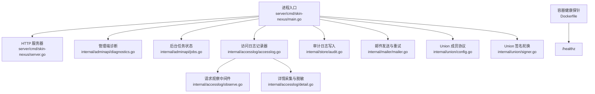
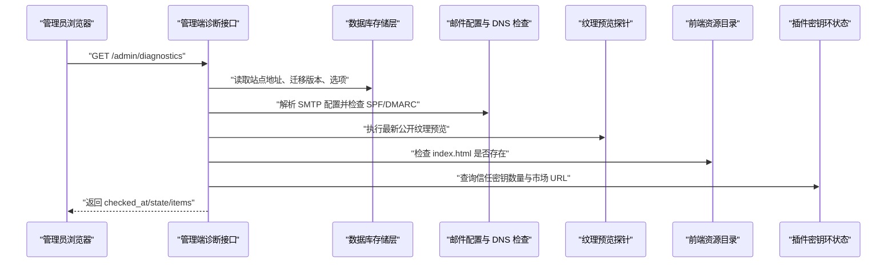
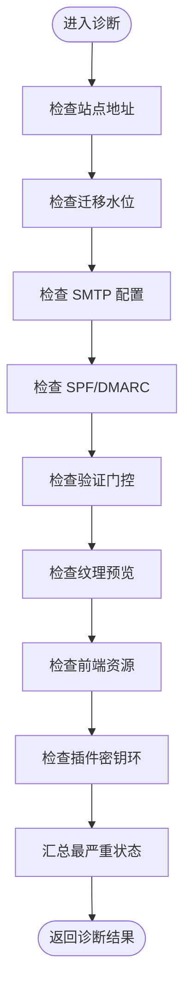
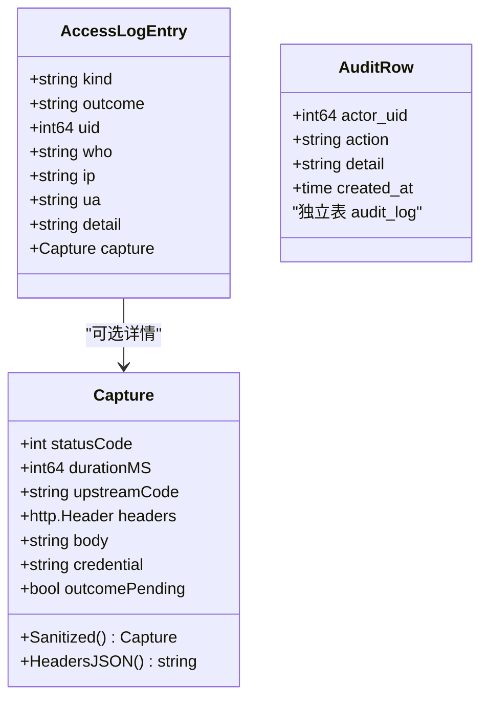
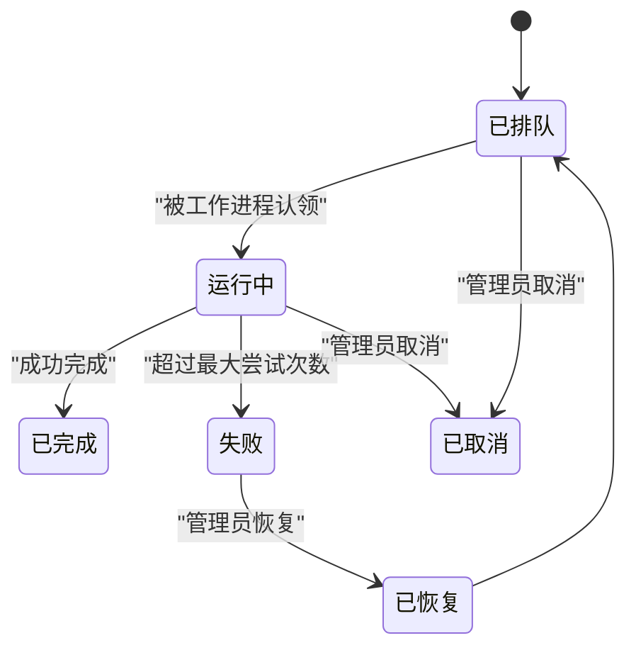
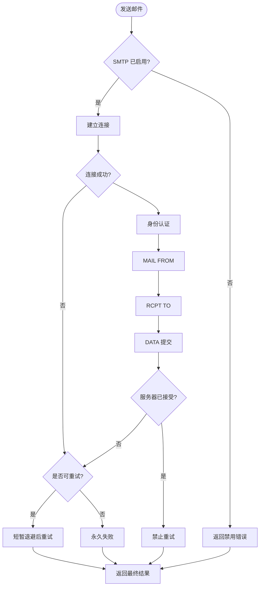
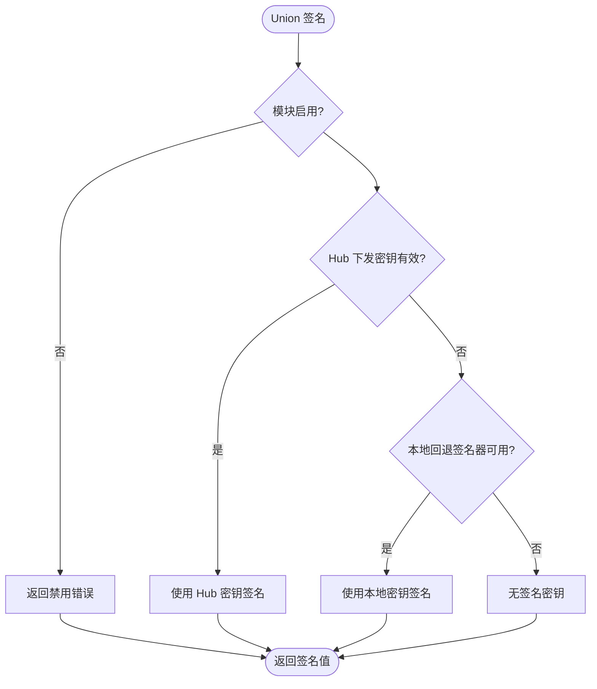
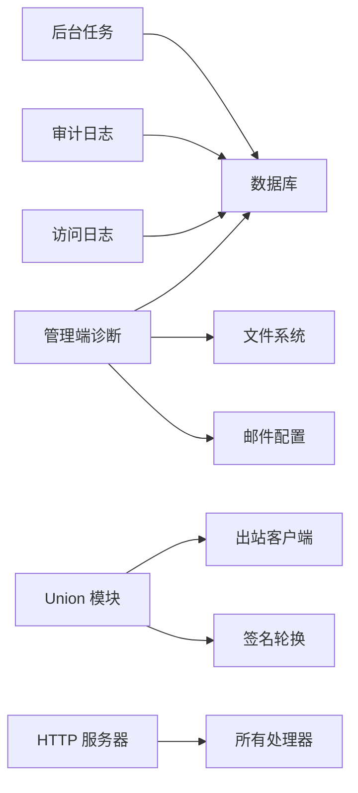
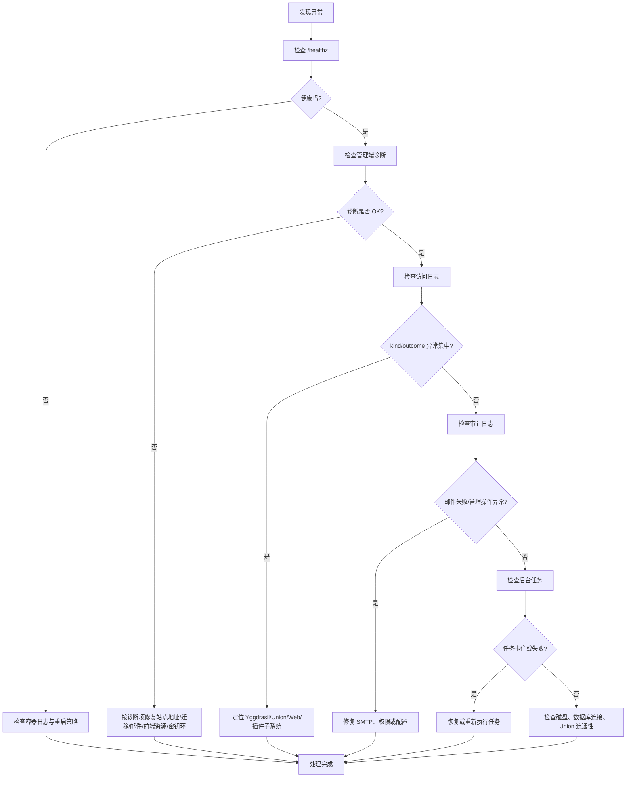

# 监控与健康检查

**本文引用的文件**
- [main.go](https://github.com/YimingZhanshen/skin-nexus/blob/797ae1a/server/cmd/skin-nexus/main.go)
- [server.go](https://github.com/YimingZhanshen/skin-nexus/blob/797ae1a/server/cmd/skin-nexus/server.go)
- [diagnostics.go](https://github.com/YimingZhanshen/skin-nexus/blob/797ae1a/server/internal/adminapi/diagnostics.go)
- [accesslog.go](https://github.com/YimingZhanshen/skin-nexus/blob/797ae1a/server/internal/accesslog/accesslog.go)
- [observe.go](https://github.com/YimingZhanshen/skin-nexus/blob/797ae1a/server/internal/accesslog/observe.go)
- [detail.go](https://github.com/YimingZhanshen/skin-nexus/blob/797ae1a/server/internal/accesslog/detail.go)
- [jobs.go](https://github.com/YimingZhanshen/skin-nexus/blob/797ae1a/server/internal/adminapi/jobs.go)
- [store.go](https://github.com/YimingZhanshen/skin-nexus/blob/797ae1a/server/internal/jobs/store.go)
- [audit.go](https://github.com/YimingZhanshen/skin-nexus/blob/797ae1a/server/internal/store/audit.go)
- [mailer.go](https://github.com/YimingZhanshen/skin-nexus/blob/797ae1a/server/internal/mailer/mailer.go)
- [retry.go](https://github.com/YimingZhanshen/skin-nexus/blob/797ae1a/server/internal/mailer/retry.go)
- [config.go](https://github.com/YimingZhanshen/skin-nexus/blob/797ae1a/server/internal/union/config.go)
- [signer.go](https://github.com/YimingZhanshen/skin-nexus/blob/797ae1a/server/internal/union/signer.go)
- [Dockerfile](https://github.com/YimingZhanshen/skin-nexus/blob/797ae1a/Dockerfile)
- [docker-compose.yml](https://github.com/YimingZhanshen/skin-nexus/blob/797ae1a/docker-compose.yml)

## 目录
1. [引言](#引言)
2. [项目结构](#项目结构)
3. [核心组件](#核心组件)
4. [架构总览](#架构总览)
5. [详细组件分析](#详细组件分析)
6. [依赖关系分析](#依赖关系分析)
7. [性能与可观测性](#性能与可观测性)
8. [故障排查指南](#故障排查指南)
9. [结论](#结论)
10. [附录：指标、探针与告警清单](#附录指标探针与告警清单)

## 引言
本文面向 SkinNexus 运维人员，说明如何从管理端诊断接口、站点公告、访问日志、审计日志和后台任务状态判断服务健康；给出 Kubernetes liveness/readiness probe 与 Docker healthcheck 的推荐路径；定义访问日志结构和审计日志用途；列出磁盘空间、数据库连接数、邮件队列积压、Union 成员站连通性等关键指标；并给出 Prometheus、Promtail、Loki、Grafana 或简单日志轮转方案的集成思路及告警规则示例。

## 项目结构
SkinNexus 是一个 Go 单二进制服务，暴露多个 API 面：Yggdrasil 兼容接口、SPA 后端 `/api/v1/*`、公开只读接口 `/api/public/v1/*`、纹理静态资源以及管理端诊断接口。运行时通过 `cmd/skin-nexus/main.go` 装配配置、数据库、迁移、插件、Union、WebAPI、管理端和访问日志；`server.go` 提供带超时保护的 HTTP Server；`Dockerfile` 内置 `/healthz` 健康探针。

**图示来源**
- [main.go:1-20](https://github.com/YimingZhanshen/skin-nexus/blob/797ae1a/server/cmd/skin-nexus/main.go#L1-L20)
- [server.go:1-24](https://github.com/YimingZhanshen/skin-nexus/blob/797ae1a/server/cmd/skin-nexus/server.go#L1-L24)
- [diagnostics.go:1-40](https://github.com/YimingZhanshen/skin-nexus/blob/797ae1a/server/internal/adminapi/diagnostics.go#L1-L40)
- [accesslog.go:1-30](https://github.com/YimingZhanshen/skin-nexus/blob/797ae1a/server/internal/accesslog/accesslog.go#L1-L30)
- [observe.go:1-25](https://github.com/YimingZhanshen/skin-nexus/blob/797ae1a/server/internal/accesslog/observe.go#L1-L25)
- [detail.go:1-20](https://github.com/YimingZhanshen/skin-nexus/blob/797ae1a/server/internal/accesslog/detail.go#L1-L20)
- [audit.go:1-20](https://github.com/YimingZhanshen/skin-nexus/blob/797ae1a/server/internal/store/audit.go#L1-L20)
- [mailer.go:1-20](https://github.com/YimingZhanshen/skin-nexus/blob/797ae1a/server/internal/mailer/mailer.go#L1-L20)
- [config.go:1-25](https://github.com/YimingZhanshen/skin-nexus/blob/797ae1a/server/internal/union/config.go#L1-L25)
- [Dockerfile:60-68](https://github.com/YimingZhanshen/skin-nexus/blob/797ae1a/Dockerfile#L60-L68)

**章节来源**
- [main.go:1-20](https://github.com/YimingZhanshen/skin-nexus/blob/797ae1a/server/cmd/skin-nexus/main.go#L1-L20)
- [server.go:1-24](https://github.com/YimingZhanshen/skin-nexus/blob/797ae1a/server/cmd/skin-nexus/server.go#L1-L24)
- [Dockerfile:60-68](https://github.com/YimingZhanshen/skin-nexus/blob/797ae1a/Dockerfile#L60-L68)

## 核心组件
- **管理端诊断接口**：运行状态页背后的自检集合，覆盖站点地址、迁移水位、SMTP、DNS SPF/DMARC、验证门控、预览管线、前端资源、插件密钥环。
- **访问日志**：记录 Web 登录、注册、Yggdrasil 认证/刷新/校验/加入/获取资料、Union 入出站、插件事件等摘要行；可选开启诊断窗口后写入更详细的头部、正文片段和凭证引用。
- **审计日志**：记录管理员操作、邮件失败、Union/OIDC 管理等安全相关动作，支持按时间窗口统计失败次数。
- **后台任务**：持久化到 `host_jobs` 的任务队列，支持排队、认领、租约、取消、恢复、进度和错误信息。
- **邮件子系统**：基于标准库 SMTP，支持隐式 TLS、STARTTLS、PLAIN 认证、一次性重试和“已提交”不可重试保护。
- **Union 模块**：启用开关、Hub 根地址、成员密钥、消息签名公钥、OAuth2 签名对、查询邮箱模式、出站超时；签名轮换采用 Hub 下发键 + 本地回退，并限制每日自动变更次数。
- **HTTP 服务器**：带读头、读、写、空闲超时，防止慢客户端耗尽资源。

**章节来源**
- [diagnostics.go:1-40](https://github.com/YimingZhanshen/skin-nexus/blob/797ae1a/server/internal/adminapi/diagnostics.go#L1-L40)
- [accesslog.go:1-134](https://github.com/YimingZhanshen/skin-nexus/blob/797ae1a/server/internal/accesslog/accesslog.go#L1-L134)
- [audit.go:1-128](https://github.com/YimingZhanshen/skin-nexus/blob/797ae1a/server/internal/store/audit.go#L1-L128)
- [jobs.go:1-101](https://github.com/YimingZhanshen/skin-nexus/blob/797ae1a/server/internal/adminapi/jobs.go#L1-L101)
- [store.go:1-60](https://github.com/YimingZhanshen/skin-nexus/blob/797ae1a/server/internal/jobs/store.go#L1-L60)
- [mailer.go:1-80](https://github.com/YimingZhanshen/skin-nexus/blob/797ae1a/server/internal/mailer/mailer.go#L1-L80)
- [retry.go:1-63](https://github.com/YimingZhanshen/skin-nexus/blob/797ae1a/server/internal/mailer/retry.go#L1-L63)
- [config.go:1-120](https://github.com/YimingZhanshen/skin-nexus/blob/797ae1a/server/internal/union/config.go#L1-L120)
- [signer.go:1-80](https://github.com/YimingZhanshen/skin-nexus/blob/797ae1a/server/internal/union/signer.go#L1-L80)
- [server.go:1-24](https://github.com/YimingZhanshen/skin-nexus/blob/797ae1a/server/cmd/skin-nexus/server.go#L1-L24)

## 架构总览
下面的序列图展示一次典型诊断请求如何串联多个子系统，帮助判断站点是否真正可用：

**图示来源**
- [diagnostics.go:41-120](https://github.com/YimingZhanshen/skin-nexus/blob/797ae1a/server/internal/adminapi/diagnostics.go#L41-L120)
- [diagnostics.go:201-501](https://github.com/YimingZhanshen/skin-nexus/blob/797ae1a/server/internal/adminapi/diagnostics.go#L201-L501)

**章节来源**
- [diagnostics.go:41-120](https://github.com/YimingZhanshen/skin-nexus/blob/797ae1a/server/internal/adminapi/diagnostics.go#L41-L120)
- [diagnostics.go:201-501](https://github.com/YimingZhanshen/skin-nexus/blob/797ae1a/server/internal/adminapi/diagnostics.go#L201-L501)

## 详细组件分析

### 管理端诊断接口
诊断接口返回一个固定顺序的检查项列表，每个条目包含 ID、状态、可选值和修复提示。整体状态取所有条目的最严重等级。它适合用于：
- 启动后快速确认站点地址是否为公网可达地址。
- 检测迁移是否落后于代码树。
- 判断 SMTP 是否启用、发件人是否配置、SPF/DMARC 是否缺失。
- 确认预览管线能渲染真实纹理。
- 确认 SPA 前端资源存在。
- 确认插件市场密钥环是否正常加载。

**图示来源**
- [diagnostics.go:41-120](https://github.com/YimingZhanshen/skin-nexus/blob/797ae1a/server/internal/adminapi/diagnostics.go#L41-L120)
- [diagnostics.go:201-501](https://github.com/YimingZhanshen/skin-nexus/blob/797ae1a/server/internal/adminapi/diagnostics.go#L201-L501)

**章节来源**
- [diagnostics.go:1-501](https://github.com/YimingZhanshen/skin-nexus/blob/797ae1a/server/internal/adminapi/diagnostics.go#L1-L501)

### 访问日志与审计日志
访问日志是“可观测伴生”，记录摘要字段；审计日志记录安全相关动作。二者职责不同：

| 类别 | 主要用途 | 关键字段 | 生产建议 |
|---|---|---|---|
| 访问日志 | 追踪登录、注册、Yggdrasil 流量、Union 入出站、插件事件 | kind、outcome、uid、who、ip、ua、detail、capture | 保留最近 90 天；按 kind/outcome 聚合；开启诊断窗口时仅短期捕获详情 |
| 审计日志 | 记录管理员操作、邮件失败、Union/OIDC 管理事件 | actor_uid、action、detail、created_at | 作为合规与安全审计源；按 action 分类告警 |

访问日志的 sink 错误不会阻塞业务请求，属于“尽力而为”。详情采集默认关闭，仅在诊断窗口打开时保留受限头部、正文片段和凭证引用，并在 24 小时后清理。

**图示来源**
- [accesslog.go:1-134](https://github.com/YimingZhanshen/skin-nexus/blob/797ae1a/server/internal/accesslog/accesslog.go#L1-L134)
- [detail.go:1-178](https://github.com/YimingZhanshen/skin-nexus/blob/797ae1a/server/internal/accesslog/detail.go#L1-L178)
- [audit.go:1-128](https://github.com/YimingZhanshen/skin-nexus/blob/797ae1a/server/internal/store/audit.go#L1-L128)

**章节来源**
- [accesslog.go:1-134](https://github.com/YimingZhanshen/skin-nexus/blob/797ae1a/server/internal/accesslog/accesslog.go#L1-L134)
- [detail.go:1-178](https://github.com/YimingZhanshen/skin-nexus/blob/797ae1a/server/internal/accesslog/detail.go#L1-L178)
- [audit.go:1-128](https://github.com/YimingZhanshen/skin-nexus/blob/797ae1a/server/internal/store/audit.go#L1-L128)

### 后台任务状态
后台任务使用 `host_jobs` 表持久化，支持分页查询、按插件或状态过滤、查看进度、最后错误、尝试次数、租约所有者和到期时间。管理端提供列表、详情、取消、恢复接口，取消和恢复会写入审计日志。

**图示来源**
- [jobs.go:1-101](https://github.com/YimingZhanshen/skin-nexus/blob/797ae1a/server/internal/adminapi/jobs.go#L1-L101)
- [store.go:60-200](https://github.com/YimingZhanshen/skin-nexus/blob/797ae1a/server/internal/jobs/store.go#L60-L200)

**章节来源**
- [jobs.go:1-101](https://github.com/YimingZhanshen/skin-nexus/blob/797ae1a/server/internal/adminapi/jobs.go#L1-L101)
- [store.go:1-200](https://github.com/YimingZhanshen/skin-nexus/blob/797ae1a/server/internal/jobs/store.go#L1-L200)

### 邮件子系统与重试策略
邮件发送使用标准库 SMTP，默认 dial 10 秒、会话 30 秒；非等待浏览器的场景允许一次短暂重试。若 SMTP 主机不存在、认证失败或 TLS 配置错误，通常不重试；一旦服务器接受 DATA，就不再重试以避免重复投递。

**图示来源**
- [mailer.go:80-200](https://github.com/YimingZhanshen/skin-nexus/blob/797ae1a/server/internal/mailer/mailer.go#L80-L200)
- [retry.go:1-63](https://github.com/YimingZhanshen/skin-nexus/blob/797ae1a/server/internal/mailer/retry.go#L1-L63)

**章节来源**
- [mailer.go:1-200](https://github.com/YimingZhanshen/skin-nexus/blob/797ae1a/server/internal/mailer/mailer.go#L1-L200)
- [retry.go:1-63](https://github.com/YimingZhanshen/skin-nexus/blob/797ae1a/server/internal/mailer/retry.go#L1-L63)

### Union 成员站连通性与验签
Union 模块在启用时需要 Hub 根地址、成员密钥、消息签名公钥和可选 OAuth2 签名对。签名轮换周期为 10 至 15 分钟加抖动，每日最多自动切换 3 次；超过预算会暂停自动轮换并触发审计告警。模块未启用时返回惰性对象，入站路由直接拒绝，出站调用快速失败。

**图示来源**
- [config.go:1-120](https://github.com/YimingZhanshen/skin-nexus/blob/797ae1a/server/internal/union/config.go#L1-L120)
- [signer.go:1-200](https://github.com/YimingZhanshen/skin-nexus/blob/797ae1a/server/internal/union/signer.go#L1-L200)

**章节来源**
- [config.go:1-200](https://github.com/YimingZhanshen/skin-nexus/blob/797ae1a/server/internal/union/config.go#L1-L200)
- [signer.go:1-200](https://github.com/YimingZhanshen/skin-nexus/blob/797ae1a/server/internal/union/signer.go#L1-L200)

## 依赖关系分析
- 管理端诊断依赖数据库选项、文件系统、邮件配置、预览探针和密钥环状态。
- 访问日志依赖 store sink，但 sink 失败不得影响业务响应。
- 审计日志由 store 统一写入，时间戳来自 Go 时钟而非数据库默认值。
- 后台任务依赖数据库事务和跨引擎兼容的 claim 条件。
- Union 模块依赖出站客户端、签名器和审计回调。
- HTTP Server 设置读头、读、写、空闲超时，避免慢客户端攻击。

**图示来源**
- [diagnostics.go:1-501](https://github.com/YimingZhanshen/skin-nexus/blob/797ae1a/server/internal/adminapi/diagnostics.go#L1-L501)
- [accesslog.go:1-134](https://github.com/YimingZhanshen/skin-nexus/blob/797ae1a/server/internal/accesslog/accesslog.go#L1-L134)
- [audit.go:1-128](https://github.com/YimingZhanshen/skin-nexus/blob/797ae1a/server/internal/store/audit.go#L1-L128)
- [store.go:1-200](https://github.com/YimingZhanshen/skin-nexus/blob/797ae1a/server/internal/jobs/store.go#L1-L200)
- [config.go:1-120](https://github.com/YimingZhanshen/skin-nexus/blob/797ae1a/server/internal/union/config.go#L1-L120)
- [server.go:1-24](https://github.com/YimingZhanshen/skin-nexus/blob/797ae1a/server/cmd/skin-nexus/server.go#L1-L24)

**章节来源**
- [diagnostics.go:1-501](https://github.com/YimingZhanshen/skin-nexus/blob/797ae1a/server/internal/adminapi/diagnostics.go#L1-L501)
- [accesslog.go:1-134](https://github.com/YimingZhanshen/skin-nexus/blob/797ae1a/server/internal/accesslog/accesslog.go#L1-L134)
- [audit.go:1-128](https://github.com/YimingZhanshen/skin-nexus/blob/797ae1a/server/internal/store/audit.go#L1-L128)
- [store.go:1-200](https://github.com/YimingZhanshen/skin-nexus/blob/797ae1a/server/internal/jobs/store.go#L1-L200)
- [config.go:1-120](https://github.com/YimingZhanshen/skin-nexus/blob/797ae1a/server/internal/union/config.go#L1-L120)
- [server.go:1-24](https://github.com/YimingZhanshen/skin-nexus/blob/797ae1a/server/cmd/skin-nexus/server.go#L1-L24)

## 性能与可观测性
- 访问日志记录是异步侧车：sink 失败仅记录到操作者日志，不重试、不改变响应语义。
- 详情采集有严格上限：正文片段最大 4 KiB，头部白名单只有 User-Agent 和 X-Request-Id，凭证引用最长 512 字节，且仅在诊断窗口内保留 24 小时。
- 邮件重试仅针对瞬态网络问题，避免重复投递和无限重试。
- Union 签名轮换有每日变更预算，防止异常频繁切换。
- HTTP Server 设置了合理的读头、读、写、空闲超时，降低慢客户端和资源耗尽风险。

**章节来源**
- [accesslog.go:1-134](https://github.com/YimingZhanshen/skin-nexus/blob/797ae1a/server/internal/accesslog/accesslog.go#L1-L134)
- [detail.go:1-178](https://github.com/YimingZhanshen/skin-nexus/blob/797ae1a/server/internal/accesslog/detail.go#L1-L178)
- [retry.go:1-63](https://github.com/YimingZhanshen/skin-nexus/blob/797ae1a/server/internal/mailer/retry.go#L1-L63)
- [signer.go:1-200](https://github.com/YimingZhanshen/skin-nexus/blob/797ae1a/server/internal/union/signer.go#L1-L200)
- [server.go:1-24](https://github.com/YimingZhanshen/skin-nexus/blob/797ae1a/server/cmd/skin-nexus/server.go#L1-L24)

## 故障排查指南

### 健康判断方法
1. **容器健康**：检查 `/healthz` 是否返回正常；该探针由镜像内置。
2. **管理端诊断**：查看运行状态页，关注 site、migrations、mail、mail_dns、verify_gate、preview、assets、keyring 的状态。
3. **访问日志**：查看 web_login、ygg_authenticate、union_in、union_out 等 kind 的 outcome 分布，fail/denied/error 上升通常对应具体子系统问题。
4. **审计日志**：统计 password_reset_mail_failed、email_verify_mail_failed、mail_test_failed 等 action 在短时间窗口内的计数。
5. **后台任务**：查看 state=running 且长时间未更新、attempts=max_attempts、last_error 持续出现的任务。
6. **Union**：检查签名模式是否为 union-managed，是否出现自动轮换暂停；同时观察 hub 连通性和验签错误。

### 常见症状对照表
| 症状 | 可能原因 | 优先检查点 | 处置建议 |
|---|---|---|---|
| 页面能打开但皮肤不显示 | 站点地址为局域网或回环地址 | diagnostics.site | 将 SKIN_BASE_URL 设置为公网域名并重启 |
| 升级后功能报错 | 迁移未完成 | diagnostics.migrations | 确保 SKIN_AUTO_MIGRATE=true 并检查迁移目录 |
| 密码重置或通知邮件收不到 | SMTP 未配置或无发件人 | diagnostics.mail | 配置 smtp_host、smtp_port、smtp_user、smtp_pass、from |
| 邮件进入垃圾箱 | SPF 或 DMARC 缺失 | diagnostics.mail_dns | 在域名 DNS 添加 SPF/DMARC 记录 |
| 管理面板无法上传或安装主题 | 插件密钥环为空 | diagnostics.keyring | 配置 SKIN_PLUGIN_TRUST_KEYS 或本地密钥 |
| Yggdrasil 登录成功但纹理签名无效 | Union 签名密钥缺失或轮换异常 | union.signer.mode、union.verify | 检查 Hub 连通性、成员密钥、签名模式 |
| 大量 5xx 或延迟升高 | 数据库连接耗尽或慢查询 | 数据库连接池、慢查询日志 | 扩容数据库、优化查询、限制并发 |
| 纹理目录写满 | 磁盘空间不足 | 文件系统容量 | 扩容磁盘、清理旧纹理、调整配额 |
| 后台任务卡住 | 工作进程崩溃或租约过期 | jobs.state、lease_until、reclaims | 重启工作进程、恢复任务、排查 handler |
| 邮件连续失败 | SMTP 认证失败、DNS 不可达、TLS 错误 | mailer、audit.log | 核对 SMTP 配置、检查 DNS 和证书 |

**章节来源**
- [diagnostics.go:1-501](https://github.com/YimingZhanshen/skin-nexus/blob/797ae1a/server/internal/adminapi/diagnostics.go#L1-L501)
- [audit.go:1-128](https://github.com/YimingZhanshen/skin-nexus/blob/797ae1a/server/internal/store/audit.go#L1-L128)
- [jobs.go:1-101](https://github.com/YimingZhanshen/skin-nexus/blob/797ae1a/server/internal/adminapi/jobs.go#L1-L101)
- [store.go:1-200](https://github.com/YimingZhanshen/skin-nexus/blob/797ae1a/server/internal/jobs/store.go#L1-L200)
- [mailer.go:1-200](https://github.com/YimingZhanshen/skin-nexus/blob/797ae1a/server/internal/mailer/mailer.go#L1-L200)

### 故障排查流程图

**图示来源**
- [Dockerfile:60-68](https://github.com/YimingZhanshen/skin-nexus/blob/797ae1a/Dockerfile#L60-L68)
- [diagnostics.go:1-501](https://github.com/YimingZhanshen/skin-nexus/blob/797ae1a/server/internal/adminapi/diagnostics.go#L1-L501)
- [accesslog.go:1-134](https://github.com/YimingZhanshen/skin-nexus/blob/797ae1a/server/internal/accesslog/accesslog.go#L1-L134)
- [audit.go:1-128](https://github.com/YimingZhanshen/skin-nexus/blob/797ae1a/server/internal/store/audit.go#L1-L128)
- [jobs.go:1-101](https://github.com/YimingZhanshen/skin-nexus/blob/797ae1a/server/internal/adminapi/jobs.go#L1-L101)

## 结论
SkinNexus 的健康判断应分层进行：先确认容器和 HTTP 层存活，再通过管理端诊断确认站点配置、迁移、邮件、前端资源和密钥环；随后用访问日志和审计日志定位业务级问题；最后用后台任务状态和基础设施指标（磁盘、数据库连接、Union 连通性）支撑容量与稳定性治理。生产环境建议把访问日志、审计日志和系统指标接入集中式日志与监控系统，并为关键子系统设置明确的阈值告警。

## 附录：指标、探针与告警清单

### 推荐探针
- **Docker healthcheck**：镜像已内置 `/healthz`，每 30 秒探测一次，超时 3 秒，失败重试 3 次。
- **Kubernetes liveness probe**：`GET http://127.0.0.1:8080/healthz`，初始延迟根据启动时间设定，失败立即重启。
- **Kubernetes readiness probe**：建议复用 `/healthz`，或在就绪逻辑完善后改为更严格的内部检查。
- **应用就绪检查**：可定期调用管理端诊断接口，要求 state=ok 且 migrations=ok、assets=ok、mail_dns=ok 等关键项达标后再切流量。

**章节来源**
- [Dockerfile:60-68](https://github.com/YimingZhanshen/skin-nexus/blob/797ae1a/Dockerfile#L60-L68)
- [docker-compose.yml:1-86](https://github.com/YimingZhanshen/skin-nexus/blob/797ae1a/docker-compose.yml#L1-L86)

### 关键指标
| 指标 | 数据源 | 含义 | 建议采集方式 |
|---|---|---|---|
| 进程存活 | `/healthz` | HTTP 层是否响应 | kube probe、Docker healthcheck |
| 站点地址有效性 | 管理端诊断 | 是否为公网可达地址 | 定时拉取诊断接口 |
| 迁移水位 | 管理端诊断 | 当前 schema 是否落后 | 定时拉取诊断接口 |
| SMTP 可用性 | 管理端诊断 + 审计日志 | 发件人是否配置、DNS 是否正常 | 诊断 + 邮件失败计数 |
| 邮件失败率 | 审计日志 | 近窗口内失败邮件数量 | Promtail/Loki 聚合 |
| 访问日志失败率 | access_logs | ygg_authenticate/web_login 等 outcome=fail/denied/error 比例 | Promtail/Loki 聚合 |
| 后台任务积压 | host_jobs | queued/running/failure 数量与时长 | 直接查询或导出指标 |
| Union 连通性 | Union 出站与验签日志 | Hub 可达、验签成功、轮换正常 | 自定义 exporter 或日志聚合 |
| 磁盘空间 | 文件系统 | textures/keys/themes 所在卷剩余空间 | node_exporter 或平台指标 |
| 数据库连接数 | 数据库 | 活跃连接、最大连接、慢查询 | 数据库 exporter |
| Union 验签失败 | Union 模块 | 验签失败、轮换暂停、密钥缺失 | 审计日志或自定义指标 |

### 日志采集与分析方案
- **Promtail + Loki + Grafana**：将 stdout/stderr、访问日志、审计日志以结构化标签采集，按 service、kind、action、outcome、plugin 等维度查询；在 Grafana 中创建访问失败率、邮件失败趋势、任务积压面板。
- **简单日志轮转**：如果规模较小，可使用 systemd journal 或 logrotate 对容器输出和应用日志轮转，配合 `grep`、`awk`、`jq` 做轻量分析。
- **Prometheus**：如需指标型监控，可在服务侧增加轻量 metrics exporter，暴露 HTTP 请求数、延迟分位、数据库连接数、磁盘剩余、Union 验签成功率等；Promtail 仍负责原始日志留存与检索。

### 告警规则示例
以下规则为概念性描述，实际实现可根据 Prometheus、Alertmanager 或 Loki 能力调整阈值与抑制策略。

| 告警名称 | 触发条件 | 严重级别 | 处置建议 |
|---|---|---|---|
| 数据库连接耗尽 | 活跃连接数接近最大值，或连接等待明显升高 | P1 | 扩容数据库、优化慢查询、限制连接池、临时降级非核心功能 |
| SMTP 连续失败 | 最近 15 分钟内 mail failure audit 行数超过阈值 | P1 | 检查 SMTP 配置、DNS、证书、发件人域名 SPF/DMARC |
| 纹理目录写满 | 数据卷剩余空间低于阈值 | P1 | 扩容磁盘、清理无效纹理、调整上传配额 |
| Union 验签失败 | 验签失败次数在短窗口内显著上升，或签名模式处于 local 且预期为 union-managed | P1 | 检查 Hub 连通性、成员密钥、签名轮换、网络隔离 |
| 迁移卡住 | 迁移水位长期落后于代码树，或诊断返回 pending/warn | P2 | 检查迁移目录、数据库权限、SKIN_AUTO_MIGRATE 配置 |
| 后台任务长期失败 | running 任务长时间无更新，或 attempts=max_attempts | P2 | 查看 last_error、handler 日志，恢复或重跑任务 |
| 前端资源缺失 | 诊断 assets=fail | P2 | 检查 web/dist 挂载、构建产物、反向代理缓存 |
| 站点地址私有 | 诊断 site=warn/fail | P2 | 修正 SKIN_BASE_URL 或反向代理配置并重启 |

**章节来源**
- [diagnostics.go:1-501](https://github.com/YimingZhanshen/skin-nexus/blob/797ae1a/server/internal/adminapi/diagnostics.go#L1-L501)
- [audit.go:1-128](https://github.com/YimingZhanshen/skin-nexus/blob/797ae1a/server/internal/store/audit.go#L1-L128)
- [accesslog.go:1-134](https://github.com/YimingZhanshen/skin-nexus/blob/797ae1a/server/internal/accesslog/accesslog.go#L1-L134)
- [jobs.go:1-101](https://github.com/YimingZhanshen/skin-nexus/blob/797ae1a/server/internal/adminapi/jobs.go#L1-L101)
- [store.go:1-200](https://github.com/YimingZhanshen/skin-nexus/blob/797ae1a/server/internal/jobs/store.go#L1-L200)
- [Dockerfile:60-68](https://github.com/YimingZhanshen/skin-nexus/blob/797ae1a/Dockerfile#L60-L68)
- [docker-compose.yml:1-86](https://github.com/YimingZhanshen/skin-nexus/blob/797ae1a/docker-compose.yml#L1-L86)
