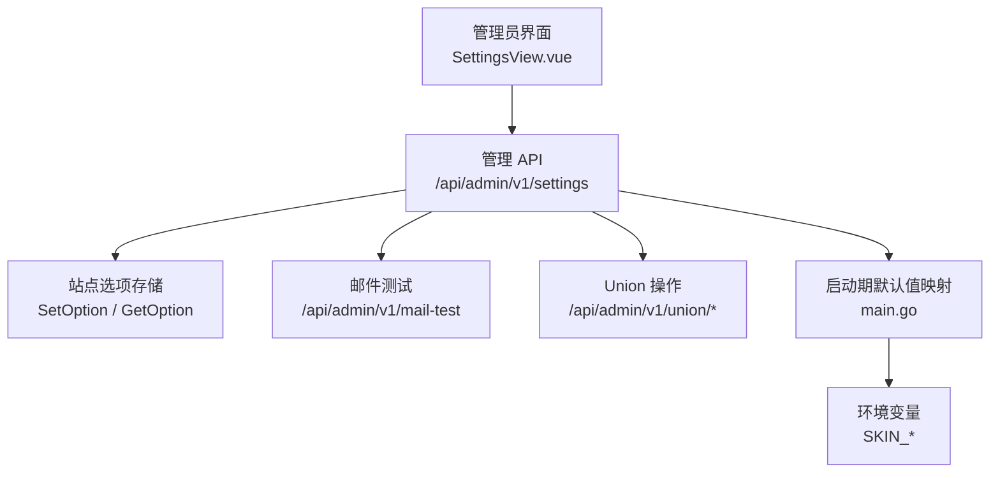
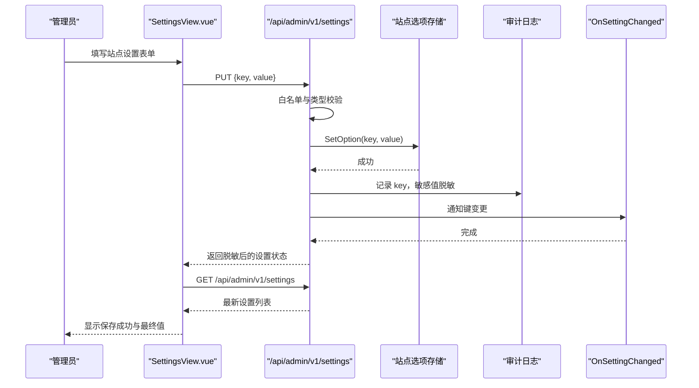
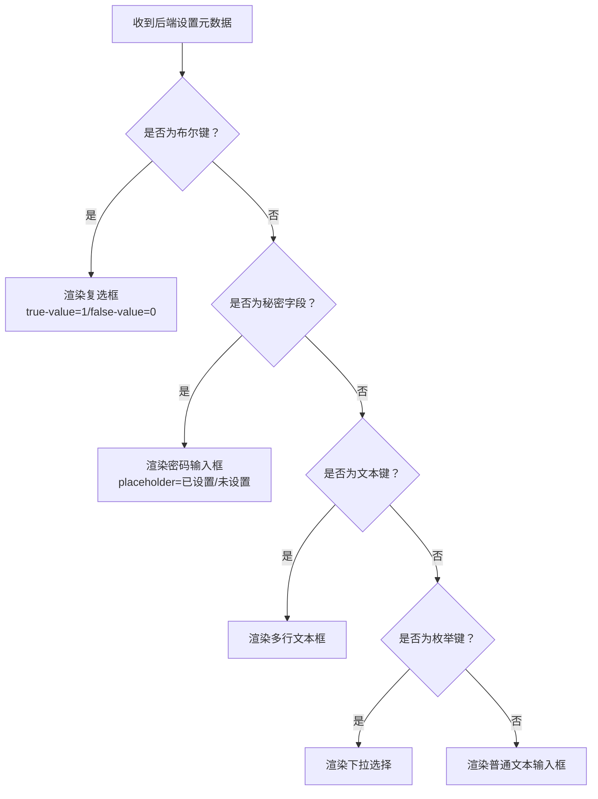
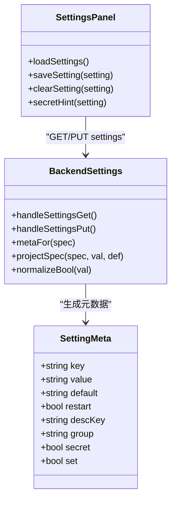
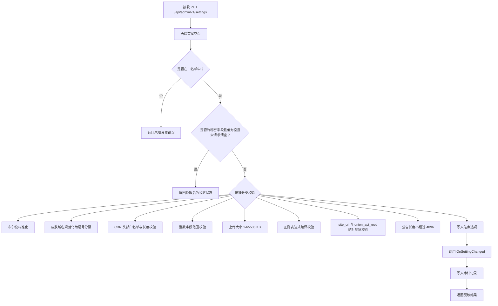
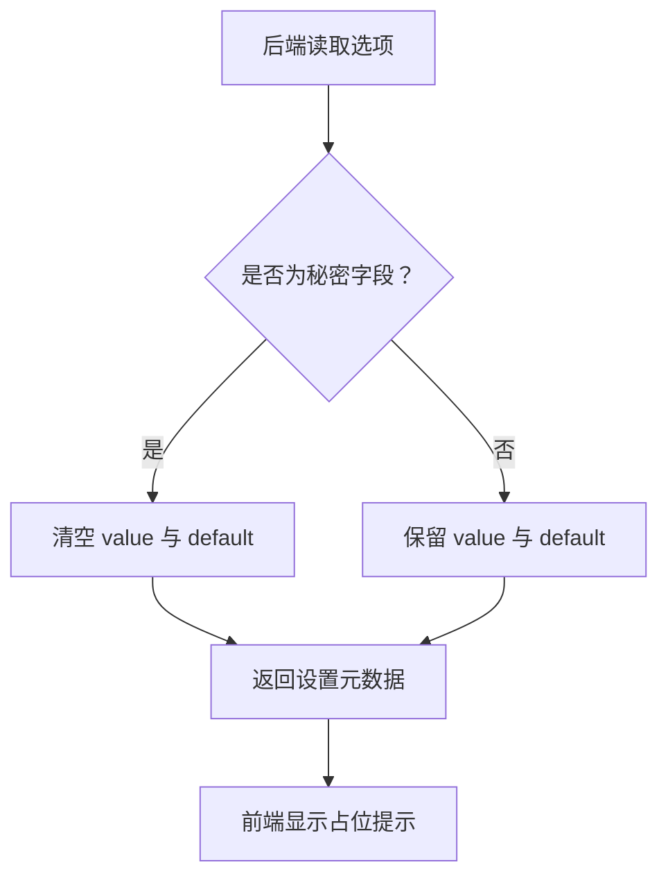
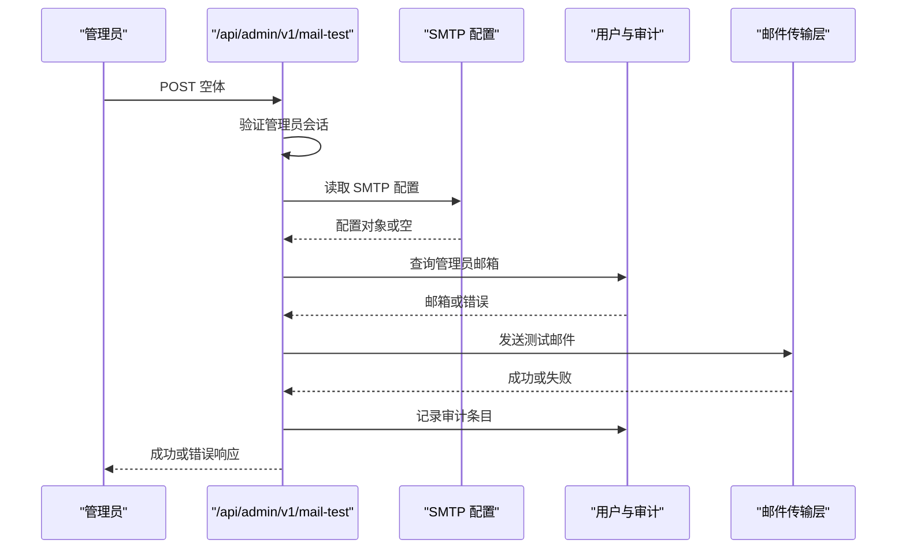
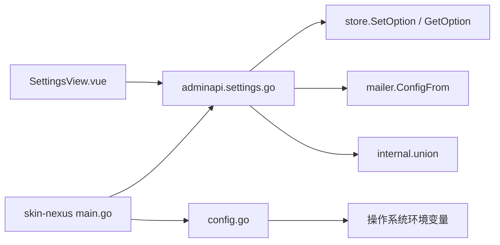

# 站点设置

**本文引用的文件**
- [SettingsView.vue](https://github.com/YimingZhanshen/skin-nexus/blob/797ae1a/web/src/components/admin/SettingsView.vue)
- [settings.go](https://github.com/YimingZhanshen/skin-nexus/blob/797ae1a/server/internal/adminapi/settings.go)
- [config.go](https://github.com/YimingZhanshen/skin-nexus/blob/797ae1a/server/internal/config/config.go)
- [mailtest.go](https://github.com/YimingZhanshen/skin-nexus/blob/797ae1a/server/internal/adminapi/mailtest.go)
- [union.go](https://github.com/YimingZhanshen/skin-nexus/blob/797ae1a/server/internal/adminapi/union.go)
- [main.go](https://github.com/YimingZhanshen/skin-nexus/blob/797ae1a/server/cmd/skin-nexus/main.go)

## 目录
1. [引言](#引言)
2. [项目结构中的站点设置入口](#项目结构中的站点设置入口)
3. [核心组件](#核心组件)
4. [架构总览](#架构总览)
5. [详细组件分析](#详细组件分析)
6. [依赖关系分析](#依赖关系分析)
7. [性能与一致性考虑](#性能与一致性考虑)
8. [常见配置问题与排错](#常见配置问题与排错)
9. [站长排错示例](#站长排错示例)
10. [结论](#结论)

## 引言
本文件面向站长和管理员，说明“站点设置”面板如何呈现、校验并保存站点名称、域名、公告、页脚、SEO、认证开关、Union 配置、邮件测试等能力。文档同时解释前端 `SettingsView.vue` 与后端 `/api/admin/v1/settings` 的映射关系，区分只读配置、可选配置和敏感密钥，并给出关键配置项、校验规则、缓存刷新机制以及常见故障定位方法。

## 项目结构中的站点设置入口
站点设置主要由前端 Vue 单页面组件承载，后端通过管理 API 暴露可编辑的配置元数据与写入接口：

- 前端展示与交互：`web/src/components/admin/SettingsView.vue`
- 后端设置元数据、白名单与写入逻辑：`server/internal/adminapi/settings.go`
- 环境变量、SMTP 默认值与启动期基础 URL 来源：`server/internal/config/config.go`
- 邮件测试入口：`server/internal/adminapi/mailtest.go`
- Union 管理端点与热切换门控：`server/internal/adminapi/union.go`
- 启动期将配置映射为面板选项键值：`server/cmd/skin-nexus/main.go`

**图示来源**
- [SettingsView.vue:1-200](https://github.com/YimingZhanshen/skin-nexus/blob/797ae1a/web/src/components/admin/SettingsView.vue#L1-L200)
- [settings.go:1-120](https://github.com/YimingZhanshen/skin-nexus/blob/797ae1a/server/internal/adminapi/settings.go#L1-L120)
- [mailtest.go:1-109](https://github.com/YimingZhanshen/skin-nexus/blob/797ae1a/server/internal/adminapi/mailtest.go#L1-L109)
- [union.go:1-80](https://github.com/YimingZhanshen/skin-nexus/blob/797ae1a/server/internal/adminapi/union.go#L1-L80)
- [main.go:720-760](https://github.com/YimingZhanshen/skin-nexus/blob/797ae1a/server/cmd/skin-nexus/main.go#L720-L760)

**章节来源**
- [SettingsView.vue:1-200](https://github.com/YimingZhanshen/skin-nexus/blob/797ae1a/web/src/components/admin/SettingsView.vue#L1-L200)
- [settings.go:1-120](https://github.com/YimingZhanshen/skin-nexus/blob/797ae1a/server/internal/adminapi/settings.go#L1-L120)
- [main.go:720-760](https://github.com/YimingZhanshen/skin-nexus/blob/797ae1a/server/cmd/skin-nexus/main.go#L720-L760)

## 核心组件
### 前端设置面板
`SettingsView.vue` 负责加载后端返回的设置列表，按组渲染表单控件，并在保存后重新拉取数据以同步状态：

- 使用 `/api/admin/v1/settings` 获取可编辑设置元数据；
- 使用 `/api/admin/v1/seo` 和 `/api/admin/v1/seo/oneclick` 管理 SEO；
- 使用 `/api/admin/v1/appearance` 管理主题、页脚、自定义 CSS/JS；
- 使用 `/api/admin/v1/oidc/clients` 管理 OIDC 客户端；
- 对布尔字段进行标准化（`true-value="1"`），避免前端勾选状态与后端存储不一致；
- 对秘密字段提供“已设置/未设置”提示，并提供“清除”按钮；
- 保存成功后触发 `settings-changed` 事件，供父级监听刷新相关 UI。

**章节来源**
- [SettingsView.vue:1-120](https://github.com/YimingZhanshen/skin-nexus/blob/797ae1a/web/src/components/admin/SettingsView.vue#L1-L120)
- [SettingsView.vue:201-406](https://github.com/YimingZhanshen/skin-nexus/blob/797ae1a/web/src/components/admin/SettingsView.vue#L201-L406)

### 后端设置接口
后端通过 `settingsWhitelist` 定义允许从管理面板修改的键名、分组、是否重启生效、是否为敏感信息。主要行为包括：

- GET `/api/admin/v1/settings`：返回白名单中每个键的元数据；
- PUT `/api/admin/v1/settings`：按白名单校验并写入单个键；
- 对布尔值、整数、正则表达式、URL、上传大小、CDN 头等进行严格校验；
- 对敏感字段执行脱敏：不返回明文值，也不把明文写入审计日志；
- 写入成功后调用 `OnSettingChanged`，用于热更新 Union 等模块。

**章节来源**
- [settings.go:1-120](https://github.com/YimingZhanshen/skin-nexus/blob/797ae1a/server/internal/adminapi/settings.go#L1-L120)
- [settings.go:120-323](https://github.com/YimingZhanshen/skin-nexus/blob/797ae1a/server/internal/adminapi/settings.go#L120-L323)

### 启动期配置映射
`main.go` 在启动时将环境变量、默认值和数据库中的选项组合成面板可见的键值集合，使旧版运行参数与新面板保持一致：

- 站点名称、服务器名称、公告、皮肤域名、邀请码模式、最大上传大小等都会映射到对应选项键；
- Union 地址、邮箱查询模式、SMTP 地址等也作为默认值提供给面板；
- 站点 URL 优先使用选项 `site_url`，再回退到 `base_url`，最后回退到 `SKIN_BASE_URL`。

**章节来源**
- [main.go:720-760](https://github.com/YimingZhanshen/skin-nexus/blob/797ae1a/server/cmd/skin-nexus/main.go#L720-L760)

## 架构总览
站点设置的数据流可以概括为：前端表单 → 管理 API → 白名单校验 → 站点选项存储 → 审计记录 → 可选热更新回调 → 前端重新读取。

**图示来源**
- [SettingsView.vue:40-120](https://github.com/YimingZhanshen/skin-nexus/blob/797ae1a/web/src/components/admin/SettingsView.vue#L40-L120)
- [settings.go:120-323](https://github.com/YimingZhanshen/skin-nexus/blob/797ae1a/server/internal/adminapi/settings.go#L120-L323)

## 详细组件分析

### 表单与后端映射关系
前端根据后端返回的 `settingMeta` 决定渲染方式：

| 前端表现 | 判断条件 | 说明 |
|---|---|---|
| 复选框 | 键属于布尔键集合 | 如邀请码模式、认证要求、Union 开关、CDN 开关等 |
| 多行文本框 | 非秘密且属于文本键集合 | 如皮肤域名、公告、正则表达式、Union 公钥等 |
| 下拉选择 | 特定枚举键 | 如玩家命名规则、Union 邮箱查询模式 |
| 密码输入框 | `secret` 为真 | 如 SMTP 密码、Union 成员密钥、签名私钥 |
| 普通文本输入框 | 其他情况 | 如站点名称、站点地址、SMTP 主机等 |

**图示来源**
- [SettingsView.vue:12-40](https://github.com/YimingZhanshen/skin-nexus/blob/797ae1a/web/src/components/admin/SettingsView.vue#L12-L40)
- [SettingsView.vue:220-290](https://github.com/YimingZhanshen/skin-nexus/blob/797ae1a/web/src/components/admin/SettingsView.vue#L220-L290)
- [settings.go:1-120](https://github.com/YimingZhanshen/skin-nexus/blob/797ae1a/server/internal/adminapi/settings.go#L1-L120)

**章节来源**
- [SettingsView.vue:12-40](https://github.com/YimingZhanshen/skin-nexus/blob/797ae1a/web/src/components/admin/SettingsView.vue#L12-L40)
- [SettingsView.vue:220-290](https://github.com/YimingZhanshen/skin-nexus/blob/797ae1a/web/src/components/admin/SettingsView.vue#L220-L290)
- [settings.go:1-120](https://github.com/YimingZhanshen/skin-nexus/blob/797ae1a/server/internal/adminapi/settings.go#L1-L120)

### 只读配置、可选配置与敏感密钥
系统对配置做明确分层：

- **只读配置**：由后端在加载时计算或注入，但当前面板未提供直接编辑入口。例如 SEO 标题、描述、关键词、OG 图片、canonical、sitemap、noindex、robots 等由独立 `/api/admin/v1/seo` 管理；主题、页脚、自定义 CSS/JS 由 `/api/admin/v1/appearance` 管理；OIDC 客户端由 `/api/admin/v1/oidc/clients` 管理。
- **可选配置**：通过 `/api/admin/v1/settings` 编辑，保存在站点选项中，部分需要重启才生效。例如站点名称、服务器名称、站点地址、公告、皮肤域名、邀请码模式、SMTP 地址、最大上传大小、Union 地址等。
- **敏感密钥**：标记为 `secret` 的键不会返回明文值，也不会把明文写入审计日志。只有当用户显式清空时才执行清除动作。例如 SMTP 密码、Union 成员密钥、Union OAuth2 私钥。

**图示来源**
- [settings.go:1-120](https://github.com/YimingZhanshen/skin-nexus/blob/797ae1a/server/internal/adminapi/settings.go#L1-L120)
- [settings.go:260-323](https://github.com/YimingZhanshen/skin-nexus/blob/797ae1a/server/internal/adminapi/settings.go#L260-L323)
- [SettingsView.vue:40-120](https://github.com/YimingZhanshen/skin-nexus/blob/797ae1a/web/src/components/admin/SettingsView.vue#L40-L120)

**章节来源**
- [settings.go:1-120](https://github.com/YimingZhanshen/skin-nexus/blob/797ae1a/server/internal/adminapi/settings.go#L1-L120)
- [settings.go:260-323](https://github.com/YimingZhanshen/skin-nexus/blob/797ae1a/server/internal/adminapi/settings.go#L260-L323)
- [SettingsView.vue:40-120](https://github.com/YimingZhanshen/skin-nexus/blob/797ae1a/web/src/components/admin/SettingsView.vue#L40-L120)

### 关键配置项说明
以下配置项是站点设置中最常调整的部分：

| 配置项 | 面板键 | 作用 | 校验或行为 | 是否需要重启 |
|---|---|---|---|---|
| 站点名称 | `site_name` | 站点标题与页脚占位符 | 普通字符串 | 是 |
| 服务器名称 | `server_name` | Yggdrasil 协议使用的服务器标识 | 普通字符串 | 是 |
| 站点地址 | `site_url` | 站点首页与资源根地址 | 必须为空或 `http://`/`https://` 绝对地址，末尾斜杠会去掉 | 是 |
| 公告 | `announcement` | Markdown 站点公告 | 最长 4096 字符 | 否 |
| SMTP 地址 | `smtp_host` | 邮件发送服务器主机 | 由邮件配置加载 | 否 |
| SMTP 端口 | `smtp_port` | 邮件发送服务器端口 | 默认 465 | 否 |
| SMTP 用户名 | `smtp_user` | 邮件认证用户名 | 普通字符串 | 否 |
| SMTP 密码 | `smtp_pass` | 邮件认证密码 | 敏感字段，明文不返回 | 否 |
| SMTP 发件人 | `smtp_from` | 邮件发件人地址 | 普通字符串 | 否 |
| Union hub 地址 | `union_api_root` | Union 联盟服务端点 | 必须为空或绝对 `http(s)` 地址 | 否 |
| Union 成员密钥 | `union_member_key` | 与 Union hub 共享的密钥 | 敏感字段 | 否 |
| Union OAuth2 私钥 | `union_oauth2_sig_private_key` | Union OAuth2 签名私钥 | PEM 格式检查 | 是 |
| Union OAuth2 公钥 | `union_oauth2_sig_public_key` | Union OAuth2 签名公钥 | PEM 格式检查 | 是 |
| 邀请码模式 | `invite_required` | 注册是否需要邀请码 | 布尔值标准化 | 否 |
| 最大上传大小 | `max_upload_file_size` | 纹理上传上限，单位 KB | 1 至 65536 | 否 |
| CSP 策略扩展 | `SKIN_CSP_SCRIPT_EXTRA_SOURCES`、`SKIN_CSP_CONNECT_EXTRA_SOURCES` | 控制额外脚本与连接来源 | 启动期解析，非法来源会被拒绝 | 是 |

注意：`SKIN_SITE_URL` 并不是代码中直接读取的环境变量名。实际的基础 URL 来自 `SKIN_BASE_URL`，并通过启动期优先级解析为 `site_url` 选项。因此，站长应优先设置 `SKIN_BASE_URL`，或通过管理面板设置 `site_url`。

**章节来源**
- [settings.go:1-120](https://github.com/YimingZhanshen/skin-nexus/blob/797ae1a/server/internal/adminapi/settings.go#L1-L120)
- [settings.go:198-260](https://github.com/YimingZhanshen/skin-nexus/blob/797ae1a/server/internal/adminapi/settings.go#L198-L260)
- [config.go:160-200](https://github.com/YimingZhanshen/skin-nexus/blob/797ae1a/server/internal/config/config.go#L160-L200)
- [config.go:270-306](https://github.com/YimingZhanshen/skin-nexus/blob/797ae1a/server/internal/config/config.go#L270-L306)
- [main.go:720-760](https://github.com/YimingZhanshen/skin-nexus/blob/797ae1a/server/cmd/skin-nexus/main.go#L720-L760)

### 配置校验流程
后端写入路径对所有键进行统一白名单检查，再按键类型分支校验：

**图示来源**
- [settings.go:120-323](https://github.com/YimingZhanshen/skin-nexus/blob/797ae1a/server/internal/adminapi/settings.go#L120-L323)

**章节来源**
- [settings.go:120-323](https://github.com/YimingZhanshen/skin-nexus/blob/797ae1a/server/internal/adminapi/settings.go#L120-L323)

### 保存成功后的缓存刷新
前端在每次保存成功后都会再次调用 `/api/admin/v1/settings`，从而消除“已修改但未持久化”的视图差异。这个设计有两个目的：

1. 如果保存失败，前端会回滚到后端真实状态；
2. 如果保存成功，前端获得服务器侧的最终值，尤其是布尔值的标准化结果和秘密字段的 `set` 状态。

此外，后端在成功写入后会调用 `OnSettingChanged`，让 Union 等模块能够立即应用新配置，而不必等待整个进程重启。

**章节来源**
- [SettingsView.vue:60-120](https://github.com/YimingZhanshen/skin-nexus/blob/797ae1a/web/src/components/admin/SettingsView.vue#L60-L120)
- [settings.go:240-323](https://github.com/YimingZhanshen/skin-nexus/blob/797ae1a/server/internal/adminapi/settings.go#L240-L323)

### 敏感字段脱敏显示
敏感字段遵循“写时可设、读时不可见”的原则：

- GET 返回设置时，秘密字段的 `value` 和 `default` 都会被清空；
- `set` 字段表示该选项是否存在值；
- 前端据此显示“已设置”或“未设置”，而不是明文；
- 审计日志中，敏感字段的值会被替换为 `<redacted>`；
- 清空秘密字段必须由用户主动点击“清除”并确认。

**图示来源**
- [settings.go:260-323](https://github.com/YimingZhanshen/skin-nexus/blob/797ae1a/server/internal/adminapi/settings.go#L260-L323)
- [SettingsView.vue:100-120](https://github.com/YimingZhanshen/skin-nexus/blob/797ae1a/web/src/components/admin/SettingsView.vue#L100-L120)

**章节来源**
- [settings.go:260-323](https://github.com/YimingZhanshen/skin-nexus/blob/797ae1a/server/internal/adminapi/settings.go#L260-L323)
- [SettingsView.vue:100-120](https://github.com/YimingZhanshen/skin-nexus/blob/797ae1a/web/src/components/admin/SettingsView.vue#L100-L120)

### 邮件测试入口
邮件测试不是任意收件人的开放端点，而是面向已登录管理员的诊断工具：

- 仅支持已登录的管理会话；
- 不接受外部收件人参数，避免成为开放邮件转发器；
- 自动使用当前管理员邮箱作为收件人；
- 若站点未配置 SMTP，返回服务不可用；
- 若管理员没有邮箱，或邮箱是占位符，返回明确错误；
- 发送失败会记录审计条目，包含 SMTP 主机和错误原因，但不在响应中泄露敏感细节；
- 超时预算约为 12 秒，适配前端 20 秒网络超时。

**图示来源**
- [mailtest.go:1-109](https://github.com/YimingZhanshen/skin-nexus/blob/797ae1a/server/internal/adminapi/mailtest.go#L1-L109)

**章节来源**
- [mailtest.go:1-109](https://github.com/YimingZhanshen/skin-nexus/blob/797ae1a/server/internal/adminapi/mailtest.go#L1-L109)

### Union 配置与同步
Union 模块支持热开关：当模块关闭时，所有 `/api/admin/v1/union/*` 路由返回 404，实现“零表面”语义。面板中 `union_enabled` 控制是否显示 Union 相关配置，同时仍保留启用开关以便恢复。

关键能力包括：

- 查看 Union 状态；
- 恢复密钥轮换；
- 强制拉取并切换 Hub 密钥；
- 拉取成员站点列表；
- 同步本地角色数据；
- 诊断 Hub 连通性；
- 代理黑名单查询、添加、释放与删除。

**章节来源**
- [union.go:1-200](https://github.com/YimingZhanshen/skin-nexus/blob/797ae1a/server/internal/adminapi/union.go#L1-L200)
- [settings.go:80-100](https://github.com/YimingZhanshen/skin-nexus/blob/797ae1a/server/internal/adminapi/settings.go#L80-L100)
- [SettingsView.vue:12-40](https://github.com/YimingZhanshen/skin-nexus/blob/797ae1a/web/src/components/admin/SettingsView.vue#L12-L40)

## 依赖关系分析

**图示来源**
- [SettingsView.vue:1-120](https://github.com/YimingZhanshen/skin-nexus/blob/797ae1a/web/src/components/admin/SettingsView.vue#L1-L120)
- [settings.go:1-120](https://github.com/YimingZhanshen/skin-nexus/blob/797ae1a/server/internal/adminapi/settings.go#L1-L120)
- [config.go:160-200](https://github.com/YimingZhanshen/skin-nexus/blob/797ae1a/server/internal/config/config.go#L160-L200)
- [main.go:720-760](https://github.com/YimingZhanshen/skin-nexus/blob/797ae1a/server/cmd/skin-nexus/main.go#L720-L760)

**章节来源**
- [SettingsView.vue:1-120](https://github.com/YimingZhanshen/skin-nexus/blob/797ae1a/web/src/components/admin/SettingsView.vue#L1-L120)
- [settings.go:1-120](https://github.com/YimingZhanshen/skin-nexus/blob/797ae1a/server/internal/adminapi/settings.go#L1-L120)
- [config.go:160-200](https://github.com/YimingZhanshen/skin-nexus/blob/797ae1a/server/internal/config/config.go#L160-L200)
- [main.go:720-760](https://github.com/YimingZhanshen/skin-nexus/blob/797ae1a/server/cmd/skin-nexus/main.go#L720-L760)

## 性能与一致性考虑
- 前端保存后立即重新读取设置，减少 UI 与服务端状态不一致的概率。
- 后端对布尔值进行标准化，避免“true/on/yes”等拼写导致功能意外关闭。
- 对整型字段限制负数与过大值，防止速率限制、上传大小、Token 过期等安全门控被静默禁用。
- 对正则表达式进行编译检查，避免运行时匹配失败造成更隐蔽的错误。
- 对敏感字段不记录明文，降低审计日志泄露风险。
- Union 相关键支持热更新，减少全站重启带来的停机时间。

[本节为通用性能建议，不直接分析具体代码片段]

## 常见配置问题与排错

### 域名不匹配
- 现象：资源链接、Yggdrasil 回调、OIDC 重定向、Union 通信出现跨域、证书错误或地址跳转异常。
- 可能原因：
  - 管理面板中 `site_url` 与反向代理暴露的域名不一致；
  - 环境变量 `SKIN_BASE_URL` 指向内网地址；
  - 站点地址末尾多了或少了斜杠；
  - 反向代理未正确传递 `Host`、`X-Forwarded-Proto`、`X-Forwarded-For` 等头。
- 处理建议：
  - 优先设置 `SKIN_BASE_URL` 为公网 HTTPS 地址；
  - 在管理面板中将 `site_url` 设置为相同地址；
  - 检查反向代理是否透传原始 Host 与协议头；
  - 使用诊断端点核对解析出的站点地址与 env 值。

**章节来源**
- [config.go:160-200](https://github.com/YimingZhanshen/skin-nexus/blob/797ae1a/server/internal/config/config.go#L160-L200)
- [settings.go:240-260](https://github.com/YimingZhanshen/skin-nexus/blob/797ae1a/server/internal/adminapi/settings.go#L240-L260)
- [main.go:1145-1165](https://github.com/YimingZhanshen/skin-nexus/blob/797ae1a/server/cmd/skin-nexus/main.go#L1145-L1165)

### HTTPS 强制问题
- 现象：浏览器报混合内容、不安全重定向、第三方资源被 CSP 拦截。
- 可能原因：
  - `SKIN_BASE_URL` 使用 HTTP；
  - 反向代理终止 TLS 但未设置正确的协议头；
  - 自定义 JS/CSS 使用了 HTTP 资源；
  - CSP 扩展来源不合法。
- 处理建议：
  - 确保 `SKIN_BASE_URL` 为 `https://`；
  - 配置反向代理信任上游并传递协议头；
  - 检查自定义 JS/CSS 和资源引用；
  - 检查 `SKIN_CSP_SCRIPT_EXTRA_SOURCES` 与 `SKIN_CSP_CONNECT_EXTRA_SOURCES`。

**章节来源**
- [config.go:40-60](https://github.com/YimingZhanshen/skin-nexus/blob/797ae1a/server/internal/config/config.go#L40-L60)
- [config.go:160-200](https://github.com/YimingZhanshen/skin-nexus/blob/797ae1a/server/internal/config/config.go#L160-L200)
- [main.go:1053-1057](https://github.com/YimingZhanshen/skin-nexus/blob/797ae1a/server/cmd/skin-nexus/main.go#L1053-L1057)

### 邮件发送失败
- 现象：密码重置邮件未送达，管理员点击邮件测试失败。
- 可能原因：
  - SMTP 主机、端口、用户名、密码未配置或错误；
  - 管理员邮箱为空或是占位符；
  - 防火墙或云厂商安全组阻止出站 465/587/25；
  - SMTP 服务拒绝连接或认证失败。
- 处理建议：
  - 在站点设置中填写 `smtp_host`、`smtp_port`、`smtp_user`、`smtp_pass`、`smtp_from`；
  - 使用管理员账号登录后再点击“邮件测试”；
  - 查看审计日志中的 `mail_test_failed` 条目；
  - 先验证端口连通性与 SMTP 凭据。

**章节来源**
- [mailtest.go:1-109](https://github.com/YimingZhanshen/skin-nexus/blob/797ae1a/server/internal/adminapi/mailtest.go#L1-L109)
- [config.go:270-306](https://github.com/YimingZhanshen/skin-nexus/blob/797ae1a/server/internal/config/config.go#L270-L306)

### Union 同步失败
- 现象：无法拉取成员列表、角色同步失败、Hub 诊断报错。
- 可能原因：
  - `union_api_root` 指向无效地址或非 Union 服务；
  - `union_member_key` 不正确；
  - Union 模块未启用；
  - 网络不通或 Hub 服务不可用；
  - OAuth2 签名密钥未生成或不匹配。
- 处理建议：
  - 确认 `union_enabled` 已开启；
  - 检查 `union_api_root` 是否为绝对 `http(s)` 地址；
  - 使用“自助诊断”查看连通性与版本；
  - 尝试“更新密钥对”和“更新服务器列表”；
  - 如需重新绑定，先在后端或上游 Hub 清理旧绑定后再重试。

**章节来源**
- [union.go:1-200](https://github.com/YimingZhanshen/skin-nexus/blob/797ae1a/server/internal/adminapi/union.go#L1-L200)
- [settings.go:80-100](https://github.com/YimingZhanshen/skin-nexus/blob/797ae1a/server/internal/adminapi/settings.go#L80-L100)
- [settings.go:212-235](https://github.com/YimingZhanshen/skin-nexus/blob/797ae1a/server/internal/adminapi/settings.go#L212-L235)

## 站长排错示例

### 修复反向代理头
1. 确认反向代理终止了 TLS，并将 `Host`、`X-Forwarded-Proto`、`X-Forwarded-For` 传递给 SkinNexus。
2. 设置 `SKIN_BASE_URL=https://皮肤域名`。
3. 在站点设置中将 `site_url` 设为同一 HTTPS 地址。
4. 访问管理面板后刷新，观察资源链接、登录重定向和 Yggdrasil 地址是否一致。

**章节来源**
- [config.go:160-200](https://github.com/YimingZhanshen/skin-nexus/blob/797ae1a/server/internal/config/config.go#L160-L200)
- [settings.go:240-260](https://github.com/YimingZhanshen/skin-nexus/blob/797ae1a/server/internal/adminapi/settings.go#L240-L260)

### 重发欢迎邮件
1. 在站点设置中配置 SMTP 主机、端口、用户名、密码和发件人。
2. 进入用户管理，确认目标用户的邮箱有效且不是占位符。
3. 使用管理员账号登录后，点击“邮件测试”。
4. 如果失败，查看审计日志中的 `mail_test_failed`，重点关注 SMTP 主机和错误信息。

**章节来源**
- [mailtest.go:1-109](https://github.com/YimingZhanshen/skin-nexus/blob/797ae1a/server/internal/adminapi/mailtest.go#L1-L109)
- [config.go:270-306](https://github.com/YimingZhanshen/skin-nexus/blob/797ae1a/server/internal/config/config.go#L270-L306)

### 重新绑定 Union
1. 在站点设置中启用 `union_enabled`。
2. 填写 `union_api_root` 和 `union_member_key`。
3. 使用“自助诊断”检查 Hub 连通性。
4. 若密钥不匹配，使用“更新密钥对”拉取并切换 Hub 密钥。
5. 使用“同步角色数据”推送本地角色列表。
6. 如上游仍存在旧绑定，先在上游清理后再重试。

**章节来源**
- [union.go:1-200](https://github.com/YimingZhanshen/skin-nexus/blob/797ae1a/server/internal/adminapi/union.go#L1-L200)
- [settings.go:80-100](https://github.com/YimingZhanshen/skin-nexus/blob/797ae1a/server/internal/adminapi/settings.go#L80-L100)

## 结论
站点设置面板将原本分散的环境变量与旧版运行参数统一为可管理的后端选项。前端负责可读表单与用户交互，后端负责白名单、类型校验、敏感字段脱敏和审计记录。站长应优先保证 `SKIN_BASE_URL` 与 `site_url` 一致，再逐步配置 SMTP、Union、上传大小和 CSP 扩展。遇到问题时，优先检查域名与协议、SMTP 凭据、Union 地址与密钥，并使用审计日志和诊断端点缩小排查范围。
