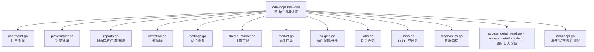
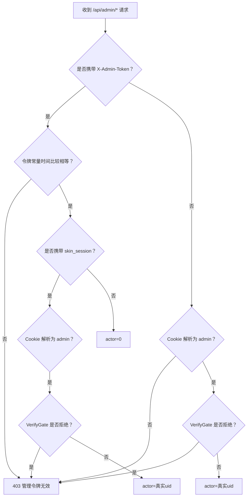
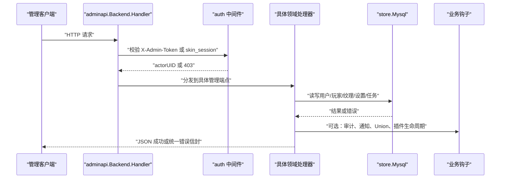

# 管理 API（/api/admin）

**本文引用的文件**
- [server/internal/adminapi/adminapi.go](https://github.com/YimingZhanshen/skin-nexus/blob/797ae1a/server/internal/adminapi/adminapi.go)
- [server/internal/adminapi/errors.go](https://github.com/YimingZhanshen/skin-nexus/blob/797ae1a/server/internal/adminapi/errors.go)
- [server/internal/adminapi/usermgmt.go](https://github.com/YimingZhanshen/skin-nexus/blob/797ae1a/server/internal/adminapi/usermgmt.go)
- [server/internal/adminapi/playermgmt.go](https://github.com/YimingZhanshen/skin-nexus/blob/797ae1a/server/internal/adminapi/playermgmt.go)
- [server/internal/adminapi/invitation.go](https://github.com/YimingZhanshen/skin-nexus/blob/797ae1a/server/internal/adminapi/invitation.go)
- [server/internal/adminapi/settings.go](https://github.com/YimingZhanshen/skin-nexus/blob/797ae1a/server/internal/adminapi/settings.go)
- [server/internal/adminapi/theme_market.go](https://github.com/YimingZhanshen/skin-nexus/blob/797ae1a/server/internal/adminapi/theme_market.go)
- [server/internal/adminapi/market.go](https://github.com/YimingZhanshen/skin-nexus/blob/797ae1a/server/internal/adminapi/market.go)
- [server/internal/adminapi/plugins.go](https://github.com/YimingZhanshen/skin-nexus/blob/797ae1a/server/internal/adminapi/plugins.go)
- [server/internal/adminapi/jobs.go](https://github.com/YimingZhanshen/skin-nexus/blob/797ae1a/server/internal/adminapi/jobs.go)
- [server/internal/adminapi/reports.go](https://github.com/YimingZhanshen/skin-nexus/blob/797ae1a/server/internal/adminapi/reports.go)
- [server/internal/adminapi/union.go](https://github.com/YimingZhanshen/skin-nexus/blob/797ae1a/server/internal/adminapi/union.go)
- [server/internal/adminapi/diagnostics.go](https://github.com/YimingZhanshen/skin-nexus/blob/797ae1a/server/internal/adminapi/diagnostics.go)
- [server/internal/adminapi/access_detail_read.go](https://github.com/YimingZhanshen/skin-nexus/blob/797ae1a/server/internal/adminapi/access_detail_read.go)
- [server/internal/adminapi/access_detail_mode.go](https://github.com/YimingZhanshen/skin-nexus/blob/797ae1a/server/internal/adminapi/access_detail_mode.go)

## 目录
1. [简介](#简介)
2. [项目结构与管理面总览](#项目结构与管理面总览)
3. [管理员身份验证与权限模型](#管理员身份验证与权限模型)
4. [通用响应与错误格式](#通用响应与错误格式)
5. [接口参考：按管理域分组](#接口参考按管理域分组)
6. [架构与调用关系图](#架构与调用关系图)
7. [性能、幂等性与批量操作建议](#性能幂等性与批量操作建议)
8. [导出、备份与运维流程](#导出备份与运维流程)
9. [故障排查指南](#故障排查指南)
10. [结论](#结论)

## 简介
本文面向站长和后台工具开发者，完整记录 `/api/admin/*` 管理 API。所有端点由 `adminapi.Backend` 注册到 `GET /api/admin/v1/overview`、`/status`、`/diagnostics`、用户、玩家、材质、邀请码、站点设置、主题市场、插件市场、后台任务、举报处理、Union 成员站、访问日志诊断、OIDC 客户端等管理路径上。

管理面同时支持两类调用者：
- Web 会话管理员：浏览器登录后携带 `skin_session` Cookie 的管理员账户。
- 机器/API 回退：通过请求头 `X-Admin-Token` 调用，适合脚本和外部工具。

## 项目结构与管理面总览
`adminapi` 包集中实现管理路由表、认证包装器、统一错误封装和各管理域处理器；可选模块（Union、Appearance/Theme Market、Plugins/Jobs/OIDC）通过依赖注入挂载，未启用时对应路由不存在或返回特定状态。



**图示来源**
- [server/internal/adminapi/adminapi.go:201-340](https://github.com/YimingZhanshen/skin-nexus/blob/797ae1a/server/internal/adminapi/adminapi.go#L201-L340)
- [server/internal/adminapi/usermgmt.go:1-120](https://github.com/YimingZhanshen/skin-nexus/blob/797ae1a/server/internal/adminapi/usermgmt.go#L1-L120)
- [server/internal/adminapi/playermgmt.go:1-60](https://github.com/YimingZhanshen/skin-nexus/blob/797ae1a/server/internal/adminapi/playermgmt.go#L1-L60)
- [server/internal/adminapi/reports.go:1-80](https://github.com/YimingZhanshen/skin-nexus/blob/797ae1a/server/internal/adminapi/reports.go#L1-L80)
- [server/internal/adminapi/invitation.go:1-79](https://github.com/YimingZhanshen/skin-nexus/blob/797ae1a/server/internal/adminapi/invitation.go#L1-L79)
- [server/internal/adminapi/settings.go:1-60](https://github.com/YimingZhanshen/skin-nexus/blob/797ae1a/server/internal/adminapi/settings.go#L1-L60)
- [server/internal/adminapi/theme_market.go:1-40](https://github.com/YimingZhanshen/skin-nexus/blob/797ae1a/server/internal/adminapi/theme_market.go#L1-L40)
- [server/internal/adminapi/market.go:1-60](https://github.com/YimingZhanshen/skin-nexus/blob/797ae1a/server/internal/adminapi/market.go#L1-L60)
- [server/internal/adminapi/plugins.go:1-40](https://github.com/YimingZhanshen/skin-nexus/blob/797ae1a/server/internal/adminapi/plugins.go#L1-L40)
- [server/internal/adminapi/jobs.go:1-40](https://github.com/YimingZhanshen/skin-nexus/blob/797ae1a/server/internal/adminapi/jobs.go#L1-L40)
- [server/internal/adminapi/union.go:1-60](https://github.com/YimingZhanshen/skin-nexus/blob/797ae1a/server/internal/adminapi/union.go#L1-L60)
- [server/internal/adminapi/diagnostics.go:1-60](https://github.com/YimingZhanshen/skin-nexus/blob/797ae1a/server/internal/adminapi/diagnostics.go#L1-L60)
- [server/internal/adminapi/access_detail_read.go:1-40](https://github.com/YimingZhanshen/skin-nexus/blob/797ae1a/server/internal/adminapi/access_detail_read.go#L1-L40)
- [server/internal/adminapi/access_detail_mode.go:1-40](https://github.com/YimingZhanshen/skin-nexus/blob/797ae1a/server/internal/adminapi/access_detail_mode.go#L1-L40)

**章节来源**
- [server/internal/adminapi/adminapi.go:1-40](https://github.com/YimingZhanshen/skin-nexus/blob/797ae1a/server/internal/adminapi/adminapi.go#L1-L40)
- [server/internal/adminapi/adminapi.go:201-340](https://github.com/YimingZhanshen/skin-nexus/blob/797ae1a/server/internal/adminapi/adminapi.go#L201-L340)

## 管理员身份验证与权限模型

### 认证方式
| 身份 | 要求 | 审计 actor | 典型用途 |
|---|---|---|---|
| Web 会话管理员 | 有效 `skin_session` Cookie，且 `users.permission > 0` | 真实管理员 uid | 面板操作、需要审计归属的操作 |
| 机器/API 调用 | 请求头 `X-Admin-Token` 等于环境变量 `SKIN_ADMIN_TOKEN` | uid 为 0 | 脚本、自动化、外部管理工具 |
| 无认证 | 拒绝 403 | 不写入成功审计行 | 非法访问 |

当同时携带 `X-Admin-Token` 和 `skin_session` 时，认证层优先走 Web 会话身份，避免把人类操作降级为机器审计。

### 权限等级
- 普通管理员：`permission = 1`
- 超级管理员：`permission = 2`
- 被封禁账号：`permission = -1`

部分敏感写操作强制要求超级管理员 Web 会话，并明确拒绝仅凭 `X-Admin-Token` 的机器通道：
- 安装/上传插件或主题
- 修改插件配置
- 绕过插件守卫
- 修改访问日志诊断窗口
- 修改用户权限

### 待验证邮箱保护
如果后端注入了 `VerifyGate`，且当前管理员邮箱尚未验证，认证中间件会直接拒绝该会话的管理操作，防止“未验证邮箱”成为绕过入口。



**图示来源**
- [server/internal/adminapi/adminapi.go:260-340](https://github.com/YimingZhanshen/skin-nexus/blob/797ae1a/server/internal/adminapi/adminapi.go#L260-L340)

**章节来源**
- [server/internal/adminapi/adminapi.go:260-340](https://github.com/YimingZhanshen/skin-nexus/blob/797ae1a/server/internal/adminapi/adminapi.go#L260-L340)

## 通用响应与错误格式

### 成功响应
大多数管理接口成功时返回 JSON 对象，常见字段包括：
- `ok`: 布尔值，表示操作完成
- `id`/`uuid`/`pid`/`tid`: 资源标识
- `total`/`page`: 分页信息
- `jobs`/`reports`/`players`/`settings`/`plugins`/`packages`: 列表容器
- `state`/`items`/`checked_at`：诊断快照

### 错误响应
所有失败响应使用统一信封：
```json
{
  "error": "稳定错误码",
  "message": "面向操作员的英文提示",
  "code": "稳定错误码"
}
```

结构化错误可能额外包含字段，例如插件安装计划 `plan`、包检查信息 `inspection`、上游诊断数据等。

| 状态码 | 含义 | 典型场景 |
|---|---|---|
| 200 | 成功 | 查询、简单变更 |
| 201 | 已创建 | 批量生成邀请码 |
| 400 | 请求参数错误 | 坏 id、无效 JSON、非法数值、正则表达式不可编译 |
| 403 | 禁止 | 令牌无效、非超级管理员、需 Web 会话、权限不足 |
| 404 | 未找到 | 用户、玩家、报告、纹理、插件、主题不存在 |
| 409 | 冲突 | 角色名重复、报告已处理、活跃主题无法卸载、内容仍被引用 |
| 413 | 请求体过大 | 插件包或主题包超过限制 |
| 500 | 内部错误 | 数据库、存储、依赖失败 |
| 502/503 | 上游服务不可用 | 主题市场、插件市场、Union 上游失败 |

**章节来源**
- [server/internal/adminapi/errors.go:1-75](https://github.com/YimingZhanshen/skin-nexus/blob/797ae1a/server/internal/adminapi/errors.go#L1-L75)

## 接口参考：按管理域分组

### 运行状态与诊断

#### GET /api/admin/v1/overview
- **作用**：管理面板头部看板指标，包括用户数、玩家数、纹理数、弱哈希余量、签名密钥指纹和纹理存储大小。
- **管理员权限**：任意管理员 Web 会话或机器令牌。
- **响应体**
  ```json
  {
    "users": 数字,
    "players": 数字,
    "textures": 数字,
    "weakHashUsers": 数字,
    "signKeyFingerprint": 字符串,
    "storageBytes": 数字或null
  }
  ```

#### GET /api/admin/v1/status
- **作用**：只读运行状态快照，包括版本、Go 版本、数据库版本与引擎、迁移水位、最近 24 小时邮件失败、构建信息、启动时间和环境。
- **管理员权限**：任意管理员。
- **响应体关键字段**：`version`、`goVersion`、`dbVersion`、`dbEngine`、`migration`、`mailFailures24h`、`build`、`startedAt`、`uptimeSeconds`、`environment`。

#### GET /api/admin/v1/diagnostics
- **作用**：部署自检，检查站点地址、迁移、邮件、发件人域名 DNS SPF/DMARC、邮箱验证门、预览渲染、Web 静态资源和签名密钥环。
- **管理员权限**：任意管理员。
- **响应体**
  ```json
  {
    "checked_at": "RFC3339 时间",
    "state": "ok|warn|fail|skip 中最严重状态",
    "items": [
      {
        "id": "site|migrations|mail|mail_dns|verify_gate|preview|web_assets|keyring",
        "state": "ok|warn|fail|skip",
        "value": "可选诊断值",
        "fix": "可选修复键"
      }
    ]
  }
  ```

#### POST /api/admin/v1/mail-test
- **作用**：向当前登录管理员自己的邮箱发送测试邮件，不允许传入收件人字段。
- **管理员权限**：任意管理员 Web 会话。
- **请求体**：空对象 `{}`
- **成功响应**：`{ "ok": true }`

**章节来源**
- [server/internal/adminapi/adminapi.go:201-260](https://github.com/YimingZhanshen/skin-nexus/blob/797ae1a/server/internal/adminapi/adminapi.go#L201-L260)
- [server/internal/adminapi/diagnostics.go:1-120](https://github.com/YimingZhanshen/skin-nexus/blob/797ae1a/server/internal/adminapi/diagnostics.go#L1-L120)

### 用户管理

#### GET /api/admin/v1/users
- **作用**：列出用户。
- **管理员权限**：任意管理员。
- **查询参数**：`q`、`page`、`perPage`、`permission`、`email`、`nickname`、`created_before`、`created_after`、`updated_before`、`updated_after`。
- **响应体**
  ```json
  {
    "users": 数组,
    "total": 数字,
    "page": 数字
  }
  ```

#### PUT /api/admin/v1/users/\{id\}/password
- **作用**：强制重置用户密码；同步使旧令牌失效，并触发 OIDC 授权撤销钩子。
- **管理员权限**：任意管理员。
- **请求体**
  ```json
  {
    "password": "至少 8 字符"
  }
  ```
- **成功响应**：`{ "ok": true }`

#### PUT /api/admin/v1/users/\{id\}/email
- **作用**：设置或清空邮箱。
- **管理员权限**：任意管理员。
- **请求体**
  ```json
  {
    "email": "合法邮箱或空字符串"
  }
  ```

#### PUT /api/admin/v1/users/\{id\}/nickname
- **作用**：设置昵称，校验长度与字符集，并要求唯一性。
- **管理员权限**：任意管理员。
- **请求体**
  ```json
  {
    "nickname": "2-24 个字母、数字、下划线或中文字符"
  }
  ```

#### PUT /api/admin/v1/users/\{id\}/verification
- **作用**：切换邮箱验证状态。
- **管理员权限**：任意管理员。
- **请求体**
  ```json
  {
    "verified": 布尔值
  }
  ```

#### PUT /api/admin/v1/users/\{id\}/permission
- **作用**：修改用户权限，支持封禁、解封、授予管理员。
- **管理员权限**：必须为超级管理员 Web 会话；机器令牌直接拒绝。
- **请求体**
  ```json
  {
    "permission": -1|0|1
  }
  ```
- **行为**
  - `-1`：封禁；通知目标用户，清除除指定保留外的 Web 会话，并失效令牌。
  - `0`：普通。
  - `1`：管理员；要求调用方为超级管理员。

#### DELETE /api/admin/v1/users/\{id\}
- **作用**：删除用户及其工作凭证；不删除纹理文件。
- **管理员权限**：任意管理员。
- **约束**
  - uid 1 不可删除。
  - `permission >= 2` 的超级管理员不可删除。
  - 不能自删。
  - 只能管理权限严格低于自己的用户。

**章节来源**
- [server/internal/adminapi/adminapi.go:201-260](https://github.com/YimingZhanshen/skin-nexus/blob/797ae1a/server/internal/adminapi/adminapi.go#L201-L260)
- [server/internal/adminapi/usermgmt.go:1-120](https://github.com/YimingZhanshen/skin-nexus/blob/797ae1a/server/internal/adminapi/usermgmt.go#L1-L120)
- [server/internal/adminapi/usermgmt.go:200-387](https://github.com/YimingZhanshen/skin-nexus/blob/797ae1a/server/internal/adminapi/usermgmt.go#L200-L387)

### 玩家/角色管理

#### GET /api/admin/v1/players
- **作用**：分页列出玩家，含 PID、名称、所有者、UUID、纹理摘要及更新时间。
- **管理员权限**：任意管理员。
- **查询参数**：`q`、`page`、`uid`。
- **响应体**
  ```json
  {
    "players": 数组,
    "total": 数字,
    "page": 数字
  }
  ```

#### PUT /api/admin/v1/players/\{pid\}/name
- **作用**：重命名玩家，保持 UUID 零漂移。
- **管理员权限**：任意管理员。
- **请求体**
  ```json
  {
    "name": "符合玩家名称规则的值"
  }
  ```
- **成功响应**：`{ "ok": true, "uuid": "字符串" }`

#### PUT /api/admin/v1/players/\{pid\}/owner
- **作用**：转移玩家所有权；旧拥有者的 launcher 选择会被失效。
- **管理员权限**：任意管理员。
- **请求体**
  ```json
  {
    "uid": 正整数
  }
  ```
- **幂等语义**：若新拥有者与旧拥有者相同，返回 `unchanged: true`。

#### PUT /api/admin/v1/players/\{pid\}/textures
- **作用**：挂载或卸载纹理，`textureId` 为 0 表示清空。
- **管理员权限**：任意管理员。
- **请求体**
  ```json
  {
    "type": "skin|cape",
    "textureId": 数字或0
  }
  ```

#### DELETE /api/admin/v1/players/\{pid\}
- **作用**：删除角色；共享纹理保留。
- **管理员权限**：任意管理员。
- **成功响应**：`{ "ok": true }`

**章节来源**
- [server/internal/adminapi/playermgmt.go:1-120](https://github.com/YimingZhanshen/skin-nexus/blob/797ae1a/server/internal/adminapi/playermgmt.go#L1-L120)
- [server/internal/adminapi/playermgmt.go:200-239](https://github.com/YimingZhanshen/skin-nexus/blob/797ae1a/server/internal/adminapi/playermgmt.go#L200-L239)

### 材质审核、举报与封禁

#### GET /api/admin/v1/textures
- **作用**：列出纹理，供材质审核使用。
- **管理员权限**：任意管理员。
- **查询参数**：`q`、`page`、`perPage`、`status`、`moderation`、`public`、`uploader`、`created_before`、`created_after`。
- **响应体**
  ```json
  {
    "textures": 数组,
    "total": 数字,
    "page": 数字
  }
  ```

#### GET /api/admin/v1/reports
- **作用**：列出举报，包含纹理预览 URL、上传者、举报人、原因、处理状态和处理时间。
- **管理员权限**：任意管理员。
- **查询参数**：`status`、`page`、`perPage`。
- **响应体**
  ```json
  {
    "reports": 数组,
    "total": 数字,
    "page": 数字
  }
  ```

#### POST /api/admin/v1/reports/\{id\}/resolve
- **作用**：处理举报。
- **管理员权限**：任意管理员。
- **请求体**
  ```json
  {
    "action": "resolve|dismiss|hide"
  }
  ```
- **行为**
  - `resolve`：标记为已解决。
  - `dismiss`：标记为已驳回。
  - `hide`：对纹理执行封禁，隐藏并通知纹理所有者。
- **成功响应**：`{ "ok": true }`

#### PUT /api/admin/v1/textures/\{tid\}/moderation
- **作用**：解除纹理违规审核限制；恢复发布权，但不自动重新公开。
- **管理员权限**：任意管理员。
- **请求体**
  ```json
  {
    "moderation": ""
  }
  ```

#### POST /api/admin/v1/textures/\{tid\}/strike
- **作用**：管理员主动封禁纹理，无需已有举报。
- **管理员权限**：任意管理员。
- **成功响应**：`{ "ok": true }`

#### DELETE /api/admin/v1/textures/\{tid\}
- **作用**：彻底删除纹理；可强制解绑仍在使用的角色、衣橱和头像。
- **管理员权限**：任意管理员。
- **查询参数**：`reason`、`force`。
- **行为**：若无 `force=1` 且纹理仍被引用，返回 409。

**章节来源**
- [server/internal/adminapi/adminapi.go:201-260](https://github.com/YimingZhanshen/skin-nexus/blob/797ae1a/server/internal/adminapi/adminapi.go#L201-L260)
- [server/internal/adminapi/reports.go:1-224](https://github.com/YimingZhanshen/skin-nexus/blob/797ae1a/server/internal/adminapi/reports.go#L1-L224)

### 邀请码

#### GET /api/admin/v1/invitation-codes
- **作用**：列出可用邀请码与已使用邀请码。
- **管理员权限**：任意管理员。
- **响应体**
  ```json
  {
    "free": 数组,
    "used": 数组
  }
  ```

#### POST /api/admin/v1/invitation-codes
- **作用**：批量生成邀请码。
- **管理员权限**：任意管理员。
- **请求体**
  ```json
  {
    "amount": 1-1000 的数字，小于 1 时钳制为 1，大于 1000 时钳制为 1000,
    "description": "描述"
  }
  ```
- **成功响应**：`{ "codes": 数组 }`

#### PUT /api/admin/v1/invitation-codes
- **作用**：编辑邀请码描述。
- **管理员权限**：任意管理员。
- **请求体**
  ```json
  {
    "id": 正整数,
    "description": "描述"
  }
  ```

**章节来源**
- [server/internal/adminapi/invitation.go:1-79](https://github.com/YimingZhanshen/skin-nexus/blob/797ae1a/server/internal/adminapi/invitation.go#L1-L79)

### 站点设置

#### GET /api/admin/v1/settings
- **作用**：获取受白名单保护的站点设置元数据。
- **管理员权限**：任意管理员。
- **响应体**
  ```json
  {
    "settings": [
      {
        "key": "字符串",
        "value": "字符串或空",
        "default": "字符串",
        "restart": 布尔值,
        "descKey": "本地化键",
        "group": "basic|register|mail|security|ygg|texture|union",
        "secret": 布尔值,
        "set": 布尔值
      }
    ]
  }
  ```
- **安全规则**：标记为 `secret` 的设置不会在 GET 中返回明文值。

#### PUT /api/admin/v1/settings
- **作用**：修改站点设置。
- **管理员权限**：任意管理员。
- **请求体**
  ```json
  {
    "key": "白名单中的设置键",
    "value": "字符串值",
    "clear": 布尔值
  }
  ```
- **类型校验**
  - 布尔键：接受 `1/0/true/false/on/off/yes/no`。
  - 整型键：范围 0-1000000，特殊键有独立范围。
  - `site_url`、`union_api_root`：必须是绝对 http(s) URL。
  - `cdn_headers`：仅允许字母、数字和连字符，禁止代理信任危险头。
  - `smtp_pass`、`union_member_key`、私钥等为敏感键，空值不覆盖。
  - `announcement`：Markdown 源最大 4096 字符。
- **热更新**：部分 Union 相关键通过 `OnSettingChanged` 热生效。
- **审计**：记录 `settings_update`，敏感值以 `<redacted>` 替代。

**章节来源**
- [server/internal/adminapi/settings.go:1-200](https://github.com/YimingZhanshen/skin-nexus/blob/797ae1a/server/internal/adminapi/settings.go#L1-L200)
- [server/internal/adminapi/settings.go:200-323](https://github.com/YimingZhanshen/skin-nexus/blob/797ae1a/server/internal/adminapi/settings.go#L200-L323)

### 主题市场

#### GET /api/admin/v1/themes
- **作用**：列出本地主题。
- **管理员权限**：任意管理员。

#### GET /api/admin/v1/themes/catalog?refresh=1
- **作用**：从主题市场拉取主题目录。
- **管理员权限**：任意管理员。
- **响应体**
  ```json
  {
    "packages": 数组,
    "enabled": true
  }
  ```

#### POST /api/admin/v1/themes/install
- **作用**：安装主题。
- **管理员权限**：必须为超级管理员 Web 会话，并通过同源 CSRF 检查。
- **请求体**
  ```json
  {
    "name": "主题标识"
  }
  ```

#### POST /api/admin/v1/themes/uninstall
- **作用**：卸载主题。
- **管理员权限**：必须为超级管理员 Web 会话，并通过同源 CSRF 检查。

#### POST /api/admin/v1/themes/upload
- **作用**：上传本地主题包，支持预览检查和安装。
- **管理员权限**：必须为超级管理员 Web 会话，并通过同源 CSRF 检查。
- **请求格式**：`multipart/form-data`
- **表单字段**
  - `file`：主题包
  - `inspect`：值为 `1` 时返回包检查信息
  - `acceptUnverified`：值为 `1` 时接受未验证包
  - `expectDigest`：期望摘要
- **大小限制**：16 MiB。

**章节来源**
- [server/internal/adminapi/adminapi.go:201-260](https://github.com/YimingZhanshen/skin-nexus/blob/797ae1a/server/internal/adminapi/adminapi.go#L201-L260)
- [server/internal/adminapi/theme_market.go:1-136](https://github.com/YimingZhanshen/skin-nexus/blob/797ae1a/server/internal/adminapi/theme_market.go#L1-L136)

### 插件管理

#### GET /api/admin/v1/plugins
- **作用**：列出已安装插件及守卫绕过状态。
- **管理员权限**：任意管理员。
- **响应体**
  ```json
  {
    "plugins": 数组,
    "guardsBypassed": 布尔值
  }
  ```

#### GET /api/admin/v1/plugins/\{name\}/config
- **作用**：查看插件配置视图。
- **管理员权限**：任意管理员。

#### PUT /api/admin/v1/plugins/\{name\}/config
- **作用**：保存插件配置。
- **管理员权限**：必须为超级管理员 Web 会话；机器令牌拒绝。
- **请求体**
  ```json
  {
    "values": 对象
  }
  ```

#### POST /api/admin/v1/plugins/\{name\}/\{action\}
- **作用**：启用、禁用或重载插件。
- **管理员权限**：必须为超级管理员 Web 会话。
- **路径参数**：`name`、`action ∈ enable|disable|reload`。

#### POST /api/admin/v1/plugins/guards/bypass
- **作用**：全局开启或关闭插件守卫绕过。
- **管理员权限**：必须为超级管理员 Web 会话。
- **请求体**
  ```json
  {
    "enabled": 布尔值
  }
  ```

#### POST /api/admin/v1/plugins/\{name\}/rollback
- **作用**：回滚插件到上一个版本。
- **管理员权限**：必须为超级管理员 Web 会话。

#### DELETE /api/admin/v1/plugins/\{name\}?purge=1
- **作用**：卸载插件；`purge=1` 时清理数据。
- **管理员权限**：必须为超级管理员 Web 会话。

#### GET /api/admin/v1/market/catalog?refresh=1
- **作用**：查看插件市场目录。
- **管理员权限**：任意管理员。
- **响应体**
  ```json
  {
    "packages": 数组
  }
  ```

#### POST /api/admin/v1/market/install
- **作用**：从市场安装插件。
- **管理员权限**：必须为超级管理员 Web 会话。
- **请求体**
  ```json
  {
    "name": "插件名",
    "consent": 布尔值
  }
  ```

#### POST /api/admin/v1/market/upload
- **作用**：上传插件包，支持检查、同意能力、接受未验证包和校验摘要。
- **管理员权限**：必须为超级管理员 Web 会话。
- **请求格式**：`multipart/form-data`
- **表单字段**：`file`、`consent`、`inspect`、`acceptUnverified`、`expectDigest`。

**章节来源**
- [server/internal/adminapi/adminapi.go:201-260](https://github.com/YimingZhanshen/skin-nexus/blob/797ae1a/server/internal/adminapi/adminapi.go#L201-L260)
- [server/internal/adminapi/plugins.go:1-166](https://github.com/YimingZhanshen/skin-nexus/blob/797ae1a/server/internal/adminapi/plugins.go#L1-L166)
- [server/internal/adminapi/market.go:1-176](https://github.com/YimingZhanshen/skin-nexus/blob/797ae1a/server/internal/adminapi/market.go#L1-L176)

### 后台任务

#### GET /api/admin/v1/jobs
- **作用**：分页列出插件后台任务。
- **管理员权限**：任意管理员。
- **查询参数**：`plugin`、`state`、`page`、`perPage`。
- **响应体**
  ```json
  {
    "jobs": [
      {
        "id": "字符串",
        "plugin": "字符串",
        "handler": "字符串",
        "ownerUid": 数字,
        "state": "字符串",
        "progress": 数字,
        "message": "字符串",
        "lastError": "字符串或null",
        "attempts": 数字,
        "maxAttempts": 数字,
        "reclaims": 数字,
        "createdAt": "RFC3339",
        "updatedAt": "RFC3339",
        "startedAt": "RFC3339或null",
        "finishedAt": "RFC3339或null",
        "payload": 对象或null,
        "cursor": 对象或null,
        "result": 对象或null
      }
    ],
    "total": 数字
  }
  ```

#### GET /api/admin/v1/jobs/\{id\}
- **作用**：查看单个任务详情。
- **管理员权限**：任意管理员。

#### POST /api/admin/v1/jobs/\{id\}/cancel
- **作用**：取消任务。
- **管理员权限**：任意管理员。
- **成功响应**：`{ "ok": true }`

#### POST /api/admin/v1/jobs/\{id\}/resume
- **作用**：恢复任务。
- **管理员权限**：任意管理员。
- **成功响应**：`{ "ok": true }`

**章节来源**
- [server/internal/adminapi/adminapi.go:201-260](https://github.com/YimingZhanshen/skin-nexus/blob/797ae1a/server/internal/adminapi/adminapi.go#L201-L260)
- [server/internal/adminapi/jobs.go:1-101](https://github.com/YimingZhanshen/skin-nexus/blob/797ae1a/server/internal/adminapi/jobs.go#L1-L101)

### Union 成员站

#### GET /api/admin/v1/union/status
- **作用**：查看签名密钥状态、轮换状态和服务器列表版本。
- **管理员权限**：任意管理员。
- **模块状态**：未启用时整个 Union 子树返回 404。
- **响应体**：由 `Status()` 返回的结构，通常包含密钥指纹、私钥版本、服务器列表版本等。

#### POST /api/admin/v1/union/rotation/resume
- **作用**：恢复每日密钥轮换暂停。
- **管理员权限**：任意管理员。
- **成功响应**：`{ "ok": true }`

#### POST /api/admin/v1/union/ops/key-update
- **作用**：立即执行一次 Hub 密钥拉取与切换。
- **管理员权限**：任意管理员。
- **响应体**
  ```json
  {
    "switched": 布尔值,
    "key_fingerprint": "字符串",
    "private_key_version": "字符串"
  }
  ```

#### POST /api/admin/v1/union/ops/serverlist
- **作用**：拉取成员站点列表。
- **管理员权限**：任意管理员。
- **响应体**
  ```json
  {
    "serverlist": 任意结构
  }
  ```

#### POST /api/admin/v1/union/ops/roster-sync
- **作用**：推送完整本地角色名录。
- **管理员权限**：任意管理员。
- **响应体**
  ```json
  {
    "profiles": 数字
  }
  ```

#### POST /api/admin/v1/union/ops/diagnose
- **作用**：连通性与版本探测，返回兼容旧版诊断形状的数据。
- **管理员权限**：任意管理员。
- **响应体**
  ```json
  {
    "status": "字符串",
    "data": 原始对象,
    "cause": "字符串",
    "probe": 对象,
    "key_fingerprint": "字符串",
    "private_key_version": "字符串",
    "server_list_version": "字符串"
  }
  ```

#### GET /api/admin/v1/union/blacklist?q=&page=
- **作用**：代理查询 Hub 黑名单，参数原样传递。
- **管理员权限**：任意管理员。
- **响应体**：透传上游 `ProxyResult`，包含 `status` 和 `body`。

#### POST /api/admin/v1/union/blacklist
- **作用**：添加黑名单条目。
- **管理员权限**：任意管理员。
- **请求体**
  ```json
  {
    "email": "邮箱",
    "reason": "原因"
  }
  ```

#### PUT /api/admin/v1/union/blacklist/\{id\}/invalidate
- **作用**：释放黑名单条目；记录保留但不再封禁。
- **管理员权限**：任意管理员。
- **响应体**：透传上游结果。

#### DELETE /api/admin/v1/union/blacklist/\{id\}
- **作用**：彻底删除黑名单记录；不可逆。
- **管理员权限**：任意管理员。
- **响应体**：透传上游结果。

**章节来源**
- [server/internal/adminapi/adminapi.go:201-260](https://github.com/YimingZhanshen/skin-nexus/blob/797ae1a/server/internal/adminapi/adminapi.go#L201-L260)
- [server/internal/adminapi/union.go:1-234](https://github.com/YimingZhanshen/skin-nexus/blob/797ae1a/server/internal/adminapi/union.go#L1-L234)

### 访问日志诊断

#### GET /api/admin/v1/access-log/detail-mode
- **作用**：查看访问日志诊断模式是否启用及剩余时间。
- **管理员权限**：任意管理员。
- **响应体**
  ```json
  {
    "enabled": 布尔值,
    "until": "RFC3339 或空",
    "seconds_remaining": 数字
  }
  ```

#### POST /api/admin/v1/access-log/detail-mode
- **作用**：打开诊断窗口，最多 24 小时。
- **管理员权限**：必须为超级管理员 Web 会话。
- **请求体**
  ```json
  {
    "until": "未来 RFC3339 绝对时间"
  }
  ```

#### DELETE /api/admin/v1/access-log/detail-mode
- **作用**：立即关闭诊断窗口。
- **管理员权限**：必须为超级管理员 Web 会话。

#### GET /api/admin/v1/access-log/details?ids=1,2,3
- **作用**：根据页面主键批量获取访问日志明细。
- **管理员权限**：任意管理员。
- **约束**：单次最多解析 200 个 id；超出时会截断并返回 `limited: true`。
- **响应体**
  ```json
  {
    "rows": 数组,
    "total": 数字,
    "requested": 数字,
    "limited": 布尔值
  }
  ```

**章节来源**
- [server/internal/adminapi/access_detail_mode.go:1-145](https://github.com/YimingZhanshen/skin-nexus/blob/797ae1a/server/internal/adminapi/access_detail_mode.go#L1-L145)
- [server/internal/adminapi/access_detail_read.go:1-92](https://github.com/YimingZhanshen/skin-nexus/blob/797ae1a/server/internal/adminapi/access_detail_read.go#L1-L92)

### OIDC 客户端

#### GET /api/admin/v1/oidc/clients
#### POST /api/admin/v1/oidc/clients
#### DELETE /api/admin/v1/oidc/clients/\{id\}
- **作用**：管理 OIDC 客户端；删除共享 launcher 客户端由 `sharedClientID` 保护。
- **管理员权限**：任意管理员。

**章节来源**
- [server/internal/adminapi/adminapi.go:201-260](https://github.com/YimingZhanshen/skin-nexus/blob/797ae1a/server/internal/adminapi/adminapi.go#L201-L260)

## 架构与调用关系图



**图示来源**
- [server/internal/adminapi/adminapi.go:201-340](https://github.com/YimingZhanshen/skin-nexus/blob/797ae1a/server/internal/adminapi/adminapi.go#L201-L340)
- [server/internal/adminapi/errors.go:1-75](https://github.com/YimingZhanshen/skin-nexus/blob/797ae1a/server/internal/adminapi/errors.go#L1-L75)

## 性能、幂等性与批量操作建议

### 分页参数
- 用户、玩家、纹理、举报、任务均提供 `page`，部分还提供 `perPage`。
- 默认页大小示例：玩家列表固定每页 50。
- 建议前端分页调用时递增 `page`，直到返回列表为空或 `total` 已遍历。

### 批量操作幂等性
- 邀请码生成：`amount` 小于 1 时钳制为 1，大于 1000 时钳制为 1000，但每次调用都会真正生成对应数量的码，因此不适合直接作为幂等重试。
- 玩家所有者转移：若新拥有者与旧拥有者相同，返回 `unchanged: true`，可作为轻量幂等信号。
- 设置更新：同一 key/value 写入会落库并记录审计，不应假设“不变则不写”。
- 黑名单释放与删除：两者语义不同，前者保留记录，后者彻底删除，调用前必须确认 id 和目标动作。

### 请求体大小
- 非上传类 JSON 请求体限制为 1 MiB。
- 插件上传大小由插件主机决定。
- 主题包上传限制为 16 MiB。

### 导出与备份建议
- 用户、玩家、纹理、举报、任务、邀请码、插件状态、Union 状态均可通过对应列表接口导出。
- 重要配置应通过 `GET /api/admin/v1/settings` 结合站点选项导出，但敏感值不会被返回；实际秘密值应从系统环境变量或密钥管理系统备份。
- Union 黑名单、服务器列表、诊断报告可通过各自端点导出为结构化 JSON，便于归档和审计。

**章节来源**
- [server/internal/adminapi/playermgmt.go:200-239](https://github.com/YimingZhanshen/skin-nexus/blob/797ae1a/server/internal/adminapi/playermgmt.go#L200-L239)
- [server/internal/adminapi/invitation.go:1-79](https://github.com/YimingZhanshen/skin-nexus/blob/797ae1a/server/internal/adminapi/invitation.go#L1-L79)
- [server/internal/adminapi/adminapi.go:201-260](https://github.com/YimingZhanshen/skin-nexus/blob/797ae1a/server/internal/adminapi/adminapi.go#L201-L260)
- [server/internal/adminapi/theme_market.go:1-136](https://github.com/YimingZhanshen/skin-nexus/blob/797ae1a/server/internal/adminapi/theme_market.go#L1-L136)

## 导出、备份与运维流程

### 日常巡检
1. 先调用 `GET /api/admin/v1/status` 确认版本、数据库引擎、迁移水位和启动时间。
2. 再调用 `GET /api/admin/v1/diagnostics` 检查站点地址、迁移、邮件、DNS、验证门、预览、静态资源和密钥环。
3. 若邮件诊断失败，重点检查 `smtp_host`、发件人地址、SPF/DMARC 记录。

### 批量封禁用户
1. 使用 `GET /api/admin/v1/users` 筛选可疑用户。
2. 对每个目标调用 `PUT /api/admin/v1/users/{id}/permission`，将 `permission` 设为 `-1`。
3. 注意：封禁会自动清除目标 Web 会话并失效令牌；若目标是超级管理员，该操作会被拒绝。

### 审核材质
1. 使用 `GET /api/admin/v1/reports` 查看待处理举报。
2. 对确认违规的内容调用 `POST /api/admin/v1/reports/{id}/resolve`，`action=hide`。
3. 对未发现举报但确认为违规的材质调用 `POST /api/admin/v1/textures/{tid}/strike`。
4. 如需恢复发布权，调用 `PUT /api/admin/v1/textures/{tid}/moderation`。

### 发布主题
1. 调用 `GET /api/admin/v1/themes/catalog` 浏览市场主题。
2. 调用 `POST /api/admin/v1/themes/install` 安装主题。
3. 若部署私有主题，调用 `POST /api/admin/v1/themes/upload` 上传包，必要时先用 `inspect=1` 预览包检查。

### 查看运行状态
1. 调用 `GET /api/admin/v1/status` 获取运行时快照。
2. 调用 `GET /api/admin/v1/overview` 获取看板指标。
3. 对 Union 站点调用 `GET /api/admin/v1/union/status` 和 `POST /api/admin/v1/union/ops/diagnose`。

**章节来源**
- [server/internal/adminapi/diagnostics.go:1-200](https://github.com/YimingZhanshen/skin-nexus/blob/797ae1a/server/internal/adminapi/diagnostics.go#L1-L200)
- [server/internal/adminapi/reports.go:1-224](https://github.com/YimingZhanshen/skin-nexus/blob/797ae1a/server/internal/adminapi/reports.go#L1-L224)
- [server/internal/adminapi/theme_market.go:1-136](https://github.com/YimingZhanshen/skin-nexus/blob/797ae1a/server/internal/adminapi/theme_market.go#L1-L136)
- [server/internal/adminapi/union.go:1-234](https://github.com/YimingZhanshen/skin-nexus/blob/797ae1a/server/internal/adminapi/union.go#L1-L234)

## 故障排查指南

### 403 管理令牌无效
- 检查是否设置了环境变量 `SKIN_ADMIN_TOKEN`。
- 检查请求头 `X-Admin-Token` 是否完全匹配。
- 若同时携带 Cookie，认证层会优先走 Web 会话，而非机器令牌。

### 403 需要超级管理员 Web 会话
- 插件安装、插件配置、守卫绕过、访问日志诊断窗口、用户权限修改等操作拒绝机器令牌。
- 确保使用浏览器会话或带有效 `skin_session` 的请求。

### 403 邮箱验证要求
- 若启用了邮箱验证门，未验证的管理员会话会被拒绝。
- 先通过 `PUT /api/admin/v1/users/{id}/verification` 手动标记验证，或配置邮件服务。

### 400 非法设置值
- 布尔值必须为 `1/0/true/false/on/off/yes/no`。
- 整型值必须在允许范围内。
- `site_url`、`union_api_root` 必须是绝对 http(s) URL。
- `custom_player_name_regexp`、`texture_name_regexp` 必须可被正则编译器解析。

### 409 冲突
- 角色名已被占用。
- 举报已处理。
- 尝试卸载当前活跃主题。
- 删除纹理但仍有角色、衣橱或头像引用。

### 502/503 上游失败
- 主题市场、插件市场、Union 上游网络或服务不可用。
- 检查市场地址、证书、防火墙和 Union 成员站连通性。

### 审计日志关联
几乎所有写操作都通过 `InsertAudit` 记录操作者、目标和资源，常见事件包括：
- `admin_user_password_reset`
- `admin_user_delete`
- `admin_user_email_update`
- `admin_user_nickname_update`
- `admin_user_verification_update`
- `admin_user_permission_update`
- `admin_player_rename`
- `admin_player_owner_update`
- `admin_player_textures_update`
- `admin_player_delete`
- `admin_invite_generate`
- `admin_invite_edit`
- `settings_update`
- `theme_market_install`
- `theme_uninstall`
- `plugin_job_cancel`
- `plugin_job_resume`
- `union_key_update`
- `union_serverlist_refresh`
- `union_roster_sync`
- `union_blacklist_add/release/delete`

**章节来源**
- [server/internal/adminapi/adminapi.go:260-340](https://github.com/YimingZhanshen/skin-nexus/blob/797ae1a/server/internal/adminapi/adminapi.go#L260-L340)
- [server/internal/adminapi/errors.go:1-75](https://github.com/YimingZhanshen/skin-nexus/blob/797ae1a/server/internal/adminapi/errors.go#L1-L75)
- [server/internal/adminapi/usermgmt.go:120-387](https://github.com/YimingZhanshen/skin-nexus/blob/797ae1a/server/internal/adminapi/usermgmt.go#L120-L387)
- [server/internal/adminapi/playermgmt.go:60-239](https://github.com/YimingZhanshen/skin-nexus/blob/797ae1a/server/internal/adminapi/playermgmt.go#L60-L239)
- [server/internal/adminapi/invitation.go:1-79](https://github.com/YimingZhanshen/skin-nexus/blob/797ae1a/server/internal/adminapi/invitation.go#L1-L79)
- [server/internal/adminapi/settings.go:200-323](https://github.com/YimingZhanshen/skin-nexus/blob/797ae1a/server/internal/adminapi/settings.go#L200-L323)
- [server/internal/adminapi/union.go:1-234](https://github.com/YimingZhanshen/skin-nexus/blob/797ae1a/server/internal/adminapi/union.go#L1-L234)

## 结论
`/api/admin/*` 是一个围绕管理员身份、审计追踪和可观测性设计的集中式管理面。它既支持浏览器管理员面板，也支持脚本和外部工具；既提供简单的用户与玩家管理，也提供材质审核、站点设置、主题市场、插件管理、后台任务、Union 成员站和部署自检等运维能力。

使用时应遵循以下原则：
- 始终区分 Web 会话管理员与机器令牌。
- 对超级管理员操作使用真实的浏览器会话。
- 分页调用列表接口，避免一次性拉取全量数据。
- 批量操作不要假设幂等，除非接口明确返回不变语义。
- 敏感设置不依赖 GET 响应，而应从环境变量或密钥系统备份。
- 变更前先运行诊断，变更后核对审计日志和 Union、插件、邮件等下游影响。
