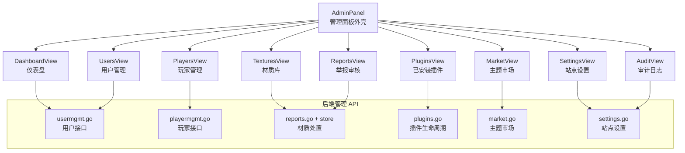
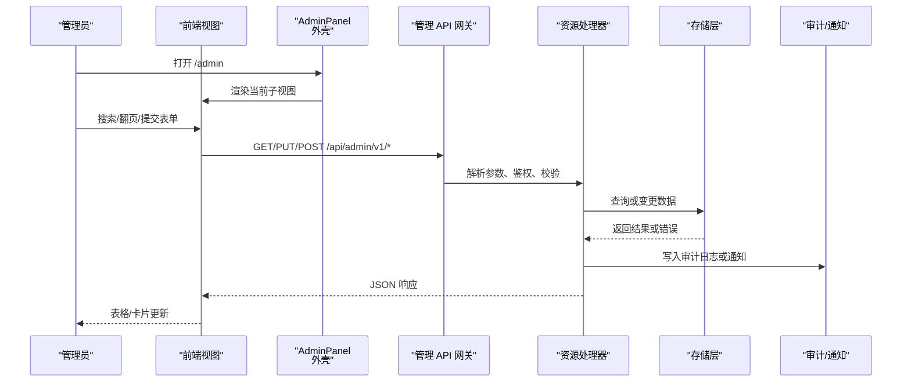
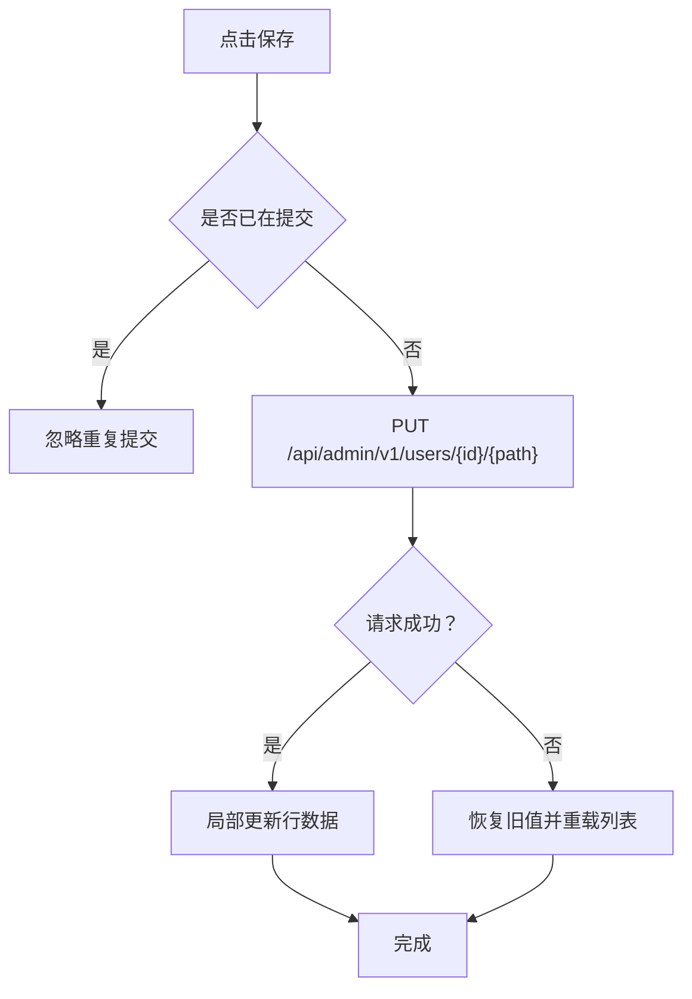
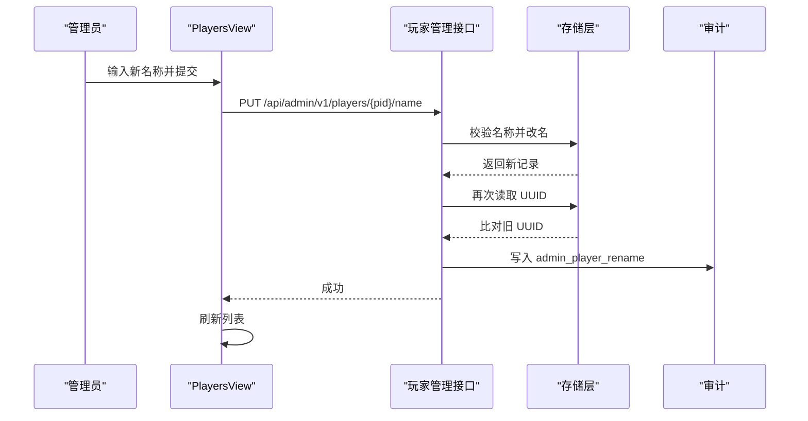
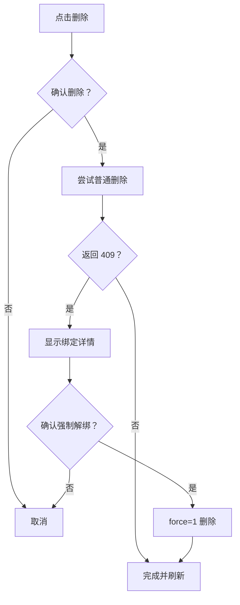
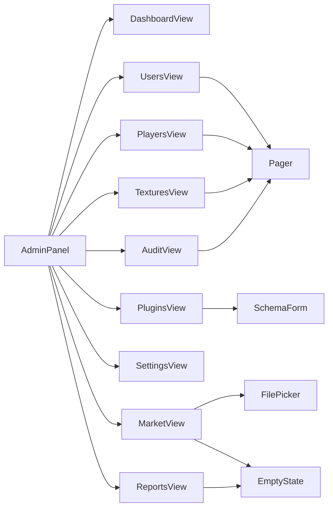
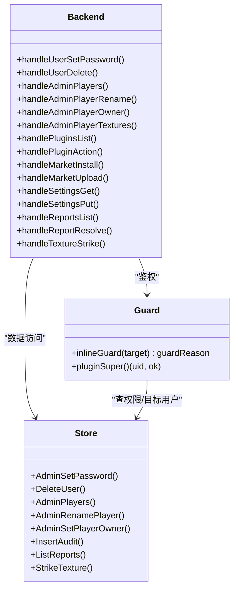

# 管理面板

**本文引用的文件**
- [AdminPanel.vue](https://github.com/YimingZhanshen/skin-nexus/blob/797ae1a/web/src/components/AdminPanel.vue)
- [DashboardView.vue](https://github.com/YimingZhanshen/skin-nexus/blob/797ae1a/web/src/components/admin/DashboardView.vue)
- [UsersView.vue](https://github.com/YimingZhanshen/skin-nexus/blob/797ae1a/web/src/components/admin/UsersView.vue)
- [PlayersView.vue](https://github.com/YimingZhanshen/skin-nexus/blob/797ae1a/web/src/components/admin/PlayersView.vue)
- [TexturesView.vue](https://github.com/YimingZhanshen/skin-nexus/blob/797ae1a/web/src/components/admin/TexturesView.vue)
- [PluginsView.vue](https://github.com/YimingZhanshen/skin-nexus/blob/797ae1a/web/src/components/admin/PluginsView.vue)
- [MarketView.vue](https://github.com/YimingZhanshen/skin-nexus/blob/797ae1a/web/src/components/admin/MarketView.vue)
- [SettingsView.vue](https://github.com/YimingZhanshen/skin-nexus/blob/797ae1a/web/src/components/admin/SettingsView.vue)
- [AuditView.vue](https://github.com/YimingZhanshen/skin-nexus/blob/797ae1a/web/src/components/admin/AuditView.vue)
- [ReportsView.vue](https://github.com/YimingZhanshen/skin-nexus/blob/797ae1a/web/src/components/admin/ReportsView.vue)
- [usermgmt.go](https://github.com/YimingZhanshen/skin-nexus/blob/797ae1a/server/internal/adminapi/usermgmt.go)
- [playermgmt.go](https://github.com/YimingZhanshen/skin-nexus/blob/797ae1a/server/internal/adminapi/playermgmt.go)
- [plugins.go](https://github.com/YimingZhanshen/skin-nexus/blob/797ae1a/server/internal/adminapi/plugins.go)
- [market.go](https://github.com/YimingZhanshen/skin-nexus/blob/797ae1a/server/internal/adminapi/market.go)
- [settings.go](https://github.com/YimingZhanshen/skin-nexus/blob/797ae1a/server/internal/adminapi/settings.go)
- [reports.go](https://github.com/YimingZhanshen/skin-nexus/blob/797ae1a/server/internal/adminapi/reports.go)

## 目录

1. [引言](#引言)
2. [项目结构](#项目结构)
3. [核心组件](#核心组件)
4. [架构总览](#架构总览)
5. [详细组件分析](#详细组件分析)
6. [依赖关系分析](#依赖关系分析)
7. [性能与可用性](#性能与可用性)
8. [故障排查指南](#故障排查指南)
9. [扩展指南](#扩展指南)
10. [结论](#结论)

## 引言

本文件说明 Skin Nexus 后端站点中的 **管理面板**：它如何把管理员路由到各子视图，每个视图暴露哪些管理 API，仪表盘展示什么指标，审计与访问日志如何查看，以及如何扩展菜单、视图、表单和诊断项。

管理面板由前端 Vue 组件 `AdminPanel` 作为外壳，按左侧导航切换 `dashboard`、`users`、`players`、`textures`、`plugins`、`market`、`settings`、`audit`、`reports` 等子视图；后端则通过 `/api/admin/v1/*` 提供用户、玩家、材质、插件、市场、设置、报告、审计等能力。权限方面，普通管理员可以执行多数日常运维操作，而“启用/禁用/重装插件”“安装主题市场插件”“配置插件”“绕过安全校验”等高危操作要求超级管理员（`permission=2`）且使用浏览器会话，不信任仅凭机器令牌登录的路径。

## 项目结构

管理面板代码分布在两个层次：

| 层次 | 位置 | 职责 |
|---|---|---|
| 前端外壳 | `web/src/components/AdminPanel.vue` | 侧边栏、路由、权限检测、令牌输入、URL 深链、插件页面注入 |
| 前端视图 | `web/src/components/admin/*.vue` | 用户、玩家、材质、插件、市场、设置、审计、报告等具体界面 |
| 后端管理 API | `server/internal/adminapi/*.go` | 请求处理、权限守卫、存储调用、审计写入、通知发送 |
| 通用组件 | `web/src/components/Pager.vue`、`EmptyState.vue`、`SchemaForm.vue`、`FilePicker.vue` | 分页、空状态、动态表单、文件选择 |

**图表来源**
- [AdminPanel.vue:1-200](https://github.com/YimingZhanshen/skin-nexus/blob/797ae1a/web/src/components/AdminPanel.vue#L1-L200)
- [DashboardView.vue:1-71](https://github.com/YimingZhanshen/skin-nexus/blob/797ae1a/web/src/components/admin/DashboardView.vue#L1-L71)
- [usermgmt.go:1-200](https://github.com/YimingZhanshen/skin-nexus/blob/797ae1a/server/internal/adminapi/usermgmt.go#L1-L200)
- [playermgmt.go:1-200](https://github.com/YimingZhanshen/skin-nexus/blob/797ae1a/server/internal/adminapi/playermgmt.go#L1-L200)
- [plugins.go:1-166](https://github.com/YimingZhanshen/skin-nexus/blob/797ae1a/server/internal/adminapi/plugins.go#L1-L166)
- [market.go:1-176](https://github.com/YimingZhanshen/skin-nexus/blob/797ae1a/server/internal/adminapi/market.go#L1-L176)
- [settings.go:1-200](https://github.com/YimingZhanshen/skin-nexus/blob/797ae1a/server/internal/adminapi/settings.go#L1-L200)
- [reports.go:1-200](https://github.com/YimingZhanshen/skin-nexus/blob/797ae1a/server/internal/adminapi/reports.go#L1-L200)

**章节来源**
- [AdminPanel.vue:1-200](https://github.com/YimingZhanshen/skin-nexus/blob/797ae1a/web/src/components/AdminPanel.vue#L1-L200)

## 核心组件

### 管理面板外壳

`AdminPanel` 维护一个固定顺序的导航数组，每项包含 ID、本地化标签、组件引用和图标。它根据站点配置隐藏邀请入口和 Union 入口；当 URL 为 `/admin`、`/admin/<tab>` 或 `/admin/plugin/<id>` 时，它会同步当前视图和浏览器历史，刷新后不会掉回仪表盘。

关键行为：

| 行为 | 实现方式 |
|---|---|
| 按角色显示菜单 | 从 `props.user.permission` 判断是否需机器令牌；过滤插件 UI 页时比较 `p.perm` |
| 条件菜单 | 邀请入口依赖 `invite_required`，Union 入口依赖 `union_enabled` |
| 深度链接 | 监听 `popstate`，把当前 tab 或插件路径写进 `history.pushState` |
| 重载机制 | 每次数据加载前自增 `reloadTick`，用 key 驱动子视图重新挂载并拉取数据 |
| 令牌模式 | 非会话管理员需要输入 X-Admin-Token；成功持久化后进入 ready 状态 |
| 插件页面 | 通过 `navPages('admin')` 把插件声明的管理页面注入到插件菜单中 |

**章节来源**
- [AdminPanel.vue:1-200](https://github.com/YimingZhanshen/skin-nexus/blob/797ae1a/web/src/components/AdminPanel.vue#L1-L200)

### 仪表盘

仪表盘调用 `/api/admin/v1/overview`，展示以下关键指标：

| 指标 | 含义 | 可交互性 |
|---|---|---|
| 用户数 | 站内注册用户总量 | 点击跳转到用户管理 |
| 玩家数 | 已注册 Minecraft 玩家数量 | 点击跳转到玩家管理 |
| 材质数 | 材质库条目总数 | 只读卡片，不跳转 |
| 存储空间 | 以人类可读单位展示字节数 | 只读 |
| 弱哈希用户 | 密码算法仍为旧版算法的用户数 | 以危险徽章提示 |
| 签名密钥指纹 | 站点签名标识 | 只读 |

仪表盘本身不负责在线用户、邮件队列、Union 健康状态等实时运行指标；这些能力通常由状态、诊断、Union 或后台作业视图承担。若需要新增仪表盘指标，应在后端 `overview` 接口补充字段，并在视图中增加统计卡片。

**章节来源**
- [DashboardView.vue:1-71](https://github.com/YimingZhanshen/skin-nexus/blob/797ae1a/web/src/components/admin/DashboardView.vue#L1-L71)

## 架构总览

管理面板的请求流程遵循“前端视图发起请求 → 后端管理 API 校验权限 → 存储层读写 → 可选审计与通知”的统一模式。

**图表来源**
- [AdminPanel.vue:120-200](https://github.com/YimingZhanshen/skin-nexus/blob/797ae1a/web/src/components/AdminPanel.vue#L120-L200)
- [usermgmt.go:120-200](https://github.com/YimingZhanshen/skin-nexus/blob/797ae1a/server/internal/adminapi/usermgmt.go#L120-L200)
- [playermgmt.go:120-200](https://github.com/YimingZhanshen/skin-nexus/blob/797ae1a/server/internal/adminapi/playermgmt.go#L120-L200)
- [plugins.go:40-166](https://github.com/YimingZhanshen/skin-nexus/blob/797ae1a/server/internal/adminapi/plugins.go#L40-L166)
- [market.go:20-176](https://github.com/YimingZhanshen/skin-nexus/blob/797ae1a/server/internal/adminapi/market.go#L20-L176)
- [settings.go:120-200](https://github.com/YimingZhanshen/skin-nexus/blob/797ae1a/server/internal/adminapi/settings.go#L120-L200)
- [reports.go:120-200](https://github.com/YimingZhanshen/skin-nexus/blob/797ae1a/server/internal/adminapi/reports.go#L120-L200)

## 详细组件分析

### 用户管理：UsersView

用户管理提供分页列表、搜索、内联编辑和账户级操作。

| 功能 | 前端实现 | 后端接口 | 权限与安全 |
|---|---|---|---|
| 列出用户 | 带 `page` 和 `q` 查询 | `GET /api/admin/v1/users` | 需要管理权限 |
| 重置密码 | 弹窗输入新密码 | `POST /api/admin/v1/users/{id}/password` | 不能改自己；目标权限必须严格低于操作者；长度至少 8 |
| 删除用户 | 二次确认 | `DELETE /api/admin/v1/users/{id}` | uid 1 不可删；SUPER_ADMIN 不可删；inlineGuard 限制 |
| 修改邮箱/昵称/验证状态/权限 | 单元格编辑，失焦保存 | `PUT /api/admin/v1/users/{id}/{path}` | inlineGuard 同样生效 |

内联编辑采用乐观更新：失败时回滚并重新拉取整页，避免显示未提交的临时值。权限下拉框对 SUPER_ADMIN 只显示标签而不提供选项，因为该级别只能通过初始化流程创建。

**图表来源**
- [UsersView.vue:40-120](https://github.com/YimingZhanshen/skin-nexus/blob/797ae1a/web/src/components/admin/UsersView.vue#L40-L120)
- [usermgmt.go:60-160](https://github.com/YimingZhanshen/skin-nexus/blob/797ae1a/server/internal/adminapi/usermgmt.go#L60-L160)

**章节来源**
- [UsersView.vue:1-200](https://github.com/YimingZhanshen/skin-nexus/blob/797ae1a/web/src/components/admin/UsersView.vue#L1-L200)
- [usermgmt.go:1-200](https://github.com/YimingZhanshen/skin-nexus/blob/797ae1a/server/internal/adminapi/usermgmt.go#L1-L200)

### 玩家管理：PlayersView

玩家管理用于维护用户对应的游戏身份，包括改名、更换所有者、替换皮肤/披风、删除。

| 功能 | 前端实现 | 后端接口 | 重要规则 |
|---|---|---|---|
| 列出玩家 | 支持 `q` 和分页 | `GET /api/admin/v1/players` | 默认每页 50 |
| 改名 | 弹窗输入新名称 | `PUT /api/admin/v1/players/{pid}/name` | 走玩家命名规则；改名后校验 UUID 零漂移 |
| 更换所有者 | 输入目标用户 ID | `PUT /api/admin/v1/players/{pid}/owner` | 目标用户必须存在；原主 token 失效 |
| 替换材质 | 输入 textureId，0 表示卸载 | `PUT /api/admin/v1/players/{pid}/textures` | skin 槽只能挂 skin，cape 槽只能挂 cape |
| 删除玩家 | 双重确认 | `DELETE /api/admin/v1/players/{pid}` | 事务内删除，同时触发 Union 广播最佳努力 |

改名后的 UUID 零漂移检查是关键安全点：即使数据库写入成功，如果 `uuid_map.uuid` 被意外改动，接口也会返回内部错误，防止迁移身份漂移。

**图表来源**
- [PlayersView.vue:40-120](https://github.com/YimingZhanshen/skin-nexus/blob/797ae1a/web/src/components/admin/PlayersView.vue#L40-L120)
- [playermgmt.go:60-140](https://github.com/YimingZhanshen/skin-nexus/blob/797ae1a/server/internal/adminapi/playermgmt.go#L60-L140)

**章节来源**
- [PlayersView.vue:1-172](https://github.com/YimingZhanshen/skin-nexus/blob/797ae1a/web/src/components/admin/PlayersView.vue#L1-L172)
- [playermgmt.go:1-200](https://github.com/YimingZhanshen/skin-nexus/blob/797ae1a/server/internal/adminapi/playermgmt.go#L1-L200)

### 材质管理：TexturesView

材质视图是站点拥有者看到的材质库，不再只是只读列表。它支持按名称、上传者、类型、公开/下架状态筛选，并提供下架、解除下架、删除等操作。

| 操作 | 接口 | 行为 |
|---|---|---|
| 下架 | `POST /api/admin/v1/textures/{id}/strike` | 标记违规，不再公开 |
| 解除下架 | `PUT /api/admin/v1/textures/{id}/moderation` | 清空 moderation，恢复发布资格 |
| 删除 | `DELETE /api/admin/v1/textures/{id}?force=1&reason=...` | 删除证据与文件；必要时强制解绑玩家/衣柜/头像 |
| 复制哈希 | 剪贴板 | 失败时显示错误，而不是静默成功 |

删除失败时若返回 409，会附带仍指向该材质的玩家、衣柜和头像数量；面板据此弹出二次确认，让管理员在知情前提下执行强制解绑。

**图表来源**
- [TexturesView.vue:120-220](https://github.com/YimingZhanshen/skin-nexus/blob/797ae1a/web/src/components/admin/TexturesView.vue#L120-L220)
- [reports.go:160-224](https://github.com/YimingZhanshen/skin-nexus/blob/797ae1a/server/internal/adminapi/reports.go#L160-L224)

**章节来源**
- [TexturesView.vue:1-268](https://github.com/YimingZhanshen/skin-nexus/blob/797ae1a/web/src/components/admin/TexturesView.vue#L1-L268)

### 插件管理：PluginsView

插件管理面向已安装的插件，展示其版本、来源、可信度、健康状态、路由、UI 页面、权限、错误信息，并提供启用、禁用、重载、回滚、卸载和配置编辑。

| 能力 | 权限要求 | 说明 |
|---|---|---|
| 查看插件列表 | 管理会话或机器令牌 | 机器令牌只能看，不能改 |
| 启用/禁用/重载 | 超级管理员 + Web 会话 | 直接执行第三方代码，拒绝仅令牌路径 |
| 配置编辑 | 超级管理员 + Web 会话 | 基于插件声明的 SchemaForm 渲染 |
| 回滚 | 超级管理员 + Web 会话 | 若无可用版本则冲突 |
| 卸载 | 超级管理员 + Web 会话 | 可选择是否清除数据 |
| 绕过安全校验 | 超级管理员 + Web 会话 | 允许跳过部分安全检查，风险极高 |

插件配置通过后端提供的 schema 动态渲染，保存成功后刷新配置视图并刷新已安装插件列表。

**章节来源**
- [PluginsView.vue:1-294](https://github.com/YimingZhanshen/skin-nexus/blob/797ae1a/web/src/components/admin/PluginsView.vue#L1-L294)
- [plugins.go:1-166](https://github.com/YimingZhanshen/skin-nexus/blob/797ae1a/server/internal/adminapi/plugins.go#L1-L166)

### 主题市场：MarketView

主题市场是受信任的主题插件来源。前端展示服务器验证后的目录，支持搜索、分页、上传 zip、检查结果、确认额外权限后安装。

| 步骤 | 接口 | 关键点 |
|---|---|---|
| 获取目录 | `GET /api/admin/v1/market/catalog?refresh=1` | 服务端验证注册表和制品 |
| 上传包 | `POST /api/admin/v1/market/upload` | 支持 inspect 和 install 两种模式 |
| 安装 | `POST /api/admin/v1/market/install` | 需要 consent；可能返回 plan 冲突或缺少依赖 |
| 回滚 | `POST /api/admin/v1/plugins/{name}/rollback` | 无回滚版本时报冲突 |
| 卸载 | `DELETE /api/admin/v1/plugins/{name}` | 可传 purge 清数据 |

上传未验证包时会显示风险说明，需要管理员勾选接受；若 digest 不匹配或计划缺少权限，也必须明确同意才能继续。

**章节来源**
- [MarketView.vue:1-300](https://github.com/YimingZhanshen/skin-nexus/blob/797ae1a/web/src/components/admin/MarketView.vue#L1-L300)
- [market.go:1-176](https://github.com/YimingZhanshen/skin-nexus/blob/797ae1a/server/internal/adminapi/market.go#L1-L176)

### 站点设置：SettingsView

站点设置是环境变量的图形化管理界面，按后端分组组织：基础、注册、邮件、安全、YGG、材质、Union。

主要能力：

| 模块 | 能力 |
|---|---|
| 站点开关 | 邀请注册、邮箱验证、Union、CDN、YGG 兜底等布尔值 |
| 文本配置 | 公告、域名、正则、CDN 头、Union 公钥等 |
| 秘密配置 | SMTP 密码、Union 私钥等，不随 GET 返回明文 |
| SEO | 一键生成、标题、描述、关键词、OG 图片、canonical、sitemap、noindex、robots |
| 外观 | 主题、底部文案、底部链接、自定义 CSS/JS |
| OIDC 客户端 | 创建、删除、查看 redirect_uris 和 grant_types |
| 主题市场集成 | 在外观区嵌入主题市场区块 |

设置保存失败时会重新拉取，避免界面保留“看似保存但实际失败”的值。

**章节来源**
- [SettingsView.vue:1-406](https://github.com/YimingZhanshen/skin-nexus/blob/797ae1a/web/src/components/admin/SettingsView.vue#L1-L406)
- [settings.go:1-200](https://github.com/YimingZhanshen/skin-nexus/blob/797ae1a/server/internal/adminapi/settings.go#L1-L200)

### 审计日志：AuditView

审计日志记录管理面板中的“谁做了什么”。它展示时间、操作者、动作名称和细节 JSON，并支持按关键字和操作类型筛选。

| 字段 | 含义 |
|---|---|
| 时间 | 数据库墙钟时间，不做本地时区转换 |
| 操作者 | 有账号时显示用户编号；机器令牌路径显示系统 |
| 动作 | 如 `admin_user_password_reset`、`admin_player_rename`、`texture_report_hide` 等 |
| 详情 | 原始 JSON，无法翻译时保持机器名 |

审计日志目前提供查看和分页，没有导出按钮。如需导出，可在前端增加 CSV/JSON 下载，并在后端提供流式导出接口。

**章节来源**
- [AuditView.vue:1-154](https://github.com/YimingZhanshen/skin-nexus/blob/797ae1a/web/src/components/admin/AuditView.vue#L1-L154)

### 举报审核：ReportsView

举报审核用于处理用户对材质的举报，支持关闭、解决或隐藏材质。

| 动作 | 效果 |
|---|---|
| 关闭 | 将状态改为 dismissed |
| 解决 | 将状态改为 resolved |
| 隐藏 | 对材质做违规标记，并通知上传者 |
| 提升下架 | 从材质管理接口调用，恢复发布资格 |
| 删除材质 | 复用材质删除接口，携带举报原因 |

举报理由包括版权、色情、暴力、仇恨、垃圾信息和其它类别，前端会把后端 reason 映射为本地化文案。

**章节来源**
- [ReportsView.vue:1-200](https://github.com/YimingZhanshen/skin-nexus/blob/797ae1a/web/src/components/admin/ReportsView.vue#L1-L200)
- [reports.go:1-200](https://github.com/YimingZhanshen/skin-nexus/blob/797ae1a/server/internal/adminapi/reports.go#L1-L200)

## 依赖关系分析

### 前端视图依赖

**图表来源**
- [AdminPanel.vue:1-120](https://github.com/YimingZhanshen/skin-nexus/blob/797ae1a/web/src/components/AdminPanel.vue#L1-L120)
- [UsersView.vue:1-40](https://github.com/YimingZhanshen/skin-nexus/blob/797ae1a/web/src/components/admin/UsersView.vue#L1-L40)
- [PluginsView.vue:1-40](https://github.com/YimingZhanshen/skin-nexus/blob/797ae1a/web/src/components/admin/PluginsView.vue#L1-L40)
- [MarketView.vue:1-40](https://github.com/YimingZhanshen/skin-nexus/blob/797ae1a/web/src/components/admin/MarketView.vue#L1-L40)
- [ReportsView.vue:1-40](https://github.com/YimingZhanshen/skin-nexus/blob/797ae1a/web/src/components/admin/ReportsView.vue#L1-L40)
- [AuditView.vue:1-40](https://github.com/YimingZhanshen/skin-nexus/blob/797ae1a/web/src/components/admin/AuditView.vue#L1-L40)

### 后端权限模型

**图表来源**
- [usermgmt.go:60-200](https://github.com/YimingZhanshen/skin-nexus/blob/797ae1a/server/internal/adminapi/usermgmt.go#L60-L200)
- [playermgmt.go:1-200](https://github.com/YimingZhanshen/skin-nexus/blob/797ae1a/server/internal/adminapi/playermgmt.go#L1-L200)
- [plugins.go:40-166](https://github.com/YimingZhanshen/skin-nexus/blob/797ae1a/server/internal/adminapi/plugins.go#L40-L166)
- [market.go:20-176](https://github.com/YimingZhanshen/skin-nexus/blob/797ae1a/server/internal/adminapi/market.go#L20-L176)
- [settings.go:120-200](https://github.com/YimingZhanshen/skin-nexus/blob/797ae1a/server/internal/adminapi/settings.go#L120-L200)
- [reports.go:120-200](https://github.com/YimingZhanshen/skin-nexus/blob/797ae1a/server/internal/adminapi/reports.go#L120-L200)

**章节来源**
- [usermgmt.go:60-200](https://github.com/YimingZhanshen/skin-nexus/blob/797ae1a/server/internal/adminapi/usermgmt.go#L60-L200)
- [plugins.go:40-166](https://github.com/YimingZhanshen/skin-nexus/blob/797ae1a/server/internal/adminapi/plugins.go#L40-L166)
- [market.go:20-176](https://github.com/YimingZhanshen/skin-nexus/blob/797ae1a/server/internal/adminapi/market.go#L20-L176)

## 性能与可用性

### 分页与搜索

所有大型列表都使用分页：

| 视图 | 默认页大小 | 搜索策略 |
|---|---:|---|
| 用户 | 50 | 立即查询 |
| 玩家 | 50 | 立即查询 |
| 材质 | 50 | 防抖 300ms |
| 审计 | 100 | 防抖 300ms |
| 报告 | 20 | 状态切换后立即查询 |
| 市场 | 10 | 前端过滤 + 分页 |

防抖用于材质和审计，因为它们对应数据库 LIKE 查询，逐字搜索可能成为“自我攻击型拒绝服务”。

### 空状态

- 用户、玩家、材质、审计、报告均在没有数据时显示空文案。
- 报告和主题市场使用 `EmptyState` 组件。
- 材质在筛选结果为空时区分“全局空库”和“筛选为空”。

### 错误提示

- 网络或业务错误写入 `error` 变量并以 alert 区域显示。
- 成功提示用于材质操作、设置保存、SEO 保存等场景。
- 用户删除、玩家删除、材质删除、插件卸载、绕过校验等均使用危险样式和确认对话框。

### 并发保护

- 用户、玩家、材质、插件、报告的操作普遍使用 `busy` 或 `rowBusy` 集合，防止同一行重复提交。
- 材质列表使用 `seq` 序列号丢弃旧请求的结果，避免慢请求覆盖最新分页。

**章节来源**
- [TexturesView.vue:20-120](https://github.com/YimingZhanshen/skin-nexus/blob/797ae1a/web/src/components/admin/TexturesView.vue#L20-L120)
- [AuditView.vue:20-120](https://github.com/YimingZhanshen/skin-nexus/blob/797ae1a/web/src/components/admin/AuditView.vue#L20-L120)
- [PluginsView.vue:1-120](https://github.com/YimingZhanshen/skin-nexus/blob/797ae1a/web/src/components/admin/PluginsView.vue#L1-L120)
- [ReportsView.vue:20-120](https://github.com/YimingZhanshen/skin-nexus/blob/797ae1a/web/src/components/admin/ReportsView.vue#L20-L120)

## 故障排查指南

### 常见问题与定位方法

| 现象 | 可能原因 | 排查建议 |
|---|---|---|
| 管理面板空白或反复请求 | 会话权限不足且未输入机器令牌 | 检查 `needToken` 和用户 `permission` |
| 能看但不能改插件 | 使用了机器令牌或非超级管理员 | 插件操作要求 `permission=2` 的 Web 会话 |
| 修改用户权限失败 | 目标权限不低于当前操作者 | 后端 inlineGuard 拒绝自改和越权 |
| 删除用户失败 | 目标是 uid 1 或 SUPER_ADMIN | 后端禁止删除启动管理员和超级管理员 |
| 玩家改名后身份异常 | 极端情况下 UUID 漂移 | 后端有 UUID 零漂移守卫，应优先检查后端日志 |
| 材质删除被阻止 | 仍有玩家/衣柜/头像引用 | 查看 409 响应中的 players/closets/avatar 数量 |
| 主题市场上传失败 | 包过大、digest 不匹配、权限未同意 | 先 inspect，再确认风险与依赖 |
| 设置保存无效 | 键不在白名单、布尔值格式错误、数值范围超限 | 检查 settingsWhitelist 和校验规则 |
| 审计日志看不懂动作名 | 旧构建写入的动作名在当前语言包无映射 | 审计逻辑会回退到原始机器名 |

### 权限相关的关键边界

- 普通管理员：可执行大部分日常管理操作。
- 机器令牌：可用于读取和部分管理接口，但插件操作、配置、市场安装等明确拒绝。
- 超级管理员：启用/禁用/重装插件、安装主题、配置插件、绕过校验、市场安装。
- 用户内联编辑：不能改自己；只能管理权限严格更低的目标。
- 删除用户：uid 1 和 SUPER_ADMIN 不可删。

**章节来源**
- [usermgmt.go:60-200](https://github.com/YimingZhanshen/skin-nexus/blob/797ae1a/server/internal/adminapi/usermgmt.go#L60-L200)
- [plugins.go:40-166](https://github.com/YimingZhanshen/skin-nexus/blob/797ae1a/server/internal/adminapi/plugins.go#L40-L166)
- [market.go:20-120](https://github.com/YimingZhanshen/skin-nexus/blob/797ae1a/server/internal/adminapi/market.go#L20-L120)
- [settings.go:120-200](https://github.com/YimingZhanshen/skin-nexus/blob/797ae1a/server/internal/adminapi/settings.go#L120-L200)

## 扩展指南

### 新增菜单

在 `AdminPanel.vue` 的导航数组中添加一项：

1. 添加图标 SVG。
2. 在 `nav` 数组中加入 `{ id, labelKey, comp, icon }`。
3. 如果需要条件显示，加入 `visibleNav` 的过滤条件。
4. 如果需要插件权限控制，在插件页面注入逻辑中比较 `myPerm` 与插件声明的 `perm`。
5. 如需隐藏某项，参考邀请和 Union 的条件菜单写法。

### 新增视图

1. 新建 `web/src/components/admin/YourView.vue`。
2. 在 `AdminPanel.vue` 中 import 该组件。
3. 把它加入导航数组。
4. 在 `zh-CN.json` 和 `en.json` 中添加 `admin.navYourView` 等本地化键。
5. 视图内使用 `fetchJSON('/api/admin/v1/...')` 调用后端。
6. 统一使用 Pager、EmptyState、dialog 等通用组件。

### 新增表单

推荐使用 `SchemaForm` 配合后端插件配置模式，或在设置页按现有 pattern 添加字段：

1. 在后端 `settingsWhitelist` 或插件 manifest 中声明字段。
2. 在前端按 `boolKeys`、`textKeys`、secret、select 等分支渲染。
3. 保存失败时重新拉取数据，避免 UI 和后端不一致。
4. 对危险操作加确认对话框和危险样式。

### 新增诊断项

当前仪表盘没有统一的“诊断项扩展点”，但可以沿以下方向扩展：

- 若属于站点运行状态：新增状态视图或扩展 StatusView/UnionView。
- 若属于后台任务：使用 JobsView 的数据源。
- 若属于审计可观测项：在相应后端处理器中调用 `InsertAudit`。
- 若属于概览指标：在 `/api/admin/v1/overview` 增加字段，并在 DashboardView 增加卡片。
- 若属于 Union 健康：扩展 UnionView 的诊断探针。

### UX 最佳实践清单

| 类别 | 建议 |
|---|---|
| 权限控制 | 前端只做体验优化，所有写操作必须在后端重验权限 |
| 空状态 | 始终区分“加载中”“无数据”“筛选为空”“网络错误” |
| 分页 | 大数据表必须分页；前端计算最大页数，后端返回 total |
| 搜索 | 模糊搜索使用防抖；服务端 LIKE 查询注意索引 |
| 错误提示 | 使用 alert 区域展示错误，role=alert；成功反馈使用 status 区域 |
| 破坏性操作 | 二次确认 + 危险样式 + 行级 busy 锁 |
| 可访问性 | 表格 caption、aria-label、禁用状态、键盘 Esc 回滚 |
| 国际化 | 所有用户可见文案走 i18n；机器名保留原始值供审计 |
| 一致性 | 时间格式、空占位符、分页控件、错误布局与其他视图保持一致 |

**章节来源**
- [AdminPanel.vue:1-200](https://github.com/YimingZhanshen/skin-nexus/blob/797ae1a/web/src/components/AdminPanel.vue#L1-L200)
- [UsersView.vue:1-200](https://github.com/YimingZhanshen/skin-nexus/blob/797ae1a/web/src/components/admin/UsersView.vue#L1-L200)
- [TexturesView.vue:1-268](https://github.com/YimingZhanshen/skin-nexus/blob/797ae1a/web/src/components/admin/TexturesView.vue#L1-L268)
- [AuditView.vue:1-154](https://github.com/YimingZhanshen/skin-nexus/blob/797ae1a/web/src/components/admin/AuditView.vue#L1-L154)

## 结论

管理面板是一个按角色和能力划分的后端管理入口：外壳负责路由、令牌和菜单，子视图负责具体业务交互，后端管理 API 负责权限、校验、审计和数据一致性。用户在面板中的操作应当可追踪、可回滚、可导出；开发扩展时应优先复用 Pager、EmptyState、SchemaForm、dialog 等通用组件，并在后端坚持“前端可见不等于后端可信”的原则。

联盟健康状态与诊断导出已经内置：`GET /api/admin/v1/union/status` 与 `/api/admin/v1/union/diagnose`，面板「联盟」页可导出 HTML 与 JSON 两份报告。仍未内置的在线用户计数、邮件队列（发信是同步 SMTP，没有队列可看）等，要按“后端接口 + 前端视图 + 审计/通知”的既有模式扩展，并保持权限模型与 UX 规范一致。
