# 系统架构总览

**本文引用的文件**
- [main.go](https://github.com/YimingZhanshen/skin-nexus/blob/797ae1a/server/cmd/skin-nexus/main.go)
- [server.go](https://github.com/YimingZhanshen/skin-nexus/blob/797ae1a/server/cmd/skin-nexus/server.go)
- [config.go](https://github.com/YimingZhanshen/skin-nexus/blob/797ae1a/server/internal/config/config.go)
- [env.go](https://github.com/YimingZhanshen/skin-nexus/blob/797ae1a/server/internal/config/env.go)
- [errorgate.go](https://github.com/YimingZhanshen/skin-nexus/blob/797ae1a/server/internal/errorgate/errorgate.go)
- [accesslog.go](https://github.com/YimingZhanshen/skin-nexus/blob/797ae1a/server/internal/accesslog/accesslog.go)
- [limiter.go](https://github.com/YimingZhanshen/skin-nexus/blob/797ae1a/server/internal/ratelimit/limiter.go)
- [runtime_goja.go](https://github.com/YimingZhanshen/skin-nexus/blob/797ae1a/server/internal/plugin/runtime_goja.go)
- [outbound.go](https://github.com/YimingZhanshen/skin-nexus/blob/797ae1a/server/internal/outbound/outbound.go)
- [webapi.go](https://github.com/YimingZhanshen/skin-nexus/blob/797ae1a/server/internal/webapi/webapi.go)
- [adminapi.go](https://github.com/YimingZhanshen/skin-nexus/blob/797ae1a/server/internal/adminapi/adminapi.go)
- [publicapi.go](https://github.com/YimingZhanshen/skin-nexus/blob/797ae1a/server/internal/publicapi/publicapi.go)
- [service.go](https://github.com/YimingZhanshen/skin-nexus/blob/797ae1a/server/internal/ygg/service.go)
- [outbound.go](https://github.com/YimingZhanshen/skin-nexus/blob/797ae1a/server/internal/union/outbound.go)

## 目录
1. [引言](#引言)
2. [项目结构](#项目结构)
3. [核心组件](#核心组件)
4. [架构总览](#架构总览)
5. [详细组件分析](#详细组件分析)
6. [依赖关系分析](#依赖关系分析)
7. [性能与部署特性](#性能与部署特性)
8. [可扩展性边界](#可扩展性边界)
9. [横向关注点](#横向关注点)
10. [故障排查指南](#故障排查指南)
11. [结论](#结论)

## 引言
SkinNexus 后端是一个以 Go 单二进制形式运行的 Minecraft 皮肤站服务。它以 `server/cmd/skin-nexus` 为唯一可执行入口，通过命令行参数分发运维命令；默认启动时加载配置、初始化数据库、迁移数据、组装 HTTP 路由，并暴露 Yggdrasil 兼容接口、管理面板、公开只读 API、插件扩展点和联盟联邦客户端。

本文面向两类读者：
- 运维与平台工程师：关注部署模型、环境变量、错误输出契约、资源清理和横向观测面。
- 开发者与维护者：关注模块调用关系、插件隔离边界、出站请求安全限制、以及错误处理规范。

## 项目结构
仓库后端主要位于 `server/` 下，采用“命令包 + internal 业务包”的 Go 常规组织方式：

| 区域 | 职责 |
|---|---|
| `server/cmd/skin-nexus` | 唯一进程入口、命令分发、全局装配、HTTP 监听器 |
| `server/internal/config` | 12-factor 配置加载与环境变量清单 |
| `server/internal/store` | 数据库连接、迁移、审计日志写入等持久化抽象 |
| `server/internal/ygg` | Yggdrasil 会话逻辑、签名、Mojang 兜底、访问日志接入 |
| `server/internal/webapi` | SPA 后端接口：注册、登录、资料、上传、设置等 |
| `server/internal/adminapi` | 管理员界面与运维 API |
| `server/internal/publicapi` | 外部只读皮肤数据接口与历史兼容路径 |
| `server/internal/plugin` | goja 驱动的插件运行时、钩子、任务队列、UI 注入 |
| `server/internal/union` | MUA Union 成员站点出站通信、密钥轮换与诊断 |
| `server/internal/accesslog` | 访问日志侧车，供管理面板查看 |
| `server/internal/ratelimit` | 基于内存的滑动窗口与失败锁定限流器 |
| `server/internal/errorgate` | AST 级别的错误响应一致性门禁 |
| `server/internal/outbound` | 最小化出站 HTTP 客户端，用于市场下载等受控网络行为 |

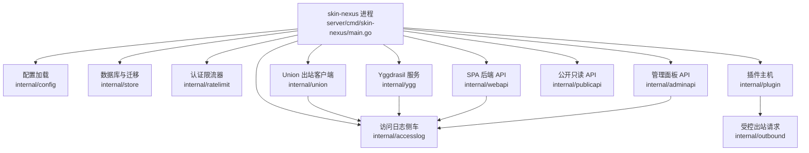

**图示来源**
- [main.go:201-550](https://github.com/YimingZhanshen/skin-nexus/blob/797ae1a/server/cmd/skin-nexus/main.go#L201-L550)
- [config.go:1-200](https://github.com/YimingZhanshen/skin-nexus/blob/797ae1a/server/internal/config/config.go#L1-L200)
- [accesslog.go:1-134](https://github.com/YimingZhanshen/skin-nexus/blob/797ae1a/server/internal/accesslog/accesslog.go#L1-L134)
- [limiter.go:1-187](https://github.com/YimingZhanshen/skin-nexus/blob/797ae1a/server/internal/ratelimit/limiter.go#L1-L187)
- [runtime_goja.go:1-200](https://github.com/YimingZhanshen/skin-nexus/blob/797ae1a/server/internal/plugin/runtime_goja.go#L1-L200)
- [outbound.go:1-167](https://github.com/YimingZhanshen/skin-nexus/blob/797ae1a/server/internal/outbound/outbound.go#L1-L167)
- [service.go:1-200](https://github.com/YimingZhanshen/skin-nexus/blob/797ae1a/server/internal/ygg/service.go#L1-L200)
- [webapi.go:1-200](https://github.com/YimingZhanshen/skin-nexus/blob/797ae1a/server/internal/webapi/webapi.go#L1-L200)
- [adminapi.go:1-200](https://github.com/YimingZhanshen/skin-nexus/blob/797ae1a/server/internal/adminapi/adminapi.go#L1-L200)
- [publicapi.go:1-200](https://github.com/YimingZhanshen/skin-nexus/blob/797ae1a/server/internal/publicapi/publicapi.go#L1-L200)
- [outbound.go:1-200](https://github.com/YimingZhanshen/skin-nexus/blob/797ae1a/server/internal/union/outbound.go#L1-L200)

**章节来源**
- [main.go:1-140](https://github.com/YimingZhanshen/skin-nexus/blob/797ae1a/server/cmd/skin-nexus/main.go#L1-L140)
- [config.go:1-200](https://github.com/YimingZhanshen/skin-nexus/blob/797ae1a/server/internal/config/config.go#L1-L200)

## 核心组件
### 唯一入口与命令分发
`server/cmd/skin-nexus/main.go` 是 SkinNexus 的唯一可执行入口。它承担以下职责：
- 解析 `os.Args`，分发 `version`、`migrate`、`redetect-models`、`fsck` 等运维子命令。
- 加载配置后构建存储引擎、应用迁移、回补去重键、确保超级管理员。
- 初始化纹理存储、SEO 引擎、主题注册表、外观引擎、邮件主题调色板。
- 构建插件主机、Yggdrasil 签名器、Union 出站栈、OIDC 提供者。
- 组装 `webapi`、`adminapi`、`publicapi`、`ygg` 的路由处理器。
- 安装访问日志、审计追踪、定时清理任务，并最终启动 HTTP 监听。

该入口体现的是“单一进程 + 多模块装配”模式，而不是微服务拆分。

**章节来源**
- [main.go:1-140](https://github.com/YimingZhanshen/skin-nexus/blob/797ae1a/server/cmd/skin-nexus/main.go#L1-L140)
- [main.go:201-550](https://github.com/YimingZhanshen/skin-nexus/blob/797ae1a/server/cmd/skin-nexus/main.go#L201-L550)

### 配置加载链路：12-factor SKIN_* 环境变量 → config.Config → 各 internal 模块
配置定义在 `internal/config/config.go`，核心结构体 `Config` 集中描述监听地址、站点 URL、数据库 DSN、SMTP、主题与插件路径、Union 开关、限流阈值等所有运行期选项。

`internal/config/env.go` 维护了权威的环境变量清单 `KnownEnv`，并在启动时检查未使用的 `SKIN_*` 变量，防止拼写错误导致“静默使用默认值”。

配置加载流程如下：

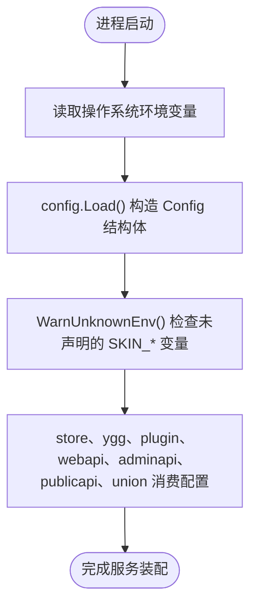

**图示来源**
- [config.go:1-200](https://github.com/YimingZhanshen/skin-nexus/blob/797ae1a/server/internal/config/config.go#L1-L200)
- [env.go:1-104](https://github.com/YimingZhanshen/skin-nexus/blob/797ae1a/server/internal/config/env.go#L1-L104)
- [main.go:201-550](https://github.com/YimingZhanshen/skin-nexus/blob/797ae1a/server/cmd/skin-nexus/main.go#L201-L550)

关键设计要点：
- 所有配置来自环境变量，不引入 `.env` 以外的秘密注入机制。
- 部分值（如 `site_url`、`cdn_enabled`、`skin_domains`）可在启动后从数据库选项覆盖，实现热切换。
- 插件市场、主题市场、信任密钥、Union 等可选能力都可通过空值或 `false` 关闭，保证非联盟部署零攻击面。

**章节来源**
- [config.go:1-200](https://github.com/YimingZhanshen/skin-nexus/blob/797ae1a/server/internal/config/config.go#L1-L200)
- [env.go:1-104](https://github.com/YimingZhanshen/skin-nexus/blob/797ae1a/server/internal/config/env.go#L1-L104)

### HTTP 路由装配与 go-chi/v5 服务器上下文
根据代码注释，SkinNexus 暴露的主要路由族包括：
- `/api/yggdrasil/*`：Yggdrasil 兼容接口。
- `/api/v1/*`：SPA 后端接口。
- `/api/public/v1/*`：公开只读接口。
- `/textures/{hash}`：纹理文件服务。
- `/skin/{player}.png` 等：历史兼容路径。
- `/*`：前端静态资源或 SPA 回退。

`server/cmd/skin-nexus/server.go` 中的 `newHTTPServer` 负责创建带超时的 `http.Server`，避免慢客户端耗尽文件描述符或协程。虽然当前文件中直接使用标准库 `http.Server`，但路由装配逻辑位于同一命令包中，并由 `main.go` 把各模块的处理器组合到统一监听器。

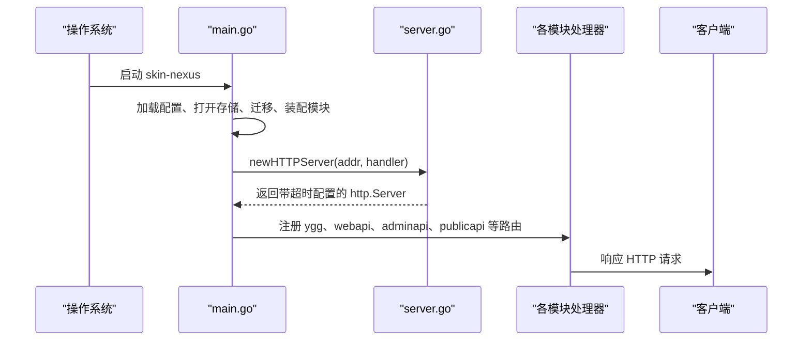

**图示来源**
- [server.go:1-24](https://github.com/YimingZhanshen/skin-nexus/blob/797ae1a/server/cmd/skin-nexus/server.go#L1-L24)
- [main.go:201-550](https://github.com/YimingZhanshen/skin-nexus/blob/797ae1a/server/cmd/skin-nexus/main.go#L201-L550)

**章节来源**
- [server.go:1-24](https://github.com/YimingZhanshen/skin-nexus/blob/797ae1a/server/cmd/skin-nexus/server.go#L1-L24)
- [main.go:1-140](https://github.com/YimingZhanshen/skin-nexus/blob/797ae1a/server/cmd/skin-nexus/main.go#L1-L140)

## 架构总览
SkinNexus 的高层调用关系可以概括为：**main 作为装配中心，向下依赖 store，向上提供 ygg、webapi、adminapi、publicapi、plugin、union 等模块。**

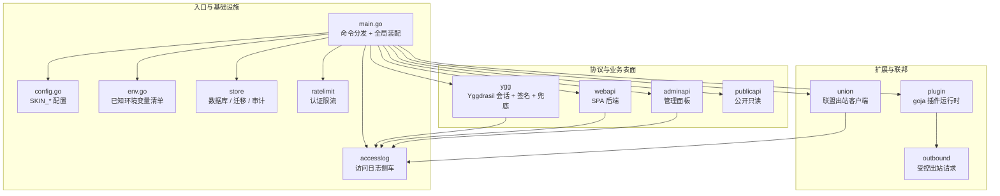

**图示来源**
- [main.go:201-550](https://github.com/YimingZhanshen/skin-nexus/blob/797ae1a/server/cmd/skin-nexus/main.go#L201-L550)
- [config.go:1-200](https://github.com/YimingZhanshen/skin-nexus/blob/797ae1a/server/internal/config/config.go#L1-L200)
- [env.go:1-104](https://github.com/YimingZhanshen/skin-nexus/blob/797ae1a/server/internal/config/env.go#L1-L104)
- [accesslog.go:1-134](https://github.com/YimingZhanshen/skin-nexus/blob/797ae1a/server/internal/accesslog/accesslog.go#L1-L134)
- [limiter.go:1-187](https://github.com/YimingZhanshen/skin-nexus/blob/797ae1a/server/internal/ratelimit/limiter.go#L1-L187)
- [service.go:1-200](https://github.com/YimingZhanshen/skin-nexus/blob/797ae1a/server/internal/ygg/service.go#L1-L200)
- [webapi.go:1-200](https://github.com/YimingZhanshen/skin-nexus/blob/797ae1a/server/internal/webapi/webapi.go#L1-L200)
- [adminapi.go:1-200](https://github.com/YimingZhanshen/skin-nexus/blob/797ae1a/server/internal/adminapi/adminapi.go#L1-L200)
- [publicapi.go:1-200](https://github.com/YimingZhanshen/skin-nexus/blob/797ae1a/server/internal/publicapi/publicapi.go#L1-L200)
- [runtime_goja.go:1-200](https://github.com/YimingZhanshen/skin-nexus/blob/797ae1a/server/internal/plugin/runtime_goja.go#L1-L200)
- [outbound.go:1-167](https://github.com/YimingZhanshen/skin-nexus/blob/797ae1a/server/internal/outbound/outbound.go#L1-L167)
- [outbound.go:1-200](https://github.com/YimingZhanshen/skin-nexus/blob/797ae1a/server/internal/union/outbound.go#L1-L200)

## 详细组件分析

### 配置子系统：config 与 env
`config.Config` 是所有模块共享的配置聚合根。它同时承担两种职责：
1. 结构化描述配置项类型与默认值。
2. 将 `os.Getenv` 结果转换为 Go 类型，例如布尔开关、整数阈值、逗号分隔域名、文件路径等。

`env.go` 的 `KnownEnv` 是“单一事实源”，配合 `WarnUnknownEnv()` 在启动时报告未消费的 `SKIN_*` 变量。测试还遍历源码，确保没有遗漏的环境变量读取。

| 配置类别 | 示例变量 | 作用 |
|---|---|---|
| 核心运行 | `SKIN_LISTEN`、`SKIN_BASE_URL`、`SKIN_ENV` | 监听地址、站点基础 URL、环境标签 |
| 数据存储 | `SKIN_DATABASE_DSN`、`SKIN_DATA_DIR`、`SKIN_MIGRATIONS_DIR` | 数据库连接、数据根目录、迁移 SQL 目录 |
| 身份与安全 | `SKIN_SETUP_TOKEN`、`SKIN_SIGN_KEY`、`SKIN_TRUSTED_PROXIES` | 安装向导令牌、签名密钥、可信代理头 |
| 认证策略 | `SKIN_RATE_LIMIT_AUTH`、`SKIN_LOGIN_FAIL_LIMIT`、`SKIN_REQUIRE_VERIFICATION` | 认证限流、失败锁定、邮箱验证门控 |
| 插件与主题市场 | `SKIN_PLUGIN_MARKET_URL`、`SKIN_THEME_TRUST_KEYS` | 市场地址、信任密钥、上传大小限制 |
| Union 联邦 | `SKIN_UNION_ENABLED`、`SKIN_UNION_API_ROOT`、`SKIN_UNION_MEMBER_KEY` | 联盟启用、Hub 地址、成员密钥 |

**章节来源**
- [config.go:1-200](https://github.com/YimingZhanshen/skin-nexus/blob/797ae1a/server/internal/config/config.go#L1-L200)
- [env.go:1-104](https://github.com/YimingZhanshen/skin-nexus/blob/797ae1a/server/internal/config/env.go#L1-L104)

### 错误处理契约：errorgate 的稳定错误结构
`internal/errorgate` 不是运行时中间件，而是一个 AST 门禁。它检查各个包的源代码，确保 HTTP 错误响应遵循 `{error, code, message}` 稳定结构：
- `code`：语言包可翻译的机器码。
- `message`：客户端无法识别 code 时显示的后备消息。
- 禁止直接输出中文硬编码文本作为用户可见消息。

门禁统计每个包中“无 code 的错误响应”和“包含中文字面量的错误响应”数量，并通过预算文件控制这些数字只能收缩，不能扩大。

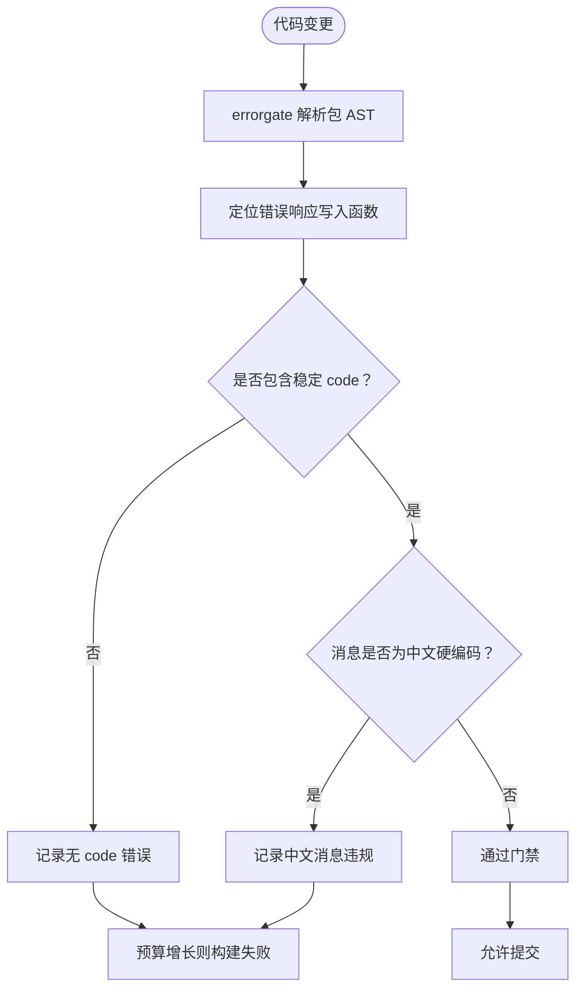

**图示来源**
- [errorgate.go:1-200](https://github.com/YimingZhanshen/skin-nexus/blob/797ae1a/server/internal/errorgate/errorgate.go#L1-L200)

该契约使前端错误展示更稳定：前端通过 `code` 走本地化，而不依赖后端返回的自然语言句子。

**章节来源**
- [errorgate.go:1-200](https://github.com/YimingZhanshen/skin-nexus/blob/797ae1a/server/internal/errorgate/errorgate.go#L1-L200)

### 访问日志侧车：accesslog
`internal/accesslog` 是横切观测面，记录网页登录、启动器登录、Yggdrasil 流量、Union 入出站和插件事件。其关键契约是：
- 记录失败不得影响主请求路径。
- `nil` Logger 或 `nil` Sink 都是安全的。
- 字段会被截断为数据库列宽上限。
- 诊断模式下才保留敏感细节；诊断窗口关闭后自动丢弃。

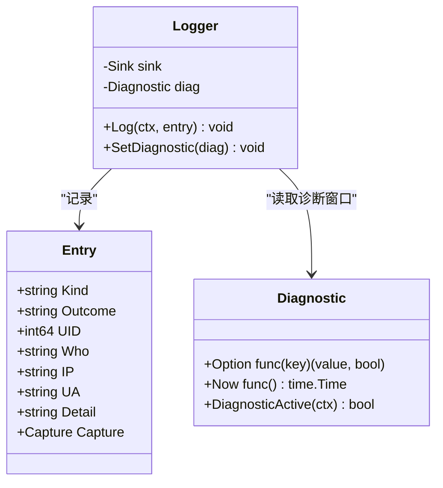

**图示来源**
- [accesslog.go:1-134](https://github.com/YimingZhanshen/skin-nexus/blob/797ae1a/server/internal/accesslog/accesslog.go#L1-L134)

**章节来源**
- [accesslog.go:1-134](https://github.com/YimingZhanshen/skin-nexus/blob/797ae1a/server/internal/accesslog/accesslog.go#L1-L134)

### 认证限流：ratelimit
`internal/ratelimit` 提供两层保护：
1. 按 IP 的滑动窗口请求计数，防止批量滥用。
2. 按标识符的连续失败锁定，防止密码猜测。

两者互不干扰：IP 窗口不会锁定标识符，失败也不会锁定 IP，从而避免共享 NAT 出口误伤整个网段。

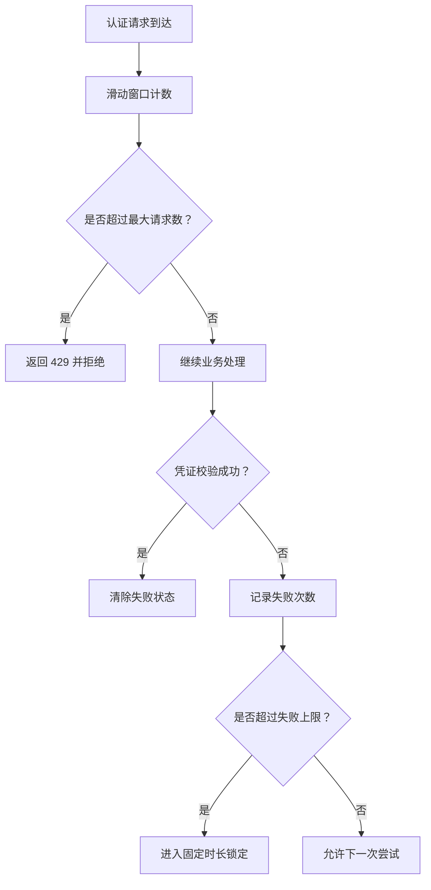

**图示来源**
- [limiter.go:1-187](https://github.com/YimingZhanshen/skin-nexus/blob/797ae1a/server/internal/ratelimit/limiter.go#L1-L187)

**章节来源**
- [limiter.go:1-187](https://github.com/YimingZhanshen/skin-nexus/blob/797ae1a/server/internal/ratelimit/limiter.go#L1-L187)

### 插件运行时：plugin 与 goja 隔离
`internal/plugin` 使用 `github.com/dop251/goja` 执行 JavaScript 插件脚本。每个插件拥有独立 VM，并通过 `sync.Mutex` 串行化访问，因为 goja 不是 goroutine 安全的。

插件能力边界：
- 钩子：用户资料过滤、纹理 URL 过滤、上传事件、生命周期事件、认证阶段观察、头像过滤。
- 路由：插件贡献只读路由，必须与清单声明一致。
- 配置：通过权限控制的 `skin.config.get/all`。
- 网络：仅当插件声明 `PermNetHTTP` 且配置允许时，才会获得受限的出站客户端。
- 任务：通过 `jobs.Store` 调度持久化任务。
- 超时：加载脚本、钩子、认证钩子和路由都有独立超时预算。

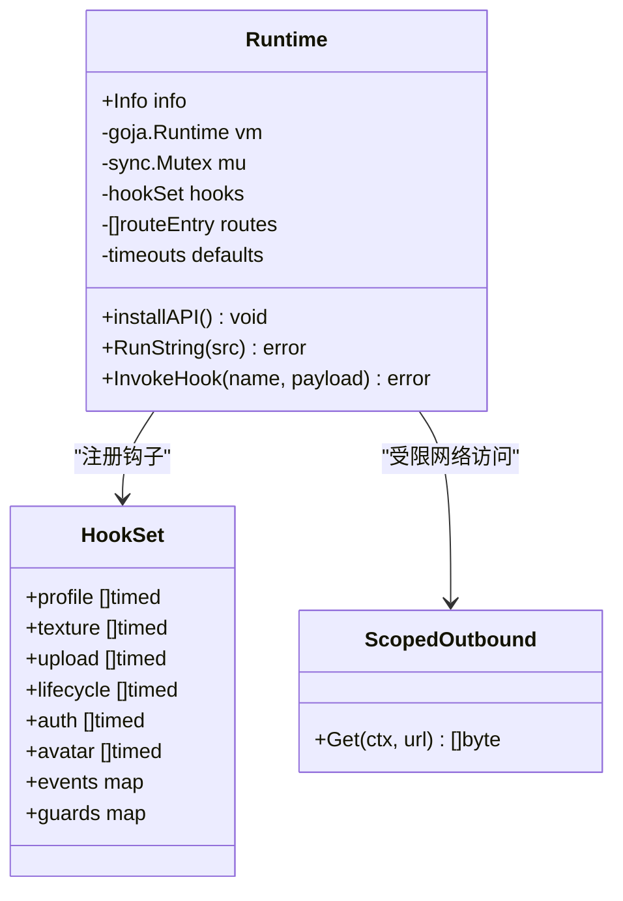

**图示来源**
- [runtime_goja.go:1-200](https://github.com/YimingZhanshen/skin-nexus/blob/797ae1a/server/internal/plugin/runtime_goja.go#L1-L200)
- [outbound.go:1-167](https://github.com/YimingZhanshen/skin-nexus/blob/797ae1a/server/internal/outbound/outbound.go#L1-L167)

**章节来源**
- [runtime_goja.go:1-200](https://github.com/YimingZhanshen/skin-nexus/blob/797ae1a/server/internal/plugin/runtime_goja.go#L1-L200)

### 受控出站请求：outbound
`internal/outbound` 是宿主侧的最小出站 HTTP 客户端，主要用于市场下载等受控网络行为。它明确不暴露给插件 JavaScript。

安全限制包括：
- 仅允许 GET。
- 不允许重定向。
- 不允许非公网地址。
- 不允许带用户名密码的 URL。
- 不允许非标端口。
- 限制响应大小。
- 禁用连接复用。
- 设置 TLS 握手与响应头超时。

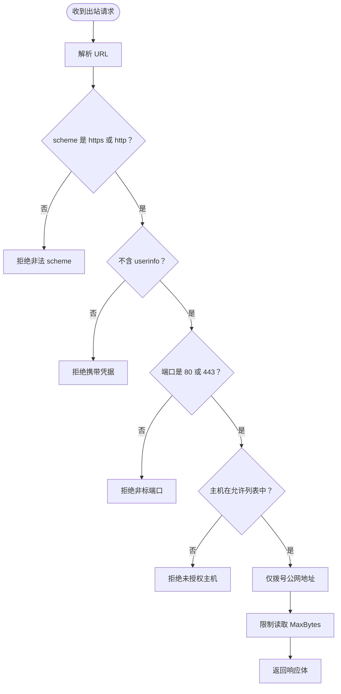

**图示来源**
- [outbound.go:1-167](https://github.com/YimingZhanshen/skin-nexus/blob/797ae1a/server/internal/outbound/outbound.go#L1-L167)

**章节来源**
- [outbound.go:1-167](https://github.com/YimingZhanshen/skin-nexus/blob/797ae1a/server/internal/outbound/outbound.go#L1-L167)

### Yggdrasil 服务：ygg
`internal/ygg/service.go` 实现 Yggdrasil 会话逻辑，包括：
- 用户与玩家模型。
- Token 签发、查找、失效。
- Join/hasJoined 会话。
- 双 TTL 窗口。
- 可注入的 token resolver（支持 OIDC JWT）。
- 插件钩子：纹理 URL 重写、资料过滤、认证阶段观察、用户生命周期观察。
- 访问日志接入。
- Mojang 官方兜底。

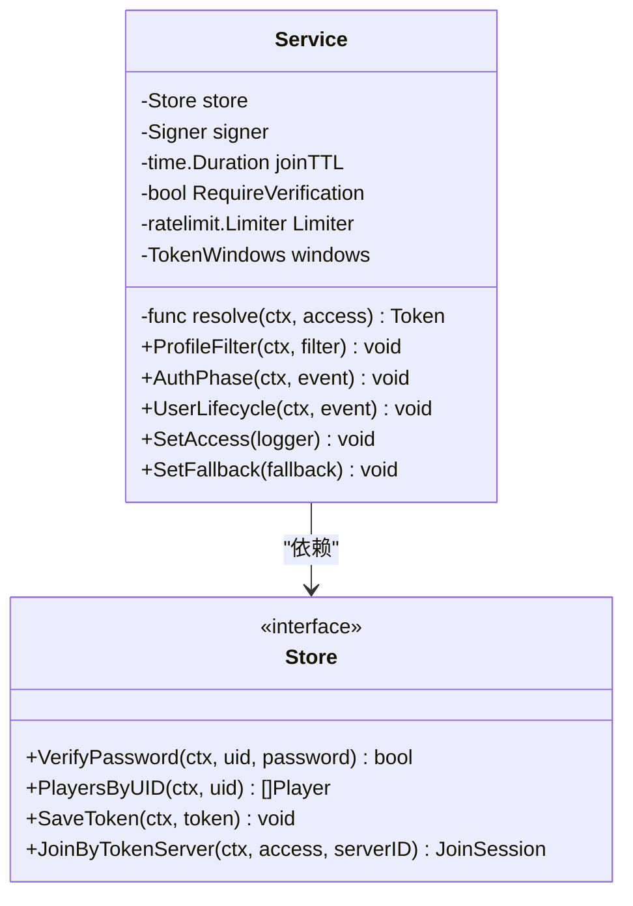

**图示来源**
- [service.go:1-200](https://github.com/YimingZhanshen/skin-nexus/blob/797ae1a/server/internal/ygg/service.go#L1-L200)

**章节来源**
- [service.go:1-200](https://github.com/YimingZhanshen/skin-nexus/blob/797ae1a/server/internal/ygg/service.go#L1-L200)

### Union 出站客户端：union
`internal/union/outbound.go` 是成员站点到 Hub 的客户端。它具备：
- 原子化的成员密钥与 Hub API Root，支持运行时旋转。
- 超时限制。
- 访问日志接入。
- 对 Hub 非 2xx 响应的结构化错误。
- 诊断报告，包含上游状态、传输错误原因和本地探针信息。

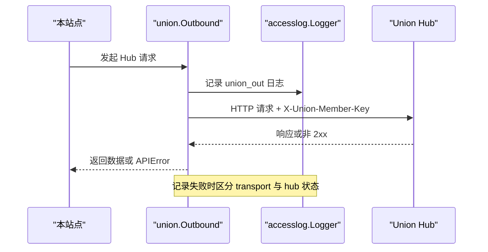

**图示来源**
- [outbound.go:1-200](https://github.com/YimingZhanshen/skin-nexus/blob/797ae1a/server/internal/union/outbound.go#L1-L200)
- [accesslog.go:1-134](https://github.com/YimingZhanshen/skin-nexus/blob/797ae1a/server/internal/accesslog/accesslog.go#L1-L134)

**章节来源**
- [outbound.go:1-200](https://github.com/YimingZhanshen/skin-nexus/blob/797ae1a/server/internal/union/outbound.go#L1-L200)

### WebAPI、AdminAPI 与 PublicAPI
三个 API 包分别对应不同受众：

| API | 主要职责 | 安全模型 |
|---|---|---|
| `webapi` | SPA 后端：注册、登录、个人资料、纹理上传、设置、Union 管理端点 | 会话认证、限流、插件守卫 |
| `adminapi` | 管理面板：用户、纹理、审计、报告、插件、设置、Union 操作 | Web 管理员会话；无 Cookie 机器客户端可用 `X-Admin-Token` |
| `publicapi` | 公开只读：玩家查询、CustomSkinAPI、历史兼容路径 | 无鉴权，CORS 开放 |

它们都依赖 `store`、`texture`、`ygg`，并可选择性地接入 `plugin`、`union`、`accesslog`。

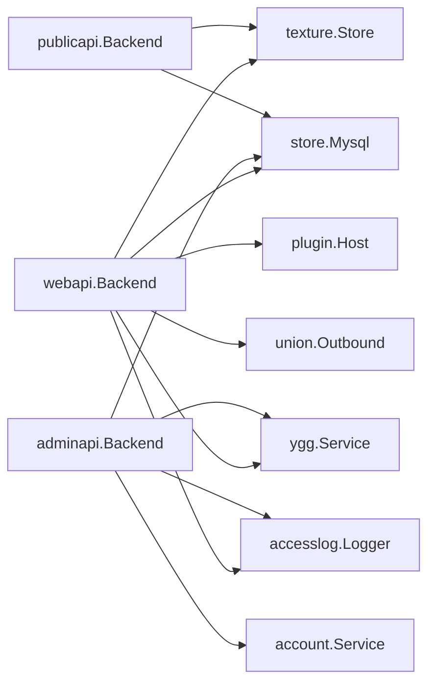

**图示来源**
- [webapi.go:1-200](https://github.com/YimingZhanshen/skin-nexus/blob/797ae1a/server/internal/webapi/webapi.go#L1-L200)
- [adminapi.go:1-200](https://github.com/YimingZhanshen/skin-nexus/blob/797ae1a/server/internal/adminapi/adminapi.go#L1-L200)
- [publicapi.go:1-200](https://github.com/YimingZhanshen/skin-nexus/blob/797ae1a/server/internal/publicapi/publicapi.go#L1-L200)

**章节来源**
- [webapi.go:1-200](https://github.com/YimingZhanshen/skin-nexus/blob/797ae1a/server/internal/webapi/webapi.go#L1-L200)
- [adminapi.go:1-200](https://github.com/YimingZhanshen/skin-nexus/blob/797ae1a/server/internal/adminapi/adminapi.go#L1-L200)
- [publicapi.go:1-200](https://github.com/YimingZhanshen/skin-nexus/blob/797ae1a/server/internal/publicapi/publicapi.go#L1-L200)

## 依赖关系分析
SkinNexus 的依赖方向是自上而下的装配链：

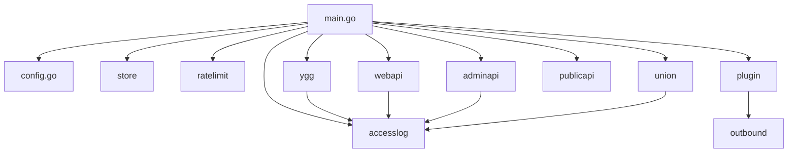

**图示来源**
- [main.go:201-550](https://github.com/YimingZhanshen/skin-nexus/blob/797ae1a/server/cmd/skin-nexus/main.go#L201-L550)
- [config.go:1-200](https://github.com/YimingZhanshen/skin-nexus/blob/797ae1a/server/internal/config/config.go#L1-L200)
- [accesslog.go:1-134](https://github.com/YimingZhanshen/skin-nexus/blob/797ae1a/server/internal/accesslog/accesslog.go#L1-L134)
- [limiter.go:1-187](https://github.com/YimingZhanshen/skin-nexus/blob/797ae1a/server/internal/ratelimit/limiter.go#L1-L187)
- [runtime_goja.go:1-200](https://github.com/YimingZhanshen/skin-nexus/blob/797ae1a/server/internal/plugin/runtime_goja.go#L1-L200)
- [outbound.go:1-167](https://github.com/YimingZhanshen/skin-nexus/blob/797ae1a/server/internal/outbound/outbound.go#L1-L167)
- [service.go:1-200](https://github.com/YimingZhanshen/skin-nexus/blob/797ae1a/server/internal/ygg/service.go#L1-L200)
- [webapi.go:1-200](https://github.com/YimingZhanshen/skin-nexus/blob/797ae1a/server/internal/webapi/webapi.go#L1-L200)
- [adminapi.go:1-200](https://github.com/YimingZhanshen/skin-nexus/blob/797ae1a/server/internal/adminapi/adminapi.go#L1-L200)
- [publicapi.go:1-200](https://github.com/YimingZhanshen/skin-nexus/blob/797ae1a/server/internal/publicapi/publicapi.go#L1-L200)
- [outbound.go:1-200](https://github.com/YimingZhanshen/skin-nexus/blob/797ae1a/server/internal/union/outbound.go#L1-L200)

耦合特征：
- `main.go` 是装配中心，耦合度最高，但职责清晰：只负责组装，不实现具体业务。
- `internal/*` 包之间通过显式依赖注入耦合，便于测试替换。
- 插件与 Union 是可选能力，通过 nil 或关闭开关降低耦合。

**章节来源**
- [main.go:201-550](https://github.com/YimingZhanshen/skin-nexus/blob/797ae1a/server/cmd/skin-nexus/main.go#L201-L550)

## 性能与部署特性
### Go 单二进制架构优势
1. **简化部署**：只需一个可执行文件和必要的数据目录，适合容器化、托管面板和传统 VPS。
2. **减少进程间通信**：所有模块在同一进程内通过函数调用交互，避免 RPC 序列化、网络延迟和服务发现。
3. **便于嵌入静态资源**：前端构建产物、迁移 SQL、主题与插件打包可随二进制或文件系统一起交付。
4. **易于监控与排障**：日志、goroutine、heap、CPU profile 都在单一进程中采集。

### HTTP 服务器超时
`newHTTPServer` 设置了：
- `ReadHeaderTimeout`：防止慢客户端占住头部读取。
- `ReadTimeout`：防止缓慢上传拖死连接。
- `WriteTimeout`：防止响应写出阻塞。
- `IdleTimeout`：空闲连接回收。
- `MaxHeaderBytes`：限制请求头大小。

这符合负载均衡器或反向代理前常见的大流量站点防护要求。

**章节来源**
- [server.go:1-24](https://github.com/YimingZhanshen/skin-nexus/blob/797ae1a/server/cmd/skin-nexus/server.go#L1-L24)

## 可扩展性边界
### 插件扩展
插件通过 `plugin.NewHost` 注入：
- 钩子回调。
- 只读路由。
- 插件 UI。
- 表单校验。
- 生命周期事件。
- 审计与访问日志。

插件风险被限制在 goja VM 中，并受到：
- 脚本加载超时。
- 钩子超时。
- 路由超时。
- 权限控制。
- 可选的网络白名单。
- 最大上传大小。
- 已安装包校验。

### 外部依赖保护
外部依赖主要通过两条路径受控：
1. **插件网络**：仅在插件声明 `PermNetHTTP` 且配置允许时使用 `outbound.Scoped`。
2. **市场下载**：`internal/outbound` 严格限制 scheme、host、port、重定向、响应大小和公网地址。

Union 出站也有限制：
- 成员密钥原子替换。
- 超时。
- 访问日志。
- 结构化错误。

**章节来源**
- [runtime_goja.go:1-200](https://github.com/YimingZhanshen/skin-nexus/blob/797ae1a/server/internal/plugin/runtime_goja.go#L1-L200)
- [outbound.go:1-167](https://github.com/YimingZhanshen/skin-nexus/blob/797ae1a/server/internal/outbound/outbound.go#L1-L167)
- [outbound.go:1-200](https://github.com/YimingZhanshen/skin-nexus/blob/797ae1a/server/internal/union/outbound.go#L1-L200)

## 横向关注点
### 访问日志
访问日志贯穿多个表面：
- Yggdrasil 请求。
- Union 入出站。
- 插件路由。
- Web 登录与注册。
- 诊断模式下的详情捕获。

日志写入是 best-effort，失败只记录到操作日志，不影响业务响应。

**章节来源**
- [accesslog.go:1-134](https://github.com/YimingZhanshen/skin-nexus/blob/797ae1a/server/internal/accesslog/accesslog.go#L1-L134)
- [main.go:201-550](https://github.com/YimingZhanshen/skin-nexus/blob/797ae1a/server/cmd/skin-nexus/main.go#L201-L550)

### 限流
限流集中在认证相关路径：
- `ratelimit.Limiter` 提供 IP 滑动窗口和标识符失败锁定。
- `ygg.Service` 可注入相同限流器。
- `webapi.Backend` 同样可注入限流器保护注册与登录。

**章节来源**
- [limiter.go:1-187](https://github.com/YimingZhanshen/skin-nexus/blob/797ae1a/server/internal/ratelimit/limiter.go#L1-L187)
- [service.go:1-200](https://github.com/YimingZhanshen/skin-nexus/blob/797ae1a/server/internal/ygg/service.go#L1-L200)
- [webapi.go:1-200](https://github.com/YimingZhanshen/skin-nexus/blob/797ae1a/server/internal/webapi/webapi.go#L1-L200)

### CSRF
CSRF 在插件表单校验与插件路由中体现：
- `webapi` 调用 `plugin.ValidateFormData` 校验 host 渲染的插件表单。
- 插件运行时存在 CSRF 稳定性测试，说明插件请求需要稳定的 CSRF 上下文。

由于具体实现分布在多个插件桥接文件，本文不展开具体 header 名称，但整体原则是：可写操作必须经过会话或无 Cookie 机器管理令牌校验，插件表单需经服务端校验。

**章节来源**
- [webapi.go:1-200](https://github.com/YimingZhanshen/skin-nexus/blob/797ae1a/server/internal/webapi/webapi.go#L1-L200)
- [runtime_goja.go:1-200](https://github.com/YimingZhanshen/skin-nexus/blob/797ae1a/server/internal/plugin/runtime_goja.go#L1-L200)

### CSP
CSP 相关能力来自 `config.Config`：
- `CSPScriptExtraSources`
- `CSPConnectExtraSources`

这些值由操作员提供，并在启动时被当作 CSP source 验证；非法值会在启动阶段报错，而不是运行时动态拼装不安全字符串。

**章节来源**
- [config.go:1-200](https://github.com/YimingZhanshen/skin-nexus/blob/797ae1a/server/internal/config/config.go#L1-L200)

### 审计追踪
审计写入位置：
- `store.InsertAudit` 被多次注入到账户服务、OIDC、插件主机、Union 等模块。
- 管理面板暴露审计查询接口。
- 访问日志与审计日志互补：访问日志偏操作流水，审计日志偏账号与资产变更。

**章节来源**
- [adminapi.go:1-200](https://github.com/YimingZhanshen/skin-nexus/blob/797ae1a/server/internal/adminapi/adminapi.go#L1-L200)
- [main.go:201-550](https://github.com/YimingZhanshen/skin-nexus/blob/797ae1a/server/cmd/skin-nexus/main.go#L201-L550)

## 故障排查指南
### 启动阶段问题
| 现象 | 可能原因 | 排查建议 |
|---|---|---|
| 启动时报配置错误 | `SKIN_*` 变量缺失或类型错误 | 检查 `config.Load()` 日志，核对 `env.go` 中的已知变量 |
| 提示未使用的 `SKIN_*` 变量 | 环境变量拼写错误或不再使用 | 对照部署文档修正变量名 |
| 数据库迁移失败 | DSN 不可用、权限不足、SQL 冲突 | 检查 `SKIN_DATABASE_DSN`、数据库实例、迁移目录 |
| 签名密钥生成失败 | 数据目录不可写或磁盘空间不足 | 检查 `SKIN_DATA_DIR` 权限 |
| 插件市场不可用 | 信任密钥无效或市场 URL 不可达 | 检查 `SKIN_PLUGIN_MARKET_URL`、`SKIN_PLUGIN_TRUST_KEYS` |

### 运行时问题
| 现象 | 可能原因 | 排查建议 |
|---|---|---|
| 登录频繁 429 | 触发滑动窗口或失败锁定 | 查看 `ratelimit` 阈值与访问日志 |
| 插件脚本卡住 | goja 钩子或加载超时 | 检查插件日志、超时配置、钩子逻辑 |
| 插件访问外网失败 | 出站白名单限制 | 检查插件 manifest 和网络配置 |
| Union 同步失败 | Hub 不可达、密钥过期、非 2xx 响应 | 查看 Union 访问日志与诊断报告 |
| 错误消息无法本地化 | 违反 errorgate 契约 | 检查错误响应是否包含稳定 `code` |

**章节来源**
- [config.go:1-200](https://github.com/YimingZhanshen/skin-nexus/blob/797ae1a/server/internal/config/config.go#L1-L200)
- [env.go:1-104](https://github.com/YimingZhanshen/skin-nexus/blob/797ae1a/server/internal/config/env.go#L1-L104)
- [limiter.go:1-187](https://github.com/YimingZhanshen/skin-nexus/blob/797ae1a/server/internal/ratelimit/limiter.go#L1-L187)
- [runtime_goja.go:1-200](https://github.com/YimingZhanshen/skin-nexus/blob/797ae1a/server/internal/plugin/runtime_goja.go#L1-L200)
- [outbound.go:1-167](https://github.com/YimingZhanshen/skin-nexus/blob/797ae1a/server/internal/outbound/outbound.go#L1-L167)
- [outbound.go:1-200](https://github.com/YimingZhanshen/skin-nexus/blob/797ae1a/server/internal/union/outbound.go#L1-L200)
- [errorgate.go:1-200](https://github.com/YimingZhanshen/skin-nexus/blob/797ae1a/server/internal/errorgate/errorgate.go#L1-L200)

## 结论
SkinNexus 后端采用清晰的单二进制装配架构：`main.go` 负责命令分发与模块组装，`config` 负责 12-factor 配置加载，`store` 负责持久化，`ygg`、`webapi`、`adminapi`、`publicapi` 暴露协议表面，`plugin` 提供 goja 隔离扩展点，`union` 提供联盟出站能力。

它的核心安全与可维护性特点包括：
- 错误响应通过 `errorgate` 强制稳定结构。
- 插件执行受 VM、超时、权限和白名单约束。
- 外部网络访问通过 `outbound` 与 Union 客户端受控。
- 访问日志、审计、限流、CSP、CSRF 等横向关注点贯穿请求链。
- 单二进制部署简化了运维，同时保留了足够强的可扩展性。

对于后续演进，应继续保持：
- 配置与环境的单一事实源。
- 错误码优先于自然语言消息。
- 插件与外部依赖的显式白名单。
- 横切能力的 best-effort 语义，确保业务协议不受辅助功能影响。
