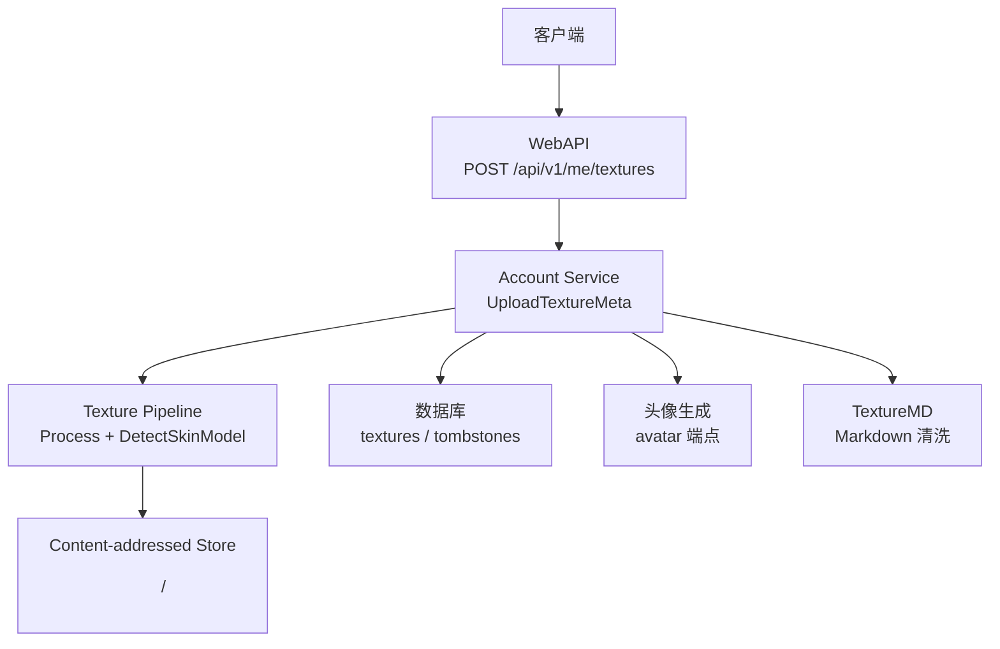
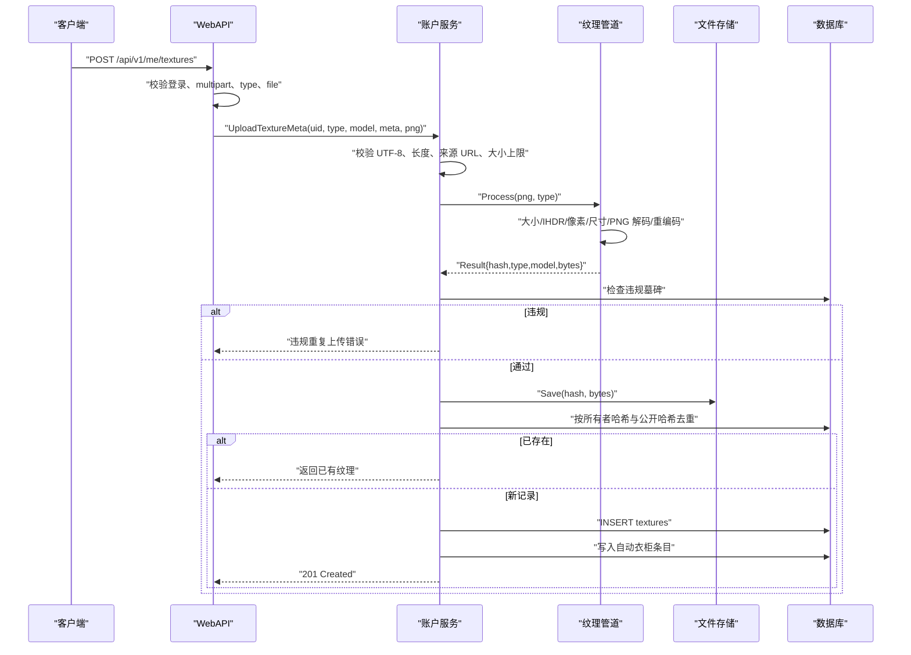
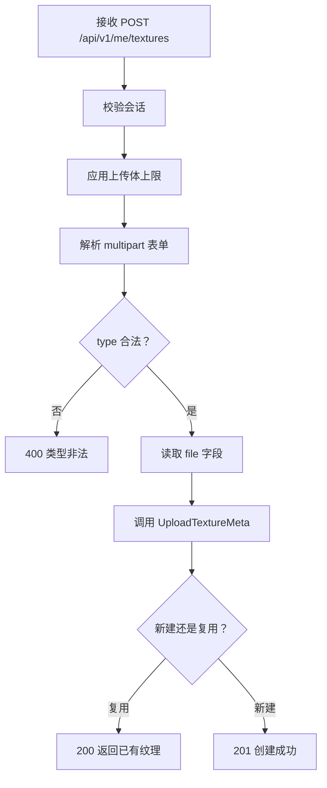
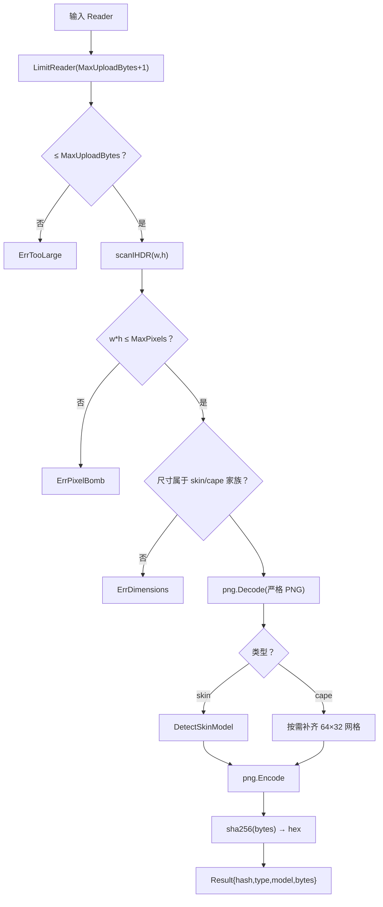
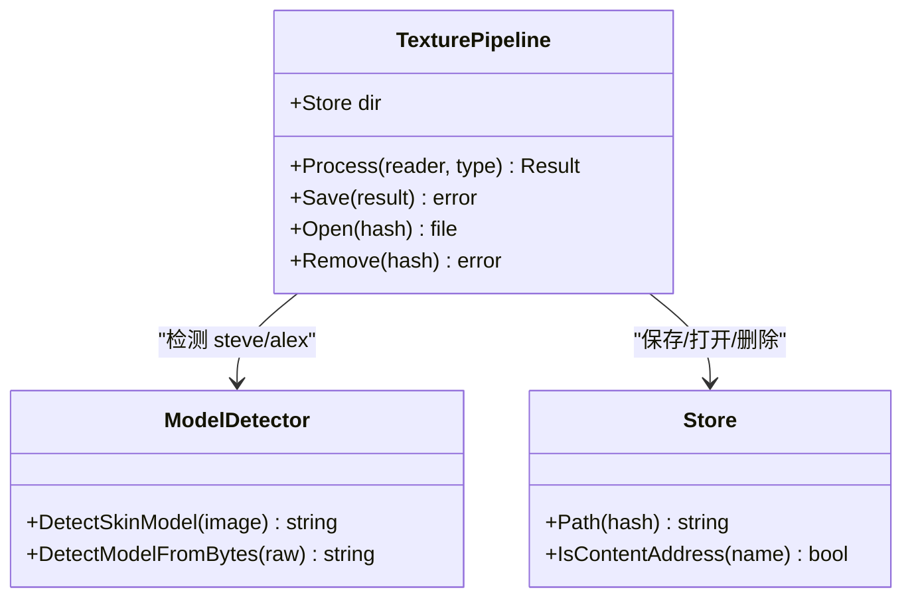
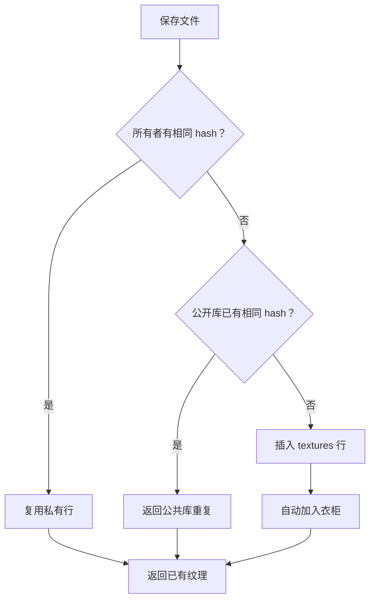
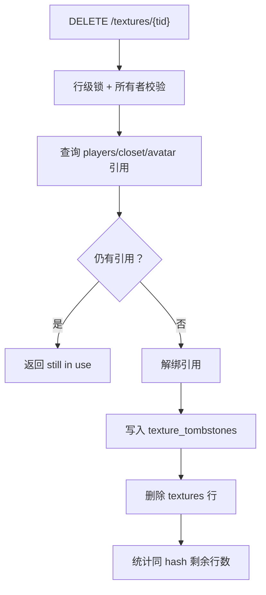
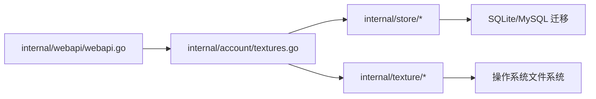

# 纹理上传与处理管线

**本文引用的文件**
- [pipeline.go](https://github.com/YimingZhanshen/skin-nexus/blob/797ae1a/server/internal/texture/pipeline.go)
- [model.go](https://github.com/YimingZhanshen/skin-nexus/blob/797ae1a/server/internal/texture/model.go)
- [delete.go](https://github.com/YimingZhanshen/skin-nexus/blob/797ae1a/server/internal/texture/delete.go)
- [texturemd.go](https://github.com/YimingZhanshen/skin-nexus/blob/797ae1a/server/internal/texturemd/texturemd.go)
- [webapi.go](https://github.com/YimingZhanshen/skin-nexus/blob/797ae1a/server/internal/webapi/webapi.go)
- [textures.go](https://github.com/YimingZhanshen/skin-nexus/blob/797ae1a/server/internal/account/textures.go)
- [texdelete.go](https://github.com/YimingZhanshen/skin-nexus/blob/797ae1a/server/internal/store/texdelete.go)
- [schema.go](https://github.com/YimingZhanshen/skin-nexus/blob/797ae1a/server/internal/store/schema.go)
- [0017_texture_metadata_reports.sql](https://github.com/YimingZhanshen/skin-nexus/blob/797ae1a/server/migrations/sqlite/0017_texture_metadata_reports.sql)
- [0018_texture_moderation.sql](https://github.com/YimingZhanshen/skin-nexus/blob/797ae1a/server/migrations/sqlite/0018_texture_moderation.sql)
- [0019_texture_tombstones.sql](https://github.com/YimingZhanshen/skin-nexus/blob/797ae1a/server/migrations/sqlite/0019_texture_tombstones.sql)
- [0024_textures_public_upload.sql](https://github.com/YimingZhanshen/skin-nexus/blob/797ae1a/server/migrations/sqlite/0024_textures_public_upload.sql)

## 目录
1. [简介](#简介)
2. [项目结构](#项目结构)
3. [核心组件](#核心组件)
4. [架构总览](#架构总览)
5. [详细组件分析](#详细组件分析)
6. [依赖关系分析](#依赖关系分析)
7. [性能考虑](#性能考虑)
8. [故障排查指南](#故障排查指南)
9. [结论](#结论)

## 简介
本文面向 SkinNexus 的“纹理上传与处理管线”，从客户端提交皮肤或披风图片开始，逐步说明：请求进入 webapi、校验大小与 MIME、PNG 解码、压缩重编码、模型检测、哈希计算、去重判断、写入内容地址存储、生成头像、可选 Markdown 描述解析、公开或私密状态设置。文档同时给出 Texture 数据模型字段及其业务含义，提供成功上传与常见失败场景的 HTTP 响应示例，并解释软删除、墓碑机制以及 `texturemd` 在元数据处理中的作用。最后给出异步解压、CDN 缓存、磁盘容量告警和去重等优化建议。

## 项目结构
该管线横跨三个层次：
- Web API 层：负责会话校验、表单解析、上传大小上限、错误码映射与最终 JSON 响应。
- 账户服务层：负责业务规则（类型、模型声明、描述长度、来源 URL、大小上限、审核拦截、锁与事务）。
- 纹理处理层：负责 PNG 解码、尺寸与像素炸弹防护、重编码、内容哈希、内容地址存储、steve/alex 模型检测。



**图表来源**
- [webapi.go:309-310](https://github.com/YimingZhanshen/skin-nexus/blob/797ae1a/server/internal/webapi/webapi.go#L309-L310)
- [webapi.go:1037-1104](https://github.com/YimingZhanshen/skin-nexus/blob/797ae1a/server/internal/webapi/webapi.go#L1037-L1104)
- [textures.go:107-334](https://github.com/YimingZhanshen/skin-nexus/blob/797ae1a/server/internal/account/textures.go#L107-L334)
- [pipeline.go:1-170](https://github.com/YimingZhanshen/skin-nexus/blob/797ae1a/server/internal/texture/pipeline.go#L1-L170)
- [model.go:1-68](https://github.com/YimingZhanshen/skin-nexus/blob/797ae1a/server/internal/texture/model.go#L1-L68)
- [texturemd.go:1-66](https://github.com/YimingZhanshen/skin-nexus/blob/797ae1a/server/internal/texturemd/texturemd.go#L1-L66)

**章节来源**
- [webapi.go:309-310](https://github.com/YimingZhanshen/skin-nexus/blob/797ae1a/server/internal/webapi/webapi.go#L309-L310)
- [webapi.go:403-424](https://github.com/YimingZhanshen/skin-nexus/blob/797ae1a/server/internal/webapi/webapi.go#L403-L424)
- [webapi.go:1037-1104](https://github.com/YimingZhanshen/skin-nexus/blob/797ae1a/server/internal/webapi/webapi.go#L1037-L1104)
- [textures.go:107-334](https://github.com/YimingZhanshen/skin-nexus/blob/797ae1a/server/internal/account/textures.go#L107-L334)
- [pipeline.go:1-170](https://github.com/YimingZhanshen/skin-nexus/blob/797ae1a/server/internal/texture/pipeline.go#L1-L170)

## 核心组件
- **WebAPI 上传入口**：`POST /api/v1/me/textures`。先校验登录态，再对 multipart 请求体施加额外上限，解析 `type`、`file`、`description`、`detail`、`source`、`sourceUrl`、`public` 等字段，然后调用账户服务的 `UploadTextureMeta`。
- **账户服务上传逻辑**：校验类型、模型声明、UTF-8、名称与描述长度、来源与来源 URL 合法性；将字节数组交给纹理管道；检查违规墓碑；写入文件；按所有者哈希与公开哈希去重；插入 `textures` 行；触发插件事件、审计与自动衣柜添加。
- **纹理管道**：限制原始字节大小、扫描 IHDR、像素炸弹检查、尺寸家族校验、严格 PNG 解码、按类型处理 steve/alex 模型与披风补齐、PNG 重编码、SHA-256 取 hex 作为文件名与缓存键。
- **内容地址存储**：以 64 位十六进制 hash 为文件名；存在即幂等跳过；提供 `Path`、`Save`、`Open`、`Remove`。
- **模型检测**：仅对正方形且宽度是 64 倍数的皮肤图像，检测右臂区域透明像素来决定 `slim`（Alex）或 `default`（Steve），不信任上传者声明。
- **Markdown 描述处理**：`texturemd` 使用受限渲染策略，只允许基础排版与 http(s) 链接，剥离远程图片与危险元素。
- **删除与墓碑**：硬删除前复制当前行到 `texture_tombstones`，解绑玩家、衣柜、头像引用，保留举报历史，文件删除由上层根据共享计数决定。

**章节来源**
- [webapi.go:1037-1104](https://github.com/YimingZhanshen/skin-nexus/blob/797ae1a/server/internal/webapi/webapi.go#L1037-L1104)
- [textures.go:107-334](https://github.com/YimingZhanshen/skin-nexus/blob/797ae1a/server/internal/account/textures.go#L107-L334)
- [pipeline.go:1-170](https://github.com/YimingZhanshen/skin-nexus/blob/797ae1a/server/internal/texture/pipeline.go#L1-L170)
- [model.go:1-68](https://github.com/YimingZhanshen/skin-nexus/blob/797ae1a/server/internal/texture/model.go#L1-L68)
- [texturemd.go:1-66](https://github.com/YimingZhanshen/skin-nexus/blob/797ae1a/server/internal/texturemd/texturemd.go#L1-L66)
- [delete.go:1-21](https://github.com/YimingZhanshen/skin-nexus/blob/797ae1a/server/internal/texture/delete.go#L1-L21)
- [texdelete.go:1-200](https://github.com/YimingZhanshen/skin-nexus/blob/797ae1a/server/internal/store/texdelete.go#L1-L200)

## 架构总览
纹理上传的生命周期可抽象为一次串行流水线，关键分支集中在账户服务层。



**图表来源**
- [webapi.go:1037-1104](https://github.com/YimingZhanshen/skin-nexus/blob/797ae1a/server/internal/webapi/webapi.go#L1037-L1104)
- [textures.go:107-334](https://github.com/YimingZhanshen/skin-nexus/blob/797ae1a/server/internal/account/textures.go#L107-L334)
- [pipeline.go:1-170](https://github.com/YimingZhanshen/skin-nexus/blob/797ae1a/server/internal/texture/pipeline.go#L1-L170)

## 详细组件分析

### 上传请求处理流程
WebAPI 的上传路由是 `/api/v1/me/textures`。它执行以下动作：
1. 获取当前用户，未登录返回未认证错误。
2. 对该路由放宽全局 JSON 体上限，改用 `MaxBytesReader` 把请求体限制为 `MaxUploadBytes + uploadBodySlack`。
3. 解析 multipart 表单；如果因过大被截断，返回 `413 Request Entity Too Large`，并携带 `upload.too_large` 类代码。
4. 校验 `type` 必须为 `skin` 或 `cape`。
5. 读取 `file` 字段，再次用 `LimitReader(MaxUploadBytes+1)` 防止超大文件撑满内存。
6. 提取 `description`、`detail`、`source`、`sourceUrl`、`public`。
7. 调用 `Account.UploadTextureMeta`。
8. 根据是否创建新记录返回 `201 Created` 或 `200 OK`，并输出 `id`、`type`、`hash`、`url`、`created`、`description`、`detail`、`source`、`sourceUrl`、`public`。



**图表来源**
- [webapi.go:1037-1104](https://github.com/YimingZhanshen/skin-nexus/blob/797ae1a/server/internal/webapi/webapi.go#L1037-L1104)

**章节来源**
- [webapi.go:309-310](https://github.com/YimingZhanshen/skin-nexus/blob/797ae1a/server/internal/webapi/webapi.go#L309-L310)
- [webapi.go:403-424](https://github.com/YimingZhanshen/skin-nexus/blob/797ae1a/server/internal/webapi/webapi.go#L403-L424)
- [webapi.go:1037-1104](https://github.com/YimingZhanshen/skin-nexus/blob/797ae1a/server/internal/webapi/webapi.go#L1037-L1104)

### 纹理管道：校验、解码、压缩与哈希
管道实现位于 `texture.Process`，注释明确列出阶段：
1. **大小限制**：读取最多 `MaxUploadBytes + 1` 字节，超过返回 `ErrTooLarge`。
2. **IHDR 预检**：在完整解码前检查宽高，用于防 PNG 炸弹。
3. **像素炸弹**：宽高乘积超过 `MaxPixels` 返回 `ErrPixelBomb`。
4. **尺寸家族**：皮肤接受 `64x32` 与 `64x64` 系列；披风接受 `64x32` 与 `22x17` 系列。
5. **严格 PNG 解码**：只接受 `image/png`，非 PNG 返回 `ErrBadPNG`。
6. **模型与补齐**：皮肤调用 `DetectSkinModel`；披风对 `22x17` 家族透明补齐到 64 网格。
7. **重编码**：丢弃辅助 chunk 与多格式 payload，统一写回 PNG。
8. **内容地址**：对重编码后的字节做 SHA-256，hex 作为文件名与缓存键。



**图表来源**
- [pipeline.go:1-170](https://github.com/YimingZhanshen/skin-nexus/blob/797ae1a/server/internal/texture/pipeline.go#L1-L170)

**章节来源**
- [pipeline.go:1-170](https://github.com/YimingZhanshen/skin-nexus/blob/797ae1a/server/internal/texture/pipeline.go#L1-L170)

### 模型检测：steve/alex 判定
`DetectSkinModel` 不信任上传者声明，而是基于像素语义判断：
- 只有正方形且宽度为 64 倍数时才具备 slim 信息。
- 按 Mojang 规则检查右臂两个区域的透明度。
- 若区域透明则判定为 `slim`，否则 `default`。
- 64x32 及非正方形纹理一律返回 `default`。



**图表来源**
- [pipeline.go:1-170](https://github.com/YimingZhanshen/skin-nexus/blob/797ae1a/server/internal/texture/pipeline.go#L1-L170)
- [model.go:1-68](https://github.com/YimingZhanshen/skin-nexus/blob/797ae1a/server/internal/texture/model.go#L1-L68)
- [delete.go:1-21](https://github.com/YimingZhanshen/skin-nexus/blob/797ae1a/server/internal/texture/delete.go#L1-L21)

**章节来源**
- [model.go:1-68](https://github.com/YimingZhanshen/skin-nexus/blob/797ae1a/server/internal/texture/model.go#L1-L68)
- [pipeline.go:1-170](https://github.com/YimingZhanshen/skin-nexus/blob/797ae1a/server/internal/texture/pipeline.go#L1-L170)

### 去重与公开/私密路径
账户服务在写入文件后执行多层去重：
1. **所有者哈希去重**：同一用户、同类型、同 hash 直接复用。
2. **私密上传复用**：私密上传遇到相同 hash 直接复用，不会变成公开。
3. **公开库去重**：公开上传遇到其他用户的相同 hash，且目标行是公开的，则视为公共库重复，返回已有纹理 ID 与页面 URL。
4. **并发竞争**：如果 `AddTexture` 返回 `ErrDuplicatePublic`，会再查一次所有者行或公开行，避免无意义的冲突。



**图表来源**
- [textures.go:200-334](https://github.com/YimingZhanshen/skin-nexus/blob/797ae1a/server/internal/account/textures.go#L200-L334)

**章节来源**
- [textures.go:200-334](https://github.com/YimingZhanshen/skin-nexus/blob/797ae1a/server/internal/account/textures.go#L200-L334)

### 删除与墓碑机制
删除不是简单物理删除整条记录。`DeleteTexture` 的工作顺序是：
1. 锁定纹理行，校验所有者权限。
2. 查询引用：角色皮肤/披风、衣柜条目、头像。
3. 若非强制删除且有引用，返回 `ErrTextureInUse`。
4. 解绑所有引用：角色设为 NULL、衣柜删除。
5. 将当前行快照写入 `texture_tombstones`，包含 `hash`、`model`、`description`、`source`、`source_url`、`public`、`moderation`、`upload_at`、`deleted_by`、`deleted_at`、`reason`。
6. 删除 `textures` 主行。
7. 统计剩余共享行数，供上层决定是否删除底层文件。



**图表来源**
- [texdelete.go:1-200](https://github.com/YimingZhanshen/skin-nexus/blob/797ae1a/server/internal/store/texdelete.go#L1-L200)
- [0019_texture_tombstones.sql:1-21](https://github.com/YimingZhanshen/skin-nexus/blob/797ae1a/server/migrations/sqlite/0019_texture_tombstones.sql#L1-L21)

**章节来源**
- [texdelete.go:1-200](https://github.com/YimingZhanshen/skin-nexus/blob/797ae1a/server/internal/store/texdelete.go#L1-L200)
- [texdelete.go:201-235](https://github.com/YimingZhanshen/skin-nexus/blob/797ae1a/server/internal/store/texdelete.go#L201-L235)
- [0019_texture_tombstones.sql:1-21](https://github.com/YimingZhanshen/skin-nexus/blob/797ae1a/server/migrations/sqlite/0019_texture_tombstones.sql#L1-L21)

### 元数据与 Markdown 解析
上传时除图片外还携带文本元数据：
- `description`：短名称，最多 50 字符，支持站点命名正则。
- `detail`：长描述，最多 4000 字符，经 `texturemd.Render` 清洗。
- `source`：`original`、`derivative`、`repost` 或空值。
- `sourceUrl`：衍生作品或转帖需提供合法的 http(s) 链接。
- `public`：默认公开，除非显式传 `false`。

`texturemd.Render` 使用受限策略：
- 允许标题、段落、列表、表格、代码块等基础 Markdown。
- 仅允许 http(s) 链接，并要求 `rel="nofollow"` 与 `referrerpolicy="no-referrer"`。
- 拒绝图片、iframe、form、style 等远程资源，防止跟踪或 NSFW 内容随描述传播。
- 渲染失败降级为空字符串，不回显原始输入。

**章节来源**
- [textures.go:107-180](https://github.com/YimingZhanshen/skin-nexus/blob/797ae1a/server/internal/account/textures.go#L107-L180)
- [texturemd.go:1-66](https://github.com/YimingZhanshen/skin-nexus/blob/797ae1a/server/internal/texturemd/texturemd.go#L1-L66)

### Texture 模型字段与业务含义
虽然仓库没有单独导出 Go 结构体，但可从迁移文件与服务层推断出 `textures` 表的关键字段与含义：

| 字段 | 类型/约束 | 业务含义 |
|---|---|---|
| `id` | 自增主键 | 纹理记录唯一标识。 |
| `uid` | 用户 ID | 上传者的用户标识。 |
| `type` | `skin` 或 `cape` | 纹理类型，影响尺寸规则、模型检测与访问路径。 |
| `hash` | 64 位十六进制 | 重编码 PNG 的 SHA-256 hex，也是内容地址文件名。 |
| `model` | `default`、`slim` 或 NULL | 仅 skin 有效，表示 Steve 或 Alex 手臂宽度，由像素检测得出。 |
| `description` | 短文本 | 显示名称，受站点命名正则约束。 |
| `detail_md` | 长文本 | 原始 Markdown 描述，前端展示时使用 `texturemd` 清洗后的 HTML。 |
| `source` | 短枚举 | 来源标记，如 `original`、`derivative`、`repost`。 |
| `source_url` | 可选 URL | 衍生作品或转帖的来源链接。 |
| `public` | 布尔 | 是否进入公共皮肤库；公开纹理参与公共库去重。 |
| `report_count` | 计数 | 累计举报数，用于管理面板与风险排序。 |
| `moderation_flag` | 状态枚举 | 审核状态，例如空表示正常、`violation` 表示违规；违规内容禁止再次上传相同 hash。 |
| `created_at` | 时间戳 | 记录创建时间。 |
| `updated_at` | 时间戳 | 记录更新时间。 |
| `upload_at` | 时间戳 | 实际上传时间，用于公开库排序索引。 |

其中，`report_count` 与 `moderation_flag` 来自报告与审核迁移；`detail_md`、`source`、`source_url` 来自元数据迁移；`idx_textures_public_upload` 为 `(public, upload_at)` 索引，支撑公开库“最新优先”的高效查询。

**章节来源**
- [0017_texture_metadata_reports.sql:1-20](https://github.com/YimingZhanshen/skin-nexus/blob/797ae1a/server/migrations/sqlite/0017_texture_metadata_reports.sql#L1-L20)
- [0018_texture_moderation.sql:1-5](https://github.com/YimingZhanshen/skin-nexus/blob/797ae1a/server/migrations/sqlite/0018_texture_moderation.sql#L1-L5)
- [0019_texture_tombstones.sql:1-21](https://github.com/YimingZhanshen/skin-nexus/blob/797ae1a/server/migrations/sqlite/0019_texture_tombstones.sql#L1-L21)
- [0024_textures_public_upload.sql:1-12](https://github.com/YimingZhanshen/skin-nexus/blob/797ae1a/server/migrations/sqlite/0024_textures_public_upload.sql#L1-L12)
- [textures.go:107-180](https://github.com/YimingZhanshen/skin-nexus/blob/797ae1a/server/internal/account/textures.go#L107-L180)

## 依赖关系分析
- `webapi` 依赖 `store.Mysql`、`texture.Store`、`ygg.Service` 与 `account.Service`。
- `account` 依赖 `store`、`texture`、`plugin`、`siteurl`、`ugctext`。
- `texture.pipeline` 依赖标准库 `crypto/sha256`、`image/png`、`io`、`os`。
- `texture.model` 依赖 `image/png` 进行像素检测。
- `texture.delete` 依赖 `os` 与文件系统错误判断。
- `store.texdelete` 依赖数据库方言、事务、事务锁与引用查询。



**图表来源**
- [webapi.go:48-50](https://github.com/YimingZhanshen/skin-nexus/blob/797ae1a/server/internal/webapi/webapi.go#L48-L50)
- [webapi.go:294-310](https://github.com/YimingZhanshen/skin-nexus/blob/797ae1a/server/internal/webapi/webapi.go#L294-L310)
- [textures.go:1-106](https://github.com/YimingZhanshen/skin-nexus/blob/797ae1a/server/internal/account/textures.go#L1-L106)
- [pipeline.go:1-170](https://github.com/YimingZhanshen/skin-nexus/blob/797ae1a/server/internal/texture/pipeline.go#L1-L170)
- [texdelete.go:1-200](https://github.com/YimingZhanshen/skin-nexus/blob/797ae1a/server/internal/store/texdelete.go#L1-L200)

**章节来源**
- [webapi.go:48-50](https://github.com/YimingZhanshen/skin-nexus/blob/797ae1a/server/internal/webapi/webapi.go#L48-L50)
- [webapi.go:294-310](https://github.com/YimingZhanshen/skin-nexus/blob/797ae1a/server/internal/webapi/webapi.go#L294-L310)
- [textures.go:1-106](https://github.com/YimingZhanshen/skin-nexus/blob/797ae1a/server/internal/account/textures.go#L1-L106)
- [pipeline.go:1-170](https://github.com/YimingZhanshen/skin-nexus/blob/797ae1a/server/internal/texture/pipeline.go#L1-L170)
- [texdelete.go:1-200](https://github.com/YimingZhanshen/skin-nexus/blob/797ae1a/server/internal/store/texdelete.go#L1-L200)

## 性能考虑
当前实现已经做了若干关键保护：
- 传输层：上传路由绕过全局 1 MiB JSON 上限，改用 `MaxBytesReader(MaxUploadBytes + uploadBodySlack)`。
- 解码层：先读有限字节，再扫描 IHDR，再限制像素数量，最后才完整解码 PNG。
- 存储层：内容地址化，相同字节幂等跳过。
- 并发层：`WithHashLock` 对每个 hash 做跨进程串行化，避免上传写文件与删除删文件竞态。

推荐进一步改进：
1. **异步解压大图片**：当前 `png.Decode` 在请求 goroutine 中同步解码，大图可能阻塞线程。可将解码与重编码放入工作队列，上传先返回待处理状态，后台任务完成后更新状态并通知客户端。
2. **CDN 缓存静态 `/textures/{hash}`**：内容地址天然适合 CDN；对公开纹理启用强缓存与 ETag，减少源站压力。注意私密纹理不应进入公共 CDN。
3. **磁盘容量告警**：`Store.Save` 直接写入磁盘，缺少配额与剩余空间检查。应监控 `textures` 目录总大小，并在接近阈值时拒绝新上传。
4. **去重避免重复存储**：当前 `Store.Save` 已幂等，但若上游多次写入相同 hash，仍可能在事务完成前产生临时重复。可在保存前先 `Stat` 并加细粒度目录级锁，或引入对象存储版本控制。
5. **批量重编码优化**：对 HD 皮肤多次解码重编码成本较高，可考虑增量压缩、并行池与失败重试。
6. **异步 Markdown 渲染**：若描述较长，可在后台渲染 HTML 并缓存，降低首次展示延迟。

[本节为通用性能建议，不直接分析具体文件]

## 故障排查指南

### 成功上传
- 请求：`POST /api/v1/me/textures`，multipart 包含 `type=skin`、`file`、`description`、`detail`、`source`、`sourceUrl`、`public=false`。
- 成功响应：
  - 新建：`201 Created`
  - 复用：`200 OK`
- 响应体关键字段：
  ```json
  {
    "id": 123,
    "type": "skin",
    "hash": "abc...def",
    "url": "/textures/abc...def",
    "created": true,
    "description": "我的皮肤",
    "detail": "&lt;p&gt;清洗后的描述&lt;/p&gt;",
    "source": "original",
    "sourceUrl": "",
    "public": false
  }
  ```

### 尺寸超限
- 原因：上传 PNG 宽高不符合 skin 或 cape 家族，或像素总数超过 `MaxPixels`。
- 典型响应：
  - 尺寸家族非法：`400 Bad Request`
  - 像素炸弹：`400 Bad Request`
- 响应体示例：
  ```json
  {
    "error": "texture.dimensions",
    "message": "纹理尺寸不属于接受的范围",
    "code": "texture.dimensions",
    "width": 100,
    "height": 100,
    "type": "skin"
  }
  ```

### 非 PNG
- 原因：PNG 解码失败，文件头无效或不是 image/png。
- 典型响应：`400 Bad Request`
- 响应体示例：
  ```json
  {
    "error": "texture.invalid",
    "message": "纹理格式无效",
    "code": "texture.invalid"
  }
  ```

### 重复 hash
- 情况一：同一用户上传相同 hash。
  - 响应：`200 OK`，返回已有纹理，`created=false`。
- 情况二：公开库已有相同 hash。
  - 响应：`200 OK`，返回公共库重复消息，附带已有纹理 ID 与页面 URL。
- 响应体示例：
  ```json
  {
    "error": "texture.duplicate_public",
    "message": "该皮肤已在公共库中",
    "code": "texture.duplicate_public",
    "textureId": 456,
    "url": "/skinlib/456"
  }
  ```

### 私密材质访问失败
- 私密纹理不应出现在公共皮肤库公开查询结果中；若直接访问公开 URL，取决于部署策略：
  - 服务端未区分公开/私密读取：可能返回 200 和图片本身。
  - 服务端按 `public` 过滤：返回未找到或无权访问。
- 建议客户端对私密纹理使用带会话的私有接口，而不是直接使用 `/textures/{hash}`。

### 删除失败
- 仍在使用中：`409 Conflict` 或业务层 `still in use`。
- 非所有者且非管理员：`403 Forbidden`。
- 已被其他人抢先删除：`404 Not Found`。

**章节来源**
- [webapi.go:1037-1104](https://github.com/YimingZhanshen/skin-nexus/blob/797ae1a/server/internal/webapi/webapi.go#L1037-L1104)
- [textures.go:107-334](https://github.com/YimingZhanshen/skin-nexus/blob/797ae1a/server/internal/account/textures.go#L107-L334)
- [texdelete.go:1-200](https://github.com/YimingZhanshen/skin-nexus/blob/797ae1a/server/internal/store/texdelete.go#L1-L200)

## 结论
SkinNexus 的纹理上传管线采用“传输层限流 → 管道层安全解码 → 内容地址化存储 → 数据库行级去重 → 公开库独立去重”的分层设计。其安全性体现在：
- 上传体大小、PNG 尺寸、像素数量三重限制。
- 模型检测不信任客户端声明。
- 违规内容通过墓碑禁止再次上传相同 hash。
- 删除前解绑引用并保留审计证据。
- 公开库去重避免不同用户重复发布相同内容。

未来重点优化方向包括：异步解码大图片、CDN 缓存公开纹理、磁盘容量监控、更细粒度的去重锁，以及将 Markdown 渲染与头像生成进一步异步化，从而提升高并发上传时的稳定性与吞吐。
