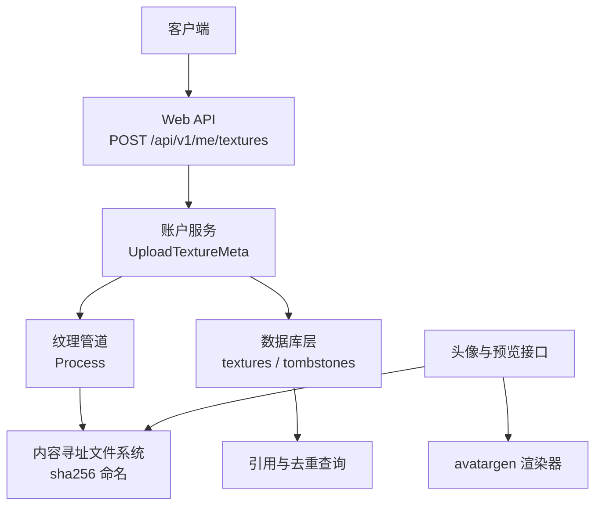
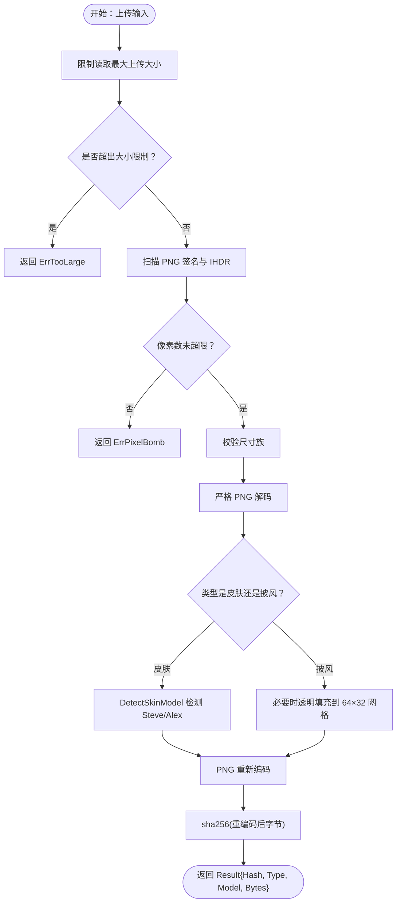
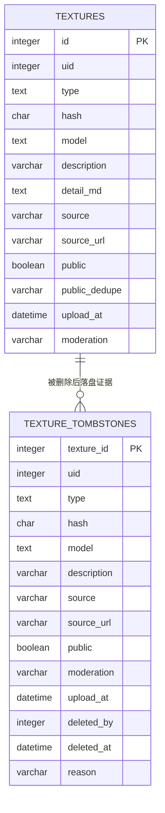
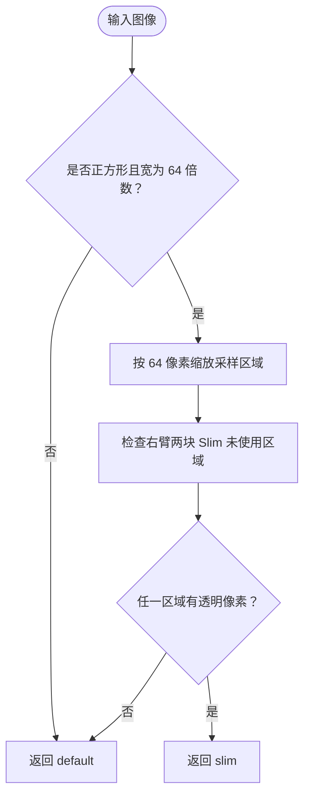
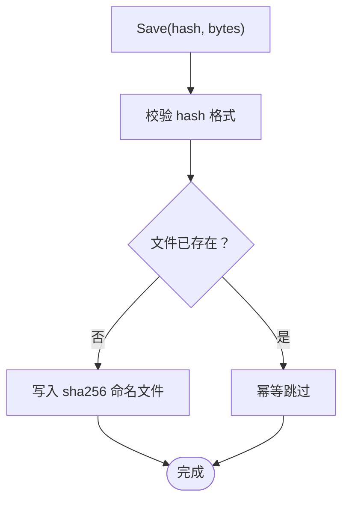
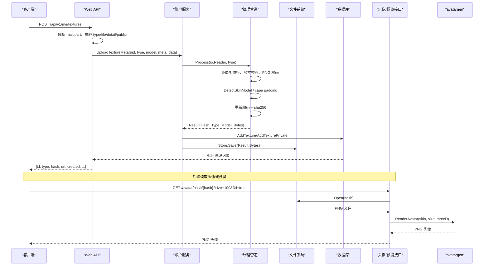
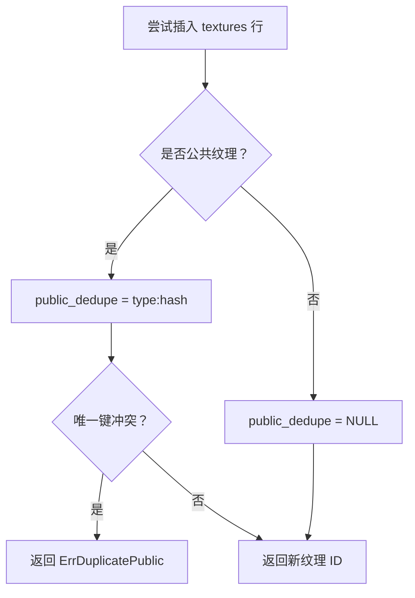
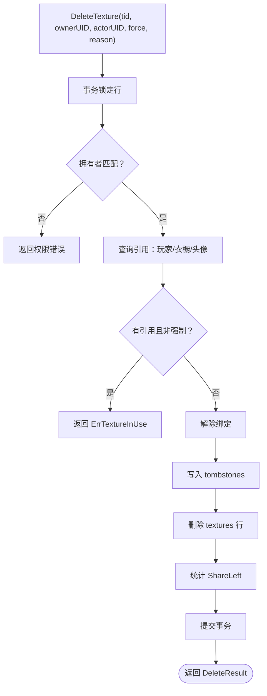
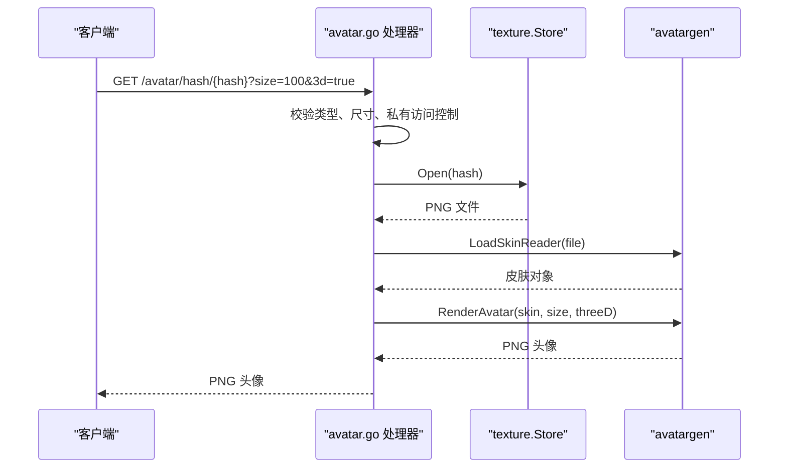
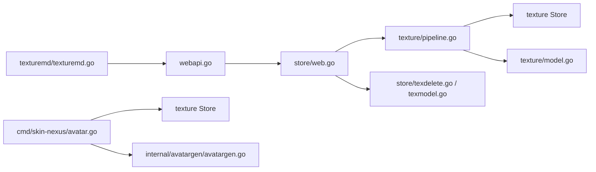

# 纹理处理与材质模块

**本文引用的文件**
- [pipeline.go](https://github.com/YimingZhanshen/skin-nexus/blob/797ae1a/server/internal/texture/pipeline.go)
- [model.go](https://github.com/YimingZhanshen/skin-nexus/blob/797ae1a/server/internal/texture/model.go)
- [delete.go](https://github.com/YimingZhanshen/skin-nexus/blob/797ae1a/server/internal/texture/delete.go)
- [texturemd.go](https://github.com/YimingZhanshen/skin-nexus/blob/797ae1a/server/internal/texturemd/texturemd.go)
- [web.go](https://github.com/YimingZhanshen/skin-nexus/blob/797ae1a/server/internal/store/web.go)
- [texmodel.go](https://github.com/YimingZhanshen/skin-nexus/blob/797ae1a/server/internal/store/texmodel.go)
- [texdelete.go](https://github.com/YimingZhanshen/skin-nexus/blob/797ae1a/server/internal/store/texdelete.go)
- [avatar.go](https://github.com/YimingZhanshen/skin-nexus/blob/797ae1a/server/cmd/skin-nexus/avatar.go)
- [avatargen.go](https://github.com/YimingZhanshen/skin-nexus/blob/797ae1a/server/internal/avatargen/avatargen.go)
- [webapi.go](https://github.com/YimingZhanshen/skin-nexus/blob/797ae1a/server/internal/webapi/webapi.go)
- [0015_texture_public_dedupe.sql](https://github.com/YimingZhanshen/skin-nexus/blob/797ae1a/server/migrations/sqlite/0015_texture_public_dedupe.sql)
- [0019_texture_tombstones.sql](https://github.com/YimingZhanshen/skin-nexus/blob/797ae1a/server/migrations/sqlite/0019_texture_tombstones.sql)
- [0024_textures_public_upload.sql](https://github.com/YimingZhanshen/skin-nexus/blob/797ae1a/server/migrations/sqlite/0024_textures_public_upload.sql)

## 目录
1. [简介](#简介)
2. [项目结构](#项目结构)
3. [核心组件](#核心组件)
4. [架构总览](#架构总览)
5. [详细组件分析](#详细组件分析)
6. [依赖关系分析](#依赖关系分析)
7. [性能考虑](#性能考虑)
8. [故障排查指南](#故障排查指南)
9. [结论](#结论)

## 简介
本模块负责 Minecraft 皮肤与披风纹理的上传、校验、压缩、去重、预览与头像生成，以及最终写入数据库与文件系统。其安全关键路径位于“公网上传面”：所有用户上传的 PNG 必须先经过轻量 IHDR 预检、尺寸规则检查、严格解码、重新编码、内容寻址哈希，然后才进入数据库与文件系统。模型（Steve/Alex）由像素区域检测决定，而不是信任上传者声明；公共纹理通过 `type:hash` 唯一索引实现跨用户去重；删除采用软删除 tombstone 机制保留审计证据，并依据共享计数决定是否清理底层文件。

## 项目结构
纹理相关代码分布在以下子系统：

| 子系统 | 职责 | 关键文件 |
|---|---|---|
| Web API | 接收 `/api/v1/me/textures` 上传请求，校验表单、委托账户服务 | [webapi.go](https://github.com/YimingZhanshen/skin-nexus/blob/797ae1a/server/internal/webapi/webapi.go) |
| 账户服务 | 限流、配额、重复上传合并、调用存储层插入记录 | [web.go](https://github.com/YimingZhanshen/skin-nexus/blob/797ae1a/server/internal/store/web.go) |
| 纹理管道 | 读取 PNG、校验元数据、检测模型、压缩、去重、生成结果 | [pipeline.go](https://github.com/YimingZhanshen/skin-nexus/blob/797ae1a/server/internal/texture/pipeline.go)、[model.go](https://github.com/YimingZhanshen/skin-nexus/blob/797ae1a/server/internal/texture/model.go) |
| 纹理存储 | 内容寻址文件系统，按 sha256 文件名读写 | [pipeline.go](https://github.com/YimingZhanshen/skin-nexus/blob/797ae1a/server/internal/texture/pipeline.go)、[delete.go](https://github.com/YimingZhanshen/skin-nexus/blob/797ae1a/server/internal/texture/delete.go) |
| 数据库层 | textures 表、公共去重索引、tombstone 审计表、引用查询 | [web.go](https://github.com/YimingZhanshen/skin-nexus/blob/797ae1a/server/internal/store/web.go)、[texdelete.go](https://github.com/YimingZhanshen/skin-nexus/blob/797ae1a/server/internal/store/texdelete.go)、[texmodel.go](https://github.com/YimingZhanshen/skin-nexus/blob/797ae1a/server/internal/store/texmodel.go) |
| 头像与预览 | 从已存储纹理渲染 2D/3D 头像及全身预览 | [avatar.go](https://github.com/YimingZhanshen/skin-nexus/blob/797ae1a/server/cmd/skin-nexus/avatar.go)、[avatargen.go](https://github.com/YimingZhanshen/skin-nexus/blob/797ae1a/server/internal/avatargen/avatargen.go) |
| 文本描述 | 对 texture description Markdown 做白名单清洗 | [texturemd.go](https://github.com/YimingZhanshen/skin-nexus/blob/797ae1a/server/internal/texturemd/texturemd.go) |
| 迁移脚本 | public_dedupe、tombstones、公共列表索引等结构变更 | [0015_texture_public_dedupe.sql](https://github.com/YimingZhanshen/skin-nexus/blob/797ae1a/server/migrations/sqlite/0015_texture_public_dedupe.sql)、[0019_texture_tombstones.sql](https://github.com/YimingZhanshen/skin-nexus/blob/797ae1a/server/migrations/sqlite/0019_texture_tombstones.sql)、[0024_textures_public_upload.sql](https://github.com/YimingZhanshen/skin-nexus/blob/797ae1a/server/migrations/sqlite/0024_textures_public_upload.sql) |

**图表来源**
- [webapi.go:1037-1115](https://github.com/YimingZhanshen/skin-nexus/blob/797ae1a/server/internal/webapi/webapi.go#L1037-L1115)
- [pipeline.go:1-200](https://github.com/YimingZhanshen/skin-nexus/blob/797ae1a/server/internal/texture/pipeline.go#L1-L200)
- [web.go:248-320](https://github.com/YimingZhanshen/skin-nexus/blob/797ae1a/server/internal/store/web.go#L248-L320)
- [avatar.go:1-200](https://github.com/YimingZhanshen/skin-nexus/blob/797ae1a/server/cmd/skin-nexus/avatar.go#L1-L200)

**章节来源**
- [webapi.go:1037-1115](https://github.com/YimingZhanshen/skin-nexus/blob/797ae1a/server/internal/webapi/webapi.go#L1037-L1115)
- [pipeline.go:1-200](https://github.com/YimingZhanshen/skin-nexus/blob/797ae1a/server/internal/texture/pipeline.go#L1-L200)
- [web.go:248-320](https://github.com/YimingZhanshen/skin-nexus/blob/797ae1a/server/internal/store/web.go#L248-L320)
- [avatar.go:1-200](https://github.com/YimingZhanshen/skin-nexus/blob/797ae1a/server/cmd/skin-nexus/avatar.go#L1-L200)

## 核心组件

### TexturePipeline：上传流水线
`Process` 是上传链路的处理器，依次执行：

1. **大小限制**：最多读取 `MaxUploadBytes + 1` 字节，超过返回 `ErrTooLarge`。
2. **IHDR 预检**：不解码像素，只解析 PNG 签名和 IHDR 头，获取宽高，防止无效或畸形 PNG。
3. **像素炸弹防护**：`w × h > MaxPixels` 时拒绝，默认上限约一百万像素。
4. **尺寸族校验**：皮肤允许 `64×32`、`64×64` 及其均匀整数倍；披风允许 `64×32`、`22×17` 及其均匀整数倍。
5. **严格解码**：仅接受 `image/png`。
6. **模型检测与披风填充**：皮肤调用 `DetectSkinModel`；披风若为 `22×17` 倍数则透明填充到最小 `64×32` 网格。
7. **重新编码**：丢弃原始 PNG 中的附加 chunk 和多态载荷，输出干净 PNG。
8. **内容寻址哈希**：对重新编码后的字节计算 sha256，作为文件名和缓存键。
9. **返回 Result**：包含 Hash、Type、Model、Bytes。

**图表来源**
- [pipeline.go:1-200](https://github.com/YimingZhanshen/skin-nexus/blob/797ae1a/server/internal/texture/pipeline.go#L1-L200)
- [pipeline.go:201-280](https://github.com/YimingZhanshen/skin-nexus/blob/797ae1a/server/internal/texture/pipeline.go#L201-L280)

**章节来源**
- [pipeline.go:1-200](https://github.com/YimingZhanshen/skin-nexus/blob/797ae1a/server/internal/texture/pipeline.go#L1-L200)
- [pipeline.go:201-280](https://github.com/YimingZhanshen/skin-nexus/blob/797ae1a/server/internal/texture/pipeline.go#L201-L280)

### Texture 模型字段与哈希规则
纹理行存储在 `textures` 表中，关键字段如下：

| 字段 | 含义 | 说明 |
|---|---|---|
| `id` | 自增主键 | 纹理记录 ID |
| `uid` | 拥有者用户 ID | 上传或导入该纹理的用户 |
| `type` | `skin` 或 `cape` | 区分皮肤与披风 |
| `hash` | sha256 十六进制字符串 | 重新编码后 PNG 的内容地址，长度固定 64 |
| `model` | `default`、`slim` 或空 | 仅皮肤有效，由像素检测得出 |
| `description` | 人类可读名称 | 可空 |
| `detail_md` | 用户描述的 Markdown | 经 texturemd 清洗后存储 |
| `source` / `source_url` | 来源标识与链接 | 用于溯源 |
| `public` | 布尔标志 | 是否公开展示 |
| `public_dedupe` | `type:hash` 或空 | 公共纹理去重键，私有副本可为 NULL |
| `upload_at` | 上传时间 | 排序与审计使用 |
| `moderation` | 审核状态 | 管理用途 |

哈希计算规则：

- 不是原始上传字节，而是**重新编码后的 PNG 字节**。
- 使用 SHA-256，输出为小写十六进制字符串。
- 同一份重新编码内容无论被多少用户上传，只要公共可见就共享一个 `type:hash` 唯一键。
- 私有纹理可以存在多份相同 `hash` 但不同 `uid` 的行，因为它们的 `public_dedupe` 为 NULL。

**图表来源**
- [web.go:248-320](https://github.com/YimingZhanshen/skin-nexus/blob/797ae1a/server/internal/store/web.go#L248-L320)
- [0015_texture_public_dedupe.sql:1-5](https://github.com/YimingZhanshen/skin-nexus/blob/797ae1a/server/migrations/sqlite/0015_texture_public_dedupe.sql#L1-L5)
- [0019_texture_tombstones.sql:1-21](https://github.com/YimingZhanshen/skin-nexus/blob/797ae1a/server/migrations/sqlite/0019_texture_tombstones.sql#L1-L21)

**章节来源**
- [web.go:248-320](https://github.com/YimingZhanshen/skin-nexus/blob/797ae1a/server/internal/store/web.go#L248-L320)
- [0015_texture_public_dedupe.sql:1-5](https://github.com/YimingZhanshen/skin-nexus/blob/797ae1a/server/migrations/sqlite/0015_texture_public_dedupe.sql#L1-L5)
- [0019_texture_tombstones.sql:1-21](https://github.com/YimingZhanshen/skin-nexus/blob/797ae1a/server/migrations/sqlite/0019_texture_tombstones.sql#L1-L21)

### 模型识别：Steve 与 Alex
`DetectSkinModel` 的检测逻辑遵循 Mojang 的规则：

- 只有正方形且宽度是 64 的倍数时才可能携带 Slim 信息；否则一律返回 `default`。
- 对右臂第一层中两块“Slim 未使用区域”采样，如果任一区域出现透明度，则判定为 `slim`。
- 明确跳过 skinview3d 的左臂区域与纯色检测启发式，避免把传统 Steve 皮肤误判为 Alex。
- 非正方形或非 64 倍数尺寸，例如经典 `64×32` 皮肤，不会触发 Slim 判断，因此需要库侧手动修正路径。

**图表来源**
- [model.go:1-68](https://github.com/YimingZhanshen/skin-nexus/blob/797ae1a/server/internal/texture/model.go#L1-L68)

**章节来源**
- [model.go:1-68](https://github.com/YimingZhanshen/skin-nexus/blob/797ae1a/server/internal/texture/model.go#L1-L68)

### 文本描述与摘要：texturemd
`texturemd.Render` 将用户提供的 Markdown 转换为安全 HTML：

- 使用 Goldmark GFM 扩展。
- 使用 bluemonday 白名单策略，仅允许段落、标题、粗斜体、列表、代码块、表格和 http(s) 链接。
- 禁止图片、iframe、表单、样式等远程资源，防止跟踪或 NSFW 内容随描述传播。
- 渲染失败回退为空字符串，不直接回显原始输入。
- `Excerpt` 提供纯文本摘要，适合元标签和卡片预览。

**章节来源**
- [texturemd.go:1-66](https://github.com/YimingZhanshen/skin-nexus/blob/797ae1a/server/internal/texturemd/texturemd.go#L1-L66)

### 文件系统存储与删除
`texture.Store` 是内容寻址文件系统：

- 目录由构造函数创建，文件名为 64 位十六进制 hash。
- `Path` 使用正则严格校验 hash，作为路径穿越防护。
- `Save` 幂等写入：若文件已存在则跳过。
- `Open` 用于读取已存储纹理，包括遗留迁移文件。
- `Remove` 删除底层文件；缺失文件不算错误，因为数据库行可能已被其他并发删除先移除。

**图表来源**
- [pipeline.go:1-200](https://github.com/YimingZhanshen/skin-nexus/blob/797ae1a/server/internal/texture/pipeline.go#L1-L200)
- [delete.go:1-21](https://github.com/YimingZhanshen/skin-nexus/blob/797ae1a/server/internal/texture/delete.go#L1-L21)

**章节来源**
- [pipeline.go:1-200](https://github.com/YimingZhanshen/skin-nexus/blob/797ae1a/server/internal/texture/pipeline.go#L1-L200)
- [delete.go:1-21](https://github.com/YimingZhanshen/skin-nexus/blob/797ae1a/server/internal/texture/delete.go#L1-L21)

## 架构总览

**图表来源**
- [webapi.go:1037-1115](https://github.com/YimingZhanshen/skin-nexus/blob/797ae1a/server/internal/webapi/webapi.go#L1037-L1115)
- [pipeline.go:1-200](https://github.com/YimingZhanshen/skin-nexus/blob/797ae1a/server/internal/texture/pipeline.go#L1-L200)
- [web.go:248-320](https://github.com/YimingZhanshen/skin-nexus/blob/797ae1a/server/internal/store/web.go#L248-L320)
- [avatar.go:1-200](https://github.com/YimingZhanshen/skin-nexus/blob/797ae1a/server/cmd/skin-nexus/avatar.go#L1-L200)

**章节来源**
- [webapi.go:1037-1115](https://github.com/YimingZhanshen/skin-nexus/blob/797ae1a/server/internal/webapi/webapi.go#L1037-L1115)
- [web.go:248-320](https://github.com/YimingZhanshen/skin-nexus/blob/797ae1a/server/internal/store/web.go#L248-L320)
- [avatar.go:1-200](https://github.com/YimingZhanshen/skin-nexus/blob/797ae1a/server/cmd/skin-nexus/avatar.go#L1-L200)

## 详细组件分析

### 上传链路：webapi/upload → pipeline.Process → store.TextureInsert → filesystem 分发

#### Web API 入口
`handleUploadTexture` 的职责：

- 验证登录用户。
- 用 `http.MaxBytesReader` 限制请求体大小。
- 解析 multipart 表单，失败时区分“超出站点限制”和“multipart 解析失败”。
- 校验 `type` 必须为 `skin` 或 `cape`。
- 读取 `file`、`description`、`detail`、`source`、`sourceUrl`、`public`。
- 调用 `b.Account.UploadTextureMeta`，将二进制 PNG 交给账户服务进一步处理。
- 根据是否新建记录返回 `201 Created` 或 `200 OK`，并返回 `id`、`type`、`hash`、`url`、`created`、`description`、`detail`、`source`、`sourceUrl`、`public`。

**章节来源**
- [webapi.go:1037-1115](https://github.com/YimingZhanshen/skin-nexus/blob/797ae1a/server/internal/webapi/webapi.go#L1037-L1115)

#### 存储层插入与公共去重
`AddTexture` 用于公共纹理：

- 插入 `uid`、`type`、`hash`、`model`、`description`、`detail_md`、`source`、`source_url`。
- `public_dedupe` 设为 `type:hash`。
- 遇到唯一键冲突返回 `ErrDuplicatePublic`，表示已有相同内容的公共纹理。

`AddTexturePrivate` 用于私密导入：

- 设置 `public = 0`，`public_dedupe = NULL`。
- 允许相同 `hash` 的多份私有副本共存。

`TextureByOwnerHash` 用于重试幂等：同一用户同类型同 hash 已存在时可直接复用。

`PublicTextureByHash` 只返回公共纹理，防止泄露其他用户的私有库。

**图表来源**
- [web.go:248-320](https://github.com/YimingZhanshen/skin-nexus/blob/797ae1a/server/internal/store/web.go#L248-L320)
- [0015_texture_public_dedupe.sql:1-5](https://github.com/YimingZhanshen/skin-nexus/blob/797ae1a/server/migrations/sqlite/0015_texture_public_dedupe.sql#L1-L5)

**章节来源**
- [web.go:248-320](https://github.com/YimingZhanshen/skin-nexus/blob/797ae1a/server/internal/store/web.go#L248-L320)
- [0015_texture_public_dedupe.sql:1-5](https://github.com/YimingZhanshen/skin-nexus/blob/797ae1a/server/migrations/sqlite/0015_texture_public_dedupe.sql#L1-L5)

### 软删除与孤儿文件清理：texdelete.go
`DeleteTexture` 的执行顺序：

1. 开启事务并锁定待删行。
2. 校验拥有者权限。
3. 查询引用：玩家角色、衣橱条目、头像引用。
4. 如果有引用且非强制删除，返回 `ErrTextureInUse`。
5. 解除绑定：清除角色、衣橱、头像中的外键引用。
6. 写入 `texture_tombstones`：保存删除前的 `type`、`hash`、`model`、`description`、`source`、`source_url`、`public`、`moderation`、`upload_at`、`deleted_by`、`deleted_at`、`reason`。
7. 删除 `textures` 行。
8. 统计剩余共享行数 `ShareLeft`。
9. 提交事务。

注意：**删除函数本身不删除底层文件**。它返回 `ShareLeft`，由调用方在持有 hash 锁的情况下决定是否调用 `Store.Remove`。这避免了数据库删除成功但文件删除失败时回滚不一致的问题。

并发安全方面：

- `WithHashLock` 使用数据库会话级 advisory lock（MySQL `GET_LOCK`），SQLite 无跨进程锁则退化。
- 锁名取 `tex:` 加 hash 前缀，避免 MySQL 锁名过长。
- 获取失败返回 `ErrBusy`，调用方可重试。
- 注释明确要求：任何接触 hash 文件生命周期的操作都必须在这个锁内执行，且数据库行锁必须在 hash 锁之后获取，避免死锁。

**图表来源**
- [texdelete.go:1-200](https://github.com/YimingZhanshen/skin-nexus/blob/797ae1a/server/internal/store/texdelete.go#L1-L200)
- [0019_texture_tombstones.sql:1-21](https://github.com/YimingZhanshen/skin-nexus/blob/797ae1a/server/migrations/sqlite/0019_texture_tombstones.sql#L1-L21)

**章节来源**
- [texdelete.go:1-200](https://github.com/YimingZhanshen/skin-nexus/blob/797ae1a/server/internal/store/texdelete.go#L1-L200)
- [0019_texture_tombstones.sql:1-21](https://github.com/YimingZhanshen/skin-nexus/blob/797ae1a/server/migrations/sqlite/0019_texture_tombstones.sql#L1-L21)

### 3D 预览与头像生成
`/avatar` 与 `/preview` 接口由 `avatar.go` 暴露：

- `/avatar/player/{name}`：玩家不存在返回 404；没有皮肤或文件则返回默认头像。
- `/avatar/user/{uid}`、`/avatar/{tid}`、`/avatar/hash/{hash}`：缺失时返回默认头像 200。
- 非皮肤纹理返回 422。
- 支持 `size`（默认 100，限制 8–1024）、`3d`（生成 45° 立方体视角）、`png`（仅兼容参数）。
- 私有预览会设置 `private, no-store` 和 `Vary: Cookie`；公共预览可长期缓存。
- 支持插件代理：如果插件允许目标主机，可重定向到外部头像服务。
- 内部流程：打开 `Store.Open(hash)`，调用 `avatargen.LoadSkinReader`，再调用 `avatargen.RenderAvatar`。

`avatargen` 负责标准 Minecraft 皮肤 UV 布局、左右肢体、头盔层、2D 头像、3D 头像、全身预览，并维护 `RenderVersion` 以破坏旧缓存。

**图表来源**
- [avatar.go:1-200](https://github.com/YimingZhanshen/skin-nexus/blob/797ae1a/server/cmd/skin-nexus/avatar.go#L1-L200)
- [avatargen.go:1-200](https://github.com/YimingZhanshen/skin-nexus/blob/797ae1a/server/internal/avatargen/avatargen.go#L1-L200)

**章节来源**
- [avatar.go:1-200](https://github.com/YimingZhanshen/skin-nexus/blob/797ae1a/server/cmd/skin-nexus/avatar.go#L1-L200)
- [avatargen.go:1-200](https://github.com/YimingZhanshen/skin-nexus/blob/797ae1a/server/internal/avatargen/avatargen.go#L1-L200)

### 模型回填与一致性：texmodel.go
`SkinModelGroups` 按 `hash` 分组查询皮肤行，收集每个内容地址当前持有的 `model` 值。
`SetModelByHash` 将指定 hash 的所有皮肤行统一更新为正确模型，忽略已经一致的行，保证回填任务幂等。

这解决了历史数据中 `model` 为空或与像素不一致的问题。

**章节来源**
- [texmodel.go:1-62](https://github.com/YimingZhanshen/skin-nexus/blob/797ae1a/server/internal/store/texmodel.go#L1-L62)

## 依赖关系分析

**图表来源**
- [webapi.go:1037-1115](https://github.com/YimingZhanshen/skin-nexus/blob/797ae1a/server/internal/webapi/webapi.go#L1037-L1115)
- [web.go:248-320](https://github.com/YimingZhanshen/skin-nexus/blob/797ae1a/server/internal/store/web.go#L248-L320)
- [pipeline.go:1-200](https://github.com/YimingZhanshen/skin-nexus/blob/797ae1a/server/internal/texture/pipeline.go#L1-L200)
- [model.go:1-68](https://github.com/YimingZhanshen/skin-nexus/blob/797ae1a/server/internal/texture/model.go#L1-L68)
- [avatar.go:1-200](https://github.com/YimingZhanshen/skin-nexus/blob/797ae1a/server/cmd/skin-nexus/avatar.go#L1-L200)
- [texturemd.go:1-66](https://github.com/YimingZhanshen/skin-nexus/blob/797ae1a/server/internal/texturemd/texturemd.go#L1-L66)

### 耦合与风险点
- Web API 与账户服务耦合：上传入口只做 HTTP 层校验，业务约束下移。
- 管道与文件系统解耦：`Result` 携带字节，存储层负责持久化。
- 删除逻辑与文件删除分离：数据库删除成功后，由外层决定文件清理，避免事务边界问题。
- 头像接口依赖 `Store.Open`，若 hash 损坏或缺失，应走默认头像路径。

**章节来源**
- [webapi.go:1037-1115](https://github.com/YimingZhanshen/skin-nexus/blob/797ae1a/server/internal/webapi/webapi.go#L1037-L1115)
- [texdelete.go:1-200](https://github.com/YimingZhanshen/skin-nexus/blob/797ae1a/server/internal/store/texdelete.go#L1-L200)
- [avatar.go:1-200](https://github.com/YimingZhanshen/skin-nexus/blob/797ae1a/server/cmd/skin-nexus/avatar.go#L1-L200)

## 性能考虑

### 大图片裁剪建议
- 当前上传限制为 2 MiB，像素上限为 1M。虽然管线能处理最高约 `2048×512` 的合法皮肤，但前端仍应在上传前裁剪到游戏支持的尺寸，减少网络传输、内存占用和重新编码成本。
- 对于超大图片，建议在浏览器端或网关层提前拒绝，避免浪费服务器 CPU 进行 PNG 解码。

### 并发限制建议
- 目前 `Process` 同步读取全部输入、解码、编码，并返回字节给上层。高并发上传场景下，应避免无限 goroutine 并行解码大 PNG。
- 建议引入上传协程池或信号量，限制同时处理的上传数量。
- `WithHashLock` 已在数据库层对同一 hash 的写入/删除做串行化，但对不同 hash 的上传没有全局并发上限。

### 缓存命中率优化
- 公共纹理已通过 `type:hash` 唯一索引去重，多次上传相同内容只需一次文件写入。
- 头像与预览接口支持长期不可变缓存，但需配合 URL 版本变化；`avatargen.RenderVersion` 在渲染器输出变化时必须递增。
- 公共皮肤列表使用了 `(public, upload_at)` 索引，加速“最新公开纹理”分页。
- 可考虑在读取路径增加本地缓存：按 hash 缓存最近打开的文件句柄或解码后的皮肤对象，但需注意内存增长与过期策略。

### I/O 与磁盘策略
- 内容寻址文件系统天然适合 deduplication；定期运行完整性校验可发现 hash 与文件名不一致的文件。
- 删除路径应先统计 `ShareLeft`，只有当值为 0 时才删除底层文件，避免孤儿文件堆积。
- 对大体积仓库建议启用独立日志分区，并监控 `textures` 表与文件目录的大小比例。

[本节为通用性能建议，不直接分析具体源码行]

## 故障排查指南

### 模型识别错误
**现象**：Alex 皮肤显示为 Steve，或 Steve 皮肤被识别为 Alex。

**诊断方法**：
1. 确认图片是否为正方形且宽度是 64 的倍数；非正方形尺寸不会触发 Slim 检测。
2. 检查右臂第一层两块 Slim 未使用区域是否有透明像素。
3. 如果是 `64×32` 经典皮肤，系统不会自动判断 Slim，需要在库侧手动修正。
4. 使用模型回填工具按 hash 批量校对并更新数据库。

**参考实现位置**
- [model.go:1-68](https://github.com/YimingZhanshen/skin-nexus/blob/797ae1a/server/internal/texture/model.go#L1-L68)
- [texmodel.go:1-62](https://github.com/YimingZhanshen/skin-nexus/blob/797ae1a/server/internal/store/texmodel.go#L1-L62)

### 预览图失真
**现象**：3D 预览角度异常、身体或头部贴图错位、颜色异常。

**诊断方法**：
1. 确认上传的是标准 Minecraft 皮肤布局，而非任意矩形图片。
2. 检查管线是否对披风做了透明填充，避免披风误入头像路径。
3. 核对 `avatargen.RenderVersion` 是否与当前渲染器输出一致，避免浏览器缓存旧版预览。
4. 检查 `/avatar` 接口返回的 `size` 是否被限制在 8–1024。
5. 如果使用的是插件头像代理，确认代理是否支持相同 UV 映射。

**参考实现位置**
- [pipeline.go:1-200](https://github.com/YimingZhanshen/skin-nexus/blob/797ae1a/server/internal/texture/pipeline.go#L1-L200)
- [avatar.go:1-200](https://github.com/YimingZhanshen/skin-nexus/blob/797ae1a/server/cmd/skin-nexus/avatar.go#L1-L200)
- [avatargen.go:1-200](https://github.com/YimingZhanshen/skin-nexus/blob/797ae1a/server/internal/avatargen/avatargen.go#L1-L200)

### 重复上传未去重
**现象**：相同纹理上传多次，公共库中出现多条。

**可能原因**：
- 上传了不同 metadata（例如 description、source、detail_md）但像素完全相同，公共去重仍应命中 `type:hash`。
- 上传的是私有纹理，私有副本允许重复。
- 上传内容在重新编码后产生了不同字节，导致 hash 不同。
- 并发写入时唯一键冲突未被正确处理。

**诊断方法**：
1. 比较两次上传返回的 `hash`。
2. 检查 `public` 是否为 true。
3. 检查 `public_dedupe` 列是否为 `type:hash`。
4. 检查数据库唯一索引 `uk_textures_public_dedupe` 是否存在。
5. 对可疑文件运行内容校验，确认文件名与实际 sha256 一致。

**参考实现位置**
- [web.go:248-320](https://github.com/YimingZhanshen/skin-nexus/blob/797ae1a/server/internal/store/web.go#L248-L320)
- [0015_texture_public_dedupe.sql:1-5](https://github.com/YimingZhanshen/skin-nexus/blob/797ae1a/server/migrations/sqlite/0015_texture_public_dedupe.sql#L1-L5)
- [pipeline.go:201-280](https://github.com/YimingZhanshen/skin-nexus/blob/797ae1a/server/internal/texture/pipeline.go#L201-L280)

### 删除后文件仍存在
**现象**：纹理行已删除，但磁盘上仍有对应 hash 文件。

**诊断方法**：
1. 检查 `ShareLeft`：如果还有其他行引用该 hash，文件不应删除。
2. 检查调用方是否在 `DeleteTexture` 成功后调用了 `Store.Remove`。
3. 检查是否发生并发删除，另一个事务先释放了 hash 锁。
4. 运行文件完整性校验，确认 hash 与文件名一致。

**参考实现位置**
- [texdelete.go:1-200](https://github.com/YimingZhanshen/skin-nexus/blob/797ae1a/server/internal/store/texdelete.go#L1-L200)
- [delete.go:1-21](https://github.com/YimingZhanshen/skin-nexus/blob/797ae1a/server/internal/texture/delete.go#L1-L21)

### 描述 Markdown 被清空
**现象**：用户提交的 description 或 detail_md 渲染为空。

**诊断方法**：
1. 检查是否包含被禁止的元素，如 ``、`<iframe>`、`<style>`、远程资源。
2. 检查链接是否使用 http(s)，其他协议会被过滤。
3. 检查渲染是否失败，失败时会降级为空字符串。
4. 使用 `Excerpt` 查看纯文本摘要是否正常。

**参考实现位置**
- [texturemd.go:1-66](https://github.com/YimingZhanshen/skin-nexus/blob/797ae1a/server/internal/texturemd/texturemd.go#L1-L66)

### 上传超时或内存压力
**现象**：高峰期上传慢、内存峰值高、CPU 被 PNG 解码占用。

**诊断方法**：
1. 检查是否有限制并发上传的协程池。
2. 检查上传文件大小是否接近 2 MiB。
3. 检查前端是否提前裁剪图片。
4. 检查是否频繁对超大 PNG 做 3D 预览渲染。
5. 监控数据库 advisory lock 等待时间，确认 hash 锁是否成为瓶颈。

**参考实现位置**
- [webapi.go:1037-1115](https://github.com/YimingZhanshen/skin-nexus/blob/797ae1a/server/internal/webapi/webapi.go#L1037-L1115)
- [pipeline.go:1-200](https://github.com/YimingZhanshen/skin-nexus/blob/797ae1a/server/internal/texture/pipeline.go#L1-L200)
- [texdelete.go:1-200](https://github.com/YimingZhanshen/skin-nexus/blob/797ae1a/server/internal/store/texdelete.go#L1-L200)

## 结论
纹理处理与材质模块围绕“内容寻址 + 严格管线 + 软删除审计”构建。上传链路将安全风险前置到 IHDR 预检、像素上限、尺寸族校验和重新编码阶段；模型识别基于像素语义而非用户声明；公共纹理通过 `type:hash` 去重，私有纹理允许隔离副本；删除不直接删除文件，而是通过 tombstone 保留审计证据，并由共享计数驱动文件清理。头像与预览接口从已存储内容生成稳定输出，并通过版本化 URL 控制缓存失效。

未来优化应聚焦于上传并发控制、大图前端裁剪、缓存命中率提升、文件完整性巡检，以及对非正方形皮肤模型的自动化回填能力。这些改进可在不改变现有安全契约的前提下，显著降低内存、CPU 和磁盘开销。
