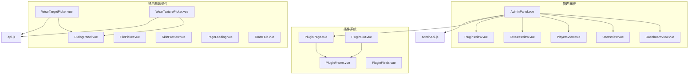
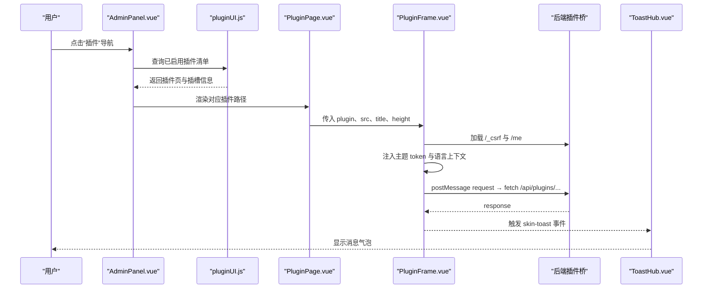
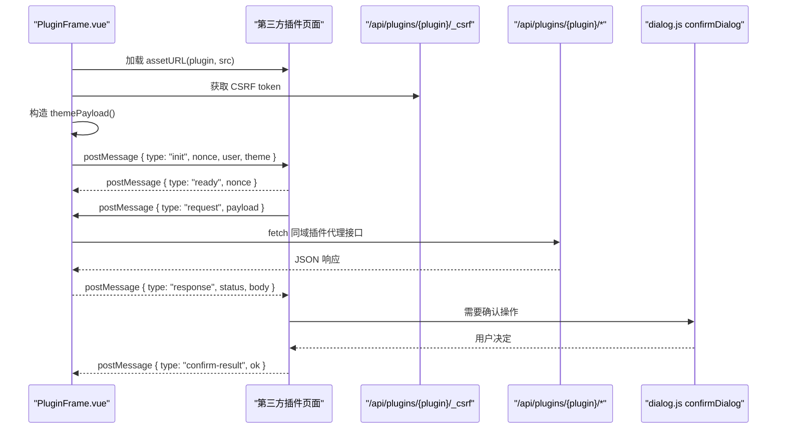
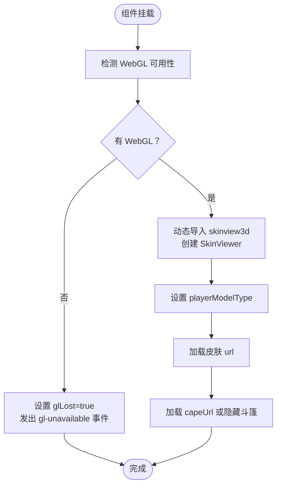
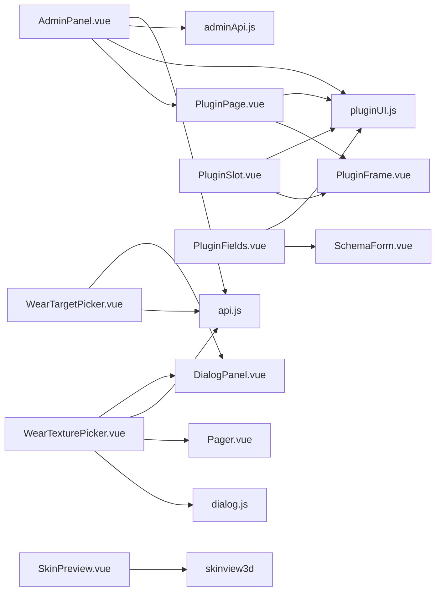

# 组件体系

**本文引用的文件**
- [AdminPanel.vue](https://github.com/YimingZhanshen/skin-nexus/blob/797ae1a/web/src/components/AdminPanel.vue)
- [PluginFrame.vue](https://github.com/YimingZhanshen/skin-nexus/blob/797ae1a/web/src/components/plugin/PluginFrame.vue)
- [PluginPage.vue](https://github.com/YimingZhanshen/skin-nexus/blob/797ae1a/web/src/components/plugin/PluginPage.vue)
- [PluginSlot.vue](https://github.com/YimingZhanshen/skin-nexus/blob/797ae1a/web/src/components/plugin/PluginSlot.vue)
- [PluginFields.vue](https://github.com/YimingZhanshen/skin-nexus/blob/797ae1a/web/src/components/plugin/PluginFields.vue)
- [DialogPanel.vue](https://github.com/YimingZhanshen/skin-nexus/blob/797ae1a/web/src/components/DialogPanel.vue)
- [FilePicker.vue](https://github.com/YimingZhanshen/skin-nexus/blob/797ae1a/web/src/components/FilePicker.vue)
- [SkinPreview.vue](https://github.com/YimingZhanshen/skin-nexus/blob/797ae1a/web/src/components/SkinPreview.vue)
- [WearTargetPicker.vue](https://github.com/YimingZhanshen/skin-nexus/blob/797ae1a/web/src/components/WearTargetPicker.vue)
- [WearTexturePicker.vue](https://github.com/YimingZhanshen/skin-nexus/blob/797ae1a/web/src/components/WearTexturePicker.vue)
- [PageLoading.vue](https://github.com/YimingZhanshen/skin-nexus/blob/797ae1a/web/src/components/PageLoading.vue)
- [ToastHub.vue](https://github.com/YimingZhanshen/skin-nexus/blob/797ae1a/web/src/components/ToastHub.vue)
- [pluginUI.js](https://github.com/YimingZhanshen/skin-nexus/blob/797ae1a/web/src/pluginUI.js)
- [adminApi.js](https://github.com/YimingZhanshen/skin-nexus/blob/797ae1a/web/src/adminApi.js)
- [api.js](https://github.com/YimingZhanshen/skin-nexus/blob/797ae1a/web/src/api.js)
- [tokens.go](https://github.com/YimingZhanshen/skin-nexus/blob/797ae1a/server/internal/theme/tokens.go)

## 目录
1. [引言](#引言)
2. [项目结构](#项目结构)
3. [核心组件](#核心组件)
4. [架构总览](#架构总览)
5. [详细组件分析](#详细组件分析)
6. [依赖关系分析](#依赖关系分析)
7. [性能考虑](#性能考虑)
8. [故障排查指南](#故障排查指南)
9. [结论](#结论)

## 引言
本文件聚焦前端 Vue 组件体系，覆盖管理面板外壳、插件嵌入机制、通用基础组件与皮肤预览相关组件。目标是让不熟悉源码的读者也能理解：
- 各组件的职责、属性、事件、插槽和内部状态；
- 父页面如何调用这些组件；
- 第三方插件 HTML/JS 的安全加载方式；
- 3D 皮肤预览与 `skinview3d` 集成；
- 响应式布局、可访问性、主题 token 使用；
- 与后端 API 的交互模式；
- 常见问题及排错方法。

## 项目结构
前端组件集中在 `web/src/components` 下，按功能划分：
- `admin/`：管理面板子页面视图；
- `plugin/`：插件框架、页面容器、插槽与表单字段；
- 根级通用组件：对话框、文件选择器、皮肤预览、穿戴选择器、加载占位、提示消息等。

**图表来源**
- [AdminPanel.vue:1-249](https://github.com/YimingZhanshen/skin-nexus/blob/797ae1a/web/src/components/AdminPanel.vue#L1-L249)
- [PluginPage.vue:1-39](https://github.com/YimingZhanshen/skin-nexus/blob/797ae1a/web/src/components/plugin/PluginPage.vue#L1-L39)
- [PluginFrame.vue:1-257](https://github.com/YimingZhanshen/skin-nexus/blob/797ae1a/web/src/components/plugin/PluginFrame.vue#L1-L257)
- [PluginSlot.vue:1-24](https://github.com/YimingZhanshen/skin-nexus/blob/797ae1a/web/src/components/plugin/PluginSlot.vue#L1-L24)
- [DialogPanel.vue:1-76](https://github.com/YimingZhanshen/skin-nexus/blob/797ae1a/web/src/components/DialogPanel.vue#L1-L76)
- [WearTargetPicker.vue:1-115](https://github.com/YimingZhanshen/skin-nexus/blob/797ae1a/web/src/components/WearTargetPicker.vue#L1-L115)
- [WearTexturePicker.vue:1-198](https://github.com/YimingZhanshen/skin-nexus/blob/797ae1a/web/src/components/WearTexturePicker.vue#L1-L198)
- [api.js:1-161](https://github.com/YimingZhanshen/skin-nexus/blob/797ae1a/web/src/api.js#L1-L161)
- [adminApi.js:1-32](https://github.com/YimingZhanshen/skin-nexus/blob/797ae1a/web/src/adminApi.js#L1-L32)

**章节来源**
- [AdminPanel.vue:1-249](https://github.com/YimingZhanshen/skin-nexus/blob/797ae1a/web/src/components/AdminPanel.vue#L1-L249)
- [pluginUI.js:1-90](https://github.com/YimingZhanshen/skin-nexus/blob/797ae1a/web/src/pluginUI.js#L1-L90)

## 核心组件
本节概述所有目标组件的职责与协作关系，具体细节见后续“详细组件分析”。

| 组件 | 职责 | 关键输入 | 关键输出 | 主要依赖 |
|---|---|---|---|---|
| `AdminPanel` | 管理面板外壳：侧边栏、路由映射、会话令牌、插件导航入口 | `user`、`siteConf`、`confLoaded` | 切换子视图、打开插件页面 | `api.js`、`adminApi.js`、`pluginUI.js` |
| `PluginPage` | 根据插件清单渲染 iframe 插件页面或显示不支持提示 | `path` | 无直接事件 | `pluginUI.js`、`PluginFrame` |
| `PluginFrame` | 沙箱化 iframe 宿主：安全通信、主题注入、尺寸自适应、重试 | `plugin`、`src`、`title`、`height` | `ready`、`error`、`resize`、`toast`、导航、确认结果 | `dialog.js`、`pluginUI.js` |
| `PluginSlot` | 在管理面板中插入受白名单保护的插件区域 | `slot` | 无直接事件 | `pluginUI.js`、`PluginFrame` |
| `PluginFields` | 渲染内置插件表单字段并收集值 | `form`、`modelValue` | `update:modelValue` | `SchemaForm`、`pluginUI.js` |
| `DialogPanel` | 基于原生 `<dialog>` 的可访问对话框 | `open`、`title`、`label`、按钮文案等 | `ok`、`cancel`、`opened` | `vue-i18n` |
| `FilePicker` | 包装原生文件选择的带样式控件 | `file`、`accept`、`disabled`、`disabledReason`、`hint` | `update:file` | `format.js`、`vue-i18n` |
| `SkinPreview` | 小型自动旋转 3D 皮肤预览，支持斗篷与模型类型切换 | `url`、`capeUrl`、`modelType`、宽高 | `gl-unavailable` | `skinview3d`（动态导入） |
| `WearTargetPicker` | “把材质穿到哪个角色”的选择器 | `open`、`type`、`textureId`、`textureName` | `close`、`worn`、`need-player` | `DialogPanel`、`api.js`、`session.js` |
| `WearTexturePicker` | “为当前角色选择材质”的网格选择器 | `open`、`type`、`textureId`、`textureHash` | `close`、`pick` | `DialogPanel`、`Pager`、`api.js`、`dialog.js`、`textureLabel.js` |
| `PageLoading` | 全局加载占位 | 无 | 无 | `vue-i18n` |
| `ToastHub` | 全局消息提示栈 | 无 | 无 | `vue-i18n` |

**章节来源**
- [AdminPanel.vue:1-249](https://github.com/YimingZhanshen/skin-nexus/blob/797ae1a/web/src/components/AdminPanel.vue#L1-L249)
- [PluginPage.vue:1-39](https://github.com/YimingZhanshen/skin-nexus/blob/797ae1a/web/src/components/plugin/PluginPage.vue#L1-L39)
- [PluginFrame.vue:1-257](https://github.com/YimingZhanshen/skin-nexus/blob/797ae1a/web/src/components/plugin/PluginFrame.vue#L1-L257)
- [PluginSlot.vue:1-24](https://github.com/YimingZhanshen/skin-nexus/blob/797ae1a/web/src/components/plugin/PluginSlot.vue#L1-L24)
- [PluginFields.vue:1-37](https://github.com/YimingZhanshen/skin-nexus/blob/797ae1a/web/src/components/plugin/PluginFields.vue#L1-L37)
- [DialogPanel.vue:1-76](https://github.com/YimingZhanshen/skin-nexus/blob/797ae1a/web/src/components/DialogPanel.vue#L1-L76)
- [FilePicker.vue:1-68](https://github.com/YimingZhanshen/skin-nexus/blob/797ae1a/web/src/components/FilePicker.vue#L1-L68)
- [SkinPreview.vue:1-87](https://github.com/YimingZhanshen/skin-nexus/blob/797ae1a/web/src/components/SkinPreview.vue#L1-L87)
- [WearTargetPicker.vue:1-115](https://github.com/YimingZhanshen/skin-nexus/blob/797ae1a/web/src/components/WearTargetPicker.vue#L1-L115)
- [WearTexturePicker.vue:1-198](https://github.com/YimingZhanshen/skin-nexus/blob/797ae1a/web/src/components/WearTexturePicker.vue#L1-L198)
- [PageLoading.vue:1-22](https://github.com/YimingZhanshen/skin-nexus/blob/797ae1a/web/src/components/PageLoading.vue#L1-L22)
- [ToastHub.vue:1-79](https://github.com/YimingZhanshen/skin-nexus/blob/797ae1a/web/src/components/ToastHub.vue#L1-L79)

## 架构总览
管理面板是 SPA 的一个路由分支，负责挂载各个子页面和插件页面；插件通过 `iframe` 隔离运行，并通过 `postMessage` 与宿主通信；用户端资源选择器通过 `api.js` 与后端交互；主题 token 由后端提取为仅包含 CSS 自定义属性的片段，避免第三方插件页面被站点样式污染。

**图表来源**
- [AdminPanel.vue:1-249](https://github.com/YimingZhanshen/skin-nexus/blob/797ae1a/web/src/components/AdminPanel.vue#L1-L249)
- [pluginUI.js:1-90](https://github.com/YimingZhanshen/skin-nexus/blob/797ae1a/web/src/pluginUI.js#L1-L90)
- [PluginPage.vue:1-39](https://github.com/YimingZhanshen/skin-nexus/blob/797ae1a/web/src/components/plugin/PluginPage.vue#L1-L39)
- [PluginFrame.vue:1-257](https://github.com/YimingZhanshen/skin-nexus/blob/797ae1a/web/src/components/plugin/PluginFrame.vue#L1-L257)
- [ToastHub.vue:1-79](https://github.com/YimingZhanshen/skin-nexus/blob/797ae1a/web/src/components/ToastHub.vue#L1-L79)

## 详细组件分析

### 管理面板外壳：AdminPanel
`AdminPanel` 是管理面板的容器，负责：
- 维护当前激活标签、当前插件路径；
- 根据后端配置隐藏未启用模块；
- 同步 `/admin`、`/admin/<tab>`、`/admin/plugin/<id>` URL；
- 清理旧 `admin_token` 存储键，不提供机器令牌输入或持久化；
- 将插件清单作为导航项注入；
- 通过 `key` 刷新当前子视图以重新拉取数据。

| 类别 | 说明 |
|---|---|
| props | `user`：当前管理员对象；`siteConf`：站点能力配置；`confLoaded`：配置是否已加载 |
| events | 向子视图转发 `go`、`settings-changed` |
| internal state | `current`、`currentComp`、`currentPlugin`、`pluginPages`、`myPerm`、`flags`、`reloadTick`、`ready` |
| key behavior | `ready = myPerm > 0`；权限足够时渲染目标视图，否则卸载视图并显示 `errors.common.forbidden` |

父页面调用示例路径：
- App 路由将 `view === 'admin'` 时挂载 `AdminPanel`，并传入 `user`、`siteConf`、`confLoaded`。

**章节来源**
- [AdminPanel.vue:1-249](https://github.com/YimingZhanshen/skin-nexus/blob/797ae1a/web/src/components/AdminPanel.vue#L1-L249)
- [adminApi.js:1-32](https://github.com/YimingZhanshen/skin-nexus/blob/797ae1a/web/src/adminApi.js#L1-L32)

### 插件页面容器：PluginPage
`PluginPage` 根据路径查找插件清单中的页面：
- 若匹配且类型为 `iframe`，则渲染 `PluginFrame`；
- 若匹配但类型为其他（例如未来 host-rendered schema），显示“暂不支持”提示；
- 若不匹配，显示“插件页面不存在”。

| 类别 | 说明 |
|---|---|
| props | `path`：插件页面路径，例如 `/plugin/import` |
| computed | `page`：从 `pluginUI.js` 解析出的页面元信息 |
| computed title | 优先使用插件导航标签，其次回退到插件名 |

父页面调用示例路径：
- `AdminPanel` 在检测到 `currentPlugin` 非空时渲染 `<PluginPage :path="currentPlugin"/>`。

**章节来源**
- [PluginPage.vue:1-39](https://github.com/YimingZhanshen/skin-nexus/blob/797ae1a/web/src/components/plugin/PluginPage.vue#L1-L39)
- [pluginUI.js:1-90](https://github.com/YimingZhanshen/skin-nexus/blob/797ae1a/web/src/pluginUI.js#L1-L90)

### 插件沙箱框架：PluginFrame
`PluginFrame` 是插件系统的核心安全边界。它不直接执行插件 JS，而是创建一个带沙箱属性的 `iframe`，并通过结构化消息协议与插件页面通信。

#### 安全机制
- 使用 `sandbox="allow-scripts allow-forms"`，不包含 `allow-same-origin`，使插件处于不透明源；
- 只允许 `request`、`navigate`、`confirm`、`resize`、`toast`、`ready` 等显式消息类型；
- `navigate` 会解析目标 URL，并要求 `target.origin === location.origin`，防止跳转到任意站点；
- CSRF 由宿主侧获取并附加到非 GET 请求头，插件帧不持有敏感凭证；
- 所有跨帧消息携带随机 `nonce`，防止重放；
- 插件初始化失败超过 8 秒进入错误态，并提供重试；
- 插件通过 `postMessage('*', ...)` 发送消息，宿主过滤来源；
- 插件无法直接调用浏览器模态框，需走宿主 `confirmDialog`。

**图表来源**
- [PluginFrame.vue:1-257](https://github.com/YimingZhanshen/skin-nexus/blob/797ae1a/web/src/components/plugin/PluginFrame.vue#L1-L257)
- [pluginUI.js:1-90](https://github.com/YimingZhanshen/skin-nexus/blob/797ae1a/web/src/pluginUI.js#L1-L90)

#### 主题注入
插件页面不应继承站点完整样式表，否则会带上背景图、字体规则等装饰样式。后端主题服务会扫描主题包样式，仅提取 `:root` 下的 CSS 自定义属性和 `color-scheme`，生成最小化的 token 样式注入插件文档。

| 主题数据来源 | 作用 |
|---|---|
| 后端 `TokenStyle()` | 从主题包中提取安全的 CSS 变量片段 |
| 前端 `themePayload()` | 读取宿主页面的 CSS 变量，转换为轻量 JSON 传给插件 |
| 前端 `assetURL()` | 将插件静态资源路径映射到 `/plugin-assets/{plugin}/...` 并附带版本参数 |

**章节来源**
- [PluginFrame.vue:1-257](https://github.com/YimingZhanshen/skin-nexus/blob/797ae1a/web/src/components/plugin/PluginFrame.vue#L1-L257)
- [pluginUI.js:1-90](https://github.com/YimingZhanshen/skin-nexus/blob/797ae1a/web/src/pluginUI.js#L1-L90)
- [tokens.go:1-200](https://github.com/YimingZhanshen/skin-nexus/blob/797ae1a/server/internal/theme/tokens.go#L1-L200)

#### 组件接口
| 类别 | 名称 | 类型 | 默认值 | 说明 |
|---|---|---|---|---|
| props | `plugin` | String | 必填 | 插件标识 |
| props | `src` | String | 必填 | 插件 HTML 资源相对路径 |
| props | `title` | String | `''` | iframe 标题 |
| props | `height` | Number | `180` | 初始高度，单位像素 |
| internal | `state` | String | `'loading'` | 取值 `loading`、`ready`、`error` |
| internal | `frameKey` | Number | `0` | 用于强制重建 iframe |
| internal | `nonce` | String | 随机 | 单次握手防重放 |
| events | 无显式 emit | — | — | 通过 `postMessage` 与宿主通信 |

父页面调用示例路径：
- `PluginPage` 对 iframe 类型插件渲染 `<PluginFrame :plugin="page.plugin" :src="page.render.src" :title="title" :height="520"/>`。

**章节来源**
- [PluginFrame.vue:1-257](https://github.com/YimingZhanshen/skin-nexus/blob/797ae1a/web/src/components/plugin/PluginFrame.vue#L1-L257)

### 插件插槽：PluginSlot
`PluginSlot` 是管理面板中插入插件区域的固定出口。它不会接受任意 HTML，只渲染后端清单中声明且启用的 iframe 插件。

| 类别 | 说明 |
|---|---|
| props | `slot`：插槽 ID，必须来自后端白名单 |
| computed | `items`：过滤出 `render.type === 'iframe'` 且有 `src` 的插槽项 |
| height 策略 | 使用 `Math.max(80, Math.min(600, Number(s.height) || 180))` 限制单个插槽高度 |
| data attribute | 外层容器添加 `data-skin-slot`，便于调试和测试定位 |

父页面调用示例路径：
- 管理面板某处渲染 `<PluginSlot slot="dashboard-top"/>`，后端清单中若存在该插槽且插件启用，则显示对应 iframe。

**章节来源**
- [PluginSlot.vue:1-24](https://github.com/YimingZhanshen/skin-nexus/blob/797ae1a/web/src/components/plugin/PluginSlot.vue#L1-L24)
- [pluginUI.js:1-90](https://github.com/YimingZhanshen/skin-nexus/blob/797ae1a/web/src/pluginUI.js#L1-L90)

### 插件表单字段：PluginFields
`PluginFields` 用于“宿主渲染的插件表单”，例如安装或配置界面中的结构化字段。它会从插件清单中取出指定 form 的 schema，交给 `SchemaForm` 渲染，并按插件聚合值。

| 类别 | 名称 | 类型 | 默认值 | 说明 |
|---|---|---|---|---|
| props | `form` | String | 必填 | 表单 ID |
| props | `modelValue` | Object | `{}` | 每个插件的值对象，例如 `{ "hello-ui": { ... } }` |
| events | `update:modelValue` | Object | — | 更新后的全部插件字段值 |
| internal | `values` | Object | 拷贝自 `modelValue` | 本地表单值缓存 |

父页面调用示例路径：
- 安装或配置插件时使用 `<PluginFields :form="installForm" v-model="pluginData"/>`。

**章节来源**
- [PluginFields.vue:1-37](https://github.com/YimingZhanshen/skin-nexus/blob/797ae1a/web/src/components/plugin/PluginFields.vue#L1-L37)
- [pluginUI.js:1-90](https://github.com/YimingZhanshen/skin-nexus/blob/797ae1a/web/src/pluginUI.js#L1-L90)

### 通用对话框：DialogPanel
`DialogPanel` 是整个应用唯一放置到顶层的元素，基于原生 `<dialog>` 提供强一致的焦点行为、遮罩层和键盘语义。

| 类别 | 名称 | 类型 | 默认值 | 说明 |
|---|---|---|---|---|
| props | `open` | Boolean | `false` | 控制对话框打开 |
| props | `title` | String | `''` | 可见标题 |
| props | `label` | String | `''` | 无障碍名称，当没有可见标题时必须提供 |
| props | `okText` | String | 必填 | 主按钮文案 |
| props | `cancelText` | String | `''` | 取消按钮文案 |
| props | `showCancel` | Boolean | `true` | 是否显示取消按钮 |
| props | `danger` | Boolean | `false` | 危险操作样式 |
| events | `ok` | — | — | 主按钮点击 |
| events | `cancel` | — | — | 取消或点击遮罩 |
| events | `opened` | — | — | 对话框真正显示后触发 |

可访问性要点：
- 使用 `<dialog>` 原生模态语义；
- 通过 `aria-label` 绑定 `label || title`；
- 关闭时自动将焦点归还触发元素；
- 遮罩点击触发取消；
- 按钮使用 `type="button"` 避免意外提交。

**章节来源**
- [DialogPanel.vue:1-76](https://github.com/YimingZhanshen/skin-nexus/blob/797ae1a/web/src/components/DialogPanel.vue#L1-L76)

### 文件选择器：FilePicker
`FilePicker` 是对原生 `<input type="file">` 的美化封装，解决原始文件控件在不同浏览器中样式不一致、选中后只显示不可读路径的问题。

| 类别 | 名称 | 类型 | 默认值 | 说明 |
|---|---|---|---|---|
| props | `file` | File \| null | `null` | 当前选中的文件 |
| props | `accept` | String | `''` | 文件类型过滤 |
| props | `disabled` | Boolean | `false` | 禁用选择器 |
| props | `disabledReason` | String | `''` | 禁用原因说明 |
| props | `hint` | String | `''` | 普通提示信息 |
| events | `update:file` | File \| null | — | 文件变更事件 |

内部状态：
- `input`：引用底层隐藏 `<input>`；
- 清空时会重置 input 的 value，确保重复选择同一文件能再次触发 change。

父页面调用示例路径：
- 上传插件包、主题包或材质时，用 `<FilePicker v-model:file="selectedFile" accept=".zip,.png"/>`。

**章节来源**
- [FilePicker.vue:1-68](https://github.com/YimingZhanshen/skin-nexus/blob/797ae1a/web/src/components/FilePicker.vue#L1-L68)

### 3D 皮肤预览：SkinPreview
`SkinPreview` 是一个小型自动旋转的 `skinview3d` 预览组件，用于玩家列表行、仪表板上传预览等场景。

| 类别 | 名称 | 类型 | 默认值 | 说明 |
|---|---|---|---|---|
| props | `url` | String | `''` | 皮肤贴图地址 |
| props | `capeUrl` | String | `''` | 斗篷贴图地址 |
| props | `modelType` | String | `'default'` | `'default'` 或 `'slim'` |
| props | `width` | Number | `128` | 画布宽度 |
| props | `height` | Number | `192` | 画布高度 |
| events | `gl-unavailable` | — | — | WebGL 不可用时通知父组件 |

内部状态：
- `canvas`：HTMLCanvas 引用；
- `glLost`：WebGL 不可用标记；
- `viewer`：`skinview3d.SkinViewer` 实例；
- `autoRotate`：遵循 `prefers-reduced-motion`；
- 卸载时调用 `viewer.dispose()` 释放 WebGL 上下文。

渲染策略：
- 若 WebGL 不可用且存在皮肤 URL，降级为像素风格 ``；
- 正常情况使用 canvas；
- 监听 `url`、`capeUrl`、`modelType` 变化并增量更新。

**图表来源**
- [SkinPreview.vue:1-87](https://github.com/YimingZhanshen/skin-nexus/blob/797ae1a/web/src/components/SkinPreview.vue#L1-L87)

父页面调用示例路径：
- 玩家列表行使用 `<SkinPreview :url="avatarSkinUrl" :model-type="modelType"/>`；
- 上传预览使用 `<SkinPreview :url="uploadPreviewUrl" :cape-url="capeUrl"/>`。

**章节来源**
- [SkinPreview.vue:1-87](https://github.com/YimingZhanshen/skin-nexus/blob/797ae1a/web/src/components/SkinPreview.vue#L1-L87)

### 穿戴目标选择器：WearTargetPicker
`WearTargetPicker` 回答“把某个材质穿到哪个角色”的问题，适用于衣柜、皮肤库等场景。

| 类别 | 名称 | 类型 | 默认值 | 说明 |
|---|---|---|---|---|
| props | `open` | Boolean | `false` | 控制弹窗打开 |
| props | `type` | String | `'skin'` | `'skin'` 或 `'cape'` |
| props | `textureId` | Number/String | `0` | 要穿戴的材质 ID |
| props | `textureName` | String | `''` | 材质名称，用于提示 |
| events | `close` | — | — | 关闭弹窗 |
| events | `worn` | Object | — | 穿戴成功，携带角色名、类型、材质名 |
| events | `need-player` | — | — | 当前无可用角色时引导用户前往玩家管理 |

内部状态：
- `players`：角色列表；
- `loading`、`err`：加载与错误状态；
- `busyId`：防止重复穿戴同一角色；
- `tid`、`worn`、`avatarOf`：判断当前佩戴者并计算头像 URL。

API 交互：
- 打开时调用 `api.players()`；
- 穿戴时调用 `api.setSkin(pid, textureId)` 或 `api.setCape(pid, textureId)`；
- 401 错误由 `guard401` 统一处理。

父页面调用示例路径：
- 衣柜中选择材质后弹出 `<WearTargetPicker :open="showWearTarget" :type="type" :texture-id="textureId" @worn="onWorn"/>`。

**章节来源**
- [WearTargetPicker.vue:1-115](https://github.com/YimingZhanshen/skin-nexus/blob/797ae1a/web/src/components/WearTargetPicker.vue#L1-L115)
- [api.js:1-161](https://github.com/YimingZhanshen/skin-nexus/blob/797ae1a/web/src/api.js#L1-L161)

### 穿戴材质选择器：WearTexturePicker
`WearTexturePicker` 回答“给这个角色穿什么材质”的问题，替代过去两个纯文本下拉框。

| 类别 | 名称 | 类型 | 默认值 | 说明 |
|---|---|---|---|---|
| props | `open` | Boolean | `false` | 控制弹窗打开 |
| props | `type` | String | `'skin'` | `'skin'` 或 `'cape'` |
| props | `textureId` | Number/String | `0` | 当前已穿戴材质 ID |
| props | `textureHash` | String | `''` | 当前材质哈希，用于跨来源匹配 |
| events | `close` | — | — | 关闭弹窗 |
| events | `pick` | Number | — | 选择材质 ID，0 表示“不穿戴” |

内部状态：
- `rows`、`total`、`page`、`pageSize=24`；
- `q`：搜索关键词；
- `loading`、`err`、`renaming`；
- `seq`：防止异步响应乱序覆盖旧数据。

关键逻辑：
- 分页加载 `api.wearable(type, q, page, pageSize)`；
- 通过 `current(r)` 同时支持按 `textureId` 和 `textureHash` 高亮当前材质；
- 支持在弹窗内重命名衣柜条目；
- 搜索防抖 300ms；
- 打开时重置页码并重新加载，避免显示过期数据。

父页面调用示例路径：
- 角色详情页或衣柜页使用 `<WearTexturePicker :open="showPicker" :type="type" :texture-id="currentTid" :texture-hash="currentHash" @pick="onPick"/>`。

**章节来源**
- [WearTexturePicker.vue:1-198](https://github.com/YimingZhanshen/skin-nexus/blob/797ae1a/web/src/components/WearTexturePicker.vue#L1-L198)
- [api.js:1-161](https://github.com/YimingZhanshen/skin-nexus/blob/797ae1a/web/src/api.js#L1-L161)

### 加载占位：PageLoading
`PageLoading` 是最简单的全局加载指示器，带有 `role="status"` 和 `aria-live="polite"`，适合放在长列表或异步数据块上方。

| 类别 | 说明 |
|---|---|
| props | 无 |
| events | 无 |
| 可访问性 | 使用 `role="status"` 和 `aria-live="polite"`，屏幕阅读器会礼貌播报 |
| 样式 | 居中、最小高度 160px，复用全局 spinner 与 muted 文字 |

父页面调用示例路径：
- 表格加载中显示 `<PageLoading/>`；
- 网络异常回退到空状态前显示加载提示。

**章节来源**
- [PageLoading.vue:1-22](https://github.com/YimingZhanshen/skin-nexus/blob/797ae1a/web/src/components/PageLoading.vue#L1-L22)

### 全局消息提示：ToastHub
`ToastHub` 监听窗口事件 `skin-toast`，最多保留最近三条消息，每条约 4.2 秒后自动消失。

| 类别 | 说明 |
|---|---|
| 消息来源 | 插件通过桥接触发 `skin-toast`，或宿主代码主动派发 |
| 级别映射 | `success`、`error`、`info` |
| 生命周期 | 挂载时注册事件，卸载时移除并清理定时器 |
| 可访问性 | 容器使用 `role="status"` 和 `aria-live="polite"` |
| 可触摸优化 | 移动端关闭按钮最小触控目标 44px |
| 动画 | 尊重 `prefers-reduced-motion: reduce` |

父页面调用示例路径：
- 应用根组件挂载 `<ToastHub/>`；
- 插件通过 `window.dispatchEvent(new CustomEvent('skin-toast', { detail }))` 发消息。

**章节来源**
- [ToastHub.vue:1-79](https://github.com/YimingZhanshen/skin-nexus/blob/797ae1a/web/src/components/ToastHub.vue#L1-L79)

## 依赖关系分析

**图表来源**
- [AdminPanel.vue:1-249](https://github.com/YimingZhanshen/skin-nexus/blob/797ae1a/web/src/components/AdminPanel.vue#L1-L249)
- [PluginPage.vue:1-39](https://github.com/YimingZhanshen/skin-nexus/blob/797ae1a/web/src/components/plugin/PluginPage.vue#L1-L39)
- [PluginSlot.vue:1-24](https://github.com/YimingZhanshen/skin-nexus/blob/797ae1a/web/src/components/plugin/PluginSlot.vue#L1-L24)
- [PluginFields.vue:1-37](https://github.com/YimingZhanshen/skin-nexus/blob/797ae1a/web/src/components/plugin/PluginFields.vue#L1-L37)
- [WearTargetPicker.vue:1-115](https://github.com/YimingZhanshen/skin-nexus/blob/797ae1a/web/src/components/WearTargetPicker.vue#L1-L115)
- [WearTexturePicker.vue:1-198](https://github.com/YimingZhanshen/skin-nexus/blob/797ae1a/web/src/components/WearTexturePicker.vue#L1-L198)
- [SkinPreview.vue:1-87](https://github.com/YimingZhanshen/skin-nexus/blob/797ae1a/web/src/components/SkinPreview.vue#L1-L87)
- [api.js:1-161](https://github.com/YimingZhanshen/skin-nexus/blob/797ae1a/web/src/api.js#L1-L161)
- [adminApi.js:1-32](https://github.com/YimingZhanshen/skin-nexus/blob/797ae1a/web/src/adminApi.js#L1-L32)
- [pluginUI.js:1-90](https://github.com/YimingZhanshen/skin-nexus/blob/797ae1a/web/src/pluginUI.js#L1-L90)

**章节来源**
- [AdminPanel.vue:1-249](https://github.com/YimingZhanshen/skin-nexus/blob/797ae1a/web/src/components/AdminPanel.vue#L1-L249)
- [api.js:1-161](https://github.com/YimingZhanshen/skin-nexus/blob/797ae1a/web/src/api.js#L1-L161)
- [adminApi.js:1-32](https://github.com/YimingZhanshen/skin-nexus/blob/797ae1a/web/src/adminApi.js#L1-L32)
- [pluginUI.js:1-90](https://github.com/YimingZhanshen/skin-nexus/blob/797ae1a/web/src/pluginUI.js#L1-L90)

## 性能考虑
- **3D 预览内存占用**：`SkinPreview` 在卸载时销毁 `skinview3d` viewer，避免网格页面累积 WebGL 上下文；同时遵循 `prefers-reduced-motion` 关闭自动旋转。
- **插件加载超时**：`PluginFrame` 设置 8 秒 ready 超时，失败后显示错误态并提供重试，避免无限 loading。
- **iframe 重建**：重试时通过递增 `frameKey` 强制重建 iframe，保证插件文档重新初始化。
- **分页与懒加载**：`WearTexturePicker` 每页 24 条，网格滚动而非多页跳转；图片使用 `loading="lazy"` 和 `decoding="async"`。
- **资源缓存**：`assetURL` 为插件静态资源追加版本参数，避免缓存污染。
- **主题 token 隔离**：后端仅注入 CSS 自定义属性，避免大型主题样式表影响插件页面。

[本节为通用性能建议，不直接分析特定代码段]

## 故障排查指南

### 插件 CSP 或同源限制导致插件页面空白
**现象**：插件 iframe 加载后无内容，或无法调用宿主 API。
**可能原因**：
- 插件页面尝试直接访问宿主 cookie 或发起跨源请求；
- 插件试图读取 `document.referrer`、`parent.location` 等受限 API；
- 后端 CSP 不允许插件资源加载。

**排查步骤**：
1. 检查插件资源是否通过 `assetURL` 暴露，路径形如 `/plugin-assets/{plugin}/...`；
2. 确认插件不期望拥有与宿主相同的 origin；
3. 确认所有 API 调用走 `postMessage request`，由宿主调用 `/api/plugins/{plugin}/...`；
4. 查看浏览器控制台是否出现 CSP 拒绝加载脚本或资源的错误；
5. 检查后端安全头是否阻止了插件所需的 script-src 或 frame-src。

**相关实现位置**
- [PluginFrame.vue:1-257](https://github.com/YimingZhanshen/skin-nexus/blob/797ae1a/web/src/components/plugin/PluginFrame.vue#L1-L257)
- [pluginUI.js:1-90](https://github.com/YimingZhanshen/skin-nexus/blob/797ae1a/web/src/pluginUI.js#L1-L90)

### 插件无法调整高度
**现象**：插件 iframe 高度固定，内容被截断或留白过多。
**可能原因**：
- 插件未发送 `resize` 消息；
- 插件发送的高度超出 80~2000 像素范围；
- 父级容器限制了高度。

**修复建议**：
- 插件在 DOM 就绪后测量内容高度并发送 `{ type: 'resize', payload: { height } }`；
- 宿主会将高度限制在合理区间；
- 检查 `PluginSlot` 的 `slotHeight` 上限。

**相关实现位置**
- [PluginFrame.vue:1-257](https://github.com/YimingZhanshen/skin-nexus/blob/797ae1a/web/src/components/plugin/PluginFrame.vue#L1-L257)
- [PluginSlot.vue:1-24](https://github.com/YimingZhanshen/skin-nexus/blob/797ae1a/web/src/components/plugin/PluginSlot.vue#L1-L24)

### 3D 预览显示为空白或平面图片
**现象**：皮肤预览不旋转，或直接显示 PNG。
**可能原因**：
- 浏览器或设备不支持 WebGL；
- GPU 上下文丢失；
- 皮肤 URL 无效。

**修复建议**：
- 检查 `gl-unavailable` 事件是否被父组件消费；
- 若仅为预览用途，可降级为 `` 显示皮肤贴图；
- 检查皮肤 URL 是否可达；
- 注意移动端 GPU 负载较高时，可关闭自动旋转。

**相关实现位置**
- [SkinPreview.vue:1-87](https://github.com/YimingZhanshen/skin-nexus/blob/797ae1a/web/src/components/SkinPreview.vue#L1-L87)

### 文件选择器无法再次选择相同文件
**现象**：用户选了同一个文件，但 UI 没有反应。
**原因**：原生 `<input type="file">` 在同一值上不会触发 change。
**修复**：`FilePicker` 在清空时重置 input value，并在选择后交由父组件通过 `v-model:file` 管理。

**相关实现位置**
- [FilePicker.vue:1-68](https://github.com/YimingZhanshen/skin-nexus/blob/797ae1a/web/src/components/FilePicker.vue#L1-L68)

### 穿戴选择器报 401 或权限不足
**现象**：打开穿戴选择器后报错，或点击穿戴无响应。
**可能原因**：
- 用户会话失效；
- 当前用户没有目标角色的修改权限；
- 后端关闭了相关模块。

**修复建议**：
- 使用 `guard401` 统一处理认证错误；
- 401 时引导用户重新登录；
- 403 时提示权限不足；
- 若无角色，触发 `need-player` 事件引导用户前往玩家管理。

**相关实现位置**
- [WearTargetPicker.vue:1-115](https://github.com/YimingZhanshen/skin-nexus/blob/797ae1a/web/src/components/WearTargetPicker.vue#L1-L115)
- [WearTexturePicker.vue:1-198](https://github.com/YimingZhanshen/skin-nexus/blob/797ae1a/web/src/components/WearTexturePicker.vue#L1-L198)
- [api.js:1-161](https://github.com/YimingZhanshen/skin-nexus/blob/797ae1a/web/src/api.js#L1-L161)

### 插件消息不显示
**现象**：插件内部提示未出现在界面。
**可能原因**：
- 未挂载 `ToastHub`；
- 插件未通过 `skin-toast` 事件发送消息；
- 消息内容为空。

**修复建议**：
- 确保应用根组件挂载 `<ToastHub/>`；
- 插件通过 `window.dispatchEvent(new CustomEvent('skin-toast', { detail: { message, level } }))` 触发；
- 空消息会被忽略。

**相关实现位置**
- [ToastHub.vue:1-79](https://github.com/YimingZhanshen/skin-nexus/blob/797ae1a/web/src/components/ToastHub.vue#L1-L79)

## 结论
本组件体系以 `AdminPanel` 为管理入口，以 `PluginFrame` 为核心安全边界，以 `DialogPanel`、`FilePicker`、`SkinPreview`、`WearTargetPicker`、`WearTexturePicker`、`PageLoading`、`ToastHub` 为基础交互单元。其设计强调：
- 插件通过 iframe 与消息协议隔离运行；
- 3D 预览具备 WebGL 降级与资源释放；
- 穿戴选择器兼顾角色与材质两端体验；
- 所有可访问性关键点由原生语义与 ARIA 属性保障；
- 主题 token 由后端精确提取，避免样式污染；
- API 调用集中封装，错误状态统一传播。

对于扩展者而言，新增插件页面应通过清单声明 `iframe` 类型并使用 `PluginFrame` 通信；新增基础组件应尽量复用 `DialogPanel`、`FilePicker`、`PageLoading`、`ToastHub` 等已有抽象，保持视觉语言、可访问性和主题一致性。
