# 认证与账户系统

**本文引用的文件**
- [server.go](https://github.com/YimingZhanshen/skin-nexus/blob/797ae1a/server/cmd/skin-nexus/server.go)
- [service.go](https://github.com/YimingZhanshen/skin-nexus/blob/797ae1a/server/internal/account/service.go)
- [players.go](https://github.com/YimingZhanshen/skin-nexus/blob/797ae1a/server/internal/account/players.go)
- [delete.go](https://github.com/YimingZhanshen/skin-nexus/blob/797ae1a/server/internal/account/delete.go)
- [password.go](https://github.com/YimingZhanshen/skin-nexus/blob/797ae1a/server/internal/auth/password.go)
- [provider.go](https://github.com/YimingZhanshen/skin-nexus/blob/797ae1a/server/internal/oidc/provider.go)
- [jwt.go](https://github.com/YimingZhanshen/skin-nexus/blob/797ae1a/server/internal/oidc/jwt.go)
- [storage.go](https://github.com/YimingZhanshen/skin-nexus/blob/797ae1a/server/internal/oidc/storage.go)
- [userapi.go](https://github.com/YimingZhanshen/skin-nexus/blob/797ae1a/server/internal/oidc/userapi.go)
- [verifygate.go](https://github.com/YimingZhanshen/skin-nexus/blob/797ae1a/server/internal/verifygate/verifygate.go)
- [setup.go](https://github.com/YimingZhanshen/skin-nexus/blob/797ae1a/server/internal/webapi/setup.go)
- [email_verify.go](https://github.com/YimingZhanshen/skin-nexus/blob/797ae1a/server/internal/webapi/email_verify.go)
- [verify_gate_web.go](https://github.com/YimingZhanshen/skin-nexus/blob/797ae1a/server/internal/webapi/verify_gate_web.go)
- [adminapi.go](https://github.com/YimingZhanshen/skin-nexus/blob/797ae1a/server/internal/adminapi/adminapi.go)
- [web.go](https://github.com/YimingZhanshen/skin-nexus/blob/797ae1a/server/internal/store/web.go)
- [mysql.go](https://github.com/YimingZhanshen/skin-nexus/blob/797ae1a/server/internal/store/mysql.go)
- [profile.go](https://github.com/YimingZhanshen/skin-nexus/blob/797ae1a/server/internal/webapi/profile.go)
- [usersbrief.go](https://github.com/YimingZhanshen/skin-nexus/blob/797ae1a/server/internal/store/usersbrief.go)
- [email_verify_store.go](https://github.com/YimingZhanshen/skin-nexus/blob/797ae1a/server/internal/store/email_verify.go)
- [password_reset_store.go](https://github.com/YimingZhanshen/skin-nexus/blob/797ae1a/server/internal/store/password_reset.go)
- [invitation_store.go](https://github.com/YimingZhanshen/skin-nexus/blob/797ae1a/server/internal/store/invitation.go)
- [0001_init.sql](https://github.com/YimingZhanshen/skin-nexus/blob/797ae1a/server/migrations/sqlite/0001_init.sql)
- [0003_oidc.sql](https://github.com/YimingZhanshen/skin-nexus/blob/797ae1a/server/migrations/sqlite/0003_oidc.sql)
- [0020_email_verify_tokens.sql](https://github.com/YimingZhanshen/skin-nexus/blob/797ae1a/server/migrations/sqlite/0020_email_verify_tokens.sql)
- [DevicePage.vue](https://github.com/YimingZhanshen/skin-nexus/blob/797ae1a/web/src/pages/DevicePage.vue)
- [AuthorizedAppsPage.vue](https://github.com/YimingZhanshen/skin-nexus/blob/797ae1a/web/src/pages/AuthorizedAppsPage.vue)

## 目录
1. [引言](#引言)
2. [项目结构](#项目结构)
3. [核心组件](#核心组件)
4. [架构总览](#架构总览)
5. [详细组件分析](#详细组件分析)
6. [依赖关系分析](#依赖关系分析)
7. [性能与扩展性](#性能与扩展性)
8. [故障排查指南](#故障排查指南)
9. [安全建议](#安全建议)
10. [结论](#结论)

## 引言
本文件系统性梳理 SkinNexus 的认证与账户体系，覆盖本地账号注册、登录、密码哈希、昵称复用、邮箱验证、账号注销；说明邀请码准入机制；深入解释内置 OIDC 提供者的设备码流程、refresh token 轮换、JWT 签发、授权应用管理与撤销；说明 verifygate 邮箱验证门禁如何与 account、webapi 协作；给出从浏览器登录到获得 session/JWT 的时序图；并列出权限等级、角色关联、玩家 UUID 与皮肤的关系。最后补充常见问题与安全加固建议。

## 项目结构
认证相关代码集中在 `server/internal`：
- `account`：跨传输（Web API 与插件）共享的账号/玩家/纹理服务。
- `auth`：密码兼容与哈希工具，支持旧系统迁移及现代 argon2id。
- `oidc`：基于 zitadel oidc v3 的 OpenID Connect 提供者，含存储适配器、JWT 校验、用户端点。
- `verifygate`：统一的邮箱验证门限判定逻辑。
- `webapi`：对外 HTTP API，包括安装向导、密码重置、邮箱验证、个人资料、账号删除等。
- `store`：数据库访问层，包含邮件验证码、邀请码、密码重置、用户简介等实现。
- `migrations/sqlite`：SQLite 表结构定义，可对照 MySQL/PostgreSQL 版本理解数据模型。
- `web/src/pages`：前端设备授权页、已授权应用管理页。

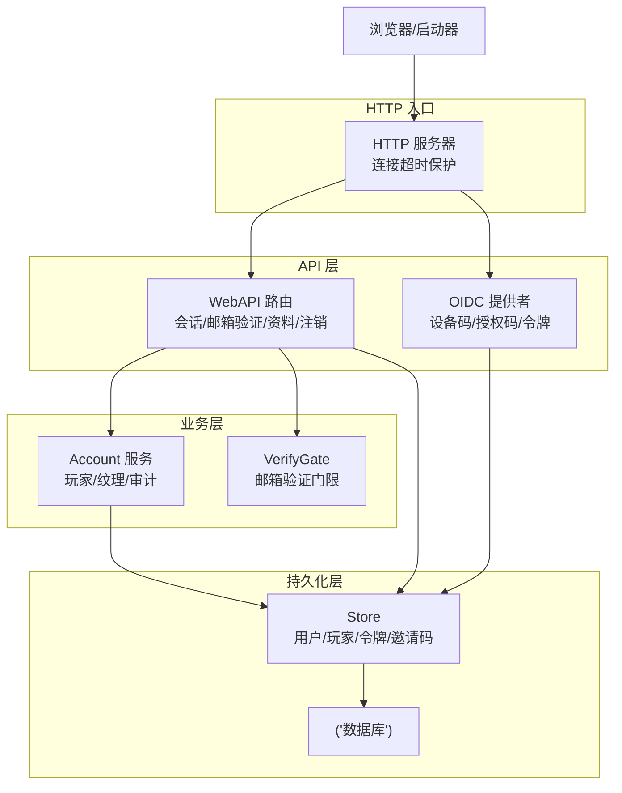

**图表来源**
- [server.go:1-24](https://github.com/YimingZhanshen/skin-nexus/blob/797ae1a/server/cmd/skin-nexus/server.go#L1-L24)
- [provider.go:60-120](https://github.com/YimingZhanshen/skin-nexus/blob/797ae1a/server/internal/oidc/provider.go#L60-L120)
- [verify_gate_web.go:140-193](https://github.com/YimingZhanshen/skin-nexus/blob/797ae1a/server/internal/webapi/verify_gate_web.go#L140-L193)

**章节来源**
- [server.go:1-24](https://github.com/YimingZhanshen/skin-nexus/blob/797ae1a/server/cmd/skin-nexus/server.go#L1-L24)

## 核心组件
- **Account 服务**：统一封装玩家查询、创建、重命名、纹理上传/删除等业务；所有变更通过守卫、事件和审计，避免信任调用方传入的 UID。
- **Auth 密码模块**：兼容 Blessing/AuthMe 旧哈希，并支持 argon2id/bcrypt/php_password_hash；对非现代算法在首次成功登录后惰性升级。
- **OIDC Provider**：基于 zitadel，暴露标准 OIDC 端点，支持 device authorization、authorization code、refresh token、RS256 JWT；提供 `/userinfo`、`/.well-known/openid-configuration`。
- **VerifyGate**：集中定义“是否阻止未验证邮箱账户”的决策函数，launcher 与 web 共用同一规则。
- **WebAPI**：安装向导、密码重置、邮箱验证、个人资料更新、账号注销、受验证门禁保护的 API 中间件。
- **Store**：抽象 SQL 操作，提供 email_verify_tokens、password_reset_tokens、invitation_codes、users、players、oidc_* 等表的读写。

**章节来源**
- [service.go:1-120](https://github.com/YimingZhanshen/skin-nexus/blob/797ae1a/server/internal/account/service.go#L1-L120)
- [password.go:1-120](https://github.com/YimingZhanshen/skin-nexus/blob/797ae1a/server/internal/auth/password.go#L1-L120)
- [provider.go:1-60](https://github.com/YimingZhanshen/skin-nexus/blob/797ae1a/server/internal/oidc/provider.go#L1-L60)
- [verifygate.go:1-48](https://github.com/YimingZhanshen/skin-nexus/blob/797ae1a/server/internal/verifygate/verifygate.go#L1-L48)
- [email_verify.go:1-80](https://github.com/YimingZhanshen/skin-nexus/blob/797ae1a/server/internal/webapi/email_verify.go#L1-L80)

## 架构总览
以下图展示浏览器登录与 OIDC 设备码流程的关键交互。

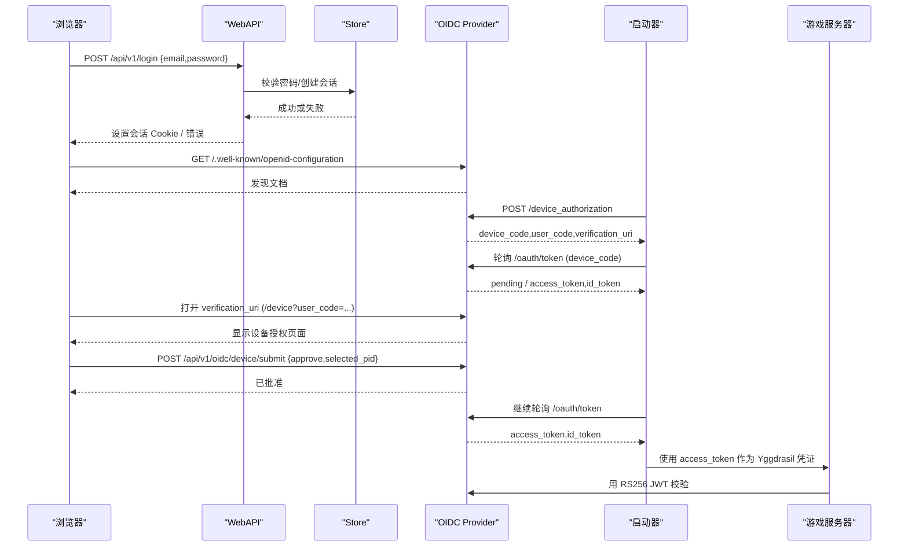

**图表来源**
- [provider.go:80-160](https://github.com/YimingZhanshen/skin-nexus/blob/797ae1a/server/internal/oidc/provider.go#L80-L160)
- [jwt.go:1-154](https://github.com/YimingZhanshen/skin-nexus/blob/797ae1a/server/internal/oidc/jwt.go#L1-L154)
- [DevicePage.vue:1-123](https://github.com/YimingZhanshen/skin-nexus/blob/797ae1a/web/src/pages/DevicePage.vue#L1-L123)

## 详细组件分析

### 本地账号生命周期：注册、登录、密码哈希、昵称复用、邮箱验证、注销

#### 注册与昵称复用
- 新用户注册由 WebAPI 与 Store 协作完成；昵称与邮箱均通过唯一索引约束（LOWER），重复会返回冲突。
- 邀请码注册走 `CreateUserWithInvitation`，原子性地写入用户记录并把邀请码标记为已用。
- 昵称复用策略：由于昵称列有唯一索引，已有昵称不可重复注册；若旧账号被删除且昵称释放，则后续注册可复用该昵称。

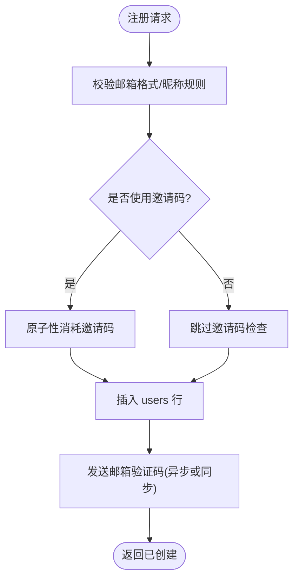

**图表来源**
- [invitation_store.go:100-175](https://github.com/YimingZhanshen/skin-nexus/blob/797ae1a/server/internal/store/invitation.go#L100-L175)
- [0001_init.sql:1-40](https://github.com/YimingZhanshen/skin-nexus/blob/797ae1a/server/migrations/sqlite/0001_init.sql#L1-L40)

**章节来源**
- [0001_init.sql:1-40](https://github.com/YimingZhanshen/skin-nexus/blob/797ae1a/server/migrations/sqlite/0001_init.sql#L1-L40)
- [invitation_store.go:1-175](https://github.com/YimingZhanshen/skin-nexus/blob/797ae1a/server/internal/store/invitation.go#L1-L175)

#### 登录与会话
- 登录接口位于 WebAPI；成功后设置会话 Cookie。
- 密码校验支持 legacy verifier 与 PHC 算法；新密码使用 argon2id。
- 登录成功后，浏览器持有会话 Cookie，用于后续 `/api/v1/me`、`/api/v1/logout` 等受保护接口。
- 前端启动、登录、注册、注销、账号切换和账户状态更新统一通过 `useSession.setSessionUser(next)` 替换用户；该操作同时删除旧 `admin_token` 存储键。
- `refreshMe()` 使用请求 generation，只有最新请求能提交用户。切号或注销后迟到的 `/me` 成功响应不能覆盖新账号，迟到的 401 也不能清除新账号。
- 当前 `/me` 返回 401 时清空用户并通知应用外壳；网络错误、超时和 5xx 不改变已有会话。启动刷新失败时显示可重试错误，后台刷新失败时保留当前用户。

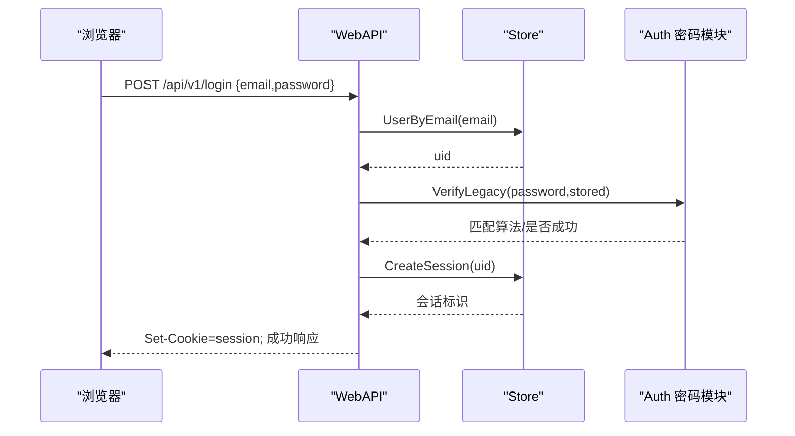

**图表来源**
- [password.go:120-280](https://github.com/YimingZhanshen/skin-nexus/blob/797ae1a/server/internal/auth/password.go#L120-L280)

**章节来源**
- [password.go:1-280](https://github.com/YimingZhanshen/skin-nexus/blob/797ae1a/server/internal/auth/password.go#L1-L280)

#### 管理 API 的会话与机器令牌边界

- `SessionUser` 只解析未过期且关联用户 `permission >= 0` 的会话；封禁账户即使仍有会话行，也不能通过会话认证。
- 管理 API 收到任何非空 `skin_session` Cookie 时，只接受合格的管理员会话；无效、过期、封禁或非管理员会话一律返回 403，不因同时携带有效 `X-Admin-Token` 而回退到机器模式。
- 没有会话 Cookie，或 Cookie 值为空时，有效 `X-Admin-Token` 仍可作为机器凭据，审计 actor 为 `0`。
- 有效管理员会话与有效机器令牌同时出现时，以会话身份为准并保留审计 actor；待验证邮箱门禁仍按会话身份执行。
- 浏览器管理面板和 Server Access 仅使用同源会话 Cookie，不读取、持久化或发送 `admin_token`；上面的无 Cookie 机器令牌例外只适用于后端机器 API 客户端。
- 管理传输遇到 HTTP 401 或 HTTP 403 + `admin.token_invalid` 时，先通知外壳再抛错；`admin.web_session_required`、`admin.super_admin_required`、普通 403、`serveraccess.forbidden`、模块 404、网络错误和 5xx 不触发登出。
- 会话失效时，外壳清空用户、`extPath`、`pendingExt`、`pendingView`、`menuOpen`、邮箱验证临时状态和认证临时状态，回到 `/` 登录页；管理与租户视图随用户清空而卸载。`useServerTenant` 另清空 tenant/role/members/invites，并递增请求代次，使在途加载和变更结果失效。
- 封禁操作在同一事务中删除目标用户的全部 Web 会话，并吊销 Yggdrasil、OIDC access/refresh 凭证及 join 会话；任一步失败都会回滚权限与全部吊销，接口返回失败而不是部分成功。

**章节来源**
- [adminapi.go:233-319](https://github.com/YimingZhanshen/skin-nexus/blob/797ae1a/server/internal/adminapi/adminapi.go#L233-L319)
- [web.go:96-124](https://github.com/YimingZhanshen/skin-nexus/blob/797ae1a/server/internal/store/web.go#L96-L124)
- [mysql.go:287-345](https://github.com/YimingZhanshen/skin-nexus/blob/797ae1a/server/internal/store/mysql.go#L287-L345)

#### 密码重置
- 忘记密码：POST `/api/v1/password/forgot`，生成随机 token，仅存储 SHA-256 digest，TTL 30 分钟，单用户仅保留最新未用 token。
- 重置密码：POST `/api/v1/password/reset`，消费 token 后更换密码；成功后撤销所有 yggdrasil 令牌、OIDC 授权、除当前会话外的其他会话。
- 无枚举泄露：未知邮箱与已知邮箱都返回相同形状；重置失败合并为单一错误消息。

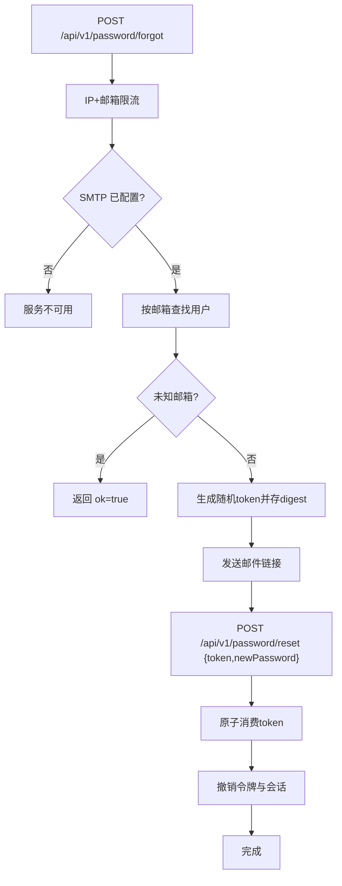

**图表来源**
- [password.go:100-200](https://github.com/YimingZhanshen/skin-nexus/blob/797ae1a/server/internal/webapi/password.go#L100-L200)
- [password_reset_store.go:1-86](https://github.com/YimingZhanshen/skin-nexus/blob/797ae1a/server/internal/store/password_reset.go#L1-L86)

**章节来源**
- [email_verify.go:80-200](https://github.com/YimingZhanshen/skin-nexus/blob/797ae1a/server/internal/webapi/email_verify.go#L80-L200)
- [password_reset_store.go:1-86](https://github.com/YimingZhanshen/skin-nexus/blob/797ae1a/server/internal/store/password_reset.go#L1-L86)

#### 邮箱验证门禁
- VerifyGate 是唯一的门限判断函数：当启用验证、邮箱未验证、且超过宽限期时阻止账户使用。
- WebAPI 的 `verifyWebGate` 中间件对 `/api/v1/` 下未开放路径进行拦截，允许登录、注册、邮箱验证、修改邮箱、注销等出口。
- 管理员（permission>=2）永远不受 pending 限制，以保障站点运维通道不被锁死。

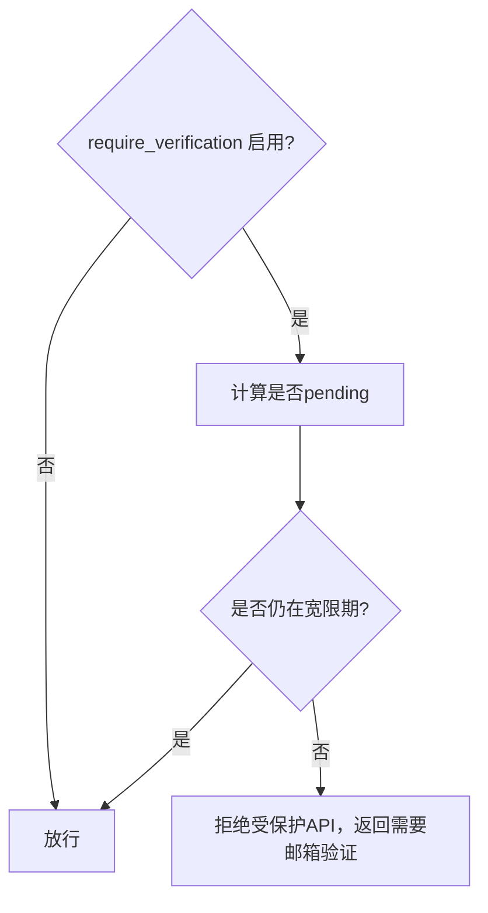

**图表来源**
- [verifygate.go:1-48](https://github.com/YimingZhanshen/skin-nexus/blob/797ae1a/server/internal/verifygate/verifygate.go#L1-L48)
- [verify_gate_web.go:1-193](https://github.com/YimingZhanshen/skin-nexus/blob/797ae1a/server/internal/webapi/verify_gate_web.go#L1-L193)

**章节来源**
- [verifygate.go:1-48](https://github.com/YimingZhanshen/skin-nexus/blob/797ae1a/server/internal/verifygate/verifygate.go#L1-L48)
- [verify_gate_web.go:1-193](https://github.com/YimingZhanshen/skin-nexus/blob/797ae1a/server/internal/webapi/verify_gate_web.go#L1-L193)

#### 账号注销
- 注销接口要求密码确认；管理员不能自删；成功后级联删除会话、令牌、衣橱、uuid_map、玩家等，但纹理与审计日志保留。
- 注销后会清理 Cookie，使前端丢弃状态。

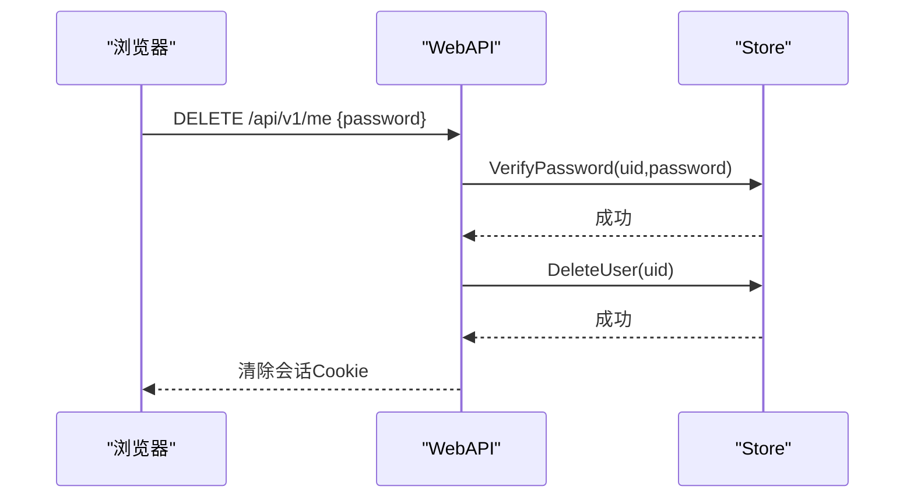

**图表来源**
- [profile.go:120-200](https://github.com/YimingZhanshen/skin-nexus/blob/797ae1a/server/internal/webapi/profile.go#L120-L200)

**章节来源**
- [profile.go:1-200](https://github.com/YimingZhanshen/skin-nexus/blob/797ae1a/server/internal/webapi/profile.go#L1-L200)

### 邀请码准入机制
- 邀请码采用 MD5 hex 随机值，长度 32 小写十六进制，兼容上游 blessing 插件。
- 批量生成在一个事务中完成，避免部分提交。
- 使用 `CreateUserWithInvitation` 原子性创建用户并标记邀请码已用；并发双写时只有一方能成功。

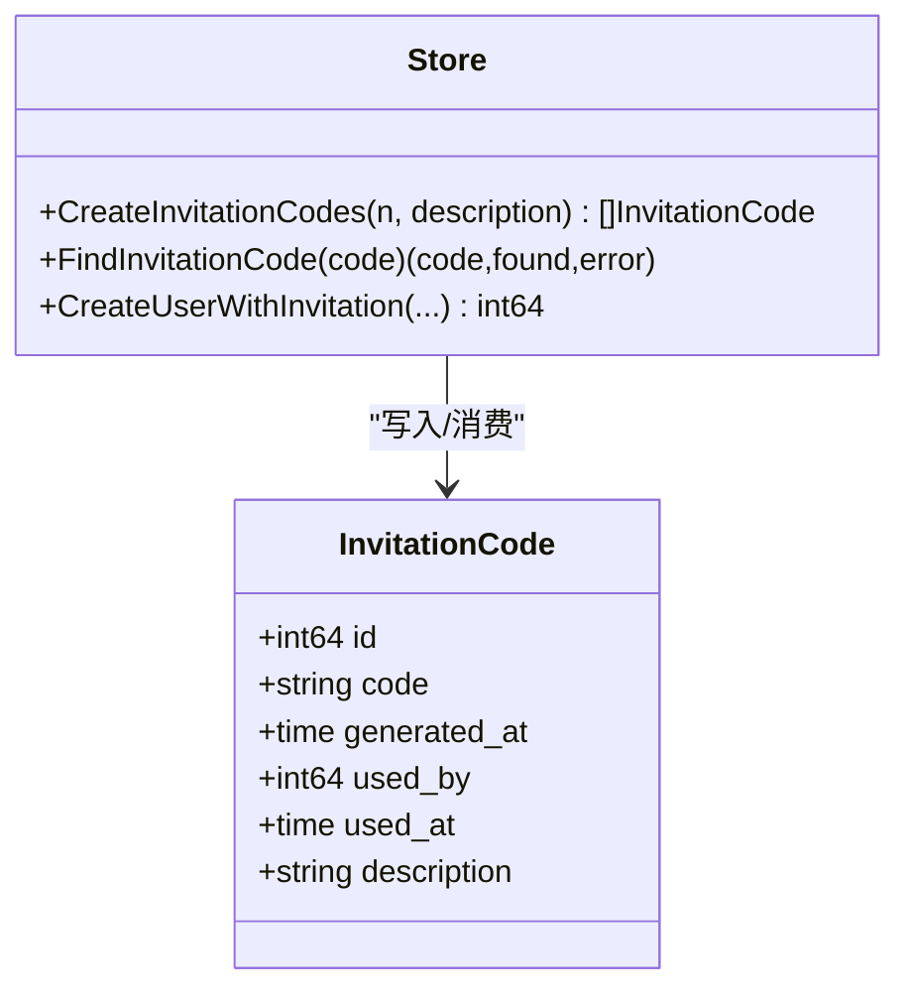

**图表来源**
- [invitation_store.go:1-175](https://github.com/YimingZhanshen/skin-nexus/blob/797ae1a/server/internal/store/invitation.go#L1-L175)

**章节来源**
- [invitation_store.go:1-175](https://github.com/YimingZhanshen/skin-nexus/blob/797ae1a/server/internal/store/invitation.go#L1-L175)

### 内置 OIDC 提供者：设备码流程、Refresh Token、JWT、授权应用管理、设备列表与撤销

#### 设备码流程
- 启动器调用 `/device_authorization` 获取 `device_code`、`user_code`、`verification_uri`。
- 浏览器打开 `/device`，输入 user_code，查看授权请求并选择玩家。
- 用户点击“批准”，后端将 `device_code` 转为 access_token 和 id_token。
- 启动器轮询 `/oauth/token` 直到拿到令牌。

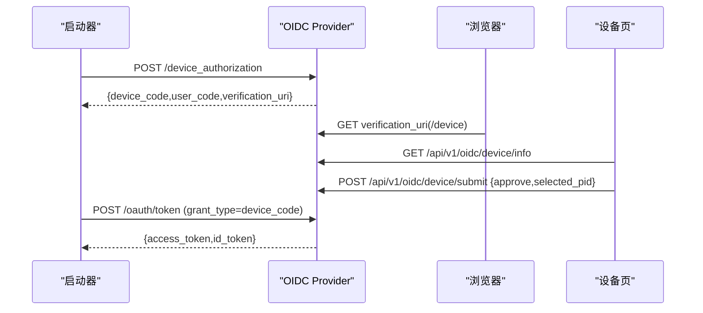

**图表来源**
- [provider.go:100-160](https://github.com/YimingZhanshen/skin-nexus/blob/797ae1a/server/internal/oidc/provider.go#L100-L160)
- [DevicePage.vue:1-123](https://github.com/YimingZhanshen/skin-nexus/blob/797ae1a/web/src/pages/DevicePage.vue#L1-L123)

#### Refresh Token 轮换与 JWT 签发
- refresh token 与 access token 分别持久化在 `oidc_refresh_tokens`、`oidc_access_tokens`。
- 刷新流程保持 selected_profile，保证多次轮换后 claims 一致。
- JWT 使用 RS256，issuer 必须匹配，exp 带 60 秒容忍，jti 必须在账本中存在且未被撤销。
- Join 场景强制要求 scope 包含 `Yggdrasil.Server.Join`。

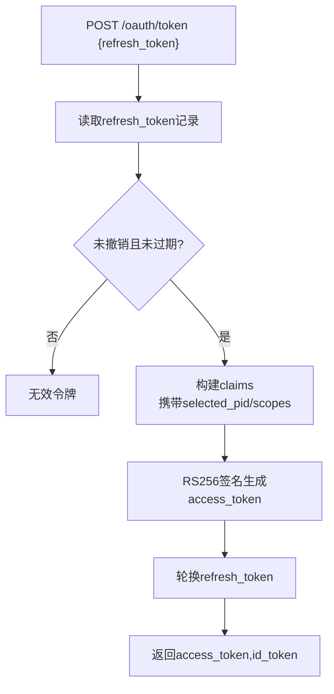

**图表来源**
- [storage.go:120-200](https://github.com/YimingZhanshen/skin-nexus/blob/797ae1a/server/internal/oidc/storage.go#L120-L200)
- [jwt.go:1-154](https://github.com/YimingZhanshen/skin-nexus/blob/797ae1a/server/internal/oidc/jwt.go#L1-L154)
- [0003_oidc.sql:1-75](https://github.com/YimingZhanshen/skin-nexus/blob/797ae1a/server/migrations/sqlite/0003_oidc.sql#L1-L75)

**章节来源**
- [provider.go:1-200](https://github.com/YimingZhanshen/skin-nexus/blob/797ae1a/server/internal/oidc/provider.go#L1-L200)
- [jwt.go:1-154](https://github.com/YimingZhanshen/skin-nexus/blob/797ae1a/server/internal/oidc/jwt.go#L1-L154)
- [storage.go:1-200](https://github.com/YimingZhanshen/skin-nexus/blob/797ae1a/server/internal/oidc/storage.go#L1-L200)
- [0003_oidc.sql:1-75](https://github.com/YimingZhanshen/skin-nexus/blob/797ae1a/server/migrations/sqlite/0003_oidc.sql#L1-L75)

#### 授权应用管理与设备列表
- 用户可在“已授权应用”页面查看自己的活动 OIDC grant（jti 账本）。
- 支持撤销单个 jti 或全部撤销；撤销单个 jti 时也会尝试撤销同 client 的 refresh tokens。
- 全部撤销会同时撤销 access tokens 与 refresh tokens，审计事件记录。

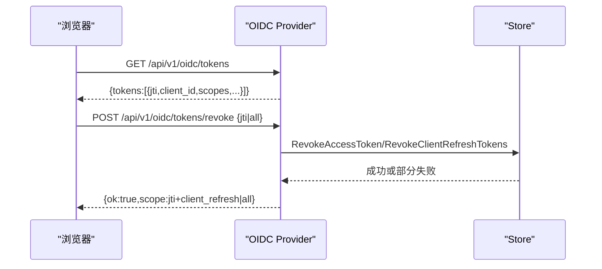

**图表来源**
- [userapi.go:1-124](https://github.com/YimingZhanshen/skin-nexus/blob/797ae1a/server/internal/oidc/userapi.go#L1-L124)
- [AuthorizedAppsPage.vue:1-81](https://github.com/YimingZhanshen/skin-nexus/blob/797ae1a/web/src/pages/AuthorizedAppsPage.vue#L1-L81)

**章节来源**
- [userapi.go:1-124](https://github.com/YimingZhanshen/skin-nexus/blob/797ae1a/server/internal/oidc/userapi.go#L1-L124)
- [AuthorizedAppsPage.vue:1-81](https://github.com/YimingZhanshen/skin-nexus/blob/797ae1a/web/src/pages/AuthorizedAppsPage.vue#L1-L81)

### 权限等级、角色关联、玩家 UUID 与皮肤关系

- 权限等级：
  - permission=0：普通用户。
  - permission=1：工作人员。
  - permission=2：超级管理员（安装向导默认授予）。
- 玩家（player）属于账号（user），一个账号可拥有多个玩家，数量受 `player_limit` 与站点上限控制。
- 每个玩家有唯一 name 与 uuid；uuid_map 维护 name→uuid 映射，并可选关联 player_id。
- 皮肤/披风是 texture 资源，玩家引用 skin_tid、cape_tid；纹理对象包含 hash、model、url 等元信息。

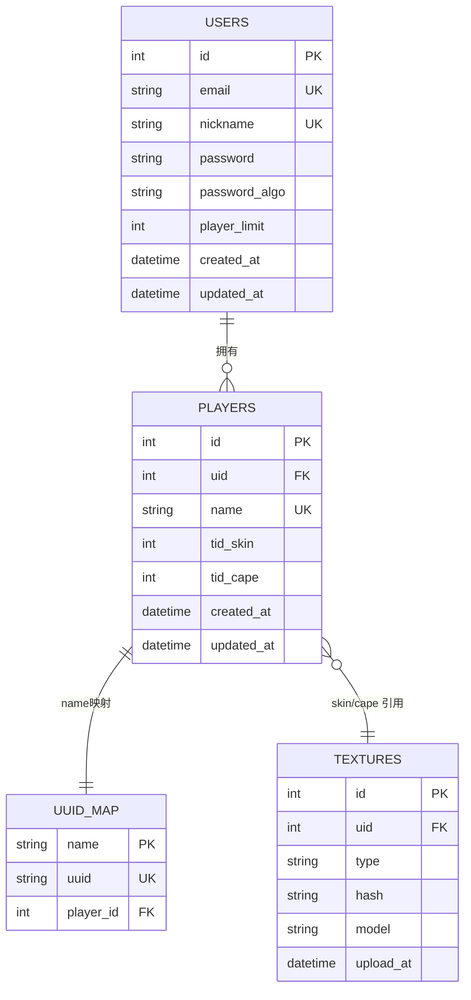

**图表来源**
- [0001_init.sql:1-104](https://github.com/YimingZhanshen/skin-nexus/blob/797ae1a/server/migrations/sqlite/0001_init.sql#L1-L104)
- [players.go:1-120](https://github.com/YimingZhanshen/skin-nexus/blob/797ae1a/server/internal/account/players.go#L1-L120)
- [service.go:120-200](https://github.com/YimingZhanshen/skin-nexus/blob/797ae1a/server/internal/account/service.go#L120-L200)

**章节来源**
- [0001_init.sql:1-104](https://github.com/YimingZhanshen/skin-nexus/blob/797ae1a/server/migrations/sqlite/0001_init.sql#L1-L104)
- [players.go:1-200](https://github.com/YimingZhanshen/skin-nexus/blob/797ae1a/server/internal/account/players.go#L1-L200)
- [service.go:120-200](https://github.com/YimingZhanshen/skin-nexus/blob/797ae1a/server/internal/account/service.go#L120-L200)

## 依赖关系分析

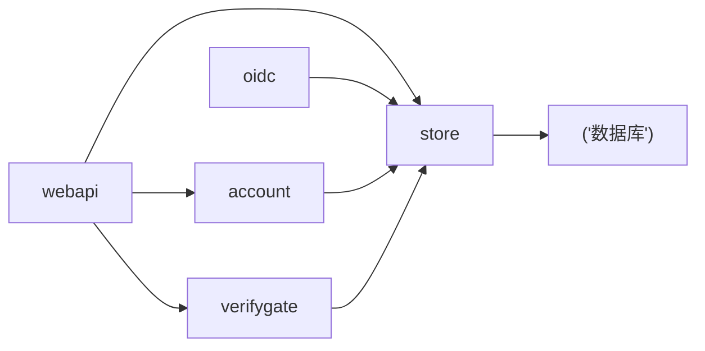

**图表来源**
- [verify_gate_web.go:140-193](https://github.com/YimingZhanshen/skin-nexus/blob/797ae1a/server/internal/webapi/verify_gate_web.go#L140-L193)
- [provider.go:60-120](https://github.com/YimingZhanshen/skin-nexus/blob/797ae1a/server/internal/oidc/provider.go#L60-L120)
- [service.go:1-120](https://github.com/YimingZhanshen/skin-nexus/blob/797ae1a/server/internal/account/service.go#L1-L120)

**章节来源**
- [verify_gate_web.go:140-193](https://github.com/YimingZhanshen/skin-nexus/blob/797ae1a/server/internal/webapi/verify_gate_web.go#L140-L193)
- [provider.go:60-120](https://github.com/YimingZhanshen/skin-nexus/blob/797ae1a/server/internal/oidc/provider.go#L60-L120)
- [service.go:1-120](https://github.com/YimingZhanshen/skin-nexus/blob/797ae1a/server/internal/account/service.go#L1-L120)

## 性能与扩展性
- HTTP 服务器设置了 ReadHeaderTimeout、ReadTimeout、WriteTimeout、IdleTimeout，防止慢客户端耗尽连接。
- 邮箱验证码、密码重置 token 在创建时自动清理超过一天的过期或已用行，降低表膨胀。
- OIDC 存储适配器使用内存 map 缓存设备授权 PID，减少重复查询。
- Account 服务在列表玩家时一次性 join 获取 skin/cape 哈希，避免 N+1 查询。

[本节为通用性能讨论，不直接分析具体文件]

## 故障排查指南

- 密码重置失败
  - 现象：收到“服务不可用”或“邮件未配置”。
  - 原因：SMTP 未配置；或重置链接已过期/已被消费。
  - 处理：检查站点 SMTP 设置；重新请求忘记密码；确保链接在 30 分钟内使用。

- OIDC 回调域名不一致
  - 现象：授权码回调报错或设备授权无法完成。
  - 原因：OIDC issuer 或 redirect URI 与实际访问地址不一致；launchers 依赖 `.well-known/openid-configuration` 解析根地址。
  - 处理：统一 site_url 与 OIDC issuer；检查反向代理透传的协议与主机名。

- 邮箱验证码过期
  - 现象：点击邮箱验证链接提示“链接无效或已过期”。
  - 原因：链接 TTL 为 24 小时；或链接已被消费。
  - 处理：重新发送验证邮件；注意不要重复点击导致原链接失效。

- 重复昵称冲突
  - 现象：注册或改名返回 409。
  - 原因：昵称唯一索引约束；旧昵称仍被占用。
  - 处理：更换昵称；或联系管理员确认是否有同名玩家/账号。

**章节来源**
- [email_verify.go:1-200](https://github.com/YimingZhanshen/skin-nexus/blob/797ae1a/server/internal/webapi/email_verify.go#L1-L200)
- [password_reset_store.go:1-86](https://github.com/YimingZhanshen/skin-nexus/blob/797ae1a/server/internal/store/password_reset.go#L1-L86)
- [provider.go:100-160](https://github.com/YimingZhanshen/skin-nexus/blob/797ae1a/server/internal/oidc/provider.go#L100-L160)

## 安全建议
- 密码强度
  - 新密码必须至少 8 字符，禁止与旧密码相同。
  - 推荐使用 argon2id；legacy 哈希在首次成功登录后惰性升级。
- CSRF 防护
  - 会话 Cookie 应配合 SameSite=Lax；注销时根据 TLS/X-Forwarded-Proto 设置 Secure。
  - 敏感操作（改密、注销）需密码二次确认。
- 登录限流
  - 密码重置与邮箱验证接口均有 IP+邮箱/UID 滑动窗口限流。
  - 建议为登录猜测增加更严格的 fail/lockout 策略。
- 敏感信息脱敏
  - 邮件失败审计使用 redact.Email 隐藏收件人；日志中避免明文输出密码、token。
- OIDC 安全
  - 仅接受 RS256；严格校验 issuer、exp、jti；join 场景强制 scope。
  - 定期审查授权应用，必要时全部撤销；客户端 secret 应妥善保存。

**章节来源**
- [password.go:120-280](https://github.com/YimingZhanshen/skin-nexus/blob/797ae1a/server/internal/auth/password.go#L120-L280)
- [email_verify.go:120-200](https://github.com/YimingZhanshen/skin-nexus/blob/797ae1a/server/internal/webapi/email_verify.go#L120-L200)
- [jwt.go:1-154](https://github.com/YimingZhanshen/skin-nexus/blob/797ae1a/server/internal/oidc/jwt.go#L1-L154)
- [profile.go:120-200](https://github.com/YimingZhanshen/skin-nexus/blob/797ae1a/server/internal/webapi/profile.go#L120-L200)

## 结论
SkinNexus 的认证与账户系统在 WebAPI、Account、OIDC、VerifyGate、Store 之间形成清晰分层：WebAPI 负责会话与表单语义，Account 封装玩家/纹理业务，OIDC 提供标准化授权能力，VerifyGate 统一邮箱验证策略，Store 提供稳定一致的持久化。通过邀请码准入、密码哈希兼容、邮箱验证门禁、OIDC 设备码流程与 JWT 校验，系统既兼容旧生态又具备现代安全性。建议在部署时统一站点地址、启用强密码策略、开启限流与审计，并定期清理不再使用的 OIDC 授权。
