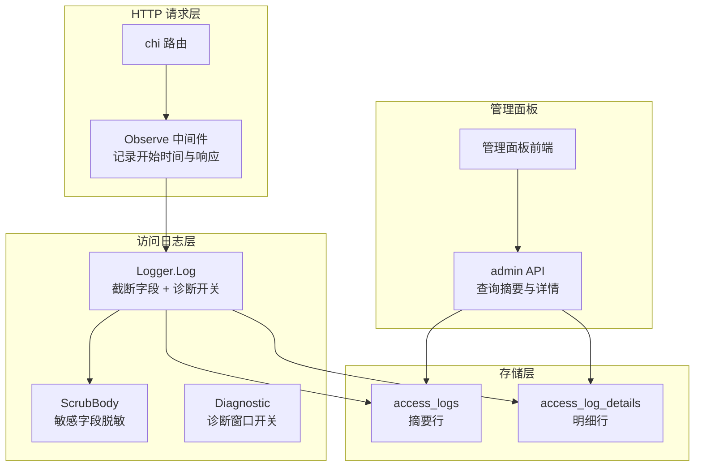
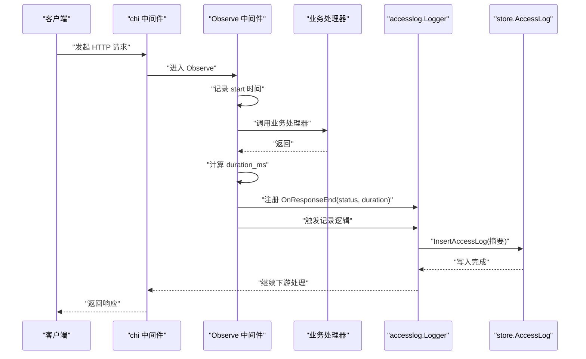
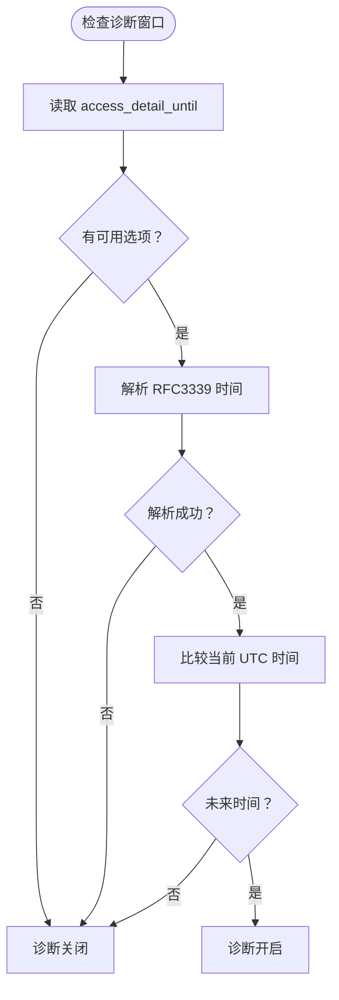
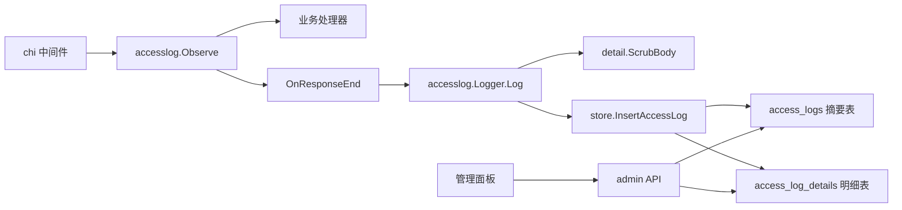
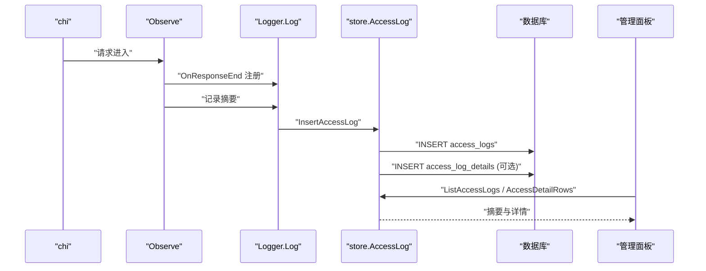
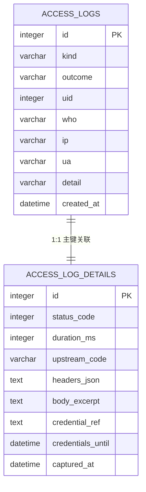
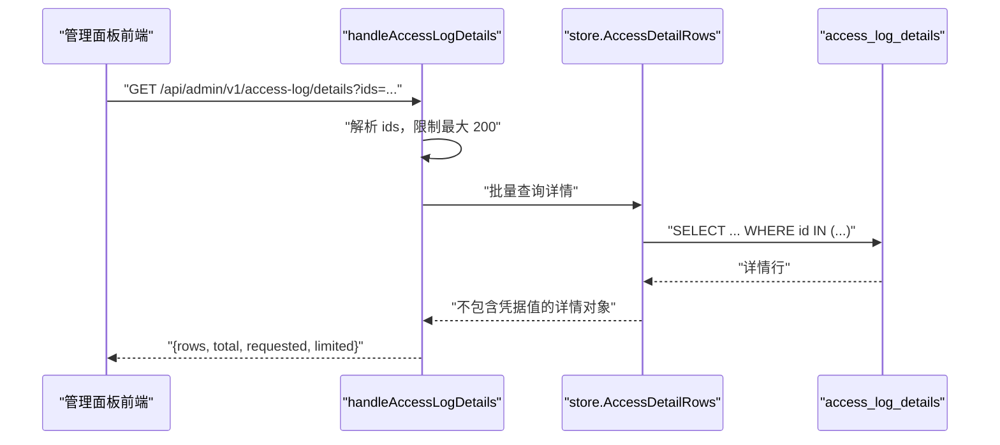
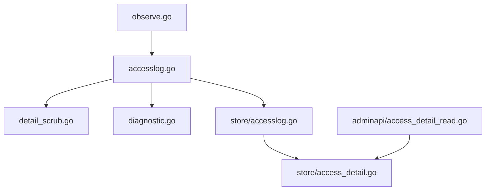

# 访问日志与审计模块

**本文引用的文件**
- [accesslog.go](https://github.com/YimingZhanshen/skin-nexus/blob/797ae1a/server/internal/accesslog/accesslog.go)
- [observe.go](https://github.com/YimingZhanshen/skin-nexus/blob/797ae1a/server/internal/accesslog/observe.go)
- [detail_scrub.go](https://github.com/YimingZhanshen/skin-nexus/blob/797ae1a/server/internal/accesslog/detail_scrub.go)
- [diagnostic.go](https://github.com/YimingZhanshen/skin-nexus/blob/797ae1a/server/internal/accesslog/diagnostic.go)
- [accesslog.go](https://github.com/YimingZhanshen/skin-nexus/blob/797ae1a/server/internal/store/accesslog.go)
- [access_detail.go](https://github.com/YimingZhanshen/skin-nexus/blob/797ae1a/server/internal/store/access_detail.go)
- [access_detail_read.go](https://github.com/YimingZhanshen/skin-nexus/blob/797ae1a/server/internal/adminapi/access_detail_read.go)
- [0011_access_logs.sql](https://github.com/YimingZhanshen/skin-nexus/blob/797ae1a/server/migrations/sqlite/0011_access_logs.sql)
- [0029_access_log_details.sql](https://github.com/YimingZhanshen/skin-nexus/blob/797ae1a/server/migrations/sqlite/0029_access_log_details.sql)
- [server.go](https://github.com/YimingZhanshen/skin-nexus/blob/797ae1a/server/cmd/skin-nexus/server.go)

## 目录
1. [简介](#简介)
2. [项目结构](#项目结构)
3. [核心组件](#核心组件)
4. [架构总览](#架构总览)
5. [详细组件分析](#详细组件分析)
6. [依赖关系分析](#依赖关系分析)
7. [性能与容量控制](#性能与容量控制)
8. [常见使用场景](#常见使用场景)
9. [故障排查](#故障排查)
10. [安全注意事项](#安全注意事项)
11. [结论](#结论)

## 简介
本模块为站点提供“访问日志”和“诊断明细”能力：在 HTTP 请求路径上记录关键观测字段，并在管理员面板中查询；当打开诊断窗口时，还可记录请求状态码、耗时、头部摘要、请求体片段以及是否包含凭据。所有写入都是“尽力而为”的副作用：日志失败不能影响业务响应，也不能把异常变成用户可见错误。

模块的关键承诺包括：
- 记录时间戳、方法（由调用方填入）、URL/来源标识、状态码、耗时、客户端 IP 与 User-Agent。
- 通过 `detail.Scrub` 对敏感字段脱敏后再持久化。
- 诊断模式默认关闭，需要显式开启并受保留期与固定凭据过期时间约束。
- 管理面板只暴露摘要；详情读取接口不会返回真实凭据值。

## 项目结构
访问日志相关代码分布在三个层次：

| 层次 | 主要职责 | 对应文件 |
| --- | --- | --- |
| 中间件层 | 拦截 chi 中间件包装后的 `http.Handler`，记录开始时间、状态码、请求体前缀、最终耗时，并把结果交给后续 recorder | [observe.go:1-206](https://github.com/YimingZhanshen/skin-nexus/blob/797ae1a/server/internal/accesslog/observe.go#L1-L206) |
| 日志抽象层 | 定义日志条目类型、kind/outcome 枚举、Logger、Diagnostic 开关、脱敏规则 | [accesslog.go:1-134](https://github.com/YimingZhanshen/skin-nexus/blob/797ae1a/server/internal/accesslog/accesslog.go#L1-L134)、[diagnostic.go:1-140](https://github.com/YimingZhanshen/skin-nexus/blob/797ae1a/server/internal/accesslog/diagnostic.go#L1-L140)、[detail_scrub.go:1-125](https://github.com/YimingZhanshen/skin-nexus/blob/797ae1a/server/internal/accesslog/detail_scrub.go#L1-L125) |
| 存储与查询层 | 写入 `access_logs` 与 `access_log_details`，分页查询摘要，批量读取详情 | [accesslog.go](https://github.com/YimingZhanshen/skin-nexus/blob/797ae1a/server/internal/store/accesslog.go)、[access_detail.go](https://github.com/YimingZhanshen/skin-nexus/blob/797ae1a/server/internal/store/access_detail.go) |
| 管理面板查询接口 | 按页读取详情行，限制 IN 列表长度，不暴露凭据值 | [access_detail_read.go:1-92](https://github.com/YimingZhanshen/skin-nexus/blob/797ae1a/server/internal/adminapi/access_detail_read.go#L1-L92) |
| 数据模型 | SQLite 迁移定义摘要表与明细表 | [0011_access_logs.sql](https://github.com/YimingZhanshen/skin-nexus/blob/797ae1a/server/migrations/sqlite/0011_access_logs.sql)、[0029_access_log_details.sql](https://github.com/YimingZhanshen/skin-nexus/blob/797ae1a/server/migrations/sqlite/0029_access_log_details.sql) |

**图表来源**
- [observe.go:1-206](https://github.com/YimingZhanshen/skin-nexus/blob/797ae1a/server/internal/accesslog/observe.go#L1-L206)
- [accesslog.go:1-134](https://github.com/YimingZhanshen/skin-nexus/blob/797ae1a/server/internal/accesslog/accesslog.go#L1-L134)
- [detail_scrub.go:1-125](https://github.com/YimingZhanshen/skin-nexus/blob/797ae1a/server/internal/accesslog/detail_scrub.go#L1-L125)
- [accesslog.go](https://github.com/YimingZhanshen/skin-nexus/blob/797ae1a/server/internal/store/accesslog.go)
- [access_detail.go](https://github.com/YimingZhanshen/skin-nexus/blob/797ae1a/server/internal/store/access_detail.go)
- [access_detail_read.go:1-92](https://github.com/YimingZhanshen/skin-nexus/blob/797ae1a/server/internal/adminapi/access_detail_read.go#L1-L92)

**章节来源**
- [observe.go:1-206](https://github.com/YimingZhanshen/skin-nexus/blob/797ae1a/server/internal/accesslog/observe.go#L1-L206)
- [accesslog.go:1-134](https://github.com/YimingZhanshen/skin-nexus/blob/797ae1a/server/internal/accesslog/accesslog.go#L1-L134)
- [accesslog.go](https://github.com/YimingZhanshen/skin-nexus/blob/797ae1a/server/internal/store/accesslog.go)
- [access_detail_read.go:1-92](https://github.com/YimingZhanshen/skin-nexus/blob/797ae1a/server/internal/adminapi/access_detail_read.go#L1-L92)

## 核心组件

### Logger：日志入口
`Logger` 是记录器的统一入口。它封装一个 sink 函数和一个诊断开关：
- 如果 logger 或 sink 为空，则不记录。
- 如果 kind 或 outcome 为空，则丢弃无效条目。
- 对 who、IP、UA、Detail 做 rune-safe 截断，防止 MySQL utf8mb4 拒绝非法 UTF-8。
- 根据 Diagnostic 决定是否保留 Capture；若诊断关闭，则直接丢弃 Capture。
- 写入失败只打印操作日志，不重试、不返回给调用方、不影响业务响应。

| 字段 | 说明 | 限制 |
| --- | --- | --- |
| Kind | 事件类别，如 web_login、ygg_authenticate、union_in 等 | 字符串 |
| Outcome | ok / fail / denied / miss / error | 字符串 |
| UID | 关联用户 ID，0 表示无账户 | 整型 |
| Who | 昵称、用户名、UUID 或目标路径 | 最多 64 字节 |
| IP | 来源 IP | 最多 45 字节 |
| UA | User-Agent | 最多 255 字节 |
| Detail | 原因、服务器 ID、状态、延迟等描述 | 最多 255 字节 |
| Capture | 诊断模式下的额外捕获 | 可空 |

**章节来源**
- [accesslog.go:1-134](https://github.com/YimingZhanshen/skin-nexus/blob/797ae1a/server/internal/accesslog/accesslog.go#L1-L134)

### Observe：chi 中间件观察点
`Observe` 是 chi 中间件链上的观察点。它负责：
- 在每个请求开始时记录时间。
- 为带请求体的请求包裹 `teeReader`，只复制最大前缀，避免无限增长。
- 用 `statusWriter` 包装响应写出器，捕获第一次写出的状态码。
- 在 handler 返回后计算最终耗时，并按 net/http 语义推断未写状态码时的 200。
- 通过 `OnResponseEnd` 回调把最终状态码和耗时交给已注册的 recorder。

**图表来源**
- [observe.go:1-206](https://github.com/YimingZhanshen/skin-nexus/blob/797ae1a/server/internal/accesslog/observe.go#L1-L206)
- [accesslog.go:1-134](https://github.com/YimingZhanshen/skin-nexus/blob/797ae1a/server/internal/accesslog/accesslog.go#L1-L134)
- [accesslog.go](https://github.com/YimingZhanshen/skin-nexus/blob/797ae1a/server/internal/store/accesslog.go)

**章节来源**
- [observe.go:1-206](https://github.com/YimingZhanshen/skin-nexus/blob/797ae1a/server/internal/accesslog/observe.go#L1-L206)

### ScrubBody：敏感字段脱敏
`ScrubBody` 是 detail 写入前的最后一道安全门：
- 如果正文为空，直接返回。
- 先检查正文文本中是否出现敏感字段名集合中的任何名称。
- 如果没有敏感键名，原样返回正文，避免误伤正常调试信息。
- 如果能解析成 JSON，则递归替换敏感键的值；如果没有实际替换，仍返回原文。
- 如果不能解析但出现了敏感键名，则整体替换为不可混淆的标记，而不是泄露原始内容。
- 脱敏结果是幂等的：对已经脱敏的输出再次运行不会产生变化。

敏感键名包括密码、令牌、授权头、OAuth code/deviceCode/setupToken 等形状的名称，大小写不敏感匹配。

**章节来源**
- [detail_scrub.go:1-125](https://github.com/YimingZhanshen/skin-nexus/blob/797ae1a/server/internal/accesslog/detail_scrub.go#L1-L125)

### Diagnostic：诊断窗口与保留策略
Diagnostic 决定“诊断模式”是否激活：
- 通过站点选项 `access_detail_until` 控制：RFC3339 时间且严格在未来才视为开启。
- 使用 Go 时钟 UTC，不使用数据库 `now()`，避免时区不一致导致开关误判。
- 如果选项缺失、为空、无法解析或已经过期，诊断模式关闭。
- 保留天数通过 `access_detail_retention_days` 控制，默认 90 天，最大 3650 天。
- 凭据清理走独立固定 TTL（24 小时），与日志保留期分离。

**图表来源**
- [diagnostic.go:1-140](https://github.com/YimingZhanshen/skin-nexus/blob/797ae1a/server/internal/accesslog/diagnostic.go#L1-L140)

**章节来源**
- [diagnostic.go:1-140](https://github.com/YimingZhanshen/skin-nexus/blob/797ae1a/server/internal/accesslog/diagnostic.go#L1-L140)

## 架构总览

**图表来源**
- [observe.go:1-206](https://github.com/YimingZhanshen/skin-nexus/blob/797ae1a/server/internal/accesslog/observe.go#L1-L206)
- [accesslog.go:1-134](https://github.com/YimingZhanshen/skin-nexus/blob/797ae1a/server/internal/accesslog/accesslog.go#L1-L134)
- [detail_scrub.go:1-125](https://github.com/YimingZhanshen/skin-nexus/blob/797ae1a/server/internal/accesslog/detail_scrub.go#L1-L125)
- [accesslog.go](https://github.com/YimingZhanshen/skin-nexus/blob/797ae1a/server/internal/store/accesslog.go)
- [access_detail.go](https://github.com/YimingZhanshen/skin-nexus/blob/797ae1a/server/internal/store/access_detail.go)
- [access_detail_read.go:1-92](https://github.com/YimingZhanshen/skin-nexus/blob/797ae1a/server/internal/adminapi/access_detail_read.go#L1-L92)

## 详细组件分析

### 数据流：chi → Observe → store.AccessLog → 管理面板

| 阶段 | 输入 | 处理 | 输出 |
| --- | --- | --- | --- |
| chi 中间件 | 原始请求 | 创建上下文、注册 Observe | 转发到下一个中间件 |
| Observe | http.Request / ResponseWriter | 记录开始时间、包装响应写出器、截取请求体前缀 | 最终状态码与耗时回调 |
| Logger.Log | Entry | 截断字段、判断诊断模式、脱敏 Capture | 调用 sink |
| store.AccessLog | Entry | 写入摘要行，必要时写入明细行 | 数据库行 |
| admin API | 摘要查询参数 / 详情 id 列表 | 分页查询、批量读取详情 | 面板可渲染的数据 |

**图表来源**
- [observe.go:1-206](https://github.com/YimingZhanshen/skin-nexus/blob/797ae1a/server/internal/accesslog/observe.go#L1-L206)
- [accesslog.go:1-134](https://github.com/YimingZhanshen/skin-nexus/blob/797ae1a/server/internal/accesslog/accesslog.go#L1-L134)
- [accesslog.go](https://github.com/YimingZhanshen/skin-nexus/blob/797ae1a/server/internal/store/accesslog.go)
- [access_detail.go](https://github.com/YimingZhanshen/skin-nexus/blob/797ae1a/server/internal/store/access_detail.go)
- [access_detail_read.go:1-92](https://github.com/YimingZhanshen/skin-nexus/blob/797ae1a/server/internal/adminapi/access_detail_read.go#L1-L92)

**章节来源**
- [accesslog.go:1-134](https://github.com/YimingZhanshen/skin-nexus/blob/797ae1a/server/internal/accesslog/accesslog.go#L1-L134)
- [accesslog.go](https://github.com/YimingZhanshen/skin-nexus/blob/797ae1a/server/internal/store/accesslog.go)
- [access_detail_read.go:1-92](https://github.com/YimingZhanshen/skin-nexus/blob/797ae1a/server/internal/adminapi/access_detail_read.go#L1-L92)

### 摘要表与明细表模型

**图表来源**
- [0011_access_logs.sql:1-16](https://github.com/YimingZhanshen/skin-nexus/blob/797ae1a/server/migrations/sqlite/0011_access_logs.sql#L1-L16)
- [0029_access_log_details.sql:1-20](https://github.com/YimingZhanshen/skin-nexus/blob/797ae1a/server/migrations/sqlite/0029_access_log_details.sql#L1-L20)

**章节来源**
- [0011_access_logs.sql:1-16](https://github.com/YimingZhanshen/skin-nexus/blob/797ae1a/server/migrations/sqlite/0011_access_logs.sql#L1-L16)
- [0029_access_log_details.sql:1-20](https://github.com/YimingZhanshen/skin-nexus/blob/797ae1a/server/migrations/sqlite/0029_access_log_details.sql#L1-L20)

### 管理面板查询接口
管理面板的详情读取接口遵循两个重要设计：
1. 一页一查询：前端传入当前页可见的摘要 id，后端用单个 SQL 批量填充详情，避免 N+1。
2. 凭据只报告存在性：返回结构中只有 `credential_present`，不包含真实凭据值。

**图表来源**
- [access_detail_read.go:1-92](https://github.com/YimingZhanshen/skin-nexus/blob/797ae1a/server/internal/adminapi/access_detail_read.go#L1-L92)
- [access_detail.go:1-233](https://github.com/YimingZhanshen/skin-nexus/blob/797ae1a/server/internal/store/access_detail.go#L1-L233)

**章节来源**
- [access_detail_read.go:1-92](https://github.com/YimingZhanshen/skin-nexus/blob/797ae1a/server/internal/adminapi/access_detail_read.go#L1-L92)
- [access_detail.go:1-233](https://github.com/YimingZhanshen/skin-nexus/blob/797ae1a/server/internal/store/access_detail.go#L1-L233)

## 依赖关系分析

**图表来源**
- [observe.go:1-206](https://github.com/YimingZhanshen/skin-nexus/blob/797ae1a/server/internal/accesslog/observe.go#L1-L206)
- [accesslog.go:1-134](https://github.com/YimingZhanshen/skin-nexus/blob/797ae1a/server/internal/accesslog/accesslog.go#L1-L134)
- [detail_scrub.go:1-125](https://github.com/YimingZhanshen/skin-nexus/blob/797ae1a/server/internal/accesslog/detail_scrub.go#L1-L125)
- [diagnostic.go:1-140](https://github.com/YimingZhanshen/skin-nexus/blob/797ae1a/server/internal/accesslog/diagnostic.go#L1-L140)
- [accesslog.go](https://github.com/YimingZhanshen/skin-nexus/blob/797ae1a/server/internal/store/accesslog.go)
- [access_detail.go](https://github.com/YimingZhanshen/skin-nexus/blob/797ae1a/server/internal/store/access_detail.go)
- [access_detail_read.go:1-92](https://github.com/YimingZhanshen/skin-nexus/blob/797ae1a/server/internal/adminapi/access_detail_read.go#L1-L92)

耦合特点：
- observe 只依赖 Logger 提供的回调约定，不关心具体 sink。
- Logger 依赖 Diagnostic 控制是否写入 Capture。
- store 层同时承担摘要写入、明细写入、摘要查询、明细批量查询。
- adminapi 层只消费 store 的读取接口，不直接构造敏感数据。

**章节来源**
- [observe.go:1-206](https://github.com/YimingZhanshen/skin-nexus/blob/797ae1a/server/internal/accesslog/observe.go#L1-L206)
- [accesslog.go:1-134](https://github.com/YimingZhanshen/skin-nexus/blob/797ae1a/server/internal/accesslog/accesslog.go#L1-L134)
- [access_detail_read.go:1-92](https://github.com/YimingZhanshen/skin-nexus/blob/797ae1a/server/internal/adminapi/access_detail_read.go#L1-L92)

## 性能与容量控制

### 请求路径开销
- Observe 每请求维护一个轻量结构，内部用互斥锁保护状态。
- 只有 `ContentLength != 0` 的请求才会复制请求体前缀。
- 请求体前缀有固定上限，超过部分直接丢弃，避免大上传拖慢日志路径。
- 日志写入失败不重试、不返回错误，避免阻塞响应。

### 字段截断
| 字段 | 最大字节数 | 目的 |
| --- | --- | --- |
| Who | 64 | 适配摘要列宽度，避免过长昵称或路径 |
| IP | 45 | 兼容 IPv6 加端口等格式 |
| UA | 255 | 防止超长 User-Agent |
| Detail | 255 | 摘要描述上限 |

### 日志保留策略
| 数据 | 保留依据 | 默认值 | 上限 |
| --- | --- | --- | --- |
| access_logs 摘要 | 配置项控制，按 created_at 清理 | 由外部配置决定 | 由运维配置 |
| access_log_details 明细 | `access_detail_retention_days` | 90 天 | 3650 天 |
| 凭据引用 | 固定 TTL，从 captured_at 起 24 小时 | 24 小时 | 固定值，不受面板保留天数影响 |

### 数据库索引
- 摘要表按 kind、created_at、who、uid、created_at 建立索引，便于按事件类型和时间筛选。
- 明细表按 credentials_until、captured_at 建立索引，便于凭据清理和保留清理。

**章节来源**
- [observe.go:1-206](https://github.com/YimingZhanshen/skin-nexus/blob/797ae1a/server/internal/accesslog/observe.go#L1-L206)
- [accesslog.go:1-134](https://github.com/YimingZhanshen/skin-nexus/blob/797ae1a/server/internal/accesslog/accesslog.go#L1-L134)
- [diagnostic.go:1-140](https://github.com/YimingZhanshen/skin-nexus/blob/797ae1a/server/internal/accesslog/diagnostic.go#L1-L140)
- [access_detail.go:1-233](https://github.com/YimingZhanshen/skin-nexus/blob/797ae1a/server/internal/store/access_detail.go#L1-L233)
- [0011_access_logs.sql:1-16](https://github.com/YimingZhanshen/skin-nexus/blob/797ae1a/server/migrations/sqlite/0011_access_logs.sql#L1-L16)
- [0029_access_log_details.sql:1-20](https://github.com/YimingZhanshen/skin-nexus/blob/797ae1a/server/migrations/sqlite/0029_access_log_details.sql#L1-L20)

## 常见使用场景

### 按 IP 或状态码筛选
- 摘要查询支持 kind 精确匹配和 q 子串模糊匹配。
- q 会在 who、ip、detail 三列上做大小写不敏感子串搜索。
- 如果需要按状态码筛选，应优先使用 kind 区分事件类型，并结合 detail 中的状态描述进行过滤。
- 对于更严格的条件，可在管理面板或上层查询服务中对 ListAccessLogs 的结果进一步筛选。

**章节来源**
- [accesslog.go](https://github.com/YimingZhanshen/skin-nexus/blob/797ae1a/server/internal/store/accesslog.go)

### 定位慢请求
- 使用 Observe 记录的 duration_ms 作为耗时指标。
- 在管理面板展开详情后，查看 status_code、duration_ms、headers_json、body_excerpt。
- 关注长时间处于 OutcomePending 的明细行：这类行会在响应完成后由 OnResponseEnd 回填最终状态和耗时。

**章节来源**
- [observe.go:1-206](https://github.com/YimingZhanshen/skin-nexus/blob/797ae1a/server/internal/accesslog/observe.go#L1-L206)
- [access_detail.go:1-233](https://github.com/YimingZhanshen/skin-nexus/blob/797ae1a/server/internal/store/access_detail.go#L1-L233)

### 排查恶意扫描
- 利用 who、ip、ua、detail 四列快速识别异常来源。
- 结合 kind 区分登录、验证、Yggdrasil、Union 等入口。
- 在诊断模式下查看请求体前缀，确认是否存在暴力破解、注入探测或异常 token 提交。
- 注意：即使没有开启诊断模式，摘要行的 detail 仍可携带状态、原因、上游码等线索。

**章节来源**
- [accesslog.go:1-134](https://github.com/YimingZhanshen/skin-nexus/blob/797ae1a/server/internal/accesslog/accesslog.go#L1-L134)
- [access_detail_read.go:1-92](https://github.com/YimingZhanshen/skin-nexus/blob/797ae1a/server/internal/adminapi/access_detail_read.go#L1-L92)

## 故障排查

### 日志写入失败
现象：
- 业务响应正常。
- 操作日志中出现 accesslog 记录失败的提示。
- 管理面板可能缺少某条摘要或明细。

原因：
- 数据库写入失败。
- 明细行重复写入导致主键冲突。
- 诊断开关关闭导致 Capture 被丢弃。

处理：
- 检查数据库连接和权限。
- 不要因日志失败修改业务逻辑。
- 确认诊断窗口是否已关闭。

**章节来源**
- [accesslog.go:1-134](https://github.com/YimingZhanshen/skin-nexus/blob/797ae1a/server/internal/accesslog/accesslog.go#L1-L134)
- [access_detail.go:1-233](https://github.com/YimingZhanshen/skin-nexus/blob/797ae1a/server/internal/store/access_detail.go#L1-L233)

### 详情状态码为 0
现象：
- 明细行 status_code 为 0。
- duration_ms 也为 0 或较小值。

原因：
- recorder 在响应写出之前记录了明细。
- 或者 Observe 没有正确安装，handler 在写出状态前 panic。

处理：
- 确认 Observe 中间件已接入 chi 中间件链。
- 等待 OnResponseEnd 回填最终值。
- 如果始终为 0，检查 handler 是否提前 panic 且未被上层恢复。

**章节来源**
- [observe.go:1-206](https://github.com/YimingZhanshen/skin-nexus/blob/797ae1a/server/internal/accesslog/observe.go#L1-L206)
- [access_detail.go:1-233](https://github.com/YimingZhanshen/skin-nexus/blob/797ae1a/server/internal/store/access_detail.go#L1-L233)

### 管理面板详情加载缓慢
现象：
- 展开大量日志详情时响应变慢。
- 数据库 IN 列表过大。

原因：
- 前端一次性请求过多 id。
- 超出 maxDetailIDs 会被截断。

处理：
- 保持分页行为，每次只展开当前页。
- 查看 returned 的 limited 标志，确认是否被截断。
- 分批缩小范围再查看详情。

**章节来源**
- [access_detail_read.go:1-92](https://github.com/YimingZhanshen/skin-nexus/blob/797ae1a/server/internal/adminapi/access_detail_read.go#L1-L92)

### 诊断模式未生效
现象：
- 没有明细行。
- 管理面板显示诊断窗口未打开。

原因：
- `access_detail_until` 未设置、为空、解析失败或已过时。
- Diagnostic.Option 未注入。
- 当前 UTC 时间已超过 until。

处理：
- 检查站点选项 `access_detail_until`。
- 确保值为未来的 RFC3339 时间。
- 检查系统时间与时区。

**章节来源**
- [diagnostic.go:1-140](https://github.com/YimingZhanshen/skin-nexus/blob/797ae1a/server/internal/accesslog/diagnostic.go#L1-L140)

## 安全注意事项

### 不要记录密码或 token
- 明文密码、accessToken、refreshToken、authorization、client_secret、setup_token 等均属于敏感字段。
- ScrubBody 会尝试脱敏这些字段，但不应把它当作唯一防线。
- 最佳实践：在 recorder 构造 Entry 之前就移除敏感字段，不要把完整凭证传给 Logger。

**章节来源**
- [detail_scrub.go:1-125](https://github.com/YimingZhanshen/skin-nexus/blob/797ae1a/server/internal/accesslog/detail_scrub.go#L1-L125)
- [accesslog.go:1-134](https://github.com/YimingZhanshen/skin-nexus/blob/797ae1a/server/internal/accesslog/accesslog.go#L1-L134)

### detail_scrub 的脱敏规则
- 仅当正文中出现敏感键名时才进行处理。
- JSON 可解析且确实替换了敏感值时，返回脱敏后的 JSON。
- JSON 不可解析但命中敏感键名时，返回统一的不可混淆标记。
- 没有命中敏感键名的正文原样返回，避免误伤正常调试数据。
- 脱敏结果幂等，重复运行不会二次破坏。

**章节来源**
- [detail_scrub.go:1-125](https://github.com/YimingZhanshen/skin-nexus/blob/797ae1a/server/internal/accesslog/detail_scrub.go#L1-L125)

### 生产环境关闭 verbose 模式
- 诊断模式必须显式开启，默认关闭。
- 诊断窗口应有明确到期时间。
- 不要在长期运行的生产环境中保持过长的诊断窗口。
- 即使关闭诊断模式，也要避免在 detail 字段中记录密码或 token。

**章节来源**
- [diagnostic.go:1-140](https://github.com/YimingZhanshen/skin-nexus/blob/797ae1a/server/internal/accesslog/diagnostic.go#L1-L140)
- [accesslog.go:1-134](https://github.com/YimingZhanshen/skin-nexus/blob/797ae1a/server/internal/accesslog/accesslog.go#L1-L134)

### HTTP 超时与资源保护
- HTTP Server 设置了 ReadHeaderTimeout、ReadTimeout、WriteTimeout、IdleTimeout。
- MaxHeaderBytes 限制请求头大小，降低超大 header 攻击风险。
- 这些超时与访问日志无关，但共同构成请求生命周期保护的一部分。

**章节来源**
- [server.go:1-24](https://github.com/YimingZhanshen/skin-nexus/blob/797ae1a/server/cmd/skin-nexus/server.go#L1-L24)

## 结论
访问日志与审计模块以最小侵入方式嵌入 HTTP 请求链路：Observe 负责时间、状态和耗时，Logger 负责字段截断与安全开关，store 负责摘要与明细写入，管理面板负责安全查询。其核心设计原则是“日志永远不能成为请求失败的原因”，并通过 ScrubBody、Diagnostic、固定凭据 TTL 和页面级查询限制，把安全性、可观测性和性能放在同一套机制中平衡。

生产部署时应：
- 保持诊断模式按需开启、按时关闭。
- 不在日志中记录密码、token、授权头。
- 使用 kind 和 q 做初步筛选，必要时结合上层过滤。
- 通过 duration_ms 定位慢请求，通过 IP/UA/who 排查扫描与滥用。
- 定期清理旧日志，并信任凭据 24 小时自动失效的安全边界。
