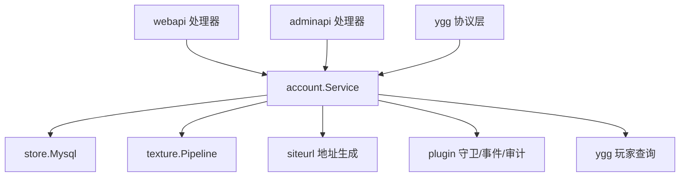
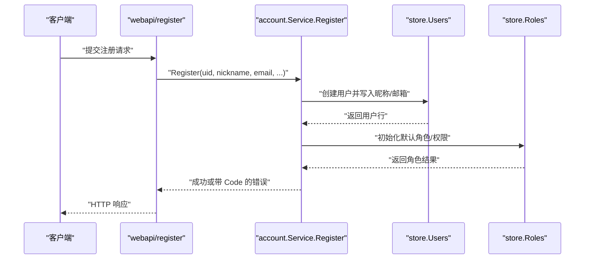
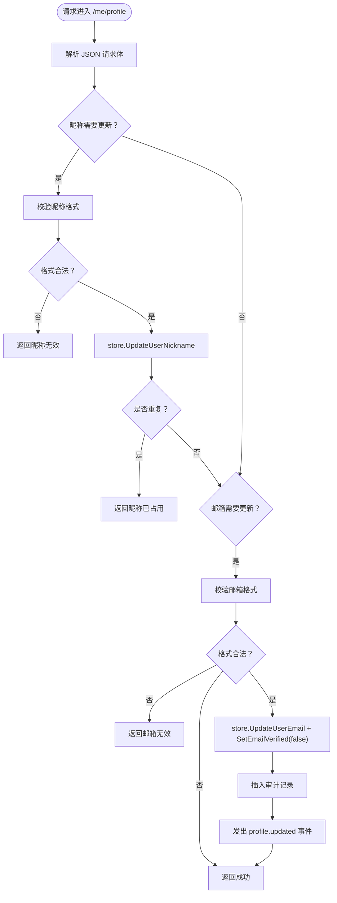
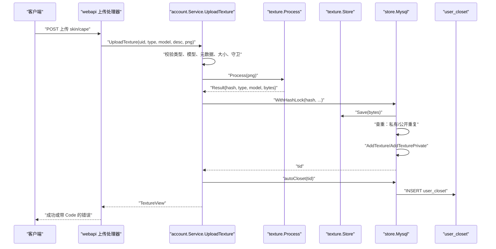
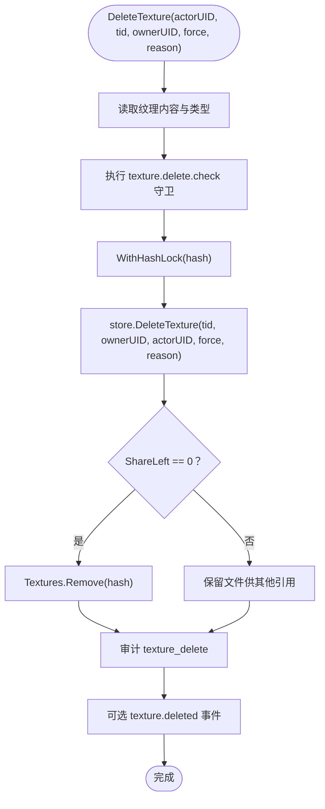
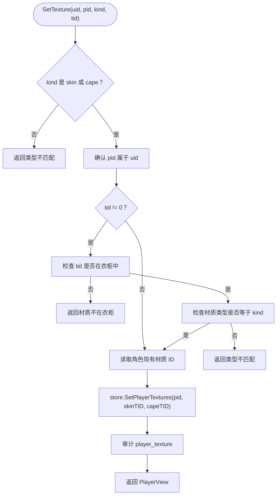
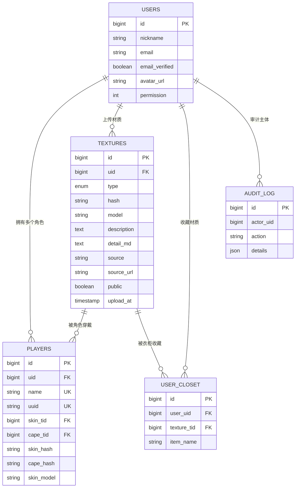
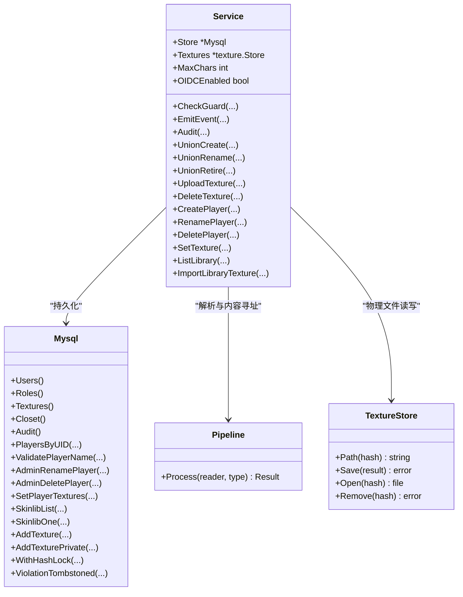

# 账户与角色模块

**本文引用的文件**
- [server/internal/account/service.go](https://github.com/YimingZhanshen/skin-nexus/blob/797ae1a/server/internal/account/service.go)
- [server/internal/account/delete.go](https://github.com/YimingZhanshen/skin-nexus/blob/797ae1a/server/internal/account/delete.go)
- [server/internal/account/library.go](https://github.com/YimingZhanshen/skin-nexus/blob/797ae1a/server/internal/account/library.go)
- [server/internal/account/players.go](https://github.com/YimingZhanshen/skin-nexus/blob/797ae1a/server/internal/account/players.go)
- [server/internal/account/textures.go](https://github.com/YimingZhanshen/skin-nexus/blob/797ae1a/server/internal/account/textures.go)
- [server/internal/webapi/profile.go](https://github.com/YimingZhanshen/skin-nexus/blob/797ae1a/server/internal/webapi/profile.go)
- [server/internal/webapi/closet.go](https://github.com/YimingZhanshen/skin-nexus/blob/797ae1a/server/internal/webapi/closet.go)
- [server/internal/texture/pipeline.go](https://github.com/YimingZhanshen/skin-nexus/blob/797ae1a/server/internal/texture/pipeline.go)
- [server/internal/store/closet.go](https://github.com/YimingZhanshen/skin-nexus/blob/797ae1a/server/internal/store/closet.go)
- [server/internal/store/texmodel.go](https://github.com/YimingZhanshen/skin-nexus/blob/797ae1a/server/internal/store/texmodel.go)

## 目录
1. [引言](#引言)
2. [项目结构](#项目结构)
3. [核心组件](#核心组件)
4. [架构总览](#架构总览)
5. [关键流程详解](#关键流程详解)
6. [数据模型与存储映射](#数据模型与存储映射)
7. [依赖关系分析](#依赖关系分析)
8. [性能与并发特性](#性能与并发特性)
9. [故障排查指南](#故障排查指南)
10. [结论](#结论)

## 引言
本模块负责皮肤站点的“账号—角色—材质—衣柜”主业务，由 `account.Service` 作为跨 API 层复用的核心服务。它统一处理注册、登录、昵称校验、邮箱验证、注销、玩家列表、材质上传、材质删除、衣柜管理以及材质与角色的关联设置；同时通过错误码体系、审计日志和可选的 Union 公告能力，为 webapi、adminapi 和 ygg 三个入口提供一致的业务语义。

## 项目结构
该模块位于 `server/internal/account`，对外暴露 `Service`，依赖以下内部包：
- `store.Mysql`：用户、角色、材质、衣柜、审计等持久化接口。
- `texture.Pipeline`：PNG 解码、尺寸校验、内容寻址与重编码。
- `siteurl`：生成纹理预览、头像与页面绝对地址。
- `plugin`：守卫、事件、审计与 Union 回调负载。
- `ygg`：Yggdrasil 玩家查询、客户端 IP 获取。

图表来源
- [server/internal/account/service.go:1-40](https://github.com/YimingZhanshen/skin-nexus/blob/797ae1a/server/internal/account/service.go#L1-L40)
- [server/internal/webapi/profile.go:1-30](https://github.com/YimingZhanshen/skin-nexus/blob/797ae1a/server/internal/webapi/profile.go#L1-L30)
- [server/internal/texture/pipeline.go:1-40](https://github.com/YimingZhanshen/skin-nexus/blob/797ae1a/server/internal/texture/pipeline.go#L1-L40)

章节来源
- [server/internal/account/service.go:1-40](https://github.com/YimingZhanshen/skin-nexus/blob/797ae1a/server/internal/account/service.go#L1-L40)

## 核心组件
- `account.Error`：传输无关的错误对象，定义稳定 code、消息、原始错误和详情字段，并给出 HTTP 状态映射。
- `account.CallMeta`：携带请求来源元信息，如 IP、文件名、插件标识、签名者等。
- `account.UploadMeta`：上传元数据，包括名称、说明、来源类型、原始 URL、是否公开。
- `account.Player` / `TextureView` / `PlayerView` / `AccountView`：面向 API 的中立视图结构。
- `account.Service`：拥有 `Store`、`Textures`、守卫、事件、审计、Union 回调等扩展点，所有变更都经过所有权检查、守卫、审计和事件广播。

关键职责划分：
- `service.go`：错误码、HTTP 状态映射、通用视图构造、服务装配与边界检查。
- `textures.go`：材质上传、导入、列出、自动加入衣柜、重复公开资源处理。
- `delete.go`：材质删除、内容锁、引用计数、孤儿文件清理、审计与事件。
- `players.go`：玩家创建、改名、删除、列表、外观材质绑定、Union 同步。
- `library.go`：公共皮肤库浏览、单条查看、复制为私有材质。

章节来源
- [server/internal/account/service.go:1-120](https://github.com/YimingZhanshen/skin-nexus/blob/797ae1a/server/internal/account/service.go#L1-L120)
- [server/internal/account/service.go:201-269](https://github.com/YimingZhanshen/skin-nexus/blob/797ae1a/server/internal/account/service.go#L201-L269)
- [server/internal/account/textures.go:1-60](https://github.com/YimingZhanshen/skin-nexus/blob/797ae1a/server/internal/account/textures.go#L1-L60)
- [server/internal/account/delete.go:1-30](https://github.com/YimingZhanshen/skin-nexus/blob/797ae1a/server/internal/account/delete.go#L1-L30)
- [server/internal/account/players.go:1-40](https://github.com/YimingZhanshen/skin-nexus/blob/797ae1a/server/internal/account/players.go#L1-L40)
- [server/internal/account/library.go:1-40](https://github.com/YimingZhanshen/skin-nexus/blob/797ae1a/server/internal/account/library.go#L1-L40)

## 架构总览
`account.Service` 是三层 API 共享的业务层：
- webapi：面向浏览器端自我服务，如修改资料、删除账号、设置头像、管理自己的角色和衣柜。
- adminapi：管理员后台，可管理用户、玩家、审计、任务、插件等，复用 Service 但通常走更高权限路径。
- ygg：Yggdrasil 风格的游戏协议或插件桥接，以 uid 身份调用角色与材质操作。

图表来源
- [server/internal/webapi/profile.go:31-120](https://github.com/YimingZhanshen/skin-nexus/blob/797ae1a/server/internal/webapi/profile.go#L31-L120)
- [server/internal/account/service.go:1-120](https://github.com/YimingZhanshen/skin-nexus/blob/797ae1a/server/internal/account/service.go#L1-L120)
- [server/internal/account/service.go:201-269](https://github.com/YimingZhanshen/skin-nexus/blob/797ae1a/server/internal/account/service.go#L201-L269)

## 关键流程详解

### 1. 注册、登录、昵称校验、邮箱验证、注销
注册和登录通常由 webapi 或 ygg 层解析认证载荷后委托给 store；本仓库中与账号自我服务最直接的实现集中在 profile 处理器和 account 服务：

- 昵称更新：webapi 先做正则校验，再调用 store 更新；重复昵称返回冲突。
- 邮箱更新：webapi 先做邮箱格式校验，再调用 store 更新，并把 `email_verified` 重置为未验证。
- 账号删除：webapi 要求当前用户密码正确，禁止管理员自删，然后调用 store 级联删除会话、令牌、衣柜、uuid_map、玩家等，保留审计记录，并清除会话 Cookie。

图表来源
- [server/internal/webapi/profile.go:31-120](https://github.com/YimingZhanshen/skin-nexus/blob/797ae1a/server/internal/webapi/profile.go#L31-L120)

#### 注销与孤儿纹理
账号删除由 webapi 直接调用 store 的 `DeleteUser`，注释明确其级联范围包含会话、令牌、衣柜、uuid_map、玩家，而 textures 和审计记录按合同保留。因此：
- 纹理文件不会因账号删除被自动清理。
- 审计记录会保留，且 actor_uid 可能指向已被删除的用户。
- 如果后续需要清理孤儿纹理，应基于 texture 引用计数和删除逻辑，而不是账号删除本身。

章节来源
- [server/internal/webapi/profile.go:120-200](https://github.com/YimingZhanshen/skin-nexus/blob/797ae1a/server/internal/webapi/profile.go#L120-L200)

### 2. 材质上传与衣柜关联
典型调用链：`webapi/upload → account.Service.UploadTexture → texture.Process → store.Textures → account.autoCloset`。

图表来源
- [server/internal/account/textures.go:60-160](https://github.com/YimingZhanshen/skin-nexus/blob/797ae1a/server/internal/account/textures.go#L60-L160)
- [server/internal/account/textures.go:160-334](https://github.com/YimingZhanshen/skin-nexus/blob/797ae1a/server/internal/account/textures.go#L160-L334)
- [server/internal/texture/pipeline.go:40-120](https://github.com/YimingZhanshen/skin-nexus/blob/797ae1a/server/internal/texture/pipeline.go#L40-L120)
- [server/internal/store/closet.go:180-258](https://github.com/YimingZhanshen/skin-nexus/blob/797ae1a/server/internal/store/closet.go#L180-L258)

要点：
- 上传前做大小、维度、像素炸弹、PNG 合法性、模型值、来源类型与来源 URL 校验。
- 使用 `texture.Process` 对 PNG 严格解码并重编码，计算 sha256 作为内容地址。
- 通过 `store.WithHashLock` 保证写文件与写数据库在同一内容锁内，避免上传与删除竞态。
- 上传成功后自动向衣柜添加一条空别名条目，使刚上传的材质立即可穿戴。
- 若内容与公开皮肤库重复，返回 `CodeDuplicatePub`，并附带已有公开材质的页面 URL。

章节来源
- [server/internal/account/textures.go:60-160](https://github.com/YimingZhanshen/skin-nexus/blob/797ae1a/server/internal/account/textures.go#L60-L160)
- [server/internal/account/textures.go:160-334](https://github.com/YimingZhanshen/skin-nexus/blob/797ae1a/server/internal/account/textures.go#L160-L334)
- [server/internal/texture/pipeline.go:40-120](https://github.com/YimingZhanshen/skin-nexus/blob/797ae1a/server/internal/texture/pipeline.go#L40-L120)

### 3. 材质删除与孤儿纹理处理
删除流程以内容哈希为锁边界，确保“数据库删除 + 文件 unlink”之间不会被另一个上传覆盖：

图表来源
- [server/internal/account/delete.go:1-85](https://github.com/YimingZhanshen/skin-nexus/blob/797ae1a/server/internal/account/delete.go#L1-L85)

关键点：
- 删除失败时若文件已经 unlink，会记录日志但不改变“删除已成功”的语义，因为行已提交。
- 当纹理仍被玩家或衣柜引用时，返回 `CodeInUse`，并在详情中列出具体玩家、衣柜、头像引用数量。
- 违规内容（tombstoned）会在上传阶段拒绝，而不是在删除后才拒绝。

章节来源
- [server/internal/account/delete.go:1-85](https://github.com/YimingZhanshen/skin-nexus/blob/797ae1a/server/internal/account/delete.go#L1-L85)

### 4. 角色与材质关联
`SetTexture` 将衣柜中的材质绑定到某个角色：
- 类型必须是 `skin` 或 `cape`。
- 非空材质必须先存在于调用者的衣柜中。
- 材质类型必须与操作类型匹配。
- 最终调用 `store.SetPlayerTextures` 更新角色的 skinTID 和 capeTID。

图表来源
- [server/internal/account/players.go:240-346](https://github.com/YimingZhanshen/skin-nexus/blob/797ae1a/server/internal/account/players.go#L240-L346)

章节来源
- [server/internal/account/players.go:240-346](https://github.com/YimingZhanshen/skin-nexus/blob/797ae1a/server/internal/account/players.go#L240-L346)

## 数据模型与存储映射

### 主要实体关系
- 用户表 `users`：uid、nickname、email、email_verified、avatar_url、permission 等。
- 角色表 `players`：pid、uid、name、uuid、skin_tid、cape_tid、skin_hash、cape_hash、skin_model。
- 材质表 `textures`：tid、uid、type、hash、model、description、detail_md、source、source_url、public、upload_at。
- 衣柜表 `user_closet`：id、user_uid、texture_tid、item_name。
- 审计表 `audit_log`：actor_uid、action、details，用于记录删除、改名、上传等操作。

图表来源
- [server/internal/store/closet.go:1-60](https://github.com/YimingZhanshen/skin-nexus/blob/797ae1a/server/internal/store/closet.go#L1-L60)
- [server/internal/account/service.go:120-200](https://github.com/YimingZhanshen/skin-nexus/blob/797ae1a/server/internal/account/service.go#L120-L200)
- [server/internal/store/texmodel.go:1-62](https://github.com/YimingZhanshen/skin-nexus/blob/797ae1a/server/internal/store/texmodel.go#L1-L62)

### 模型复杂度与约束
- `WearableTextures` 使用 `NOT EXISTS` 去重，保证同一材质只展示一个衣柜条目，优先显示有别名的条目，并按最新活动排序。
- `AddClosetEntry` 对 `(uid, texture_tid)` 做幂等插入；非本人私有机材质会被拒绝，避免隐私泄露。
- `SkinModelGroups` 与 `SetModelByHash` 用于修复历史材质中同一内容地址对应不同 `model` 的问题。

章节来源
- [server/internal/store/closet.go:60-258](https://github.com/YimingZhanshen/skin-nexus/blob/797ae1a/server/internal/store/closet.go#L60-L258)
- [server/internal/store/texmodel.go:1-62](https://github.com/YimingZhanshen/skin-nexus/blob/797ae1a/server/internal/store/texmodel.go#L1-L62)

## 依赖关系分析

图表来源
- [server/internal/account/service.go:120-269](https://github.com/YimingZhanshen/skin-nexus/blob/797ae1a/server/internal/account/service.go#L120-L269)
- [server/internal/texture/pipeline.go:40-120](https://github.com/YimingZhanshen/skin-nexus/blob/797ae1a/server/internal/texture/pipeline.go#L40-L120)
- [server/internal/store/closet.go:1-60](https://github.com/YimingZhanshen/skin-nexus/blob/797ae1a/server/internal/store/closet.go#L1-L60)

### 耦合与风险
- `account.Service` 紧耦合 `store.Mysql` 的具体方法，但通过错误码与事务封装降低上层 API 的差异。
- 上传路径耦合 `texture.Pipeline` 与 `texture.Store`，避免业务层直接处理 PNG 细节。
- Union 回调是可选扩展点，nil 表示关闭，不会导致上传或角色操作失败。
- 守卫 `CheckGuard`、事件 `EmitEvent`、审计 `Audit` 均为可选钩子，缺失时降级为静默通过或跳过记录。

章节来源
- [server/internal/account/service.go:120-269](https://github.com/YimingZhanshen/skin-nexus/blob/797ae1a/server/internal/account/service.go#L120-L269)

## 性能与并发特性

### 并发安全
- 上传与删除共用 `store.WithHashLock`，按纹理内容的 sha256 加锁，防止“删除文件后立刻又写入相同内容”的竞态。
- 删除路径中，数据库行已提交但文件 unlink 失败不会回滚数据库，而是记录日志，因为“删除语义”已在数据库层面完成。
- 上传路径中，内容锁定也保护了“违规内容 tombstone”的检查，避免违规内容绕过审核再次写入。

### 性能特征
- `PlayerView` 构建尽量复用 `ListPlayers` 的结果，避免每个角色二次查询材质。
- `storageBytes` 遍历用户材质并 stat 文件系统，属于 O(N) 开销，适合低频统计场景。
- 衣柜查询使用分页、全文搜索和类型过滤，避免一次性返回大量收藏项。
- 上传管道限制最大 2 MiB、100 万像素，并对 PNG 进行严格解码与重编码，降低恶意图片和庞大图块攻击面。

章节来源
- [server/internal/account/delete.go:1-85](https://github.com/YimingZhanshen/skin-nexus/blob/797ae1a/server/internal/account/delete.go#L1-L85)
- [server/internal/account/textures.go:160-334](https://github.com/YimingZhanshen/skin-nexus/blob/797ae1a/server/internal/account/textures.go#L160-L334)
- [server/internal/texture/pipeline.go:40-120](https://github.com/YimingZhanshen/skin-nexus/blob/797ae1a/server/internal/texture/pipeline.go#L40-L120)
- [server/internal/account/players.go:40-120](https://github.com/YimingZhanshen/skin-nexus/blob/797ae1a/server/internal/account/players.go#L40-L120)
- [server/internal/store/closet.go:60-180](https://github.com/YimingZhanshen/skin-nexus/blob/797ae1a/server/internal/store/closet.go#L60-L180)

## 故障排查指南

### 重复昵称处理
- 用户修改昵称时，webapi 先做正则校验，再通过 store 更新；若返回 `ErrDuplicate`，返回冲突错误。
- 角色改名时，`account.RenamePlayer` 同样处理 `ErrDuplicate`，并触发审计与 Union 改名事件。
- 排查建议：
  - 检查前端是否缓存旧昵称。
  - 检查是否有并发提交相同昵称的请求。
  - 检查数据库中昵称唯一索引是否异常。

章节来源
- [server/internal/webapi/profile.go:31-120](https://github.com/YimingZhanshen/skin-nexus/blob/797ae1a/server/internal/webapi/profile.go#L31-L120)
- [server/internal/account/players.go:120-240](https://github.com/YimingZhanshen/skin-nexus/blob/797ae1a/server/internal/account/players.go#L120-L240)

### 邮箱验证 token 过期
- 邮箱变更后，webapi 会调用 `SetEmailVerified(false)`，使新邮箱处于未验证状态。
- 邮箱验证 token 的生命周期由 store/email_verify 相关实现管理，过期后应引导用户重新发送验证邮件。
- 排查建议：
  - 确认邮箱是否确实被更新为未验证。
  - 检查邮件服务是否成功发送验证链接。
  - 检查前端是否正确跳转至 landing 页并使用新邮箱。

章节来源
- [server/internal/webapi/profile.go:31-120](https://github.com/YimingZhanshen/skin-nexus/blob/797ae1a/server/internal/webapi/profile.go#L31-L120)

### 头像未更新
- 头像设置要求传入的 `textureId` 必须属于当前用户，且材质类型必须是 `skin`。
- 如果材质不是 skin，会返回“只有皮肤可以作为头像”的错误。
- 如果材质不存在或不属于当前用户，返回“不是你的”或 404。
- 排查建议：
  - 确认上传成功后材质类型是否为 skin。
  - 确认 `textureId` 是否来自当前用户的衣柜或上传列表。
  - 确认后端是否成功调用 `SetUserAvatar`。

章节来源
- [server/internal/webapi/profile.go:160-200](https://github.com/YimingZhanshen/skin-nexus/blob/797ae1a/server/internal/webapi/profile.go#L160-L200)

### 材质上传失败
常见错误码及含义：
- `texture.invalid`：PNG 无法解析。
- `texture.dimensions_invalid`：宽高不符合 skin 或 cape 家族。
- `texture.pixel_bomb`：像素数超限。
- `texture.model_invalid`：skin 模型不是 default 或 slim。
- `texture.source_invalid`：来源类型不允许。
- `texture.source_url_required`：衍生或转载缺少原始 URL。
- `texture.source_url_invalid`：原始 URL 不是 http(s)。
- `texture.too_large`：超过上传大小限制。
- `texture.duplicate_public`：与公开皮肤库重复。
- `texture.busy`：内容锁冲突，需重试。

排查建议：
- 检查客户端上传文件大小和 PNG 完整性。
- 检查 skin 模型的声明是否与像素检测一致。
- 检查是否重复上传相同内容。
- 遇到 `busy` 时增加重试与退避。

章节来源
- [server/internal/account/textures.go:60-160](https://github.com/YimingZhanshen/skin-nexus/blob/797ae1a/server/internal/account/textures.go#L60-L160)
- [server/internal/account/textures.go:160-334](https://github.com/YimingZhanshen/skin-nexus/blob/797ae1a/server/internal/account/textures.go#L160-L334)
- [server/internal/texture/pipeline.go:40-120](https://github.com/YimingZhanshen/skin-nexus/blob/797ae1a/server/internal/texture/pipeline.go#L40-L120)

### 材质删除失败
- `texture.not_found`：纹理不存在。
- `texture.in_use`：纹理仍被玩家、衣柜或头像引用，详情中会列出具体引用方。
- `texture.busy`：正在被其他操作锁定。
- `texture.not_owned`：非上传者无权删除。

排查建议：
- 先查询哪些角色或衣柜仍在引用该材质。
- 如果是管理员强制删除，确认 force 参数和审计原因。
- 遇到 busy 后延迟重试。

章节来源
- [server/internal/account/delete.go:1-85](https://github.com/YimingZhanshen/skin-nexus/blob/797ae1a/server/internal/account/delete.go#L1-L85)

## 结论
`account.Service` 是账户与角色模块的核心业务封装，统一协调用户、角色、材质、衣柜和审计。它通过稳定的错误码、内容哈希锁、可选守卫与事件机制，为 webapi、adminapi 和 ygg 提供一致的能力边界。理解其关键路径——注册与资料更新、材质上传与衣柜关联、材质删除与引用清理、角色外观绑定——有助于快速定位重复昵称、邮箱验证、头像未更新、上传失败、删除冲突等问题。对于孤儿纹理，应关注纹理删除流程和引用计数，而不是依赖账号删除；对于审计记录，则应按合同保留，即使关联用户已删除。
