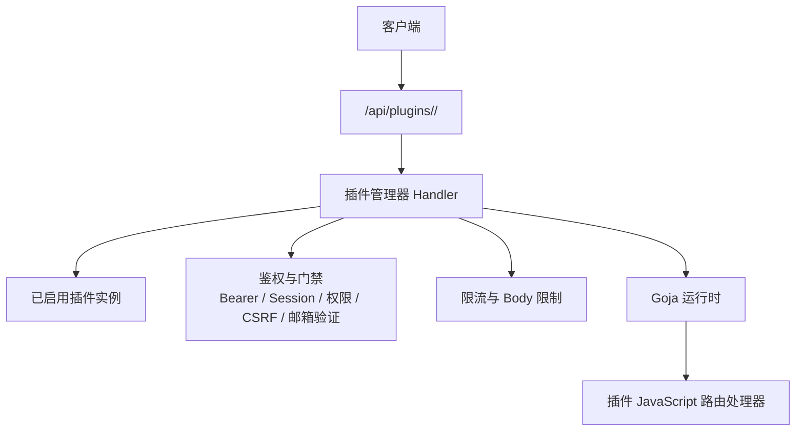
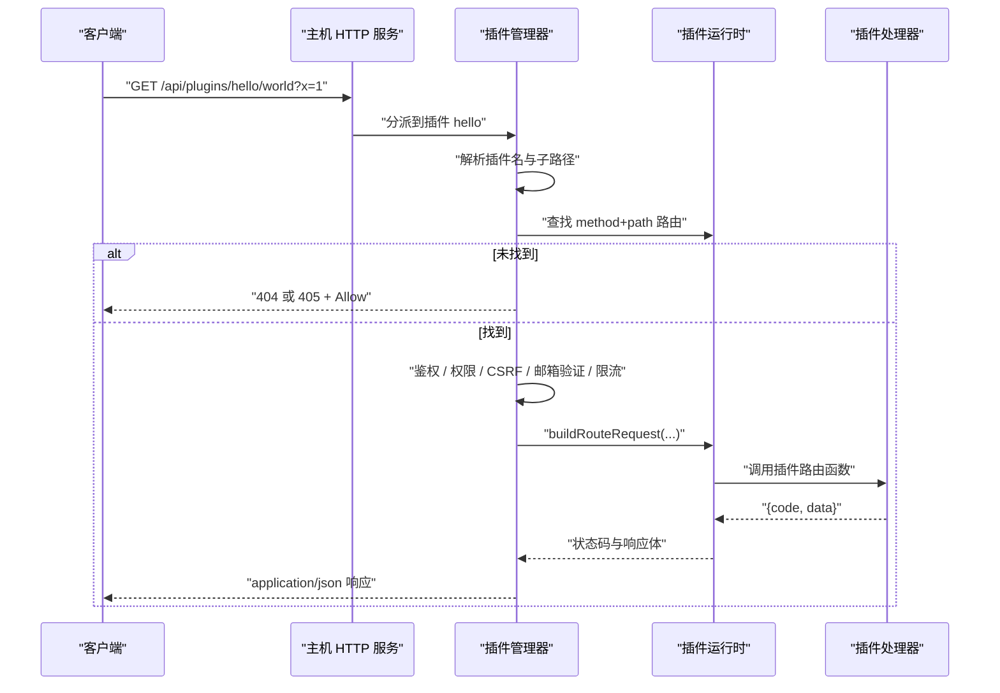
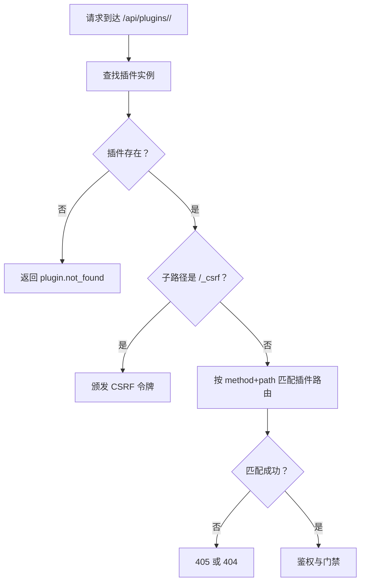
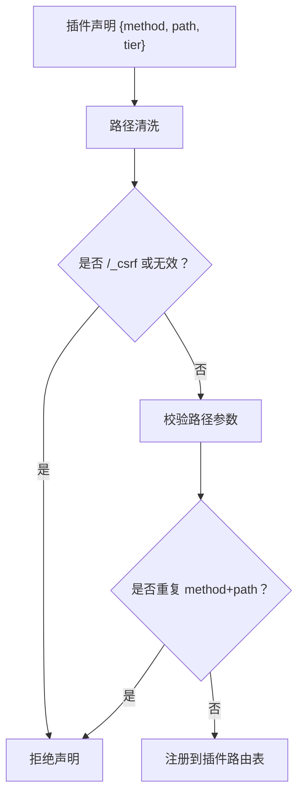
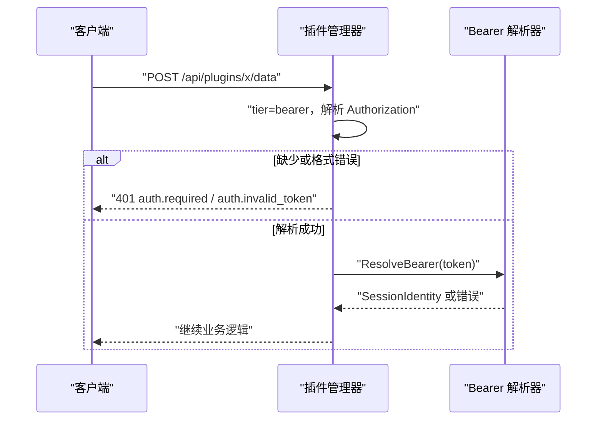
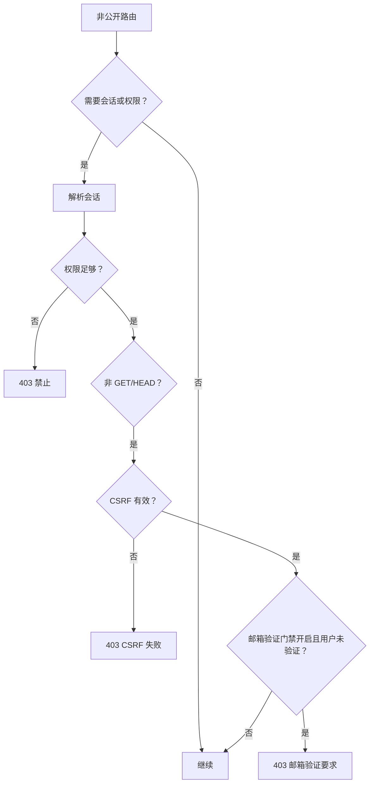
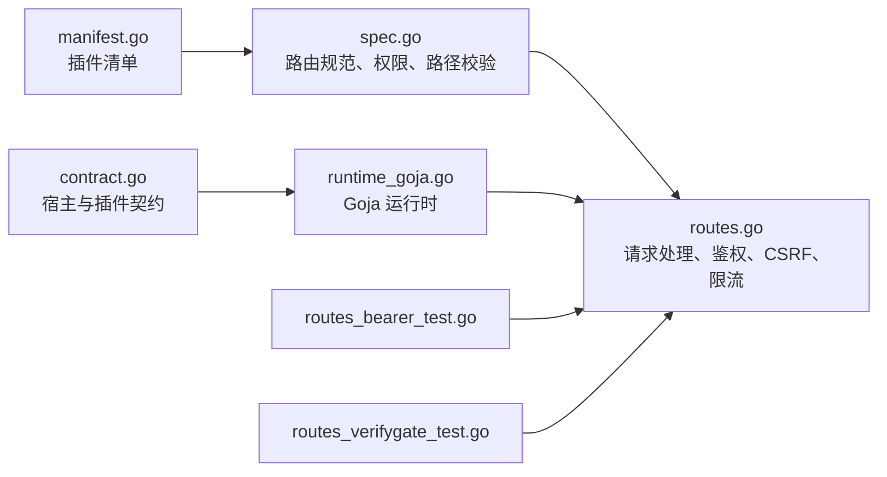

# 路由系统与 API 暴露

**本文引用的文件**
- [routes.go](https://github.com/YimingZhanshen/skin-nexus/blob/797ae1a/server/internal/plugin/routes.go)
- [spec.go](https://github.com/YimingZhanshen/skin-nexus/blob/797ae1a/server/internal/plugin/spec.go)
- [manifest.go](https://github.com/YimingZhanshen/skin-nexus/blob/797ae1a/server/internal/plugin/manifest.go)
- [runtime_goja.go](https://github.com/YimingZhanshen/skin-nexus/blob/797ae1a/server/internal/plugin/runtime_goja.go)
- [contract.go](https://github.com/YimingZhanshen/skin-nexus/blob/797ae1a/server/internal/plugin/contract.go)
- [routes_bearer_test.go](https://github.com/YimingZhanshen/skin-nexus/blob/797ae1a/server/internal/plugin/routes_bearer_test.go)
- [routes_verifygate_test.go](https://github.com/YimingZhanshen/skin-nexus/blob/797ae1a/server/internal/plugin/routes_verifygate_test.go)

## 目录
1. [引言](#引言)
2. [项目结构与定位](#项目结构与定位)
3. [核心组件](#核心组件)
4. [架构总览](#架构总览)
5. [详细组件分析](#详细组件分析)
6. [依赖关系分析](#依赖关系分析)
7. [性能与限制](#性能与限制)
8. [故障排查指南](#故障排查指南)
9. [结论](#结论)

## 引言
本文说明插件路由系统如何把插件声明的 HTTP 路由统一接入主机服务，并解释三类安全等级：公开路由、Bearer 鉴权路由与会话型路由。需要特别说明的是：本仓库中插件路由并非通过 `chi.Router` 挂载到 `http.routes`、`http.routes.bearer`、`http.routes.form` 三个命名空间；而是由插件管理器提供一个统一的 `/api/plugins/<pluginName>` 入口，再按插件内部注册的路径分发。表单能力走 UI 表单规范，而不是独立的“表单路由命名空间”。

## 项目结构与定位
插件路由相关代码集中在 `server/internal/plugin` 包：
- `routes.go`：请求处理、鉴权、CSRF、限流、Body 解析、访问日志。
- `spec.go`：路由规范、权限校验、路径参数规则、表单与资源上限。
- `manifest.go`：插件清单加载与组合。
- `runtime_goja.go`：Goja 运行时调用插件函数，并把宿主请求转换为插件可理解的请求对象。
- `contract.go`：宿主与插件之间的契约类型。
- 测试文件覆盖 Bearer Token、邮箱验证门禁、Body 行为等。

**图示来源**
- [routes.go:24-120](https://github.com/YimingZhanshen/skin-nexus/blob/797ae1a/server/internal/plugin/routes.go#L24-L120)
- [runtime_goja.go:1-200](https://github.com/YimingZhanshen/skin-nexus/blob/797ae1a/server/internal/plugin/runtime_goja.go#L1-L200)

**章节来源**
- [routes.go:24-120](https://github.com/YimingZhanshen/skin-nexus/blob/797ae1a/server/internal/plugin/routes.go#L24-L120)
- [spec.go:44-80](https://github.com/YimingZhanshen/skin-nexus/blob/797ae1a/server/internal/plugin/spec.go#L44-L80)

## 核心组件
- **插件管理器入口**：对外暴露 `Manager.Handler()`，作为所有插件 API 的统一前缀。
- **路由查找器**：按请求方法与子路径匹配插件内部注册的路由，支持静态段和 `{param}`、`{...}` 通配段。
- **鉴权层**：根据路由声明的 tier 决定是否需要 Bearer Token、Web 会话、管理员权限或超级管理员权限。
- **CSRF 层**：为会话型与非 GET 方法提供同源 Cookie + Header 校验。
- **邮箱验证门禁**：当站点开启验证门禁且当前用户未验证时，拒绝写入类请求。
- **限流层**：按 IP 或用户 ID 对路由进行速率限制。
- **Body 解析器**：限制大小、JSON 解码、base64 二进制编码。
- **运行时桥接**：把 Go 请求转为插件侧 JSON 对象，并接收插件返回的状态码与 JSON 体。

**章节来源**
- [routes.go:24-200](https://github.com/YimingZhanshen/skin-nexus/blob/797ae1a/server/internal/plugin/routes.go#L24-L200)
- [spec.go:44-110](https://github.com/YimingZhanshen/skin-nexus/blob/797ae1a/server/internal/plugin/spec.go#L44-L110)
- [runtime_goja.go:1-200](https://github.com/YimingZhanshen/skin-nexus/blob/797ae1a/server/internal/plugin/runtime_goja.go#L1-L200)

## 架构总览
插件路由不是传统 REST 框架中的多路由器拼装，而是一个“插件内路由表 + 统一入口”的架构：

**图示来源**
- [routes.go:24-180](https://github.com/YimingZhanshen/skin-nexus/blob/797ae1a/server/internal/plugin/routes.go#L24-L180)
- [routes.go:320-420](https://github.com/YimingZhanshen/skin-nexus/blob/797ae1a/server/internal/plugin/routes.go#L320-L420)

## 详细组件分析

### 1. 插件入口与路由分发
插件入口固定为 `/api/plugins/<pluginName>/...`。主机收到请求后：
- 剥离 `/api/plugins/`，分离插件名与剩余路径。
- 从已启用实例表中查找对应插件。
- 如果插件不存在，返回插件级 404。
- `_csrf` 是保留端点，直接由管理器处理。
- 其他路径进入插件路由查找。

**图示来源**
- [routes.go:24-120](https://github.com/YimingZhanshen/skin-nexus/blob/797ae1a/server/internal/plugin/routes.go#L24-L120)

**章节来源**
- [routes.go:24-120](https://github.com/YimingZhanshen/skin-nexus/blob/797ae1a/server/internal/plugin/routes.go#L24-L120)

### 2. 公开路由、Bearer 路由与会话路由
插件路由通过 `RouteSpec.Tier` 声明安全等级：
- `public`：无需登录或 Bearer。
- `bearer`：要求 `Authorization: Bearer <token>`。
- `session`：要求有效 Web 会话 Cookie。
- `admin`：要求管理员权限。
- `superadmin`：要求超级管理员权限。

| 层级 | 认证要求 | 权限要求 | CSRF 要求 | 典型用途 |
|---|---|---|---|---|
| public | 无 | 无 | 不强制 | 公开查询、健康检查、元信息 |
| bearer | Bearer Token | 无会话权限检查 | 不强制 | 外部系统集成、API Key 式调用 |
| session | Web 会话 | 普通用户即可 | 非 GET/HEAD 必须开启 | 用户个人数据读写 |
| admin | Web 会话 | 管理员及以上 | 非 GET/HEAD 必须开启 | 管理操作 |
| superadmin | Web 会话 | 必须超级管理员 | 非 GET/HEAD 必须开启 | 高敏感管理操作 |

**章节来源**
- [spec.go:44-80](https://github.com/YimingZhanshen/skin-nexus/blob/797ae1a/server/internal/plugin/spec.go#L44-L80)
- [routes.go:60-160](https://github.com/YimingZhanshen/skin-nexus/blob/797ae1a/server/internal/plugin/routes.go#L60-L160)

### 3. URL 前缀、命名空间隔离与冲突检测
- 每个插件拥有独立命名空间：`/api/plugins/<pluginName>`。
- 插件内部声明的 `Path` 是相对于该插件命名空间的子路径。
- 插件内部不允许重复的 `method + path`。
- 路径清理会去掉首尾斜杠，不允许根路径、`..` 段、保留路径 `/_csrf`。
- 路径参数只允许 `{id}` 形式；最后一段可用 `{...}` 做通配捕获。

**图示来源**
- [spec.go:520-620](https://github.com/YimingZhanshen/skin-nexus/blob/797ae1a/server/internal/plugin/spec.go#L520-L620)

**章节来源**
- [spec.go:520-620](https://github.com/YimingZhanshen/skin-nexus/blob/797ae1a/server/internal/plugin/spec.go#L520-L620)

### 4. 请求上下文对象：插件侧看到的请求
插件处理器收到的请求是一个 JSON 对象，字段如下：

| 字段 | 类型 | 含义 |
|---|---|---|
| `method` | string | HTTP 方法，如 GET、POST、PUT、DELETE、PATCH |
| `path` | string | 插件子路径，不含 `/api/plugins/<name>` |
| `params` | object | 路径参数，例如 `{id:"123"}` |
| `query` | object | 查询参数，同名键取第一个值 |
| `ip` | string | 经主机解析后的客户端 IP |
| `headers.content-type` | string | 请求 Content-Type |
| `headers.accept-language` | string | 语言偏好 |
| `headers.user-agent` | string | 用户代理 |
| `headers.origin` | string | Origin 头 |
| `headers.x-request-id` | string | 请求标识 |
| `body` | any \| undefined | 已解析的请求体；GET/HEAD 可能为空 |
| `bodyEncoding` | string \| undefined | 若声明 base64，则传入编码方式 |
| `user.id` | number \| undefined | 已认证用户 ID |
| `user.nickname` | string \| undefined | 昵称 |
| `user.permission` | number \| undefined | 权限等级 |
| `user.admin` | boolean \| undefined | 是否管理员 |

注意：插件侧没有 `ctx.Query`、`ctx.Form`、`ctx.JSON`、`ctx.Redirect`、`ctx.Params`、`ctx.GetAccount`、`ctx.SetAccount`、`ctx.Store` 这些 Go 风格方法。它们对应的是上述 JSON 字段或宿主在运行时代入的能力。

**章节来源**
- [routes.go:360-420](https://github.com/YimingZhanshen/skin-nexus/blob/797ae1a/server/internal/plugin/routes.go#L360-L420)

### 5. 与 Go 宿主 Context 方法的映射
虽然插件 JavaScript 侧看到的是 JSON 对象，但宿主在处理链中确实涉及以下概念。为避免误解，这里给出“插件侧等价语义”，而不是声称插件可以直接调用 Go 方法：

| 宿主页面的语义 | 插件侧等价访问方式 |
|---|---|
| `ctx.Query` | `req.query` 对象 |
| `ctx.Form` | 通常不走表单路由；POST Body 中 JSON 数据位于 `req.body` |
| `ctx.JSON` | 插件返回 `{code, data}`，宿主封装为 `application/json` |
| `ctx.Redirect` | 插件不能直接重定向；应返回相应状态码与位置信息，由宿主策略决定 |
| `ctx.Params` | `req.params` 对象 |
| `ctx.GetAccount` / `ctx.SetAccount` | 宿主可通过运行时扩展注入账号能力；默认请求对象只有 `user` 基础字段 |
| `ctx.Store` | 宿主提供 namespaced store；插件需声明 store 权限并使用宿主提供的存储接口 |

**章节来源**
- [routes.go:360-420](https://github.com/YimingZhanshen/skin-nexus/blob/797ae1a/server/internal/plugin/routes.go#L360-L420)
- [contract.go:1-200](https://github.com/YimingZhanshen/skin-nexus/blob/797ae1a/server/internal/plugin/contract.go#L1-L200)
- [runtime_goja.go:1-200](https://github.com/YimingZhanshen/skin-nexus/blob/797ae1a/server/internal/plugin/runtime_goja.go#L1-L200)

### 6. Bearer Token 验证流程
Bearer 路由要求 `Authorization: Bearer <token>`：
- 缺少 Authorization 头：返回 `auth.required`。
- 格式不正确：返回 `auth.invalid_token`。
- Token 过长：返回 `auth.invalid_token`。
- 解析失败：返回 `auth.invalid_token`。
- 身份无效：返回 `auth.invalid_token`。
- 配置缺失：返回 `auth.unavailable`。

当缺少授权时，响应头包含 `WWW-Authenticate: Bearer realm="skin-nexus"`。

**图示来源**
- [routes.go:140-200](https://github.com/YimingZhanshen/skin-nexus/blob/797ae1a/server/internal/plugin/routes.go#L140-L200)

**章节来源**
- [routes.go:140-200](https://github.com/YimingZhanshen/skin-nexus/blob/797ae1a/server/internal/plugin/routes.go#L140-L200)

### 7. CSRF 防护与邮箱验证门禁
#### CSRF
- 保留端点 `GET /api/plugins/<name>/_csrf` 返回 CSRF 令牌。
- Cookie 名称为 `skin_csrf`，SameSite=Lax，HttpOnly，最长存活 12 小时。
- 修改请求必须同时满足：
  - Origin 与 Host 同源（或无 Origin）。
  - 携带 `X-CSRF-Token` 头。
  - 头部值与 Cookie 值常量时间比较一致。
- 会话型、管理员、超级管理员路由的非 GET/HEAD 方法必须在声明中开启 `csrf: true`，否则清单校验阶段就拒绝。

#### 邮箱验证门禁
- 当站点启用邮箱验证门禁且当前用户未完成验证时，会话型、管理员、超级管理员路由会被拒绝。
- 公开与 Bearer 路由不会走到这个分支。

**图示来源**
- [routes.go:60-140](https://github.com/YimingZhanshen/skin-nexus/blob/797ae1a/server/internal/plugin/routes.go#L60-L140)
- [routes.go:420-497](https://github.com/YimingZhanshen/skin-nexus/blob/797ae1a/server/internal/plugin/routes.go#L420-L497)

**章节来源**
- [routes.go:60-140](https://github.com/YimingZhanshen/skin-nexus/blob/797ae1a/server/internal/plugin/routes.go#L60-L140)
- [routes.go:420-497](https://github.com/YimingZhanshen/skin-nexus/blob/797ae1a/server/internal/plugin/routes.go#L420-L497)
- [spec.go:560-620](https://github.com/YimingZhanshen/skin-nexus/blob/797ae1a/server/internal/plugin/spec.go#L560-L620)

### 8. 测试用例展示的典型用法
测试文件展示了插件路由系统的常见集成模式：

| 场景 | 测试文件 | 关键断言 |
|---|---|---|
| Bearer Token 缺失 | `routes_bearer_test.go` | 返回 401，提示 token 必需 |
| Bearer Token 非法 | `routes_bearer_test.go` | 返回 401，提示 token 无效 |
| Bearer Token 有效 | `routes_bearer_test.go` | 正常进入插件处理器 |
| 邮箱验证门禁 | `routes_verifygate_test.go` | 未验证用户被拒绝 |
| JSON 响应 | `routes_body_test.go` | 响应体为 JSON，Content-Type 为 `application/json` |
| Body 过大 | `routes_body_test.go` | 返回请求体过大错误 |
| 限流 | `routes.go` 及关联测试 | 超出限流返回 429，并可能带 Retry-After |

这些用例共同演示了：
- GET/POST/PUT/DELETE/PATCH 方法。
- JSON 输入输出。
- Bearer 鉴权。
- CSRF 保护。
- 邮箱验证门禁。
- 限流与错误响应。

**章节来源**
- [routes_bearer_test.go:1-104](https://github.com/YimingZhanshen/skin-nexus/blob/797ae1a/server/internal/plugin/routes_bearer_test.go#L1-L104)
- [routes_verifygate_test.go:1-131](https://github.com/YimingZhanshen/skin-nexus/blob/797ae1a/server/internal/plugin/routes_verifygate_test.go#L1-L131)
- [routes_body_test.go:1-110](https://github.com/YimingZhanshen/skin-nexus/blob/797ae1a/server/internal/plugin/routes_body_test.go#L1-L110)

### 9. 关于“routes.go 将 http.routes、http.routes.bearer、http.routes.form 注入 chi.Router”的澄清
在本仓库中：
- 没有发现 `http.routes`、`http.routes.bearer`、`http.routes.form` 这样的显式 `chi.Router` 注入点。
- 插件路由由 `Manager.Handler()` 提供单一入口，并通过插件内部注册表分发。
- “公开路由”“Bearer 路由”“会话/管理路由”的区别来自 `RouteSpec.Tier`，而不是多个 Router 实例。
- “表单路由”不是独立 HTTP 命名空间；表单能力通过 `ui.forms` 声明，由宿主渲染 SchemaForm，插件负责持久化。

因此，更准确的描述是：**插件路由系统通过统一入口和安全等级实现命名空间隔离，而不是通过多个 chi.Router 命名空间。**

**章节来源**
- [routes.go:24-120](https://github.com/YimingZhanshen/skin-nexus/blob/797ae1a/server/internal/plugin/routes.go#L24-L120)
- [spec.go:560-620](https://github.com/YimingZhanshen/skin-nexus/blob/797ae1a/server/internal/plugin/spec.go#L560-L620)

## 依赖关系分析

**图示来源**
- [spec.go:44-110](https://github.com/YimingZhanshen/skin-nexus/blob/797ae1a/server/internal/plugin/spec.go#L44-L110)
- [routes.go:24-200](https://github.com/YimingZhanshen/skin-nexus/blob/797ae1a/server/internal/plugin/routes.go#L24-L200)
- [runtime_goja.go:1-200](https://github.com/YimingZhanshen/skin-nexus/blob/797ae1a/server/internal/plugin/runtime_goja.go#L1-L200)
- [contract.go:1-200](https://github.com/YimingZhanshen/skin-nexus/blob/797ae1a/server/internal/plugin/contract.go#L1-L200)

**章节来源**
- [spec.go:44-110](https://github.com/YimingZhanshen/skin-nexus/blob/797ae1a/server/internal/plugin/spec.go#L44-L110)
- [routes.go:24-200](https://github.com/YimingZhanshen/skin-nexus/blob/797ae1a/server/internal/plugin/routes.go#L24-L200)
- [runtime_goja.go:1-200](https://github.com/YimingZhanshen/skin-nexus/blob/797ae1a/server/internal/plugin/runtime_goja.go#L1-L200)
- [contract.go:1-200](https://github.com/YimingZhanshen/skin-nexus/blob/797ae1a/server/internal/plugin/contract.go#L1-L200)

## 性能与限制
- 插件路由响应体最大 1 MiB。
- 默认请求体限制 64 KiB，base64 二进制最大 4 MiB。
- 路由数量受插件上限限制。
- 限流使用 IP 或用户 ID 作为主体，避免无限放大。
- 访问日志记录插件名、方法、路径、IP、状态码、耗时、层级和用户 ID。

**章节来源**
- [routes.go:24-60](https://github.com/YimingZhanshen/skin-nexus/blob/797ae1a/server/internal/plugin/routes.go#L24-L60)
- [routes.go:280-360](https://github.com/YimingZhanshen/skin-nexus/blob/797ae1a/server/internal/plugin/routes.go#L280-L360)
- [spec.go:560-620](https://github.com/YimingZhanshen/skin-nexus/blob/797ae1a/server/internal/plugin/spec.go#L560-L620)

## 故障排查指南

### 1. 查看已注册插件路由
- 插件路由不在 `chi.Router` 的多命名空间中，而是在 `/api/plugins/<pluginName>` 下。
- 可通过管理面板的插件列表确认插件是否启用、是否声明了路由。
- 若路由不可用，优先检查插件清单中的 `method`、`path`、`tier` 是否合法。

### 2. 打印请求日志
- 插件路由会在入口处记录访问日志，包括状态码、耗时和层级。
- 若未看到日志，检查主机是否启用了访问日志回调。
- 对于 Bearer 路由，鉴权失败也会记录日志，便于定位 token 问题。

### 3. 处理 401 未授权
- Bearer 路由缺少或格式错误的 Authorization 头。
- 检查请求头是否为 `Authorization: Bearer <token>`。
- 检查 Bearer 解析器是否已配置。
- 检查 Token 是否过期或被撤销。

### 4. 处理 403 禁止访问
- 管理员或超级管理员权限不足。
- 非 GET/HEAD 会话型路由未开启 CSRF。
- CSRF Cookie 或 X-CSRF-Token 缺失或不匹配。
- 邮箱验证门禁阻止未验证用户。

### 5. 处理 429 限流
- 检查路由是否声明了 `rateLimit`。
- 观察是否返回 `Retry-After` 头。
- 确认限流主体是按 IP 还是按用户 ID。

### 6. 调试 Bearer 路由
- 确认插件声明 `tier: bearer` 且具备 `http:routes:bearer` 权限。
- 确认请求头格式正确。
- 查看响应是否包含 `WWW-Authenticate: Bearer`。
- 参考 Bearer 测试用例对比请求与响应。

### 7. 调试 CSRF
- 先调用 `GET /api/plugins/<name>/_csrf` 获取令牌。
- 后续修改请求携带：
  - Cookie `skin_csrf`。
  - Header `X-CSRF-Token`。
  - 同源 Origin（或与 Host 相同）。
- 确保插件声明中开启了 `csrf: true`。

### 8. 调试邮箱验证门禁
- 确认当前用户是否完成邮箱验证。
- 确认该路由是会话型、管理员或超级管理员路由。
- 公开与 Bearer 路由不受邮箱验证门禁影响。

**章节来源**
- [routes.go:60-200](https://github.com/YimingZhanshen/skin-nexus/blob/797ae1a/server/internal/plugin/routes.go#L60-L200)
- [routes.go:420-497](https://github.com/YimingZhanshen/skin-nexus/blob/797ae1a/server/internal/plugin/routes.go#L420-L497)
- [routes_bearer_test.go:1-104](https://github.com/YimingZhanshen/skin-nexus/blob/797ae1a/server/internal/plugin/routes_bearer_test.go#L1-L104)
- [routes_verifygate_test.go:1-131](https://github.com/YimingZhanshen/skin-nexus/blob/797ae1a/server/internal/plugin/routes_verifygate_test.go#L1-L131)

## 结论
插件路由系统以 `/api/plugins/<pluginName>` 为统一入口，通过插件内部路由表、安全等级、CSRF、限流和邮箱验证门禁实现可控的 API 暴露。它不依赖 `chi.Router` 的 `http.routes`、`http.routes.bearer`、`http.routes.form` 命名空间注入；而是通过声明式规范与运行时分发保证安全性与隔离性。开发插件时应明确：
- 使用正确的 `tier`。
- 非 GET/HEAD 会话型路由必须开启 CSRF。
- 在插件侧通过 `req.query`、`req.params`、`req.body`、`req.user` 访问上下文。
- 借助管理面板、访问日志和测试用例定位 401、403、429 等问题。
