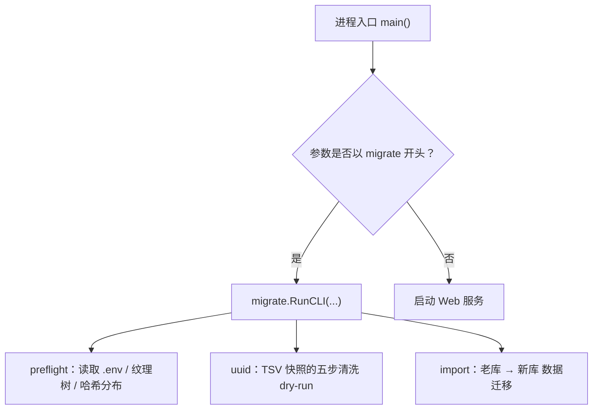
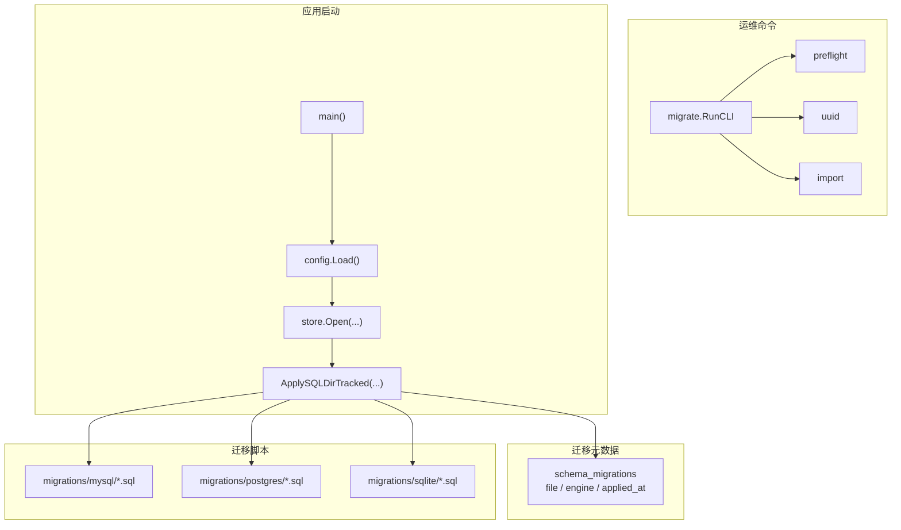
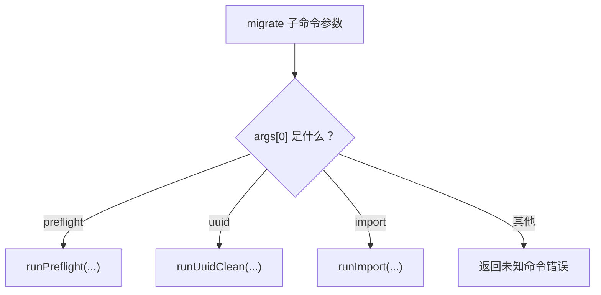
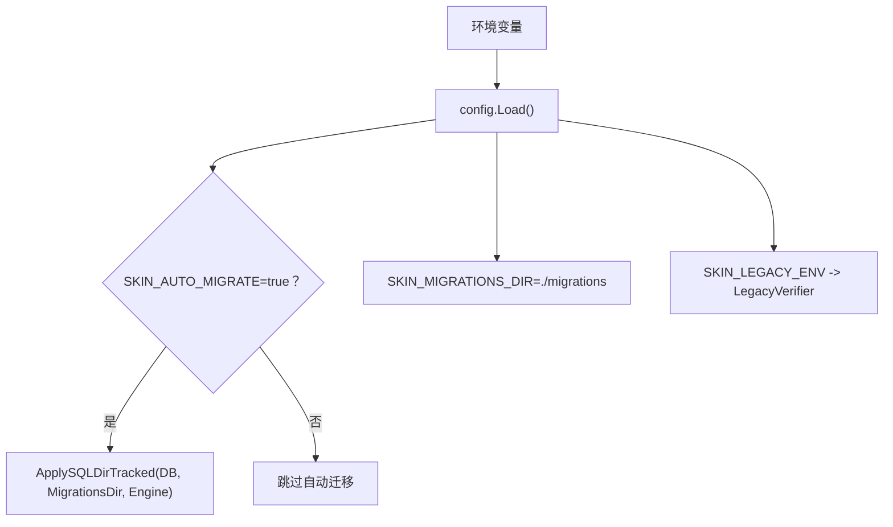
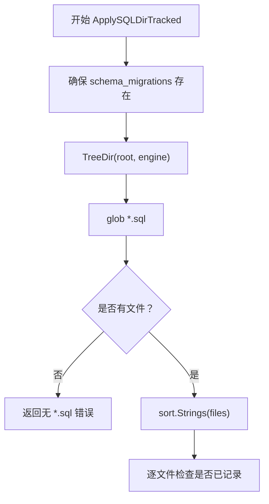
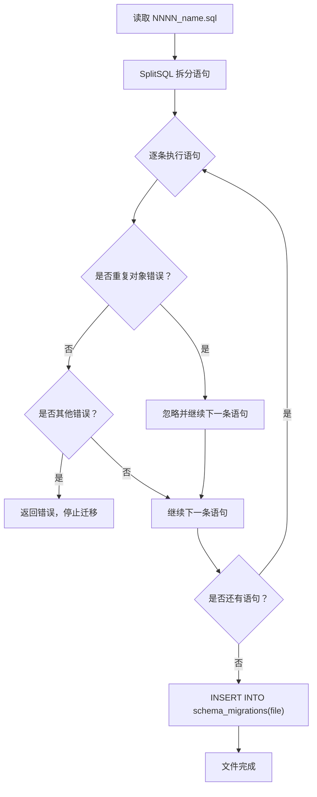
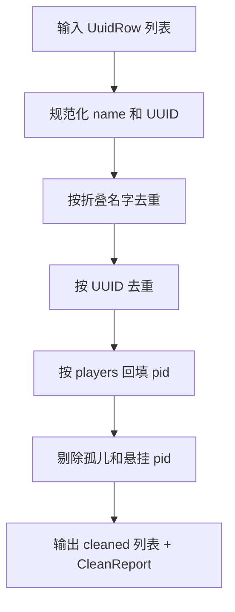
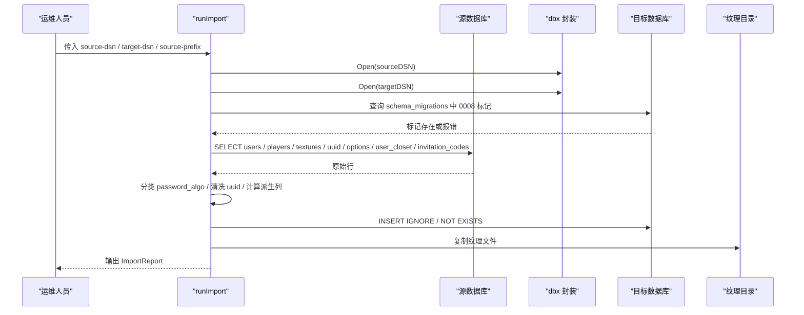
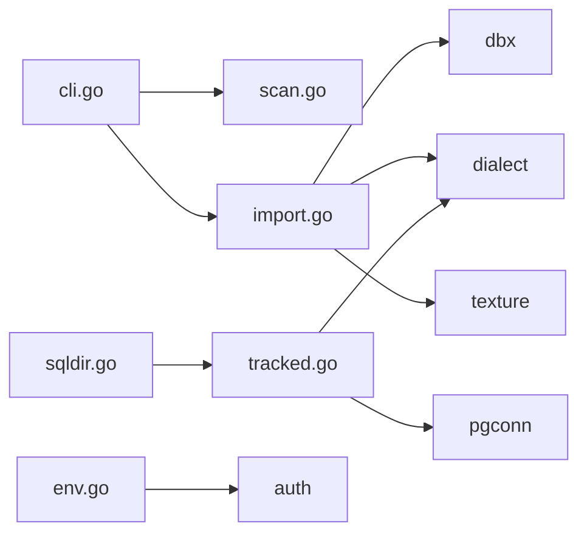
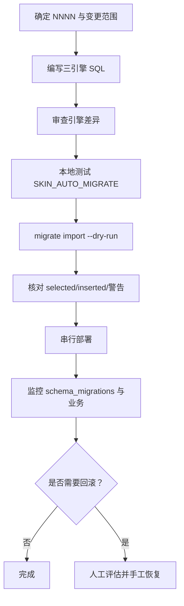

# 迁移系统

**本文引用的文件**
- [server/cmd/skin-nexus/main.go](https://github.com/YimingZhanshen/skin-nexus/blob/797ae1a/server/cmd/skin-nexus/main.go)
- [server/internal/migrate/cli.go](https://github.com/YimingZhanshen/skin-nexus/blob/797ae1a/server/internal/migrate/cli.go)
- [server/internal/migrate/env.go](https://github.com/YimingZhanshen/skin-nexus/blob/797ae1a/server/internal/migrate/env.go)
- [server/internal/migrate/scan.go](https://github.com/YimingZhanshen/skin-nexus/blob/797ae1a/server/internal/migrate/scan.go)
- [server/internal/migrate/sqldir.go](https://github.com/YimingZhanshen/skin-nexus/blob/797ae1a/server/internal/migrate/sqldir.go)
- [server/internal/migrate/tracked.go](https://github.com/YimingZhanshen/skin-nexus/blob/797ae1a/server/internal/migrate/tracked.go)
- [server/internal/migrate/clean.go](https://github.com/YimingZhanshen/skin-nexus/blob/797ae1a/server/internal/migrate/clean.go)
- [server/internal/migrate/import.go](https://github.com/YimingZhanshen/skin-nexus/blob/797ae1a/server/internal/migrate/import.go)
- [server/internal/config/env.go](https://github.com/YimingZhanshen/skin-nexus/blob/797ae1a/server/internal/config/env.go)
- [server/internal/config/config.go](https://github.com/YimingZhanshen/skin-nexus/blob/797ae1a/server/internal/config/config.go)
- [docs/migration.md](https://github.com/YimingZhanshen/skin-nexus/blob/797ae1a/docs/migration.md)

## 目录
1. [引言](#引言)
2. [项目结构与入口](#项目结构与入口)
3. [核心组件](#核心组件)
4. [架构总览](#架构总览)
5. [详细组件分析](#详细组件分析)
6. [依赖关系分析](#依赖关系分析)
7. [性能与一致性特征](#性能与一致性特征)
8. [常见问题与修复](#常见问题与修复)
9. [结论](#结论)
10. [附录：新增迁移工作流](#附录新增迁移工作流)

## 引言
本文聚焦 `migrate` 包及其在 `skin-nexus` 二进制中的集成，目标是让运营者和维护者理解数据库迁移的命令行行为、自动部署机制、历史数据导入流程，以及跨 MySQL、PostgreSQL、SQLite 三引擎的一致性要求。文档同时给出新增迁移的标准操作路径和生产约束：生产环境只允许向前迁移，不推荐依赖自动回滚。

## 项目结构与入口
`migrate` 包位于 `server/internal/migrate`，提供以下职责：
- 解析遗留 `.env`、统计哈希分布（预检）
- 扫描纹理目录并做完整性审计
- 按引擎扫描 `migrations/<engine>/*.sql`，执行带标记的 DDL 迁移
- 清理历史 UUID 表数据
- 从 blessing-skin-server 或其他来源导入原始 SQL 到目标引擎
- 通过 `SplitSQL` 将脚本拆分为可执行语句

应用入口在 `main()` 中判断子命令 `migrate`，然后调用 `migrate.RunCLI(args, os.Stdout)`。`RunCLI` 当前实现支持 `preflight`、`uuid`、`import`；尚未实现 `apply`、`check`、`clean` 三个动作。

**图表来源**
- [server/cmd/skin-nexus/main.go:80-120](https://github.com/YimingZhanshen/skin-nexus/blob/797ae1a/server/cmd/skin-nexus/main.go#L80-L120)
- [server/internal/migrate/cli.go:1-45](https://github.com/YimingZhanshen/skin-nexus/blob/797ae1a/server/internal/migrate/cli.go#L1-L45)

**章节来源**
- [server/cmd/skin-nexus/main.go:80-120](https://github.com/YimingZhanshen/skin-nexus/blob/797ae1a/server/cmd/skin-nexus/main.go#L80-L120)
- [server/internal/migrate/cli.go:1-45](https://github.com/YimingZhanshen/skin-nexus/blob/797ae1a/server/internal/migrate/cli.go#L1-L45)

## 核心组件
- **命令行接口 `RunCLI`**：分发 `preflight`、`uuid`、`import`；对未知命令返回用法错误。
- **环境变量**：`SKIN_AUTO_MIGRATE`、`SKIN_MIGRATIONS_DIR`、`SKIN_LEGACY_ENV` 等由配置层加载；`SKIN_*` 未使用变量会在启动时告警。
- **DDL 扫描与执行**：`ApplySQLDirTracked` 按引擎扫描 `migrations/<engine>/*.sql`，跳过已记录文件，容忍重复对象错误，其他错误致命。
- **迁移标记表**：每引擎独立创建 `schema_migrations`，包含文件名、引擎名、执行时间。
- **SQL 拆分器 `SplitSQL`**：按行尾分号拆分，丢弃整行注释。
- **历史数据清理**：`CleanUuidTable` 对 uuid 表执行五步清洗。
- **数据导入器 `RunImport`**：从源 DSN 读取老站数据，写入目标 DSN，保留主键 ID，并对用户密码算法分类。

**章节来源**
- [server/internal/migrate/cli.go:1-45](https://github.com/YimingZhanshen/skin-nexus/blob/797ae1a/server/internal/migrate/cli.go#L1-L45)
- [server/internal/config/env.go:17-45](https://github.com/YimingZhanshen/skin-nexus/blob/797ae1a/server/internal/config/env.go#L17-L45)
- [server/internal/config/config.go:101-102](https://github.com/YimingZhanshen/skin-nexus/blob/797ae1a/server/internal/config/config.go#L101-L102)
- [server/internal/config/config.go:212-213](https://github.com/YimingZhanshen/skin-nexus/blob/797ae1a/server/internal/config/config.go#L212-L213)
- [server/internal/migrate/tracked.go:1-30](https://github.com/YimingZhanshen/skin-nexus/blob/797ae1a/server/internal/migrate/tracked.go#L1-L30)
- [server/internal/migrate/sqldir.go:1-33](https://github.com/YimingZhanshen/skin-nexus/blob/797ae1a/server/internal/migrate/sqldir.go#L1-L33)
- [server/internal/migrate/clean.go:1-20](https://github.com/YimingZhanshen/skin-nexus/blob/797ae1a/server/internal/migrate/clean.go#L1-L20)
- [server/internal/migrate/import.go:1-30](https://github.com/YimingZhanshen/skin-nexus/blob/797ae1a/server/internal/migrate/import.go#L1-L30)

## 架构总览
迁移系统在两条路径上运行：

1. **应用启动时的自动迁移**：当 `SKIN_AUTO_MIGRATE=true` 时，每次启动都会调用 `ApplySQLDirTracked`，把 `migrations/<engine>/*.sql` 中未记录的 DDL 应用到数据库。
2. **运维命令迁移**：`skin-nexus migrate import` 用于从 blessing-skin-server 或兼容旧站迁移历史数据；`preflight` 和 `uuid` 是辅助工具。

**图表来源**
- [server/cmd/skin-nexus/main.go:150-180](https://github.com/YimingZhanshen/skin-nexus/blob/797ae1a/server/cmd/skin-nexus/main.go#L150-L180)
- [server/internal/migrate/tracked.go:30-90](https://github.com/YimingZhanshen/skin-nexus/blob/797ae1a/server/internal/migrate/tracked.go#L30-L90)
- [server/internal/migrate/cli.go:1-45](https://github.com/YimingZhanshen/skin-nexus/blob/797ae1a/server/internal/migrate/cli.go#L1-L45)

**章节来源**
- [server/cmd/skin-nexus/main.go:150-180](https://github.com/YimingZhanshen/skin-nexus/blob/797ae1a/server/cmd/skin-nexus/main.go#L150-L180)
- [server/internal/migrate/tracked.go:30-90](https://github.com/YimingZhanshen/skin-nexus/blob/797ae1a/server/internal/migrate/tracked.go#L30-L90)

## 详细组件分析

### 命令行入口与支持的 action
`RunCLI` 根据第一个参数选择处理函数：
- `preflight`：解析 legacy `.env`，输出密码方法、盐槽对齐情况、哈希分布、纹理树审计结果。
- `uuid`：接收 TSV 快照，dry-run 执行五步清洗，输出保留行。
- `import`：连接源库和目标库，迁移用户、玩家、纹理、UUID 映射、选项、衣柜、邀请码等数据。

当前代码**不支持** `apply`、`check`、`clean` 三个 action。若传入这些名称，会返回“未知 migrate command”错误。

**图表来源**
- [server/internal/migrate/cli.go:12-45](https://github.com/YimingZhanshen/skin-nexus/blob/797ae1a/server/internal/migrate/cli.go#L12-L45)

**章节来源**
- [server/internal/migrate/cli.go:12-45](https://github.com/YimingZhanshen/skin-nexus/blob/797ae1a/server/internal/migrate/cli.go#L12-L45)

### SKIN_AUTO_MIGRATE 与 SKIN_MIGRATIONS_DIR 的行为
- `SKIN_AUTO_MIGRATE`：布尔值，默认 `false`。为 `true` 时，应用启动后调用 `ApplySQLDirTracked`，对当前数据库引擎对应的迁移目录执行增量 DDL。
- `SKIN_MIGRATIONS_DIR`：迁移根目录，默认 `./migrations`。该目录被组织为 `<root>/<engine>/*.sql`，其中 engine 是 `mysql`、`postgres` 或 `sqlite`。
- `SKIN_LEGACY_ENV`：可选，指向 legacy `.env`，用于启动时构建 `LegacyVerifier`，帮助验证 bcrypt/argon2 以外的旧密码格式。

未声明的 `SKIN_*` 变量会在启动时打印警告，防止拼写错误导致配置静默失效。

**图表来源**
- [server/internal/config/env.go:27-45](https://github.com/YimingZhanshen/skin-nexus/blob/797ae1a/server/internal/config/env.go#L27-L45)
- [server/internal/config/config.go:101-102](https://github.com/YimingZhanshen/skin-nexus/blob/797ae1a/server/internal/config/config.go#L101-L102)
- [server/internal/config/config.go:212-213](https://github.com/YimingZhanshen/skin-nexus/blob/797ae1a/server/internal/config/config.go#L212-L213)
- [server/cmd/skin-nexus/main.go:150-180](https://github.com/YimingZhanshen/skin-nexus/blob/797ae1a/server/cmd/skin-nexus/main.go#L150-L180)

**章节来源**
- [server/internal/config/env.go:27-45](https://github.com/YimingZhanshen/skin-nexus/blob/797ae1a/server/internal/config/env.go#L27-L45)
- [server/internal/config/config.go:101-102](https://github.com/YimingZhanshen/skin-nexus/blob/797ae1a/server/internal/config/config.go#L101-L102)
- [server/internal/config/config.go:212-213](https://github.com/YimingZhanshen/skin-nexus/blob/797ae1a/server/internal/config/config.go#L212-L213)
- [server/cmd/skin-nexus/main.go:150-180](https://github.com/YimingZhanshen/skin-nexus/blob/797ae1a/server/cmd/skin-nexus/main.go#L150-L180)

### sqldir 扫描规则与排序方式
`ApplySQLDirTracked` 使用 `filepath.Glob(filepath.Join(dir, "*.sql"))` 获取某个引擎目录下的所有 SQL 文件，然后通过 `sort.Strings(files)` 按文件名字典序执行。由于约定文件名为 `NNNN_name.sql`，数字前缀决定了执行顺序。

扫描流程如下：

**图表来源**
- [server/internal/migrate/tracked.go:60-120](https://github.com/YimingZhanshen/skin-nexus/blob/797ae1a/server/internal/migrate/tracked.go#L60-L120)

**章节来源**
- [server/internal/migrate/tracked.go:60-120](https://github.com/YimingZhanshen/skin-nexus/blob/797ae1a/server/internal/migrate/tracked.go#L60-L120)

### tracked 表结构与执行状态
`schema_migrations` 表在每个引擎下独立创建，结构差异体现在 `applied_at` 类型和默认值上：
- MySQL：`DATETIME(3)`，默认 `CURRENT_TIMESTAMP(3)`。
- SQLite：`DATETIME`，默认当前 UTC 时间字符串。
- PostgreSQL：`TIMESTAMPTZ`，默认 `CURRENT_TIMESTAMP`。

字段含义：
- `file`：迁移文件名，例如 `0001_init.sql`。
- `engine`：记录该数据库使用的是哪个引擎树，防止不同引擎的迁移互相污染。
- `applied_at`：记录执行时间。

`ApplySQLDirTracked` 的执行语义：
1. 确保 `schema_migrations` 表存在，并在必要时添加 `engine` 列。
2. 校验当前数据库没有来自其他引擎的记录。
3. 按文件名顺序扫描 `*.sql`。
4. 如果某文件已在表中，则跳过。
5. 读取文件内容，用 `SplitSQL` 拆成多条语句，逐条执行。
6. 如果遇到“重复对象”错误（重复表、重复列、重复索引/约束），视为已生效，继续下一条语句。
7. 其他任何错误直接返回，终止本次迁移。
8. 成功执行完一个文件的所有语句后，向 `schema_migrations` 插入该文件名。

**图表来源**
- [server/internal/migrate/tracked.go:60-120](https://github.com/YimingZhanshen/skin-nexus/blob/797ae1a/server/internal/migrate/tracked.go#L60-L120)
- [server/internal/migrate/sqldir.go:1-33](https://github.com/YimingZhanshen/skin-nexus/blob/797ae1a/server/internal/migrate/sqldir.go#L1-L33)

**章节来源**
- [server/internal/migrate/tracked.go:30-120](https://github.com/YimingZhanshen/skin-nexus/blob/797ae1a/server/internal/migrate/tracked.go#L30-L120)
- [server/internal/migrate/sqldir.go:1-33](https://github.com/YimingZhanshen/skin-nexus/blob/797ae1a/server/internal/migrate/sqldir.go#L1-L33)

### clean 清理逻辑
`clean.go` 主要实现 `CleanUuidTable`，对应 legacy `yggc:fix-uuid-table` 的五步清洗流程。它不是用来删除迁移文件的，而是对导出的 uuid 数据进行去重、回填和孤儿清理。

五步语义：
1. 按折叠后的名字去重，保留最低 id。
2. 按标准化 UUID 去重，保留最低 id。
3. 根据 players 表回填 pid，采用大小写不敏感匹配。
4. 剔除无 pid 且无法回填的行，以及指向不存在玩家的 dangling pid。
5. 最终结果由目标表的唯一键保证。

注意：`clean.go` 并不读取 `schema_migrations`，也不删除 `migrations/` 中的残留 SQL 文件。因此，当前仓库中没有基于 tracked 元数据清理无效迁移文件的实现。

**图表来源**
- [server/internal/migrate/clean.go:20-122](https://github.com/YimingZhanshen/skin-nexus/blob/797ae1a/server/internal/migrate/clean.go#L20-L122)

**章节来源**
- [server/internal/migrate/clean.go:1-122](https://github.com/YimingZhanshen/skin-nexus/blob/797ae1a/server/internal/migrate/clean.go#L1-L122)

### import 导入流程与引擎兼容性
`RunImport` 是从 blessing-skin-server 或兼容旧站迁移数据的 APPLY 路径。关键行为包括：

- 源库和目标库通过 DSN 连接，分别由 `dbx.Open` 打开。
- 目标引擎决定 INSERT 使用的占位符改写策略；导入器本身不会强制源库和目标库同引擎。
- 非 dry-run 模式下，强查目标库 `schema_migrations` 中是否已有 `0008_legacy_preserve.sql` 标记，缺失则拒绝执行。
- 用户密码按前缀分类：bcrypt 归为 `legacy:bcrypt`，argon2 PHC 归为 `legacy:argon2`，其余归为 `legacy`，依赖 `SKIN_LEGACY_ENV` 进行盐链验证。
- 主键 ID 原样保留，使用 `InsertIgnore` 或 `NOT EXISTS` 实现幂等。
- UUID 数据先走 `CleanUuidTable`，再写入 `uuid_map`。
- 纹理文件按内容 hash 字节级拷贝；文件名不等于内容 hash、非 64-hex 文件名的文件不会被拷贝。

**图表来源**
- [server/internal/migrate/import.go:30-120](https://github.com/YimingZhanshen/skin-nexus/blob/797ae1a/server/internal/migrate/import.go#L30-L120)
- [server/internal/migrate/import.go:120-200](https://github.com/YimingZhanshen/skin-nexus/blob/797ae1a/server/internal/migrate/import.go#L120-L200)
- [server/internal/migrate/scan.go:1-81](https://github.com/YimingZhanshen/skin-nexus/blob/797ae1a/server/internal/migrate/scan.go#L1-L81)

**章节来源**
- [server/internal/migrate/import.go:30-200](https://github.com/YimingZhanshen/skin-nexus/blob/797ae1a/server/internal/migrate/import.go#L30-L200)
- [server/internal/migrate/scan.go:1-81](https://github.com/YimingZhanshen/skin-nexus/blob/797ae1a/server/internal/migrate/scan.go#L1-L81)

### 表前缀、字符集与驱动兼容检查
- **表前缀**：`--source-prefix` 必填，用于拼接源表名，例如 `legacy.users` 或 `legacy_users.players`。源码中对空前缀直接报错。
- **字符集**：`schema_migrations` 的 MySQL 定义显式使用 `utf8mb4`；PG 和 SQLite 没有同一字符集语义，但迁移脚本是按引擎编写的，避免文本翻译不可信的问题。
- **驱动兼容**：导入器通过 `opt.Target.Engine()` 获取目标引擎，并使用 `eng.InsertIgnore` 生成幂等 INSERT。MySQL 使用 `go-sql-driver/mysql`，PostgreSQL 使用 `jackc/pgx`，SQLite 通过 dbx 层统一。
- **事务边界**：`ApplySQLDirTracked` 对每个文件逐语句执行，没有将整个文件包裹在一个事务中；重复对象错误被忽略，其他错误立即失败。`RunImport` 也没有对整个导入过程使用单事务，而是逐表处理。

**章节来源**
- [server/internal/migrate/tracked.go:30-60](https://github.com/YimingZhanshen/skin-nexus/blob/797ae1a/server/internal/migrate/tracked.go#L30-L60)
- [server/internal/migrate/import.go:30-80](https://github.com/YimingZhanshen/skin-nexus/blob/797ae1a/server/internal/migrate/import.go#L30-L80)
- [server/internal/migrate/import.go:80-120](https://github.com/YimingZhanshen/skin-nexus/blob/797ae1a/server/internal/migrate/import.go#L80-L120)

## 依赖关系分析
`migrate` 包依赖以下内部模块：
- `dbx`：数据库连接、引擎检测、占位符改写。
- `dialect`：引擎枚举、Bind、InsertIgnore。
- `texture`：纹理存储、IHDR 扫描、Legacy 纹理读取。
- `auth`：密码方法常量、LegacyVerifier。
- `pgconn`：识别 PostgreSQL 特定错误码。

**图表来源**
- [server/internal/migrate/cli.go:1-20](https://github.com/YimingZhanshen/skin-nexus/blob/797ae1a/server/internal/migrate/cli.go#L1-L20)
- [server/internal/migrate/import.go:20-40](https://github.com/YimingZhanshen/skin-nexus/blob/797ae1a/server/internal/migrate/import.go#L20-L40)
- [server/internal/migrate/tracked.go:20-40](https://github.com/YimingZhanshen/skin-nexus/blob/797ae1a/server/internal/migrate/tracked.go#L20-L40)
- [server/internal/migrate/env.go:1-20](https://github.com/YimingZhanshen/skin-nexus/blob/797ae1a/server/internal/migrate/env.go#L1-L20)

**章节来源**
- [server/internal/migrate/cli.go:1-20](https://github.com/YimingZhanshen/skin-nexus/blob/797ae1a/server/internal/migrate/cli.go#L1-L20)
- [server/internal/migrate/import.go:20-40](https://github.com/YimingZhanshen/skin-nexus/blob/797ae1a/server/internal/migrate/import.go#L20-L40)
- [server/internal/migrate/tracked.go:20-40](https://github.com/YimingZhanshen/skin-nexus/blob/797ae1a/server/internal/migrate/tracked.go#L20-L40)
- [server/internal/migrate/env.go:1-20](https://github.com/YimingZhanshen/skin-nexus/blob/797ae1a/server/internal/migrate/env.go#L1-L20)

## 性能与一致性特征
- **扫描复杂度**：`ApplySQLDirTracked` 对每个引擎目录做一次 glob 和一次字符串排序，时间复杂度近似 O(N log N)，N 为 SQL 文件数。
- **重复对象容错**：重复表、重复列、重复索引/约束被视为“已经生效”，允许对已有数据库安全追加新迁移文件。
- **数据碰撞不静默**：重复数据行（如 `Error 1062`、PostgreSQL 唯一约束冲突）不被当作重复对象错误，会直接失败，避免静默丢数据。
- **导入幂等性**：users、players、textures、options 等使用 `INSERT IGNORE` 或等价语义；user_closet 使用 `NOT EXISTS`。
- **纹理导入按内容寻址**：相同 hash 的文件只保存一次，`files copied` 计数的是文件数而非记录数。

**章节来源**
- [server/internal/migrate/tracked_test.go:1-28](https://github.com/YimingZhanshen/skin-nexus/blob/797ae1a/server/internal/migrate/tracked_test.go#L1-L28)
- [server/internal/migrate/import.go:30-120](https://github.com/YimingZhanshen/skin-nexus/blob/797ae1a/server/internal/migrate/import.go#L30-L120)
- [server/internal/migrate/scan.go:1-81](https://github.com/YimingZhanshen/skin-nexus/blob/797ae1a/server/internal/migrate/scan.go#L1-L81)

## 常见问题与修复

| 问题 | 原因 | 修复建议 |
|---|---|---|
| 传入 `migrate apply`、`migrate check`、`migrate clean` 报未知命令 | 当前 `RunCLI` 只实现 `preflight`、`uuid`、`import` | 改用现有命令；如需 `apply`/`check`/`clean`，应在 `RunCLI` 中新增分支 |
| 启动时报“no *.sql found in migrations/&lt;engine&gt;” | 迁移目录为空或未正确设置 `SKIN_MIGRATIONS_DIR` | 确认目录中存在 `NNNN_name.sql` 文件，且引擎子目录完整 |
| 启动时报“this database was migrated as postgres, not mysql” | `schema_migrations` 中已有其他引擎记录 | 不要将多个引擎树连到同一个数据库；重新初始化或使用对应引擎的连接 |
| 导入时报“target schema not ready” | 目标库缺少 `0008_legacy_preserve.sql` 标记 | 至少启动一次带 `SKIN_AUTO_MIGRATE=true` 的目标实例，或手动补记标 |
| 导入时报“Unknown column” | 老站表结构不一致，缺少 `pid` 或 `description` 等列 | 参考迁移文档，提前在源库补齐列，或调整导入查询 |
| 用户被跳过或出现 `will be SKIPPED` | email/nickname 在目标库唯一键下发生大小写不敏感冲突 | 按警告定位冲突行，修正老站数据后清库重跑 |
| 迁移中途失败 | 非重复对象的 DDL 错误或数据冲突 | 修复 SQL 或数据后重试；不要假设失败部分已成功 |
| 并发部署导致版本号冲突 | 多个进程同时执行 `ApplySQLDirTracked` 可能竞争写入 `schema_migrations` | 生产环境串行部署，或在应用外加锁；不要把多实例同时视为迁移协调器 |
| 未为所有数据库引擎提供同名迁移 | 每个引擎有独立迁移树 | 为 mysql、postgres、sqlite 分别提供同名 `NNNN_name.sql` |
| DDL 不可回滚 | 迁移是向前追加，没有反向迁移文件 | 在生产只允许向前迁移；回滚需人工评估风险并手工恢复 |
| MySQL/PG/SQLite 语法不一致 | 迁移按引擎编写，不能靠运行时文本翻译 | 新增迁移时必须为三引擎分别提供等价 DDL |
| 事务边界不当 | 文件内逐语句执行，没有整体事务 | 把不可逆 DDL 放在最小文件内，避免半成功状态；需要事务的复杂变更应放入 Go 逻辑 |

**章节来源**
- [server/internal/migrate/cli.go:12-45](https://github.com/YimingZhanshen/skin-nexus/blob/797ae1a/server/internal/migrate/cli.go#L12-L45)
- [server/internal/migrate/tracked.go:60-120](https://github.com/YimingZhanshen/skin-nexus/blob/797ae1a/server/internal/migrate/tracked.go#L60-L120)
- [server/internal/migrate/import.go:60-120](https://github.com/YimingZhanshen/skin-nexus/blob/797ae1a/server/internal/migrate/import.go#L60-L120)
- [docs/migration.md:1-120](https://github.com/YimingZhanshen/skin-nexus/blob/797ae1a/docs/migration.md#L1-L120)

## 结论
`migrate` 包当前提供三类运维能力：预检、UUID 清洗、历史数据导入。自动迁移通过 `SKIN_AUTO_MIGRATE` 在应用启动时对每个引擎执行未记录的 DDL，并通过 `schema_migrations` 记录文件名、引擎和执行时间。导入器保留主键 ID，按引擎差异化生成幂等 INSERT，并严格检查目标库迁移标记。

生产环境中应遵循以下原则：
- 只允许向前迁移，不推荐依赖自动回滚。
- 为 MySQL、PostgreSQL、SQLite 分别维护同名迁移文件。
- 先在测试环境运行 preflight 和 dry-run，再实跑 import。
- 部署迁移时使用串行流程，避免多进程竞争 `schema_migrations`。
- 对不可逆 DDL 保持谨慎，必要时在 Go 层实现带事务的数据补偿逻辑。

## 附录：新增迁移工作流

### 标准步骤
1. 确定下一个编号 `NNNN`，保证比现有最大编号大。
2. 在 `server/migrations/mysql/NNNN_name.sql`、`server/migrations/postgres/NNNN_name.sql`、`server/migrations/sqlite/NNNN_name.sql` 中分别编写引擎专用 DDL。
3. 确认三引擎语义等价：包括索引、约束、枚举、字符集、默认值、大小写行为等。
4. 本地或测试库启动一次 `SKIN_AUTO_MIGRATE=true`，观察日志是否成功记录 `NNNN_name.sql`。
5. 如有历史数据变更，同步更新 `import.go` 中的导入逻辑。
6. 运行 `migrate import --dry-run`，核对各表 selected/inserted 与报告一致。
7. 正式部署时串行执行，监控 `schema_migrations` 和数据库状态。
8. 如必须回滚，优先评估业务影响；不建议依赖自动回滚，必要时手工恢复备份。

**图表来源**
- [server/internal/migrate/tracked.go:60-120](https://github.com/YimingZhanshen/skin-nexus/blob/797ae1a/server/internal/migrate/tracked.go#L60-L120)
- [server/internal/migrate/import.go:60-120](https://github.com/YimingZhanshen/skin-nexus/blob/797ae1a/server/internal/migrate/import.go#L60-L120)
- [docs/migration.md:1-120](https://github.com/YimingZhanshen/skin-nexus/blob/797ae1a/docs/migration.md#L1-L120)
