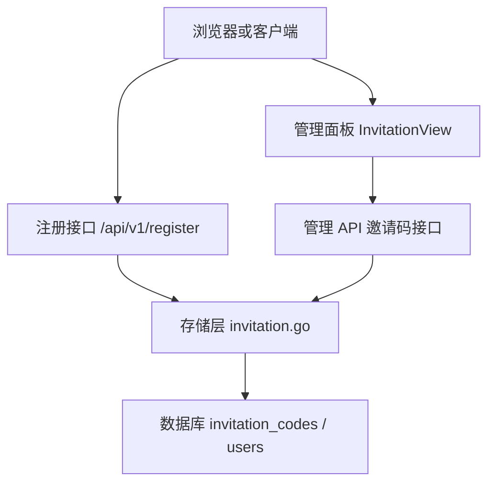
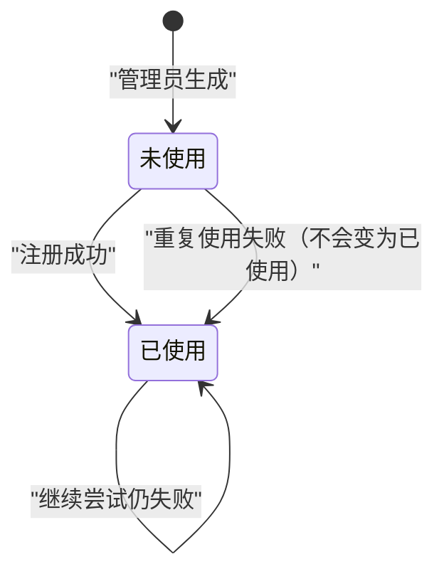
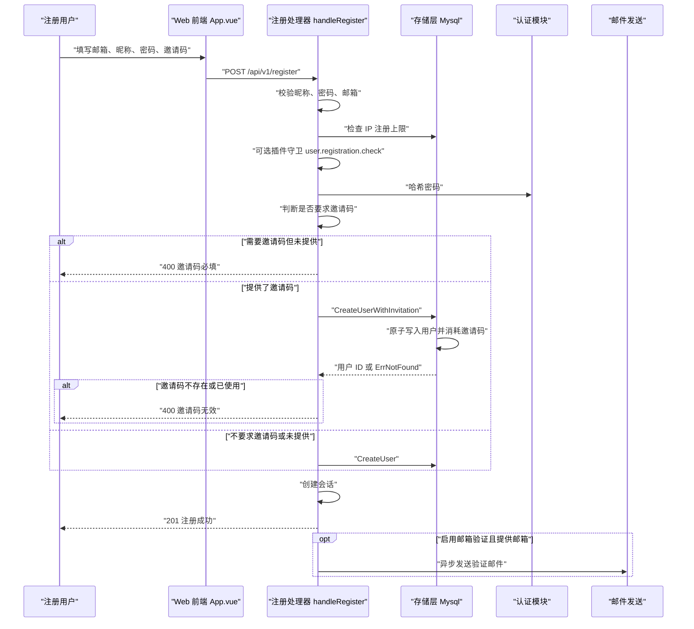
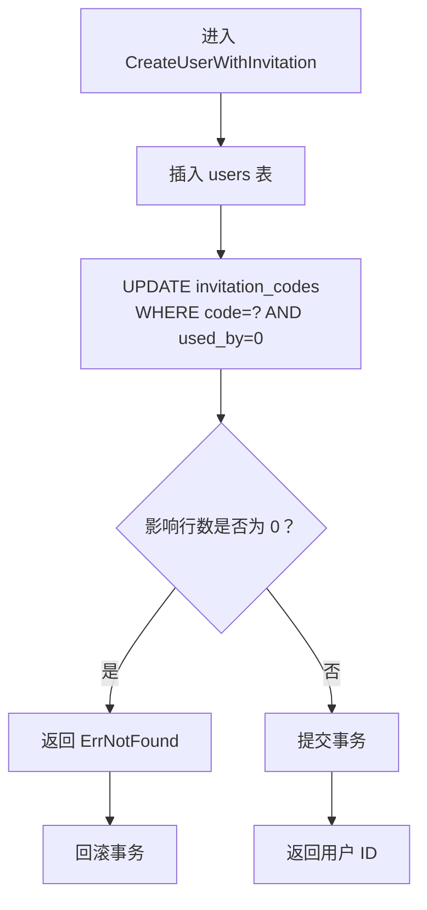
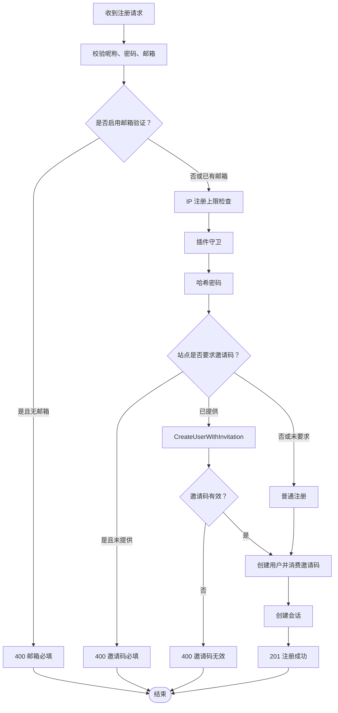
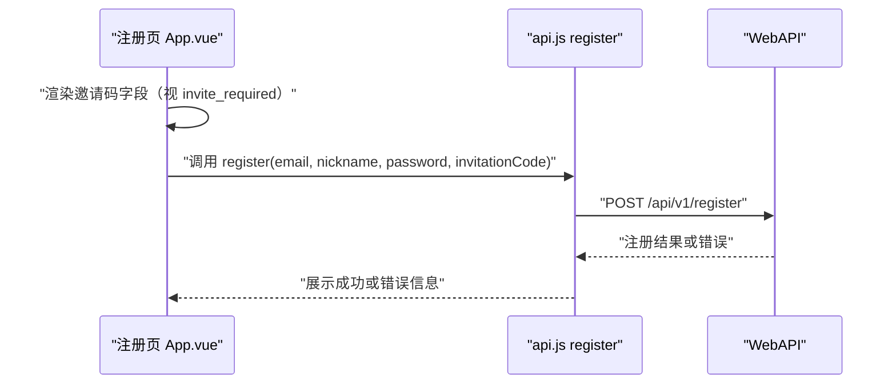
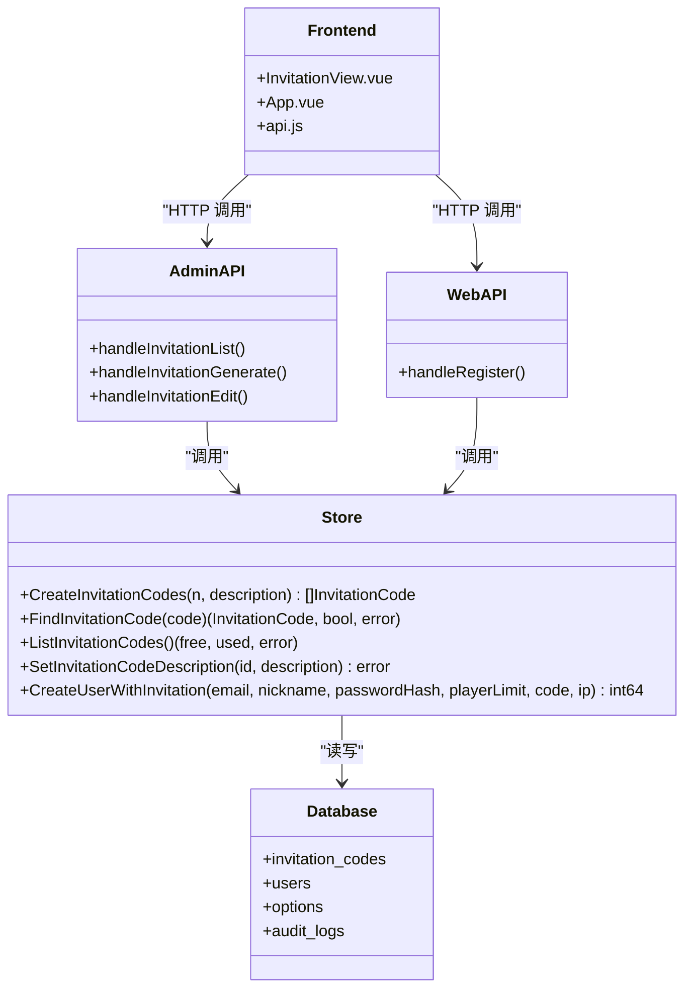
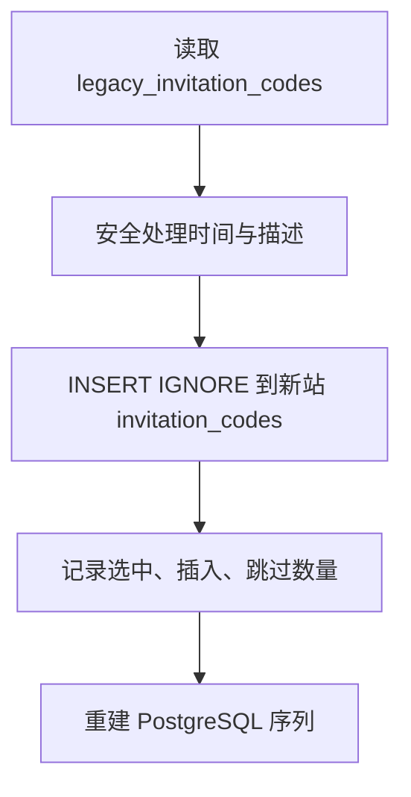

# 邀请码与注册门禁

**本文引用的文件**
- [invitation.go](https://github.com/YimingZhanshen/skin-nexus/blob/797ae1a/server/internal/store/invitation.go)
- [invitation.go](https://github.com/YimingZhanshen/skin-nexus/blob/797ae1a/server/internal/adminapi/invitation.go)
- [InvitationView.vue](https://github.com/YimingZhanshen/skin-nexus/blob/797ae1a/web/src/components/admin/InvitationView.vue)
- [0006_invitation_codes.sql](https://github.com/YimingZhanshen/skin-nexus/blob/797ae1a/server/migrations/mysql/0006_invitation_codes.sql)
- [webapi.go](https://github.com/YimingZhanshen/skin-nexus/blob/797ae1a/server/internal/webapi/webapi.go)
- [register_email_gate_test.go](https://github.com/YimingZhanshen/skin-nexus/blob/797ae1a/server/internal/webapi/register_email_gate_test.go)
- [schema.go](https://github.com/YimingZhanshen/skin-nexus/blob/797ae1a/server/internal/store/schema.go)
- [import.go](https://github.com/YimingZhanshen/skin-nexus/blob/797ae1a/server/internal/migrate/import.go)
- [import_integration_test.go](https://github.com/YimingZhanshen/skin-nexus/blob/797ae1a/server/internal/store/import_integration_test.go)
- [App.vue](https://github.com/YimingZhanshen/skin-nexus/blob/797ae1a/web/src/App.vue)
- [api.js](https://github.com/YimingZhanshen/skin-nexus/blob/797ae1a/web/src/api.js)

## 目录
1. [简介](#简介)
2. [项目结构与边界](#项目结构与边界)
3. [核心概念与数据模型](#核心概念与数据模型)
4. [架构总览](#架构总览)
5. [详细组件分析](#详细组件分析)
6. [依赖关系分析](#依赖关系分析)
7. [性能与并发特性](#性能与并发特性)
8. [常见问题排查](#常见问题排查)
9. [安全建议](#安全建议)
10. [结论](#结论)

## 简介
本文围绕 SkinNexus 的“邀请码 + 注册门禁”机制展开，说明以下问题：
- 邀请码如何控制新用户注册。
- 邀请码生成、使用状态、审计记录以及管理面板中的创建、分发与统计。
- 注册前站点是否允许公开注册、是否要求邀请码、是否处于安装阶段。
- 成功注册与多种失败路径的响应语义。
- 从 blessing-skin-server 迁移时邀请码数据的兼容策略。
- 常见运维问题与安全加固建议。

需要特别强调的是：当前实现中并未引入“邀请码过期时间”字段；因此“有效期”在代码层面并不存在，所有未使用的邀请码在语义上等价于“永久有效”，直到被 `used_by` 标记为已使用。

## 项目结构与边界
与邀请码和注册门禁直接相关的代码分布在四层：
- 数据库迁移层：定义 `invitation_codes` 表结构。
- 存储层：负责邀请码生成、查询、批量创建、描述编辑、以及带邀请码的用户注册事务。
- Web API 层：处理 `/api/v1/register` 注册请求，并在需要邀请码时校验。
- 管理 API 与前端管理面板：提供邀请码列表、批量生成、备注编辑与使用情况展示。

**图示来源**
- [InvitationView.vue:1-108](https://github.com/YimingZhanshen/skin-nexus/blob/797ae1a/web/src/components/admin/InvitationView.vue#L1-L108)
- [webapi.go:590-740](https://github.com/YimingZhanshen/skin-nexus/blob/797ae1a/server/internal/webapi/webapi.go#L590-L740)
- [invitation.go:1-175](https://github.com/YimingZhanshen/skin-nexus/blob/797ae1a/server/internal/store/invitation.go#L1-L175)
- [0006_invitation_codes.sql:1-14](https://github.com/YimingZhanshen/skin-nexus/blob/797ae1a/server/migrations/mysql/0006_invitation_codes.sql#L1-L14)

**章节来源**
- [0006_invitation_codes.sql:1-14](https://github.com/YimingZhanshen/skin-nexus/blob/797ae1a/server/migrations/mysql/0006_invitation_codes.sql#L1-L14)
- [invitation.go:1-175](https://github.com/YimingZhanshen/skin-nexus/blob/797ae1a/server/internal/store/invitation.go#L1-L175)
- [webapi.go:590-740](https://github.com/YimingZhanshen/skin-nexus/blob/797ae1a/server/internal/webapi/webapi.go#L590-L740)
- [InvitationView.vue:1-108](https://github.com/YimingZhanshen/skin-nexus/blob/797ae1a/web/src/components/admin/InvitationView.vue#L1-L108)

## 核心概念与数据模型

### 邀请码数据结构
`invitation_codes` 表是邀请码的核心持久化结构，字段含义如下：

| 字段 | 类型（MySQL） | 含义 |
|---|---|---|
| `id` | `INT UNSIGNED NOT NULL AUTO_INCREMENT` | 主键，迁移导入时保留原站 ID。 |
| `code` | `VARCHAR(255) NOT NULL` | 邀请码字符串，长度为 32 位小写十六进制。 |
| `generated_at` | `DATETIME NOT NULL` | 生成时间。 |
| `used_by` | `INT NOT NULL DEFAULT 0` | 使用者用户 ID；`0` 表示未使用。 |
| `used_at` | `DATETIME NULL` | 使用时间；未使用时为空。 |
| `description` | `VARCHAR(255) NULL` | 管理员备注，例如邀请对象、批次用途等。 |

该表由迁移 `0006_invitation_codes.sql` 创建，并声明与线上 blessing 插件的 `invitation-codes` 表保持 1:1 兼容。

**章节来源**
- [0006_invitation_codes.sql:1-14](https://github.com/YimingZhanshen/skin-nexus/blob/797ae1a/server/migrations/mysql/0006_invitation_codes.sql#L1-L14)
- [invitation.go:10-23](https://github.com/YimingZhanshen/skin-nexus/blob/797ae1a/server/internal/store/invitation.go#L10-L23)

### 邀请码生命周期
一个邀请码的生命周期包括：
1. **生成**：调用管理接口批量生成，`used_by=0`、`used_at=NULL`。
2. **分发**：管理员复制 `code`，通过内部渠道发给目标用户。
3. **使用**：用户在注册时提交邀请码；注册成功后 `used_by` 写入用户 UID，`used_at` 写入时间。
4. **作废**：同一个邀请码再次提交会被拒绝，因为更新条件要求 `used_by = 0`。
5. **审计**：每次批量生成和备注编辑都会写入审计日志。

**图示来源**
- [invitation.go:145-175](https://github.com/YimingZhanshen/skin-nexus/blob/797ae1a/server/internal/store/invitation.go#L145-L175)

**章节来源**
- [invitation.go:145-175](https://github.com/YimingZhanshen/skin-nexus/blob/797ae1a/server/internal/store/invitation.go#L145-L175)

## 架构总览
注册流程中，邀请码只是门禁的一个条件。完整的注册门禁包括：
- 输入校验：昵称、密码、邮箱格式。
- 站点级限制：IP 注册上限、插件守卫。
- 邀请码门禁：是否要求邀请码，以及邀请码是否有效。
- 账号创建：普通注册或邀请码注册。
- 会话与会后事件：登录态、用户生命周期事件、邮件验证。

**图示来源**
- [webapi.go:590-740](https://github.com/YimingZhanshen/skin-nexus/blob/797ae1a/server/internal/webapi/webapi.go#L590-L740)
- [invitation.go:145-175](https://github.com/YimingZhanshen/skin-nexus/blob/797ae1a/server/internal/store/invitation.go#L145-L175)

**章节来源**
- [webapi.go:590-740](https://github.com/YimingZhanshen/skin-nexus/blob/797ae1a/server/internal/webapi/webapi.go#L590-L740)

## 详细组件分析

### 邀请码生成与管理 API
管理端通过三个主要操作维护邀请码：

| 操作 | HTTP 行为 | 后端方法 | 主要职责 |
|---|---|---|---|
| 列出邀请码 | GET `/api/admin/v1/invitation-codes` | `handleInvitationList` | 返回 `free` 与 `used` 两个列表。 |
| 批量生成 | POST `/api/admin/v1/invitation-codes` | `handleInvitationGenerate` | 生成 1–1000 个邀请码，写入审计日志。 |
| 编辑备注 | PUT `/api/admin/v1/invitation-codes` | `handleInvitationEdit` | 修改邀请码备注，记录审计日志。 |

后端对 `amount` 做了显式钳制：小于 1 提升到 1，大于 1000 限制到 1000。这是为了避免前端误操作导致批量过大或过小。

**章节来源**
- [invitation.go:1-79](https://github.com/YimingZhanshen/skin-nexus/blob/797ae1a/server/internal/adminapi/invitation.go#L1-L79)

### 存储层：邀请码实体与事务消费
存储层 `InvitationCode` 与数据库表一一对应。关键能力包括：

- `NewInvitationCodeValue()`：使用随机字节加 MD5 生成 32 位小写十六进制邀请码，保持与 blessing 插件兼容。
- `CreateInvitationCodes(n, description)`：在单个事务中批量插入，避免旧实现逐条自动提交造成的部分成功问题。
- `FindInvitationCode(code)`：按码查询，找不到返回 `ErrNotFound`。
- `ListInvitationCodes()`：返回未使用与已使用两类结果。
- `SetInvitationCodeDescription(id, description)`：更新备注；若行不存在返回 `ErrNotFound`，若值相同则视为成功。
- `CreateUserWithInvitation(email, nickname, passwordHash, playerLimit, code, ip)`：原子写入用户并消费邀请码。

其中消费逻辑的关键在于更新语句包含 `WHERE code = ? AND used_by = 0`。如果影响行数为 0，说明邀请码不存在或已被其他请求抢先使用，从而返回 `ErrNotFound`。

**图示来源**
- [invitation.go:145-175](https://github.com/YimingZhanshen/skin-nexus/blob/797ae1a/server/internal/store/invitation.go#L145-L175)

**章节来源**
- [invitation.go:24-175](https://github.com/YimingZhanshen/skin-nexus/blob/797ae1a/server/internal/store/invitation.go#L24-L175)

### 注册接口：邀请码门禁与错误分支
注册处理器 `handleRegister` 是邀请码门禁的主要入口。其关键判断顺序如下：

1. 解析 JSON。
2. IP 限流检查。
3. 昵称长度与字符集校验。
4. 邮箱门控：如果站点启用“加入前邮箱验证”，则必须提供邮箱；否则空邮箱仍可注册。
5. 邮箱格式校验。
6. 密码至少 8 位。
7. IP 注册上限检查。
8. 插件守卫 `user.registration.check`。
9. 密码哈希。
10. 邀请码门禁：如果站点要求邀请码且请求未提供，返回“邀请码必填”。
11. 如果提供了邀请码，走 `CreateUserWithInvitation`；否则走普通 `CreateUser`。
12. 重复用户名或邮箱冲突时给出具体提示。
13. 创建会话、记录访问日志、触发用户生命周期事件。
14. 如启用邮箱验证且提供了邮箱，异步发送验证邮件。

**图示来源**
- [webapi.go:590-740](https://github.com/YimingZhanshen/skin-nexus/blob/797ae1a/server/internal/webapi/webapi.go#L590-L740)
- [register_email_gate_test.go:1-170](https://github.com/YimingZhanshen/skin-nexus/blob/797ae1a/server/internal/webapi/register_email_gate_test.go#L1-L170)

**章节来源**
- [webapi.go:590-740](https://github.com/YimingZhanshen/skin-nexus/blob/797ae1a/server/internal/webapi/webapi.go#L590-L740)
- [register_email_gate_test.go:1-170](https://github.com/YimingZhanshen/skin-nexus/blob/797ae1a/server/internal/webapi/register_email_gate_test.go#L1-L170)

### 管理面板 InvitationView
前端 `InvitationView.vue` 提供三类功能：
- 顶部表单：设置数量与备注，调用 POST 生成邀请码。
- “可用列表”：显示 `used_by=0` 的邀请码，支持编辑备注。
- “已用列表”：显示 `used_by!=0` 的邀请码，展示使用者 UID 与使用时间。

它通过 `/api/admin/v1/invitation-codes` 完成加载、生成和编辑。为避免重复点击导致重复批次，前端使用 `invBusy` 集合禁用按钮；同时初始化 `amount` 为 1，最大 1000。

需要注意：当前管理面板没有独立的“删除邀请码”“作废邀请码”“设置过期时间”“撤销使用”等操作。邀请码一旦使用就不可逆。

**章节来源**
- [InvitationView.vue:1-108](https://github.com/YimingZhanshen/skin-nexus/blob/797ae1a/web/src/components/admin/InvitationView.vue#L1-L108)

### 站点设置与安装阶段的关系
注册门禁还受以下站点状态影响：

- `invite_required`：决定是否要求邀请码。注册接口会读取该配置，并在缺少邀请码时返回错误。
- `setup_done` 与 `NeedsSetup`：决定站点是否仍处于安装向导阶段。安装阶段与邀请码门禁不是同一开关，但站长通常先完成安装，再开启邀请码门禁。
- 邮箱验证门控：当启用时，即使邀请码正确，若未提供邮箱也会先被拒绝。

`NeedsSetup` 的判断逻辑包括：
1. 检查 `users` 表是否存在。
2. 检查选项 `setup_done` 是否为 `"1"`。
3. 若无用户，则认为仍需安装。

**章节来源**
- [webapi.go:590-740](https://github.com/YimingZhanshen/skin-nexus/blob/797ae1a/server/internal/webapi/webapi.go#L590-L740)
- [schema.go:33-53](https://github.com/YimingZhanshen/skin-nexus/blob/797ae1a/server/internal/store/schema.go#L33-L53)

### 前端注册页面与邀请码字段
前端注册页 `App.vue` 根据后端返回的 `invite_required` 决定是否显示必填邀请码字段。注册时调用 `api.register`，将邮箱、昵称、密码、邀请码和插件表单数据发送到 `/api/v1/register`。

**图示来源**
- [App.vue:85-489](https://github.com/YimingZhanshen/skin-nexus/blob/797ae1a/web/src/App.vue#L85-L489)
- [api.js:43-43](https://github.com/YimingZhanshen/skin-nexus/blob/797ae1a/web/src/api.js#L43-L43)
- [webapi.go:590-740](https://github.com/YimingZhanshen/skin-nexus/blob/797ae1a/server/internal/webapi/webapi.go#L590-L740)

**章节来源**
- [App.vue:85-489](https://github.com/YimingZhanshen/skin-nexus/blob/797ae1a/web/src/App.vue#L85-L489)
- [api.js:43-43](https://github.com/YimingZhanshen/skin-nexus/blob/797ae1a/web/src/api.js#L43-L43)

## 依赖关系分析

**图示来源**
- [invitation.go:1-175](https://github.com/YimingZhanshen/skin-nexus/blob/797ae1a/server/internal/store/invitation.go#L1-L175)
- [invitation.go:1-79](https://github.com/YimingZhanshen/skin-nexus/blob/797ae1a/server/internal/adminapi/invitation.go#L1-L79)
- [webapi.go:590-740](https://github.com/YimingZhanshen/skin-nexus/blob/797ae1a/server/internal/webapi/webapi.go#L590-L740)
- [InvitationView.vue:1-108](https://github.com/YimingZhanshen/skin-nexus/blob/797ae1a/web/src/components/admin/InvitationView.vue#L1-L108)
- [App.vue:85-489](https://github.com/YimingZhanshen/skin-nexus/blob/797ae1a/web/src/App.vue#L85-L489)
- [api.js:43-43](https://github.com/YimingZhanshen/skin-nexus/blob/797ae1a/web/src/api.js#L43-L43)

**章节来源**
- [invitation.go:1-175](https://github.com/YimingZhanshen/skin-nexus/blob/797ae1a/server/internal/store/invitation.go#L1-L175)
- [invitation.go:1-79](https://github.com/YimingZhanshen/skin-nexus/blob/797ae1a/server/internal/adminapi/invitation.go#L1-L79)
- [webapi.go:590-740](https://github.com/YimingZhanshen/skin-nexus/blob/797ae1a/server/internal/webapi/webapi.go#L590-L740)
- [InvitationView.vue:1-108](https://github.com/YimingZhanshen/skin-nexus/blob/797ae1a/web/src/components/admin/InvitationView.vue#L1-L108)
- [App.vue:85-489](https://github.com/YimingZhanshen/skin-nexus/blob/797ae1a/web/src/App.vue#L85-L489)
- [api.js:43-43](https://github.com/YimingZhanshen/skin-nexus/blob/797ae1a/web/src/api.js#L43-L43)

## 性能与并发特性

### 并发安全性
邀请码消费采用单事务原子更新：
- 先插入用户。
- 再用 `UPDATE ... WHERE code = ? AND used_by = 0` 消耗邀请码。
- 最后提交事务。

这意味着多个并发请求使用同一个邀请码时，只有一个能成功，其余会因影响行数为 0 而失败。这是修复旧版 blessing 插件中“会话暂存 + 事后更新”可能导致的重复使用问题的关键设计。

### 批量生成性能
批量生成邀请码使用单个数据库事务，而不是每生成一个就提交一次。这样可避免之前“生成 50 个只成功 30 个却报错让管理员以为一个都没生成”的问题。单次最多生成 1000 个。

### 查询性能
- 列表查询按 `id` 排序，不做分页，适合邀请码规模不大的站点。
- 查找邀请码通过唯一业务码 `code` 查询，实际索引取决于迁移与数据库配置；当前迁移仅声明主键 `id`，`code` 的查询效率依赖于数据库引擎对唯一值扫描的表现。
- 使用/未使用分类在前端和管理 API 层按 `used_by` 拆分，不涉及复杂 JOIN。

[本节为通用性能讨论，不直接分析特定文件]

## 常见问题排查

### 站长无法生成邀请码
可能原因：
- 管理权限不足：只有具备管理权限的操作才能访问邀请码管理接口。
- 请求体非法：`amount` 不是数字或 JSON 解析失败。
- 后端服务异常：数据库连接失败、事务失败或审计写入失败。
- 数量被钳制：小于 1 自动变为 1，大于 1000 自动变为 1000，但这不应阻止生成。

排查建议：
- 检查管理面板网络请求是否返回 500。
- 检查后端审计日志与数据库事务错误。
- 确认管理接口路由未被反向代理拦截。

**章节来源**
- [invitation.go:1-79](https://github.com/YimingZhanshen/skin-nexus/blob/797ae1a/server/internal/adminapi/invitation.go#L1-L79)
- [invitation.go:24-79](https://github.com/YimingZhanshen/skin-nexus/blob/797ae1a/server/internal/store/invitation.go#L24-L79)

### 邀请码显示已用但实际未用
可能原因：
- 管理员误把某个邀请码交给他人使用后，对方确实注册成功。
- 测试过程中多次调用注册接口，其中一个成功消耗了邀请码。
- 历史数据迁移时，blessing 旧站的 `used_by` 原本就不为 0。

排查建议：
- 查看管理面板“已用列表”中的 `used_by` 与 `used_at`。
- 在数据库中检查对应 `invitation_codes.used_by` 是否等于某个真实用户 ID。
- 核对审计日志中是否有 `admin_invite_generate` 与 `admin_invite_edit` 记录。

**章节来源**
- [invitation.go:90-144](https://github.com/YimingZhanshen/skin-nexus/blob/797ae1a/server/internal/store/invitation.go#L90-L144)
- [InvitationView.vue:77-108](https://github.com/YimingZhanshen/skin-nexus/blob/797ae1a/web/src/components/admin/InvitationView.vue#L77-L108)

### 站点仍允许无邀请码注册
可能原因：
- 站点配置中未启用邀请码强制要求。
- 前端缓存的后端配置尚未刷新。
- 站长误以为“安装阶段结束”等同于“启用邀请码门禁”。
- 某些外部代理或网关绕过了后端配置。

排查建议：
- 检查后端注册接口返回的站点元数据中 `invite_required` 是否为真。
- 检查站点选项与配置是否设置了邀请码强制要求。
- 确认站点已完成安装且未处于 `NeedsSetup` 阶段。

**章节来源**
- [webapi.go:590-740](https://github.com/YimingZhanshen/skin-nexus/blob/797ae1a/server/internal/webapi/webapi.go#L590-L740)
- [schema.go:33-53](https://github.com/YimingZhanshen/skin-nexus/blob/797ae1a/server/internal/store/schema.go#L33-L53)

### 邀请码显示“无效”但站长认为应该有效
可能原因：
- 邀请码已经使用过。
- 邀请码拼写错误。
- 邀请码来自旧系统，但新系统中不存在。
- 多实例部署下，不同实例共享数据库是关键；若数据库未共享，可能出现本地有码但注册接口查不到。

**章节来源**
- [webapi.go:668-682](https://github.com/YimingZhanshen/skin-nexus/blob/797ae1a/server/internal/webapi/webapi.go#L668-L682)
- [invitation.go:70-89](https://github.com/YimingZhanshen/skin-nexus/blob/797ae1a/server/internal/store/invitation.go#L70-L89)

### 邀请码没有过期时间
当前实现不包含过期字段，因此：
- 未使用的邀请码不会被自动失效。
- 不能通过时间窗口关闭某个邀请码。
- 如果需要时效控制，应配合管理流程主动作废或销毁邀请码，而不能依赖系统自动过期。

[本节为现状说明，不引用特定代码片段]

## 安全建议

### 邀请码生成应具备不可预测性
当前实现使用 16 字节随机数经 MD5 生成 32 位十六进制邀请码。虽然这不是现代加密密钥的最佳实践，但它保持了与 blessing 插件的兼容形状。生产环境应避免使用弱随机源，并确保邀请码生成过程不受可预测输入影响。

**章节来源**
- [invitation.go:24-33](https://github.com/YimingZhanshen/skin-nexus/blob/797ae1a/server/internal/store/invitation.go#L24-L33)

### 邀请码必须一次性失效
当前实现通过 `used_by = 0` 条件保证同一邀请码只能成功消费一次。建议：
- 不要在业务侧缓存“邀请码有效”后再执行二次注册。
- 不要把“邀请码已找到”当作最终授权结论；最终结论应来自消费事务的结果。

**章节来源**
- [invitation.go:145-175](https://github.com/YimingZhanshen/skin-nexus/blob/797ae1a/server/internal/store/invitation.go#L145-L175)

### 审计日志应保留
每次生成与编辑邀请码都会写入审计日志。建议：
- 保留足够长的审计日志周期。
- 将审计日志纳入安全巡检。
- 不要在生产环境中将邀请码明文暴露在公共访问日志中。

**章节来源**
- [invitation.go:34-79](https://github.com/YimingZhanshen/skin-nexus/blob/797ae1a/server/internal/adminapi/invitation.go#L34-L79)

### 不要将邀请码暴露在公开链接中
邀请码本身是访问令牌；即使它是一次性的，泄露后仍可能被恶意抢先注册。建议：
- 通过私密渠道分发邀请码。
- 不在公告、截图、公开日志中展示完整邀请码。
- 对管理面板增加访问控制与操作审计。

[本节为通用安全建议，不直接分析特定文件]

## 与 blessing-skin-server 迁移时的兼容处理

### 表结构兼容
迁移导入器会读取旧站 `invitation_codes` 表，并将 `id`、`code`、`generated_at`、`used_by`、`used_at`、`description` 复制到新站同名表中。主键 `id` 保持不变，因此历史邀请码可以在新旧系统之间对齐。

### 幂等导入
导入使用 `INSERT IGNORE` 或等效的忽略冲突语法，使重复运行迁移不会覆盖已有数据。

### 时间字段容错
迁移中对 `generated_at` 与 `used_at` 进行安全处理：NULL 或零时间会根据字段是否必需转换为当前时间或 NULL，并写入警告信息。

### 自增序列同步
导入完成后，PostgreSQL 会对 `users`、`players`、`textures`、`invitation_codes` 等表的重建序列，确保后续新生成的 ID 不会与导入的历史 ID 冲突。

**图示来源**
- [import.go:470-560](https://github.com/YimingZhanshen/skin-nexus/blob/797ae1a/server/internal/migrate/import.go#L470-L560)
- [import_integration_test.go:180-240](https://github.com/YimingZhanshen/skin-nexus/blob/797ae1a/server/internal/store/import_integration_test.go#L180-L240)

**章节来源**
- [import.go:470-560](https://github.com/YimingZhanshen/skin-nexus/blob/797ae1a/server/internal/migrate/import.go#L470-L560)
- [import_integration_test.go:180-240](https://github.com/YimingZhanshen/skin-nexus/blob/797ae1a/server/internal/store/import_integration_test.go#L180-L240)

## 结论
SkinNexus 的邀请码机制以 `invitation_codes` 表为核心，通过存储层事务保证邀请码的一次性消费，并通过 Web API 将邀请码门禁与站点配置、邮箱验证、插件守卫等机制组合在一起。管理面板提供邀请码的批量生成、备注编辑与使用情况统计，但没有内置过期、撤销或删除功能。

对于运维人员而言，最重要的注意事项是：
- 邀请码不是 URL 参数，也不是公开令牌。
- 邀请码不会自动过期。
- 邀请码一旦使用就无法恢复。
- 站点允许无邀请码注册与否由配置决定，与安装阶段无关。
- 迁移时邀请码数据会保留主键与使用状态，但需要关注审计、日志与幂等性。
