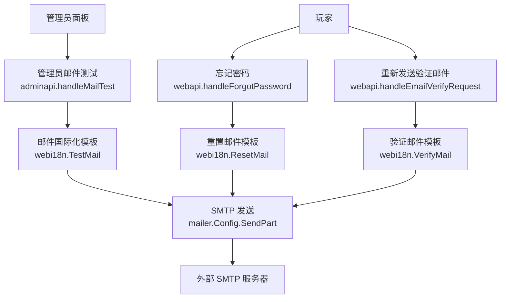
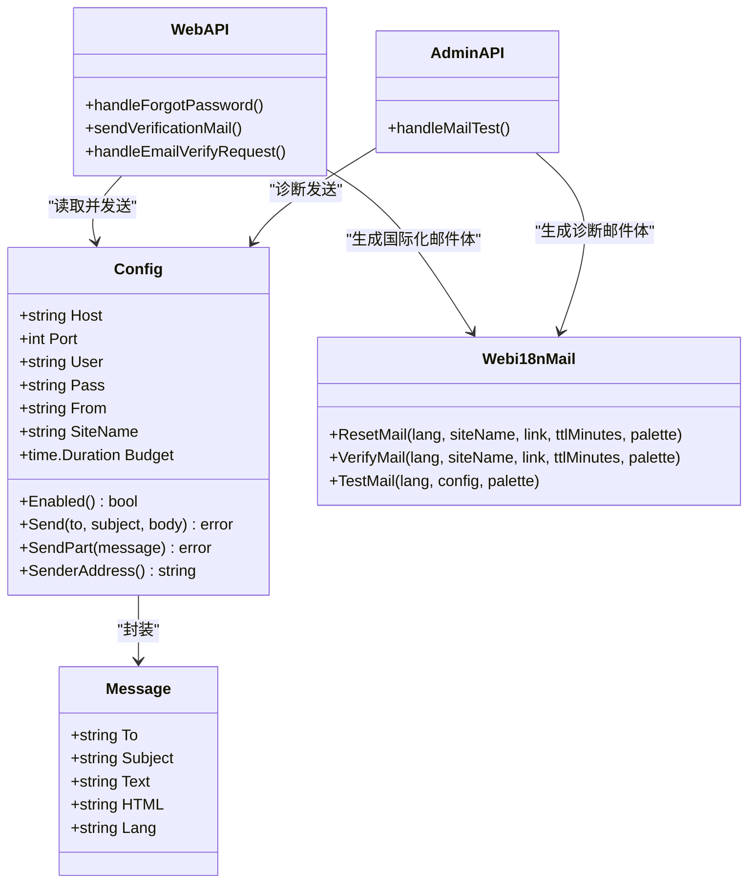
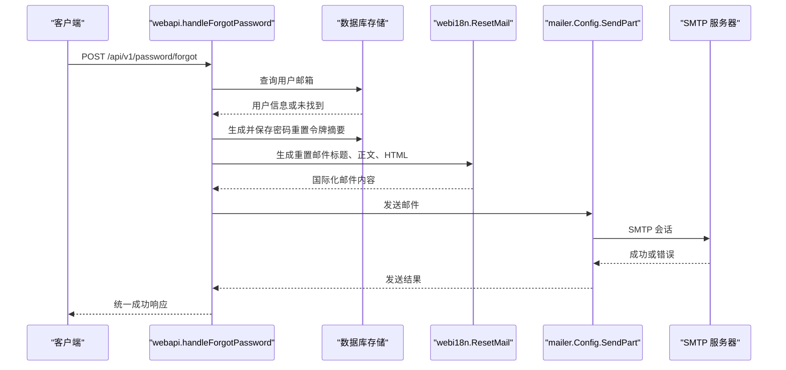
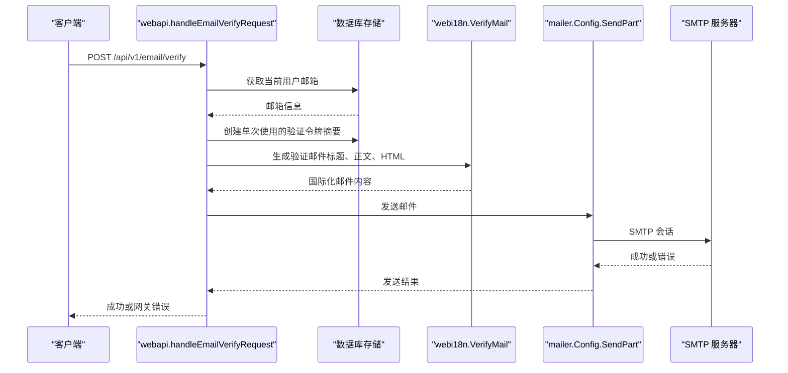
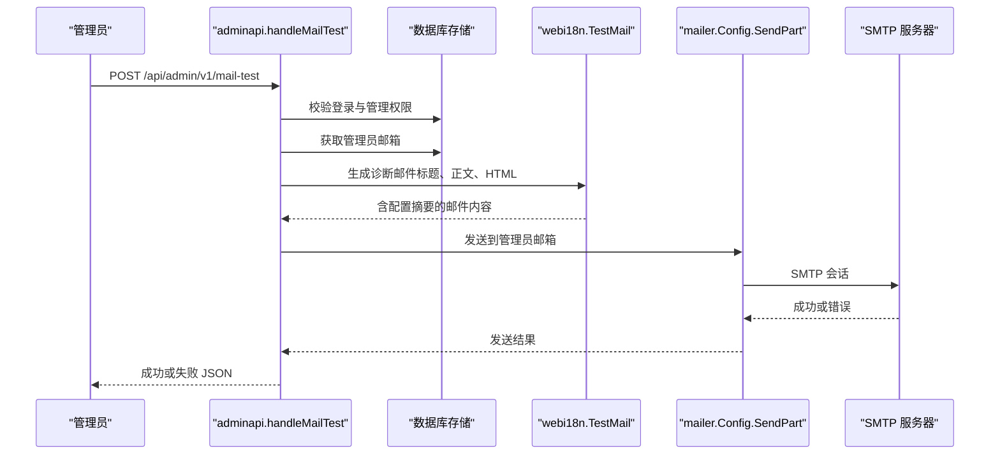
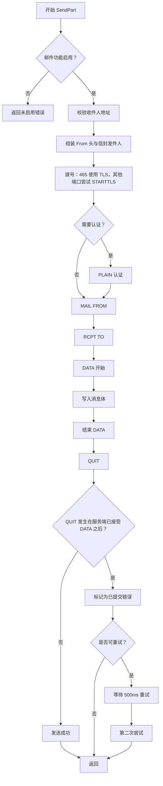
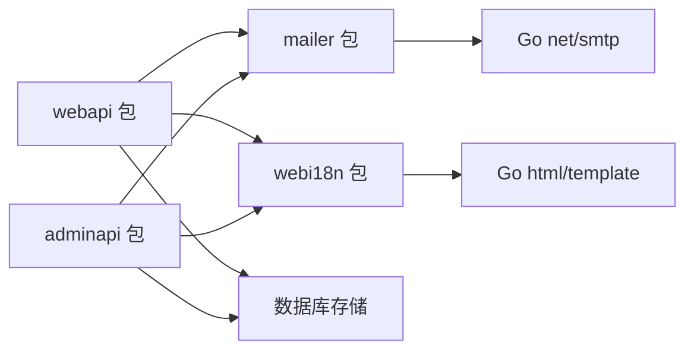

# 邮件服务集成

**本文引用的文件**
- [server/internal/mailer/config.go](https://github.com/YimingZhanshen/skin-nexus/blob/797ae1a/server/internal/mailer/config.go)
- [server/internal/mailer/mailer.go](https://github.com/YimingZhanshen/skin-nexus/blob/797ae1a/server/internal/mailer/mailer.go)
- [server/internal/mailer/message.go](https://github.com/YimingZhanshen/skin-nexus/blob/797ae1a/server/internal/mailer/message.go)
- [server/internal/mailer/retry.go](https://github.com/YimingZhanshen/skin-nexus/blob/797ae1a/server/internal/mailer/retry.go)
- [server/internal/webi18n/mail.go](https://github.com/YimingZhanshen/skin-nexus/blob/797ae1a/server/internal/webi18n/mail.go)
- [server/internal/adminapi/mailtest.go](https://github.com/YimingZhanshen/skin-nexus/blob/797ae1a/server/internal/adminapi/mailtest.go)
- [server/internal/webapi/password.go](https://github.com/YimingZhanshen/skin-nexus/blob/797ae1a/server/internal/webapi/password.go)
- [server/internal/webapi/email_verify.go](https://github.com/YimingZhanshen/skin-nexus/blob/797ae1a/server/internal/webapi/email_verify.go)
- [server/internal/adminapi/diagnostics_maildns_test.go](https://github.com/YimingZhanshen/skin-nexus/blob/797ae1a/server/internal/adminapi/diagnostics_maildns_test.go)
- [server/internal/adminapi/status_mail_test.go](https://github.com/YimingZhanshen/skin-nexus/blob/797ae1a/server/internal/adminapi/status_mail_test.go)

## 目录
1. [引言](#引言)
2. [项目结构与职责划分](#项目结构与职责划分)
3. [核心组件总览](#核心组件总览)
4. [架构与调用链](#架构与调用链)
5. [详细组件分析](#详细组件分析)
6. [依赖关系分析](#依赖关系分析)
7. [性能与并发特性](#性能与并发特性)
8. [配置示例与测试请求](#配置示例与测试请求)
9. [故障排查指南](#故障排查指南)
10. [安全与运维建议](#安全与运维建议)
11. [结论](#结论)

## 引言
本文件说明 SkinNexus 的邮件子系统如何把 SMTP、国际化模板和管理员诊断整合在一起。系统负责发送邀请码、邮箱验证链接、密码重置链接以及管理员状态通知等邮件；其中“管理员诊断测试”通过 `adminapi.MailTest` 向管理员自己的邮箱发送一封带配置摘要的诊断信，用于确认 SMTP 账户是否真正可用。

邮件能力由四层组成：
- 配置层：从站点设置与环境默认值解析 SMTP 主机、端口、用户名、密码、发件人及站点名称。
- 传输层：基于 Go 标准库 `net/smtp` 实现 SMTPS（465）和机会式 STARTTLS，并内置一次重试。
- 消息层：构造纯文本或 `multipart/alternative` 邮件体，生成安全的 `Message-ID` 与随机边界。
- 国际化层：根据语言包生成标题、正文、按钮文案和页脚，避免把主题样式直接注入邮件客户端。

**章节来源**
- [server/internal/mailer/config.go:1-43](https://github.com/YimingZhanshen/skin-nexus/blob/797ae1a/server/internal/mailer/config.go#L1-L43)
- [server/internal/mailer/mailer.go:1-120](https://github.com/YimingZhanshen/skin-nexus/blob/797ae1a/server/internal/mailer/mailer.go#L1-L120)
- [server/internal/mailer/message.go:1-60](https://github.com/YimingZhanshen/skin-nexus/blob/797ae1a/server/internal/mailer/message.go#L1-L60)
- [server/internal/webi18n/mail.go:1-80](https://github.com/YimingZhanshen/skin-nexus/blob/797ae1a/server/internal/webi18n/mail.go#L1-L80)

## 项目结构与职责划分
邮件相关代码主要分布在 `server/internal` 下的四个包：

| 包 | 职责 | 关键类型/函数 |
|---|---|---|
| `mailer` | SMTP 连接、认证、重试、消息编码 | `Config`、`Message`、`Send`、`SendPart`、`SenderAddress` |
| `webi18n` | 邮件文案、HTML 骨架、调色板 | `ResetMail`、`VerifyMail`、`TestMail`、`MailPalette` |
| `webapi` | 用户侧密码重置与邮箱验证流程 | `handleForgotPassword`、`sendVerificationMail` |
| `adminapi` | 管理员邮件诊断、审计计数 | `handleMailTest`、`mailFailures24h` |



**图表来源**
- [server/internal/adminapi/mailtest.go:1-109](https://github.com/YimingZhanshen/skin-nexus/blob/797ae1a/server/internal/adminapi/mailtest.go#L1-L109)
- [server/internal/webapi/password.go:1-200](https://github.com/YimingZhanshen/skin-nexus/blob/797ae1a/server/internal/webapi/password.go#L1-L200)
- [server/internal/webapi/email_verify.go:1-200](https://github.com/YimingZhanshen/skin-nexus/blob/797ae1a/server/internal/webapi/email_verify.go#L1-L200)
- [server/internal/webi18n/mail.go:1-160](https://github.com/YimingZhanshen/skin-nexus/blob/797ae1a/server/internal/webi18n/mail.go#L1-L160)
- [server/internal/mailer/mailer.go:1-120](https://github.com/YimingZhanshen/skin-nexus/blob/797ae1a/server/internal/mailer/mailer.go#L1-L120)

**章节来源**
- [server/internal/adminapi/mailtest.go:1-109](https://github.com/YimingZhanshen/skin-nexus/blob/797ae1a/server/internal/adminapi/mailtest.go#L1-L109)
- [server/internal/webapi/password.go:1-200](https://github.com/YimingZhanshen/skin-nexus/blob/797ae1a/server/internal/webapi/password.go#L1-L200)
- [server/internal/webapi/email_verify.go:1-200](https://github.com/YimingZhanshen/skin-nexus/blob/797ae1a/server/internal/webapi/email_verify.go#L1-L200)
- [server/internal/webi18n/mail.go:1-160](https://github.com/YimingZhanshen/skin-nexus/blob/797ae1a/server/internal/webi18n/mail.go#L1-L160)

## 核心组件总览

### mailer.Config：SMTP 配置
`mailer.ConfigFrom` 是统一入口：它读取 `smtp_host`、`smtp_port`、`smtp_user`、`smtp_pass`、`smtp_from`，并把站点名称作为 `SiteName` 注入。

| 配置项 | 默认值 | 行为 |
|---|---:|---|
| `smtp_host` | 空字符串 | 为空表示禁用邮件功能；所有发送路径会返回未配置错误。 |
| `smtp_port` | 465 | 非空且为有效端口时覆盖默认；465 被视为隐式 TLS。 |
| `smtp_user` | 空字符串 | 通常填完整邮箱地址；当 `smtp_from` 为空时可退化为发件人。 |
| `smtp_pass` | 空字符串 | 用于 `AUTH PLAIN`；标准库禁止在非 TLS 通道明文发送凭证。 |
| `smtp_from` | 空字符串 | 支持 `Name <a@b.c>`；若为空则回退到 `smtp_user`。 |
| `site_name` | 来自业务上下文 | 用于邮件标题前缀和显示名称。 |

如果 `smtp_from` 与 `smtp_user` 都为空，配置会被视为不可用，而不是让发送静默失败。

**章节来源**
- [server/internal/mailer/config.go:1-43](https://github.com/YimingZhanshen/skin-nexus/blob/797ae1a/server/internal/mailer/config.go#L1-L43)

### mailer.Message：消息结构
`Message` 只描述一封信的内容，不包含网络细节：

| 字段 | 含义 |
|---|---|
| `To` | 收件人地址。 |
| `Subject` | 标题，使用 UTF-8 Q 编码。 |
| `Text` | 纯文本正文。 |
| `HTML` | HTML 正文；为空时保持历史纯文本格式。 |
| `Lang` | 内容语言，写入 `Content-Language` 头。 |

当 `HTML` 非空时，消息采用 `multipart/alternative`：纯文本在前，HTML 在后，以便兼容客户端选择更合适的版本。

**章节来源**
- [server/internal/mailer/message.go:1-60](https://github.com/YimingZhanshen/skin-nexus/blob/797ae1a/server/internal/mailer/message.go#L1-L60)

### webi18n.mail：邮件模板与国际化
`webi18n` 不负责网络，只负责把语言、站点名、链接、主题色变成可渲染的邮件体。

| 函数 | 用途 | 输入 |
|---|---|---|
| `ResetMail` | 密码重置邮件 | 语言、站点名、重置链接、有效期分钟数、调色板。 |
| `VerifyMail` | 邮箱验证邮件 | 语言、站点名、验证链接、有效期分钟数、调色板。 |
| `TestMail` | 管理员诊断邮件 | 语言、测试配置摘要、调色板。 |

这些函数内部通过 `F` 和 `T` 访问语言包，因此邀请码、验证链接、站点名称、按钮文案、页脚等文本都走统一国际化管线。

**章节来源**
- [server/internal/webi18n/mail.go:1-160](https://github.com/YimingZhanshen/skin-nexus/blob/797ae1a/server/internal/webi18n/mail.go#L1-L160)

## 架构与调用链

### 整体架构


**图表来源**
- [server/internal/mailer/mailer.go:1-120](https://github.com/YimingZhanshen/skin-nexus/blob/797ae1a/server/internal/mailer/mailer.go#L1-L120)
- [server/internal/mailer/message.go:1-60](https://github.com/YimingZhanshen/skin-nexus/blob/797ae1a/server/internal/mailer/message.go#L1-L60)
- [server/internal/webi18n/mail.go:1-160](https://github.com/YimingZhanshen/skin-nexus/blob/797ae1a/server/internal/webi18n/mail.go#L1-L160)
- [server/internal/webapi/password.go:1-200](https://github.com/YimingZhanshen/skin-nexus/blob/797ae1a/server/internal/webapi/password.go#L1-L200)
- [server/internal/webapi/email_verify.go:1-200](https://github.com/YimingZhanshen/skin-nexus/blob/797ae1a/server/internal/webapi/email_verify.go#L1-L200)
- [server/internal/adminapi/mailtest.go:1-109](https://github.com/YimingZhanshen/skin-nexus/blob/797ae1a/server/internal/adminapi/mailtest.go#L1-L109)

### 密码重置调用链


**图表来源**
- [server/internal/webapi/password.go:1-200](https://github.com/YimingZhanshen/skin-nexus/blob/797ae1a/server/internal/webapi/password.go#L1-L200)
- [server/internal/webi18n/mail.go:1-120](https://github.com/YimingZhanshen/skin-nexus/blob/797ae1a/server/internal/webi18n/mail.go#L1-L120)
- [server/internal/mailer/mailer.go:120-214](https://github.com/YimingZhanshen/skin-nexus/blob/797ae1a/server/internal/mailer/mailer.go#L120-L214)

**章节来源**
- [server/internal/webapi/password.go:1-200](https://github.com/YimingZhanshen/skin-nexus/blob/797ae1a/server/internal/webapi/password.go#L1-L200)
- [server/internal/webi18n/mail.go:1-120](https://github.com/YimingZhanshen/skin-nexus/blob/797ae1a/server/internal/webi18n/mail.go#L1-L120)

### 邮箱验证调用链


**图表来源**
- [server/internal/webapi/email_verify.go:1-200](https://github.com/YimingZhanshen/skin-nexus/blob/797ae1a/server/internal/webapi/email_verify.go#L1-L200)
- [server/internal/webi18n/mail.go:80-140](https://github.com/YimingZhanshen/skin-nexus/blob/797ae1a/server/internal/webi18n/mail.go#L80-L140)
- [server/internal/mailer/mailer.go:120-214](https://github.com/YimingZhanshen/skin-nexus/blob/797ae1a/server/internal/mailer/mailer.go#L120-L214)

**章节来源**
- [server/internal/webapi/email_verify.go:1-200](https://github.com/YimingZhanshen/skin-nexus/blob/797ae1a/server/internal/webapi/email_verify.go#L1-L200)

### 管理员诊断测试调用链


**图表来源**
- [server/internal/adminapi/mailtest.go:1-109](https://github.com/YimingZhanshen/skin-nexus/blob/797ae1a/server/internal/adminapi/mailtest.go#L1-L109)
- [server/internal/webi18n/mail.go:120-180](https://github.com/YimingZhanshen/skin-nexus/blob/797ae1a/server/internal/webi18n/mail.go#L120-L180)
- [server/internal/mailer/mailer.go:120-214](https://github.com/YimingZhanshen/skin-nexus/blob/797ae1a/server/internal/mailer/mailer.go#L120-L214)

**章节来源**
- [server/internal/adminapi/mailtest.go:1-109](https://github.com/YimingZhanshen/skin-nexus/blob/797ae1a/server/internal/adminapi/mailtest.go#L1-L109)

## 详细组件分析

### 配置解析与启用判断
`ConfigFrom` 的行为可以总结为：

1. 读取 `smtp_host`。
2. 主机为空则返回 `nil`，表示邮件功能关闭。
3. 端口默认为 465；只有合法整数端口才覆盖默认值。
4. 读取用户名、密码、发件人、站点名称。
5. 如果 `smtp_from` 和 `smtp_user` 都为空，也视为未配置。
6. 返回可用于 `Enabled()` 检查的 `*Config`。

这保证了“没有发件人地址等于没有邮件能力”，避免面板显示已配置但实际无法发送。

**章节来源**
- [server/internal/mailer/config.go:1-43](https://github.com/YimingZhanshen/skin-nexus/blob/797ae1a/server/internal/mailer/config.go#L1-L43)

### SMTP 发送与一次重试
`Config.Send` 是面向普通纯文本的便捷方法；`SendPart` 才是通用路径，支持纯文本和 HTML。

发送过程包括：
- 检查是否启用。
- 校验收件人地址。
- 组装 From 头和信封发件人。
- 处理端口：465 使用 TLS 直连，其他端口先建立 TCP，再尝试 STARTTLS。
- 可选 `AUTH PLAIN`。
- 执行 `MAIL FROM`、`RCPT TO`、`DATA`。
- 写出消息体后关闭数据流。
- 在 `QUIT` 之后包装为“已提交错误”，防止重复投递。

重试策略如下：
- 仅对“可能因等待而恢复”的错误重试一次。
- 包含 DNS 临时错误、连接超时、连接重置、管道关闭、意外 EOF、4xx SMTP 错误。
- 不重试：上下文超时、DNS 找不到主机、DATA 已被接受、未知错误。
- 最多一次 500ms 延迟重试。
- 当调用方设置了预算时间时，不再重试；这是为了让浏览器等待的管理员测试按钮能给出明确结果。



**图表来源**
- [server/internal/mailer/mailer.go:120-214](https://github.com/YimingZhanshen/skin-nexus/blob/797ae1a/server/internal/mailer/mailer.go#L120-L214)
- [server/internal/mailer/retry.go:1-63](https://github.com/YimingZhanshen/skin-nexus/blob/797ae1a/server/internal/mailer/retry.go#L1-L63)

**章节来源**
- [server/internal/mailer/mailer.go:120-214](https://github.com/YimingZhanshen/skin-nexus/blob/797ae1a/server/internal/mailer/mailer.go#L120-L214)
- [server/internal/mailer/retry.go:1-63](https://github.com/YimingZhanshen/skin-nexus/blob/797ae1a/server/internal/mailer/retry.go#L1-L63)

### 消息构建与国际化注入
`webi18n` 负责三类邮件：

| 场景 | 模板函数 | 关键变量 |
|---|---|---|
| 密码重置 | `ResetMail` | 站点名、重置链接、过期时间、按钮文案、忽略提示、页脚。 |
| 邮箱验证 | `VerifyMail` | 站点名、验证链接、过期时间、按钮文案、忽略提示、页脚。 |
| 管理员诊断 | `TestMail` | 站点名、SMTP 主机、端口、发件人、语言、主题 ID、诊断摘要。 |

HTML 模板使用表格布局，避免依赖 `<style>` 和远程资源；主题色只影响顶部横幅和按钮背景，正文始终使用浅色纸面与深色文字，从而避免邮件客户端反色导致白底白字。

`TestMail` 的输出还包含一个“配置摘要”，帮助管理员截图说明测试结果，同时记录当前语言、主题和发件人。

**章节来源**
- [server/internal/webi18n/mail.go:1-180](https://github.com/YimingZhanshen/skin-nexus/blob/797ae1a/server/internal/webi18n/mail.go#L1-L180)

### 管理员邮件测试 API
`adminapi.handleMailTest` 的行为如下：

1. 必须通过管理员会话调用；API Token 路径没有收件箱，因此被拒绝。
2. 如果站点未配置 SMTP，返回 503，并提示在设置中配置 SMTP。
3. 将预算时间设为 12 秒，使管理员面板的 HTTP 超时与服务端会话超时对齐。
4. 读取管理员用户的邮箱。
5. 如果邮箱为空或占位符地址，返回 400。
6. 调用 `webi18n.TestMail` 生成国际化诊断邮件。
7. 调用 `mailer.Config.SendPart` 发送。
8. 成功时记录审计事件，返回包含脱敏收件人和 SMTP 主机的 JSON。
9. 失败时记录原始错误与 SMTP 主机到日志和审计表，返回 502。

返回格式要点：
- 成功：HTTP 200，JSON 中包含 `ok`、脱敏后的 `to`、`host`。
- 失败：HTTP 502，错误字典指向通用邮件发送失败。
- 未配置：HTTP 503，提示管理员去设置页面配置 SMTP。
- 邮箱缺失或占位符：HTTP 400，提示修复个人资料。

**章节来源**
- [server/internal/adminapi/mailtest.go:1-109](https://github.com/YimingZhanshen/skin-nexus/blob/797ae1a/server/internal/adminapi/mailtest.go#L1-L109)

### 邮件失败审计与状态页
系统通过审计事件统计最近 24 小时的邮件失败数量，包括：
- `mail_test_failed`
- `password_reset_mail_failed`
- `email_verify_mail_failed`

状态页应报告失败计数；单个计数失败不能破坏整个状态接口。

**章节来源**
- [server/internal/adminapi/status_mail_test.go:1-41](https://github.com/YimingZhanshen/skin-nexus/blob/797ae1a/server/internal/adminapi/status_mail_test.go#L1-L41)

## 依赖关系分析



**图表来源**
- [server/internal/mailer/mailer.go:1-40](https://github.com/YimingZhanshen/skin-nexus/blob/797ae1a/server/internal/mailer/mailer.go#L1-L40)
- [server/internal/webi18n/mail.go:1-40](https://github.com/YimingZhanshen/skin-nexus/blob/797ae1a/server/internal/webi18n/mail.go#L1-L40)
- [server/internal/webapi/password.go:1-40](https://github.com/YimingZhanshen/skin-nexus/blob/797ae1a/server/internal/webapi/password.go#L1-L40)
- [server/internal/webapi/email_verify.go:1-40](https://github.com/YimingZhanshen/skin-nexus/blob/797ae1a/server/internal/webapi/email_verify.go#L1-L40)
- [server/internal/adminapi/mailtest.go:1-40](https://github.com/YimingZhanshen/skin-nexus/blob/797ae1a/server/internal/adminapi/mailtest.go#L1-L40)

**章节来源**
- [server/internal/mailer/mailer.go:1-40](https://github.com/YimingZhanshen/skin-nexus/blob/797ae1a/server/internal/mailer/mailer.go#L1-L40)
- [server/internal/webi18n/mail.go:1-40](https://github.com/YimingZhanshen/skin-nexus/blob/797ae1a/server/internal/webi18n/mail.go#L1-L40)
- [server/internal/webapi/password.go:1-40](https://github.com/YimingZhanshen/skin-nexus/blob/797ae1a/server/internal/webapi/password.go#L1-L40)
- [server/internal/webapi/email_verify.go:1-40](https://github.com/YimingZhanshen/skin-nexus/blob/797ae1a/server/internal/webapi/email_verify.go#L1-L40)
- [server/internal/adminapi/mailtest.go:1-40](https://github.com/YimingZhanshen/skin-nexus/blob/797ae1a/server/internal/adminapi/mailtest.go#L1-L40)

## 性能与并发特性

| 方面 | 实现方式 | 影响 |
|---|---|---|
| 连接超时 | 拨号窗口默认 10 秒。 | 避免长时间阻塞。 |
| 会话超时 | 默认会话窗口 30 秒。 | 控制整个 SMTP 对话上限。 |
| 管理员测试预算 | 设置为 12 秒。 | 与面板 HTTP 超时对齐，避免“还在发但客户端已放弃”。 |
| 注册验证邮件 | 使用独立 goroutine，最长 45 秒。 | 注册流程不因 SMTP 慢而卡顿。 |
| 重试 | 最多一次，间隔约 500ms。 | 缓解短暂网络抖动，但不掩盖永久错误。 |
| 无第三方依赖 | 仅使用标准库。 | 降低供应链风险，便于审查。 |

重要约束：
- 不要在长事务中同步发送邮件。
- 用户可见的请求应尽量异步或快速失败。
- 重试次数要少，避免放大 SMTP 压力。
- 不要在大事务内持有数据库连接等待 SMTP。

**章节来源**
- [server/internal/mailer/mailer.go:40-120](https://github.com/YimingZhanshen/skin-nexus/blob/797ae1a/server/internal/mailer/mailer.go#L40-L120)
- [server/internal/webapi/email_verify.go:1-120](https://github.com/YimingZhanshen/skin-nexus/blob/797ae1a/server/internal/webapi/email_verify.go#L1-L120)
- [server/internal/adminapi/mailtest.go:40-80](https://github.com/YimingZhanshen/skin-nexus/blob/797ae1a/server/internal/adminapi/mailtest.go#L40-L80)

## 配置示例与测试请求

### 配置示例
以下键名应与站点设置一致；示例值仅用于说明，不应直接用于生产环境：

| 配置键 | 示例值 | 说明 |
|---|---|---|
| `smtp_host` | `smtp.example.com` | SMTP 主机。 |
| `smtp_port` | `465` | 465 表示隐式 TLS；也可用 587 配合 STARTTLS。 |
| `smtp_user` | `noreply@example.com` | 认证身份，很多服务商要求完整邮箱地址。 |
| `smtp_pass` | `授权码` | 应用授权码或应用专用密码，不是普通登录密码。 |
| `smtp_from` | `"SkinNexus" <noreply@example.com>` | 可选；为空时使用用户名。 |
| `site_name` | `SkinNexus` | 站点名称，用于邮件显示名和标题前缀。 |

### curl 触发邮件测试
管理员登录后，向管理 API 发送空请求体：

```bash
curl -X POST \
  --cookie "SESSION=管理员会话Cookie" \
  https://your-site.example.com/api/admin/v1/mail-test
```

预期结果：
- 成功：HTTP 200，JSON 中包含 `ok`、脱敏后的收件人、SMTP 主机。
- 未配置 SMTP：HTTP 503，提示在设置中配置 SMTP。
- 管理员邮箱缺失或占位符：HTTP 400，提示修复邮箱。
- SMTP 拒绝：HTTP 502，并记录原始错误。

注意：
- 不要向该接口传入任意收件人地址；实现故意不接受 `to` 字段，以避免成为开放转发器。
- 日志中的原始错误可能包含 SMTP 主机和原因，但对外响应应保持通用。

**章节来源**
- [server/internal/adminapi/mailtest.go:1-109](https://github.com/YimingZhanshen/skin-nexus/blob/797ae1a/server/internal/adminapi/mailtest.go#L1-L109)

## 故障排查指南

| 现象 | 可能原因 | 排查步骤 | 处理方式 |
|---|---|---|---|
| SMTP 连接超时 | 主机不可达、防火墙阻断、DNS 解析慢。 | 检查 `smtp_host`、端口、出站网络、DNS。 | 修正网络策略；必要时改用本地可信中继。 |
| TLS 握手失败 | 证书问题、主机名不匹配、STARTTLS 不支持。 | 检查端口是否为 465；确认服务器是否提供 STARTTLS。 | 使用正确端口或信任受控内网中继。 |
| 535 认证失败 | 用户名、密码或授权码错误。 | 核对 `smtp_user`、`smtp_pass`；确认是否需要应用专用授权码。 | 更新凭据；不要把普通登录密码当作 SMTP 密码。 |
| 发件人被拒收 | 域名缺少 SPF/DMARC、发件域不被信任。 | 查看诊断中的 SPF/DMARC 检查；检查 `smtp_from` 域名。 | 配置 SPF、DKIM、DMARC；使用受信发件域。 |
| 模板变量缺失 | 语言包缺少对应键，或站点名未设置。 | 检查中英文语言包；确认 `site_name`。 | 补充语言包条目；确保站点名称存在。 |
| 管理员测试成功但玩家收不到 | 玩家邮箱被过滤、占位符邮箱、或后续流程未发送。 | 对比管理员邮箱与玩家邮箱；检查审计事件。 | 修复邮箱；检查审计表中的失败事件。 |
| 邮箱验证链接无效或过期 | 令牌已消费、过期、或邮件未送达。 | 检查验证令牌 TTL；重新发送验证邮件。 | 引导用户重新发起验证。 |
| 密码重置未收到 | SMTP 配置错误、速率限制、或发送失败被吞掉。 | 检查审计事件 `password_reset_mail_failed`。 | 修复 SMTP；不要暴露“邮箱是否存在”的差异化响应。 |

### SMTP 连接超时
- 检查拨号阶段是否失败。
- 如果是 DNS 找不到主机，不会重试。
- 如果是临时 DNS 错误或连接超时，会重试一次。

**章节来源**
- [server/internal/mailer/retry.go:1-63](https://github.com/YimingZhanshen/skin-nexus/blob/797ae1a/server/internal/mailer/retry.go#L1-L63)
- [server/internal/mailer/mailer.go:120-214](https://github.com/YimingZhanshen/skin-nexus/blob/797ae1a/server/internal/mailer/mailer.go#L120-L214)

### TLS 握手失败
- 465 端口使用隐式 TLS。
- 其他端口只有在服务器声明 STARTTLS 时才升级。
- 标准库的 `PlainAuth` 不会在非 TLS 或非本地主机上发送密码。

**章节来源**
- [server/internal/mailer/mailer.go:80-160](https://github.com/YimingZhanshen/skin-nexus/blob/797ae1a/server/internal/mailer/mailer.go#L80-L160)

### 535 认证失败
- 属于 SMTP 认证错误，不会重试。
- 常见原因是使用了普通登录密码而非授权码。
- 管理员诊断失败时会记录原始错误和主机名到日志与审计。

**章节来源**
- [server/internal/mailer/retry.go:1-63](https://github.com/YimingZhanshen/skin-nexus/blob/797ae1a/server/internal/mailer/retry.go#L1-L63)
- [server/internal/adminapi/mailtest.go:60-109](https://github.com/YimingZhanshen/skin-nexus/blob/797ae1a/server/internal/adminapi/mailtest.go#L60-L109)

### 发件人被拒收
- 检查 `smtp_from` 是否与 SPF/DMARC 配置一致。
- 诊断模块会查询 SPF 和 DMARC，并在缺失时给出警告。
- 占位符域名会跳过 DNS 查询。

**章节来源**
- [server/internal/adminapi/diagnostics_maildns_test.go:1-200](https://github.com/YimingZhanshen/skin-nexus/blob/797ae1a/server/internal/adminapi/diagnostics_maildns_test.go#L1-L200)

### 模板变量缺失
- 英文与中文语言包都必须包含 `mail.*` 相关键。
- 站点名缺失会导致显示名退化。
- 主题色不可用时回退到默认配色。

**章节来源**
- [server/internal/webi18n/mail.go:1-180](https://github.com/YimingZhanshen/skin-nexus/blob/797ae1a/server/internal/webi18n/mail.go#L1-L180)

## 安全与运维建议

### 安全建议
- 不要把 SMTP 密码写入公开仓库；使用站点设置或环境变量。
- 管理员邮件测试不接收外部收件人参数，避免成为开放转发器。
- 日志中记录原始错误时要小心；对外响应应泛化，避免泄露用户存在性。
- 密码重置和邮箱验证只存储令牌的哈希，不存储明文。
- 认证仅在 TLS 或本地可信环境中发送凭据。

### 性能建议
- 不要在用户写操作的大事务中同步发送邮件。
- 用户注册后可使用独立 goroutine 发送验证邮件。
- 管理员测试使用较短预算时间，避免客户端超时与服务端重试不一致。
- 重试次数控制在一次以内，避免重复投递。
- 审计计数失败应降级为零，不影响状态接口可用性。

### 运维建议
- 使用独立重试队列或后台作业处理高延迟邮件发送。
- 记录 SMTP 主机、错误类型、脱敏收件人，但不要记录密码或完整敏感内容。
- 监控 `mail_test_failed`、`password_reset_mail_failed`、`email_verify_mail_failed`。
- 定期运行管理员邮件测试，并在状态页展示最近 24 小时失败数。
- 为生产环境配置 SPF、DKIM、DMARC，提高到达率。

**章节来源**
- [server/internal/adminapi/mailtest.go:1-109](https://github.com/YimingZhanshen/skin-nexus/blob/797ae1a/server/internal/adminapi/mailtest.go#L1-L109)
- [server/internal/adminapi/status_mail_test.go:1-41](https://github.com/YimingZhanshen/skin-nexus/blob/797ae1a/server/internal/adminapi/status_mail_test.go#L1-L41)
- [server/internal/webapi/email_verify.go:1-120](https://github.com/YimingZhanshen/skin-nexus/blob/797ae1a/server/internal/webapi/email_verify.go#L1-L120)
- [server/internal/mailer/mailer.go:1-120](https://github.com/YimingZhanshen/skin-nexus/blob/797ae1a/server/internal/mailer/mailer.go#L1-L120)

## 结论
SkinNexus 的邮件子系统以清晰的职责分层实现 SMTP 发送：`mailer` 负责连接与可靠性，`webi18n` 负责文案与模板，`webapi` 负责用户流程，`adminapi` 负责管理员可操作的诊断入口。配置缺失会被显式暴露，发送失败会被审计，模板文本通过语言包统一管理。

生产部署时应重点验证：
1. SMTP 主机、端口、用户名、授权码、发件人是否正确。
2. 管理员邮件测试能否向管理员邮箱成功送达。
3. 密码重置和邮箱验证是否生成正确的国际化链接。
4. 审计表中是否有持续增长的邮件失败事件。
5. 是否在后台队列中发送邮件，避免阻塞用户请求。
