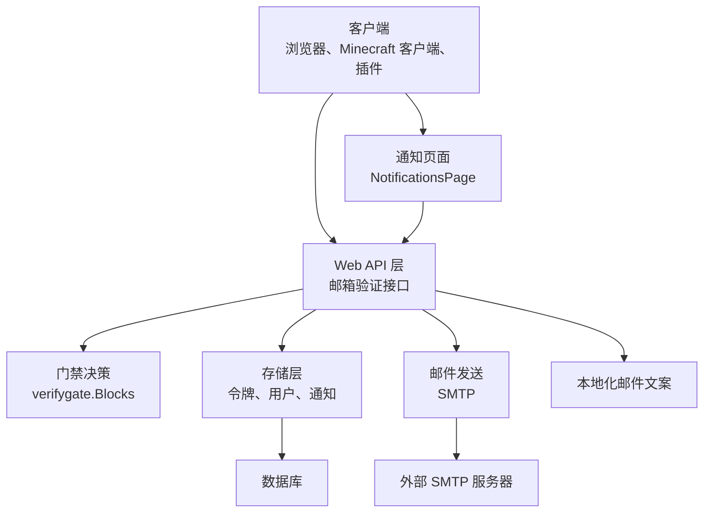
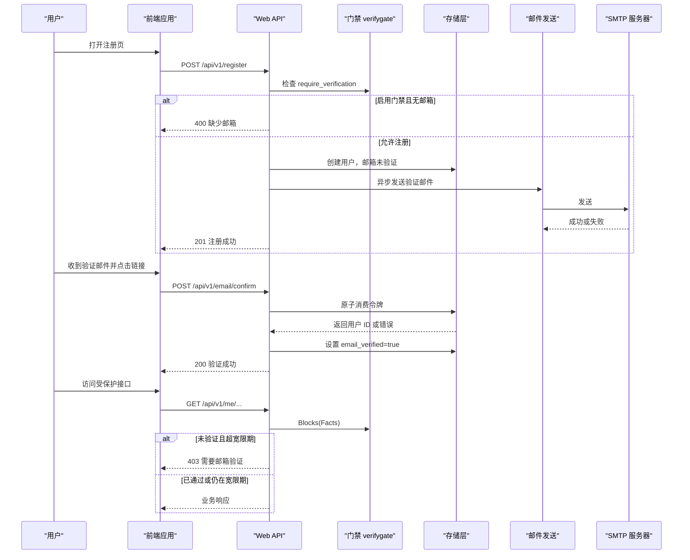
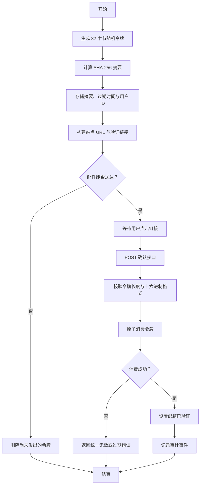
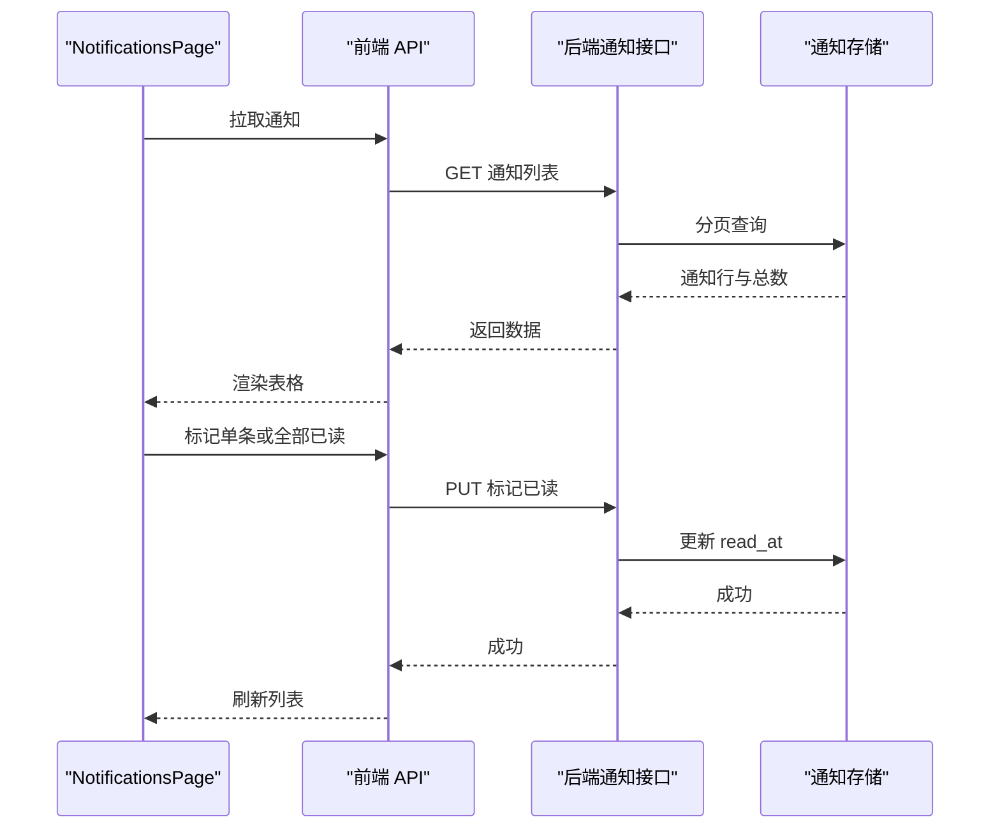
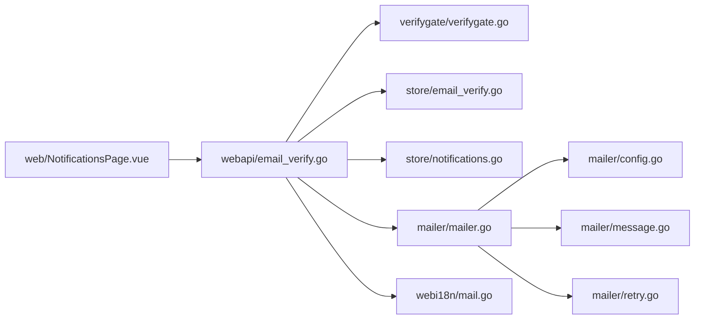

# 邮箱验证门禁与通知

**本文引用的文件**
- [verifygate.go](https://github.com/YimingZhanshen/skin-nexus/blob/797ae1a/server/internal/verifygate/verifygate.go)
- [email_verify.go（存储层）](https://github.com/YimingZhanshen/skin-nexus/blob/797ae1a/server/internal/store/email_verify.go)
- [email_verify.go（Web API 层）](https://github.com/YimingZhanshen/skin-nexus/blob/797ae1a/server/internal/webapi/email_verify.go)
- [mailer.go](https://github.com/YimingZhanshen/skin-nexus/blob/797ae1a/server/internal/mailer/mailer.go)
- [config.go（邮件配置）](https://github.com/YimingZhanshen/skin-nexus/blob/797ae1a/server/internal/mailer/config.go)
- [message.go](https://github.com/YimingZhanshen/skin-nexus/blob/797ae1a/server/internal/mailer/message.go)
- [retry.go](https://github.com/YimingZhanshen/skin-nexus/blob/797ae1a/server/internal/mailer/retry.go)
- [address.go](https://github.com/YimingZhanshen/skin-nexus/blob/797ae1a/server/internal/mailer/address.go)
- [notifications.go（存储层）](https://github.com/YimingZhanshen/skin-nexus/blob/797ae1a/server/internal/store/notifications.go)
- [NotificationsPage.vue](https://github.com/YimingZhanshen/skin-nexus/blob/797ae1a/web/src/pages/NotificationsPage.vue)
- [mail.go（邮件文案）](https://github.com/YimingZhanshen/skin-nexus/blob/797ae1a/server/internal/webi18n/mail.go)
- [0020_email_verify_tokens.sql](https://github.com/YimingZhanshen/skin-nexus/blob/797ae1a/server/migrations/sqlite/0020_email_verify_tokens.sql)
- [0021_notifications.sql](https://github.com/YimingZhanshen/skin-nexus/blob/797ae1a/server/migrations/sqlite/0021_notifications.sql)
- [register_email_gate_test.go](https://github.com/YimingZhanshen/skin-nexus/blob/797ae1a/server/internal/webapi/register_email_gate_test.go)
- [routes_verifygate_test.go](https://github.com/YimingZhanshen/skin-nexus/blob/797ae1a/server/internal/plugin/routes_verifygate_test.go)
- [verify_web_gate_test.go](https://github.com/YimingZhanshen/skin-nexus/blob/797ae1a/server/internal/webapi/verify_web_gate_test.go)
- [email_verify_landing_test.go](https://github.com/YimingZhanshen/skin-nexus/blob/797ae1a/server/cmd/skin-nexus/email_verify_landing_test.go)

## 目录
1. [简介](#简介)
2. [项目结构与职责划分](#项目结构与职责划分)
3. [核心组件总览](#核心组件总览)
4. [架构总览](#架构总览)
5. [详细组件分析](#详细组件分析)
6. [依赖关系分析](#依赖关系分析)
7. [性能与可靠性特性](#性能与可靠性特性)
8. [典型请求与响应示例](#典型请求与响应示例)
9. [常见问题排查](#常见问题排查)
10. [安全建议](#安全建议)
11. [结论](#结论)

## 简介
本系统实现了“邮箱验证门禁”和“站内通知”两条主线：

- **邮箱验证门禁**：通过 `verifygate` 统一判定是否要求用户完成邮箱验证；Web API、插件路由以及 Minecraft 登录门都使用同一份判定逻辑。未验证用户在宽限期内可能仍可使用，宽限期过后访问自身受保护接口会被拒绝。
- **邮箱验证令牌流程**：注册或主动重发时生成随机令牌，仅存储哈希值，设置短期过期时间，点击链接后原子消费并写入 `email_verified`。
- **邮件发送**：由 `mailer` 包基于标准库 SMTP 发送纯文本或多部分 HTML 邮件，支持 STARTTLS、隐式 TLS、单次重试和预算化超时。
- **通知系统**：记录与账户内容相关的状态事件，前端 `NotificationsPage` 分页展示并可标记已读。

该文档从代码结构、数据流、处理逻辑、集成点、错误处理、性能和安全六个维度展开，并提供时序图、流程图和故障排查建议。

## 项目结构与职责划分
邮箱验证相关代码分布在以下层次：

| 层次 | 主要文件 | 职责 |
|---|---|---|
| 门禁决策 | [verifygate.go](https://github.com/YimingZhanshen/skin-nexus/blob/797ae1a/server/internal/verifygate/verifygate.go) | 定义 `Facts` 与 `Blocks`，是 Web、插件、服务端统一的邮箱验证判断入口 |
| Web API | [email_verify.go（Web API 层）](https://github.com/YimingZhanshen/skin-nexus/blob/797ae1a/server/internal/webapi/email_verify.go) | 暴露重发验证邮件、确认链接等接口，组合门面、限制器、存储和邮件服务 |
| 存储层 | [email_verify.go（存储层）](https://github.com/YimingZhanshen/skin-nexus/blob/797ae1a/server/internal/store/email_verify.go)、[notifications.go（存储层）](https://github.com/YimingZhanshen/skin-nexus/blob/797ae1a/server/internal/store/notifications.go) | 管理令牌哈希、过期、已用状态及通知行 |
| 邮件子系统 | [mailer.go](https://github.com/YimingZhanshen/skin-nexus/blob/797ae1a/server/internal/mailer/mailer.go)、[config.go（邮件配置）](https://github.com/YimingZhanshen/skin-nexus/blob/797ae1a/server/internal/mailer/config.go)、[message.go](https://github.com/YimingZhanshen/skin-nexus/blob/797ae1a/server/internal/mailer/message.go)、[retry.go](https://github.com/YimingZhanshen/skin-nexus/blob/797ae1a/server/internal/mailer/retry.go)、[address.go](https://github.com/YimingZhanshen/skin-nexus/blob/797ae1a/server/internal/mailer/address.go) | SMTP 连接、消息组装、地址校验、重试策略 |
| 前端 | [NotificationsPage.vue](https://github.com/YimingZhanshen/skin-nexus/blob/797ae1a/web/src/pages/NotificationsPage.vue) | 拉取通知列表、过滤未读、单条或全部标记已读 |
| 迁移脚本 | [0020_email_verify_tokens.sql](https://github.com/YimingZhanshen/skin-nexus/blob/797ae1a/server/migrations/sqlite/0020_email_verify_tokens.sql)、[0021_notifications.sql](https://github.com/YimingZhanshen/skin-nexus/blob/797ae1a/server/migrations/sqlite/0021_notifications.sql) | 创建令牌表与通知表 |



**图表来源**
- [verifygate.go:1-48](https://github.com/YimingZhanshen/skin-nexus/blob/797ae1a/server/internal/verifygate/verifygate.go#L1-L48)
- [email_verify.go（Web API 层）:1-204](https://github.com/YimingZhanshen/skin-nexus/blob/797ae1a/server/internal/webapi/email_verify.go#L1-L204)
- [email_verify.go（存储层）:1-79](https://github.com/YimingZhanshen/skin-nexus/blob/797ae1a/server/internal/store/email_verify.go#L1-L79)
- [mailer.go:1-214](https://github.com/YimingZhanshen/skin-nexus/blob/797ae1a/server/internal/mailer/mailer.go#L1-L214)
- [NotificationsPage.vue:1-113](https://github.com/YimingZhanshen/skin-nexus/blob/797ae1a/web/src/pages/NotificationsPage.vue#L1-L113)

**章节来源**
- [verifygate.go:1-48](https://github.com/YimingZhanshen/skin-nexus/blob/797ae1a/server/internal/verifygate/verifygate.go#L1-L48)
- [email_verify.go（Web API 层）:1-204](https://github.com/YimingZhanshen/skin-nexus/blob/797ae1a/server/internal/webapi/email_verify.go#L1-L204)
- [email_verify.go（存储层）:1-79](https://github.com/YimingZhanshen/skin-nexus/blob/797ae1a/server/internal/store/email_verify.go#L1-L79)
- [mailer.go:1-214](https://github.com/YimingZhanshen/skin-nexus/blob/797ae1a/server/internal/mailer/mailer.go#L1-L214)
- [NotificationsPage.vue:1-113](https://github.com/YimingZhanshen/skin-nexus/blob/797ae1a/web/src/pages/NotificationsPage.vue#L1-L113)

## 核心组件总览

### 门禁决策：`verifygate`
`verifygate` 不直接读取数据库或请求上下文，而是接收一组“事实”：

| 字段 | 含义 | 默认行为 |
|---|---|---|
| `Enabled` | 是否启用 `require_verification` | 为假时不拦截 |
| `Verified` | 用户是否已验证邮箱 | 为真时放行 |
| `CreatedAt` | 用户注册时间 | 零值表示没有宽限期 |
| `Grace` | 宽限期时长 | 零或负数表示立即强制 |
| `Now` | 当前时间 | 零值回退到墙钟 |

判定规则如下：

1. 若功能未启用或用户已验证，则不拦截。
2. 若存在有效宽限期且用户注册时间在宽限期内，则不拦截。
3. 否则拦截。

这意味着：**启用门禁 + 未验证 + 超出宽限期 = 被拒绝**。

**章节来源**
- [verifygate.go:1-48](https://github.com/YimingZhanshen/skin-nexus/blob/797ae1a/server/internal/verifygate/verifygate.go#L1-L48)

### Web API 邮箱验证
Web API 提供两个关键能力：

- **重发验证邮件**：向已登录用户的自有邮箱发送新链接，不做跨用户猜测。
- **确认链接**：消费令牌并设置邮箱已验证，对外统一返回模糊错误信息，避免泄露令牌状态。

**章节来源**
- [email_verify.go（Web API 层）:1-204](https://github.com/YimingZhanshen/skin-nexus/blob/797ae1a/server/internal/webapi/email_verify.go#L1-L204)

### 存储层令牌
令牌表与密码重置令牌共享威胁模型：

- 只存哈希，不存明文。
- 每个用户最多一个未使用的活跃令牌。
- 按过期时间和已使用时间清理。
- 消费操作是原子的：未知、过期、已用均返回相同语义的错误，避免成为状态探针。

**章节来源**
- [email_verify.go（存储层）:1-79](https://github.com/YimingZhanshen/skin-nexus/blob/797ae1a/server/internal/store/email_verify.go#L1-L79)
- [0020_email_verify_tokens.sql:1-14](https://github.com/YimingZhanshen/skin-nexus/blob/797ae1a/server/migrations/sqlite/0020_email_verify_tokens.sql#L1-L14)

### 邮件子系统
邮件子系统负责 SMTP 收发、地址校验、消息体构造和失败重试：

- 支持端口 465 隐式 TLS 与其他端口的 STARTTLS。
- 认证使用 PLAIN，标准库保证不在明文通道上发送凭据。
- 对可恢复的网络瞬态错误执行一次重试。
- 如果调用方有超时预算，则禁用重试以避免浏览器等待期间重复投递。
- 主题和正文来自本地化模板，HTML 兼容主流邮件客户端。

**章节来源**
- [mailer.go:1-214](https://github.com/YimingZhanshen/skin-nexus/blob/797ae1a/server/internal/mailer/mailer.go#L1-L214)
- [config.go（邮件配置）:1-43](https://github.com/YimingZhanshen/skin-nexus/blob/797ae1a/server/internal/mailer/config.go#L1-L43)
- [message.go:1-156](https://github.com/YimingZhanshen/skin-nexus/blob/797ae1a/server/internal/mailer/message.go#L1-L156)
- [retry.go:1-63](https://github.com/YimingZhanshen/skin-nexus/blob/797ae1a/server/internal/mailer/retry.go#L1-L63)
- [address.go:1-21](https://github.com/YimingZhanshen/skin-nexus/blob/797ae1a/server/internal/mailer/address.go#L1-L21)

### 通知系统
通知用于记录与用户自身内容或账户相关的事件：

- 类型集合封闭，由后端写入。
- 每行携带快照信息，即使主题对象后来被删除也能渲染。
- 写入时自动清理超过保留期的旧行。
- 前端分页展示，支持只看未读、标记单条或全部已读。

**章节来源**
- [notifications.go（存储层）:1-125](https://github.com/YimingZhanshen/skin-nexus/blob/797ae1a/server/internal/store/notifications.go#L1-L125)
- [0021_notifications.sql:1-18](https://github.com/YimingZhanshen/skin-nexus/blob/797ae1a/server/migrations/sqlite/0021_notifications.sql#L1-L18)
- [NotificationsPage.vue:1-113](https://github.com/YimingZhanshen/skin-nexus/blob/797ae1a/web/src/pages/NotificationsPage.vue#L1-L113)

## 架构总览



**图表来源**
- [email_verify.go（Web API 层）:1-204](https://github.com/YimingZhanshen/skin-nexus/blob/797ae1a/server/internal/webapi/email_verify.go#L1-L204)
- [verifygate.go:1-48](https://github.com/YimingZhanshen/skin-nexus/blob/797ae1a/server/internal/verifygate/verifygate.go#L1-L48)
- [email_verify.go（存储层）:1-79](https://github.com/YimingZhanshen/skin-nexus/blob/797ae1a/server/internal/store/email_verify.go#L1-L79)
- [mailer.go:1-214](https://github.com/YimingZhanshen/skin-nexus/blob/797ae1a/server/internal/mailer/mailer.go#L1-L214)

## 详细组件分析

### 邮箱验证令牌生命周期

令牌生命周期包含生成、存储、发送、点击、消费、撤销与清理：



**图表来源**
- [email_verify.go（Web API 层）:1-204](https://github.com/YimingZhanshen/skin-nexus/blob/797ae1a/server/internal/webapi/email_verify.go#L1-L204)
- [email_verify.go（存储层）:1-79](https://github.com/YimingZhanshen/skin-nexus/blob/797ae1a/server/internal/store/email_verify.go#L1-L79)

#### 令牌生成与存储
- 令牌长度固定为 64 个十六进制字符。
- 原始令牌只在内存中短暂出现，随后转为 SHA-256 摘要。
- 创建新令牌前，会清除该用户其他未使用的旧令牌。
- 同时清理超过一天的已完成或过期记录，防止表无限增长。
- 默认 TTL 为 1800 秒；若传入非正数则回退到默认值。
- 实际验证链接 TTL 设置为 24 小时，比密码重置更长，因为验证邮件可能长时间停留在收件箱。

#### 点击验证
- 先做轻量预检：令牌必须是 64 位十六进制字符串。
- 对确认接口进行 IP 速率限制。
- 将用户提交的令牌再次求哈希后查询存储。
- 消费失败时统一返回“链接无效或已过期”，禁止区分未知、过期、已用。
- 成功后写入 `email_verified=true` 并记录审计事件。

#### 撤销机制
- 修改邮箱时会失效该用户所有未使用令牌，防止旧邮箱收到的链接验证新邮箱。
- 如果邮件从未离开服务器，会在失败路径中删除对应令牌哈希，避免数据库泄露的链接仍有效。

**章节来源**
- [email_verify.go（Web API 层）:1-204](https://github.com/YimingZhanshen/skin-nexus/blob/797ae1a/server/internal/webapi/email_verify.go#L1-L204)
- [email_verify.go（存储层）:1-79](https://github.com/YimingZhanshen/skin-nexus/blob/797ae1a/server/internal/store/email_verify.go#L1-L79)

### 门禁如何拦截未验证用户

门禁不是只作用于某个接口，而是在多个表面统一生效：

| 表面 | 拦截方式 | 说明 |
|---|---|---|
| Web API | 在会话级路由上调用门禁 | 未验证用户访问自身身份相关接口返回 403 |
| 插件路由 | 在解析会话后、调用桥接前调用门禁 | 插件路由中的玩家身份操作同样受限 |
| Minecraft 登录 | 由服务端门面判断 | 保持与 Web 面一致的验证要求 |

门禁允许的路径包括：

- 查看自身资料。
- 获取公共内容。
- 获取站点配置。
- 重新发送验证邮件。
- 修改邮箱。
- 退出登录。
- 公开资源与 bearer 客户端。

这些例外确保用户能够自救，而不是被门禁锁死。

**章节来源**
- [verifygate.go:1-48](https://github.com/YimingZhanshen/skin-nexus/blob/797ae1a/server/internal/verifygate/verifygate.go#L1-L48)
- [verify_web_gate_test.go:1-200](https://github.com/YimingZhanshen/skin-nexus/blob/797ae1a/server/internal/webapi/verify_web_gate_test.go#L1-L200)
- [routes_verifygate_test.go:1-131](https://github.com/YimingZhanshen/skin-nexus/blob/797ae1a/server/internal/plugin/routes_verifygate_test.go#L1-L131)

### 注册流程与邮箱必填约束

当门禁启用时，注册接口必须在写用户之前检查邮箱：

- 空邮箱返回 400，并携带明确的邮箱缺失错误码。
- 无效邮箱保留原有“邮箱无效”错误码。
- 门禁关闭时，行为保持不变：允许空邮箱注册。
- 成功注册的用户邮箱未验证，但会尝试异步发送验证邮件。

测试还验证了：

- 门禁开启且无邮箱时不会创建用户。
- 门禁关闭时仍可创建用户。
- 门禁开启且有邮箱时，用户记录中包含真实邮箱且未验证。

**章节来源**
- [register_email_gate_test.go:1-170](https://github.com/YimingZhanshen/skin-nexus/blob/797ae1a/server/internal/webapi/register_email_gate_test.go#L1-L170)
- [email_verify.go（Web API 层）:1-204](https://github.com/YimingZhanshen/skin-nexus/blob/797ae1a/server/internal/webapi/email_verify.go#L1-L204)

### 邮件发送、重试与配置

#### SMTP 配置解析
邮件配置从键值存储解析，优先级为面板选项覆盖环境变量：

| 配置项 | 默认值 | 说明 |
|---|---:|---|
| `smtp_host` | 空 | 为空表示邮件功能关闭 |
| `smtp_port` | 465 | 465 表示隐式 TLS，其他端口使用 STARTTLS |
| `smtp_user` | 空 | 认证用户名，通常是完整邮箱 |
| `smtp_pass` | 空 | 认证密码或授权码 |
| `smtp_from` | 空 | 发件人地址，为空时回退到 `smtp_user` |
| `site_name` | 空 | 用于邮件主题和显示名称 |

如果 `smtp_host` 为空，或既没有 `smtp_from` 也没有 `smtp_user`，则整体视为未配置。

#### 传输与重试
- 默认拨号窗口为 10 秒，会话窗口为 30 秒。
- 对于可重试错误，最多重试一次。
- 可重试错误包括 DNS 临时错误、网络超时、连接中断、EOF、意外 EOF、4xx 状态等。
- 不可重试错误包括：DNS 找不到主机、上下文超时、DATA 提交后的失败、凭据错误、TLS 配置错误等。
- 如果调用方设置了预算时间，则跳过重试，避免浏览器等待期间重复投递。

#### 地址防护
- 收件人地址不能包含换行符。
- 发件人信封地址会从 `Name <a@b.c>` 中提取裸邮箱。
- 占位邮箱如 `localhost` 或没有点号的域名会被识别为无法收信地址。

**章节来源**
- [config.go（邮件配置）:1-43](https://github.com/YimingZhanshen/skin-nexus/blob/797ae1a/server/internal/mailer/config.go#L1-L43)
- [mailer.go:1-214](https://github.com/YimingZhanshen/skin-nexus/blob/797ae1a/server/internal/mailer/mailer.go#L1-L214)
- [retry.go:1-63](https://github.com/YimingZhanshen/skin-nexus/blob/797ae1a/server/internal/mailer/retry.go#L1-L63)
- [address.go:1-21](https://github.com/YimingZhanshen/skin-nexus/blob/797ae1a/server/internal/mailer/address.go#L1-L21)

### 通知系统与前端展示

#### 后端通知
通知表保存：

- 用户 ID。
- 事件类型。
- 主题纹理 ID。
- 主题快照文本。
- 已读时间。
- 创建时间。

写入时自动删除 90 天前的旧通知。查询支持分页、只看未读、统计总数和标记已读。

#### 前端展示
`NotificationsPage` 的主要逻辑：

- 挂载时拉取通知列表。
- 支持翻页、只显示未读。
- 点击“标记已读”调用后端接口并刷新列表。
- 点击“全部标记已读”清空未读数。
- 文本从本地化字典根据 `kind` 渲染。
- 如果主题已被删除，`ref` 为空，仍能用通用文案展示通知。



**图表来源**
- [NotificationsPage.vue:1-113](https://github.com/YimingZhanshen/skin-nexus/blob/797ae1a/web/src/pages/NotificationsPage.vue#L1-L113)
- [notifications.go（存储层）:1-125](https://github.com/YimingZhanshen/skin-nexus/blob/797ae1a/server/internal/store/notifications.go#L1-L125)

**章节来源**
- [notifications.go（存储层）:1-125](https://github.com/YimingZhanshen/skin-nexus/blob/797ae1a/server/internal/store/notifications.go#L1-L125)
- [NotificationsPage.vue:1-113](https://github.com/YimingZhanshen/skin-nexus/blob/797ae1a/web/src/pages/NotificationsPage.vue#L1-L113)

## 依赖关系分析



**图表来源**
- [email_verify.go（Web API 层）:1-204](https://github.com/YimingZhanshen/skin-nexus/blob/797ae1a/server/internal/webapi/email_verify.go#L1-L204)
- [verifygate.go:1-48](https://github.com/YimingZhanshen/skin-nexus/blob/797ae1a/server/internal/verifygate/verifygate.go#L1-L48)
- [email_verify.go（存储层）:1-79](https://github.com/YimingZhanshen/skin-nexus/blob/797ae1a/server/internal/store/email_verify.go#L1-L79)
- [notifications.go（存储层）:1-125](https://github.com/YimingZhanshen/skin-nexus/blob/797ae1a/server/internal/store/notifications.go#L1-L125)
- [mailer.go:1-214](https://github.com/YimingZhanshen/skin-nexus/blob/797ae1a/server/internal/mailer/mailer.go#L1-L214)
- [config.go（邮件配置）:1-43](https://github.com/YimingZhanshen/skin-nexus/blob/797ae1a/server/internal/mailer/config.go#L1-L43)
- [message.go:1-156](https://github.com/YimingZhanshen/skin-nexus/blob/797ae1a/server/internal/mailer/message.go#L1-L156)
- [retry.go:1-63](https://github.com/YimingZhanshen/skin-nexus/blob/797ae1a/server/internal/mailer/retry.go#L1-L63)
- [mail.go（邮件文案）:1-200](https://github.com/YimingZhanshen/skin-nexus/blob/797ae1a/server/internal/webi18n/mail.go#L1-L200)
- [NotificationsPage.vue:1-113](https://github.com/YimingZhanshen/skin-nexus/blob/797ae1a/web/src/pages/NotificationsPage.vue#L1-L113)

耦合要点：

- Web API 依赖门禁、存储、邮件和本地化文案。
- 门禁本身无外部依赖，只接受事实，便于多端一致。
- 邮件模块内部解耦配置、消息体、重试策略。
- 前端只依赖通知 API，不关心具体事件类型实现细节。

## 性能与可靠性特性

| 方面 | 设计 | 影响 |
|---|---|---|
| 令牌生成 | 使用加密随机源生成 32 字节 | 提高猜测难度 |
| 令牌存储 | 仅存 SHA-256 哈希 | 数据库泄露时不直接暴露链接 |
| 令牌有效期 | 默认 1800 秒，链接 TTL 24 小时 | 平衡用户体验与安全 |
| 令牌消费 | 原子更新 + 行数判断 | 防止并发重复消费 |
| 邮件发送 | 预算化超时 + 单次重试 | 减少阻塞和重复投递 |
| 通知写入 | 写入时清理 90 天前数据 | 控制表大小 |
| 通知查询 | 分页 + 未读索引 | 避免全表扫描 |
| 门禁判断 | 纯函数 + 注入时间 | 易于测试且无时钟漂移 |

[本节为一般性性能讨论，不直接分析具体代码片段]

## 典型请求与响应示例

以下示例描述协议形态，不包含敏感字段或机密值。

### 重新发送验证邮件
- 方法：`POST`
- 路径：`/api/v1/email/verify`
- 认证：需要会话 Cookie
- 请求体：空对象或空体
- 成功响应：200
- 失败场景：
  - 401：未登录
  - 429：频率过高
  - 503：未配置邮件
  - 400：账户没有邮箱
  - 409：邮箱已验证
  - 502：发送邮件失败

示例请求体：

```json
{}
```

示例成功响应：

```json
{
  "ok": true
}
```

### 确认邮箱验证
- 方法：`POST`
- 路径：`/api/v1/email/confirm`
- 认证：不需要会话，链接即凭证
- 请求体：包含令牌
- 成功响应：200
- 失败场景：
  - 400：令牌无效、过期或已用
  - 429：频率过高
  - 500：内部错误

示例请求体：

```json
{
  "token": "abcdef0123456789abcdef0123456789abcdef0123456789abcdef0123456789"
}
```

示例成功响应：

```json
{
  "ok": true
}
```

### 访问受保护接口
- 方法：例如 `GET`
- 路径：`/api/v1/me/notifications`
- 认证：需要会话 Cookie
- 成功响应：200，返回通知列表
- 门禁拒绝响应：403，携带邮箱验证必需错误码

示例门禁拒绝响应：

```json
{
  "error": "auth.email_verify_required",
  "code": "auth.email_verify_required",
  "message": "需要邮箱验证"
}
```

### 通知列表
- 方法：`GET`
- 路径：由前端 `api.notifications(page, perPage, onlyUnread)` 调用
- 成功响应：包含通知数组与总数

示例响应结构：

```json
{
  "notifications": [
    {
      "id": 1,
      "kind": "report.resolved",
      "tid": 412,
      "ref": "示例纹理标题",
      "read": false,
      "createdAt": "2026-11-12T08:00:00Z"
    }
  ],
  "total": 1
}
```

### 标记通知已读
- 方法：`PUT`
- 路径：由前端 `api.markNotificationsRead` 调用
- 请求体可以是单条 ID 或全部标记

示例请求体（标记单条）：

```json
{
  "id": 1
}
```

示例请求体（全部标记）：

```json
{
  "all": true
}
```

[本节示例基于接口行为推断，字段名与结构来源于测试与前端调用约定]

## 常见问题排查

### SMTP 连接失败
**现象**：重发验证邮件返回 502 或日志中出现 SMTP 错误。
**排查步骤**：

1. 检查 `smtp_host` 是否为空。
2. 检查端口：465 使用隐式 TLS，其他端口使用 STARTTLS。
3. 检查 `smtp_user` 与 `smtp_pass` 是否正确。
4. 检查 `smtp_from` 是否缺失；若缺失，需设置发件人或至少设置 `smtp_user`。
5. 观察错误是否属于可重试类别：DNS 临时错误、超时、连接断开、4xx 状态可重试。
6. 若为 DNS 找不到主机或凭据错误，属于不可重试，应修正配置而非反复重试。

**相关实现**
- [mailer.go:1-214](https://github.com/YimingZhanshen/skin-nexus/blob/797ae1a/server/internal/mailer/mailer.go#L1-L214)
- [retry.go:1-63](https://github.com/YimingZhanshen/skin-nexus/blob/797ae1a/server/internal/mailer/retry.go#L1-L63)
- [config.go（邮件配置）:1-43](https://github.com/YimingZhanshen/skin-nexus/blob/797ae1a/server/internal/mailer/config.go#L1-L43)

### 验证码链接 404
**现象**：点击邮件中的链接后页面不存在或接口报错。
**排查步骤**：

1. 确认站点基础 URL 正确拼接 `/email-verify?token=...`。
2. 确认前端路由是否包含邮箱验证落地页。
3. 确认落地页是否在加载时消费令牌；测试明确要求落地页只准备显示，按钮点击才发起确认。
4. 确认邮件网关或内置浏览器没有预取链接导致令牌被提前消耗。

**相关实现**
- [email_verify.go（Web API 层）:1-204](https://github.com/YimingZhanshen/skin-nexus/blob/797ae1a/server/internal/webapi/email_verify.go#L1-L204)
- [email_verify_landing_test.go:1-135](https://github.com/YimingZhanshen/skin-nexus/blob/797ae1a/server/cmd/skin-nexus/email_verify_landing_test.go#L1-L135)

### 验证码过期
**现象**：提示链接无效或已过期。
**原因**：

- 令牌默认 TTL 较短，虽然链接 TTL 为 24 小时，但仍可能被长时间放置的邮件忽略。
- 令牌只能使用一次。
- 修改邮箱会失效旧令牌。
- 邮件发送失败时，服务器会删除未发出的令牌。

**处理建议**：

- 让用户重新点击“重新发送验证邮件”。
- 检查是否已经点击过链接。
- 检查是否修改过邮箱。
- 检查邮件是否真的送达。

**相关实现**
- [email_verify.go（存储层）:1-79](https://github.com/YimingZhanshen/skin-nexus/blob/797ae1a/server/internal/store/email_verify.go#L1-L79)
- [email_verify.go（Web API 层）:1-204](https://github.com/YimingZhanshen/skin-nexus/blob/797ae1a/server/internal/webapi/email_verify.go#L1-L204)

### 重复点击验证
**现象**：第二次点击返回无效链接。
**原因**：令牌是单用的，第一次成功消费后不再有效。
**处理建议**：

- 前端应在点击后立即进入“处理中”或“已完成”状态，阻止重复提交。
- 落地页测试要求按钮点击后才调用确认接口，并在 working/done 状态下忽略重复点击。

**相关实现**
- [email_verify.go（存储层）:1-79](https://github.com/YimingZhanshen/skin-nexus/blob/797ae1a/server/internal/store/email_verify.go#L1-L79)
- [email_verify_landing_test.go:1-135](https://github.com/YimingZhanshen/skin-nexus/blob/797ae1a/server/cmd/skin-nexus/email_verify_landing_test.go#L1-L135)

### 通知未更新
**现象**：后台写入通知后，前端没有看到新条目。
**排查步骤**：

1. 确认通知确实写入成功。
2. 确认前端是否调用了拉取接口。
3. 确认是否开启了“只看未读”过滤。
4. 确认是否已经手动标记为已读。
5. 确认通知类型是否存在对应的本地化文案，否则前端渲染可能异常。

**相关实现**
- [notifications.go（存储层）:1-125](https://github.com/YimingZhanshen/skin-nexus/blob/797ae1a/server/internal/store/notifications.go#L1-L125)
- [NotificationsPage.vue:1-113](https://github.com/YimingZhanshen/skin-nexus/blob/797ae1a/web/src/pages/NotificationsPage.vue#L1-L113)

## 安全建议

### 验证码随机性
- 使用加密安全的随机源生成 32 字节令牌。
- 令牌以十六进制编码后作为链接参数。
- 数据库中只存储 SHA-256 哈希。

**依据**
- [email_verify.go（Web API 层）:1-204](https://github.com/YimingZhanshen/skin-nexus/blob/797ae1a/server/internal/webapi/email_verify.go#L1-L204)
- [email_verify.go（存储层）:1-79](https://github.com/YimingZhanshen/skin-nexus/blob/797ae1a/server/internal/store/email_verify.go#L1-L79)

### 短期有效
- 令牌具有过期时间。
- 未使用的令牌会被后续创建操作或邮箱变更失效。
- 已完成的令牌也会被定期清理。

**依据**
- [email_verify.go（存储层）:1-79](https://github.com/YimingZhanshen/skin-nexus/blob/797ae1a/server/internal/store/email_verify.go#L1-L79)

### HTTPS 传输
- 验证链接是Bearer 型凭证，不应在明文 HTTP 中传播。
- 站点应部署反向代理或 TLS 终止，确保邮件链接使用 HTTPS。
- 邮件主题和正文中的链接应由站点基础 URL 生成。

**依据**
- [email_verify.go（Web API 层）:1-204](https://github.com/YimingZhanshen/skin-nexus/blob/797ae1a/server/internal/webapi/email_verify.go#L1-L204)

### 防止暴力猜测
- 令牌长度为 64 位十六进制字符，空间足够大。
- 确认接口对 IP 做速率限制。
- 失败响应统一，不泄露“未知”“过期”“已用”的区别。
- 不要仅依赖长度，仍需结合速率限制和审计。

**依据**
- [email_verify.go（Web API 层）:1-204](https://github.com/YimingZhanshen/skin-nexus/blob/797ae1a/server/internal/webapi/email_verify.go#L1-L204)
- [email_verify.go（存储层）:1-79](https://github.com/YimingZhanshen/skin-nexus/blob/797ae1a/server/internal/store/email_verify.go#L1-L79)

### 邮件内容脱敏
- 日志中对邮箱地址进行脱敏处理。
- 审计记录中的收件人字段也应脱敏。
- 邮件模板不应包含额外敏感信息。
- 发件人和收件人地址在进入 SMTP 前进行头部注入防护。

**依据**
- [email_verify.go（Web API 层）:1-204](https://github.com/YimingZhanshen/skin-nexus/blob/797ae1a/server/internal/webapi/email_verify.go#L1-L204)
- [mailer.go:1-214](https://github.com/YimingZhanshen/skin-nexus/blob/797ae1a/server/internal/mailer/mailer.go#L1-L214)

## 结论
邮箱验证门禁与通知是一个端到端的安全闭环：

- `verifygate` 提供单一、可测试、可注入时间的判定逻辑，避免 Web 面与服务端门出现分歧。
- 注册流程在门禁启用时强制邮箱，确保后续验证链路有真实收件人。
- 令牌采用随机生成、短效、单用、仅存哈希的设计，降低数据库泄露风险。
- 邮件子系统以标准库为基础，兼顾 STARTTLS、隐式 TLS、预算化超时和可控重试。
- 通知系统以封闭类型和快照文本保证长期可读性，前端分页展示并提供明确交互。
- 测试覆盖了门禁作用域、注册邮箱约束、落地页行为、令牌消费和通知渲染等关键点。

部署时应优先关注 SMTP 配置、HTTPS 传输、速率限制和日志脱敏；运维时应关注令牌过期、重复点击、邮件送达率和通知缓存刷新。
