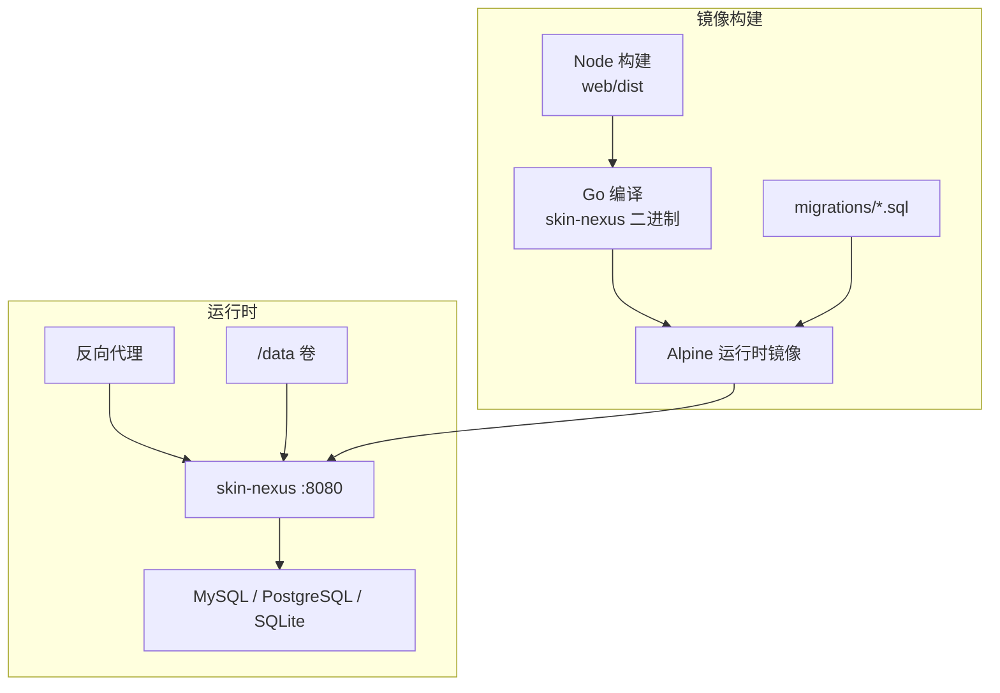
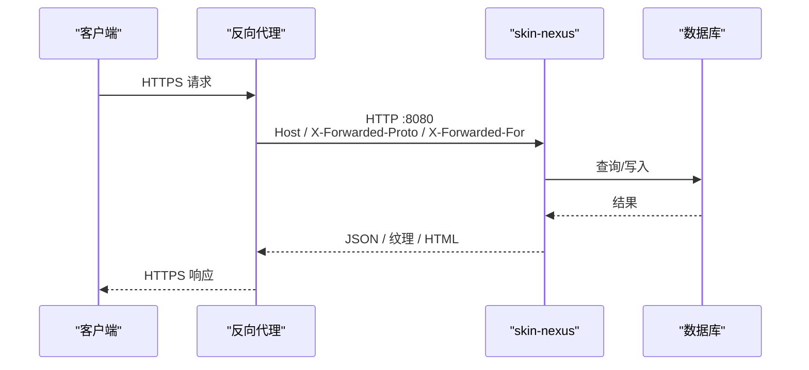
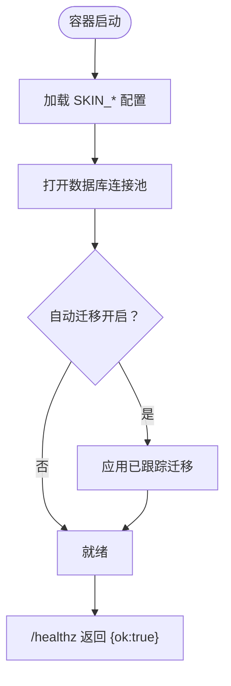
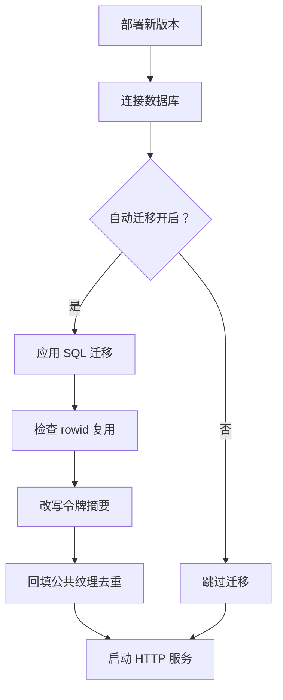
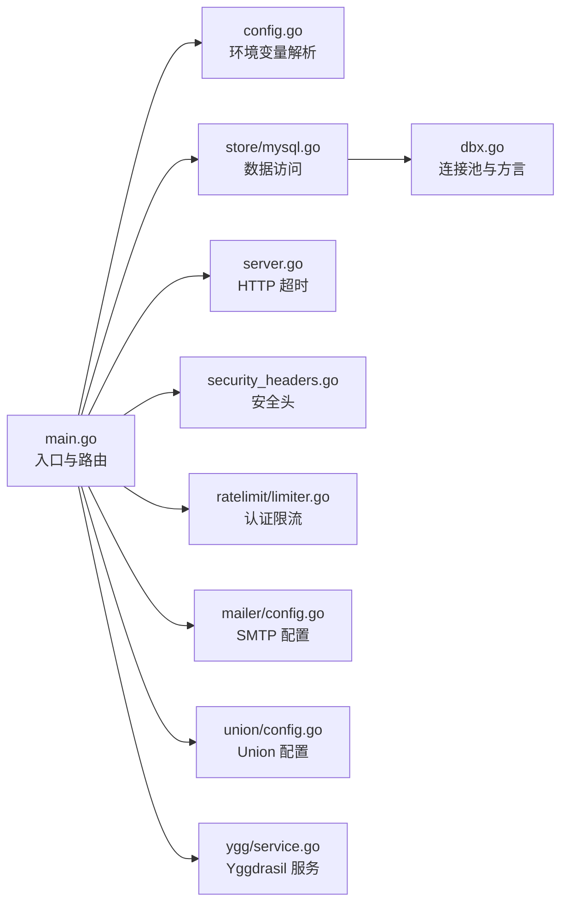

# 部署与运维

**本文引用的文件**
- [Dockerfile](https://github.com/YimingZhanshen/skin-nexus/blob/797ae1a/Dockerfile)
- [docker-compose.yml](https://github.com/YimingZhanshen/skin-nexus/blob/797ae1a/docker-compose.yml)
- [docker-compose.quickstart.yml](https://github.com/YimingZhanshen/skin-nexus/blob/797ae1a/docker-compose.quickstart.yml)
- [server/cmd/skin-nexus/main.go](https://github.com/YimingZhanshen/skin-nexus/blob/797ae1a/server/cmd/skin-nexus/main.go)
- [server/cmd/skin-nexus/server.go](https://github.com/YimingZhanshen/skin-nexus/blob/797ae1a/server/cmd/skin-nexus/server.go)
- [server/cmd/skin-nexus/security_headers.go](https://github.com/YimingZhanshen/skin-nexus/blob/797ae1a/server/cmd/skin-nexus/security_headers.go)
- [server/internal/config/env.go](https://github.com/YimingZhanshen/skin-nexus/blob/797ae1a/server/internal/config/env.go)
- [server/internal/config/config.go](https://github.com/YimingZhanshen/skin-nexus/blob/797ae1a/server/internal/config/config.go)
- [server/internal/dbx/dbx.go](https://github.com/YimingZhanshen/skin-nexus/blob/797ae1a/server/internal/dbx/dbx.go)
- [server/internal/store/mysql.go](https://github.com/YimingZhanshen/skin-nexus/blob/797ae1a/server/internal/store/mysql.go)
- [server/internal/mailer/config.go](https://github.com/YimingZhanshen/skin-nexus/blob/797ae1a/server/internal/mailer/config.go)
- [server/internal/ratelimit/limiter.go](https://github.com/YimingZhanshen/skin-nexus/blob/797ae1a/server/internal/ratelimit/limiter.go)
- [server/internal/union/config.go](https://github.com/YimingZhanshen/skin-nexus/blob/797ae1a/server/internal/union/config.go)
- [server/internal/ygg/service.go](https://github.com/YimingZhanshen/skin-nexus/blob/797ae1a/server/internal/ygg/service.go)

## 目录
1. [简介](#简介)
2. [项目结构](#项目结构)
3. [核心组件](#核心组件)
4. [架构总览](#架构总览)
5. [详细组件分析](#详细组件分析)
6. [依赖关系分析](#依赖关系分析)
7. [性能与容量规划](#性能与容量规划)
8. [故障排查指南](#故障排查指南)
9. [结论](#结论)

## 简介
SkinNexus 是一个以 Go 编写的皮肤托管服务，提供 Yggdrasil 兼容接口、纹理上传与分发、用户与会话管理、插件市场、主题市场以及 Union 联邦能力。生产部署通常由反向代理（Nginx/Caddy/Traefik）在前端终止 HTTPS，后端容器暴露 `:8080`，并通过命名卷持久化纹理、密钥和主题；数据库可使用 MySQL、PostgreSQL 或 SQLite。

## 项目结构
镜像构建采用三阶段流水线：前端静态资源通过 Node 构建，Go 服务端二进制通过 Alpine + golang 编译，最终运行镜像只包含可执行文件、嵌入的前端产物和内置迁移脚本。运行时默认挂载 `/data`，健康检查轮询 `/healthz`。

**图示来源**
- [Dockerfile:1-68](https://github.com/YimingZhanshen/skin-nexus/blob/797ae1a/Dockerfile#L1-L68)
- [server/cmd/skin-nexus/main.go:960-960](https://github.com/YimingZhanshen/skin-nexus/blob/797ae1a/server/cmd/skin-nexus/main.go#L960-L960)

**章节来源**
- [Dockerfile:1-68](https://github.com/YimingZhanshen/skin-nexus/blob/797ae1a/Dockerfile#L1-L68)
- [docker-compose.yml:1-86](https://github.com/YimingZhanshen/skin-nexus/blob/797ae1a/docker-compose.yml#L1-L86)
- [docker-compose.quickstart.yml:1-71](https://github.com/YimingZhanshen/skin-nexus/blob/797ae1a/docker-compose.quickstart.yml#L1-L71)

## 核心组件
- **HTTP 服务器**：设置读取头、请求、写入和空闲超时，限制最大请求头大小，防止慢客户端耗尽连接。
- **配置加载器**：从 `SKIN_*` 环境变量解析全部运行时参数，并在缺少数据库连接串时直接报错启动失败。
- **数据库抽象层**：统一连接池、占位符重写、引擎探测和 Ping 健康检查；支持 MySQL、PostgreSQL、SQLite。
- **存储层**：基于 `dbx` 实现用户、玩家、会话、纹理、插件状态等数据访问。
- **限流器**：内存中按 IP 滑动窗口和按标识符连续失败锁定，保护认证链路。
- **邮件模块**：SMTP 配置为空主机即关闭，From 和用户名为空时视为未配置并返回服务不可用。
- **Union 模块**：可选联邦成员模块，启用前需校验 API Root、签名密钥和查询邮箱模式。
- **安全响应头**：默认 CSP、X-Content-Type-Options、Referrer-Policy、Permissions-Policy、HSTS（仅 TLS）。

**章节来源**
- [server/cmd/skin-nexus/server.go:1-24](https://github.com/YimingZhanshen/skin-nexus/blob/797ae1a/server/cmd/skin-nexus/server.go#L1-L24)
- [server/internal/config/config.go:1-200](https://github.com/YimingZhanshen/skin-nexus/blob/797ae1a/server/internal/config/config.go#L1-L200)
- [server/internal/dbx/dbx.go:1-200](https://github.com/YimingZhanshen/skin-nexus/blob/797ae1a/server/internal/dbx/dbx.go#L1-L200)
- [server/internal/ratelimit/limiter.go:1-187](https://github.com/YimingZhanshen/skin-nexus/blob/797ae1a/server/internal/ratelimit/limiter.go#L1-L187)
- [server/internal/mailer/config.go:1-43](https://github.com/YimingZhanshen/skin-nexus/blob/797ae1a/server/internal/mailer/config.go#L1-L43)
- [server/internal/union/config.go:1-200](https://github.com/YimingZhanshen/skin-nexus/blob/797ae1a/server/internal/union/config.go#L1-L200)
- [server/cmd/skin-nexus/security_headers.go:1-168](https://github.com/YimingZhanshen/skin-nexus/blob/797ae1a/server/cmd/skin-nexus/security_headers.go#L1-L168)

## 架构总览
下图展示典型生产拓扑：外部流量经反向代理终止 HTTPS，代理转发 Host、Scheme、真实客户端 IP；应用侧通过 X-Forwarded-Proto 判断是否处于 HTTPS 上下文，从而决定是否发送 HSTS 和 Secure Cookie。

**图示来源**
- [server/cmd/skin-nexus/security_headers.go:110-168](https://github.com/YimingZhanshen/skin-nexus/blob/797ae1a/server/cmd/skin-nexus/security_headers.go#L110-L168)
- [server/internal/config/config.go:36-44](https://github.com/YimingZhanshen/skin-nexus/blob/797ae1a/server/internal/config/config.go#L36-L44)
- [server/cmd/skin-nexus/main.go:1067-1073](https://github.com/YimingZhanshen/skin-nexus/blob/797ae1a/server/cmd/skin-nexus/main.go#L1067-L1073)

## 详细组件分析

### Docker 镜像结构与容器网络
- **镜像阶段**：web 阶段构建前端静态文件；server 阶段编译 Go 二进制；runtime 阶段仅复制二进制、前端 dist 和 migrations。
- **端口**：默认监听 `:8080`，建议绑定回环地址后由反向代理暴露。
- **健康检查**：容器级健康检查调用 `/healthz`，该处理器执行一次数据库健康检测并返回 JSON。
- **卷**：`/data` 是数据根目录，包含纹理、签名密钥、OIDC 密钥、Union 密钥、主题和插件状态。
- **自动迁移**：`SKIN_AUTO_MIGRATE=true` 时每次启动会应用迁移目录中的 SQL 变更。

**图示来源**
- [Dockerfile:34-68](https://github.com/YimingZhanshen/skin-nexus/blob/797ae1a/Dockerfile#L34-L68)
- [server/cmd/skin-nexus/main.go:960-960](https://github.com/YimingZhanshen/skin-nexus/blob/797ae1a/server/cmd/skin-nexus/main.go#L960-L960)
- [server/cmd/skin-nexus/main.go:1330-1339](https://github.com/YimingZhanshen/skin-nexus/blob/797ae1a/server/cmd/skin-nexus/main.go#L1330-L1339)

**章节来源**
- [Dockerfile:1-68](https://github.com/YimingZhanshen/skin-nexus/blob/797ae1a/Dockerfile#L1-L68)
- [docker-compose.yml:13-86](https://github.com/YimingZhanshen/skin-nexus/blob/797ae1a/docker-compose.yml#L13-L86)
- [docker-compose.quickstart.yml:10-71](https://github.com/YimingZhanshen/skin-nexus/blob/797ae1a/docker-compose.quickstart.yml#L10-L71)

### 数据库对比：MySQL、PostgreSQL、SQLite

| 维度 | MySQL | PostgreSQL | SQLite |
|---|---|---|---|
| 部署复杂度 | 需要独立 MySQL 实例或托管服务；compose 示例默认内嵌 `mysql:8.0` | 使用 PGX stdlib 驱动，DSN 走标准 URL 格式；无需额外方言包 | 使用 modernc/sqlite，单文件数据库，适合单机演示或极小规模 |
| 连接与线程模型 | 每个连接对应数据库线程；高并发下需合理设置连接池上限 | 进程内多协程共享连接池，适合 Go 的并发模型 | 单文件锁写；并发写容易阻塞，不适合高写负载 |
| 性能特征 | 成熟生态，读写吞吐高，适合中等到大规模站点 | 事务与一致性较强，复杂查询表现稳定 | 读快写弱，大量纹理上传或频繁会话写入会成为瓶颈 |
| 适用场景 | 生产主力推荐，尤其已有现成 MySQL 集群 | 需要强一致、复杂查询或多租户隔离的生产环境 | 本地开发、演示、极低流量站点或一次性导入工具 |
| 注意事项 | compose 示例要求 `parseTime=true&charset=utf8mb4`；外网直连建议使用专用账户 | DSN scheme 会被 dbx 自动识别；时间处理由 Go UTC 值保证 | 备份需拷贝数据库文件并确保写入一致；不建议多进程同时写同一文件 |

**章节来源**
- [server/internal/dbx/dbx.go:1-120](https://github.com/YimingZhanshen/skin-nexus/blob/797ae1a/server/internal/dbx/dbx.go#L1-L120)
- [server/internal/store/mysql.go:41-74](https://github.com/YimingZhanshen/skin-nexus/blob/797ae1a/server/internal/store/mysql.go#L41-L74)
- [docker-compose.yml:60-86](https://github.com/YimingZhanshen/skin-nexus/blob/797ae1a/docker-compose.yml#L60-L86)

### 环境变量参考：`SKIN_*`
以下清单按必需性分组。变量名来自已知环境变量列表，实际行为以配置加载器和各模块初始化为准。

#### 必需变量
- `SKIN_DATABASE_DSN`：数据库连接串。必填，缺失时配置加载直接报错。
- `SKIN_LISTEN`：服务监听地址，默认 `:8080`。
- `SKIN_BASE_URL`：站点公开基础地址，用于纹理 URL、OIDC issuer 快照和安全头。
- `SKIN_DATA_DIR`：数据根目录，默认 `./data`。
- `SKIN_ADMIN_TOKEN`：管理面板和 API 机器身份备用凭证。
- `SKIN_SETUP_TOKEN`：安装向导令牌；留空会在启动日志生成随机值。

#### 数据与路径
- `SKIN_TEXTURES_DIR`：纹理目录；默认在数据根下的 `textures`。
- `SKIN_THEMES_DIR`：主题目录；默认 `<DataDir>/themes`。
- `SKIN_PLUGINS_DIR`：插件目录；默认 `<DataDir>/plugins`。
- `SKIN_PLUGIN_STATE_DIR`：插件状态目录；默认 `<PluginsDir>/.state`。
- `SKIN_MIGRATIONS_DIR`：迁移脚本目录，默认 `./migrations`。
- `SKIN_SIGN_KEY`：皮肤签名私钥 PEM，默认 `<DataDir>/sign-key.pem`。
- `SKIN_OIDC_SIGN_KEY`：OIDC token 签名私钥，默认 `<DataDir>/oidc-key.pem`。
- `SKIN_UNION_HOST_PUBKEY`：Union host 公钥 PEM，默认 `<DataDir>/union-host-pubkey.pem`。
- `SKIN_UNION_OAUTH2_SIG_KEY`：Union OAuth2 签名私钥，默认 `<DataDir>/union-oauth2-sig.pem`。

#### 站点与安全
- `SKIN_SITE_NAME`：站点显示名称。
- `SKIN_SERVER_NAME`：Yggdrasil metadata serverName。
- `SKIN_SKIN_DOMAINS`：逗号分隔的皮肤域名列表。
- `SKIN_TRUSTED_PROXIES`：允许转发真实客户端 IP 的反向代理 CIDR 列表。
- `SKIN_CSP_SCRIPT_EXTRA_SOURCES`：扩展 script-src 源，仅接受严格 CSP source 表达式。
- `SKIN_CSP_CONNECT_EXTRA_SOURCES`：扩展 connect-src 源。
- `SKIN_ENV`：部署标签，如 production/demo。

#### 注册与认证
- `SKIN_OIDC_ENABLED`：启用内部 OIDC 无密码登录。
- `SKIN_OIDC_ISSUER`：OIDC issuer；默认与 `SKIN_BASE_URL` 一致。
- `SKIN_OIDC_SHARED_CLIENT_ID`：launcher 公共客户端 ID。
- `SKIN_REQUIRE_VERIFICATION`：强制邮箱验证后方可加入服务器。
- `SKIN_INVITE_REQUIRED`：注册必须填写邀请码。
- `SKIN_LOGIN_FAIL_LIMIT`：同一标识符连续失败锁定阈值，默认 5。
- `SKIN_RATE_LIMIT_AUTH`：每 IP 每滑动窗口的认证请求上限，默认 120。

#### SMTP 邮件
- `SKIN_SMTP_HOST`：SMTP 主机；为空表示邮件功能关闭。
- `SKIN_SMTP_PORT`：SMTP 端口，默认 465。
- `SKIN_SMTP_USER`：SMTP 用户名。
- `SKIN_SMTP_PASS`：SMTP 密码。
- `SKIN_SMTP_FROM`：发件人地址；若同时为空则视为未配置。

#### 插件与主题市场
- `SKIN_PLUGIN_SECRET_KEY`：插件平台密钥。
- `SKIN_PLUGIN_MARKET_URL`：插件注册表地址；设为空字符串可禁用市场。
- `SKIN_PLUGIN_TRUST_KEYS`：插件信任键集合，形如 `id:base64pub,...`。
- `SKIN_PLUGIN_UPLOAD_MAX`：插件上传大小上限字节数，默认约 64 MiB。
- `SKIN_THEME_MARKET_URL`：主题注册表地址；设为空字符串可禁用主题市场浏览。
- `SKIN_THEME_TRUST_KEYS`：主题市场信任键集合。

#### Union 联邦
- `SKIN_UNION_ENABLED`：启用 Union 成员模块。
- `SKIN_UNION_API_ROOT`：Union hub API 根地址。
- `SKIN_UNION_MEMBER_KEY`：成员密钥。
- `SKIN_UNION_HOST_PUBKEY`：host 公钥路径。
- `SKIN_UNION_ALLOW_UPDATEBACKENDKEY`：允许远端更新后端密钥。
- `SKIN_UNION_QUERYEMAIL_MODE`：查询邮箱模式，有效值为 `full` 或 `off`。
- `SKIN_UNION_OAUTH2_SIG_KEY`：OAuth2 签名私钥路径。
- `SKIN_UNION_HUB_ORIGIN`：hub 源地址。
- `SKIN_UNION_RESOLVE_NAMES`：是否解析 peer 站点名称。

#### 其他
- `SKIN_AUTO_MIGRATE`：启动时自动应用迁移，默认 false。
- `SKIN_LEGACY_ENV`：旧版站点 env 文件路径，用于遗留密码方法迁移。

compose 模板还会使用 `SKIN_PORT`、`SKIN_IMAGE_TAG`、`SKIN_DB_PASSWORD`、`SKIN_DB_ROOT_PASSWORD`，这些由 compose 插值而非进程直接读取。

**章节来源**
- [server/internal/config/env.go:1-104](https://github.com/YimingZhanshen/skin-nexus/blob/797ae1a/server/internal/config/env.go#L1-L104)
- [server/internal/config/config.go:1-200](https://github.com/YimingZhanshen/skin-nexus/blob/797ae1a/server/internal/config/config.go#L1-L200)
- [server/internal/config/config.go:200-306](https://github.com/YimingZhanshen/skin-nexus/blob/797ae1a/server/internal/config/config.go#L200-L306)
- [docker-compose.yml:25-58](https://github.com/YimingZhanshen/skin-nexus/blob/797ae1a/docker-compose.yml#L25-L58)
- [docker-compose.quickstart.yml:20-56](https://github.com/YimingZhanshen/skin-nexus/blob/797ae1a/docker-compose.quickstart.yml#L20-L56)

### 反向代理示例要点

#### Nginx
- 将 `https` 流量终止在 Nginx，并转发 `Host`、`X-Forwarded-Proto=https`、`X-Forwarded-For`。
- WebSocket 如需使用，应透传 `Upgrade` 和 `Connection` 头。
- 对 `/textures/*` 开启长期缓存；对动态 API 禁用缓存。
- 将后端指向 `http://127.0.0.1:8080` 或容器网络中的服务地址。
- 建议在反向代理层设置更严格的速率限制、IP 白名单和请求体大小限制。

#### Caddy
- 使用 `reverse_proxy` 代理至 `http://localhost:8080`。
- 使用 `encode gzip` 或自动压缩。
- 通过 `header` 指令补充必要的安全头；应用自身也会设置 CSP、HSTS 等。
- 对静态资源使用 `cache` 或浏览器友好缓存策略。

#### Traefik
- 使用 `entryPoints` 接收 HTTPS，并将 `X-Forwarded-*` 自动传递。
- 使用 `traefik.http.middlewares` 添加限流、IP 白名单和重试。
- 为 `/healthz` 配置 healthcheck，以便 Traefik 移除不健康后端。

通用要求：
- **WebSocket**：透传 `Upgrade` 和 `Connection`；当前代码未发现显式 WebSocket 路由，但插件 UI、诊断通道或未来功能可能依赖长连接。
- **HTTPS 终止**：代理必须设置 `X-Forwarded-Proto=https`，否则应用不会发出 HSTS 且部分 Cookie 不是 Secure。
- **Host 头**：保留原始 Host，避免 OIDC issuer 和纹理 URL 被错误拼接。
- **静态资源缓存**：纹理内容哈希 URL 适合设置较长 Cache-Control；API 路径禁止缓存。

**章节来源**
- [server/cmd/skin-nexus/security_headers.go:110-168](https://github.com/YimingZhanshen/skin-nexus/blob/797ae1a/server/cmd/skin-nexus/security_headers.go#L110-L168)
- [server/cmd/skin-nexus/server.go:1-24](https://github.com/YimingZhanshen/skin-nexus/blob/797ae1a/server/cmd/skin-nexus/server.go#L1-L24)
- [server/internal/config/config.go:36-44](https://github.com/YimingZhanshen/skin-nexus/blob/797ae1a/server/internal/config/config.go#L36-L44)

### 数据备份与恢复流程

#### 备份目标
- **数据库**：MySQL 可通过 `mysqldump`；PostgreSQL 通过 `pg_dump`；SQLite 直接复制 `.db` 文件，但应在写入暂停或快照下进行。
- **纹理目录**：`/data/textures`，是所有用户上传内容的物理副本。
- **签名与密钥**：`/data/sign-key.pem`、`/data/oidc-key.pem`、`/data/union-host-pubkey.pem`、`/data/union-oauth2-sig.pem`。丢失签名密钥会使所有已签名皮肤失效。
- **主题与插件状态**：`/data/themes` 和插件状态目录。

#### 备份建议
- 数据库与文件系统备份应保持时间一致；先冻结写入或使用快照，再导出。
- 密钥文件加密存储，权限收紧，仅备份系统可读取。
- 定期试恢复，尤其是 SQLite 文件损坏难以在线修复。

#### 恢复步骤
1. 停止应用实例。
2. 恢复数据库到目标引擎。
3. 恢复 `/data` 中纹理与密钥。
4. 确保 `SKIN_BASE_URL`、`SKIN_DATABASE_DSN`、`SKIN_AUTO_MIGRATE` 与备份时一致。
5. 启动应用，确认 `/healthz` 正常。
6. 验证若干用户登录、纹理下载和皮肤签名是否可用。

**章节来源**
- [docker-compose.yml:58-86](https://github.com/YimingZhanshen/skin-nexus/blob/797ae1a/docker-compose.yml#L58-L86)
- [server/internal/config/config.go:140-190](https://github.com/YimingZhanshen/skin-nexus/blob/797ae1a/server/internal/config/config.go#L140-L190)

### 升级与迁移注意事项
- 应用启动时会应用 `SKIN_MIGRATIONS_DIR` 中的已跟踪迁移脚本；生产环境建议开启 `SKIN_AUTO_MIGRATE=true`。
- 迁移失败会导致启动失败，因此升级前应先在测试库验证。
- 如果历史数据库早于迁移追踪机制，启动过程会容忍重复对象冲突，其余异常仍为致命。
- 旧版 UUID 复用问题会通过 `EnsureNoRowIDReuse` 修复；迁移失败会中止启动。
- 令牌摘要改写和公共纹理去重回填在每次启动尝试执行，失败会记录警告但不阻断服务。
- 升级前建议完整备份数据库和 `/data`，特别是签名密钥。

**图示来源**
- [server/cmd/skin-nexus/main.go:130-200](https://github.com/YimingZhanshen/skin-nexus/blob/797ae1a/server/cmd/skin-nexus/main.go#L130-L200)

**章节来源**
- [server/cmd/skin-nexus/main.go:130-200](https://github.com/YimingZhanshen/skin-nexus/blob/797ae1a/server/cmd/skin-nexus/main.go#L130-L200)

### 监控指标、健康检查与日志采集

#### 健康检查
- 容器健康检查轮询 `GET /healthz`，成功返回 `{ok:true}` 且状态码 200。
- 该处理器会调用存储层的健康检测，因此能发现数据库不可用。
- 反向代理也应把 `/healthz` 纳入上游健康检查，以便剔除故障节点。

#### 指标建议
- 应用本身未暴露 `/debug/pprof` 作为公开 HTTP 路由；pprof 依赖出现在依赖树中，但不应在生产暴露。
- 建议采集：
  - 进程 CPU、内存、goroutine 数量。
  - 数据库连接池使用率、活跃连接、等待队列。
  - HTTP 请求总量、延迟分布、错误率、响应体大小。
  - 磁盘使用量，尤其是 `/data` 和数据库数据目录。
  - 邮件发送成功/失败计数。
  - Union 出站请求成功率与延迟。
- 使用 Prometheus Exporter、node_exporter、数据库 exporter 和日志聚合系统（例如 Fluent Bit、Vector、OpenTelemetry Collector）收集。

#### 日志采集
- 应用使用标准日志输出，建议 stdout 输出并由容器编排器或日志代理采集。
- 访问日志由 accesslog 子系统记录，敏感字段有脱敏逻辑。
- 不要将数据库连接串、SMTP 密码、签名密钥写入日志；配置加载器会对未知变量告警，但仍需审计敏感环境变量。

**章节来源**
- [Dockerfile:56-68](https://github.com/YimingZhanshen/skin-nexus/blob/797ae1a/Dockerfile#L56-L68)
- [server/cmd/skin-nexus/main.go:960-960](https://github.com/YimingZhanshen/skin-nexus/blob/797ae1a/server/cmd/skin-nexus/main.go#L960-L960)
- [server/cmd/skin-nexus/main.go:1330-1339](https://github.com/YimingZhanshen/skin-nexus/blob/797ae1a/server/cmd/skin-nexus/main.go#L1330-L1339)

## 依赖关系分析

**图示来源**
- [server/cmd/skin-nexus/main.go:1-60](https://github.com/YimingZhanshen/skin-nexus/blob/797ae1a/server/cmd/skin-nexus/main.go#L1-L60)
- [server/internal/config/config.go:1-200](https://github.com/YimingZhanshen/skin-nexus/blob/797ae1a/server/internal/config/config.go#L1-L200)
- [server/internal/dbx/dbx.go:1-120](https://github.com/YimingZhanshen/skin-nexus/blob/797ae1a/server/internal/dbx/dbx.go#L1-L120)
- [server/internal/store/mysql.go:41-74](https://github.com/YimingZhanshen/skin-nexus/blob/797ae1a/server/internal/store/mysql.go#L41-L74)
- [server/internal/ratelimit/limiter.go:1-60](https://github.com/YimingZhanshen/skin-nexus/blob/797ae1a/server/internal/ratelimit/limiter.go#L1-L60)
- [server/internal/mailer/config.go:1-43](https://github.com/YimingZhanshen/skin-nexus/blob/797ae1a/server/internal/mailer/config.go#L1-L43)
- [server/internal/union/config.go:1-120](https://github.com/YimingZhanshen/skin-nexus/blob/797ae1a/server/internal/union/config.go#L1-L120)
- [server/internal/ygg/service.go:1-120](https://github.com/YimingZhanshen/skin-nexus/blob/797ae1a/server/internal/ygg/service.go#L1-L120)

**章节来源**
- [server/cmd/skin-nexus/main.go:1-60](https://github.com/YimingZhanshen/skin-nexus/blob/797ae1a/server/cmd/skin-nexus/main.go#L1-L60)
- [server/internal/config/config.go:1-200](https://github.com/YimingZhanshen/skin-nexus/blob/797ae1a/server/internal/config/config.go#L1-L200)

## 性能与容量规划

### 连接池与超时
- HTTP 服务器设置了读取头、读取、写入和空闲超时，并限制最大请求头大小，缓解慢客户端攻击。
- 数据库连接通过 `database/sql` 连接池建立；不同引擎的池参数未在代码中硬编码，应由数据库侧或驱动配置控制。
- 认证限流使用内存映射，按 IP 滑动窗口和按标识符失败锁定；多实例部署时限流状态不共享。

### 磁盘与 I/O
- `/data` 是主要增长目录，纹理文件按内容地址组织。
- SQLite 单文件数据库不适合高频写入；生产应优先 MySQL 或 PostgreSQL。
- 纹理目录应与数据库同处可靠存储，并具备快照或增量备份能力。

### 缓存策略
- 纹理 URL 通常包含内容哈希，适合设置长期浏览器缓存。
- 页面和 API 应禁止缓存，除非明确标注可缓存。
- 反向代理可缓存静态资源，但对 `/api/*` 和 `/setup*` 应放行。

[本节为通用指导，不直接分析具体代码片段]

## 故障排查指南

### 数据库连接耗尽
- 症状：启动时 ping 失败，或请求出现数据库连接超时、连接数过多。
- 排查：
  - 检查 `SKIN_DATABASE_DSN` 是否正确，网络可达，账号权限足够。
  - 查看数据库最大连接数和连接池配置。
  - 观察是否有慢查询或长时间事务。
  - 如果是 SQLite，检查是否多个进程同时写入。
- 处理：增加数据库连接上限、优化查询、减少长事务；SQLite 改为 MySQL/PostgreSQL。

**章节来源**
- [server/internal/dbx/dbx.go:60-120](https://github.com/YimingZhanshen/skin-nexus/blob/797ae1a/server/internal/dbx/dbx.go#L60-L120)

### 磁盘写满
- 症状：纹理上传失败、数据库写入失败、容器健康检查不稳定。
- 排查：
  - 检查 `/data` 体积，特别是纹理目录。
  - 检查数据库数据目录占用。
  - 查看磁盘 inode 是否耗尽。
- 处理：清理废弃纹理、扩容磁盘、接入归档或对象存储、调整上传配额。

**章节来源**
- [Dockerfile:45-55](https://github.com/YimingZhanshen/skin-nexus/blob/797ae1a/Dockerfile#L45-L55)
- [docker-compose.yml:75-86](https://github.com/YimingZhanshen/skin-nexus/blob/797ae1a/docker-compose.yml#L75-L86)

### 邮件发送失败
- 症状：重置密码接口返回服务不可用，或后台持续报 SMTP 错误。
- 排查：
  - 确认 `SKIN_SMTP_HOST` 非空。
  - 检查 `SKIN_SMTP_PORT`、用户名、密码和 From 地址。
  - 若 From 和用户名为空，邮件配置被视为未配置。
- 处理：补全 SMTP 凭据；若不需要邮件功能，保持主机为空以获得明确不可用语义。

**章节来源**
- [server/internal/mailer/config.go:1-43](https://github.com/YimingZhanshen/skin-nexus/blob/797ae1a/server/internal/mailer/config.go#L1-L43)

### 反代导致 HSTS 或 Cookie 异常
- 症状：浏览器提示不安全 Cookie、HSTS 未生效、跳转回 HTTP。
- 排查：
  - 确认反向代理设置 `X-Forwarded-Proto=https`。
  - 确认 `SKIN_TRUSTED_PROXIES` 正确限制可信代理。
  - 检查证书域名是否与 `SKIN_BASE_URL` 一致。
- 处理：修正代理配置，使应用感知 HTTPS 上下文。

**章节来源**
- [server/cmd/skin-nexus/security_headers.go:110-168](https://github.com/YimingZhanshen/skin-nexus/blob/797ae1a/server/cmd/skin-nexus/security_headers.go#L110-L168)
- [server/internal/config/config.go:36-44](https://github.com/YimingZhanshen/skin-nexus/blob/797ae1a/server/internal/config/config.go#L36-L44)

### 认证被限流
- 症状：同一 IP 短时间内大量注册、登录、刷新请求返回 429。
- 排查：
  - 检查 `SKIN_RATE_LIMIT_AUTH` 和 `SKIN_LOGIN_FAIL_LIMIT`。
  - 确认反向代理是否隐藏了真实客户端 IP。
  - 多实例部署时内存限流无法跨节点共享。
- 处理：提高阈值需谨慎；在反向代理层做 IP 级限流；必要时引入 Redis 等集中式限流。

**章节来源**
- [server/internal/ratelimit/limiter.go:1-187](https://github.com/YimingZhanshen/skin-nexus/blob/797ae1a/server/internal/ratelimit/limiter.go#L1-L187)
- [server/internal/config/config.go:150-170](https://github.com/YimingZhanshen/skin-nexus/blob/797ae1a/server/internal/config/config.go#L150-L170)

### Union 模块无法通信
- 症状：Union 自检失败、出站请求超时、邮箱查询被拒绝。
- 排查：
  - 确认 `SKIN_UNION_ENABLED`、`SKIN_UNION_API_ROOT`、`SKIN_UNION_MEMBER_KEY`。
  - 检查 host 公钥和 OAuth2 签名密钥路径。
  - 校验 `SKIN_UNION_QUERYEMAIL_MODE` 是否为 `full` 或 `off`。
- 处理：修正 API Root、密钥和模式；暂时关闭模块以减少出网面。

**章节来源**
- [server/internal/union/config.go:1-200](https://github.com/YimingZhanshen/skin-nexus/blob/797ae1a/server/internal/union/config.go#L1-L200)

## 结论
SkinNexus 的生产部署应以反向代理终止 HTTPS，容器暴露 `:8080`，并通过命名卷持久化 `/data` 和数据库。MySQL 是默认推荐引擎，PostgreSQL 适合更强一致性和复杂查询场景，SQLite 仅适合演示或极低负载。运维重点包括：准确配置 `SKIN_DATABASE_DSN`、`SKIN_BASE_URL`、`SKIN_TRUSTED_PROXIES`、`SKIN_AUTO_MIGRATE` 和密钥路径；做好数据库、纹理目录与签名密钥的备份；通过 `/healthz` 和基础设施监控保障可用性；在反向代理层强化速率限制、缓存和安全头，减轻应用压力。
