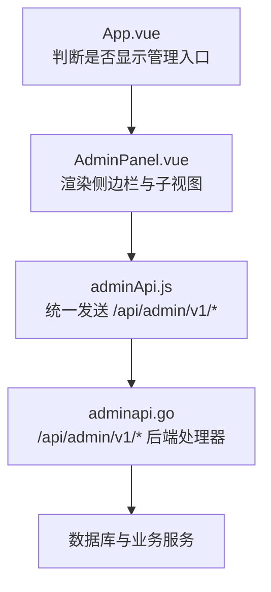
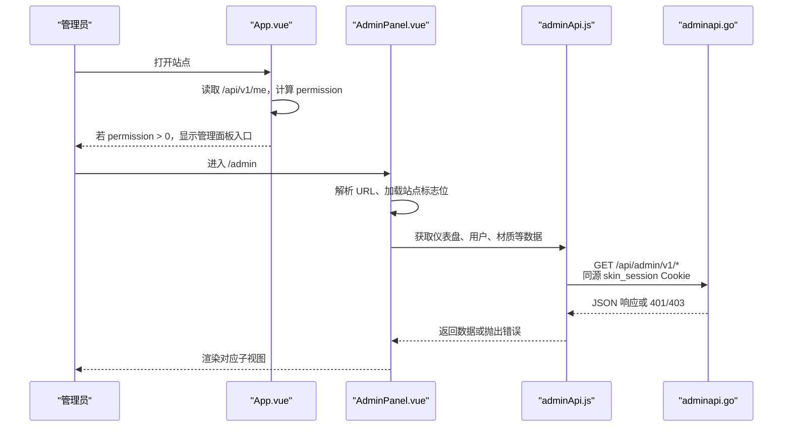
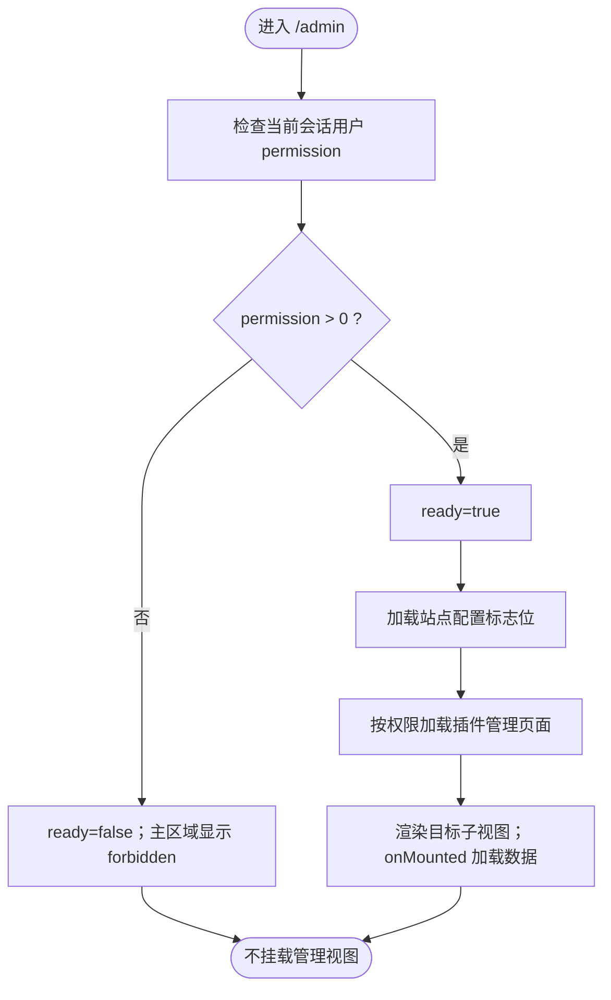
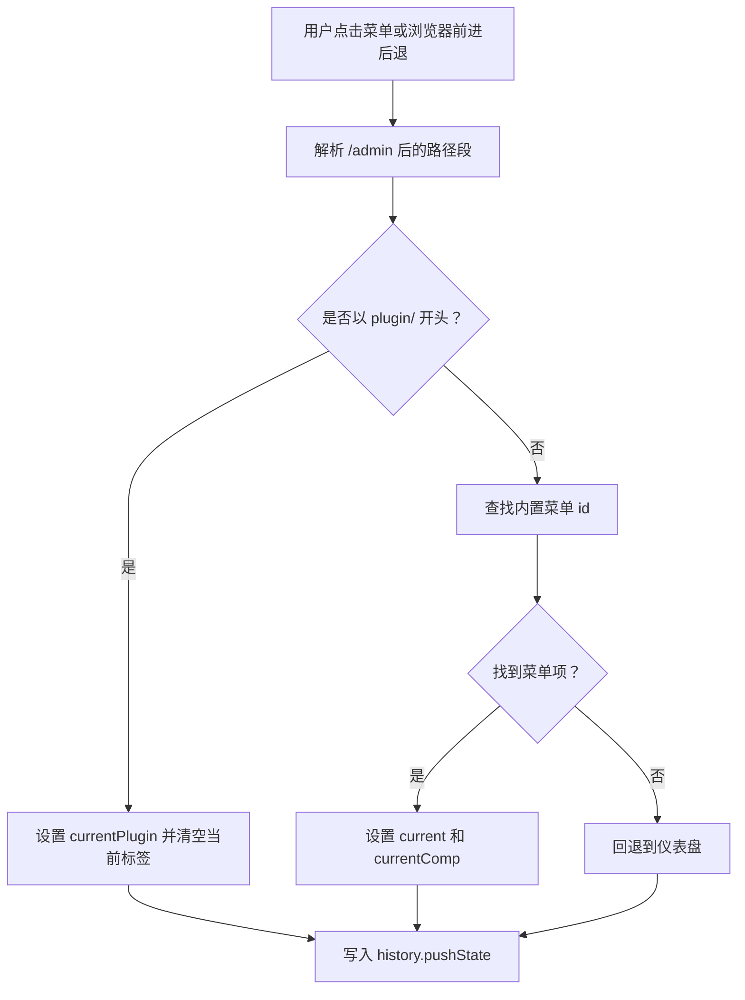
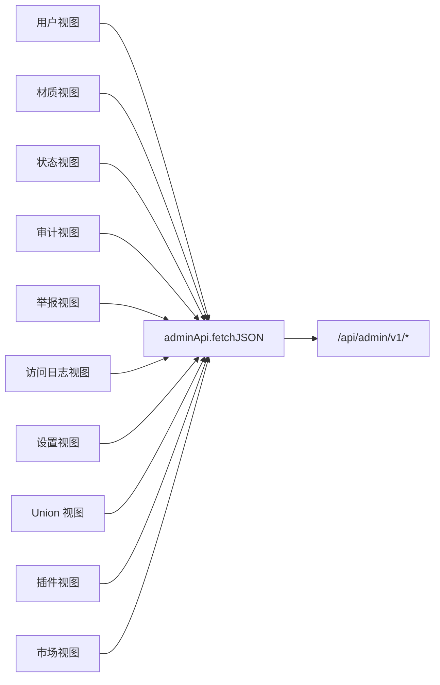
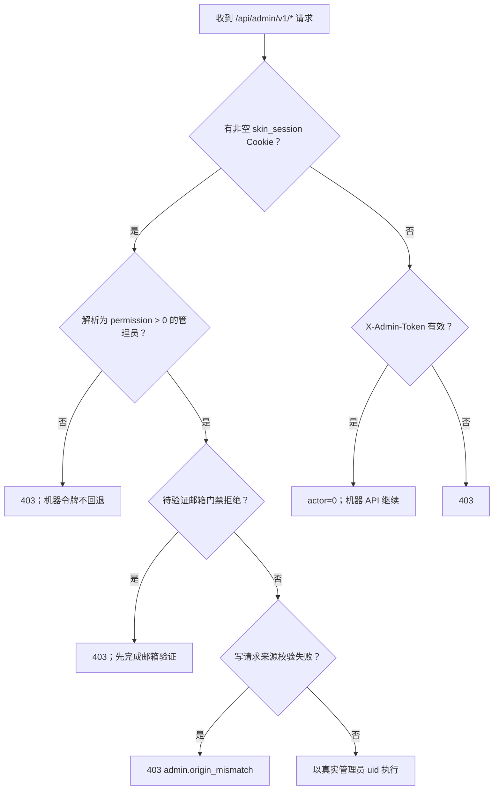

# 面板概览与导航

**本文引用的文件**
- [AdminPanel.vue](https://github.com/YimingZhanshen/skin-nexus/blob/797ae1a/web/src/components/AdminPanel.vue)
- [adminApi.js](https://github.com/YimingZhanshen/skin-nexus/blob/797ae1a/web/src/adminApi.js)
- [App.vue](https://github.com/YimingZhanshen/skin-nexus/blob/797ae1a/web/src/App.vue)
- [i18n.js](https://github.com/YimingZhanshen/skin-nexus/blob/797ae1a/web/src/i18n.js)
- [zh-CN.json](https://github.com/YimingZhanshen/skin-nexus/blob/797ae1a/web/src/locales/zh-CN.json)
- [en.json](https://github.com/YimingZhanshen/skin-nexus/blob/797ae1a/web/src/locales/en.json)
- [adminapi.go](https://github.com/YimingZhanshen/skin-nexus/blob/797ae1a/server/internal/adminapi/adminapi.go)

## 目录
1. [简介](#简介)
2. [项目结构与职责划分](#项目结构与职责划分)
3. [核心组件：管理面板外壳](#核心组件管理面板外壳)
4. [架构总览](#架构总览)
5. [菜单结构说明](#菜单结构说明)
6. [页面初始化流程](#页面初始化流程)
7. [URL、路由与深度链接](#url路由与深度链接)
8. [前端到后端接口映射](#前端到后端接口映射)
9. [权限控制与未授权处理](#权限控制与未授权处理)
10. [常见使用场景](#常见使用场景)
11. [多语言文案在面板中的使用方式](#多语言文案在面板中的使用方式)
12. [故障排查与常见问题](#故障排查与常见问题)
13. [结论](#结论)

## 简介
本文面向管理员和前端维护者，解释 SkinNexus 管理面板的工作方式：`AdminPanel.vue` 如何根据当前用户角色、站点配置和插件能力决定左侧菜单与可渲染视图；前端 `adminApi.js` 如何只通过同源会话 Cookie 把管理视图请求发送到 `/api/admin/v1/*`；后端 `adminapi.go` 如何校验管理员会话，并仅为无会话 Cookie 的机器客户端保留独立令牌通道。文档还覆盖仪表盘、用户、玩家/角色、材质、插件、主题市场、设置、审计、报告、Union、状态等模块的职责边界，以及站长登录、跳转到用户列表、查看诊断信息等典型流程。

## 项目结构与职责划分
管理面板涉及三层代码：
- 前端外壳：`AdminPanel.vue` 负责侧边栏、子视图切换、深度链接和权限态展示。
- 前端数据层：`adminApi.js` 提供只发送同源会话 Cookie、剥离机器令牌并清理旧存储的统一请求函数。
- 后端接口层：`adminapi.go` 注册 `/api/admin/v1/*` 路由，实现管理员会话鉴权及无 Cookie 机器令牌鉴权、业务聚合和分页响应。

**图表来源**
- [App.vue:1-200](https://github.com/YimingZhanshen/skin-nexus/blob/797ae1a/web/src/App.vue#L1-L200)
- [AdminPanel.vue:1-200](https://github.com/YimingZhanshen/skin-nexus/blob/797ae1a/web/src/components/AdminPanel.vue#L1-L200)
- [adminApi.js:1-32](https://github.com/YimingZhanshen/skin-nexus/blob/797ae1a/web/src/adminApi.js#L1-L32)
- [adminapi.go:1-200](https://github.com/YimingZhanshen/skin-nexus/blob/797ae1a/server/internal/adminapi/adminapi.go#L1-L200)

**章节来源**
- [AdminPanel.vue:1-249](https://github.com/YimingZhanshen/skin-nexus/blob/797ae1a/web/src/components/AdminPanel.vue#L1-L249)
- [adminApi.js:1-32](https://github.com/YimingZhanshen/skin-nexus/blob/797ae1a/web/src/adminApi.js#L1-L32)
- [adminapi.go:1-500](https://github.com/YimingZhanshen/skin-nexus/blob/797ae1a/server/internal/adminapi/adminapi.go#L1-L500)

## 核心组件：管理面板外壳
`AdminPanel.vue` 是管理面板的容器，不直接承载所有业务逻辑，而是：
- 定义静态菜单项，包括仪表盘、用户、玩家、邀请码、设置、状态、访问日志、举报、材质、审计、任务队列、Union、插件和市场。
- 根据站点配置隐藏可选菜单：当站点未启用邀请码时隐藏“邀请码”；未启用 Union 时隐藏“Union”。
- 根据插件 UI 注册表动态追加插件菜单项。
- 根据当前 URL 同步激活的标签页，并渲染对应的子视图组件。
- `ready` 完全由当前会话的 `permission > 0` 派生；权限不足时不挂载任何管理子视图，主区域只显示禁止访问提示。

关键行为包括：
- `visibleNav` 根据 `invite_required` 和 `union_enabled` 过滤菜单。
- `go(id)` 切换到内置菜单项。
- `openPlugin(path)` 切换到插件页面。
- `ready` 控制主内容区域是否渲染子视图。
- `reloadTick` 通过 key 变更强制重新挂载当前视图，从而触发其自身的数据加载。

**章节来源**
- [AdminPanel.vue:1-200](https://github.com/YimingZhanshen/skin-nexus/blob/797ae1a/web/src/components/AdminPanel.vue#L1-L200)
- [AdminPanel.vue:201-249](https://github.com/YimingZhanshen/skin-nexus/blob/797ae1a/web/src/components/AdminPanel.vue#L201-L249)

## 架构总览
管理面板采用“外壳 + 子视图 + 共享 API 客户端”的分层模式：

**图表来源**
- [App.vue:1-200](https://github.com/YimingZhanshen/skin-nexus/blob/797ae1a/web/src/App.vue#L1-L200)
- [AdminPanel.vue:1-200](https://github.com/YimingZhanshen/skin-nexus/blob/797ae1a/web/src/components/AdminPanel.vue#L1-L200)
- [adminApi.js:1-32](https://github.com/YimingZhanshen/skin-nexus/blob/797ae1a/web/src/adminApi.js#L1-L32)
- [adminapi.go:1-200](https://github.com/YimingZhanshen/skin-nexus/blob/797ae1a/server/internal/adminapi/adminapi.go#L1-L200)

## 菜单结构说明
AdminPanel 的菜单由三部分构成：内置菜单、站点标志位过滤、插件扩展菜单。

| 菜单项 | 内部 id | 主要职责 | 可见性条件 |
|---|---|---|---|
| 仪表盘 | `dashboard` | 展示用户数、角色数、材质数、弱哈希余量、存储用量、签名密钥指纹 | 始终可见 |
| 用户管理 | `users` | 查询、重置密码、修改邮箱昵称、调整权限、删除用户 | 始终可见 |
| 角色管理 | `players` | 管理站长的玩家/角色列表、改名、改所有者、替换材质、删除 | 始终可见 |
| 邀请码 | `invitation` | 生成、编辑、列出邀请码 | 仅当站点启用邀请码时可见 |
| 站点设置 | `settings` | 获取和保存站点配置项 | 始终可见 |
| 运行状态 | `status` | 展示版本、构建信息、运行时环境、数据库信息和模块开关 | 始终可见 |
| 访问日志 | `access` | 分页查看网页、启动器、Yggdrasil、Union 访问记录 | 始终可见 |
| 举报处理 | `reports` | 列出举报、处理举报 | 始终可见 |
| 材质库 | `textures` | 查询、审核、打击、删除材质 | 始终可见 |
| 站内材质 | `closet` | 管理站内材质衣柜与可见性 | 始终可见 |
| 操作审计 | `audit` | 按操作人、动作、关键词查询后台审计日志 | 始终可见 |
| 任务队列 | `jobs` | 列出任务、查看详情、取消或恢复任务 | 始终可见 |
| Union | `union` | 联盟状态、轮换、黑名单、诊断等操作 | 仅当站点启用 Union 时可见 |
| 服务器接入 | `serveraccess` | 平台租户、服务器、配额与紧急状态管理 | 仅当模块启用且 `permission=2` 时可见 |
| 插件 | `plugins` | 查看已安装插件、回滚、卸载、配置、绕过守卫 | 始终可见 |
| 插件市场 | `market` | 浏览市场目录、安装插件、上传插件包 | 始终可见 |

此外，插件可通过 `pluginUI.js` 注册管理面板扩展页面，这些扩展会出现在侧边栏中，并根据插件声明的权限要求过滤。

**章节来源**
- [AdminPanel.vue:1-120](https://github.com/YimingZhanshen/skin-nexus/blob/797ae1a/web/src/components/AdminPanel.vue#L1-L120)
- [AdminPanel.vue:201-249](https://github.com/YimingZhanshen/skin-nexus/blob/797ae1a/web/src/components/AdminPanel.vue#L201-L249)

## 页面初始化流程
管理面板的初始化不是单一函数调用，而是由外层应用、面板外壳和子视图共同完成：

1. **外层判断管理员身份**
   `App.vue` 从 `/api/v1/me` 获取当前用户对象，并通过 `user.permission > 0` 判断是否为管理员。只有管理员才会看到“管理面板”入口。

2. **进入面板后加载初始状态**
   `AdminPanel.vue` 在 `onMounted` 中执行以下工作：
   - 从已加载的会话用户计算 `myPerm` 与 `ready = myPerm > 0`；权限不足时主区域显示禁止访问提示。
   - 清理旧 `admin_token` 存储键，不读取或写入机器令牌。
   - 加载插件 UI 中声明的管理面板页面，并按当前权限过滤。
   - 尝试加载站点配置标志位，用于决定是否显示邀请码、Union 和 Server Access 菜单；Server Access 还要求超管权限。

3. **渲染左侧导航**
   模板遍历 `visibleNav`，用 i18n 的 `t()` 渲染菜单标题，并渲染插件扩展菜单。

4. **加载目标视图数据**
   当 `ready` 为真时，面板渲染当前组件。每个子视图通常在自己的 `onMounted` 中发起数据请求；面板通过 `reloadTick` 改变 key 来重新挂载当前视图，从而实现刷新。

**图表来源**
- [App.vue:1-200](https://github.com/YimingZhanshen/skin-nexus/blob/797ae1a/web/src/App.vue#L1-L200)
- [AdminPanel.vue:120-200](https://github.com/YimingZhanshen/skin-nexus/blob/797ae1a/web/src/components/AdminPanel.vue#L120-L200)
- [AdminPanel.vue:201-249](https://github.com/YimingZhanshen/skin-nexus/blob/797ae1a/web/src/components/AdminPanel.vue#L201-L249)

**章节来源**
- [App.vue:1-200](https://github.com/YimingZhanshen/skin-nexus/blob/797ae1a/web/src/App.vue#L1-L200)
- [AdminPanel.vue:120-249](https://github.com/YimingZhanshen/skin-nexus/blob/797ae1a/web/src/components/AdminPanel.vue#L120-L249)

## URL、路由与深度链接
管理面板支持浏览器地址栏深度链接，使刷新、分享和后退按钮能回到上次打开的标签页。

- `/admin`：默认仪表盘。
- `/admin/users`：用户管理。
- `/admin/players`：角色管理。
- `/admin/textures`：材质库。
- `/admin/settings`：站点设置。
- `/admin/status`：运行状态。
- `/admin/access`：访问日志。
- `/admin/reports`：举报处理。
- `/admin/audit`：操作审计。
- `/admin/jobs`：任务队列。
- `/admin/union`：Union。
- `/admin/plugins`：插件。
- `/admin/market`：插件市场。
- `/admin/plugin/<path>`：插件扩展页面。

面板内部通过监听 `current` 和 `currentPlugin` 的变化写入 `history.pushState`，同时监听 `popstate` 以支持后退。未知路径会回退到仪表盘，而不是报错。

**图表来源**
- [AdminPanel.vue:120-200](https://github.com/YimingZhanshen/skin-nexus/blob/797ae1a/web/src/components/AdminPanel.vue#L120-L200)

**章节来源**
- [AdminPanel.vue:120-200](https://github.com/YimingZhanshen/skin-nexus/blob/797ae1a/web/src/components/AdminPanel.vue#L120-L200)

## 前端到后端接口映射
`adminApi.js` 是管理面板统一的 HTTP 客户端。它的主要职责不是定义每个业务端点，而是：
- 使用 `credentials: 'same-origin'` 发送同源 `skin_session` Cookie。
- 清理旧 `admin_token` 存储键，并剥离调用方传入的任何大小写形式的 `X-Admin-Token`。
- 将网络超时、非成功状态码转换为带 `status` 和 `data` 的错误对象。
- 仅在 HTTP 401 或 HTTP 403 + `admin.token_invalid` 时通过 `guard401` 通知外壳清理会话；其他 403 不会触发令牌卡或会话清理。

后端在 `adminapi.go` 中集中注册 `/api/admin/v1/*` 路由。前端各子视图根据业务语义调用不同路径，例如：
- 仪表盘统计：`GET /api/admin/v1/overview`
- 运行状态：`GET /api/admin/v1/status`
- 部署自检：`GET /api/admin/v1/diagnostics`
- 用户列表：`GET /api/admin/v1/users`
- 材质列表：`GET /api/admin/v1/textures`
- 审计日志：`GET /api/admin/v1/audit`
- 访问日志：`GET /api/admin/v1/access-logs`
- 举报列表和处理：`GET /api/admin/v1/reports`、`POST /api/admin/v1/reports/{id}/resolve`
- 站点设置：`GET /api/admin/v1/settings`、`PUT /api/admin/v1/settings`
- Union 相关：`GET /api/admin/v1/union/status` 及一系列运维操作端点
- 插件与市场：`GET /api/admin/v1/plugins`、`GET /api/admin/v1/market/catalog`、`POST /api/admin/v1/market/install`、`POST /api/admin/v1/market/upload`

**图表来源**
- [adminApi.js:1-32](https://github.com/YimingZhanshen/skin-nexus/blob/797ae1a/web/src/adminApi.js#L1-L32)
- [adminapi.go:1-200](https://github.com/YimingZhanshen/skin-nexus/blob/797ae1a/server/internal/adminapi/adminapi.go#L1-L200)

**章节来源**
- [adminApi.js:1-32](https://github.com/YimingZhanshen/skin-nexus/blob/797ae1a/web/src/adminApi.js#L1-L32)
- [adminapi.go:1-200](https://github.com/YimingZhanshen/skin-nexus/blob/797ae1a/server/internal/adminapi/adminapi.go#L1-L200)

## 权限控制与未授权处理
权限控制分为两层：前端判断是否显示入口，后端对每个管理接口做最终鉴权。

### 前端权限
- `App.vue` 使用 `/api/v1/me` 返回的 `permission` 字段判断管理员。普通用户不会看到“管理面板”入口。
- `AdminPanel.vue` 的 `ready` 只由 `myPerm > 0` 派生：管理员渲染目标视图；非管理员或权限被撤销后立即卸载视图，主区域显示 `errors.common.forbidden`。
- 面板没有 `X-Admin-Token` 输入卡，也不读取或持久化 `admin_token`；机器令牌不能改变前端权限。

### 后端权限
`adminapi.go` 先判断是否存在非空会话 Cookie：
1. **存在非空会话 Cookie**：只接受能解析为 `permission > 0` 的管理员会话。令牌缺失或无效不影响有效会话；无效、过期、封禁或非管理员会话一律 403，即使同时携带有效机器令牌也不回退。
2. **没有非空会话 Cookie**：才对 `X-Admin-Token` 与 `SKIN_ADMIN_TOKEN` 做常量时间比较；有效时作为 `actor=0` 的机器调用继续，无效或未配置时 403。空值 Cookie 与没有 Cookie 等价。

有效管理员会话还受待验证邮箱保护和写请求来源校验约束。超级管理员网页会话专属端点继续拒绝机器通道。

**图表来源**
- [adminapi.go:201-360](https://github.com/YimingZhanshen/skin-nexus/blob/797ae1a/server/internal/adminapi/adminapi.go#L201-L360)

### 会话失效与空菜单
- HTTP 401 或 HTTP 403 + `admin.token_invalid` 会经 `guard401` 通知应用外壳清理会话并回到登录页；其他 403（包括 `admin.web_session_required`、`admin.super_admin_required`）保留当前会话并显示错误。
- 权限字段降为 `permission <= 0` 时，`AdminPanel.vue` 立即卸载管理视图并显示禁止访问提示，不提供令牌回退。
- 如果站点关闭了邀请码或 Union，对应菜单会被隐藏；Server Access 还要求模块启用且 `permission=2`。
- 如果所有菜单都被隐藏，面板仍会渲染外壳，但左侧导航为空。此时应检查站点配置和插件权限，而不是假设后端一定出错。

**章节来源**
- [App.vue:1-200](https://github.com/YimingZhanshen/skin-nexus/blob/797ae1a/web/src/App.vue#L1-L200)
- [AdminPanel.vue:1-200](https://github.com/YimingZhanshen/skin-nexus/blob/797ae1a/web/src/components/AdminPanel.vue#L1-L200)
- [adminApi.js:1-32](https://github.com/YimingZhanshen/skin-nexus/blob/797ae1a/web/src/adminApi.js#L1-L32)
- [adminapi.go:201-360](https://github.com/YimingZhanshen/skin-nexus/blob/797ae1a/server/internal/adminapi/adminapi.go#L201-L360)

## 常见使用场景

### 场景一：站长登录后进入仪表盘
1. 站长通过正常登录获得会话。
2. `App.vue` 发现 `permission > 0`，显示管理面板入口。
3. 进入 `/admin` 后，`AdminPanel.vue` 检测到会话管理员，直接渲染目标管理视图。
4. 仪表盘视图加载 `/api/admin/v1/overview`，显示用户、角色、材质、弱哈希余量等统计。

**章节来源**
- [App.vue:1-200](https://github.com/YimingZhanshen/skin-nexus/blob/797ae1a/web/src/App.vue#L1-L200)
- [AdminPanel.vue:120-200](https://github.com/YimingZhanshen/skin-nexus/blob/797ae1a/web/src/components/AdminPanel.vue#L120-L200)
- [adminapi.go:360-420](https://github.com/YimingZhanshen/skin-nexus/blob/797ae1a/server/internal/adminapi/adminapi.go#L360-L420)

### 场景二：跳转到用户列表
1. 管理员点击“用户管理”。
2. `AdminPanel.vue` 更新 `current` 为 `users`，并渲染 `UsersView`。
3. 用户视图发起 `GET /api/admin/v1/users`。
4. 后端返回分页用户列表，包含总数和当前页码。

**章节来源**
- [AdminPanel.vue:120-200](https://github.com/YimingZhanshen/skin-nexus/blob/797ae1a/web/src/components/AdminPanel.vue#L120-L200)
- [adminapi.go:420-460](https://github.com/YimingZhanshen/skin-nexus/blob/797ae1a/server/internal/adminapi/adminapi.go#L420-L460)

### 场景三：查看诊断信息
1. 管理员进入“运行状态”或相关诊断页面。
2. 前端调用 `/api/admin/v1/status` 或 `/api/admin/v1/diagnostics`。
3. 后端返回版本、Go 版本、数据库引擎、迁移版本、容器信息、运行时间、模块开关等部署事实。

**章节来源**
- [adminapi.go:420-500](https://github.com/YimingZhanshen/skin-nexus/blob/797ae1a/server/internal/adminapi/adminapi.go#L420-L500)

## 多语言文案在面板中的使用方式
面板的多语言由 Vue I18n 驱动，`i18n.js` 负责选择语言并持久化到 cookie 和本地存储。管理面板中的菜单标题和部分提示使用 `useI18n().t()` 渲染。

中文文案集中在 `zh-CN.json`，英文文案在 `en.json`。面板相关键包括：
- `admin.title`：管理面板标题。
- `admin.load`：加载按钮文案。
- `admin.reload`：刷新按钮文案。
- `admin.navDashboard`：仪表盘。
- `admin.navUsers`：用户管理。
- `admin.navPlayers`：角色管理。
- `admin.navSettings`：站点设置。
- `admin.navStatus`：运行状态。
- `admin.navAccess`：访问日志。
- `admin.navReports`：举报处理。
- `admin.navTextures`：材质库。
- `admin.navAudit`：操作审计。
- `admin.navJobs`：任务队列。
- `admin.navUnion`：Union。
- `admin.navPlugins`：插件。
- `admin.navMarket`：插件市场。

新增或修改菜单文案时，应同步更新中英文翻译文件，并确保 `AdminPanel.vue` 使用的 `labelKey` 与翻译键一致。

**章节来源**
- [i18n.js:1-68](https://github.com/YimingZhanshen/skin-nexus/blob/797ae1a/web/src/i18n.js#L1-L68)
- [AdminPanel.vue:1-120](https://github.com/YimingZhanshen/skin-nexus/blob/797ae1a/web/src/components/AdminPanel.vue#L1-L120)
- [zh-CN.json:650-700](https://github.com/YimingZhanshen/skin-nexus/blob/797ae1a/web/src/locales/zh-CN.json#L650-L700)
- [zh-CN.json:969-978](https://github.com/YimingZhanshen/skin-nexus/blob/797ae1a/web/src/locales/zh-CN.json#L969-L978)
- [en.json:1-200](https://github.com/YimingZhanshen/skin-nexus/blob/797ae1a/web/src/locales/en.json#L1-L200)

## 故障排查与常见问题

| 现象 | 可能原因 | 排查建议 |
|---|---|---|
| 登录后看不到管理面板入口 | 用户 `permission` 不大于 0 | 检查 `/api/v1/me` 返回的权限字段 |
| 进入面板后显示禁止访问 | 当前会话不是管理员，或权限已被撤销 | 用 `permission > 0` 的管理员账号重新登录；不要尝试填入机器令牌 |
| 点击菜单无反应 | URL 路径不存在或匹配不到内置菜单 | 检查地址栏是否为 `/admin/<id>`，未知路径会回退到仪表盘 |
| 邀请码菜单不出现 | 站点未启用邀请码 | 检查站点配置 `invite_required` |
| Union 菜单不出现 | 站点未启用 Union | 检查站点配置 `union_enabled` |
| 接口返回 401 或 403 | 会话失效、权限不足、来源校验失败或端点要求超管会话 | 按响应 `code` 处理；会话失效时重新登录，其他 403 修正权限或请求来源 |
| 审计或设置操作报需邮箱验证 | 管理员账号未完成邮箱验证 | 先完成邮箱验证，再执行敏感操作 |
| 刷新后视图丢失 | 深度链接未正确写入或 URL 被改写 | 检查 `/admin` 或 `/admin/<id>` 是否正确 |
| 插件菜单不显示 | 插件未注册、权限不足或被过滤 | 检查插件 UI 注册表和当前用户权限 |

**章节来源**
- [App.vue:1-200](https://github.com/YimingZhanshen/skin-nexus/blob/797ae1a/web/src/App.vue#L1-L200)
- [AdminPanel.vue:120-249](https://github.com/YimingZhanshen/skin-nexus/blob/797ae1a/web/src/components/AdminPanel.vue#L120-L249)
- [adminApi.js:1-32](https://github.com/YimingZhanshen/skin-nexus/blob/797ae1a/web/src/adminApi.js#L1-L32)
- [adminapi.go:201-360](https://github.com/YimingZhanshen/skin-nexus/blob/797ae1a/server/internal/adminapi/adminapi.go#L201-L360)

## 结论
管理面板的核心设计是“前端外壳负责导航、可见性与权限派生视图，后端负责鉴权与数据”。`AdminPanel.vue` 根据会话权限、站点配置和插件能力组合出最终菜单；`adminApi.js` 只发送同源会话 Cookie 并清理旧机器令牌；`adminapi.go` 在 `/api/admin/v1/*` 上实现细粒度后端权限控制，并仅为无 Cookie 机器客户端保留独立令牌通道。理解这三层关系后，可以安全地扩展新菜单、对接新接口，并在权限、语言和深度链接方面保持一致行为。
