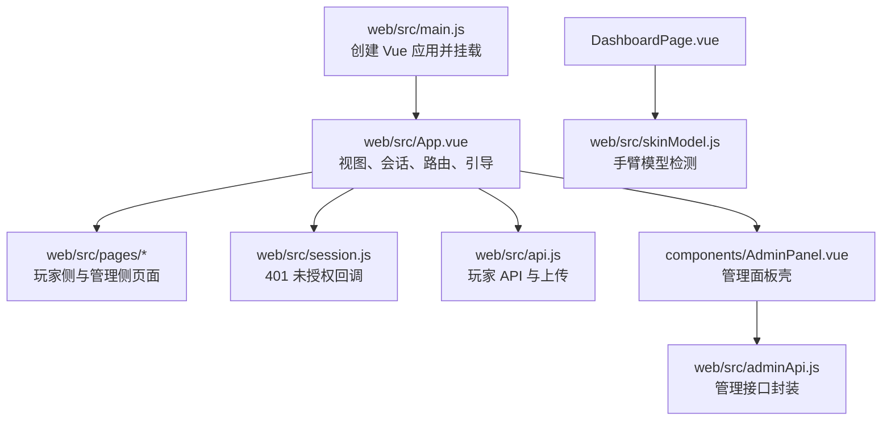
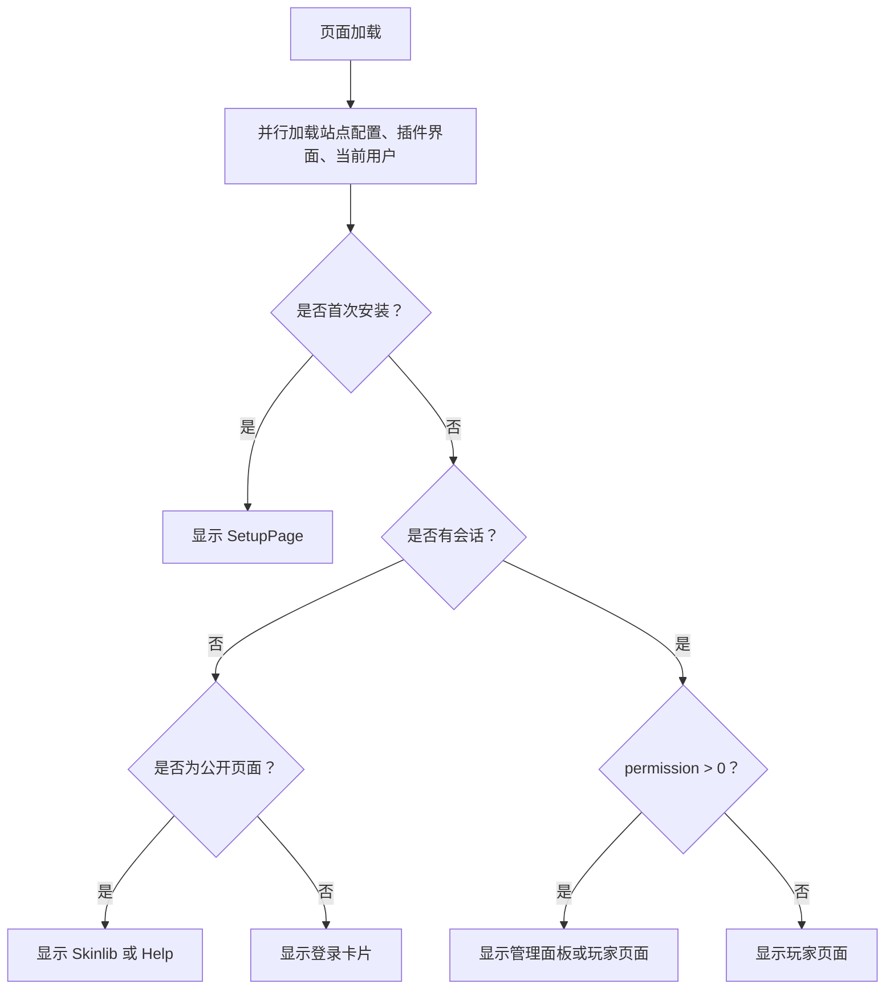
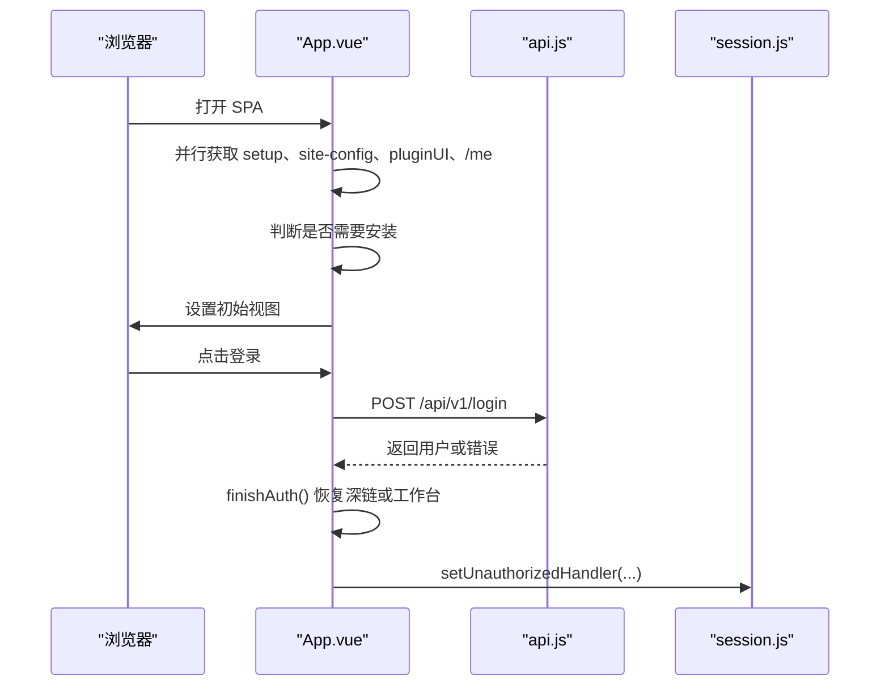
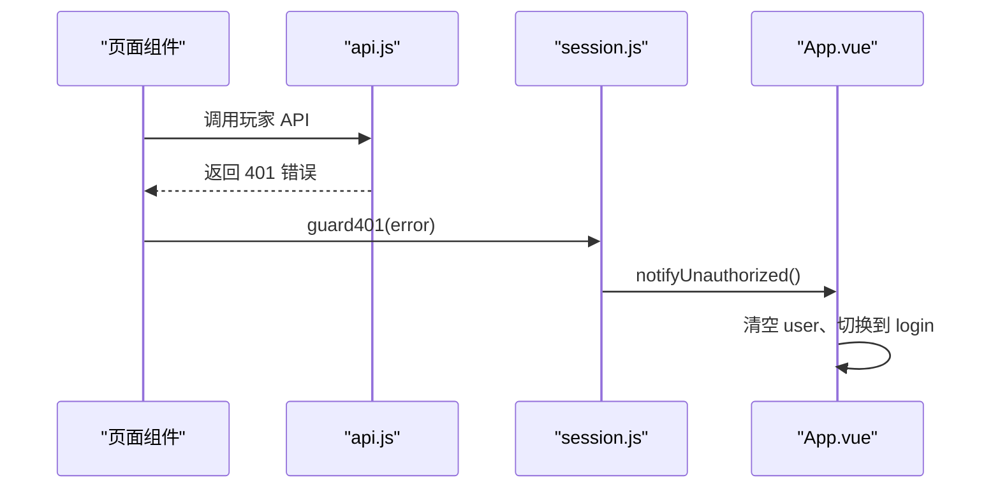
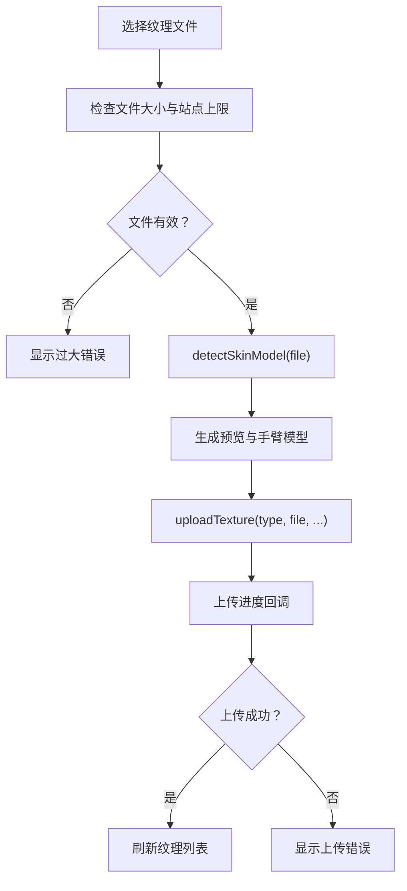
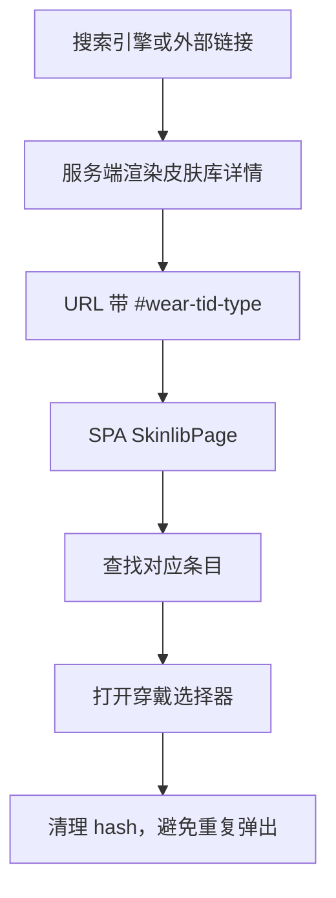

# 页面与路由

**本文引用的文件**
- [web/src/main.js](https://github.com/YimingZhanshen/skin-nexus/blob/797ae1a/web/src/main.js)
- [web/src/App.vue](https://github.com/YimingZhanshen/skin-nexus/blob/797ae1a/web/src/App.vue)
- [web/src/session.js](https://github.com/YimingZhanshen/skin-nexus/blob/797ae1a/web/src/session.js)
- [web/src/api.js](https://github.com/YimingZhanshen/skin-nexus/blob/797ae1a/web/src/api.js)
- [web/src/adminApi.js](https://github.com/YimingZhanshen/skin-nexus/blob/797ae1a/web/src/adminApi.js)
- [web/src/skinModel.js](https://github.com/YimingZhanshen/skin-nexus/blob/797ae1a/web/src/skinModel.js)
- [web/src/pages/DashboardPage.vue](https://github.com/YimingZhanshen/skin-nexus/blob/797ae1a/web/src/pages/DashboardPage.vue)
- [web/src/pages/PlayersPage.vue](https://github.com/YimingZhanshen/skin-nexus/blob/797ae1a/web/src/pages/PlayersPage.vue)
- [web/src/pages/ClosetPage.vue](https://github.com/YimingZhanshen/skin-nexus/blob/797ae1a/web/src/pages/ClosetPage.vue)
- [web/src/pages/ProfilePage.vue](https://github.com/YimingZhanshen/skin-nexus/blob/797ae1a/web/src/pages/ProfilePage.vue)
- [web/src/pages/SkinlibPage.vue](https://github.com/YimingZhanshen/skin-nexus/blob/797ae1a/web/src/pages/SkinlibPage.vue)
- [web/src/pages/HelpPage.vue](https://github.com/YimingZhanshen/skin-nexus/blob/797ae1a/web/src/pages/HelpPage.vue)
- [web/src/pages/NotificationsPage.vue](https://github.com/YimingZhanshen/skin-nexus/blob/797ae1a/web/src/pages/NotificationsPage.vue)
- [web/src/pages/AuthorizedAppsPage.vue](https://github.com/YimingZhanshen/skin-nexus/blob/797ae1a/web/src/pages/AuthorizedAppsPage.vue)
- [web/src/pages/DevicePage.vue](https://github.com/YimingZhanshen/skin-nexus/blob/797ae1a/web/src/pages/DevicePage.vue)
- [web/src/pages/UnionBindPage.vue](https://github.com/YimingZhanshen/skin-nexus/blob/797ae1a/web/src/pages/UnionBindPage.vue)
- [web/src/pages/SetupPage.vue](https://github.com/YimingZhanshen/skin-nexus/blob/797ae1a/web/src/pages/SetupPage.vue)

## 目录

1. [引言](#引言)
2. [项目结构与入口](#项目结构与入口)
3. [页面总览与职责](#页面总览与职责)
4. [权限隔离模型](#权限隔离模型)
5. [前端数据层协作方式](#前端数据层协作方式)
6. [通用交互状态处理](#通用交互状态处理)
7. [架构与关键流程图](#架构与关键流程图)
8. [详细页面分析](#详细页面分析)
9. [新增受保护页面的步骤](#新增受保护页面的步骤)
10. [SEO、服务端渲染与移动端适配](#seo服务端渲染与移动端适配)
11. [故障排查](#故障排查)
12. [结论](#结论)

## 引言

本文聚焦前端 `web/src/pages` 下的所有页面及其路由组织，目标是帮助开发者快速理解：

- 每个页面负责什么业务。
- 哪些页面需要登录、哪些是访客可访问、哪些只允许管理员。
- 页面如何调用 `api.js`、`adminApi.js`、`session.js` 和 `skinModel.js`。
- 加载中、空列表、分页、错误和成功反馈的通用模式。
- 如何新增一个受保护的页面，并把它加入导航、国际化文案和路由。
- SEO 相关页面与服务端渲染的关系，以及移动端与可访问性注意事项。

该项目是一个 Vue 单页应用（SPA），由 `web/src/main.js` 创建应用实例并挂载到根节点；实际视图切换集中在 `web/src/App.vue` 中，而不是传统的路由库。页面通过 `view` 状态驱动，并通过 `history.pushState` 同步地址栏。

## 项目结构与入口



**图表来源**
- [web/src/main.js:1-6](https://github.com/YimingZhanshen/skin-nexus/blob/797ae1a/web/src/main.js#L1-L6)
- [web/src/App.vue:1-20](https://github.com/YimingZhanshen/skin-nexus/blob/797ae1a/web/src/App.vue#L1-L20)
- [web/src/session.js:1-13](https://github.com/YimingZhanshen/skin-nexus/blob/797ae1a/web/src/session.js#L1-L13)
- [web/src/api.js:1-161](https://github.com/YimingZhanshen/skin-nexus/blob/797ae1a/web/src/api.js#L1-L161)
- [web/src/adminApi.js:1-32](https://github.com/YimingZhanshen/skin-nexus/blob/797ae1a/web/src/adminApi.js#L1-L32)
- [web/src/skinModel.js:1-41](https://github.com/YimingZhanshen/skin-nexus/blob/797ae1a/web/src/skinModel.js#L1-L41)

### 入口职责

| 文件 | 职责 | 关键行为 |
|---|---|---|
| `main.js` | 应用启动 | 引入根组件、国际化样式，然后挂载到 `#app`。 |
| `App.vue` | 全局视图与路由壳 | 加载站点配置、用户信息、插件界面；根据 URL 决定显示登录、设备页、安装向导或玩家/管理面板。 |
| `session.js` | 会话级未授权处理 | 提供统一 401 处理器，让任意页面在鉴权失效时回到登录页。 |
| `api.js` | 玩家侧 API 客户端 | 封装 `/api/v1/me`、衣柜、角色、皮肤库、通知、OIDC、Union 等请求。 |
| `adminApi.js` | 管理侧 API 客户端 | 为管理面板附加可选的 `X-Admin-Token`，并把 401/403 转为需要令牌的状态。 |
| `skinModel.js` | 客户端纹理手臂模型检测 | 用浏览器图像能力判断经典手臂或窄手臂，仅用于上传前的 3D 预览。 |

**章节来源**
- [web/src/main.js:1-6](https://github.com/YimingZhanshen/skin-nexus/blob/797ae1a/web/src/main.js#L1-L6)
- [web/src/App.vue:1-120](https://github.com/YimingZhanshen/skin-nexus/blob/797ae1a/web/src/App.vue#L1-L120)
- [web/src/session.js:1-13](https://github.com/YimingZhanshen/skin-nexus/blob/797ae1a/web/src/session.js#L1-L13)
- [web/src/api.js:1-161](https://github.com/YimingZhanshen/skin-nexus/blob/797ae1a/web/src/api.js#L1-L161)
- [web/src/adminApi.js:1-32](https://github.com/YimingZhanshen/skin-nexus/blob/797ae1a/web/src/adminApi.js#L1-L32)
- [web/src/skinModel.js:1-41](https://github.com/YimingZhanshen/skin-nexus/blob/797ae1a/web/src/skinModel.js#L1-L41)

## 页面总览与职责

`web/src/pages` 下共有 11 个页面，分为玩家侧、设备侧、安装向导和管理侧四类。

| 页面文件 | 路由键或路径 | 业务职责 | 是否需要登录 | 主要 API |
|---|---|---|---|---|
| `SetupPage.vue` | `/setup`（自动进入） | 首次安装向导：站点名称、基础地址、管理员账号、皮肤域名。 | 否，但只在服务器返回“需要安装”时显示 | `/api/v1/setup/status`、`/api/v1/setup` |
| `DevicePage.vue` | `/device?user_code=…` | RFC 8628 设备码流程：查询设备信息、选择角色、批准或拒绝 OIDC 授权。 | 提交时需要；未登录时提示而非跳转 | `oidc.deviceInfo`、`oidc.deviceSubmit` |
| `DashboardPage.vue` | `/user/dashboard` | 工作台：公告、使用量、启动器快速配置、上传材质、纹理分页列表。 | 是 | `api.me`、`api.textures`、`uploadTexture` |
| `PlayersPage.vue` | `/user/players` | 玩家侧角色管理：创建、改名、删除、换皮肤、换披风。 | 是 | `api.players`、`api.createPlayer`、`api.renamePlayer`、`api.deletePlayer`、`api.setSkin`、`api.setCape` |
| `ClosetPage.vue` | `/user/closet` | 衣柜：按皮肤/披风筛选、搜索、分页、设为头像、改名、移除、“穿到角色”。 | 是 | `api.closet`、`api.setAvatar`、`api.closetRename`、`api.closetRemove` |
| `ProfilePage.vue` | `/user/profile` | 个人资料：昵称、邮箱、密码、头像、自助删号。 | 是 | `api.me`、`api.updateProfile`、`api.changePassword`、`api.requestEmailVerification`、`api.setAvatar`、`api.resetAvatar`、`api.deleteAccount` |
| `SkinlibPage.vue` | `/skinlib` | 公开皮肤库：浏览、搜索、分页、点赞、收藏进衣柜、作者编辑、可见性切换、“穿到角色”。 | 浏览无需登录；点赞/收藏/编辑需要 | `api.skinlib`、`api.skinlibLike`、`api.skinlibUnlike`、`api.skinlibPatch` |
| `HelpPage.vue` | `/help` | 帮助说明：常见问题、上传规则、衣柜与密码说明。 | 否 | 无直接 API，读取站点配置中的上传限制与验证门控 |
| `NotificationsPage.vue` | `/user/notifications` | 站内通知收件箱：未读过滤、翻页、标记已读、全部已读。 | 是 | `api.notifications`、`api.markNotificationsRead` |
| `AuthorizedAppsPage.vue` | `/user/apps` | 已授权应用：列出 OIDC 令牌、撤销单个令牌或全部令牌。 | 是 | `oidc.tokens`、`oidc.revokeToken` |
| `UnionBindPage.vue` | `/user/union` | MUA Union 绑定：服务器列表、绑定/解绑、UUID 重映射、站点安全等级。 | 是 | `api.players`、`union.servers`、`union.securityLevel`、`union.detail`、`union.bind`、`union.bindto`、`union.unbind`、`union.remapuuid`、`union.unmapped` |

**章节来源**
- [web/src/App.vue:120-220](https://github.com/YimingZhanshen/skin-nexus/blob/797ae1a/web/src/App.vue#L120-L220)
- [web/src/pages/SetupPage.vue:1-159](https://github.com/YimingZhanshen/skin-nexus/blob/797ae1a/web/src/pages/SetupPage.vue#L1-L159)
- [web/src/pages/DevicePage.vue:1-123](https://github.com/YimingZhanshen/skin-nexus/blob/797ae1a/web/src/pages/DevicePage.vue#L1-L123)
- [web/src/pages/DashboardPage.vue:1-200](https://github.com/YimingZhanshen/skin-nexus/blob/797ae1a/web/src/pages/DashboardPage.vue#L1-L200)
- [web/src/pages/PlayersPage.vue:1-200](https://github.com/YimingZhanshen/skin-nexus/blob/797ae1a/web/src/pages/PlayersPage.vue#L1-L200)
- [web/src/pages/ClosetPage.vue:1-200](https://github.com/YimingZhanshen/skin-nexus/blob/797ae1a/web/src/pages/ClosetPage.vue#L1-L200)
- [web/src/pages/ProfilePage.vue:1-200](https://github.com/YimingZhanshen/skin-nexus/blob/797ae1a/web/src/pages/ProfilePage.vue#L1-L200)
- [web/src/pages/SkinlibPage.vue:1-200](https://github.com/YimingZhanshen/skin-nexus/blob/797ae1a/web/src/pages/SkinlibPage.vue#L1-L200)
- [web/src/pages/HelpPage.vue:1-94](https://github.com/YimingZhanshen/skin-nexus/blob/797ae1a/web/src/pages/HelpPage.vue#L1-L94)
- [web/src/pages/NotificationsPage.vue:1-113](https://github.com/YimingZhanshen/skin-nexus/blob/797ae1a/web/src/pages/NotificationsPage.vue#L1-L113)
- [web/src/pages/AuthorizedAppsPage.vue:1-81](https://github.com/YimingZhanshen/skin-nexus/blob/797ae1a/web/src/pages/AuthorizedAppsPage.vue#L1-L81)
- [web/src/pages/UnionBindPage.vue:1-200](https://github.com/YimingZhanshen/skin-nexus/blob/797ae1a/web/src/pages/UnionBindPage.vue#L1-L200)

## 权限隔离模型

权限隔离不是通过多个独立 SPA 实现，而是由 `App.vue` 的用户对象和权限字段控制。

### 核心规则

| 条件 | 行为 |
|---|---|
| 没有会话 | 默认进入登录页；`/skinlib` 和 `/help` 例外，允许访客阅读。 |
| 普通用户（`permission === 0`） | 看到工作台、皮肤库、衣柜、角色、个人资料、通知、已授权应用、帮助、插件用户中心菜单。 |
| 管理员（`permission > 0`） | 额外看到“管理面板”入口，并可访问 `/admin` 及子路径。 |
| 被封禁（`permission === -1`） | 由后端网关控制访问；前端根据 `/me` 结果决定是否隐藏管理入口。 |
| 邮箱验证未完成 | 不阻止登录，但会保留“待验证”语义，并在需要时触发重新读取自身信息。 |
| Union 功能关闭 | 导航隐藏 union 入口；若已在 union 页面打开，则回退到工作台。 |



**图表来源**
- [web/src/App.vue:120-350](https://github.com/YimingZhanshen/skin-nexus/blob/797ae1a/web/src/App.vue#L120-L350)

### 管理面板权限

管理面板本身不在 `web/src/pages` 下，而是在 `web/src/components/AdminPanel.vue`；`App.vue` 通过异步组件加载它。只有当 `user.permission > 0` 时才把“管理面板”加入导航组，并且尝试访问管理路由时会检查权限。

管理侧 API 走 `adminApi.js`，其封装逻辑对 401/403 设置 `needToken.value = true`，从而让管理面板显示令牌输入卡。普通会话也可以携带 cookie 访问 `/api/admin/v1/*`，`X-Admin-Token` 是机器回退方案。

**章节来源**
- [web/src/App.vue:1-120](https://github.com/YimingZhanshen/skin-nexus/blob/797ae1a/web/src/App.vue#L1-L120)
- [web/src/App.vue:350-554](https://github.com/YimingZhanshen/skin-nexus/blob/797ae1a/web/src/App.vue#L350-L554)
- [web/src/adminApi.js:1-32](https://github.com/YimingZhanshen/skin-nexus/blob/797ae1a/web/src/adminApi.js#L1-L32)

## 前端数据层协作方式

### `session.js`：统一 401 处理

`session.js` 暴露三个关键点：

1. `setUnauthorizedHandler(fn)`：注册全局未授权回调。
2. `notifyUnauthorized()`：触发回调，通常由 `App.vue` 把用户清空并切回登录页。
3. `guard401(e)`：判断错误是否来自 401；如果成立，调用方应停止展示自己的错误提示，因为已经发生了会话级跳转。

各页面通常在 catch 块中使用：

```text
catch (e) { if (!guard401(e)) error.value = e.message }
```

这避免了同一个 401 既弹出页面级错误，又跳转到登录页。

### `api.js`：玩家侧 API 客户端

`api.js` 的核心是 `req` 方法：

- 使用 `fetchWithTimeout` 发起同源请求。
- 将响应体解析为 JSON。
- 非 2xx 时构造带 `status` 和 `data` 的错误对象。
- 遇到 `auth.email_verify_required` 时调用 `gateWatch.onVerifyRequired`，让 `App.vue` 刷新自身信息。
- 特殊处理 204：返回 `null`。

它导出的主要模块包括：

| 模块 | 用途 |
|---|---|
| `api` | 用户资料、认证、衣柜、角色、纹理、皮肤库、通知、Union。 |
| `oidc` | OIDC 设备流程和已授权令牌。 |
| `union` | Union 成员侧绑定与站点安全等级。 |
| `uploadTexture` | 基于 `XMLHttpRequest` 的文件上传，支持进度回调和超时。 |

### `adminApi.js`：管理侧 API 客户端

`adminApi.js` 为管理面板提供统一的 `fetchJSON`：

- 从 `localStorage` 读取 `admin_token`。
- 请求时附带 `X-Admin-Token`。
- 401/403 时设置 `needToken.value = true`。
- 错误对象也携带 `status` 和 `data`，供管理页面区分“模块关闭”“未找到”“会话失效”等场景。

### `skinModel.js`：上传前手臂模型检测

`skinModel.js` 仅在浏览器支持 `createImageBitmap` 和 `OffscreenCanvas` 时运行。它读取像素区域判断窄手臂，否则降级为 `default`。注意：这是预览辅助，最终模型由服务端决定。

**章节来源**
- [web/src/session.js:1-13](https://github.com/YimingZhanshen/skin-nexus/blob/797ae1a/web/src/session.js#L1-L13)
- [web/src/api.js:1-161](https://github.com/YimingZhanshen/skin-nexus/blob/797ae1a/web/src/api.js#L1-L161)
- [web/src/adminApi.js:1-32](https://github.com/YimingZhanshen/skin-nexus/blob/797ae1a/web/src/adminApi.js#L1-L32)
- [web/src/skinModel.js:1-41](https://github.com/YimingZhanshen/skin-nexus/blob/797ae1a/web/src/skinModel.js#L1-L41)

## 通用交互状态处理

### 加载中

大多数页面使用本地 `loading`、`busy`、`creating`、`rowBusy` 等状态：

- 列表加载时使用 `loading`，首次为空时显示骨架或空状态。
- 行级写操作使用 `busyId` 或 `Set` 防止重复提交。
- 上传使用 `uploading` 和 `uploadProgress`。
- 按钮根据对应状态禁用，避免双击造成并发写入。

### 空状态

空状态通常通过 `EmptyState` 组件表达，例如：

- 衣柜为空：引导去上传或皮肤库。
- 通知为空：分别处理“全部空”和“未读为空”。
- 已授权应用为空：直接显示空列表提示。
- 角色为空：显示“还没有角色”之类的提示。

### 分页

分页普遍遵循同一模式：

1. 维护 `page`、`total`、`pages`。
2. 服务端返回 `total` 计算页数。
3. 使用 `Pager` 组件展示页码。
4. 搜索或切换分类后重置为第 1 页。
5. 使用 `reqSeq` 或类似序列号丢弃旧响应。

### 错误与成功反馈

- 网络或业务错误写入 `err` / `error` / `pageErr` / `uploadErr`，并用 `role="alert"` 暴露给辅助技术。
- 成功消息写入 `ok` / `success`，用 `role="status"` 表示一次性状态。
- 401 由 `guard401` 拦截，不再单独弹窗。
- 危险操作（删除、撤销令牌、解绑、删号）使用 `confirmDialog` 二次确认。

**章节来源**
- [web/src/pages/ClosetPage.vue:1-200](https://github.com/YimingZhanshen/skin-nexus/blob/797ae1a/web/src/pages/ClosetPage.vue#L1-L200)
- [web/src/pages/PlayersPage.vue:1-200](https://github.com/YimingZhanshen/skin-nexus/blob/797ae1a/web/src/pages/PlayersPage.vue#L1-L200)
- [web/src/pages/NotificationsPage.vue:1-113](https://github.com/YimingZhanshen/skin-nexus/blob/797ae1a/web/src/pages/NotificationsPage.vue#L1-L113)
- [web/src/pages/AuthorizedAppsPage.vue:1-81](https://github.com/YimingZhanshen/skin-nexus/blob/797ae1a/web/src/pages/AuthorizedAppsPage.vue#L1-L81)
- [web/src/pages/DashboardPage.vue:1-200](https://github.com/YimingZhanshen/skin-nexus/blob/797ae1a/web/src/pages/DashboardPage.vue#L1-L200)

## 架构与关键流程图

### 应用引导流程



**图表来源**
- [web/src/App.vue:350-554](https://github.com/YimingZhanshen/skin-nexus/blob/797ae1a/web/src/App.vue#L350-L554)
- [web/src/api.js:1-161](https://github.com/YimingZhanshen/skin-nexus/blob/797ae1a/web/src/api.js#L1-L161)
- [web/src/session.js:1-13](https://github.com/YimingZhanshen/skin-nexus/blob/797ae1a/web/src/session.js#L1-L13)

### 受保护资源 401 流程



**图表来源**
- [web/src/session.js:1-13](https://github.com/YimingZhanshen/skin-nexus/blob/797ae1a/web/src/session.js#L1-L13)
- [web/src/App.vue:350-554](https://github.com/YimingZhanshen/skin-nexus/blob/797ae1a/web/src/App.vue#L350-L554)

### 上传与预览模型流程



**图表来源**
- [web/src/pages/DashboardPage.vue:1-200](https://github.com/YimingZhanshen/skin-nexus/blob/797ae1a/web/src/pages/DashboardPage.vue#L1-L200)
- [web/src/skinModel.js:1-41](https://github.com/YimingZhanshen/skin-nexus/blob/797ae1a/web/src/skinModel.js#L1-L41)
- [web/src/api.js:1-161](https://github.com/YimingZhanshen/skin-nexus/blob/797ae1a/web/src/api.js#L1-L161)

## 详细页面分析

### SetupPage：首次安装向导

**业务职责**

- 检查 `/api/v1/setup/status`，如果不是首次安装则跳回首页。
- 收集站点名称、基础地址、管理员昵称、邮箱、密码、皮肤域名、可选安装令牌。
- 提交到 `POST /api/v1/setup`。
- 成功后显示站点 URL 与环境变量差异提示。

**权限**

- 不需要登录。
- 安装完成后，服务端会返回 404，页面会跳回首页。

**数据模型**

- 输入字段：站点名称、基础地址、管理员昵称、邮箱、密码、皮肤域名、安装令牌。
- 输出结果：站点 URL、环境变量基础地址、是否存在 mismatch。

**加载与错误处理**

- 安装检查失败时保持表单可见，不阻断用户重试。
- 下一步校验站点名称、协议、密码长度与一致性。
- 提交错误通过 `describe(data, status)` 显示。

**章节来源**
- [web/src/pages/SetupPage.vue:1-159](https://github.com/YimingZhanshen/skin-nexus/blob/797ae1a/web/src/pages/SetupPage.vue#L1-L159)

### DevicePage：设备码授权

**业务职责**

- 支持从 URL 参数 `user_code` 进入，也支持手动输入。
- 调用 `oidc.deviceInfo(userCode)` 拉取设备请求信息。
- 支持选择角色（单角色账户有 `default_pid`，但不会自动选中）。
- 调用 `oidc.deviceSubmit(userCode, decision, pid)` 批准或拒绝。

**权限**

- 查询设备信息可以匿名进行。
- 提交授权时需要登录；401 时只显示错误，不跳转，保持设备流程完整。

**数据模型**

- 输入：`user_code`、选择的角色 ID。
- 输出：客户端名、作用域、可用角色列表、批准或拒绝结果。

**加载与错误处理**

- 无 `user_code` 时显示手动输入框。
- 无可用角色时引导去角色页面。
- 401 提交错误显示“需要登录”，而不是跳转。

**章节来源**
- [web/src/pages/DevicePage.vue:1-123](https://github.com/YimingZhanshen/skin-nexus/blob/797ae1a/web/src/pages/DevicePage.vue#L1-L123)
- [web/src/api.js:1-161](https://github.com/YimingZhanshen/skin-nexus/blob/797ae1a/web/src/api.js#L1-L161)

### DashboardPage：工作台

**业务职责**

- 展示 Markdown 公告，客户端再用 DOMPurify 做第二层消毒。
- 展示玩家用量：角色数量、存储字节。
- 提供启动器快速配置链接复制和拖拽配置。
- 上传皮肤/披风，使用 `uploadTexture` 并支持进度。
- 展示纹理列表，支持分页、搜索、类型筛选。
- 行级操作：设为头像、改名、设为公开、删除。

**权限**

- 需要登录。
- 上传和删除纹理需要登录态和相应后端权限。

**数据模型**

- 用户信息：角色计数、角色上限、存储字节。
- 纹理列表：纹理数组、总数、每行包含预览、哈希、类型、是否入柜等。

**分页与搜索**

- 纹理列表分页大小为 50。
- 搜索使用防抖，搜索后重置页码。
- 末页删除后若页码越界，自动退回最后一页再拉取一次。

**章节来源**
- [web/src/pages/DashboardPage.vue:1-200](https://github.com/YimingZhanshen/skin-nexus/blob/797ae1a/web/src/pages/DashboardPage.vue#L1-L200)
- [web/src/api.js:1-161](https://github.com/YimingZhanshen/skin-nexus/blob/797ae1a/web/src/api.js#L1-L161)
- [web/src/skinModel.js:1-41](https://github.com/YimingZhanshen/skin-nexus/blob/797ae1a/web/src/skinModel.js#L1-L41)

### PlayersPage：玩家侧角色管理

**业务职责**

- 创建角色。
- 改名。
- 删除角色（双重确认）。
- 更换皮肤或披风，通过 `WearTexturePicker` 选择衣柜中的纹理。

**权限**

- 需要登录。
- 删除是危险操作，前端要求两次确认。

**数据模型**

- 角色列表：ID、名称、UUID、当前皮肤 TID、当前披风 TID、皮肤模型、预览 URL。
- 当前挂载纹理使用角色载荷中的 `SkinTID` / `CapeTID`，而不是整个衣柜列表。

**分页与交互**

- 角色列表一次性加载。
- 换皮肤/披风走可穿戴纹理选择器，该选择器内部分页加载衣柜。
- 每次写操作串行化，避免重复提交覆盖。

**章节来源**
- [web/src/pages/PlayersPage.vue:1-200](https://github.com/YimingZhanshen/skin-nexus/blob/797ae1a/web/src/pages/PlayersPage.vue#L1-L200)
- [web/src/api.js:1-161](https://github.com/YimingZhanshen/skin-nexus/blob/797ae1a/web/src/api.js#L1-L161)

### ClosetPage：衣柜

**业务职责**

- 按“全部/皮肤/披风”标签筛选。
- 搜索名称与内容地址。
- 分页加载。
- 设为头像、改名、移除。
- “穿到角色”：如果目标需要角色，跳转到角色页面。

**权限**

- 需要登录。
- 设头像只对皮肤类型开放，披风会被后端拒绝。

**数据模型**

- 衣柜条目：ID、类型、预览 URL、描述、哈希、名称、纹理 ID。
- 总数和服务端分页共同决定页码。

**空状态**

- 全空时显示“还没有衣柜内容”，并提供去上传和皮肤库的入口。
- 搜索无结果时显示“搜索结果为空”。

**章节来源**
- [web/src/pages/ClosetPage.vue:1-200](https://github.com/YimingZhanshen/skin-nexus/blob/797ae1a/web/src/pages/ClosetPage.vue#L1-L200)
- [web/src/api.js:1-161](https://github.com/YimingZhanshen/skin-nexus/blob/797ae1a/web/src/api.js#L1-L161)

### ProfilePage：个人资料

**业务职责**

- 修改昵称和邮箱。
- 修改密码。
- 请求邮箱验证。
- 从衣柜选头像或重置头像。
- 自助删除账号（需密码确认和双重确认）。

**权限**

- 需要登录。
- 管理员不能自助删号，由后端强制。

**数据模型**

- 用户对象：昵称、邮箱、是否已验证、头像哈希、权限等。
- 头像 URL 由 `/textures/{avatarHash}` 构建。

**危险操作**

- 删除账号需要密码、双重确认。
- 成功后刷新页面以清除会话。

**章节来源**
- [web/src/pages/ProfilePage.vue:1-200](https://github.com/YimingZhanshen/skin-nexus/blob/797ae1a/web/src/pages/ProfilePage.vue#L1-L200)
- [web/src/api.js:1-161](https://github.com/YimingZhanshen/skin-nexus/blob/797ae1a/web/src/api.js#L1-L161)

### SkinlibPage：皮肤库

**业务职责**

- 公开浏览皮肤库，支持按类型、排序、关键词、上传者筛选。
- 点赞/取消点赞：访客点击时触发登录引导。
- 作者可改名、切换公开状态。
- 收藏到衣柜后提供继续“穿到角色”的入口。
- 支持服务端渲染详情页面的 hash 深链 `#wear-{tid}-{type}`。

**权限**

- 浏览无需登录。
- 点赞、收藏、改名、改可见性需要登录且具备相应所有权或管理员权限。

**数据模型**

- 皮肤库条目：`tid`、名称、类型、预览 URL、纹理 URL、是否 liked、是否 public、上传者、likes 数。
- 分页大小 20。

**性能注意**

- 使用服务端生成的预览 PNG，避免每个卡片都创建 WebGL 上下文。
- 预览 URL 带版本参数，缓存失效更稳定。

**章节来源**
- [web/src/pages/SkinlibPage.vue:1-200](https://github.com/YimingZhanshen/skin-nexus/blob/797ae1a/web/src/pages/SkinlibPage.vue#L1-L200)
- [web/src/api.js:1-161](https://github.com/YimingZhanshen/skin-nexus/blob/797ae1a/web/src/api.js#L1-L161)

### HelpPage：帮助

**业务职责**

- 回答玩家常见困惑：启动器、角色名、服务器、域名、私有纹理、邮箱验证。
- 展示上传尺寸、文件名规则。
- 根据站点配置动态显示上传上限和邮箱验证门控。

**权限**

- 无需登录。
- 设计目的是帮助无法登录的玩家。

**数据来源**

- 不直接调用玩家 API。
- 通过注入的 `siteConfig` 读取 `max_upload_kb` 和 `verify_gate_enabled`。

**章节来源**
- [web/src/pages/HelpPage.vue:1-94](https://github.com/YimingZhanshen/skin-nexus/blob/797ae1a/web/src/pages/HelpPage.vue#L1-L94)

### NotificationsPage：站内通知

**业务职责**

- 列出属于当前用户的系统通知。
- 支持只看未读。
- 标记单条为已读、全部已读。
- 通知文本来自 i18n 字典，新类型必须补充双语文案。

**权限**

- 需要登录。

**数据模型**

- 通知项：ID、类型、是否已读、创建时间、引用纹理 ID。
- 列表分页，每页 20 条。

**章节来源**
- [web/src/pages/NotificationsPage.vue:1-113](https://github.com/YimingZhanshen/skin-nexus/blob/797ae1a/web/src/pages/NotificationsPage.vue#L1-L113)
- [web/src/api.js:1-161](https://github.com/YimingZhanshen/skin-nexus/blob/797ae1a/web/src/api.js#L1-L161)

### AuthorizedAppsPage：已授权应用

**业务职责**

- 列出当前会话的 OIDC 令牌。
- 撤销单个令牌。
- 撤销全部令牌。

**权限**

- 需要登录。

**数据模型**

- 令牌项：`jti`、`client_id`、scopes、selected_pid、created_at、expires_at。

**章节来源**
- [web/src/pages/AuthorizedAppsPage.vue:1-81](https://github.com/YimingZhanshen/skin-nexus/blob/797ae1a/web/src/pages/AuthorizedAppsPage.vue#L1-L81)
- [web/src/api.js:1-161](https://github.com/YimingZhanshen/skin-nexus/blob/797ae1a/web/src/api.js#L1-L161)

### UnionBindPage：Union 绑定

**业务职责**

- 列出可用 Union 服务器。
- 显示本站点的安全等级。
- 通过 token 绑定本地角色到远端 UUID。
- 通过远端 token 绑定到本地角色。
- 解绑。
- UUID 重映射，支持本地角色与远端映射建议。

**权限**

- 需要登录。
- Union 功能关闭时，API 可能返回 404；页面应显示友好提示而不是报错风暴。

**数据模型**

- 本地角色列表。
- Union 服务器列表、版本。
- 安全等级：`level` 与 `levelState`。
- 绑定令牌有效期 2 分钟。
- 重映射建议：本地角色 UUID、远端映射 UUID、同名候选。

**容错策略**

- 安全等级查询失败时显示“未知”，不阻断绑定卡片。
- Union 服务器列表 404 时显示“功能未启用”，而不是网络错误。

**章节来源**
- [web/src/pages/UnionBindPage.vue:1-200](https://github.com/YimingZhanshen/skin-nexus/blob/797ae1a/web/src/pages/UnionBindPage.vue#L1-L200)
- [web/src/api.js:1-161](https://github.com/YimingZhanshen/skin-nexus/blob/797ae1a/web/src/api.js#L1-L161)

## 新增受保护页面的步骤

假设要新增一个名为 `MyFeaturePage` 的受保护页面，可按以下步骤操作：

### 第一步：新建页面文件

创建 `web/src/pages/MyFeaturePage.vue`，遵循现有页面模式：

1. 使用 `<script setup>`。
2. 引入 `useI18n`。
3. 引入需要的 API：玩家页面用 `api.js`，管理页面用 `adminApi.js`。
4. 使用 `guard401` 处理 401。
5. 维护加载、错误、成功状态。
6. 在 `onMounted` 中拉取数据。

示例结构（概念性说明，不含具体代码）：

- 定义响应式数据：列表、总数、页码、错误、成功。
- 定义 `load` 函数：调用 API，填充数据，处理错误。
- 定义写操作函数：先校验，再调用 API，最后刷新列表。
- 模板中展示错误区域、成功区域、表格或卡片、空状态、分页。

### 第二步：准备 i18n 文案

在 `web/src/locales/en.json` 和 `web/src/locales/zh-CN.json` 中添加文案键。

建议命名空间：

- `myFeature.title`
- `myFeature.hint`
- `myFeature.empty`
- `myFeature.error`
- `myFeature.success`
- 操作按钮文案，如 `myFeature.save`、`myFeature.delete`。

### 第三步：连接 API

- 如果是玩家侧页面，在 `api.js` 中新增函数，例如 `myFeatureList`、`myFeatureCreate`。
- 如果是管理侧页面，在 `adminApi.js` 中通过 `fetchJSON` 调用 `/api/admin/v1/*`。
- 页面中导入对应模块，并在 `load` 中调用。
- 所有 catch 块都应检查 `guard401(e)`。

### 第四步：加入导航

如果需要把页面加入顶部导航：

1. 在 `App.vue` 的导航图标对象中加入图标 SVG。
2. 在 `navGroups` 计算属性中加入导航项。
3. 如果是管理页面，放在管理员分组中。
4. 如果是玩家页面，放在用户中心分组中。
5. 如需深链，在 `viewURLs` 和 `legacyRoutes` 中增加映射。

### 第五步：处理加载和错误状态

遵循现有模式：

- 首次加载显示骨架或空状态。
- 列表加载完成后再渲染表格。
- 401 不显示本地错误，而是回登录。
- 其他错误显示 `role="alert"` 的错误消息。
- 成功操作显示 `role="status"` 的成功消息。
- 危险操作使用 `confirmDialog`。

### 第六步：测试边界情况

- 未登录访问：应跳转到登录或显示受限提示。
- 权限不足：不应暴露管理入口。
- 空列表：应显示有意义的空状态。
- 分页越界：应回退到有效页。
- 网络超时：应显示翻译后的网络错误。
- 移动端：按钮点击区域不小于 44px，表格在小屏上可滚动。

**章节来源**
- [web/src/App.vue:120-220](https://github.com/YimingZhanshen/skin-nexus/blob/797ae1a/web/src/App.vue#L120-L220)
- [web/src/session.js:1-13](https://github.com/YimingZhanshen/skin-nexus/blob/797ae1a/web/src/session.js#L1-L13)
- [web/src/api.js:1-161](https://github.com/YimingZhanshen/skin-nexus/blob/797ae1a/web/src/api.js#L1-L161)
- [web/src/adminApi.js:1-32](https://github.com/YimingZhanshen/skin-nexus/blob/797ae1a/web/src/adminApi.js#L1-L32)

## SEO、服务端渲染与移动端适配

### SEO 相关页面与服务端渲染

项目中与 SEO 相关的服务端渲染主要体现在皮肤库详情页。后端 Go 服务中有皮肤库 SSR 相关文件，SPA 的 `SkinlibPage.vue` 通过 hash 深链 `#wear-{tid}-{skin|cape}` 承接服务端渲染详情页面传过来的穿戴意图。

关键点：

- 皮肤库主列表是 SPA 渲染。
- 皮肤库详情可以由服务端渲染，以便搜索引擎抓取。
- SPA 收到 `#wear-...` 时，定位对应条目并打开穿戴选择器。
- 打开穿戴选择器后会替换掉 hash，避免重复弹出。
- 预览图片使用服务端生成的 PNG，有利于缓存和性能。



**图表来源**
- [web/src/pages/SkinlibPage.vue:1-200](https://github.com/YimingZhanshen/skin-nexus/blob/797ae1a/web/src/pages/SkinlibPage.vue#L1-L200)

### 移动端适配

现有页面已有一些移动端适配思路：

- 小屏幕使用抽屉菜单。
- 帮助页面的“链接一样的按钮”在粗指针设备上增大点击区域。
- 角色网格使用自适应网格列。
- 表格外层使用 `table-scroll`，避免小屏表格撑破布局。
- 皮肤库不使用每个卡片一个 WebGL 上下文，改用服务端预览图，避免移动端 WebGL 上下文耗尽。

### 可访问性注意事项

现有页面在可访问性方面已有部分实践：

- 错误区域使用 `role="alert"`。
- 成功区域使用 `role="status"`。
- 表格添加 `caption` 并使用 `sr-only` 类隐藏视觉标题。
- 通知未读点使用 `aria-label` 表达未读状态。
- 帮助页面使用语义化标题和列表。

新增页面时应补充：

- 按钮和输入框应有可读文本。
- 图片应有合适的 `alt`。
- 表单元素应有关联的 `label`。
- 键盘可操作的交互应避免鼠标依赖。
- 颜色对比度应满足可访问性要求。
- 动态内容变化应使用 `role="alert"` 或 `role="status"`。

**章节来源**
- [web/src/pages/SkinlibPage.vue:1-200](https://github.com/YimingZhanshen/skin-nexus/blob/797ae1a/web/src/pages/SkinlibPage.vue#L1-L200)
- [web/src/pages/HelpPage.vue:1-94](https://github.com/YimingZhanshen/skin-nexus/blob/797ae1a/web/src/pages/HelpPage.vue#L1-L94)
- [web/src/pages/NotificationsPage.vue:1-113](https://github.com/YimingZhanshen/skin-nexus/blob/797ae1a/web/src/pages/NotificationsPage.vue#L1-L113)
- [web/src/pages/ClosetPage.vue:1-200](https://github.com/YimingZhanshen/skin-nexus/blob/797ae1a/web/src/pages/ClosetPage.vue#L1-L200)

## 故障排查

### 登录后仍然显示登录页

可能原因：

- 会话已过期，API 返回 401。
- 邮箱验证门控关闭，导致 `me` 失败。
- 安装向导结束后仍停留在安装页。

排查步骤：

1. 检查浏览器网络面板中 `/api/v1/me` 是否返回 401。
2. 检查 `session.js` 的 401 处理器是否被调用。
3. 检查 `App.vue` 的 `boot` 是否把 `meR.reason.status === 401` 视为无会话。
4. 检查 `finishAuth` 是否正确恢复 `pendingView`。

**章节来源**
- [web/src/session.js:1-13](https://github.com/YimingZhanshen/skin-nexus/blob/797ae1a/web/src/session.js#L1-L13)
- [web/src/App.vue:350-554](https://github.com/YimingZhanshen/skin-nexus/blob/797ae1a/web/src/App.vue#L350-L554)

### 管理面板显示令牌输入卡

可能原因：

- 会话不是管理员。
- 管理接口返回 401 或 403。
- `X-Admin-Token` 缺失或无效。

排查步骤：

1. 检查 `adminApi.js` 的 `needToken` 是否在 401/403 时被置为 `true`。
2. 检查 localStorage 中的 `admin_token`。
3. 检查后端管理模块是否启用。
4. 检查调用方是否传递了正确的管理路径。

**章节来源**
- [web/src/adminApi.js:1-32](https://github.com/YimingZhanshen/skin-nexus/blob/797ae1a/web/src/adminApi.js#L1-L32)

### 上传后纹理没有刷新

可能原因：

- 上传成功但列表刷新逻辑未执行。
- 搜索或分页状态导致重新请求覆盖旧结果。
- 删除后页码越界。

排查步骤：

1. 检查 `DashboardPage.vue` 的上传成功分支是否刷新纹理列表。
2. 检查 `texSeq` 是否用于丢弃旧响应。
3. 检查末页删除后是否回退到最后一页。

**章节来源**
- [web/src/pages/DashboardPage.vue:1-200](https://github.com/YimingZhanshen/skin-nexus/blob/797ae1a/web/src/pages/DashboardPage.vue#L1-L200)

### 游客点击皮肤库点赞没有反应

可能原因：

- 游客点击点赞会触发登录引导，而不是直接调用 API。
- 父组件没有监听 `login` 事件。

排查步骤：

1. 检查 `SkinlibPage.vue` 中未登录时的 `emit('login')`。
2. 检查父组件如何接收并处理该事件。

**章节来源**
- [web/src/pages/SkinlibPage.vue:1-200](https://github.com/YimingZhanshen/skin-nexus/blob/797ae1a/web/src/pages/SkinlibPage.vue#L1-L200)

## 结论

这个前端项目的页面与路由组织以 `App.vue` 为中心：

- 所有页面位于 `web/src/pages`。
- 路由通过 `view` 状态和 `history.pushState` 管理。
- 权限由 `/api/v1/me` 返回的 `permission` 控制。
- 玩家侧页面使用 `api.js`，管理侧页面使用 `adminApi.js`。
- 401 通过 `session.js` 统一处理，避免每个页面各自实现登出逻辑。
- 上传预览使用 `skinModel.js`，但最终模型以服务端为准。
- 公共页面 `/skinlib` 和 `/help` 支持未登录访问。
- 皮肤库详情与服务端渲染协作，通过 hash 深链衔接 SPA 穿戴流程。
- 新增页面应遵循现有的加载、错误、分页、权限和 i18n 模式。

按照本文的步骤和模式，可以在保持权限隔离、用户体验一致性和可维护性的前提下，安全地扩展新的玩家侧或管理侧页面。
