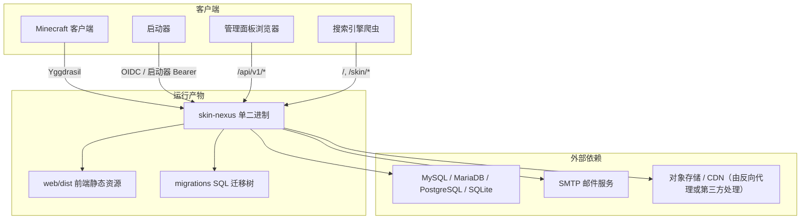
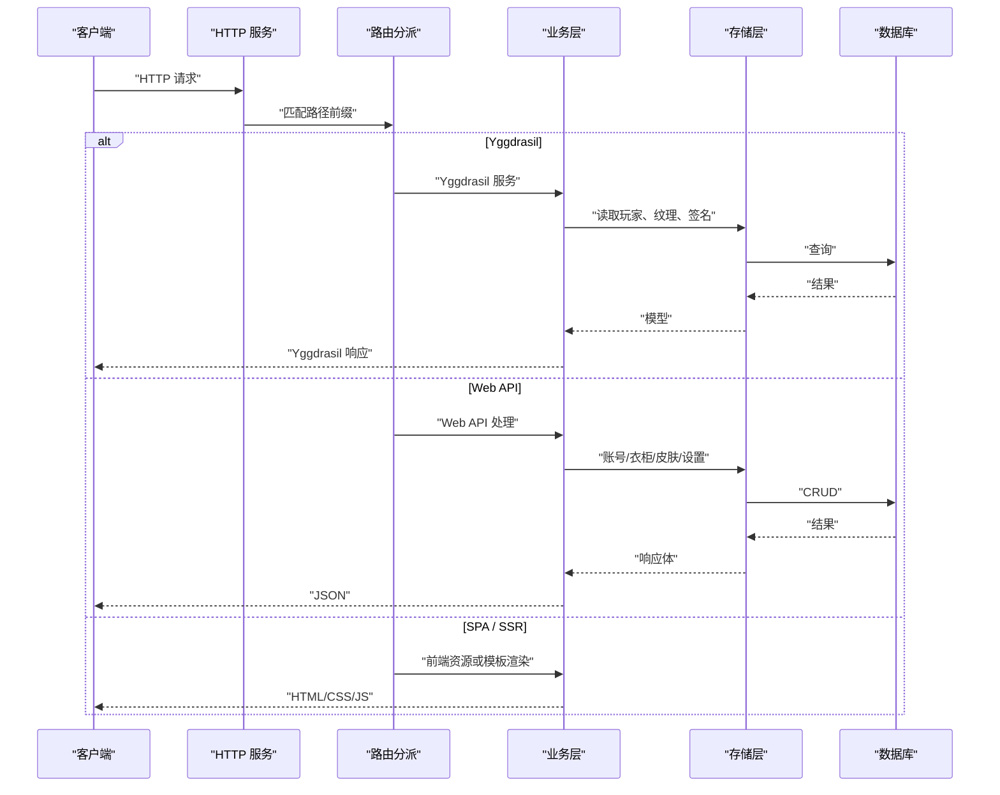
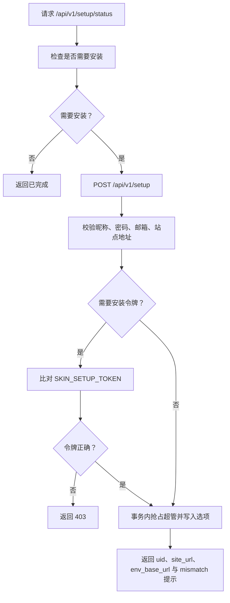
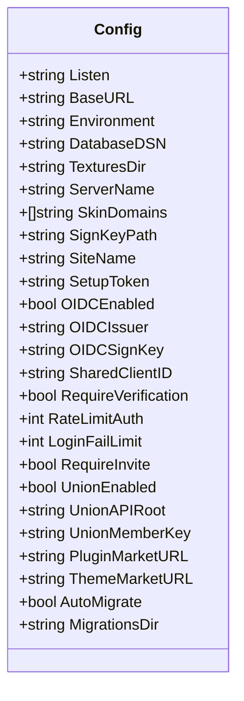
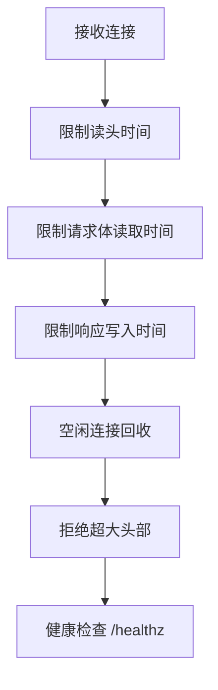
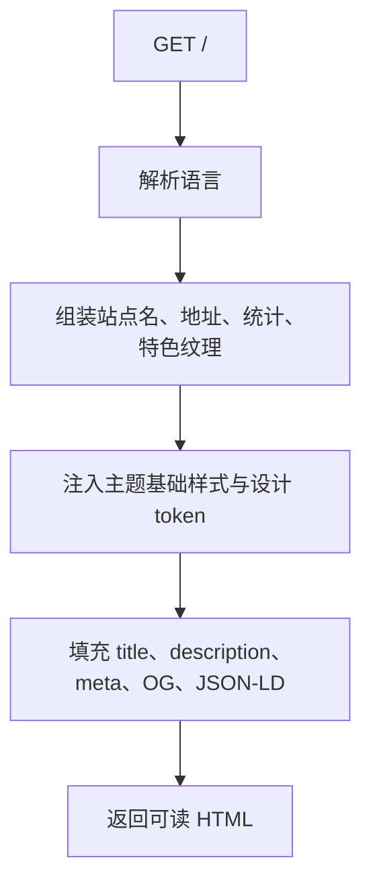
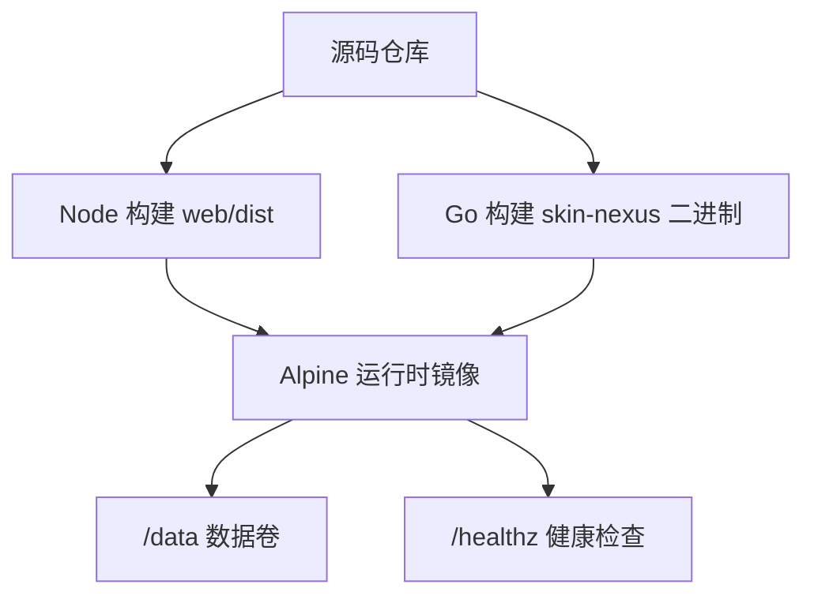
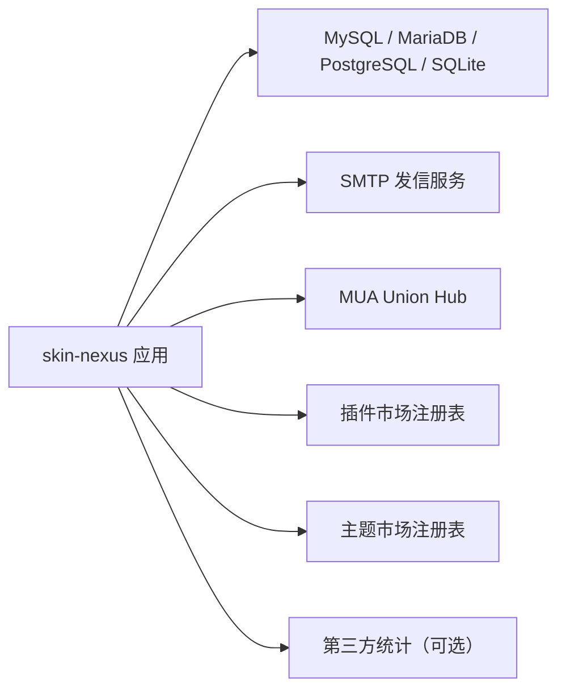

# 项目概览与快速开始

**本文引用的文件**
- [README.md](https://github.com/YimingZhanshen/skin-nexus/blob/797ae1a/README.md)
- [docker-compose.quickstart.yml](https://github.com/YimingZhanshen/skin-nexus/blob/797ae1a/docker-compose.quickstart.yml)
- [Dockerfile](https://github.com/YimingZhanshen/skin-nexus/blob/797ae1a/Dockerfile)
- [server/cmd/skin-nexus/main.go](https://github.com/YimingZhanshen/skin-nexus/blob/797ae1a/server/cmd/skin-nexus/main.go)
- [server/cmd/skin-nexus/server.go](https://github.com/YimingZhanshen/skin-nexus/blob/797ae1a/server/cmd/skin-nexus/server.go)
- [server/internal/config/config.go](https://github.com/YimingZhanshen/skin-nexus/blob/797ae1a/server/internal/config/config.go)
- [server/internal/webapi/setup.go](https://github.com/YimingZhanshen/skin-nexus/blob/797ae1a/server/internal/webapi/setup.go)
- [server/cmd/skin-nexus/landing.go](https://github.com/YimingZhanshen/skin-nexus/blob/797ae1a/server/cmd/skin-nexus/landing.go)
- [docs/deploy.md](https://github.com/YimingZhanshen/skin-nexus/blob/797ae1a/docs/deploy.md)
- [docs/competitor-analysis.md](https://github.com/YimingZhanshen/skin-nexus/blob/797ae1a/docs/competitor-analysis.md)

## 目录
1. [简介](#简介)
2. [项目结构](#项目结构)
3. [核心组件](#核心组件)
4. [架构总览](#架构总览)
5. [详细组件分析](#详细组件分析)
6. [依赖关系分析](#依赖关系分析)
7. [性能与差异化](#性能与差异化)
8. [从零到一：五分钟内部署](#从零到一五分钟部署)
9. [故障排查](#故障排查)
10. [结论](#结论)

## 简介
SkinNexus（肤枢）是一个自托管的 Minecraft 皮肤站，目标是让服务器管理员、皮肤站站长和插件开发者拥有完整的数据主权：账号、纹理文件和签名密钥都保存在自己的机器或云盘上。它把 Yggdrasil/OIDC/Web API、管理面板、插件生态、主题系统与 SEO 渲染整合成一个 Go 单二进制 + Vue 3 应用，数据库可选 MySQL/MariaDB/PostgreSQL/SQLite，并通过 Docker Compose 提供“拉镜像 → 改环境变量 → 启动”的一键体验。

目标用户：
- Minecraft 服务器管理员：用启动器免密登录直接进服，减少玩家注册成本。
- 皮肤站站长：自建站点、品牌化主题、联盟成员站展示与 SEO 收录。
- 插件开发者：基于 goja 宿主扩展路由、事件、配置、UI 与后台任务。

核心能力：
- 皮肤上传预览、角色衣柜、材质生命周期闭环、联盟成员站、SEO 服务端渲染。
- Yggdrasil 兼容接口、OIDC 设备码免密登录、MUA Union 成员模块、CustomSkinAPI / USM / 公开只读 API。
- 插件市场与主题市场（Ed25519 验签）、本地主题包热插拔。
- 访问日志、操作审计、诊断窗口、限流与失败锁定。

与传统同类方案相比，SkinNexus 在协议契约稳定性、错误码门禁、多引擎集成测试、内容寻址缓存与可观测性方面更偏向生产可用；同时保留 blessing-skin-server 生态迁移路径，主键、UUID 与旧密码算式继续可用。

**章节来源**
- [README.md:1-114](https://github.com/YimingZhanshen/skin-nexus/blob/797ae1a/README.md#L1-L114)
- [docs/competitor-analysis.md:1-102](https://github.com/YimingZhanshen/skin-nexus/blob/797ae1a/docs/competitor-analysis.md#L1-L102)

## 项目结构
仓库采用“后端 Go 服务 + 前端 Vue SPA + 文档与示例”的分层组织：
- `server/`：Go 后端，包含命令行入口、HTTP 路由、领域逻辑、数据库迁移、插件与主题运行时。
- `web/`：Vue 3 前端，包含管理面板、用户页面、插件 UI 框架与国际化资源。
- `docs/`：部署、构建、迁移、竞品分析、启动器 API 等运维与生态文档。
- `examples/plugins/`：插件开发示例，包括 hello-world、hello-ui 与 jobs 夹具。
- `scripts/`：质量与兼容性脚本，如语言检查、主题契约校验与文档一致性检查。
- 根级 `Dockerfile`、`docker-compose.yml`、`docker-compose.quickstart.yml`：容器镜像与一键编排。



**图表来源**
- [Dockerfile:1-68](https://github.com/YimingZhanshen/skin-nexus/blob/797ae1a/Dockerfile#L1-L68)
- [server/cmd/skin-nexus/main.go:1-30](https://github.com/YimingZhanshen/skin-nexus/blob/797ae1a/server/cmd/skin-nexus/main.go#L1-L30)

**章节来源**
- [Dockerfile:1-68](https://github.com/YimingZhanshen/skin-nexus/blob/797ae1a/Dockerfile#L1-L68)
- [server/cmd/skin-nexus/main.go:1-30](https://github.com/YimingZhanshen/skin-nexus/blob/797ae1a/server/cmd/skin-nexus/main.go#L1-L30)

## 核心组件
SkinNexus 的核心职责可以按协议面、业务域与基础设施三个维度理解：

- 协议面
  - `/api/yggdrasil/**`：兼容 authlib-injector 的 Yggdrasil 认证与元数据接口。
  - OIDC：内置身份提供方，支持设备码流程与 refresh 轮换，无需外挂 Janus。
  - Web API：`/api/v1/*` 管理端点、用户资料、衣柜、皮肤库、设置、Union 绑定等。
  - 公开只读 API：`/api/public/v1/*`、CustomSkinAPI、USM 与裸 PNG 兼容。
  - 纹理分发：`/textures/{hash}` 与 `/skin/{player}.png` 等历史兼容路径。
  - 前端 SPA：`/*` 静态资源与 SSR 落地页。

- 业务域
  - 账号与权限：用户、超管、邀请码、封禁、会话摘要、启动器令牌摘要。
  - 材质与皮肤：上传、模型判定、预览、头像生成、删除留证、违规状态。
  - 联盟 Union：成员站入站验签、角色同步、跨站绑定、安全级别徽章。
  - 插件与主题：清单校验、Ed25519 签名、goja 执行环境、路由挂载、任务调度。
  - 内容与 SEO：首页与详情页服务端渲染、sitemap、robots、llms、逐页 meta/OG/JSON-LD。

- 基础设施
  - 配置系统：全部通过 `SKIN_*` 环境变量注入，未知变量告警。
  - 数据库：自动迁移、行号修复、公共纹理去重回填、超管引导。
  - HTTP 服务：连接超时、慢客户端保护、健康检查。
  - 可观测性：访问日志、审计、诊断明细、运行状态。

**章节来源**
- [server/cmd/skin-nexus/main.go:1-30](https://github.com/YimingZhanshen/skin-nexus/blob/797ae1a/server/cmd/skin-nexus/main.go#L1-L30)
- [server/internal/config/config.go:1-200](https://github.com/YimingZhanshen/skin-nexus/blob/797ae1a/server/internal/config/config.go#L1-L200)
- [server/cmd/skin-nexus/server.go:1-24](https://github.com/YimingZhanshen/skin-nexus/blob/797ae1a/server/cmd/skin-nexus/server.go#L1-L24)

## 架构总览
从一次请求看，SkinNexus 的调用链通常是“客户端 → HTTP 服务 → 路由分派 → 业务层 → 存储层 → 数据库”。不同类型的请求会进入不同的处理器：



**图表来源**
- [server/cmd/skin-nexus/main.go:1-30](https://github.com/YimingZhanshen/skin-nexus/blob/797ae1a/server/cmd/skin-nexus/main.go#L1-L30)
- [server/cmd/skin-nexus/server.go:1-24](https://github.com/YimingZhanshen/skin-nexus/blob/797ae1a/server/cmd/skin-nexus/server.go#L1-L24)

## 详细组件分析

### 安装向导与初始设置
安装向导是 SkinNexus 首次上线的关键门控：当数据库为空或尚未完成初始化时，`/api/v1/setup` 允许第一个合法请求者创建站点名、站点地址、管理员账号、邮箱、玩家上限与皮肤域。若设置了 `SKIN_SETUP_TOKEN`，则必须提交相同令牌才能完成；否则每次启动会在日志中打印一个临时安装令牌。



**图表来源**
- [server/internal/webapi/setup.go:1-173](https://github.com/YimingZhanshen/skin-nexus/blob/797ae1a/server/internal/webapi/setup.go#L1-L173)

关键设计要点：
- 安装向导是单向门：完成后永久返回 404。
- 令牌用于关闭“空库谁先提交谁当超管”的窗口期。
- 站点地址由面板 `site_url` 接管，但首次启动仍可从环境变量兜底。
- 管理员账号创建与站点选项写入在同一事务中，避免半安装状态。

**章节来源**
- [server/internal/webapi/setup.go:1-173](https://github.com/YimingZhanshen/skin-nexus/blob/797ae1a/server/internal/webapi/setup.go#L1-L173)
- [docs/deploy.md:1-173](https://github.com/YimingZhanshen/skin-nexus/blob/797ae1a/docs/deploy.md#L1-L173)

### 配置与环境变量
所有运行参数通过 `SKIN_*` 环境变量注入，未声明的变量会被警告，避免“静默失效”。重要配置包括：
- 监听地址、站点基础地址、运行环境标签。
- 数据库 DSN，自动选择 MySQL/MariaDB/SQLite/PostgreSQL。
- 文本目录、皮肤域名、签名密钥路径。
- OIDC 开关、签发密钥、共享客户端 ID。
- Union 开关、API 根、成员密钥、主机公钥、Hub 源。
- 插件与主题市场地址及信任密钥。
- 自动迁移、迁移目录、数据根目录。
- 认证限流、登录失败锁定、邀请注册、邮箱验证门禁。



**图表来源**
- [server/internal/config/config.go:1-200](https://github.com/YimingZhanshen/skin-nexus/blob/797ae1a/server/internal/config/config.go#L1-L200)

**章节来源**
- [server/internal/config/config.go:1-200](https://github.com/YimingZhanshen/skin-nexus/blob/797ae1a/server/internal/config/config.go#L1-L200)
- [docs/deploy.md:1-173](https://github.com/YimingZhanshen/skin-nexus/blob/797ae1a/docs/deploy.md#L1-L173)

### HTTP 服务与安全性
HTTP 服务不是裸 `http.ListenAndServe`，而是显式设置了读头超时、读超时、写超时、空闲超时与最大头部大小，防止慢客户端耗尽连接和 goroutine。健康检查通过 `/healthz` 暴露给 Docker。



**图表来源**
- [server/cmd/skin-nexus/server.go:1-24](https://github.com/YimingZhanshen/skin-nexus/blob/797ae1a/server/cmd/skin-nexus/server.go#L1-L24)
- [Dockerfile:49-68](https://github.com/YimingZhanshen/skin-nexus/blob/797ae1a/Dockerfile#L49-L68)

**章节来源**
- [server/cmd/skin-nexus/server.go:1-24](https://github.com/YimingZhanshen/skin-nexus/blob/797ae1a/server/cmd/skin-nexus/server.go#L1-L24)
- [Dockerfile:49-68](https://github.com/YimingZhanshen/skin-nexus/blob/797ae1a/Dockerfile#L49-L68)

### 落地页与 SEO 渲染
SkinNexus 的落地页由 Go 模板直接渲染，不依赖 JavaScript 即可被搜索引擎抓取。它复用主题 token、国际化文案与 SEO 注入层，并提供标题描述、统计信息、特色皮肤卡片与语言切换链接。



**图表来源**
- [server/cmd/skin-nexus/landing.go:1-150](https://github.com/YimingZhanshen/skin-nexus/blob/797ae1a/server/cmd/skin-nexus/landing.go#L1-L150)

**章节来源**
- [server/cmd/skin-nexus/landing.go:1-150](https://github.com/YimingZhanshen/skin-nexus/blob/797ae1a/server/cmd/skin-nexus/landing.go#L1-L150)

### 容器镜像与数据持久化
镜像构建分为三个阶段：前端打包、Go 编译、最小运行时。运行时只包含二进制、前端静态资源与迁移 SQL，数据目录 `/data` 通过卷持久化。升级镜像不会覆盖数据卷，Schema 在 `SKIN_AUTO_MIGRATE=true` 时自动应用。



**图表来源**
- [Dockerfile:1-68](https://github.com/YimingZhanshen/skin-nexus/blob/797ae1a/Dockerfile#L1-L68)

**章节来源**
- [Dockerfile:1-68](https://github.com/YimingZhanshen/skin-nexus/blob/797ae1a/Dockerfile#L1-L68)

## 依赖关系分析
SkinNexus 的外部依赖较少，核心依赖集中在数据库、邮件服务与可能的第三方统计或联盟服务：



- 数据库驱动由 DSN 前缀决定；迁移按引擎树分别维护。
- Union 默认关闭，关闭时零暴露面。
- 插件与主题市场可通过环境变量禁用或使用自有注册表。
- 第三方统计需通过 CSP 白名单放行。

**图表来源**
- [server/internal/config/config.go:1-200](https://github.com/YimingZhanshen/skin-nexus/blob/797ae1a/server/internal/config/config.go#L1-L200)
- [docker-compose.quickstart.yml:1-71](https://github.com/YimingZhanshen/skin-nexus/blob/797ae1a/docker-compose.quickstart.yml#L1-L71)

**章节来源**
- [server/internal/config/config.go:1-200](https://github.com/YimingZhanshen/skin-nexus/blob/797ae1a/server/internal/config/config.go#L1-L200)
- [docker-compose.quickstart.yml:1-71](https://github.com/YimingZhanshen/skin-nexus/blob/797ae1a/docker-compose.quickstart.yml#L1-L71)

## 性能与差异化
根据仓库 README 的生产实测，单台 2 核 3.5 GB VPS 上：
- 落地页约 600 RPS。
- 纹理分发约 5182 RPS。
- Yggdrasil 元数据约 2365 RPS。
- 零错误。

差异化优势总结：
- SEO 服务端渲染体系：首页与皮肤详情页可直接被搜索引擎收录。
- 材质生命周期闭环：像素定模型、违规禁止公开、删除后引用计数与墓碑留证。
- 错误契约稳定：错误体带稳定 code，并由 AST 闸强制约束。
- 多引擎集成测试：MySQL/MariaDB/PostgreSQL/SQLite 六组合 CI。
- 单二进制与 Docker 优先：部署简单，升级换镜像不换数据。
- 协议兼容：Yggdrasil、OIDC、CustomSkinAPI、USM 与老站迁移路径。

对比其他同类产品，SkinNexus 的优势不在“功能列表更长”，而在“契约完整性、工程纪律与生产可用性”。

**章节来源**
- [README.md:1-114](https://github.com/YimingZhanshen/skin-nexus/blob/797ae1a/README.md#L1-L114)
- [docs/competitor-analysis.md:1-102](https://github.com/YimingZhanshen/skin-nexus/blob/797ae1a/docs/competitor-analysis.md#L1-L102)

## 从零到一：五分钟内部署

### 第一步：准备目录与环境变量
在任意工作目录执行以下命令，生成 `docker-compose.quickstart.yml` 与 `.env`：

```bash
mkdir skin-nexus && cd skin-nexus
curl -fsSLO https://raw.githubusercontent.com/YimingZhanshen/skin-nexus/main/docker-compose.quickstart.yml
cat > .env <<EOF
SKIN_BASE_URL=https://skin.example.com
SKIN_DB_PASSWORD=$(openssl rand -hex 16)
SKIN_DB_ROOT_PASSWORD=$(openssl rand -hex 16)
SKIN_ADMIN_TOKEN=$(openssl rand -hex 32)
SKIN_SETUP_TOKEN=$(openssl rand -hex 16)
EOF
```

说明：
- `SKIN_BASE_URL`：站点公开地址，例如 `https://skin.example.com`。
- `SKIN_DB_PASSWORD`：数据库用户密码。
- `SKIN_DB_ROOT_PASSWORD`：数据库 root 密码。
- `SKIN_ADMIN_TOKEN`：管理接口的回退凭据。
- `SKIN_SETUP_TOKEN`：安装向导的一次性令牌，可不设，但建议设置以避免空库窗口。

### 第二步：启动服务
```bash
docker compose -f docker-compose.quickstart.yml up -d
```

该 compose 文件会：
- 拉取 `ghcr.io/yimingzhanshen/skin-nexus` 镜像。
- 启动内置 MySQL 8.0 数据库。
- 映射宿主机 8080 端口到容器 8080。
- 挂载 `skin-data` 卷保存纹理、密钥与主题。
- 等待数据库健康后再启动皮肤站。

### 第三步：完成初始设置
打开浏览器访问：
```
http://<宿主机IP>:8080/setup
```

填写：
- 站点名称。
- 管理员昵称与密码。
- 邮箱（可选）。
- 皮肤域名（通常为站点域名）。
- 安装令牌（如果设置了 `SKIN_SETUP_TOKEN`）。

提交成功后，站点即完成初始化。之后可通过 `http://<宿主机IP>:8080` 访问落地页与管理面板。

### 第四步：常用运维动作
- 查看日志：`docker compose logs skin-nexus`。
- 升级：`docker compose pull && docker compose up -d`。
- 停止：`docker compose down`。
- 备份：保留 `skin-data` 与数据库卷，特别是签名密钥 `sign-key.pem`。

**章节来源**
- [README.md:28-74](https://github.com/YimingZhanshen/skin-nexus/blob/797ae1a/README.md#L28-L74)
- [docker-compose.quickstart.yml:1-71](https://github.com/YimingZhanshen/skin-nexus/blob/797ae1a/docker-compose.quickstart.yml#L1-L71)
- [docs/deploy.md:1-173](https://github.com/YimingZhanshen/skin-nexus/blob/797ae1a/docs/deploy.md#L1-L173)

## 故障排查
常见问题与定位建议：

- 无法访问 `/setup`：
  - 确认容器端口已映射到宿主机 8080。
  - 检查日志是否出现数据库连接失败。
  - 如果启用了 `SKIN_SETUP_TOKEN`，确保提交值与 `.env` 一致。

- 登录后仍提示需要安装：
  - 检查是否误填了错误的站点地址，导致面板与实际访问地址不一致。
  - 安装向导完成后会永久返回 404，这是预期行为。

- 第三方统计脚本被拦截：
  - 在 `.env` 中设置 `SKIN_CSP_SCRIPT_EXTRA_SOURCES` 与 `SKIN_CSP_CONNECT_EXTRA_SOURCES`。
  - 确认 compose `environment:` 段透传了这些变量。

- 反代 IP 识别异常：
  - 确保反向代理透传 `X-Forwarded-Proto` 与 `X-Forwarded-For`。
  - 如需限定可信对端，设置 `SKIN_TRUSTED_PROXIES`。

- 升级后行为变化：
  - 确认镜像版本与 commit sha。
  - 数据卷保持不变，Schema 由自动迁移控制。

- 签名密钥丢失：
  - 已下发皮肤的签名将失效，务必备份 `/data/sign-key.pem`。

**章节来源**
- [server/internal/webapi/setup.go:1-173](https://github.com/YimingZhanshen/skin-nexus/blob/797ae1a/server/internal/webapi/setup.go#L1-L173)
- [docs/deploy.md:1-173](https://github.com/YimingZhanshen/skin-nexus/blob/797ae1a/docs/deploy.md#L1-L173)
- [README.md:44-74](https://github.com/YimingZhanshen/skin-nexus/blob/797ae1a/README.md#L44-L74)

## 结论
SkinNexus 的定位很明确：为 Minecraft 社区提供一个可控、可移植、可扩展的皮肤站基础设施。它既适合新手站长用 Docker Compose 快速跑起来，也适合有经验运维人员基于 Go 单二进制、清晰的环境变量契约和多引擎数据库栈做长期运营。对于插件开发者而言，签名平台、事件机制与 iframe UI 提供了扩展空间；对于联盟成员站而言，Union 模块提供了跨站角色与身份协同能力。

如果你希望“站点自己跑、数据在自己手里、协议能对接主流工具”，SkinNexus 是当前仓库中实现最完整的一条路径。
